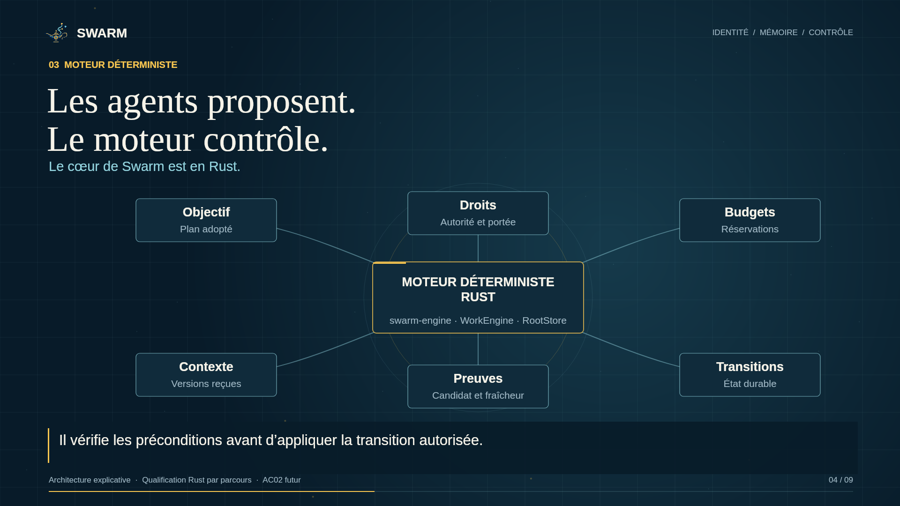
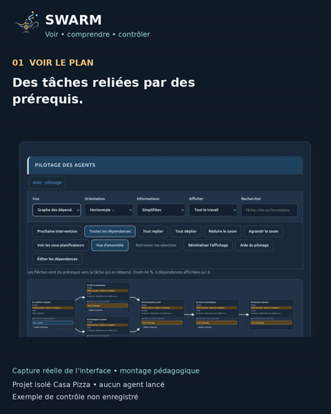
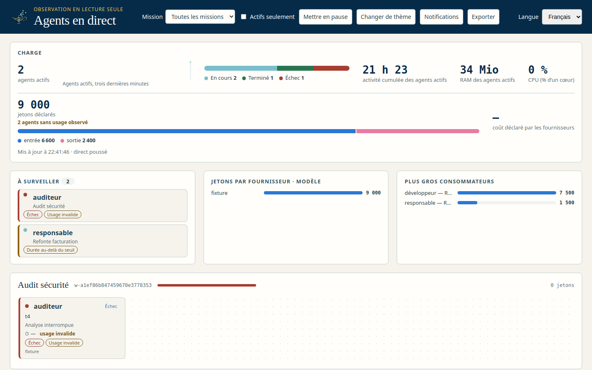
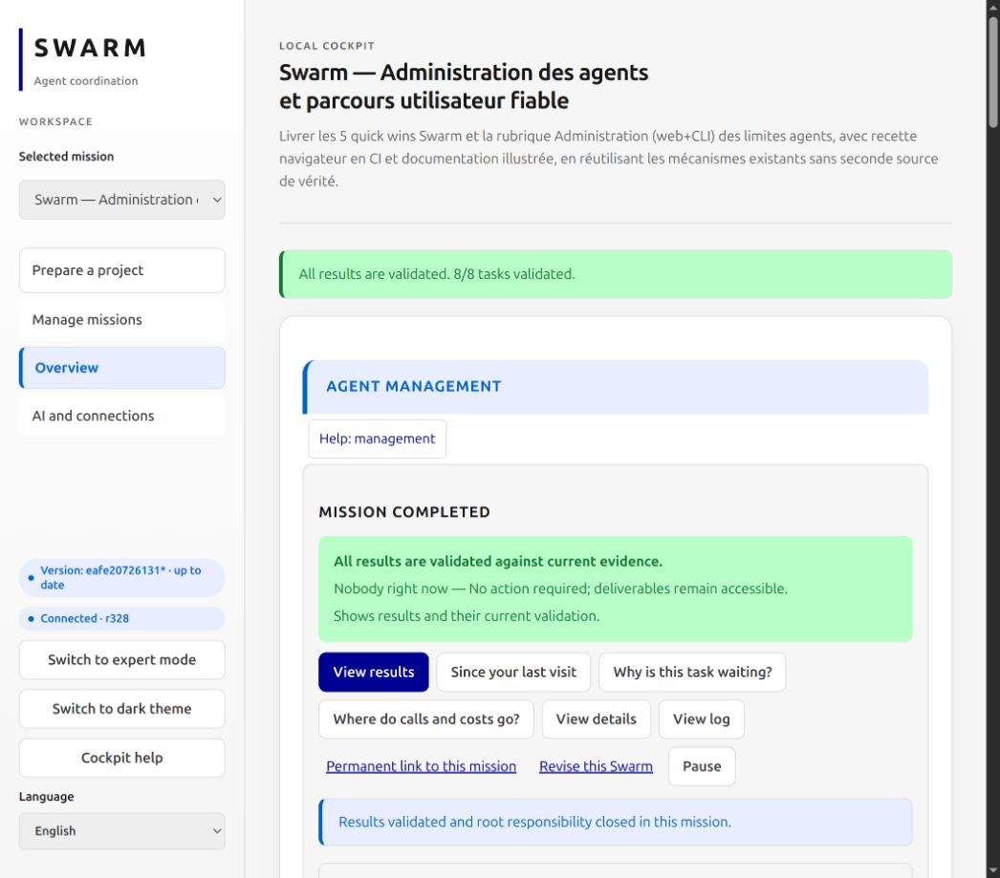
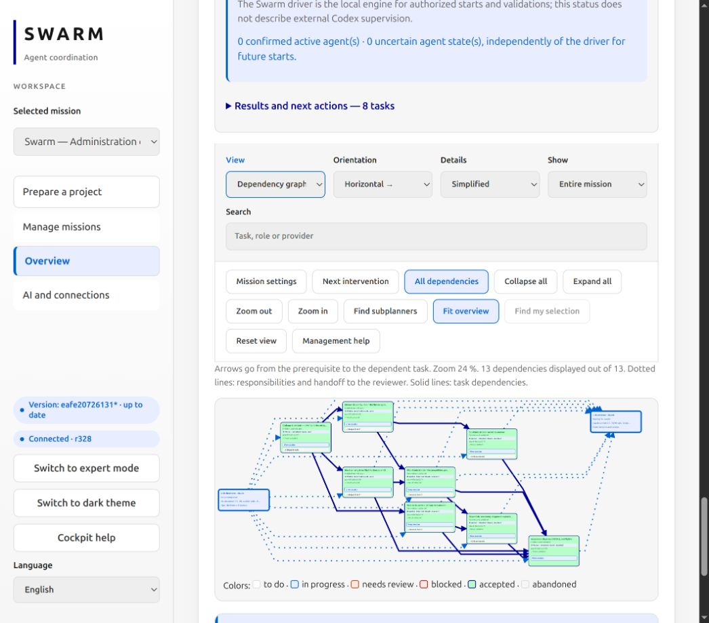

# Swarm


**Rust engine.** The CLI and local server use Rust. Sources are in [rust/](rust/). Capability parity and global acceptance remain open; historical descriptions below are not Rust qualification. See the [Biba contract](docs/en/BIBA-GOVERNANCE-RUST.md) and [active plan](docs/plans/migration-rust/PLAN.md).

[Français](README.md) · English

### Give an AI team an objective. See who acts. Verify what it delivers.

Swarm is a **local cockpit and CLI for organizing agentic workflows**.
It connects requirements, planning, agents, checks and results to a persistent
mission. Its interface is available in French and English.
Its core is a **deterministic engine written in Rust** that owns mission state
and authorized transitions. Humans define rules and authority; the engine
enforces the validation required by policy. In `human` mode, successful checks
do not replace the human decision.

When several agents work on a project, someone still has to pass instructions,
manage dependencies, understand blockers and examine evidence. Swarm makes these
handoffs visible, with explicit responsibilities and limits. **A finished process,
a submitted report and an accepted result are three distinct states.**

**Status on October 24, 2026: Rust migration in progress.** Selected CLI flows
and web surfaces are verified. The local CLI and server run Rust; complete functional coverage and final acceptance remain open. Historical Go capabilities do not
establish Rust parity. See [native status](docs/en/RUST-MIGRATION.md), the
[active plan](docs/plans/migration-rust/PLAN.md) and [evidence and replays](docs/en/RUST-MIGRATION-REPLAYS.md).

[Videos](#videos) · [Capabilities and maturity](#capabilities-and-maturity) · [Architecture](#architecture) · [Human control](#human-control-and-validation) · [Identity](#identity-and-authority) · [Memory](#memory-and-context) · [Supervision](#supervision-and-recovery) · [Logs](#logs-live-views-and-traceability) · [Getting started](#getting-started) · [Documentation](#documentation) · [License](#license)

## Videos

### Identity memory and human control — 1 min 40

[](docs/communication/linkedin-swarm-identite-memoire-20261023/Swarm_Architecture_Film_v2.mp4)

A motion-design film follows a bad instruction retained and transmitted, then
explains the deterministic Rust engine, permissions, human validation and
supervision. **French on-screen text, 1080p, original instrumental music, no voice.**
French and English subtitle tracks and SRT files are included. Pending integrations
and the unstarted AC02 plan stay explicit. This is an architecture explainer,
not an application screen recording.

[Watch MP4](docs/communication/linkedin-swarm-identite-memoire-20261023/Swarm_Architecture_Film_v2.mp4) · [French SRT](docs/communication/linkedin-swarm-identite-memoire-20261023/video-v2/Swarm_Architecture_Film_v2.fr.srt) · [English SRT](docs/communication/linkedin-swarm-identite-memoire-20261023/video-v2/Swarm_Architecture_Film_v2.en.srt) · [Chapters and sources](docs/communication/linkedin-swarm-identite-memoire-20261023/video-v2/README.md) · [Previous video](docs/communication/linkedin-swarm-identite-memoire-20261023/video/README.md)

[Word article v6, in French](docs/communication/linkedin-swarm-identite-memoire-20261023/Swarm_Article2_Identite_Memoire_v6.docx): context-poisoning introduction,
18 references, five complete technical views embedded in the corresponding article
sections and film access. The Rust engine
and human validation remain central to the architecture.

### Explore the graph — about 1 minute

[](docs/screenshots/graph-linkedin/Swarm_graphe_LinkedIn_FR_V2.mp4)

Actual interactions in a teaching plan: dependencies, branches, blockers and
validation previews. French explanations; no provider agent launched and no
control saved. This historical recording does not qualify the Rust port.

[Watch the MP4](docs/screenshots/graph-linkedin/Swarm_graphe_LinkedIn_FR_V2.mp4) · [Still image](docs/screenshots/graph-tour/graph-tour-en.png)

### Casa Pizza — four tutorials in English and French

Open **Cockpit help → Casa Pizza training** for four captioned video tutorials, GIF previews, transcripts and a **38-page PDF guide**. Resources follow the selected cockpit language; switching language in the reader updates videos, captions, PDF and kit links. The reader also works offline from the kit, without external services or AI calls.

| Module | Duration | English video | French video |
| --- | ---: | --- | --- |
| Requirements and graph | 24 s | [MP4](docs/training/casa-pizza/tutoriels/media/01-plan-en.mp4) | [MP4](docs/training/casa-pizza/tutoriels/media/01-plan-fr.mp4) |
| Swarm checks | 24 s | [MP4](docs/training/casa-pizza/tutoriels/media/02-controles-en.mp4) | [MP4](docs/training/casa-pizza/tutoriels/media/02-controles-fr.mp4) |
| Customer order | 30 s | [MP4](docs/training/casa-pizza/tutoriels/media/03-client-en.mp4) | [MP4](docs/training/casa-pizza/tutoriels/media/03-client-fr.mp4) |
| Restaurant and tracking | 42 s | [MP4](docs/training/casa-pizza/tutoriels/media/04-restaurant-en.mp4) | [MP4](docs/training/casa-pizza/tutoriels/media/04-restaurant-fr.mp4) |

Captioned sequences of actual screenshots, without audio, captured on October
9–10, 2026. The teaching plan remains unexecuted; the fictional order is advanced
manually. Reference application content remains French. The kit includes the
offline reader, transcripts and answered exercises.

[English PDF](docs/training/casa-pizza/Swarm_Casa_Pizza_Training_EN.pdf) · [English kit](docs/training/casa-pizza/Swarm_Casa_Pizza_Training_Kit_EN.zip) · [French PDF](docs/training/casa-pizza/Formation_Swarm_Casa_Pizza.pdf) · [French kit](docs/training/casa-pizza/Kit_Formation_Swarm_Casa_Pizza.zip) · [Method and limitations](docs/training/casa-pizza/tutoriels/README.md#english)

GitHub displays the images and GIF; open the MP4 links to watch the videos.

## Capabilities and maturity

| Need | Swarm foundations | Rust port status |
| --- | --- | --- |
| Prepare the work | Requirements, brief, templates, tasks and dependencies | Native components; complete preparation journey still to qualify |
| Organize and supervise | Planner, scope owners, workers, independent review | Worker launch/watch, queued restart and planning → worker verified on CLI fixtures; other roles and web journeys remain open |
| Understand activity | Graph, attempts, reports, telemetry and waiting reasons | Selected read flows and live console verified; full cockpit remains open |
| Control starts and delivery | Dependencies, reservations, budgets, checks and evidence freshness | Contracts ported incrementally; global qualification remains open |
| Validate results | `human` or `automatic` policy, preauthorized checks and a human decision when required | Native controller preserves `pending_human` in `human` mode; a PASS does not accept. Scoped local qualification is separate from protected human identity |
| Carry experience forward | Verified lessons learned, versioned memory and explicit selection | Rust G8 project/memory journey remains open; native context partially ported |
| Bound authority | Actor, instance, plan, grants, delegation and revocation | Internal components; global public integration and protected human approval remain open |
| Confine agents and network access | AC-02 plan: files/processes, network/secrets, lineage and security menus | **Plan saved, not started**; resume after Rust migration/qualification and an explicit start request |

Local evidence establishes its declared scope. It does not demonstrate an entire
team’s autonomy, compatibility with every provider or global migration acceptance.
The [active plan](docs/plans/migration-rust/PLAN.md) retains outstanding criteria.

## Architecture

The **deterministic Rust engine (`swarm-engine`, `RootStore`, `WorkEngine`)** connects
mission state, contracts, decisions, reservations and evidence. Supervisors propose
and arbitrate; the engine checks and applies authorized operations. Workers produce
candidates and originals; checks, independent review and global cycle judgment
retain their separate responsibilities.

[](docs/diagrams/architecture-overview-en.svg)

[Full-size SVG](docs/diagrams/architecture-overview-en.svg) · [PNG](docs/diagrams/architecture-overview-en.png) · [Mermaid source](docs/diagrams/architecture-overview-en.mmd)

These five views describe **Swarm internal architecture contracts**. A functional
block does not necessarily denote a crate or service. Rust maturity is tracked
separately in the [technical architecture](docs/en/ARCHITECTURE.md), with a
[component → source-section map](docs/diagrams/CONTRACT-MAP.md). A solid arrow
represents a contract relationship; it does not certify deployment.

## Human control and validation

Human control is part of the deterministic engine’s security contract. The user
defines the objective, scope, rights and validation policy. AI supervisors direct
the work within that authority.

- In **`human`** mode, preauthorized checks provide evidence. Success leaves the
  result awaiting a human decision and does not release downstream tasks. A
  favorable AI review does not replace that decision.
- In **`automatic`** mode, required checks and independent review still apply;
  the engine checks the same candidate, criteria and freshness before acceptance.
  The producer does not accept its own work.

Native controls distinguish `pending_human` from `pending_review`. Their local
evidence does not establish the complete protected human-authentication journey.
Process supervision, AI review and human result validation are separate roles.

[Human-validation contract](docs/en/ENGINE-ACCEPTANCE.md#checks-as-evidence-for-human-review) · [Rust139 status](docs/en/RUST-MIGRATION.md#ordinary-tasks-and-human-validation--wiring139-under-qualification).

## Identity and authority

[](docs/diagrams/identity-authority-en.svg)

[Full-size SVG](docs/diagrams/identity-authority-en.svg) · [PNG](docs/diagrams/identity-authority-en.png) · [Mermaid source](docs/diagrams/identity-authority-en.mmd)

Authenticated initiator, principal, logical agent, instance, scope owner and content
author are separate notions. The contract connects human authority, enrollment,
current plan, grants and delegation, registry snapshots, Trust head and exact request.
An approval must remain bound to the same bytes and current state until admission
or use.

The view also retains configuration/witness, checked local transport, expiry,
revocation and preparation authority before a plan. Pending integrations remain
identified; a signature or cookie does not become business authority.
A signature establishes origin under its trust assumptions; it does not prove
content truth or safety.
[Identity contract](docs/en/AGENT-IDENTITY-CONTRACT.md).

## Memory and context

[](docs/diagrams/memory-context-en.svg)

[Full-size SVG](docs/diagrams/memory-context-en.svg) · [PNG](docs/diagrams/memory-context-en.png) · [Mermaid source](docs/diagrams/memory-context-en.mmd)

**Swarm memory** includes several paths: versioned project knowledge from verified
lessons, prepared and finally composed context, task history, extractive selections,
instruction revisions and dialogue boundaries. Versions, conditions, sources,
digests, reception and recovery remain attributable. Withdrawal never rewrites
context already delivered. A memory grants no authority: memory informs reasoning,
while contracts establish permissions.

A mistaken instruction stored in memory can return in another instance.
Provenance, admission and reuse conditions must remain examinable; memory creates
no new right or authorization. The initial instruction is retained alongside
attributed revisions. Supervisor additions are approved by default and rejectable
before reservation; an already reserved attempt is not silently rewritten. This
path is separate from human validation of the result.

Read, summarize and transmit rights bind an exact source and recipient. Conversation
recovery requires an explicit decision, preflight and new attempt; an unconfirmed
boundary requires examining effects. Porting status belongs to the technical matrix,
without changing memory’s name or place in the architecture.
[Memory](docs/en/PROJECT-MEMORY.md) · [Usage rights, FR](docs/plans/deepagents-integration/CONTRAT-USAGES-MEMOIRE.md) · [Instruction learning](docs/en/INSTRUCTION-LEARNING.md).

## Supervision and recovery

[](docs/diagrams/run-supervision-en.svg)

[Full-size SVG](docs/diagrams/run-supervision-en.svg) · [PNG](docs/diagrams/run-supervision-en.png) · [Mermaid source](docs/diagrams/run-supervision-en.mmd)

Duration, tool waits, silence and incidents feed `run_observation`, attributed to
mission, task, attempt and owner. Root and scope supervisors receive their own
events, diagnose and propose `planning decide`. The engine checks rights, lease,
generation, revision, received event and budgets.

`continue-run` retains the process and counters; `stop-run` requests termination
and then requires actual confirmation. Production observations, structured-inference
limits and global cycle judgment remain separate. Incidents return to their owner
until the effect is verified and the original objective resumes. A decision to
continue or stop a process does not replace result validation: `human` mode still
requires the human decision.
[Supervision](docs/en/RUN-SUPERVISION.md) · [AI/engine protocol](docs/en/AGENT-ENGINE-PROTOCOL.md) · [Cycles](docs/en/JUDGMENT-CYCLES.md).

## Logs, live views and traceability

[](docs/diagrams/logs-observability-en.svg)

[Full-size SVG](docs/diagrams/logs-observability-en.svg) · [PNG](docs/diagrams/logs-observability-en.png) · [Mermaid source](docs/diagrams/logs-observability-en.mmd)

Attempt logs, terminal output, engine activity, decisions, the call ledger, Linux
resources and OTLP telemetry retain their provenance. **Tracking → Logs**, live
views and exports use public operations with explicit filters, cursors and limits.
They remain read-only; live SSE has an explicit polling fallback.

Originals and digests reconstruct **objective → decision → attempt → candidate →
check → review → human validation when required → acceptance**. Colored logs, reserved calls or missing cost become
neither execution evidence, an invoice nor success.
[Console](docs/en/LOG-CONSOLE.md) · [Traceability](docs/en/TRACEABILITY.md) · [Call ledger](docs/en/CALL-ACCOUNTING.md) · [Native live contract](docs/en/RUST-MIGRATION.md).

## Security and planned evolution

The [security positioning and references](docs/en/SECURITY-POSITIONING.md) link
orchestration, authority, exact actions and recovery. They distinguish the roles
of ISO, OWASP, NIST and SPIFFE, local Rust Biba results and protections still to
qualify. The proposed PA-01–08 assurance profile extends the existing matrix
without claiming certification or global compliance.

The [AC-02 plan](docs/en/plans/actions-confiance/securite-execution-apex.md) retains
contracts for Linux confinement, network and secret mediation, lineage, recovery
and security menus. Its **four visual references** are the policy editor, blocked
actions panel, connection lineage and security timeline. No AC-02 lot has started.

The references serve distinct purposes: [NVIDIA OpenShell v0.1.5](https://docs.nvidia.com/openshell/v0.1.5/how-it-works/policies/schema)
for the intended policy subset; [Bromure](https://bromure.io/en/blog/openshell-policies-and-network-lineage)
for security journeys; [Agent Baseline Software Factory](https://github.com/agentbaseline/agentbaseline/blob/d842a1bb34a42e9d7c0d54a1b12ead9e0e59e283/software-factory/software-factory.md)
for boundaries and controls. Agent Baseline YAML catalogues are not executable
confinement policies. Citing these sources does not certify Swarm. See also the
[trusted actions target architecture](docs/en/ACTIONS-CONFIANCE.md).

## See the interface

### Rust live console — October 22, 2026 fixture



Actual `swarm-rust` capture on a fixture root: agents, alerts and declared usage.
Scoped local verification; independent review and global acceptance remain open.
The interface shown is French. [Presentation and provenance](docs/publications/20261022-console-live/README.md).

### Historical Go cockpit

Historical captures from **October 1, 2026**: an eight-task mission closed with
human decisions. They illustrate the Go cockpit, without establishing Rust
parity or unattended autonomy. User-authored task names remain French.





[Open the graph at full size](docs/screenshots/en/mission-graph-current-en.png) · [Illustrated guide](docs/en/USER-GUIDE.md)

## Getting started

### Local Rust application

Requirements: Linux, Git, Bash, Python 3, Rust/Cargo (validated toolchain 1.96.0) and a C compiler for bundled SQLite. Fetch locked dependencies once, then use the supported launcher:

```sh
cargo fetch --locked --manifest-path rust/Cargo.toml
./swarm.sh build
./swarm.sh start --root /path/to/project
./swarm.sh status
```

`./swarm` dispatches to the installed Rust `bin/swarm`. Unported commands refuse explicitly; they never invoke Go. Docker builds the Rust source with the locked dependencies; see [installation](docs/en/INSTALL.md).

### Rust development

The native engine is under construction for Linux. From the repository root:

```sh
cargo build --manifest-path rust/Cargo.toml --locked -p swarm-cli
```

The `swarm-cli` package produces **`swarm-rust`**. Read the [native help](rust/crates/swarm-cli/src/lib.rs)
and [migration contract](docs/en/RUST-MIGRATION.md) before choosing a flow.
Use an isolated fixture root for experiments; this build neither installs the
service nor migrates existing missions.

### Historical installation and usage

The [experimental v0.1.0 release](https://github.com/mo0ogly/swarm/releases/tag/v0.1.0)
and [Docker/native](docs/en/INSTALL.md), [user](docs/en/USER-GUIDE.md) and
[CLI guides](docs/en/REFERENCE.md) document the historical edition.
`install.sh` (native or Docker), `build.sh`, `swarm.sh` and CI build Rust exclusively. Go is not a prerequisite or fallback. Current installation is described in [INSTALL](docs/en/INSTALL.md); see also the
[native local launcher](docs/en/NATIVE-LOCAL-LAUNCHER.md).

In that edition, preparing requirements and adopting a plan does not launch
agents. Check roles, connections, workspaces and limits before authorizing
execution. Agent programs and authentication are installed separately.
The [v0.1.0 notes, FR](docs/releases/v0.1.0.md) describe the release; binary
identity and **Version and what's new** distinguish the running binary, commit
and local sources. Rebuilding does not replace an already running server process.

## Data and limits

Missions and history are stored under the project’s `.swarm/`, including SQLite.
External providers receive context for their assigned calls: **local does not
mean all models run on your machine**. Keep secrets and session links private.
API keys in the historical edition are stored locally with restrictive file
permissions, without encryption at rest.

Workspace reservations may serialize tasks. Unreported usage stays unknown;
external session quotas are not observed automatically. Closing the cockpit
does not stop agents. Allowing a destination or HTTP method alone does not
guarantee the absence of exfiltration or unintended business effects.

## Documentation

| Topic | Reference |
| --- | --- |
| Getting started | [User guide](docs/en/USER-GUIDE.md), [installation](docs/en/INSTALL.md), [training](docs/training/casa-pizza/README.md) |
| Native maturity | [Rust contract](docs/en/RUST-MIGRATION.md), [plan, FR](docs/plans/migration-rust/PLAN.md), [evidence/replays](docs/en/RUST-MIGRATION-REPLAYS.md) |
| Architecture and supervision | [Two UX applications, FR](docs/PRODUCT-ARCHITECTURE.md), [supervision](docs/en/RUN-SUPERVISION.md), [communication](docs/en/AGENT-COMMUNICATION.md) |
| Security and standards | [Positioning and proposed profile](docs/en/SECURITY-POSITIONING.md), [controls and limits](docs/en/actions-confiance-referentiels.md), [Rust Biba](docs/en/actions-confiance-rust.md) |
| Context and authority | [Memory](docs/en/PROJECT-MEMORY.md), [identity](docs/en/AGENT-IDENTITY-CONTRACT.md), [trusted actions](docs/en/ACTIONS-CONFIANCE.md) |
| Preparation and methods | [Catalogue](docs/en/PREPARATION-TEMPLATES.md), [product workflow](docs/en/PRODUCT-WORKFLOW.md), [methods](docs/en/AGENT-METHODS.md), [profile and skills](docs/en/PROJECT-PROFILE.md) |
| Control and recovery | [Budgets](docs/en/BUDGETS.md), [business controls](docs/en/ENGINE-BUSINESS-CONTROLS.md), [blocked contracts](docs/en/CONTRACT-REVISION.md), [attempt recovery](docs/en/ATTEMPT-RECOVERY.md), [storage](docs/en/RUNTIME-RECOVERY.md) |
| Automation and API | [Durable programs](docs/en/AUTOMATION-PROGRAMS.md), [CLI reference](docs/en/REFERENCE.md), [preparation](docs/en/PREPARATION-UX.md), [workflows, FR](WORKFLOWS.md) |
| Planned evolution | [APEX project queue](docs/en/APEX-QUEUE.md), [Saved AC-02 plan](docs/en/plans/actions-confiance/securite-execution-apex.md), [after-cutover follow-up, FR/EN](docs/plans/migration-rust/AFTER-CUTOVER.md) |

Methods provide an approach; they grant no execution rights. Their canonical
sources are in [`.claude/skills/`](.claude/skills/), and preparation commands in
[`.claude/commands/`](.claude/commands/).

## Repository and verification

- `rust/crates/swarm-engine`: native engine; `swarm-cli`: CLI; `swarm-web`: HTTP service.
- `web/`, `frontend/`, `locales/`: interface and translations; `tests/`: public and browser flows.
- `tools/verification/`: [permanent recipes and retained evidence](tools/verification/README.md).
- `docs/` and `docs/en/`: contracts, guides, plans, diagrams and media.

Select checks for the changed contract and actual delivered profile. Fixture
tests, production builds, independent review and acceptance are distinct evidence.
`make test`, `make smoke`, `make test-process` and `make test-install` use current Rust checks; passing them does not establish full migration acceptance. See
[contributing](CONTRIBUTING.md) and [qualification limits, FR](docs/COMMUNITY-QUALIFICATION.md).

## License

Source is available under [PolyForm Noncommercial 1.0.0](LICENSE), subject to its
terms. Commercial uses not covered require separate permission; the project is
not presented as OSI open source. Previously Apache 2.0 licensed versions and
third-party components retain their rights: [details](docs/LICENSING.md),
[third-party notices](THIRD_PARTY_NOTICES.md).
For sensitive reports, see [SECURITY.md](SECURITY.md).

### Install an already qualified Rust candidate

After `./swarm.sh build` and candidate verification, `./swarm.sh restart --prepared-build SHA256 --no-open` installs precisely the latest qualified candidate matching the supplied full hash. Replace `SHA256` with `binary_sha256` from the reviewed `deploy/local-build.json` record. Its fixture-free profile, compiled archive, bilingual notes and image are rechecked before stopping the managed server. A different hash, altered proof or version downgrade refuses before shutdown. Later source edits remain pending and their count is reported. The source binary path stays managed; ordinary `restart` still rebuilds normally. This local operation publishes no commit or release.

The prepared-mode count covers this candidate’s known compiled inputs, not every new checkout file. Delivery tools are repository Python files; their changes can precede the next compilation of embedded evolution notes.

PAEA: check an existing private anchor using `identity checkpoint-check REQUEST_PIN --input ABSOLUTE_PRIVATE_ANCHOR --json`; [contract and limits](docs/en/plans/actions-confiance/paea/INCREMENT-56.md). Caller must already protect the locator; no package/material/service created.

PAEA: `identity initial-create REQUEST_PIN OPERATOR_DIRECTORY PRIVATE_ANCHOR --input PRIVATE_REQUEST --json` prepares a dormant private package; `initial-reconcile` reads the same slot without regeneration. [Contract and limits57](docs/en/plans/actions-confiance/paea/INCREMENT-57.md), no account/service/human admitted.
