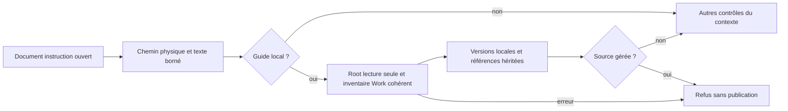

# Swarm — référence technique

> Référence historique du contrat Go. La CLI active est Rust, sans repli Go. Les commandes et exemples de compilation Go ci-dessous sont conservés comme historique, pas comme procédure actuelle d’installation. Consulter [INSTALL](INSTALL.md), l’aide native et le plan de migration pour les commandes disponibles.


[English](docs/en/REFERENCE.md) · Français

Pour la présentation du produit et le démarrage rapide, voir [le README](README.md) et le [guide utilisateur](GUIDE-UTILISATEUR.md).

Compagnon Go pour conserver des travaux entre sessions Claude/Codex.
Interface française ou anglaise, terminal 80 colonnes et Markdown ; sortie JSON pour outils.
Le cockpit peut lancer explicitement des agents Claude/Codex et suivre leurs processus.
`work list` et `resume` ne lancent aucun agent et ne choisissent pas le travail.
Voir [la procédure du cockpit](COCKPIT.md) pour le lancement et le pilotage.

## Dépôt autonome

Swarm se développe dans ce dépôt et pilote des projets distincts via `--root`.
Linux et Go 1.24+ sont le périmètre actuellement testé. Les ressources web sont
embarquées dans le binaire. Node 22 et npm sont nécessaires pour les reconstruire.

```sh
make build
./bin/swarm --root /chemin/du/projet init
./bin/swarm --root /chemin/du/projet providers init
./bin/swarm --root /chemin/du/projet web 127.0.0.1:18787
```

Ouvrir le lien de session imprimé par le serveur, puis utiliser le sélecteur des
missions dans le même onglet. Les agents installés s’authentifient séparément ;
les connexions API se configurent dans « IA et connexions ».

```sh
make test          # Go et tests Node déterministes
make frontend     # npm ci + reconstruction Monaco/xterm
make smoke        # reprise/export/import dans un projet temporaire
PUPPETEER_SKIP_DOWNLOAD=true npm ci
CHROME_BIN=/chemin/vers/chrome npm run test:connections
```

Les méthodes APEX, KS et PDCA restent des ressources du **projet piloté** :
voir [les limites de migration](docs/migration/README.md). Les clés, bases et
missions `.swarm/` ne sont pas livrées avec le code.

## Construire et commencer

Go 1.24+ ; SQLite embarqué via `modernc.org/sqlite` (sans cgo), versions figées
par `go.mod` / `go.sum`. La compilation initiale télécharge les dépendances ;
le binaire construit fonctionne hors ligne, sans Python ni serveur SQLite.
Depuis ce dossier :

```sh
go test -race ./...
mkdir -p bin
CGO_ENABLED=0 go build -trimpath -o bin/swarm ./cmd/swarm
```

Depuis le dépôt Swarm, ou avec le binaire installé dans le PATH :

```sh
./swarm init
./swarm work list
./swarm work create --input work.json
./swarm resume IDENTIFIANT
```

`--root CHEMIN` cible une autre racine ; il ne fait pas de recherche implicite
vers le dépôt Git parent. Copier seulement `bin/swarm` suffit sur une machine
Linux de même architecture. Les autres plateformes doivent être compilées et
testées séparément. Aucun hook ne compile ni n’accède au réseau.

## Requêtes versionnées

`--input -` lit stdin ; `--json` produit du JSON sans texte décoratif.
Les champs communs aux mutations métier sont `schema_version: 1`, un `event_id`
unique et `expected_revision` (0 à la création, révision courante ensuite).
La sortie contient le travail, l’historique, les gates recalculées et la fiche.
Les dates sont UTC. Les identifiants utilisent lettres ASCII, chiffres, `_`, `-`.

Les lecteurs communs de travaux persistés vérifient ensemble clé SQL, révision
positive et corps UTF-8/JSON de schéma 1. `work show`, `work list` et la liste
HTTP refusent une incohérence avec erreur, sans publier de résultat partiel.
Mutation et rejeu communs appliquent aussi cette garde avant leurs callbacks.
Cette concordance ne prouve aucun auteur ou droit et ne couvre pas tous les
lecteurs SQL explicites : voir le [contrat des lignes Work](docs/architecture/WORK-ROW-CONTRACT.md).

Création (`work.json`) :

```json
{
  "schema_version": 1,
  "event_id": "creation-api-1",
  "expected_revision": 0,
  "title": "Faire évoluer le contrat API",
  "objective": "Client et serveur utilisent le même schéma",
  "scope": "Contrat, client, serveur et tests associés",
  "criteria": ["Tests de contrat PASS sur les fichiers courants"],
  "next": "Définir la tâche de contrat"
}
```

`task add TRAVAIL` : ajouter `id`, `title`, `deliverable`, `criteria`,
`owner`, `depends` (liste optionnelle de tâches existantes), `next`.
`task update TRAVAIL` : `id`, puis les champs à modifier. `status` est facultatif.
`owner`, `blocker`, `next` restent des métadonnées. Le contrat est également modifiable :
`title`, `deliverable`, `criteria` (1 à 12 textes), `depends`, `max_attempts` (1–3),
`max_tool_calls` (1–100). Une liste omise/null est inchangée ; `depends: []` retire
les dépendances ; `criteria: []` est refusé. Les chaînes vides sont inchangées,
les textes uniquement composés d'espaces sont refusés.

Le parcours conseillé est **Configurer les validations** dans la vue Tâches :
il présente chaque critère, les contrôles structurés qui le couvrent, la portée,
les limites et l'effet exact. Le premier clic demande un aperçu au moteur ; le
second confirme cet aperçu. Modifier un champ rend l'aperçu caduc. Le retrait est
une action distincte. Aucune suggestion de l'assistant IA n'alimente ce formulaire.

La CLI utilise le même contrat et le même jeton d'aperçu :

```sh
swarm validation preview TRAVAIL --task t4 --input politique.json --json
# recopier preview_token dans le même document, ajouter un event_id stable
swarm validation apply TRAVAIL --task t4 --input politique-confirmee.json --json
swarm aide validations
```

Le document porte `schema_version`, `expected_revision`, `task_id`, `intent`
(`replace` ou `remove`) et, pour `replace`, `policy`. `apply` exige en plus
`event_id` et le `preview_token` rendu. Une révision ou une politique modifiée
impose un nouvel aperçu. Pour retirer la politique, omettre `policy` :
`{"schema_version":1,"expected_revision":12,"task_id":"t4","intent":"remove"}`.

`validation_policy` fixe ce que le conducteur peut vérifier après le handoff.
`mode: "human"` conserve toujours la revue humaine et n'accepte aucun
contrôle. `mode: "automatic"` exige de 1 à 8 contrôles structurés. Chaque contrôle
nomme la commande exacte, les indices de critères couverts, une justification
objective de cette couverture, un répertoire relatif optionnel et un délai de
1 à 300 secondes ; le budget cumulé reste inférieur ou
égal à 300 secondes. Seuls `go`, `git`, `node`, `npm`, `python`, `python3` et
`pytest` sont exécutables, directement et sans shell. Le texte du plan, du
handoff, des journaux ou d'une réponse IA n'est jamais interprété comme commande.
Tous les critères doivent être couverts ; pour une tâche issue d'un plan, chaque
check obligatoire du plan doit porter le même identifiant qu'un contrôle.

Exemple de document d'aperçu opérateur :

```json
{
  "schema_version": 1,
  "expected_revision": 9,
  "task_id": "t4",
  "intent": "replace",
  "policy": {
    "mode": "automatic",
    "controls": [
      {
        "id": "contrat-api",
        "command": ["go", "test", "./api", "-run", "TestContract", "-count=1"],
        "criteria": [1],
        "justification": "Le test échoue si le contrat API attendu par le critère 1 régresse.",
        "dir": ".",
        "timeout_seconds": 120
      }
    ]
  }
}
```

Le document de confirmation est identique avec `event_id` et `preview_token`.
Une politique humaine est le choix sûr dès qu'un critère demande d'apprécier la
lisibilité, la pertinence, la qualité ou tout autre jugement non démontré par un
contrôle objectif. Une politique automatique doit couvrir tous les critères.

Le contrat se modifie sur une tâche `todo` ou `blocked`, sans transition simultanée,
et sans agent actif dans le travail ni tâche `running`. Les dépendances inconnues,
répétées ou cycliques sont refusées atomiquement. Toute modification effective du
contrat invalide gate, override et revalidation ; les checks du plan sont recalculés.
Les tentatives et événements restent conservés. Les plans approuvés antérieurs restent
historiques : le contrat courant est celui de la tâche, les pièces mémoire doivent
être synchronisées par le conducteur.

La mission continue distingue trois faits. `mission start` enregistre l’autorisation ;
le conducteur n’est actif que tant que `swarm web` ou `swarm mission watch TRAVAIL`
renouvelle sa vérification ; les agents déjà lancés publient leur activité séparément.
`swarm mission status TRAVAIL` et le cockpit affichent le même verdict, avec dernière
vérification, erreur éventuelle, prochaine vérification relative et dernière action
persistée du **Conducteur Swarm**. Une autorisation seule n’est jamais présentée comme
une supervision active, et ce conducteur local est distinct d’une supervision externe
Codex. Si le service tombe, l’autorisation reste conservée mais aucun nouveau départ
automatique n’est promis. Au redémarrage,
le conducteur relit les tentatives actives avant de décider un départ ; les gardes
transactionnelles empêchent deux conducteurs de réserver deux fois la même place.
Après le relais d'un handoff, le conducteur n'accepte automatiquement que si la
mission est encore autorisée, non pausée et autonome, si la politique automatique
est explicite et complète, et si tous ses contrôles objectifs réussissent sur les
fichiers courants. Il crée sous `.swarm/validation/` un reçu lié à la tentative,
à l'empreinte de politique, au livrable et aux résultats. Une preuve modifiée
invalide ensuite la gate. Un échec bloque la tâche et ses dépendants, pas les
branches indépendantes. Si `max_attempts` autorise une correction, le conducteur
renvoie au producteur l'identifiant, le code de sortie, l'empreinte de sortie et
le reçu de chaque contrôle échoué. La nouvelle tentative invalide la décision
courante, rejoue tous les contrôles, puis publie un nouveau reçu ; la borne de
tentatives du plan interdit toute boucle ouverte. Une pause retient les contrôles ; la boucle les reprend
depuis la tentative terminée et le handoff encore attribuable après reprise.

### Échanges agent à agent

`swarm exchange send TRAVAIL --input échange.json` enregistre une `handoff`,
`help_request` ou `help_answer`. Chaque message porte `agent_id`, `task_id`,
`attempt_id`, `recipient_task_id` et `recipient_role`. Le rôle doit être celui
du plan courant et la tâche destinataire doit déjà exister : un message ne peut
donc ni accorder un rôle ni étendre le plan. Une remise exige un `result_state`
et au moins un artefact `{path, sha256}` ; les empreintes sont vérifiées à
l'envoi et à la consommation. Une tâche consommatrice doit dépendre de la tâche
productrice.

`swarm exchange consume TRAVAIL --input accusé.json` lie l'accusé à la tentative
destinataire. La transition est atomique et un rejeu exact reste sans effet.
Une tentative source remplacée ou un artefact modifié rend la remise obsolète.
Une `help_request` impose `timeout_seconds` entre 1 et 3600 ; le conducteur la
fait passer à `escalated` si aucune réponse n'arrive avant l'échéance, y compris
si elle avait seulement été accusée. `swarm exchange list TRAVAIL --json` et
`GET /api/v1/exchanges?work=TRAVAIL` exposent les mêmes états persistés.

`mission preview` annonce la première vague réellement calculée, pas le nombre
de créneaux demandé comme une promesse. Le profil commun cible un même dossier :
ce mode reste séquentiel, avec un seul écrivain dans tout arbre de chemins qui se
recouvre. Des profils de tâche pointant vers des dossiers déjà préparés, distincts
et non imbriqués peuvent partir en parallèle. Une file FIFO persistée départage
les missions qui attendent le même arbre ; une fin confirmée libère le tour.
Cette capacité experte ne crée ni ne supprime les copies. L'intégration est une
commande séparée, sérialisée et liée à une remise SHA-256 :
`swarm workspace integrate TRAVAIL --input manifeste.json`. Chaque cible indique
`source`, `target`, `base_sha256` (vide si elle doit être absente) et
`result_sha256`. Toute base différente produit un reçu `conflict`, un code 3 et
zéro écriture. `swarm workspace status TRAVAIL` expose les tours et reçus.
Swarm ne crée toujours aucun worktree, ne fusionne pas Git et ne rejoue pas les
contrôles de validation après intégration ; ce n'est donc pas un gestionnaire de
branches de bout en bout.

Exemple : `swarm task update TRAVAIL --input correction.json` :

```json
{"schema_version":1,"event_id":"correction-t4-1","expected_revision":9,"id":"t4","title":"Résolution exacte et provenance","criteria":["Aucune preuve d'une autre identité dans le score"],"depends":["t1","t3"],"max_attempts":2,"max_tool_calls":80}
```

`work update TRAVAIL` modifie `title`, `objective`, `scope`, `criteria` du travail
avec la même enveloppe de révision. Toutes ses tâches doivent être `todo`/`blocked`,
sans agent actif. Les validations sont invalidées, l'historique reste conservé.
Quitter `running` exige `outcome`: `completed`, `failed` ou `interrupted`.
`submitted` exige `completed`. `blocked` exige un motif. Une réouverture de
`accepted` passe par `todo`, puis une nouvelle tentative et une nouvelle gate.

`checkpoint TRAVAIL` : `summary` obligatoire, `next`, `memory` (chemins relatifs
de fichiers existants). `ooda TRAVAIL` : `observation`, `orientation`, `decision`,
`owner`, `next` obligatoires ; `result` facultatif. Ne pas enregistrer de pensée
privée ni de transcription intégrale.

`gate TRAVAIL --input gate.json` attend un objet :

```json
{
  "schema_version": 1,
  "event_id": "gate-contract-1",
  "expected_revision": 4,
  "task_id": "contract",
  "phase": "delivery",
  "document": {"method_version": "2", "scope_id": "contract"}
}
```

L’objet `document` doit être complété avec `artifacts`, `domains`, `checks` et
`results` selon le contrat méthode 2 (`tools/agent-workflows/references/scoring.md` dans le projet d’origine).
L’exemple ci-dessus montre l’enveloppe, **pas une preuve acceptable**.
`evaluate --input evidence.json --phase delivery` calcule sans persister.
Les phases sont `entry`, `validation`, `delivery`, `audit`.
Codes de sortie : 0 succès ; 1 évaluation calculée mais bloquée ; 2 erreur,
entrée invalide ou conflit. Une gate bloquée est persistée si son entrée est valide.

## Reprise et fiabilité

Un échec classé « environnement » (droits, sandbox, montage ou ressource
indisponible) retient la tâche concernée : le conducteur ne la relance pas à
vide et continue d'examiner les branches indépendantes. La reprise est
explicite et cible la dernière tentative avec `previous`. Elle exige alors
`precondition_evidence`, une courte observation nouvelle de la vérification
effectuée. La même observation ne peut pas être rejouée après un nouvel échec
d'environnement. Cette preuve de précondition ne valide pas le livrable et ne
permet pas d'assouplir les limites : la reprise conserve les plafonds les plus
stricts de la tentative précédente. Exemple de champs dans l'entrée de
`swarm agent start` :

```json
{
  "previous": "agent-identifiant",
  "precondition_evidence": "Lecture et écriture de la ressource vérifiées sur l'hôte",
  "instruction": "Reprendre au contrôle interrompu"
}
```

Le cockpit web et la console interactive demandent cette vérification quand le
diagnostic structuré de la tentative contient la catégorie `environment`. Ils
ne proposent jamais de désactiver le sandbox ni de modifier les montages.

`work list` et `work show ID` sont des lectures. `resume` sans identifiant
présente la liste ; avec identifiant il régénère `.swarm/views/ID.md`.
Les mutations régénèrent également la fiche ; une erreur de rendu n’annule pas
une transaction déjà enregistrée. Relancer `resume` répare la vue.

La fiche présente objectif, contexte Git, tâches actives, livrables, preuves,
blocages, gates, prochaine action, dernières décisions OODA et mémoire utile.
Qualité, progression des critères et nombre de tâches acceptées sont distincts.
Une donnée absente reste « non renseigné » ; la prochaine action n’est pas inventée.
Une tâche enregistrée en cours n’est jamais affichée comme processus vivant.

SQLite est la source canonique : état et événement sont écrits dans une même
transaction, avec contrôle de révision et déduplication des événements.
Les fichiers Markdown sont des vues dérivées datées/révisionnées : les relire
via le moteur pour obtenir l’état courant. Les preuves sont revérifiées à la
reprise et à l’acceptation ; une empreinte valide établit l’identité d’un fichier,
pas la vérité de son contenu ou l’exhaustivité du périmètre.

`.swarm/` est ignoré par Git, y compris dans un projet indépendant via son propre
`.gitignore`. Les fichiers de code, hooks et procédures restent versionnables.
Ne pas y stocker des secrets ou des conversations brutes. L’espace est local,
pas un service partagé ; chaque worktree a son propre espace dans cette version.

## Transport et sauvegarde

```sh
./swarm export ID --output /tmp/travail.zip
./swarm --root /autre/projet init
./swarm --root /autre/projet import --input /tmp/travail.zip
```

L’export logique lit état et événements dans une transaction SQLite cohérente.
Il embarque les fichiers explicitement référencés comme preuves ou mémoire, avec empreintes,
et signale ceux qui manquent. Il ne copie pas tout le code ni les fichiers ignorés.
Une preuve modifiée fait échouer l’export au lieu de certifier la nouvelle version.
L’archive est limitée à 128 Mio décompressés ; les entrées JSON à 16 Mio.

L’import garde les identifiants et refuse collisions, versions inconnues,
chemins d’archive arbitraires et pièces altérées. Les pièces sont archivées dans
`.swarm/imports/ID/` ; elles n’écrasent jamais les fichiers du projet cible.
Les gates sont revérifiées contre ce projet : absence ou différence = non valide.
Aucune fusion d’historiques divergents et aucune synchronisation Git automatique.

## Cycle de vie des missions

Les quatre actions ont des contrats distincts et passent toutes par un aperçu
lié à la révision et à la génération de cycle de vie :

```sh
./swarm lifecycle list
./swarm lifecycle preview ID archive --input /tmp/requete.json --json
./swarm lifecycle apply ID archive --input /tmp/confirmation.json --json
```

Le document d’aperçu contient `schema_version`, `expected_revision`, `action` et,
pour `purge`, `retention_days` (1 à 36 500). La confirmation reprend ces champs,
ajoute un `event_id` unique et le `preview_token` reçu. `archive` crée un ZIP dans
`.swarm/lifecycle/archives/` et marque la mission sans retirer ses données ;
`restore` enlève ce marquage. `purge` retire uniquement les journaux d’agents,
sorties terminal et échanges assistant plus anciens que la rétention. Les
événements métier, reçus, verdicts et preuves en sont exclus.

`delete` déplace atomiquement les lignes SQLite de la mission et de ses objets
liés dans `mission_trash`; `restore` les réinsère atomiquement. Les sources,
rapports, preuves et autres fichiers du projet ne sont jamais supprimés, même
s’ils sont référencés par une mission. Les opérations refusent les agents,
intentions, réservations, dialogues de préparation, conducteur ou contrôles
actifs et refont ces contrôles sous verrou lors de l’exécution. Les reçus rendent
un double envoi idempotent ; une collision pendant restauration laisse toute la
mission en corbeille. Le web utilise exactement le même moteur via les actions
`lifecycle-preview` et `lifecycle-apply`.

Pour la corbeille, aperçu et reçu exposent `snapshot_sha256` ; le jeton lie les
octets exacts de la capture, revérifiés avant écriture. Une capture incohérente,
une ligne liée étrangère ou un contenu remplacé est refusé sans restauration
partielle ni perte de corbeille. Il faut obtenir un nouvel aperçu après tout
changement. Le Work restauré conserve son identité/révision concordante ; cette
cohérence n'atteste ni auteur ni droit d'usage. Voir le
[contrat des captures](docs/architecture/WORK-ROW-CONTRACT.md#captures-dynamiques-et-restauration).

Dans le cockpit, **Gérer les missions** regroupe recherche, filtres Active,
Archivée et Corbeille récupérable, puis les actions **Archiver**, **Restaurer**,
**Purger l’historique** et **Supprimer**. Chaque action ouvre d’abord l’aperçu du
moteur. Supprimer exige en plus la saisie du nom exact de la mission ; fermer la
modale ou consulter l’aperçu ne modifie rien. La sélection reste sur la même
mission lorsqu’elle passe en corbeille ou revient dans la liste active.

## Workflows et tests

Lire [WORKFLOWS.md](WORKFLOWS.md) pour les points d’enregistrement APEX/PDCA/KS.
Les hooks propres à un projet ne sont pas installés par Swarm. Leur présence
ne prouve pas leur exécution par un fournisseur.

```sh
go test -race ./...
go vet ./...
go build -o /tmp/swarm-companion ./cmd/swarm
SWARM_BINARY=/tmp/swarm-companion python3 tests/parity.py
```

Python intervient seulement dans les tests différentiels, comme oracle de la
méthode existante. Le compagnon distribué n’en dépend pas.


## Assistant IA de chaque page

Le cockpit web propose un assistant sur Dialogue IA/APEX, Tâches, Agents,
Décisions, Journaux, Reprise/OODA et Budget. Sélectionner un élément, puis
« Poser une question sur cette page ». La modale montre le contexte et le prompt
exacts avant confirmation. Le moteur reconstruit les faits côté serveur ; le
navigateur transmet seulement les coordonnées de la vue.

Les faits cités sont consultables et les actions proposées ouvrent les formulaires
habituels. Une réponse périmée conserve ses références mais ne permet plus d’ouvrir
une action. Le contrôle de structure et de références ne garantit pas la vérité
d’une interprétation. L’assistant ne valide ni tâche ni gate. Une réponse IA seule
ne constitue jamais une preuve et ne peut ni créer une politique de validation,
ni alimenter un résultat PASS. Une revue IA peut préparer une décision qualitative,
qui reste humaine (`mode: "human"`).

Claude et Codex disposent d’adaptateurs sans outils de réalisation, dans un
répertoire isolé, avec délai maximal de 300 secondes et annulation explicite.
`assistant_timeout_seconds` dans la configuration du fournisseur règle ce délai
entre 1 et 300 secondes. Les fournisseurs inconnus, dont l’adaptateur GLM actuel,
ne peuvent pas répondre à ces questions ; leur lancement comme agent de travail
reste disponible. Un refus reste explicite, sans relance silencieuse.

Questions, réponses/refus, contexte, prompt et usage déclaré sont conservés dans
SQLite (schéma 4), par travail, avec export JSON complet et inclusion dans l’archive.
Seuls les 40 derniers échanges apparaissent dans l’historique courant. Les budgets
comptent aussi les réservations des questions ; ils ne constituent pas une facture.

Voir le [guide utilisateur](GUIDE-UTILISATEUR.md) pour le parcours de l’assistant.

## Fournisseurs et niveaux de modèles

Le menu **Administration fournisseurs** règle trois niveaux par fournisseur,
avec modèle et effort explicites. Le modèle résolu apparaît avant lancement et
reste enregistré avec la tentative. Les questions de page utilisent par défaut
le niveau simple, les travaux et le dialogue APEX le niveau standard. Le niveau
exigeant est un choix explicite ; aucun repli automatique après un refus.
La politique proposée pour Codex utilise Luna, Sol puis Astra. Skynet conserve
son modèle configuré aux trois niveaux, avec sa facturation déclarée sur site.

La même résolution sert les lancements JSON (`level`: `auto`, `simple`,
`standard`, `exigeant`), le web et le terminal. `model_policy_hash` lie un lancement
à la politique montrée dans l’aperçu. Le catalogue est local et l’accès se teste
explicitement depuis une carte fournisseur ; ouvrir l’administration n’appelle
aucune IA. Export/import ne transporte ni secrets ni commandes.

Voir [IA et connexions](PREPARATION-UX.md#ia-et-connexions).

### Lire la session d’un agent automatisé

Dans les détails de la tâche, **Voir la session de l’agent** ouvre le journal
actualisé en direct. Les nouvelles tentatives conservent les messages publics
explicites de Codex et Claude, indépendamment de la capture brute. Le dernier
message apparaît aussi au-dessus du journal. Les raisonnements internes ne sont
pas collectés dans ce canal. Les messages sont bornés à 2 048 octets chacun et
1 Mio par tentative ; une limite atteinte est signalée.

La **Capture détaillée des sorties** reste nécessaire pour conserver le contenu
des réponses d’outils. Le journal extrait les réponses lisibles des événements
capturés ; la sortie originale reste accessible. Les anciennes tentatives sans
capture ne peuvent pas restituer rétroactivement ces détails. La fin de la
session ne vaut pas validation du résultat de la tâche.

### Planification hiérarchique et livraison Git (v19)

Sur une mission neuve, `swarm planning enable WORK --input activation.json`
active des responsables de périmètre, une boîte de réception durable et des
décisions atomiques. `planning step WORK` exécute au plus une décision IA ;
`planning show WORK` affiche son état. Une mission autorisée et surveillée peut
ensuite réactiver son responsable automatiquement après un retour d'agent.

Le web propose l’activation sur une mission vide, la lecture des décisions, les
copies Git gérées, la validation héritée et le téléchargement du résultat.
`planning history`, `bundle`, `cleanup-preview` et `cleanup` exposent les mêmes
fonctions au CLI. Voir les [contrats de préparation](PREPARATION-UX.md).

## Préparation, révision et modèles IA

Voir [le parcours web et les contrats CLI](PREPARATION-UX.md) : formulaire de missions, responsable durable, validation explicite, révision avec historique et menu **IA et connexions**.

### Statuts des résultats d’évaluation

L’évaluateur accepte exactement un des cinq statuts : `PASS`, `FAIL`, `PARTIEL`,
`NON TESTÉ`, `NON APPLICABLE`. Une composition (`FAIL|PARTIEL`), une valeur
inconnue ou entourée d’espaces est refusée avant décision. Un échec critique ne
peut pas être déguisé en composition pour éviter son blocage. Les règles de
compteur, preuve et justification restent applicables à chaque statut admis.
La correction est à livrer par le parcours habituel ; elle ne remplace pas
automatiquement un binaire déjà lancé.

Les poids d’évaluation doivent permettre un agrégat fini dans la représentation
numérique utilisée. Un débordement produit un refus explicite ; il ne crée
aucun plafond métier sur les poids. Si nécessaire, réduire leur échelle en
conservant leurs proportions et préparer à nouveau les preuves du barème.
Un échec d’écriture du résultat JSON renvoie aussi une erreur, même lorsque
l’évaluation calculée était favorable.

Les contrôles obligatoires d’un plan sont lus avec les mêmes clés JSON exactes
que le calcul de score : `checks`, `id`, `gate`, `mandatory`. Des variantes de
casse ne peuvent pas satisfaire des contrôles différents de ceux évalués.
La présence des contrôles ne prouve pas leurs résultats, la fraîcheur des
artefacts ou l’autorité d’accepter la tâche.

La correction est vérifiée par la commande publique gate sur fixtures isolées ;
la livraison du service actif reste une opération distincte.

Une tâche en cours ne peut pas être terminée sans tentative courante conservée.
Un état incohérent est refusé avec `attempt_state_invalid`, sans créer de
tentative ni effacer l’historique. Une réparation doit établir les preuves
manquantes ; un nouveau retry ne les remplace pas.

### Sources documentaires — moteur Rust

`prepare files ID [DOSSIER [RECHERCHE]]` observe les noms autorisés ;
`prepare source ID CHEMIN DÉBUT FIN` capture un extrait UTF-8, lignes inclusives
à partir de1, avec empreinte SHA-256 du fichier complet. Les GET protégés
`/api/v1/preparations/files` (`id,scope,q`) et `/source` (`id,path,start,end`)
partagent ce lecteur ; les clés inconnues/répétées sont refusées.
`prepare source-add ID --input REQUÊTE` et `source-remove` utilisent le writer
version1, event_id, expected_revision et `source:{path,start_line,end_line,sha256}`
(retrait : path seul). Le serveur relit et compare l’empreinte avant ajout,
conserve l’extrait horodaté puis invalide adoption du brief/verdict/plan prêt.
Les documents, Work et engagements existants restent conservés. Un reçu exact
se rejoue sans relire le fichier ; un retrait n’exige ni fichier ni politique
source disponible. Le dialogue Sources utilise ces mêmes opérations sans IA.

Admin expose douze réglages `preparation_source_*`/`preparation_sources_*` :
taille fichier/extrait/total/chemin/recherche, lignes, nombre de sources,
limites dossiers/fichiers/visites, extensions et composants exclus. Le groupe
settings44 est complet ou absent ; une ancienne installation n’adopte pas ces
valeurs silencieusement. `null` enlève une borne numérique ; zéro interdit le
volume correspondant. Les listes vides autorisent zéro extension / n’excluent
aucun composant supplémentaire. Le défaut `private` protège les répertoires de
preuves privés connus, sans constituer un détecteur universel de données privées.
Les limites de visite/résultats ne bornent pas la durée ou la mémoire : un dossier
est énuméré et trié avant leur application.

Les chemins privés connus, traversées, liens, fichiers spéciaux, NUL, UTF-8
invalide et formes de secrets dans le fichier entier sont refusés. Les
identités .swarm/base sont vérifiées par descripteurs ; ceci n’est ni un
confinement OS ni un instantané atomique de fichiers modifiés simultanément.
Un aperçu n’accorde aucun droit d’exécution. Un objet JSON imbriqué de forme
invalide retourne `preparation-request-invalid` ; un budget décodé mais
monétairement invalide retourne `preparation-budget-invalid`. Doublons/alias/null
suivent la projection Go dès le premier décodage, sans perdre une limite finie.

### Statut des consignes projet — Rust

`project-profile show` et `project-profile check` observent les métadonnées des
consignes courantes pour préparation, planificateur, sous-planificateur, exécutant
et vérificateur. GET/HEAD protégé `/api/v1/project-profile` renvoie le même statut,
sans paramètres ni corps. Le lecteur partagé applique les politiques de contexte,
les refus de secrets reconnaissables et le garde mémoire existant. Les rôles sont
observés successivement : aucune cohérence atomique du système de fichiers,
réception par un agent, authentification ou autorisation future n’est prouvée.

La détection des trois chemins Claude connus vérifie uniquement présence régulière
et confinement du chemin ; aucun contenu de réglage natif n’est ouvert/importé.
Absence, type non régulier ou chemin externe sont exclus ; les autres erreurs
restent des erreurs, pas une liste vide réussie. La préparation réutilise le
dialogue de métadonnées. Sélection/catalogue/application de profil restent à porter.
Pour cette lecture, les refus exposent un motif statique sûr dans failure.reason ;
les causes internes restent masquées. L’interface l’affiche comme texte sans
modifier les décisions de contrôle fondées sur les codes.

La source canonique sous `.claude/field-guide` reste refusée avec HTTP501 et
`versioned-memory-source-guard-not-ported` tant que son garde versionné n’est pas
porté. Le statut ne contourne pas cette limite.

`prepare release-review ID` lit le même objet `{preparation, work}` que GET
`/api/v1/preparations/release-review?id=ID`. Les deux observations successives
ne constituent pas un instantané atomique : une libération ultérieure doit lier
les deux révisions. Le Work contient les contrats courants, même modifiés depuis
la conversion. Aucun verrou de départ ni budget n’est modifié par la lecture.

### Historique des échanges de préparation — Rust

`prepare dialogue ID` et GET/HEAD `/api/v1/preparations/dialogue?id=ID` lisent
tous les tours conservés dans leur ordre SQL. Le statut de ligne fait autorité ;
identités/type/cause invalides refusent. Les marqueurs used_in_brief/used_in_plan
et stale sont recalculés depuis les documents et octets de méthode observés.
Le prompt privé ne peut pas être sérialisé par ce DTO de lecture.

Cette lecture ne tue/termine aucun processus et ne touche aucune réservation.
Un tour pending/running/stopping refuse explicitement501 tant que le superviseur
correspondant reste à porter. L’historique fini est consultable dans la vue de
conversation existante, en texte ; envoyer/arrêter/utiliser une proposition reste
indisponible. Aucun polling, plafond de20 ou délai15s hérité du Go n’est ajouté.
Les politiques et appels futurs doivent avoir leur propre contrat persisté.

### Appels IA de préparation Rust — pilote local

Le raccord API texte, ses politiques Admin v46 et le worker Rust sont installés
dans le pilote local ; preuves et limites dans [le suivi dédié](docs/plans/migration-rust/PREPARATION-AI-CALLS-20261026.md).
Aucun appel n'est activé implicitement sur une installation historique. Les
adaptateurs CLI et les agents Work API restent explicitement non portés.

Le parcours texte natif expose `prepare capabilities`, `prepare send ID --input
JSON`, `prepare stop ID --input JSON`, `prepare dialogue ID` et
`prepare use-proposal ID --input JSON`, avec `--root ROOT --json`. Les routes
protégées correspondantes sont GET/HEAD `preparations/capabilities`, GET/HEAD
`preparations/dialogue?id=ID`, POST `preparations/send`, POST `preparations/stop`
et POST `preparations/command` pour `use-proposal`, sous `/api/v1/`.

Le groupe Admin v46 est complet ou absent ; les installations historiques ne
l'adoptent pas automatiquement. Valeurs initiales : activation0, message8000
et contexte96000 octets,20 tours, réponse1048576 octets, délai300s et maximum600s,
observation200ms, rafraîchissement2000ms, transport `json`,100 headers HTTP/1 et
16384 octets de headers HTTP/2 (représentation `u32`). Toutes sont persistées,
validées et éditables dans Admin. Les quatre caps acceptent `null` sans borne et
0 pour refuser du contenu/un tour non vide. Un délai0 exige un maximum0 pour
retirer le délai ; les intervalles restent positifs. Les durées non représentables
par l'horloge locale sont refusées sans fallback. SSE borne chaque événement
avec `agent_provider_event_max_bytes` ; la borne de réponse porte alors sur le
contenu assemblé, contre le corps entier en JSON.

Seules les connexions API texte actives déjà configurées sont proposées. Le
modèle configuré est envoyé exactement ; son affichage ne prouve ni le backend,
ni le compte fournisseur. Pas de redirection, retry, changement de modèle ou
outil. Le texte reçu doit être un JSON complet ; raisonnement SSE et prompts
privés ne sont pas publiés. Les tours, réservations et données restent conservés.
La réservation devient `estimated` avant tout contact possible ; erreur, arrêt,
absence d'usage ou mort du worker ne la remboursent pas automatiquement. Les
jetons sont déclarés par le fournisseur ; aucun tarif ou coût nul n'est inventé.

Toute modification du journal des réglages, des catalogues fournisseurs, de la
méthode ou des consignes du projet invalide l'appel en cours, sans relance ; un
appel distant peut déjà être facturé. Les extraits joints restent des instantanés.
Le switch de déploiement `SWARM_PREPARATION_DISABLED=1` reste prioritaire. Le
serveur vivant réconcilie la mort de son propre worker. Après sortie du CLI, un
worker orphelin demande une reprise explicite par `stop`, sans signal sur un PID
seul. Un autre host/boot/namespace est refusé. Ces observations ne constituent
ni authentification d'agent, ni confinement du système.

Les propositions se comparent avant `use-proposal`, avec événement et CAS ; le
brouillon, son historique et `source_turn` sont conservés. L'adoption du brief
reste explicite ; le plan reste à vérifier. Aucune mission n'est démarrée par ce
parcours. Adaptateurs CLI, anciens tours actifs et agents Work API restent hors
de ce premier raccord. La garde des sources mémoire versionnées reste en501,
avec une raison statique ; la supprimer n'est pas un mode de reprise.

Compatibilité historique livrée : un événement exact d'un tour Go
terminé peut être relu sans métadonnées de worker natif, sans appel ni mutation.
Le parent et l'empreinte restent obligatoires ; un autre message est un conflit.
Un ancien tour actif reste explicitement non porté (CLI et HTTP501). Les nouveaux
appels n'acceptent toujours que les niveaux vide/auto. Voir le suivi du rejeu historique.

### Sélection des profils projet Rust — pilote local

`project-profile show|check|list` lit les observations et les suggestions ;
`preview|apply --input JSON` consomme `{profile, expected_sha256}` et
`select ID --input JSON` consomme `{expected_sha256}`. Les opérations acceptent
`--root ROOT --json` ; sans JSON, un titre FR/EN précède le document complet.
Le catalogue protégé est GET/HEAD `/api/v1/project-profile/catalog` ; les POST
`project-profile/preview|apply|select` utilisent session/CSRF et limites de transport
communes. Le POST select reçoit `{id, expected_sha256}`.

Le profil référence des fichiers et des rôles, jamais des permissions natives.
L'aperçu ne crée ni fichier temporaire de profil vivant, ni appel ni agent. Il
valide les cinq rôles avec les limites `project_profile_max_*`,
`project_context_max_bytes` et `project_worker_context_max_bytes` persistées/Admin.
`null` garde le sens illimité et0 le refus de contenu non vide ; aucune seconde
borne n'est ajoutée au formulaire. Les empreintes sont des observations, pas
une approbation des futurs contenus : appliquer relit les sources.

L'application compare le SHA actuel puis publie `swarm.project.json` atomiquement,
en JSON compatible Go avec nouvelle ligne. Une configuration absente utilise
NOREPLACE. Les écrivains Root coopérants partagent une réservation exclusive ;
les éditeurs externes ne sont pas confinés. Un échec tardif conserve le marqueur
`configuration_may_be_recorded` : relire et comparer, jamais supposer un rollback.
Le catalogue peut signaler `active_error` avec le SHA du profil JSON invalide
pour permettre une réparation explicite ; il n'en affirme pas la validité.

Les secrets reconnaissables sont contrôlés dans le nom, les chemins et le texte.
Les cibles réelles privées `.swarm`/`.git` et les alias vers des fichiers autres
que Markdown/texte sont refusés ; sur Unix, les sources à liens physiques
multiples et les redirections de composants lors de l'ouverture sont refusées.
Cette preuve concerne Linux : ni absence de tout secret, ni confinement OS, ni
attestation d'agent. Les mémoires versionnées restent sous leur garde501.
Le formulaire conserve le brouillon et son ancien SHA après échec ; actualiser
ne le rebase pas silencieusement. Aucune configuration vivante n'est sélectionnée
par l'installation. Voir [le suivi](docs/plans/migration-rust/PROJECT-PROFILE-SELECT-20261027.md).

### Préparation Rust vers un travail existant — pilote local

Une préparation créée avec un `work_id` explicite peut matérialiser son plan
validé dans ce travail. La revue readonly `prepare release-review ID` et
GET `/api/v1/preparations/release-review?id=ID` retournent préparation et travail
courants ; leurs deux révisions doivent être relues après un conflit. Le nom
historique de la route ne vaut pas autorisation de départ.

`prepare create-missions ID --input JSON` et le POST partagé exigent le SHA du
plan, `expected_revision` et `expected_work_revision` :0 pour créer un travail,
révision positive courante pour ajouter à la cible associée. Le formulaire
affiche le titre et la révision de cette cible avant confirmation. Les anciennes
tâches, plans, budgets, configuration et tentatives restent conservés ; seuls
les nouveaux identifiants déterministes sont ajoutés, verrouillés, avec gates et
provenance. Toute collision refuse ; aucune tâche existante n'est remplacée.

Tâches, verrous, événement et reçu sont écrits dans la même transaction avec
relecture finale, y compris des verrous des autres préparations. Un refus CAS
n'écrit rien. Un échec de commit ou une sortie tardive conserve les diagnostics
incertain/enregistré existants : relire ou rejouer exactement le même événement.
`release-plan` exige une autre confirmation et la révision courante ; il libère
uniquement les tâches de cette conversion, conservant les autres tâches/verrous.
Il peut dépauser un conducteur déjà configuré, sans changer autonomie ni budget
et sans lancer synchroniquement un fournisseur. L'équipe initiale garde son
contrat pristine ; un travail déjà configuré se pilote par les opérations
publiques existantes, pas par adoption automatique d'une organisation du plan.
Aucun nouveau délai, plafond ou permission n'est introduit. Parcours livré localement en179 ; preuves et limites dans le [suivi](docs/plans/migration-rust/PREPARATION-EXISTING-WORK-20261027.md).

### Révision d’un plan matérialisé Rust — pilote local184

Après avoir enregistré puis vérifié un nouveau plan, `prepare release-review ID`
et GET `/api/v1/preparations/release-review?id=ID` ajoutent un champ `revision`
uniquement si son hash diffère de la conversion. Il contient `plan_hash`, `spec`
et les `changes` ordonnés : ajoutée, modifiée, conservée, retirée avec historique
ou dépendante à revérifier. La vue compare le plan d’origine, le contrat actuel
du travail et le nouveau contrat ; elle ne masque pas les modifications manuelles.
Ce sont des observations successives de préparation, travail et réglages, pas
un instantané atomique ou une approbation des futurs contenus.

`prepare revise-missions ID --root ROOT --input JSON --json` ou le POST commun
`/api/v1/preparations/command` exige `version:1`, `action:revise-missions`,
`preparation_id`, `event_id`, `expected_revision`, `expected_work_revision` positif
et `sha256` du nouveau document. Le moteur revalide le plan sous les politiques
Admin actuelles et contrôle les deux révisions. Les agents, revues natives
actives/incertaines et décisions détenues bloquent ; réconcilier par les
opérations publiques correspondantes, jamais par effacement des journaux.

La révision conserve tentatives, versions, anciennes revues, plans et consommation.
Elle archive la revue courante des tâches impactées et invalide leurs résultats,
y compris les dépendants externes. Les retraits restent `abandoned` ; une
dépendance vivante vers un retrait refuse. Contrôles dont le sens change, branches
déléguées ou perte d’exigences demandent une réautorisation/reconfiguration
explicite. La limite stockée d’une récupération reste conservée si le plafond
auteur ne change pas ; une réduction explicite du plan s’applique. Cela ne crée
ni droit, ni réservation, ni appel supplémentaire.

Corps du travail, verrous, pause, événement et reçu partagent la transaction et
sa relecture finale, avec les verrous conservés des tâches retirées/étrangères.
Les tâches du nouveau plan sont verrouillées et le cockpit/planning pausé.
`release-plan` reste explicite ; il ne retire pas la pause cockpit d’une révision.
La reprise de mission utilise son contrôle public distinct. Aucune exécution
ni acceptation n’est attestée par la création ou la libération du plan.

Un conflit Work invalide la revue : la fermer puis la rouvrir pour obtenir une
nouvelle intention. Un reçu200 incohérent garde au contraire l’événement original
en attente pour vérification/rejeu ; ne pas fabriquer un autre événement après
une issue inconnue. Les erreurs tardives gardent leurs marqueurs connu/incertain.
Voir le [suivi et ses limites](docs/plans/migration-rust/PREPARATION-REVISION-20261027.md).

### Préparation : adaptateurs CLI Rust (pilote192)

Le dialogue de préparation peut proposer les exécutables absolus Claude/Codex configurés avec une route de modèle enregistrée et le droit Admin de contexte fournisseur non vérifié. Les adaptateurs personnalisés/harness et les probes obligatoires restent refusés. Une indisponibilité individuelle de route est exposée dans `unavailable_providers` sans masquer les fournisseurs API disponibles ; une erreur de lecture/décodage reste un échec.

Le worker possède son enfant derrière un canal privé. Le prompt passe sur stdin scellé, dans un répertoire temporaire privé, avec l’environnement autorisé. Délais, cadence d’observation et limites de sortie viennent des paramètres Admin existants ; zéro délai conserve l’absence de limite enregistrée. Une réponse exige un événement terminal, une sortie de processus réussie et le contrat JSON du dialogue. Les restrictions d’outils sont demandées au fournisseur : leur efficacité externe n’est pas certifiée.

Arrêter n’annule pas un coût distant. Une réservation tentée reste estimée après erreur ou annulation ; consommation absente/invalide reste inconnue. Aucun document n’est adopté automatiquement. Changer paramètres, configuration, exécutable, environnement autorisé ou route invalide la confirmation précédente. Les tours Go actifs ne sont pas adoptés.

Les déclarations structurées connues d’appels/résultats d’outils Claude/Codex interrompent aussi le flux CLI : une réponse finale ultérieure ne les efface pas. Cela ne certifie ni les événements non observés, ni l’absence ou l’annulation d’effets externes.

### Niveaux CLI explicites — pilote195

Les niveaux `simple`, `standard`, `exigeant` sont observés dans les capacités de préparation CLI, avec leur modèle, leur politique et leur empreinte. Ils restent soumis aux annonces et restrictions enregistrées. Le choix automatique conserve sa route configurée ; s’il est interdit, une sélection humaine est requise. Aucun modèle voisin n’est substitué. Les API conservent leur modèle fixe et refusent un niveau explicite. La réservation manuelle n’est pas une tarification ni une facture.

Un envoi explicite conserve son niveau dans les métadonnées privées v2 ; les tours API/automatiques gardent v1. Un ancien worker refuse v2 avant contact. Les reçus terminés et budgets restent conservés ; terminer/interrompre les tours avec une version compatible avant de revenir à un exécutable ancien. Un même événement garde son payload initial même après retrait des capacités, afin de vérifier son état connu sans nouveau départ implicite.

### Sources de profil et mémoire versionnée — pilote201

Le lecteur de contexte vérifie le chemin physique du document ouvert. Dans `.claude/field-guide`, les leçons locales liées aux versions mémoire et les références à ces leçons dans `index.md` sont refusées, y compris après retrait. Un guide ordinaire sans référence gérée reste disponible. Imports et versions d’un autre projet ne déclarent pas de chemin local ; cette règle n’admet ni ne sélectionne une version mémoire.

L’inventaire provient d’une connexion Root en lecture seule distincte du writer appelant, avec association répertoire/base conservée et revérifiée. Les erreurs d’inventaire ou de fermeture empêchent la publication du contexte ; elles ne deviennent pas une liste vide. Les fichiers liés plusieurs fois, les alias privés et les chemins hors projet gardent les refus du lecteur existant. Ces observations ne figent pas le système de fichiers et n’établissent aucune autorisation d’agent.



### Récupération explicite d’un échange historique Go actif (pilote216)

L’historique affiche aussi les échanges `pending`, `running` et `stopping`, sans
adopter leurs processus ni appliquer l’ancien arrêt automatique après15s.
`prepare stop ID --input FICHIER --json` et `POST /api/v1/preparations/stop`
acceptent une intention `{ "preparation_id": "ID", "turn_id": "TOUR" }`.
L’interface expose « Demander ou vérifier l’arrêt » même sans activer les appels IA.
Un échange en attente est interrompu par CAS avant claim. Pour un superviseur d’origine
observé vivant, seul le statut `stopping` est enregistré ; sa réception n’est pas
attestée. Actualiser ou redemander l’arrêt après sa fin permet le règlement. Identité absente/étrangère ou observation
incertaine : refus sans règlement terminal. Aucun signal hérité ni relance.
Seule une réservation restée `reserved` est libérée ; `estimated` reste engagé.
Un ledger absent/corrompu refuse et annule la transaction. Un descendant fournisseur
peut survivre : aucune garantie d’arrêt distant ou d’absence de coût.
Le renvoi exact d’un événement historique encore actif retourne son état enregistré sans dispatch, réservation supplémentaire ou adoption du worker.
Preuves et état de livraison : [plan](docs/plans/migration-rust/PREPARATION-LEGACY-ACTIVE-20261027.md).

Le format de journal47 est accepté à l’initialisation et dans les changements,
avec les mêmes contrôles de chaîne d’historique. Lire un journal46 n’ajoute aucune
valeur ; son évolution vers47 exige toujours preview/apply explicite. Une version
future inconnue est refusée. La borne de format est un invariant de protocole,
aucune augmentation de budget ou adoption automatique des paramètres.

La commande Rust `mission seen WORK --root ROOT [--json]` raccorde le marque-page
de consultation historique au writer `visit mark`. JSON historique Visit, texte
FR/EN ; aucun document `--input`. Une erreur de sortie peut suivre une écriture
enregistrée : relire `visit show WORK`. Voir docs/architecture/NATIVE-SESSION-VISIT.md.
