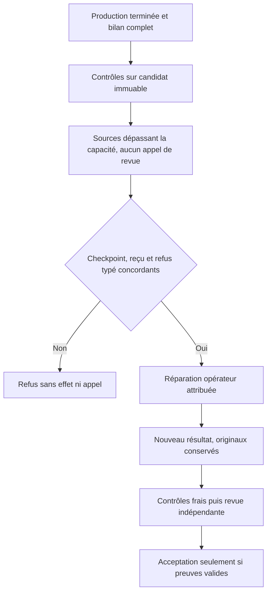
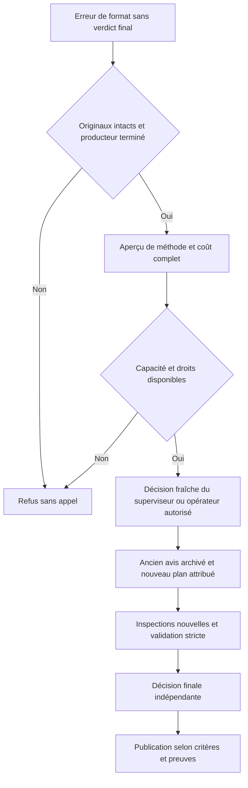
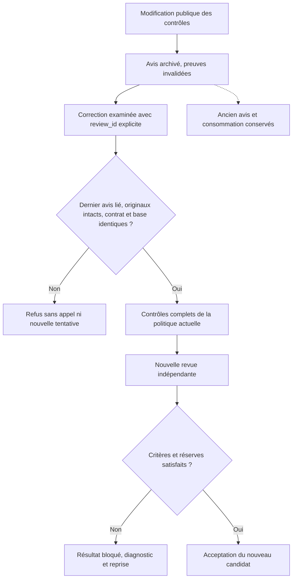

# Reprendre une tâche dont les tentatives sont épuisées

## Avis historique et nouvelle production

Une nouvelle tentative conserve l'ancien avis dans l'historique et prépare sa
propre revue. Un avis encore actif ou en file bloque ce changement. Les dépenses
et les tentatives consommées ne sont pas effacées.

Pour un ancien état conservant par erreur un avis courant d'une tentative
antérieure, le précontrôle du candidat actuel reste disponible si cet avis est
terminé et attribuable à cette tâche. L'inventaire ne modifie aucun état ; une
reprise validée archive l'avis dans la même transaction. Un avis inconnu,
inachevé ou de la tentative actuelle n'est jamais ignoré.

Dans **Pilotage des agents**, la carte bloquée et son détail proposent
**Autoriser une tentative supplémentaire** lorsque toutes les tentatives prévues
sont consommées. Indiquez le motif et la correction à apporter : sources manquantes,
précondition vérifiée ou travail partiel à reprendre. Une répétition à l’identique
ne résout pas le blocage.

La confirmation augmente le plafond d’une unité, sans dépasser trois tentatives.
Elle conserve les tentatives, rapports, contrôles, avis et budgets d’outils. La tâche
reste bloquée et non validée. Le formulaire de lancement s’ouvre ensuite : il
présente les conditions encore à résoudre avant de démarrer. Aucun fournisseur
n’est lancé par l’autorisation elle-même. Échap ou Fermer annule la saisie sans
modifier le travail. Un écran périmé est refusé : fermer et rouvrir la décision.

L’opération est refusée si un agent ou une revue travaille encore, si des tentatives
restent disponibles ou si trois ont déjà été autorisées. Après trois essais, le parcours exceptionnel ci-dessous est distinct ; aucune
augmentation automatique du plafond n’est possible.

## Équivalent CLI

Lire d’abord la révision courante avec `swarm --json work show WORK`. Créer un fichier :

```json
{
  "schema_version": 1,
  "event_id": "identifiant-unique-de-la-decision",
  "expected_revision": 42,
  "task_id": "ma-tache",
  "reason": "Décision explicite après examen du blocage",
  "recovery_instruction": "Transmettre les sources manquantes du candidat puis rejouer les mêmes contrôles."
}
```

```sh
swarm planning extend-attempt WORK --input reprise.json
```

Cette décision opérateur est distincte d’une modification du contrat hiérarchique.
Elle ne change ni les critères, ni les dépendances, ni le responsable. Un même
`event_id` est rejouable sans accorder deux tentatives ; une révision périmée est refusée.
L’événement `task.attempt-extension` conserve le motif et la consigne.

## Après trois essais : autoriser une correction précise

**Préparer un essai correctif** apparaît dans la carte, le diagnostic de reprise
et le détail de la tâche. Le formulaire reprend le dernier refus indépendant et
propose une consigne modifiable. Lire le diagnostic ne consomme aucun appel IA et
ne change aucun plafond. La proposition reprend les constats ; elle ne garantit
pas que le diagnostic du vérificateur soit complet ou exact.

**Autoriser cet essai correctif** accorde exactement un quatrième essai à cette
tâche. La mission active le prend en charge quand les conditions de départ sont
réunies ; la pause, les dépendances, les réservations, les contrôles de stockage,
les budgets et la disponibilité du vérificateur restent applicables. Le résultat
corrigé doit obtenir des contrôles et un nouvel avis indépendant avant acceptation.

Le moteur exige une tâche bloquée avec trois essais consommés, un refus de revue
lié à la dernière tentative, un vérificateur configuré avec un budget disponible,
une nouvelle consigne, un motif et une confirmation explicite. Aucun agent ne doit
encore travailler sur cette tâche. L’opération est atomique et rejouable : deux
clics n’accordent qu’un essai ; un formulaire périmé est refusé. L’événement
`task.corrective-recovery` et `task.corrective_recovery` conservent l’auteur, la
date, l’avis, la tentative, la révision, le motif et la consigne.

Il n’existe pas de cinquième essai dans ce parcours, même après modification de
la tâche. Ni le planificateur ni l’assistant de page ne peuvent accorder cette
exception par une proposition. Un opérateur local doit l’autoriser ; l’API/CLI
locale demeure dans le périmètre de confiance de cet opérateur.

```json
{
  "schema_version": 1,
  "event_id": "reprise-corrective-unique",
  "expected_revision": 42,
  "task_id": "ma-tache",
  "review_id": "identifiant-du-dernier-avis",
  "attempt_id": "identifiant-de-la-derniere-tentative",
  "confirm_recovery": true,
  "reason": "Correction ciblée après examen du refus indépendant",
  "recovery_instruction": "Corriger les preuves manquantes identifiées dans cet avis et rejouer tous les contrôles du candidat corrigé."
}
```

```sh
swarm planning authorize-recovery WORK --input reprise-corrective.json
```

Cette commande autorise une reprise susceptible de démarrer avec le conducteur
actif. Examiner le JSON avant de l’envoyer. Elle ne relève aucun budget d’outils,
de coût ou de revue et n’efface aucun essai. Les étapes non concernées gardent
leur propre plafond. Un environnement en erreur exige toujours ses vérifications.

## Ce que l’exécutant reçoit lors d’une reprise

Le moteur prépare automatiquement un dossier dans `.git/swarm-recovery.json`
de la **nouvelle copie isolée**. La consigne de l’agent indique son emplacement
et son empreinte SHA-256. Le CLI, le web et le conducteur passent par cette même
préparation ; aucun transfert manuel de correctif n’est nécessaire lorsqu’un
résultat Git a déjà été enregistré par le moteur.

Le dossier lie la mission, la tâche, l’agent et la tentative précédents à la
correction du responsable, au motif d’arrêt et, s’ils existent, à l’avis indépendant
complet et au reçu correspondant. Le reçu est relu et son empreinte vérifiée.
Le résultat Git attribué à cette tentative est importé dans la nouvelle copie
sous `refs/swarm/recovery/previous`. Son rapport et ses changements sont donc
consultables localement avec `git show` et `git diff`, sans lire ni modifier les
fichiers de l’ancien agent. Les identifiants de base et de résultat sont dans le JSON.

La nouvelle copie démarre toujours sur le candidat validé courant. L’exécutant
examine, réutilise et corrige les changements nécessaires dans sa propre copie ;
il doit résoudre les éventuels conflits. Le résultat refusé n’est pas publié ni
appliqué automatiquement. Le dossier reste dans les métadonnées Git : il ne
pollue pas les fichiers du livrable. Les nouveaux contrôles, le bilan par critère
et la revue indépendante restent obligatoires sur le nouveau candidat.

Si une tentative gérée interrompue ou en échec n’a pas remis de résultat, le moteur
confirme la fin de son processus et fige les sources conservées dans un checkpoint
Git séparé dès le règlement de la tentative, même si aucune tentative ne reste.
L'événement `attempt_ended` remet au responsable le manifeste attribué et son
empreinte. Un défaut de conservation reste dans le blocage et l'événement ;
le responsable doit réconcilier la copie et son attribution. Le dossier fournit `checkpoint.commit`, `checkpoint.base_commit` et
`checkpoint.tree` ; la même référence locale permet d’examiner ces sources.
`result_commit` reste absent : ce checkpoint ne constitue aucune livraison validée.
Le diagnostic structuré de la tentative précédente est présent dans `diagnostic`
et directement dans la consigne reçue par l’exécutant. Il permet de retrouver la
cause observée avant de dépenser de nouveaux appels.

Une tentative historique sans fin confirmée conserve une limite explicite ; le
moteur ne prétend pas récupérer ses fichiers. Une attribution incohérente, un reçu
altéré ou un dossier préparé modifié empêche le départ et conserve les copies.
Le dossier est limité à 512 Kio, sans troncature. Cette passation ne consomme aucun
appel IA et n’accorde aucune tentative supplémentaire. Elle facilite une reprise
déjà autorisée ; elle ne remplace pas la décision sur un plafond épuisé.

### Examiner avant de reconstruire

Dans la nouvelle copie attribuée, vérifier d’abord `pwd` et
`git rev-parse --show-toplevel`. Lire le dossier depuis cette racine Git, puis
utiliser les identifiants qu’il contient :

```sh
cat .git/swarm-recovery.json
git ls-tree --name-only -r refs/swarm/recovery/previous
git diff --stat BASE_COMMIT refs/swarm/recovery/previous
git diff BASE_COMMIT refs/swarm/recovery/previous -- CHEMIN_VERIFIE
```

`BASE_COMMIT` est `base_commit` pour un résultat remis, ou
`checkpoint.base_commit` pour un checkpoint. `CHEMIN_VERIFIE` vient de l’inventaire
Git, et non d’un chemin supposé. Lire un rapport avec `git show` seulement après
avoir vérifié qu’il figure dans cet arbre. Ne pas chercher dans une copie voisine.

Le checkpoint existant reste identique après modification de l’ancienne copie.
Le verrou Git partagé refuse une opération concurrente ; après sa libération,
une nouvelle lecture doit retrouver le même checkpoint. Une référence sans son
manifeste est une preuve incomplète : conserver cet état et transmettre à
l’opérateur son attribution à réconcilier, sans supprimer ni écraser les fichiers.

### Choisir la reprise selon la cause

| Fait observé | Action utile | Condition vérifiable avant relance |
| --- | --- | --- |
| Fichier ou interface supposé absent | Inventorier avec `rg --files`, lire le producteur et ses appelants | Chemin et signature observés dans la copie courante |
| Mauvais `workdir` | Utiliser le répertoire courant vérifié ; omettre le paramètre lorsqu’il est hérité | Commande réellement démarrée dans la copie attribuée |
| Symbole Go déjà déclaré | Examiner puis réutiliser la déclaration compatible | Compilation et tests nommés du changement réussis |
| Transport refusé dans le bac à sable | Conserver l’erreur, remettre les sources et la dépendance au responsable | Capacité démontrée dans l’environnement prévu pour ce contrôle |
| Sources interrompues sans résultat remis | Examiner le checkpoint et son diagnostic | Sources lisibles dans la nouvelle copie, cause reçue, contrôles encore non validés |
| Tentatives épuisées | Examiner une réparation externe ou une autorisation opérateur explicite | Parcours public admissible ; aucun compteur effacé |

Ces consignes réduisent les erreurs de préparation ; elles n’interceptent pas
les outils internes du fournisseur. Une erreur de compilation peut encore être
produite, mais elle ne doit pas devenir une livraison acceptée. Une consigne
ajoutée ou un test dans un autre environnement ne prouve pas une prévention
autonome. Voir le [contrat de diagnostic et ses limites](architecture/AUTORECURSIVE-RECOVERY.md).

### Distinguer les environnements de vérification

Une recette navigateur doit ouvrir un serveur local et piloter un navigateur
réels. Vérifier cette capacité avant la recette dans le contexte prévu. Après un
refus identique de permission, rejouer `validation`, `delivery` et le critère
n’apporte aucune preuve nouvelle ; remettre le blocage au responsable.

Le worker, l’opérateur et le contrôleur moteur peuvent disposer de droits
différents. Indiquer qui a exécuté le contrôle, avec quel binaire, sur quelle
révision et dans quelle fixture. Un succès opérateur ne démontre pas les capacités
du worker. Une réparation externe autorisée peut exploiter ce succès par le
parcours décrit ci-dessous ; elle reste attribuée à l’opérateur et soumise aux
contrôles et à la revue requis. Aucun refus réseau ne justifie de désactiver les
contrôles ou d’élargir implicitement les permissions.

### Remettre des sources prêtes sans inventer un succès local

Les nouvelles tentatives gérées reçoivent `delivery_version: 2` et un modèle de
bilan version 2. `outcome: ready` permet de remettre les sources et recettes à
contrôler lorsque l'environnement du producteur ne peut pas exécuter un contrôle.
Le critère conserve `status: not_tested`, son motif, les fichiers complets et les
identifiants des contrôles automatiques autorisés qui le couvrent. Un défaut
produit connu reste `fail` et bloque cette remise. `ready` ne dispense pas des
preuves ni des limites du contexte fourni au vérificateur.

Le moteur exécute tous les contrôles configurés sur le candidat immuable, puis
obtient l'avis indépendant. Un contrôle en échec empêche l'appel de revue ; un
avis défavorable empêche l'acceptation. Les anciennes tentatives version 1
conservent leur contrat : une déclaration `complete` exige les vérifications
locales effectivement réalisées. Le protocole d'une tentative en cours n'est
pas changé rétroactivement.

### Reprendre après un incident d'environnement

Une phrase affirmant que l'environnement a été corrigé ne suffit pas. Après un
diagnostic structuré d'environnement sur une tentative terminée, le précontrôle
doit être `ready` et `verification: verified`, avec une sonde configurée dans le
contexte réel du fournisseur. Les capacités déclarées, y compris les capacités
supplémentaires telles que `loopback_listen`, doivent toutes être `verified`.
Un précontrôle hôte `compatible/unverified` conserve le refus
`environment_verification_required`, sans nouvelle tentative ni réservation.
Le motif de précondition corrigée reste également obligatoire. Un arrêt opérateur
n'efface pas un incident structuré déjà constaté.

Le moteur vérifie les capacités déclarées dans la configuration ; il ne devine
pas toutes les ressources nécessaires à une recette et ne certifie pas une sonde
mal configurée. Une recette qui exige un serveur local doit donc avoir cette
capacité déclarée et réellement vérifiée dans son environnement. Les premiers
départs historiques à précontrôle optionnel conservent leur compatibilité.

## Donner au vérificateur les sources du candidat

Les fichiers déclarés dans `delivery.criteria[].evidence` sont désormais joints
intégralement depuis le candidat contrôlé, même inchangés. Le rapport est déjà
fourni. Le manifeste ci-dessous sert à ajouter des sources complémentaires ; il
n'est plus nécessaire pour joindre un fichier déjà déclaré comme preuve.
Voir le [contrat global et ses schémas](architecture/REVIEW-EVIDENCE.md).

Pour une intégration Git gérée, le producteur peut ajouter
`docs/ID-DE-TACHE.review-context.json` dans le sous-projet de la mission :

```json
{"version":1,"files":["managed_review.go","managed_review_test.go","tests/engine_acceptance.cjs"]}
```

Les chemins de `files` partent de la racine du dépôt. Le moteur lit les fichiers
complets dans le commit candidat contrôlé, jamais dans une copie modifiable. Il
joint leur contenu, chemin, objet Git et empreinte SHA-256 au contexte de revue.
Le choix des fichiers ne prouve pas que le contexte suffit : le vérificateur doit
maintenir un verdict inconnu si une preuve nécessaire manque.

Limites : manifeste de 8 Kio ; 24 fichiers distincts ; 96 Kio par fichier ; 128 Kio
pour les sources ; limite globale de revue de 192 Kio. Chemins invalides, fichiers
absents, liens symboliques, contenu binaire et dépassements sont refusés sans
troncature ni appel de revue. Sans manifeste, les preuves de la livraison restent jointes. Une tentative
historique sans bilan ni manifeste conserve diff, rapports et reçus. Cette livraison est un contexte explicite,
pas une surveillance générale des fichiers ni un message direct entre agents.

## Réparer un résultat interrompu sans réécrire son historique

Une limite d’exécution domine les erreurs d’outils antérieures dans le diagnostic.
Le moteur transmet au responsable un bilan JSON d’arrêt dans `.swarm/interruptions/`,
avec l’identité, la copie, la cause, les compteurs et la dernière action observée.
Ce bilan est un constat du moteur, pas un rapport produit par l’agent ni une preuve
de réussite. Il ne fige pas les fichiers de la copie. En cas d’échec de stockage,
une alerte est conservée si le journal reste accessible ; aucun bilan n’est inventé.

Les consignes du nouvel exécutant désignent une seule racine de code et demandent
un rapport dès le début, actualisé régulièrement. C’est un cadrage explicite, pas
un confinement système du fournisseur ni une garantie qu’il suivra ces consignes.

Pour une réparation externe expressément demandée, un opérateur peut compléter
la copie arrêtée, vérifier toutes les obligations et remettre **une seule** révision par tentative
par `planning submit-recovered-result`. Cette opération ne lance aucun exécutant,
ne change aucun plafond et conserve le processus et la tentative interrompus.
Le reçu transmis au vérificateur identifie `external_repair` et son auteur.
Elle ne constitue donc pas une démonstration d’autonomie.

Une réparation conservée d’une tentative précédente n’empêche pas la remise de
la tentative courante arrêtée. La nouvelle remise conserve l’ancienne réparation,
son avis et sa coordination dans l’événement durable ; leurs références Git et
reçus restent intacts. Elle exige ses propres contrôles et un nouvel avis. Une
deuxième soumission implicite de la même tentative reste refusée ; une correction
de ce résultat passe par `revise-recovered-result` et son refus indépendant attribué, ou le précontrôle
sans appel vérifié décrit plus bas.

Après examen du diff et des preuves, indexer la copie avec `git add -A`, relever
`git write-tree`, puis fournir à la commande un JSON contenant `schema_version: 1`,
`event_id`, `expected_revision`, `task_id`, `agent_id`, `attempt_id`,
`confirm_recovery: true`, `result_tree` et un `reason` explicite. Une modification
des fichiers depuis cet examen, une tentative active ou remplacée, une déclaration
de livraison incomplète ou un rapport absent refuse la remise. La déclaration
`docs/TACHE.delivery.json` est obligatoire, y compris pour une ancienne tentative.

Les contrôles et la revue indépendante portent ensuite sur le même candidat.
Un refus reste un refus ; aucun cinquième essai n’est créé. Le rejeu du même
événement reprend la révision enregistrée sans nouvelle production ni nouvelle
revue implicite après refus. Une autre soumission de réparation pour cette tâche
est refusée ; les incidents de revue utilisent le parcours explicite déjà existant.

Un contexte de revue trop volumineux peut provenir des lignes inchangées du diff.
Au-delà de 160 Kio de contexte sérialisé, le moteur emploie trois lignes de contexte
Git au lieu de quarante. Il conserve toutes les lignes modifiées, les fichiers de
sources complets et les reçus. La limite finale de 192 Kio reste obligatoire.
Le rejeu explicite de la même remise externe peut reprendre cet échec préalable
si aucune revue de cette tentative n’a commencé ; un avis déjà rendu reste lié
à son candidat et ne déclenche aucun nouvel appel implicite.

### Corriger un résultat refusé sans relancer le producteur

`planning revise-recovered-result` remet une correction externe explicitement
examinée, liée au dernier `review_id` en `changes_requested`. Fournir les mêmes
champs que `submit-recovered-result`, plus cet identifiant et la révision courante.
L’arbre doit différer du résultat refusé et correspondre aux fichiers examinés.
Le moteur conserve l’ancien avis, son reçu et ses références Git ; le nouveau
candidat repasse les contrôles et une revue dans le budget existant.
Aucune tentative de production ni aucun compteur n’est réinitialisé. Un rejeu
de la même demande ne consomme pas une seconde revue. Une tâche déjà acceptée
ne peut pas être remplacée par cette opération. Cette réparation est une
intervention externe tracée, pas une production autonome.

### Compléter une revue terminée sans verdict

Un avis `unknown` à la sélection finale n'est ni un défaut produit confirmé ni
une erreur de transport. Après examen des originaux, une correction externe peut
fournir un nouvel arbre par `revise-recovered-result`, avec `review_id`,
`confirm_recovery: true` et `confirm_review_unknown_correction: true`. Ce dernier
champ exprime le choix explicite de corriger les preuves ou sources manquantes ;
il n'accorde aucune acceptation. Il exige une sélection finale terminée et
attribuée, ses journaux intacts, une tâche bloquée et un arbre effectivement
modifié. Une revue active, une révision périmée, des preuves altérées ou un arbre
inchangé sont refusés sans mutation ni consommation supplémentaire.

Le manifeste complet reste obligatoire. Les anciens avis et reçus sont conservés ;
le nouveau candidat repasse les contrôles et une revue indépendante dans les
budgets existants. Cette voie ne remplace pas la reprise du même candidat après
une véritable correction de sa seule capacité de sélection.

### Erreur de format de l’avis indépendant

Une citation `pass` doit être un extrait exact et contigu des preuves fournies.
Une paraphrase ou plusieurs extraits assemblés ne sont pas acceptés. Le moteur
conserve désormais la réponse du vérificateur, même rejetée, dans un fichier
privé lié à l’avis (`reply_path`, `reply_sha256`) et précise la tâche/le critère
fautif. Ce fichier n’est pas une approbation. Les anciens avis produits avant
ce correctif peuvent ne pas disposer de cette réponse brute.

Après une correction démontrée du format ou de la précondition, `planning
retry-review` permet une reprise explicite dans le budget existant. Aucun rejeu
payant automatique n’est déclenché. Les reçus, contextes et rapports sont relus
pendant l’inférence et avant publication ; une modification rend l’avis périmé.

Après `retry-review`, le conducteur reprend aussi une réparation externe dont
le producteur reste interrompu : seul le résultat explicitement remis et en
attente d’intégration est repris. Le processus historique et ses tentatives
restent inchangés. Une remise refusée non réarmée ne déclenche aucun nouvel avis.

### Dossier cumulé trop volumineux

Le moteur garde la limite de contexte. Après réduction des seules lignes de
contexte inchangées du diff, il peut retirer une source complémentaire dupliquée
si le fichier est entièrement nouveau et si son contenu complet correspond
exactement au diff intégral, avec le même objet Git. Le diff, les rapports, les
reçus et toutes les lignes modifiées restent transmis. Aucun fichier modifié
préexistant n’est raccourci. Un contexte encore trop grand reste refusé avant
appel fournisseur ; cette déduplication n’autorise aucune troncature.

### Dernière tentative terminée sans rapport

Une tâche non gérée par Git, bloquée après trois tentatives, peut aussi présenter
**Préparer un essai correctif** lorsque le conducteur a enregistré l’absence de
rapport de la dernière tentative. Cette cause opérationnelle ne constitue pas un
avis indépendant. Corrigez d’abord la cause, puis confirmez une nouvelle consigne.
La mission conserve sa pause et la limite d’appels ; une seule quatrième tentative
est autorisée. Son résultat devra ensuite passer les contrôles et la revue.

Le CLI utilise la même opération `planning authorize-recovery` et les mêmes champs
que ci-dessus, en remplaçant `review_id` par `"missing_report": true`. Conserver
`attempt_id` de la dernière tentative, `expected_revision`, `confirm_recovery`,
`reason` et `recovery_instruction`. Ne pas combiner cette cause avec `review_id`
ou `result_commit`. Le moteur vérifie le refus de relais enregistré ; le booléen
fourni ne suffit jamais à établir l’absence de rapport.

### Revue interrompue par son délai

Dans le cockpit, **Délai de vérification** sous le vérificateur permet de régler
une durée positive pour les prochaines revues, ou `0` pour hériter de la
politique du projet configurée dans Admin, avec un motif enregistré.
La sauvegarde conserve les appels consommés et leur plafond ; elle ne relance rien.
Après correction de la cause, **Reprendre la vérification** reprend l’examen du
résultat existant dans le budget restant, sans lancer un nouvel exécutant.

## Contrôles avant la revue indépendante

Pour une tâche avec des contrôles automatiques explicitement autorisés, le
moteur exécute ces contrôles avant la revue IA. Leur réussite produit un reçu
et laisse la tâche en attente de revue : elle ne vaut pas acceptation. Le
vérificateur reçoit les commandes, codes de sortie et empreintes du reçu
moteur courant ; il examine si ces contrôles couvrent réellement les critères.

Après avis favorable, le moteur réutilise le reçu courant sans rejouer les
commandes. Un échec, une preuve périmée ou une autre tentative interdit cette
acceptation. Un rapport importé ou une gate manuelle ne remplace pas le reçu.
Les tâches en revue humaine conservent leur parcours habituel.

## Reprise et budget des outils

Le dernier outil autorisé peut terminer et son résultat est conservé, dans les
délais existants. Un appel supplémentaire reste interdit et les protections
contre répétitions et erreurs demeurent actives. Une interruption ne valide
pas le travail.

Une nouvelle tentative reçoit un résumé borné des opérations observées sur
la tentative précédente de cette même tâche. Ce résumé évite un inventaire
à repartir de zéro, mais ne prouve pas que les opérations ont réussi.
Les consignes chiffrent une phase d'exploration et réservent un cinquième
des appels aux contrôles et au rapport ; ces jalons restent indicatifs pour
le modèle, tandis que le plafond total est surveillé par le moteur.

## Observer une mission sans plafonds d’exécution

Dans **Administration**, sélectionner la portée **Mission**, charger son
identifiant, puis choisir **Mode d’exécution → Observation — sans plafonds
d’exécution**. Un motif est obligatoire ; prévisualiser puis confirmer.
Ce choix explicite est réservé à l’administration d’une mission.

Les prochains exécutants, y compris les reprises, comptent toujours leurs
appels et résultats mais ne sont plus interrompus par les plafonds d’appels,
de répétitions, d’erreurs, de silence ou de durée. Le nombre de tentatives du
plan ne refuse plus leur départ. Les anciennes limites restent conservées à
titre de référence ; le champ `observation_mode: 1` indique qu’elles ne coupent
pas cette exécution. Les tentatives déjà lancées gardent leur mode initial.

Les dépendances, contrôles d’acceptation, exclusions d’espaces de travail,
arrêts manuels et erreurs du fournisseur continuent de s’appliquer. Ce mode ne
réinitialise rien, ne valide aucun résultat et ne crée pas de reprises
automatiques illimitées. Les budgets de planification et de revue sont distincts.
Pour terminer l’expérience, choisir **Plafonds actifs** : les futurs départs
retrouvent les limites configurées et les compteurs antérieurs.

Le CLI utilise la même opération `swarm run-limits apply mission <id> -
--input changement.json`, avec `values.observation_mode` à `1` (observation) ou
`0` (plafonds actifs), un `reason` explicite et la révision attendue. Conserver
les autres valeurs de la portée dans le document de changement.

## Redémarrage explicite distinct de l’essai correctif

La limite de quatre productions du parcours `authorize-recovery` reste applicable.
Une décision opérateur distincte, `swarm planning restart-task`, peut autoriser
une seule nouvelle production après examen du résultat courant. Ce n’est ni une
cinquième tentative automatique ni une remise à zéro. Voir les
[conditions et empreintes du redémarrage](ENGINE-RECOVERY.md#repartir-sur-une-tâche-bloquée).

### Corriger un précontrôle sans appel après interruption

Une réparation externe peut avoir une déclaration complète et passer les
contrôles, puis échouer avant toute revue parce qu’une pièce de contexte est
trop grande. La même tentative arrêtée peut être corrigée explicitement par
`planning revise-recovered-result`, sans `review_id` puisqu’aucun avis n’existe.
Fournir les identités, la révision courante, `confirm_recovery`, un motif concret
et le nouvel `result_tree` examiné ; l’arbre doit différer du résultat conservé.

Le moteur relit le précontrôle conservé : cause connue sans appel, tâche bloquée,
agent/tentative courants, processus effectivement terminé, résultat attribuable,
checkpoint candidat et reçu concordants avec base/contrat/contrôles. Leur
altération refuse la reprise avant mutation. Une erreur arbitraire n’autorise
pas cette correction. Le résultat, l’avis éventuel, les références et reçus
antérieurs restent conservés ; des contrôles et une revue frais couvrent le
nouveau candidat. Le rejeu n’ajoute aucun appel, essai ou remboursement.

Un grand manifeste d’intégrité peut être réparti en plusieurs fichiers complets,
chacun lié par SHA-256 à son manifeste parent. Le harness reconstruit toutes
les entrées avant d’en vérifier le digest cumulé. Ce découpage ne retire aucune
preuve, ne relève aucun plafond et ne renouvelle aucune acceptation historique.

Les seuils de durée et de silence restent des observations aussi en mode
plafonds actifs. Le changement de mode concerne les plafonds d’exécution et
les tentatives ; la décision IA de conduite conserve son attribution.

## Réparer un refus de capacité des sources avant la revue

Un bilan complet et un diff borné peuvent encore dépasser la capacité totale des
sources jointes. Ce refus n’a payé aucun appel de revue ; le moteur conserve le
résultat Git, le candidat préparé et les contrôles. La correction publique
`planning revise-recovered-result` doit pouvoir corriger la sélection déclarée
sans créer une nouvelle production ni prétendre une acceptation.

Le moteur vérifie travail, tâche, tentative terminée, résultat immuable, contrat,
candidat précédent, checkpoint et reçu de contrôles concordants. Il reconstruit
le contexte original et reconnaît seulement une erreur de capacité typée dont
le message correspond au refus enregistré. Un checkpoint altéré, un autre
défaut, une ancienne tentative ou un avis indépendant existant ne donnent pas
cette autorisation. Une reprise de revue ordinaire conserve son exigence de
contexte complet et borné. Seul le parcours de réparation peut examiner le
checkpoint vérifié malgré cette capacité dépassée.

La réparation garde les originaux et retire seulement les déclarations
redondantes, ou produit des pièces adaptées avec leur filiation. Elle est
attribuée à l’opérateur. Le nouveau résultat passe à nouveau les contrôles et
la revue indépendante ; tentatives et consommations restent conservées.



## Réservation de revue abandonnée au redémarrage

Après acquisition exclusive du verrou de la tentative, le moteur reconnaît
un avis resté `running` par le conducteur précédent. Il vérifie les originaux
et le journal ancré, puis classe seulement la dernière réservation sans résultat
comme `interrupted` dans un nouveau journal adressé par son empreinte. Le journal
initial, les inspections achevées et les appels consommés restent conservés.
Cette réconciliation ne relance aucun fournisseur et n’accepte aucun candidat.

L’incident `review_fragment_interrupted` rejoint le responsable `reviewer_runtime`.
Une décision fraîche `review-retry` peut reprendre le même candidat dans les
budgets existants ; un correctif externe explicite peut remettre un arbre modifié
avec `revise-recovered-result` et `confirm_review_error_repair`. Les deux parcours
conservent les contrôles, attributions et validations requis. Un original altéré,
un propriétaire encore actif ou une identité de client incompatible bloque la
reprise ; une déclaration opérateur ne remplace pas ces contrôles.

Pour arrêter volontairement une vérification, suspendre par le parcours public,
attendre le classement durable de l’appel et la fin des sous-processus, puis
arrêter le conducteur identifié. Un arrêt trop précoce peut laisser un journal
sans résultat ; le parcours de redémarrage conserve cette incertitude.

## Changement du contrat d’inspection après erreur

Une erreur de format sans décision finale peut adopter un nouveau contrat de
citation ou de constat par une reprise complète explicite. `planning
recovery-preview` vérifie les originaux, l’attribution, le fournisseur, le modèle
et le budget requis avant tout appel. Une reprise prête porte
`method_restart_ready` ; les anciennes inspections deviennent de l’historique,
sans réutilisation comme avis du nouveau contrat. `planning retry-review` exige
la révision fraîche, un motif et `confirm_review_error_repair: true`, ou une
décision fraîche `review-retry` du superviseur autorisé. L’opération ne dépense
aucun appel ; le conducteur effectue ensuite la nouvelle revue attribuée.

Un verdict métier défavorable, une réservation active, un original altéré ou un
budget insuffisant bloque ce remplacement. Corriger la précondition par son
parcours public avant reprise ; ne jamais effacer la dépense ou retoucher la
réponse originale pour la rendre valide.

Pour cet aperçu, le corps utilise `task_id` (pas `task`) :

```json
{"schema_version":1,"task_id":"ID_TACHE"}
```

L’envoyer à `swarm --root RACINE --json planning recovery-preview ID_TRAVAIL
--input requete.json`. L’aperçu ne remplace pas la décision du propriétaire et
ne relance pas le conducteur.



L’aperçu de reprise ci-dessus concerne les inspections et le changement complet
de méthode. Si une décision finale est déjà engagée, examiner son journal : la
reprise finale explicite conserve les inspections et les appels, et exige encore
une décision fraîche. Pour remettre un arbre réparé avec `revise-recovered-result`,
la mission et la planification doivent être actives. Après une pause de diagnostic,
arrêter le conducteur identifié sans descendants, lever publiquement la pause,
remettre le résultat, puis reprendre le conducteur ; cela évite de relancer
l’ancien candidat pendant la remise. Une erreur de précondition ne donne aucune
autorisation supplémentaire.

## Vérifier le motif réel d’un refus

Les nouvelles tentatives gérées reçoivent cette consigne dans leur prompt de
livraison : garder valides les autres champs du scénario, vérifier le motif
attendu et l’absence de mutation métier. Après ajout d’un champ obligatoire,
réexaminer les anciens tests négatifs ; un refus pour une autre garde peut
masquer la disparition de la protection annoncée. Pour une garde critique,
un retrait contrôlé dans une fixture isolée doit faire échouer le test nommé.
La mutation reste hors du candidat livré et ne modifie aucune base de mission.

Le test du constructeur de prompt et la qualification des livraisons `ready`
vérifient la transmission locale de cette règle. Ils ne démontrent pas encore
qu’un nouveau worker natif l’a appliquée ; observer son contexte et ses résultats
avant de revendiquer cet effet.

## Correction après modification des contrôles

Une modification publique de `validation_policy` archive l’avis courant et
invalide ses contrôles. Elle ne doit pas rendre impossible la réparation du
résultat refusé. `revise-recovered-result` peut désigner par `review_id` le dernier
avis archivé du même producteur, de la même tentative et de la même réparation.
Le contrat métier et la base doivent encore correspondre ; les originaux,
empreintes, fournisseur, méthode et refus admissible sont revérifiés. Un avis plus
ancien, étranger, inachevé ou altéré ne donne aucun droit de reprise.

L’opération exige toujours une révision fraîche, un arbre différent examiné,
une copie arrêtée et attribuée, ainsi que les confirmations applicables au refus.
Le résultat repasse tous les contrôles de la politique actuelle et une nouvelle
revue indépendante. L’ancien avis reste historique : aucun contrôle ou verdict
n’est réutilisé pour accepter le nouveau candidat. Tentatives et consommations
restent inchangées, hors nouveaux appels effectivement exécutés.



Pour vérifier le parcours en fixture isolée :

```sh
go test ./internal/engine -race -count=1 -v -run '^TestRecoveredResultCorrectionAfterPublicPolicyChange$'
```

Ce test applique l’aperçu puis la politique publique, remet un arbre corrigé et
vérifie le reçu de politique actuelle, le nouveau candidat et l’avis frais. Il
refuse aussi un identifiant étranger et un reçu altéré sans dépenser d’appel,
et vérifie qu’un rejeu ne répète pas la revue. Les variantes de contrat, base,
producteur, tentative et dernier avis sont contrôlées séparément. Pour une mission
réelle, retenir en plus la réception publique, les contrôles, la décision et son
effet observable ; le test seul ne remplace pas ces quatre preuves.
