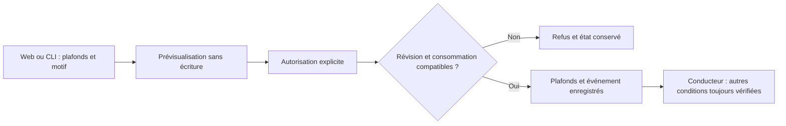
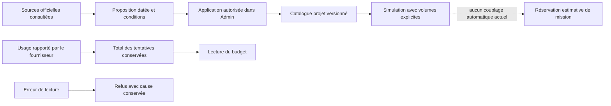
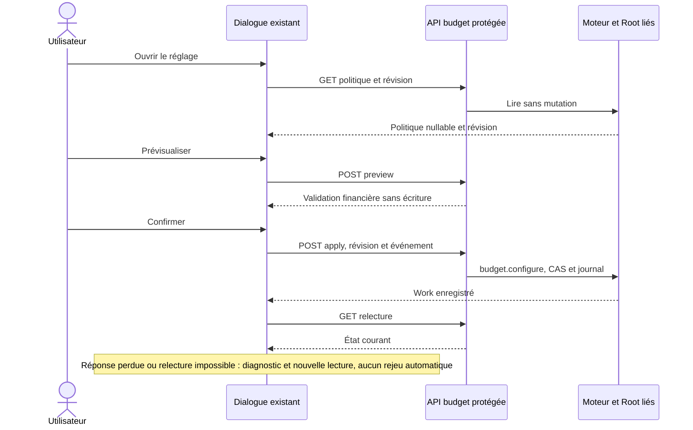
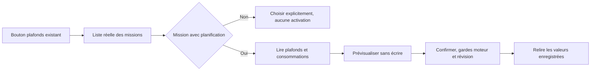

# Budgets et coûts IA

## Régler l’enveloppe d’une mission

Dans **Budgets et coûts IA**, ouvrir **Régler le budget**, saisir le plafond USD,
la réservation estimée par départ, la source et la date de référence.
**Prévisualiser le budget** montre ancien et nouveau plafond et engagements
conservés. **Enregistrer ce budget** applique la modification. Modifier un champ
invalide la prévisualisation. Une page périmée est refusée : fermer le formulaire,
actualiser, puis examiner à nouveau les valeurs.

Un plafond de zéro désactive le contrôle financier estimatif. Une baisse ne tue
pas les agents actifs et n’efface pas les dépenses estimées ni les réservations.
Les futurs départs restent soumis aux autres contrôles du moteur.

## Même contrôle depuis le CLI

```sh
swarm budget show WORK --json
swarm budget preview WORK --input budget.json --json
swarm budget apply WORK --input budget.json --json
```

Exemple de `budget.json` (montants fictifs, à remplacer) :

```json
{
  "schema_version": 1,
  "event_id": "budget-authorization-001",
  "expected_revision": 12,
  "budget": {
    "limit_usd": 10,
    "reserve_per_launch_usd": 2,
    "estimate_source": "Estimation locale documentée",
    "reference_date": "2026-09-23"
  }
}
```

Utiliser la révision renvoyée par `show`. `preview` est une lecture indicative ;
les réservations peuvent évoluer ensuite. `apply` vérifie la révision dans la
transaction qui enregistre le réglage et son événement. Deux autorisations
concurrentes sur la même révision ne peuvent pas se remplacer silencieusement.
Rejouer le même événement avec la même demande ne consomme pas de révision.
L’auteur et la date d’enregistrement sont déterminés par le moteur.

## Ce qui est réellement couvert

L’enveloppe estimative couvre exécution, planification, assistance de page et
préparation. **Les revues indépendantes ont un plafond d’appels séparé ; leurs
coûts monétaires ne sont pas inclus dans cette enveloppe.** Les coûts rapportés
par les fournisseurs sont distincts des estimations ; absence de coût ne veut
pas dire zéro. Ce contrôle n’est pas une garantie de plafond de facturation.

Les défauts pour les nouvelles missions restent à réaliser. Les autorisations
existantes ne changent pas lors de l’installation.

## Catalogue de tarifs par fournisseur et modèle

Ouvrir **Tarifs des modèles** dans **Admin** ou **Budgets et coûts IA**. Le catalogue appartient
au projet, pas à une mission. Ajouter fournisseur, modèle, devise (code à trois
lettres), source et date, puis les montants par million de jetons. Aucun tarif
n’est prérempli : vide signifie inconnu, zéro signifie explicitement gratuit.
Entrée hors cache, sortie, cache lu et cache écrit sont des catégories distinctes.

**Créer une nouvelle version** conserve l’ancienne. L’auteur et la date sont
enregistrés par le moteur. Une modification concurrente refuse l’ancien formulaire.
**Estimer avec ce tarif** calcule une simulation en conservant l’identifiant de
version. Si une catégorie utilisée n’a pas de tarif, le montant reste inconnu.
Le calcul n’ajoute pas les jetons en cache à un total d’entrée qui les comprend
déjà : saisir uniquement les jetons hors cache dans « Entrée hors cache ».

```sh
swarm pricing list --json
swarm pricing save --input tarif.json --json
swarm pricing estimate --input volumes.json --json
```

Exemple de tarif (valeurs fictives) :

```json
{"schema_version":1,"expected_digest":"DIGEST_RENVOYE_PAR_LIST","rate":{"provider":"mon-fournisseur","model":"mon-modele","currency":"USD","input_per_million":2,"output_per_million":5,"cache_read_per_million":null,"cache_write_per_million":null,"source":"Estimation locale documentée","reference_date":"2026-09-23"}}
```

Exemple de volumes :

```json
{"rate_version":"VERSION_RENVOYEE_PAR_SAVE","non_cached_input_tokens":1000000,"output_tokens":1000000,"cache_read_tokens":0,"cache_write_tokens":0}
```

Résultat attendu : estimation de 7 USD avec la version, les tarifs et les volumes
utilisés dans la sortie JSON. Une nouvelle version ne change pas cette simulation.
Conserver cette sortie si elle sert de preuve : les simulations ne sont pas
enregistrées comme dépenses de mission. Aucun taux de change n’est appliqué.

**Limites :** ce catalogue ne transforme pas automatiquement les événements des
fournisseurs en coûts historiques et ne change pas la réserve forfaitaire par
départ. Les tarifs doivent être vérifiés par la personne qui les saisit. Les prix
d’abonnement, paliers, durées de cache et remises nécessitent un tarif adapté au
cas étudié ; le calculateur ne les devine pas. Les versions ne sont pas supprimées
par l’interface. Aucun plafond métier de prix, de volume ou de nombre de versions
n’est imposé. Les montants doivent rester finis ; un calcul non représentable est
refusé. Les volumes CLI/API utilisent des entiers signés 64 bits non négatifs ;
l’interface exige des entiers JavaScript exactement représentables. Le format de
fichier reste borné à 2 Mio, les requêtes HTTP à 12 000 octets : ces gardes
techniques existantes refusent sans tronquer ni supprimer l’historique. Elles ne
constituent ni un budget ni une politique de rétention ; leur évolution vers un
stockage paginé reste à réaliser avant saturation du catalogue.

## Réglages du moteur

Dans **Admin**, ouvrir **Réglages du moteur** ; le même dialogue reste accessible
dans **Budgets et coûts IA**. Le tableau distingue l'utilisation courante des
plafonds ; l'historique et les allocations locales sont consultables à la demande.
Saisir les réglages et un motif, prévisualiser puis autoriser.
Une modification des champs invalide la prévisualisation. Une révision périmée
est refusée. Aucun compteur consommé, historique, échec ou état de pause n’est effacé.

Ces politiques sont persistantes, communes au web, à l'API et au CLI. Aucun second
plafond fixe de 100, 200 ou 500 n'est appliqué dans le moteur ou le formulaire.

| Champ de `limits` | Signification |
| --- | --- |
| `planning_tasks` | Nombre maximal de tâches ; entier positif, au moins le nombre actuel |
| `planning_activations` | Activations globales ; entier positif, au moins le consommé |
| `planning_decisions` | Décisions globales ; entier positif, au moins le consommé |
| `review_calls` | Appels du vérificateur configuré ; entier positif, au moins le consommé, ou `null` sans vérificateur |
| `planning_scopes` | Nombre maximal de périmètres ; `0` sans plafond supplémentaire, sinon au moins le nombre actuel |
| `delegation_depth` | Nombre maximal de niveaux ; racine = niveau 1, `0` sans plafond supplémentaire, sinon au moins la profondeur actuelle |
| `judge_cycles` | Nombre maximal de cycles du juge ; `0` sans plafond supplémentaire, sinon au moins le cycle actuel |

Omettre les champs optionnels de tâches, périmètres, niveaux ou cycles conserve
leur valeur. Un zéro ne supprime ni les budgets d'appels ni les droits et autres
contrôles. Les allocations propres aux sous-planificateurs restent inchangées et
s'appliquent encore. Une réservation de planificateur ou une revue en cours
interdit la modification jusqu'à sa libération. La lecture `GET /api/v1/quotas`
expose valeurs, consommation, révision et dernière autorisation ; `remaining`
vaut `null` pour une dimension sans plafond. Les bornes techniques sont distinguées
des politiques ; les valeurs entières doivent rester représentables sans perte.

```sh
swarm quotas show WORK --json
swarm quotas preview WORK --input quotas.json --json
swarm quotas apply WORK --input quotas.json --json
```

Exemple de `quotas.json` : adapter la révision et les valeurs à `show`.

```json
{"schema_version":1,"event_id":"quota-authorization-001","expected_revision":12,"limits":{"planning_tasks":30,"planning_activations":60,"planning_decisions":40,"review_calls":20,"planning_scopes":0,"delegation_depth":0,"judge_cycles":0},"reason":"Autorisation explicite après examen du travail restant"}
```

Sans vérificateur configuré, `review_calls` doit être `null`. Le réglage n’en crée
pas un. L’auteur et la date sont enregistrés par le moteur ; le même événement
rejoué à l’identique est idempotent. Les modifications concurrentes sont refusées.

**Effet :** le réglage ne lance pas directement d’agent. Une mission active peut
utiliser la nouvelle autorisation au prochain passage du conducteur. Un échec ne
se transforme pas en réussite et une pause n’est pas levée. Les tentatives de
production restent réautorisées depuis leur tâche, avec une consigne corrective ;
ce formulaire ne contourne pas cette protection.



## Connaître le coût d’une revue avant de la reprendre

`planning review-cost WORK --input request.json`, avec
`{"task_id":"TASK"}`, fournit une estimation sans réserver d’appel. Le même
résultat est disponible par l’API de planification avec `action=review-cost`.

Le résultat distingue nouvelles inspections, observations historiques conservées
et deux appels finaux. Vérifier **les deux** champs `fits_budget` et
`transport_ready` ; `transport_blocker` explique une capacité de message dépassée.
Les appels précédents restent consommés. Une estimation favorable n’est ni une
autorisation supplémentaire ni une validation du résultat.

Une correction peut conserver les observations d’un ancien paquet seulement si
toutes ses entrées sont identiques. Les réserves restent ouvertes ; un nouvel avis
doit examiner les changements et leurs impacts avant toute acceptation. Les
[conditions et limites du protocole](plans/review-efficiency-apex/DIFFERENTIAL.md)
explicitent ce qui est effectivement vérifié.

### Ajuster un périmètre de planification

La demande `quotas preview/apply` accepte le champ optionnel
`"scope_activations":{"preuve-livraison":21}` à côté de `limits`.
Il modifie uniquement les plafonds nommés, après autorisation humaine. Les
compteurs consommés restent inchangés ; les valeurs avant/après sont conservées
avec l'auteur et le motif. Un périmètre inconnu, un plafond inférieur à sa
consommation ou supérieur au parent/global est refusé. Un parent explicitement
borné doit être relevé dans la même demande si nécessaire. Une session de
planification ou une revue active interdit toujours la modification.

## Délais navigateur distincts des budgets

Dans Admin, la modale **Attente des requêtes navigateur** règle les lectures/actions
courantes, les snapshots et les tests de connexion. `0` désactive l'expiration de
l'interface ; cela ne change ni les limites des agents ni les délais d'exécution
serveur. Aperçu, sauvegarde, historique et CLI partagent le contrat Go. Voir les
[unités, effets et limites](architecture/WEB-REQUEST-POLICY.md).

## Découverte assistée et séparation des preuves

La skill [pricing-discovery](../.claude/skills/pricing-discovery/SKILL.md) prépare
une proposition depuis les pages officielles ouvertes, avec date de consultation,
unité, devise et conditions (plateforme, palier, cache, région). Elle ne contient
aucun tarif et ne crée aucun rafraîchissement périodique. La saisie autorisée
ajoute une version via Admin/API/CLI et vérifie la relecture ; la recherche seule
ne modifie pas le catalogue. Source et conditions restent du texte dans le schéma
actuel, sans validation automatique de leur authenticité ou de leur applicabilité.



La réserve forfaitaire ne se recalcule pas automatiquement depuis un tarif.
L'estimation n'est pas une facture et une devise différente n'est pas convertie
vers USD. Les coûts rapportés des agents couvrent toutes les tentatives conservées,
sans pagination de l'affichage récent. Une erreur de lecture refuse la vue budget
avec `reported_cost_unavailable` ; elle ne devient pas un coût absent. La cause
reste accessible en interne sans sérialisation dans l'erreur publique.

Le parcours HTTP et Admin est celui du moteur Go. Le catalogue et le devis
natifs Rust disposent maintenant de `pricing list|save|estimate` sur une racine
native privée initialisée ; HTTP/Admin natifs et bascule de racines Go restent
ouverts. Le schéma tarifaire est compatible, ce qui n'autorise pas le partage
d'une racine active entre moteurs. La skill ne vaut ni livraison installée ni
authentification de l'acteur. Le contrat de réservation financière reste distinct.

```sh
swarm-rust pricing list --root RACINE_NATIVE --json
swarm-rust pricing save --root RACINE_NATIVE --input tarif.json --json
swarm-rust pricing estimate --root RACINE_NATIVE --input volumes.json --json
```

Les demandes utilisent les mêmes champs que les exemples Go ci-dessus. La lecture
renvoie l'empreinte des octets du catalogue, à reporter dans `expected_digest`
pour une nouvelle version. Le moteur remplace version/auteur/horodatage fournis.
La CLI ferme les ressources avant sortie et vérifie écriture/flush. Une erreur
après publication reste un échec explicite : relire le catalogue avant reprise.
Une panne avant renommage conserve l'original ; après renommage mais sans preuve
de synchronisation, l'état est `local-publication-uncertain`, jamais « annulé ».
Les variantes d'injection sont absentes du profil de production ; la source
`source` conserve des conditions textuelles non authentifiées.

Le lecteur Rust conserve aussi les valeurs initiales du producteur Go : `{}` ou
`null` représentent un catalogue vide de schéma1 ; `rates:null` garde la forme
JSON nulle. Ce sont des règles de décodage, aucun prix par défaut. Une chaîne vide,
un document invalide ou un tarif conservé invalide refuse la lecture. Les devis
utilisent des flottants comme Go : ils ne garantissent pas la précision décimale
d'une facture. Voir les [preuves et limites du portage](architecture/RUST-MIGRATION.md).

Le calcul garde l’ordre flottant habituel de Go pour les devis déjà représentables.
Seul un produit intermédiaire infini est rééchelonné ; un total non fini est refusé.
Le témoin conservé contre la source Go antérieure fixe ce comportement.

Preuves71 :445testsRust,46CLI profil défaut,18Go ciblés et101comparaisons
sur8476entrées stables ; catalogue/CLI vérifiés, HTTP/Admin natifs non portés.
Revue Codex même session, aucun serveur remplacé.

## Réglage dans le cockpit Rust local
Le bouton « Régler le budget » est raccordé au dialogue existant : montants USD,
source et date, prévisualisation financière sans écriture puis seconde confirmation.
La sauvegarde utilise la révision actuelle et le journal du moteur, sans modifier
les réservations, consommations ni les agents actifs. Zéro de plafond signifie
illimité ; une politique absente laisse les champs vides, aucun montant n’est adopté.
Un refus connu est distingué d’une réponse perdue et d’un enregistrement connu dont
la relecture échoue. Dans ces cas le formulaire exige une nouvelle lecture ; aucune
sauvegarde n’est répétée automatiquement. Le catalogue des tarifs et les autres
commandes restent des raccords distincts. Voir le contrat de routes et limites dans
[Rust — raccord1468](architecture/RUST-MIGRATION.md#raccord1468--réglage-réel-des-budgets-de-mission).



## Plafonds dans le cockpit Rust
Le bouton existant ouvre le même composant que l’Admin natif, avec ses groupes et
son aide. La mission sélectionnée est proposée seulement si elle figure réellement
dans la liste avec planification ; sinon il faut la choisir explicitement. Aucune
planification n’est activée par ce dialogue. Les valeurs et consommations sont lues
via `/api/v1/quotas`, puis preview/apply utilisent les gardes moteur existantes.
Modifier invalide la confirmation ; le motif, la révision, les consommations et les
plafonds des ancêtres restent contrôlés par le moteur. Aucun départ automatique.
Une réponse malformée refuse avant de rendre les champs éditables. Erreur visible,
pas de répétition automatique ; choisir de nouveau la mission relit son état.


