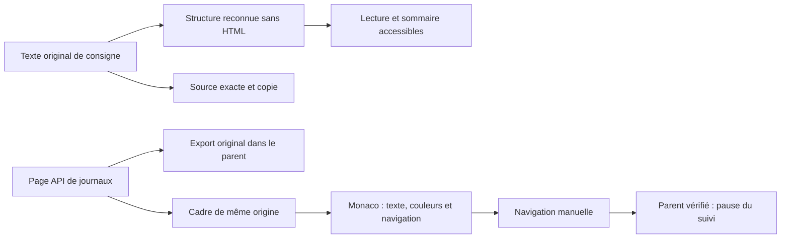

# Lire les instructions et les journaux

Le lecteur de consignes sépare **Lecture structurée** et **Texte source**. La
première donne une hiérarchie au texte ; la seconde conserve chaque caractère du
texte reçu, y compris ses fins de ligne. Copier utilise cette source. Un refus du
presse-papiers est visible et ouvre la source sélectionnable ; il n’est jamais
annoncé comme une copie réussie.

## Instructions

Le composant partagé `web/text-reader.js` présente les titres Markdown, les
paragraphes, les listes numérotées ou à puces et imbriquées, les cases écrites dans
le document, les citations, les tableaux simples et les blocs de code délimités.
Gras, emphase et code en ligne restent distincts. Les titres suivis de deux-points
avant une liste ou un saut de paragraphe sont aussi des repères de section.
Le sommaire est explicite ; ses liens déplacent le focus clavier au titre choisi.

Les blocs `> [!NOTE]`, `TIP`, `IMPORTANT`, `WARNING` et `CAUTION` distinguent des
indications écrites dans le texte. Attention et prudence emploient les paires
sémantiques correspondantes. Une case cochée reste une déclaration du document,
pas une preuve d’exécution ni une acceptation du moteur. Le lecteur ne déduit
aucun résultat à partir d’un mot ou d’une couleur.

Intégrations : consigne de tâche (`task.next`) dans l’inspecteur, ajouts de
consignes, consignes communes conservées et lancement préparé. Les saisies de
consigne, correction, prochaine action, objectif et périmètre disposent d’un
**Aperçu de lecture** explicite, mis à jour pendant la saisie uniquement s’il est
ouvert. Lire, copier ou ouvrir cet aperçu ne sauvegarde et ne lance rien.
La consigne de tâche n’est pas présentée comme le prompt complet d’une tentative.

Les choix source/lecture, le sommaire, le focus et le défilement de la source restent conservés
lors d’un rafraîchissement de l’inspecteur. Le texte n’est pas enregistré dans
une préférence navigateur. Les documents utilisateur ne sont jamais traduits.

## Écrire une consigne lisible

La palette reste celle de Swarm : titres marine/cyan, surfaces papier, code sur
fond distinct et avertissements ambre ou rouge. La couleur accompagne toujours
un libellé. Le lecteur ne colore pas arbitrairement les phrases du document et
n’interprète pas les alertes comme des décisions du moteur.

Exemple reconnu par le lecteur :

````markdown
# Préparer la livraison

## Objectif
Conserver **toutes les preuves** dans `rapport.md`.

Vérifications :
1. Relire le contrat.
2. Vérifier les résultats.
   - Conserver les originaux.

> [!WARNING]
> Ne pas annoncer une acceptation sans preuve.

| Contrôle | Résultat attendu |
| --- | --- |
| Tests | Résultats et commande conservés |

```json
{"request_id":"exemple", "approved":false}
```
````

Les réglages de lecture ne réécrivent pas cette consigne. Utiliser **Texte source**
pour contrôler les caractères exacts, puis **Copier le texte source** pour la
réutiliser. L’aperçu de saisie reste fermé tant qu’il n’est pas demandé.

## Journaux

La console Monaco reste en lecture seule, avec les originaux et l’export de la
page API conservés dans le parent. La navigation choisit un événement de cette
page, ou passe au précédent, au suivant et au prochain signal erreur/attention.
La position correspond aux événements réellement reçus. Naviguer manuellement
met le suivi en pause et laisse la reprise au bouton **Suivre le direct**.
Le message de pause est contrôlé par origine et fenêtre émettrice.

Les clés JSON, valeurs numériques, littéraux et code en ligne ont des repères
distincts, avec les couleurs sémantiques du thème. Les niveaux et horodatages
conservent leurs libellés et leurs couleurs. Les messages restent du texte.
**Lecture aérée** et **Retour à la ligne** sont des préférences de présentation
locales (`swarm-log:reading`), pas des politiques d’exécution. Les réglages
s’appliquent au rendu ; le texte reçu et l’export ne changent pas. La recherche
Ctrl+F et les filtres de source/page restent disponibles.



## Contrat et vérification

La construction utilise uniquement des nœuds DOM et `textContent`. Aucun HTML du
document n’est exécuté. Les images ne sont pas chargées ; seuls les liens
explicites HTTP/HTTPS deviennent navigables, avec ouverture isolée. Les liens
non pris en charge restent lisibles en texte. Ce lecteur est un sous-ensemble
de présentation, pas une implémentation complète de CommonMark : la source est
toujours disponible, notamment pour les syntaxes complexes ou non reconnues.

Les blocs JSON des consignes gardent leur contenu ; leurs jetons sont mis en
valeur. Le JSON des logs peut être indenté comme auparavant pour la lecture,
sans changer la réponse originale exportée. Les longues lignes de code et
tableaux défilent localement, sans élargir la page.

Recettes : `node tests/text_reader_test.cjs`, puis
`node tests/dense_text_ui.cjs BINAIRE DOSSIER_PREUVES`. Compléter par les recettes
Journaux, console masquée, instructions/RETEX et design selon les consommateurs
modifiés. Les preuves locales, doubles de logs/presse-papiers et absence
d’installation sont distingués dans le [rapport](reports/window-identity-20261017.md).
