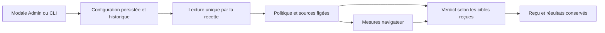

# Configurer les objectifs de performance du graphe

Dans **Administration → Objectifs de performance du graphe → Configurer les seuils**, réglez :

- le délai maximal du clavier, en millisecondes ;
- le nombre d’échantillons par charge ;
- les charges à mesurer, avec le nombre de cartes et le délai maximal de rendu pour chacune.

Une mesure de **30 ms** est un résultat observé. Le seuil exprime le résultat acceptable. Le **p95** est le délai sous lequel doivent rester 95 % des échantillons ; avec seulement cinq échantillons, ce calcul utilise leur maximum. Augmenter le seuil ne rend pas le graphe plus rapide. Un seul échantillon est utile pour un diagnostic, pas pour estimer une distribution représentative.

L’aperçu ne sauvegarde aucune configuration. La confirmation exige un motif et crée une nouvelle révision. Un changement concurrent est refusé : rechargez les réglages avant de confirmer. Échap ferme la modale sans enregistrer et restitue le focus. L’historique conserve les anciennes valeurs, l’auteur, la date et le motif. Pour revenir à une configuration antérieure, ressaisissez ses valeurs : elles deviennent une nouvelle révision, sans effacement de l’historique.

## Valeurs et stockage

Les valeurs par défaut ont une seule source : `config/graph-performance.json`, embarquée lors de la construction. Il ne s’agit plus de seuils cachés dans la nouvelle recette. Sans réglage enregistré, cette configuration est affichée comme **Valeurs par défaut**.

Les valeurs choisies et l’historique sont enregistrés atomiquement dans `.swarm/graph-performance.json`. Le CLI et le web emploient les mêmes gardes : révision attendue, identifiant d’opération, validation des valeurs, verrou interprocessus et refus des liens symboliques. Une même opération ne crée pas une deuxième révision. Aucun secret n’est stocké ici. Les maxima annoncés par l’API et utilisés par le formulaire correspondent uniquement à la représentation exacte des entiers Go/JSON, avec au plus 2⁵³−1 sur une plateforme 64 bits. Les anciens plafonds de 60 000 ms, 100 échantillons, 10 profils et 10 000 cartes sont retirés. Les délais et échantillons restent positifs ; cette recette exige au moins un profil, des nombres de cartes distincts et au moins deux cartes par graphe. Les requêtes web restent limitées à 16 Kio et le document de configuration/historique à 1 Mio ; ces limites de transport et stockage sont annoncées séparément. L’aperçu contrôle aussi la taille réellement enregistrable, sans écrire.

Ces réglages ne changent pas les budgets, délais d’arrêt ou nombres d’appels des agents.

## CLI

```sh
swarm --root /chemin/projet run-limits performance show
swarm --root /chemin/projet run-limits performance history
swarm --root /chemin/projet run-limits performance preview --input seuils.json
swarm --root /chemin/projet run-limits performance apply --input seuils.json
```

Document complet à préparer après lecture de la révision actuelle :

```json
{
  "schema_version": 1,
  "event_id": "performance-configuration-001",
  "expected_revision": 0,
  "values": {
    "keyboard_p95_ms": 100,
    "samples": 5,
    "loads": [
      {"cards": 50, "render_p95_ms": 1000},
      {"cards": 200, "render_p95_ms": 1000},
      {"cards": 500, "render_p95_ms": 2000}
    ]
  },
  "reason": "Objectifs de réactivité validés pour ce projet"
}
```

## Recette configurable et preuves

```sh
node tests/graph_performance_ui.cjs /chemin/swarm /chemin/resultats /chemin/projet
```

Cette recette lit les réglages **une seule fois via le CLI public**, avant tout parcours. Elle enregistre `performance-policy.json` : révision, valeurs exactes, empreinte de la politique et empreinte de la recette utilisée. Les variantes fonctionnelles FR/EN et sombre/État sont conservées ; les charges, échantillons et seuils de performance viennent du réglage figé. Le résultat conserve aussi cette politique. Un changement pendant l’exécution ne réinterprète pas le résultat.

Pour une validation automatique, autorisez explicitement cette commande dans la politique publique de la tâche et déclarez ses entrées, notamment la recette, le binaire/candidat et la configuration choisie. Une configuration modifiée ne remplace pas automatiquement un contrat de validation déjà autorisé. Aucun changement de seuil ne transforme un ancien échec en succès.

La recette B03 historique (`tests/graph_draft_ui.cjs`) et ses contrats figés conservent les seuils d’origine pour reproduire leurs preuves. Le nouveau point d’entrée configurable l’adapte dans un fichier de sortie temporaire, refuse une source incompatible et ne modifie pas cette archive. Les nouveaux contrôles doivent utiliser le point d’entrée configurable ci-dessus.

[English guide](en/GRAPH-PERFORMANCE.md)

## Verdict conforme aux réglages reçus

Le point d'entrée configurable applique les mêmes cibles au diagnostic d'une
charge et au verdict final de toutes les charges. Il refuse une recette dont le
format ne correspond plus aux adaptations attendues. Les tests du verdict généré
couvrent cibles plus strictes, plus souples, égalité et nombre de cartes personnalisé ;
ils utilisent des observations contrôlées et ne constituent pas des mesures navigateur.

Mesure locale du 13 octobre, graphe de 500 cartes : cinq rechargements, p95 de
1 342 ms ; cinq interactions clavier, p95 de 31 ms. La politique reçue conserve
2 000 ms et 100 ms : aucune cible n'est relevée pour obtenir PASS. Le démarrage
initial à froid de 1 691 ms est rapporté séparément. Le reçu conserve le binaire,
la recette et la configuration figée. Aucun modèle n'est appelé par cette mesure.

La commande « Ajouter une charge » reprend le seuil de rendu de la dernière ligne ; elle transmet le même champ `render_p95_ms` que le moteur. Après sauvegarde et relecture, le focus revient au réglage ou au rechargement si la lecture a échoué. La recette Admin vérifie onze profils, des valeurs au-delà des anciens plafonds, persistance et réouverture, FR/EN et deux thèmes.


