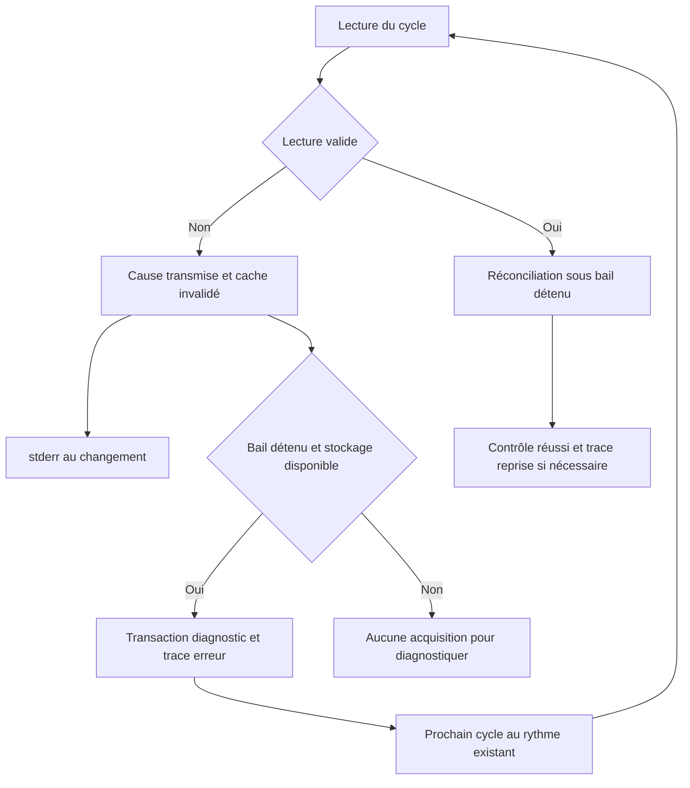
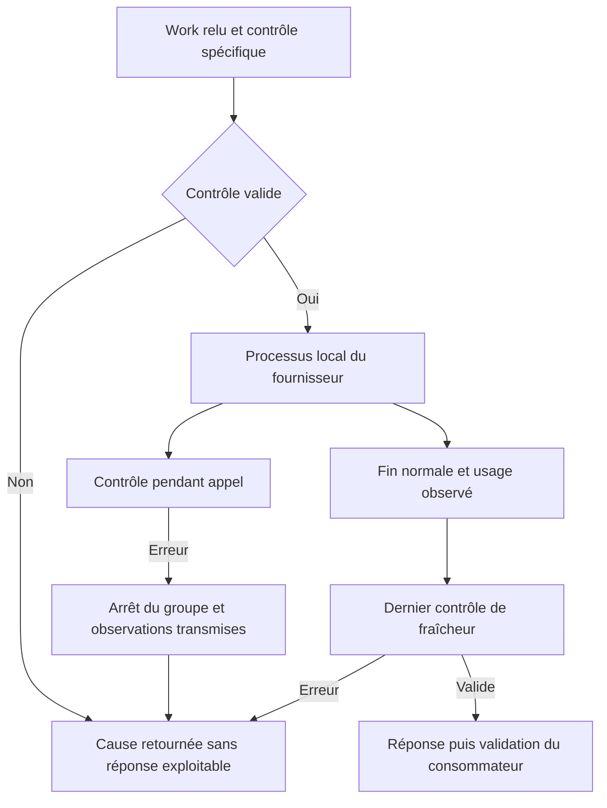
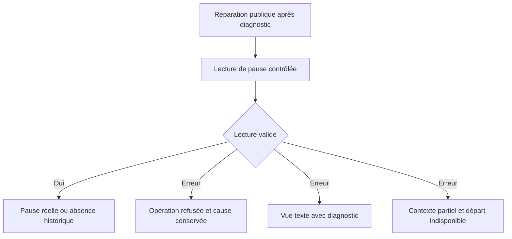
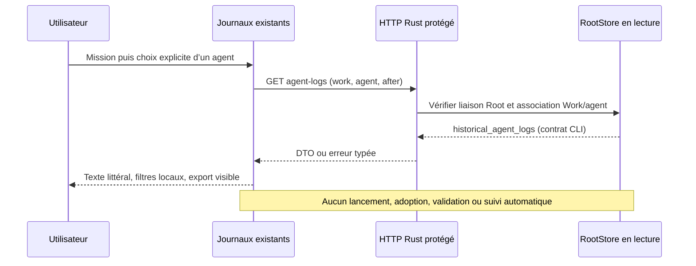
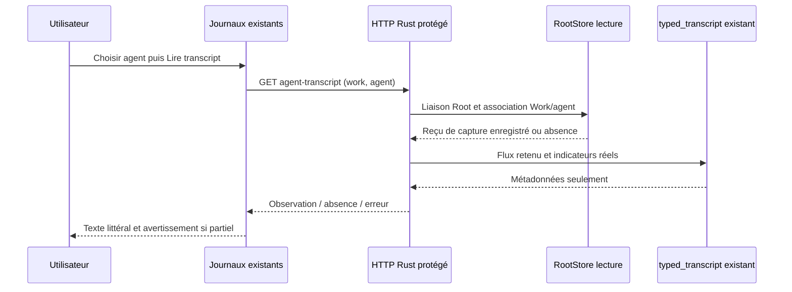

# Incident machine et reprise d’une mission

Une mission n’est terminée que lorsque ses résultats sont validés et son
responsable a clôturé le travail. Un serveur actif ou des tests du moteur réussis
ne prouvent pas cette clôture.

## Stockage indisponible

Dans le moteur Rust, le délai SQLite `storage_busy_timeout_ms` enregistré dans
Admin s'applique dès la première vérification de l'identité du datastore. Le
moteur lit d'abord les réglages validés par son descripteur de répertoire, sans
SQL ; il ne retombe sur les valeurs d'installation que si le fichier est absent.
Un document invalide ou illisible refuse l'ouverture. Ce délai remplace celui du
constructeur SQLite et ne change ni les tentatives ni les droits. Zéro est une
décision opérateur de refus immédiat sous contention ; l'expiration d'un délai
non nul reste un refus, jamais un succès vide ou une preuve d'absence d'effet.
Les lectures d'identité suivantes conservent le réglage courant de la connexion.

Si une permission opérateur est retirée pendant la synchronisation, un aperçu de départ ou la lecture
initiale d'un rapport, avant son écriture, un refus
propre du garde peut arrêter la seule surveillance de cette mission avec la raison
`permission-withdrawn`. L'événement `mission-watch-blocked` conserve les effets de
file déjà enregistrés, les refus des autres candidats et la cause du preview.
Une synchronisation refusée reste explicitement enregistrée : une révision
concurrente ne la transforme pas en opération sans effet. Son Work, sa permission
et l'absence de préparation sont contrôlés avant l'arrêt de cette session.
Pour un rapport, il conserve aussi le dernier Work déjà enregistré et indique
qu'aucune nouvelle écriture de rapport n'a été tentée par cette lecture refusée.
Ce n'est ni une réussite de départ, ni un nettoyage de file démontré. Le serveur
continue ; les workers déjà autorisés conservent leur cycle propre. Les rôles
encore possédés par cette surveillance sont drainés par l'arrêt de son contrôleur.
Un échec de publication, une admission tentée ou un effet incertain reste une
erreur avec ses causes. La reprise exige les permissions courantes et une nouvelle
session propriétaire, sans remboursement ni rejeu automatique de l'admission.

Le cockpit affiche un bandeau global et un bouton **Diagnostic du stockage**.
Cette lecture locale ne consomme aucun appel IA et ne dépend pas de SQLite :
elle reste accessible si la lecture des missions échoue. **Vérifier à nouveau**
actualise les mesures ; aucun bouton ne supprime de fichier.

En ligne de commande :

```sh
swarm --root /chemin/du/projet doctor
swarm --root /chemin/du/projet --json doctor
```

`doctor` ne crée ni n’ouvre la base. Il lit les volumes de `.swarm` et du dossier
temporaire du processus. Le code de sortie vaut 2 si l’un des volumes est
indisponible ou sous la marge de sécurité, 0 sinon. Le JSON donne les chemins,
octets et inodes disponibles. Un dossier `.swarm` absent n’est pas considéré sain.

- Avertissement sous 1 Gio disponibles.
- Nouveaux départs suspendus sous 256 Mio, ou sous 256 inodes disponibles.
- Une mesure impossible suspend également les départs.
- Les préparations d’agents, départs de superviseurs, activations de planification
  et revues indépendantes utilisent le même contrôle avant un nouvel appel.
- Le conducteur réexamine le stockage à chaque cycle. Après rétablissement, il
  reprend la réconciliation et les opérations déjà autorisées. Les tâches refusées,
  plafonds épuisés et pauses restent applicables.
- Les erreurs système ENOSPC et SQLite FULL deviennent `storage_unavailable` ;
  l’API renvoie HTTP 507, sans annoncer que la commande a réussi.

Le contrôle n’est pas une réservation d’espace. Un agent déjà actif peut remplir
le volume entre deux lectures. Les volumes propres à un fournisseur distant ou à
un espace externe ne sont pas couverts par cette mesure. Ne pas interpréter
« stockage disponible » comme une garantie de capacité pour toute la mission.

Pour libérer de l’espace, identifier d’abord ce qui l’occupe. Les caches de
compilation reconstruisibles peuvent être nettoyés par leurs outils. Les rapports,
bases, copies de travail en échec et historiques ne sont jamais assimilés à des
caches. Après une écriture interrompue, examiner l’état public avant toute reprise.

## Lecture impossible par le conducteur

Une erreur de lecture de l’inventaire ou de l’occupation des agents interrompt
le cycle : aucune liste partielle n’autorise un départ. Le conducteur rapporte
la cause sur stderr à son apparition ou changement, puis la reprise du cycle
une fois l’erreur levée ; il ne répète pas une erreur identique à chaque poll.
Le serveur utilise ce même parcours. Un `mission watch TRAVAIL` lit seulement
le Work ciblé : une enveloppe étrangère invalide ne bloque pas ce watch.
Le conducteur global exige toujours un inventaire complet valide.

Pour les baux qu’il possède déjà, le conducteur publie `supervision.state=error`,
`last_error` et la prochaine vérification dans `mission status` et le snapshot
HTTP du cockpit, si le Work ciblé reste lisible. Sinon ces lectures publiques
retournent elles-mêmes l’erreur du Work, sans fabriquer un statut exploitable. Il ne prend aucun bail pour diagnostiquer une mission illisible
et ne réactive pas un bail arrêté ou remplacé. Si l’échec précède toute acquisition,
il reste dans stderr ; aucun diagnostic persistant n’est inventé. Si le stockage
est bloqué, aucune écriture de diagnostic n’est tentée par le cycle. Si SQLite
refuse ce diagnostic, l’erreur retournée conserve aussi cette cause ; un ancien
état en base peut rester visible jusqu’à expiration du bail.

Une erreur au message vide ou limité aux contrôles reste un échec explicite.
Une première vérification en échec ne renseigne pas `reconciled_at`. Une
réconciliation antérieure reste historique pendant l’erreur. À la reprise,
`last_error` est vidé ; les transitions `cycle-error` et `cycle-recovered` sont
ajoutées au journal de coordination dans la même transaction que le diagnostic,
une seule fois par changement. Un refus d’écriture du journal annule ce contrôle.
Ces traces de santé ne sont pas des actions métier du conducteur. Une reprise
ne répare pas les données, ne réautorise aucune tâche et ne prouve pas la clôture.
L’arrêt d’un bail retourne ses erreurs à la boucle au lieu de les absorber.



Voir les [preuves et limites M31](plans/deepagents-integration/RESULTATS-MEMOIRE-27.md).
La fiabilité de tous les autres callbacks de lecture reste à qualifier dans MEM-P1.

## Fraîcheur pendant une revue ou une planification

Les appels structurés de planification, revue simple, revue de candidat, lots,
fragments et diagnostic relisent l’enveloppe Work avant leur contrôle spécifique.
Une erreur de lecture reste une erreur avec sa cause ; elle n’est plus réduite à
un booléen « activation révoquée ». Le lanceur vérifie avant le départ, au poll
existant pendant l’appel et après une fin normale, avant de rendre une réponse
exploitable. Une réponse rapide n’évite donc pas le dernier contrôle.

Un contrôle absent refuse l’appel sans panic. Avant le départ, aucun processus
n’est lancé en cas de refus. Pendant l’appel, l’arrêt utilise le même groupe de
processus que précédemment. Une erreur de fraîcheur ne fournit aucune réponse
exploitable au consommateur. Le lanceur remet les observations d’usage d’un processus déjà lancé
au recorder existant ; il ne supprime ni ne rembourse réservations, activations
ou historique. Une panne d’écriture de ce recorder n’est pas qualifiée ici. Les délais et politiques Admin existants restent applicables.

Pause, remplacement de tentative ou de bail et preuves changées restent des
refus. Pour ces cinq chemins qui consultaient déjà la pause, une valeur illisible
est une erreur explicite ; la cause reste accessible sans exposer la valeur.
Le début, la réservation et la finalisation des fragments ainsi que les gardes
transactionnelles de planification utilisent le même lecteur contrôlé.
Les erreurs Work, fichiers et fournisseur conservent leur cause au travers
du contrôle. Un cooldown simultané ne remplace plus la cause initiale : les deux
peuvent être conservés. La persistance métier relit encore l’état courant ; si
le Work reste illisible, elle retourne cette erreur et ne fabrique pas un avis
passé, une tâche acceptée ou un diagnostic exploitable.

Les fonctions historiques à callback booléen sont adaptées pour compatibilité ;
elles peuvent signaler une révocation, mais ne disposent pas d’une cause de
lecture à transmettre. Les six consommateurs ci-dessus utilisent le contrat
avec erreur. Ce contrôle ne crée aucun droit d’usage mémoire ou d’identité.



Preuves et limites de cette tranche : [M32](plans/deepagents-integration/RESULTATS-MEMOIRE-28.md).

## Pause illisible dans les opérations et les vues

Le lecteur booléen qui ignorait les erreurs de pause est supprimé. Les opérations
et les 19 appels concernés relisent la pause par le même lecteur contrôlé : une
absence historique signifie non pausé ; une valeur illisible est une erreur,
sans réparation implicite. Les transactions de lancement, modèle de responsable,
révision de contrat, contrôle automatique, règlement et automation conservent
leur propre validation et propagent la cause sûre. Une lecture invalide ne devient
ni autorisation de départ, ni réussite vide, ni simple « autorisation absente ».

Les snapshots CLI/HTTP refusent cette lecture plutôt que publier paused=false.
Les vues texte montrent le diagnostic. Dans le contexte partiel de la page des
tâches, le fait suspension_departs est omis, la donnée manquante est attribuée
au travail dans Missing et le départ devient indisponible avec sa raison.
Un prédicat d’éligibilité booléen peut donc refuser ; il n’est pas un lecteur SQL
qui prétend connaître la pause. Une erreur du cycle conserve son empreinte
précédente et rejoint son chemin de diagnostic existant.

La réparation utilise l’opération publique de pause, après diagnostic. Elle ne
rembourse pas les appels ou réservations et ne confère aucun droit supplémentaire.
Les chemins qui ne consultaient pas la pause quand leur option était désactivée
conservent ce contrat. Les lectures jointes d’observation noyau et le prédicat SQL
de supervision restent à qualifier avec leurs enveloppes liées ; MEM-P1 demeure
ouvert. L’UI courante et le serveur existant ne sont pas qualifiés par une fixture
backend avec des ressources embarquées figées.



Recette, preuves et limites : [M33](plans/deepagents-integration/RESULTATS-MEMOIRE-29.md).

## Tentatives épuisées

Le cockpit affiche **Mission bloquée — tentatives épuisées** lorsqu’aucune tâche
ne tourne et qu’une tâche bloquée a atteint son plafond. Le bouton **Examiner les
tentatives et les refus** ouvre les faits conservés, le dernier avis indépendant
et les accès aux rapports. **Enregistrer le diagnostic** exporte un JSON local
avec révision, tâche, tentatives et avis. Aucun appel IA n’est lancé par ce parcours.

Le CLI expose les mêmes faits via `swarm mission status TRAVAIL`, ou en JSON avec
`attempts_used`, `attempts_allowed` et `attempt_limit_reached` pour chaque tâche.

Après trois tentatives, **Préparer un essai correctif** ouvre la proposition
fondée sur le dernier refus indépendant. Une confirmation explicite autorise un
seul essai supplémentaire, avec historique et revue conservés. Les conditions,
limites et commande CLI sont décrites dans [la reprise bornée](ATTEMPT-RECOVERY.md).
Si l’action est indisponible, son motif reste affiché : une autorisation antérieure,
une revue absente ou en cours, ou un budget de revue épuisé ne sont pas contournés.

Cette possibilité de reprise ne démontre pas, à elle seule, qu’une mission réelle
aboutira. La clôture dépend de la correction effective et de ses preuves.

## Résumé de reprise dans le cockpit Rust
La page **Reprendre le travail** lit le résumé actuel calculé par le moteur pour
la mission sélectionnée, en FR ou EN. Le texte est affiché littéralement dans le
bloc existant. Cette lecture n’établit ni différence depuis la visite précédente,
ni identité d’agent, ni validation nouvelle ; OODA et marquage de visite restent
indisponibles dans ce raccord. Un résumé peut mentionner des preuves conservées
et leur état courant sans autoriser une action ultérieure.
GET/HEAD `/api/v1/work-resume?work=ID&lang=fr|en` exige les deux paramètres explicites,
sans doublon/inconnu, derrière session/Host/capacité et Root lié. Le moteur utilise
`inspect_work_view` : lecture des données, politiques, événements et observations
fichiers/Git ; aucun fichier de vue n’est publié (contrairement à `render_work_view`).
Les politiques Git déjà enregistrées restent applicables. Aucun appel IA, commande
de contrôle, départ, visite ou changement de budget n’est déclenché.
L’ouverture ou une actualisation explicite relit le texte ; la sélection d’une autre
mission efface l’ancienne lecture. Une réponse tardive est ignorée, une erreur ou
une réponse invalide affiche un diagnostic avec reprise explicite, sans retry/polling.

```mermaid
sequenceDiagram
    actor U as Utilisateur
    participant I as Page Reprendre existante
    participant H as API Rust protégée
    participant R as Root et preuves conservées
    U->>I: Ouvrir ou actualiser la mission sélectionnée
    I->>H: GET work-resume, Work et langue explicites
    H->>R: inspect_work_view, sans publication
    R-->>I: Révision, langue, Markdown calculé
    Note over I: Texte littéral ; réponse ancienne ignorée après sélection
    Note over R: Aucun fichier de vue, visite ou OODA enregistré
```

Si la projection calculée n’est pas portée (HTTP501), le refus reste visible.
**Lire uniquement les données enregistrées** déclenche explicitement la lecture
protégée distincte `/api/v1/work-recorded-resume`, avec les mêmes Work/langue explicites.
Le DTO indique `observation: recorded`, et le texte précise que la validation n’a
pas été recalculée. La garde de projection complète demeure ; aucune acceptation
n’est déduite. La projection de revues managées en lots reste à porter. Aucun
fallback ni retry automatique n’est déclenché.

Le bloc de résumé défilant est nommé pour les lecteurs d’écran et reçoit le focus clavier explicitement ; cette propriété ne dépend pas de l’auto-focus des conteneurs du navigateur.

Limite connue de migration : le statut de missions historiques peut encore refuser avec `mission-root-unavailable` enveloppant `agent-mission-provenance` / `mission-agent-binding-required`. Cette enveloppe ne prouve ni panne du stockage ni absence du rôle Root. Le résumé ne répare pas ce binding et n’autorise aucun départ ; adoption de provenance native/legacy à qualifier séparément.

## Journaux historiques d’agents — cockpit Rust

La page **Journaux** conserve ses contrôles et son lecteur texte existants.
Sélectionner une mission, ouvrir la page, puis choisir explicitement un agent.
La liste provient des données enregistrées ; ni son état ni ses messages ne
prouvent son identité authentifiée, sa présence actuelle ou un droit d’exécution.
Cette lecture ne dépend pas du statut calculé des anciennes missions.

`GET /api/v1/agent-logs?work=ID&agent=ID&after=0` (HEAD aussi) exige les trois
paramètres exactement une fois, des identifiants sûrs et un entier i64 canonique.
Corps, clés inconnues, doublons, curseurs ambigus et association agent/mission
incorrecte sont refusés. Session, Host, capacité et liaison physique du Root
restent contrôlés. Le Root est ouvert sans écriture ; aucune visite, mission,
réservation métier, provenance, budget ou commande fournisseur n’est modifié.
Les causes de lecture/encodage/fermeture restent des erreurs, jamais une liste vide.

Le DTO porte `schema_version`, `work_id`, `agent_id`, `after`, `rows`. Les lignes
sont exactement celles de `agent logs ID CURSOR --json` : zéro demande les
200 dernières en ordre croissant ; un entier négatif les 200 premières ; un
entier positif les suivantes strictement après ce numéro. Ce découpage hérité
est une pagination de transport, pas une rétention ni une politique d’exécution.
**Depuis le début** puis **Page suivante** parcourent l’historique. Une page vide
est explicitement annoncée ; aucune extrapolation sur la présence d’un agent.
Le navigateur refuse les numéros hors de la représentation entière exacte de
JavaScript ; utiliser la CLI i64 pour ces historiques, sans arrondi silencieux.

Les filtres texte exact et type exact portent uniquement sur la page chargée.
L’export NDJSON contient uniquement ses lignes visibles. Le texte est rendu
littéralement ; aucune coloration/console distante ni suivi automatique n’est
activé. Une erreur efface les anciens messages et désactive l’export ; une
sélection explicite ou **Depuis le début** permet une nouvelle lecture. Changer
de mission efface la source et ignore les réponses retardées déjà en vol.
Les autres journaux de supervision et le direct restent à raccorder.



Les observations opaques produites par le moteur (capture finale et faits
fournisseur) sont encodées dans leur représentation persistée avant comparaison
stricte et journalisation. Les caractères HTML et séparateurs Unicode sont
échappés selon le contrat Go JSON, sans perte des clés dupliquées ni des lexèmes
numériques. Cela corrige un refus de sauvegarde après exécution ; cela ne répare
pas automatiquement un ancien reçu incomplet et ne desserre aucun garde.

Les pages retournées sont les entrées historiques du cycle de vie/commandes
de l’agent ; la capture des sorties du programme et le transcript sont distincts
et ne sont pas exposés par cette route. La page Journaux ne demande pas le
statut calculé de la mission. Ouvrir une autre vue le demande normalement et
conserve ses refus, notamment les branches terminales encore non portées.

## Transcript typé depuis Journaux — Rust

Après le choix d’un agent, ouvrir **Transcript typé — contenu masqué** puis
**Lire le transcript typé**. Le lecteur réutilise `typed_transcript`, déjà utilisé
par Live, sans modifier cette interface indépendante. Il affiche les types
d’événements, noms/identifiants d’outils, nombres d’octets omis et tokens déclarés.
Aucun message d’assistant, prompt, entrée/sortie d’outil ou capture brute n’est
renvoyé. Les métadonnées d’identifiants restent des données enregistrées, pas
une authentification, une preuve d’activité ou une autorisation. Le format
Claude/Codex vient de la forme des événements, pas du nom du fournisseur configuré.

`GET /api/v1/agent-transcript?work=ID&agent=ID` (HEAD aussi) exige les deux clés
uniques, identifiants sûrs et corps vide. Session, Host, capacité et descripteur
du Root restent contrôlés ; l’agent doit appartenir à la mission explicite.
DTO : `schema_version:1`, `observation:recorded`, `work_id`, `agent_id`,
`recorded_status`, `state`, `reason`, `capture_truncated`, `capture_invalid_utf8`,
`output_complete`, `transcript`. Un reçu absent (`receipt-absent`) ou une capture
non retenue (`capture-not-retained`) donne `unavailable`, transcript/indicateurs
explicitement null. Une capture vide valide donne `available` avec zéro événement.

Le reçu native_execution_result v1 exige ses indicateurs réels ; absence, mauvais
type, doublon connu ou version non prise en charge restent des erreurs serveur,
jamais des valeurs false implicites. Les requêtes invalides restent HTTP400,
méthode405, accès refusé403. Lecture/encodage/fermeture conservent leurs causes.
Une capture tronquée, UTF8 remplacé, sortie incomplète ou flux JSON tronqué
affiche un avertissement de lecture partielle. Les notes du parseur existant
conservent les événements inconnus/queues non JSON ; elles ne prouvent pas que
tout le flux était reconnu. Aucune borne d’exécution ni rétention n’est ajoutée :
la capture existante reste soumise à sa politique Admin `agent_capture_max_bytes`.

Lecture uniquement sur bouton, sans polling, visite, lancement ou modification
Work/agent/budget. Le contenu est littéral, défilant et accessible au clavier.
Changer de mission/source efface le transcript et invalide les réponses en vol.
Erreur et absence ne réutilisent jamais le contenu précédent ; le bouton permet
une reprise explicite. Cette projection ne fournit pas le terminal interactif
ni l’export des contenus masqués. Le journal de cycle de vie conserve son propre
lecteur/curseur/export, indépendant du transcript.



## Statut après terminaison ordinaire — Rust

Après un agent terminé sur une tâche bloquée, hors livraison incomplète ou reprise
non portée, `mission status` et Conduite exposent le résultat sans le valider.
Sans rapport attribuable : `completed_unproven`. Un rapport non vide sous `docs/`,
dans la fenêtre du réglage persistant de décalage d’horloge, devient
`attributable_unsubmitted` et reste à vérifier. Plusieurs candidats sont ambigus.
Les erreurs de lecture restent des erreurs ; aucune identité ou autorisation de
relance ne découle de cette lecture. Les anciens agents sans binding natif et
les revues en lots non portées peuvent encore refuser le statut calculé.

Pour une tâche ordinaire sans planification, un agent terminé et un blocage
« Livraison incomplète : » produisent `delivery_incomplete`, `not_validated`,
rapport absent. Le moteur ne cherche pas de rapport incomplet dans `docs/` :
le producteur historique de ce rapport concerne seulement les dépôts managed.
Ce raccord ne porte pas encore cette branche managed et n’autorise pas de reprise.

Une décision d’abandon ordinaire reste consultable si des agents terminés
(completed/failed/interrupted) sont conservés. Le statut montre l’abandon non
validé, l’agent et la tentative historiques, sans lire ou attribuer un nouveau
rapport. Un agent encore actif sur cette tâche conserve le refus de cohérence.
Les dérogations et les historiques managed non portés restent distincts.

## Lectures de préparations — Rust

`prepare list`, `prepare show ID`, `prepare history ID besoin|brief|plan [avant_revision]`
et `prepare methods` lisent la Root courante sans écrire ni adopter un plan.
Les routes GET/HEAD protégées correspondantes sont `/api/v1/preparations`,
`/api/v1/preparations/show?id=ID`, `/api/v1/preparations/history?id=ID&document=plan&before=REV`
et `/api/v1/preparations/methods`. Les requêtes ambiguës, corps ou champs inconnus
sont refusés ; une préparation absente reste404, un enregistrement malformé500.

`plan_ready` est recalculé avec les hash déclarés des documents et les octets
courants de la méthode. Ce drapeau ne vaut ni adoption humaine, ni validation
d’un résultat, ni autorisation de lancement. Une méthode indisponible garde un
motif visible dans le catalogue et rend ce drapeau faux. Un fichier local absent
utilise le pack embarqué ; un lien, accès refusé ou contenu invalide ne le fait pas.

Dans Admin → Préparations et documents, les trois paramètres v41 sont persistés :
`preparation_list_limit` (défaut livré100), `preparation_history_limit` (50),
`preparation_method_max_bytes` (131072octets par fichier). Null signifie sans
plafond ; zéro masque les lignes/versions sans les supprimer, ou refuse une
méthode non vide pour la limite d’octets. Les anciennes installations sans ce
groupe doivent l’adopter explicitement via prévisualisation/application Admin ou
CLI ; aucune valeur de repli ne s’applique à leur lecture. Les limites actives
sont relues à chaque opération, sans redémarrage. Les grands compteurs restent
exacts en configuration ; les consommateurs JSON doivent préserver les entiers.

L’historique utilise une révision `before` positive exclusive ; son absence
reprend le sentinelle i64max du contrat Go. Le tri de liste suit rowid décroissant,
pas l’ordre lexical d’un identifiant opaque. Les données et les historiques de
préparation restent inchangés. Les écritures, le dialogue et la conversion de
préparations ainsi que l’éditeur web complet restent non portés.

Le lecteur de réglages Rust utilise aussi les tentatives/délais de contention stockés : une réservation Admin occupée et libérée proprement peut être réessayée avant lecture, sans relancer de mission ou de fournisseur. Zéro tentative supplémentaire refuse immédiatement ; null peut attendre sans plafond. Les erreurs de fermeture, de politique ou composées restent fatales.


### Brouillons de préparation : écriture Rust (v42)

La création et la sauvegarde sont raccordées au même stockage que les lectures :
`prepare create --input requete.json`, `prepare save ID --input requete.json`,
ou POST protégé `/api/v1/preparations/command`. Fournir version1, action,
event_id et expected_revision ; save exige preparation_id identique à ID et
document besoin/brief/plan. Création : identifiant absent et révision0.
Une sauvegarde ne valide ni n’exécute le plan.

Si `settings-preparation-write-not-configured` apparaît sur une ancienne
installation, ouvrir Admin → Régler le moteur et adopter les nouvelles valeurs
par prévisualisation/enregistrement, ou utiliser engine-settings describe/show/
preview/apply avec le schéma du catalogue. Ne pas réinitialiser le journal.
L’interrupteur0/1, les tailles UTF-8 (null sans plafond) et la méthode initiale
sont persistés et partagés entre Admin, API et CLI. L’ancien interrupteur
SWARM_PREPARATION_DISABLED Go ne remplace pas ce réglage Rust.

Même événement et même intention : reçu d’origine, sans nouvelle sauvegarde.
Un reçu historique porte receipt_historical=true. Après un résultat incertain,
relire puis rejouer le même événement inchangé ; ne pas inventer un autre ID.
Les erreurs après un reçu connu conservent recorded_preparation(id,revision),
distinct du Work ; absence de métadonnées ne garantit pas un rollback. CLI :
conflit3, écriture désactivée4, méthode inconnue5, autres erreurs ordinaires2.
Les diagnostics structurés Rust conservent leurs familles préfixées et les causes ;
les textes d’erreur Go ne constituent pas un oracle octet pour octet.
Une méthode indisponible permet un brouillon sans empreinte fraîche ; consulter
prepare methods pour son diagnostic, sans autorisation implicite d’exécution.

La recette preparation-writes-rust couvre les parcours publics et le test Rust
retained-Root des insertions enfants. Un déclencheur SQL ajouté avant ouverture
est correctement refusé par le contrôle de schéma : cette fixture ne prouve pas
le rollback du writer. Le test d’atomicité injecte après ouverture valide d’une
Root isolée, supprime le défaut, rejoue et rouvre. Aucun éditeur de préparation,
dialogue IA, adoption de plan ni migration globale achevée n’est revendiqué ici.

Un refus `preparation-receipt-identity-mismatch` signale une incohérence de reçu,
pas un conflit normal de révision : conserver les preuves et diagnostiquer avec
le propriétaire du stockage. Aucun rejeu identique ne répare un reçu corrompu.
Le contrôle compare le contenu courant avant projection ; un reçu historique
reste explicitement historique et n’acquiert aucune autorité d’exécution.
