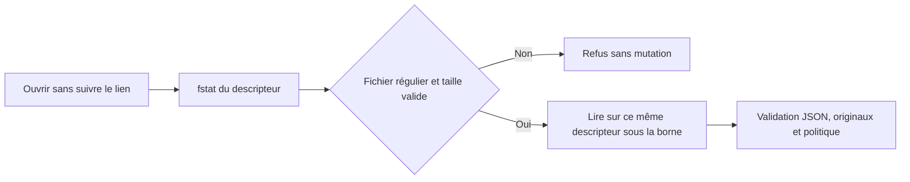
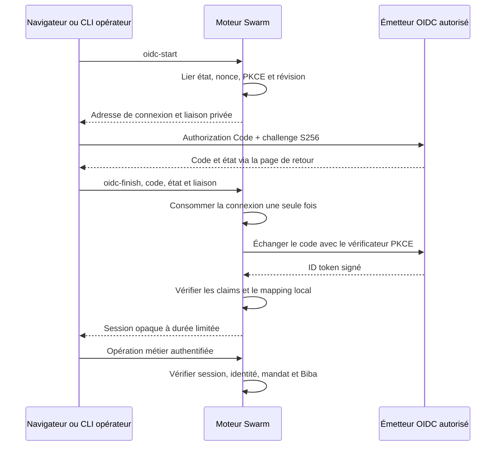
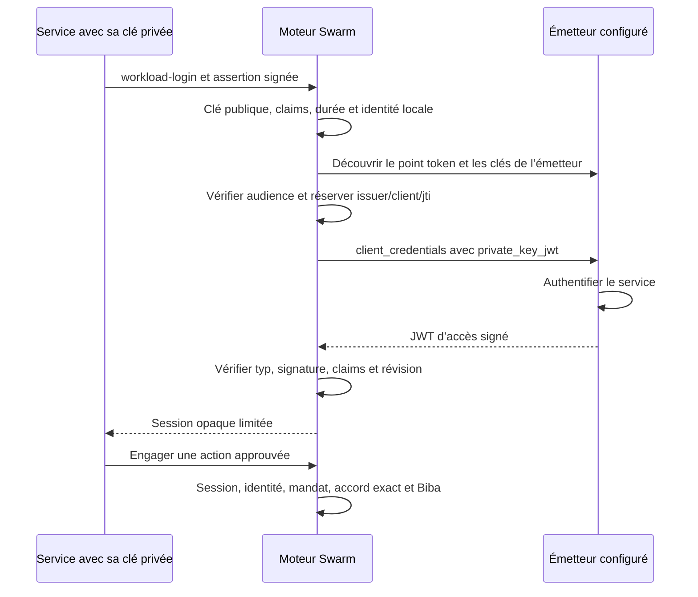
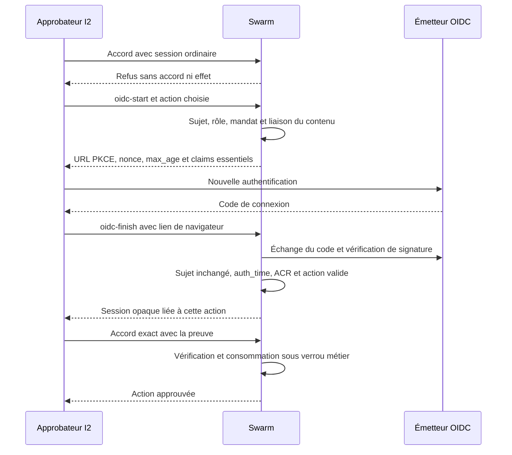
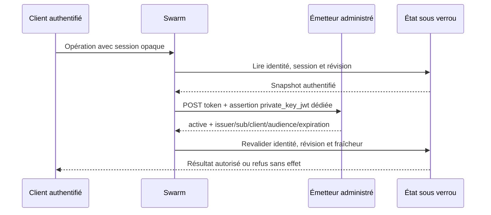

# Actions de confiance — pilote T2

Ce pilote protège un règlement **strictement simulé** par un mandat versionné, une approbation exacte et une variante stricte de Biba. Il ne contacte aucune banque, ne déploie rien et ne constitue ni une preuve d’exécution réelle ni une acceptation du moteur.

## Contrat public

Pour viser le serveur persistant, utiliser `--server http://127.0.0.1:PORT`
et `SWARM_WEB_SESSION` : [contrat du client local](actions-confiance-T4.md#cli-vers-le-serveur-local-persistant).
La racine locale n'est pas ouverte dans ce mode, même en cas d'échec serveur.

Les opérations utilisent `swarm --root RACINE --json trust OPÉRATION [--input FICHIER|-]`. Pour les actions métier, l’identité authentifiée vient uniquement de `SWARM_TRUST_TOKEN` pour le CLI et de `Authorization: Bearer …` pour `POST /api/v1/trust-actions?action=OPÉRATION`. Les champs `actor` et `integrity` du demandeur sont ignorés. Les jetons ne sont persistés que sous forme d’empreintes. La configuration est une opération de l’opérateur local, protégée par les droits de son espace et, sur le web, par la session Swarm et le CSRF ; elle n’exige pas le jeton métier et consigne l’identité opérateur. Les rôles d’administration d’entreprise relèvent de T3.

Opérations : `show`, `config-preview`, `config-apply`, `mandate-create`, `mandate-revoke`, `request`, `approve`, `commit`, `reconcile`, `direct-write`, `elevate-integrity`, `export`, `anchor` et `verify`. Une commande mutante porte `schema_version: 1` et un `event_id` unique. `approve`, `commit` et `reconcile` désignent l’objet par `action_id` (l’ancien champ `resource` reste lu pour la compatibilité du pilote).

L’API et le CLI utilisent la même validation Go et le même état durable `.swarm/trust-actions.json`. Les écritures prennent un verrou processus et remplacent le fichier atomiquement. Une même clé d’idempotence avec le même contenu retourne l’état connu ; avec un contenu différent elle échoue avec `idempotency_conflict` sans nouvelle écriture au grand livre.

## Modèle Biba retenu

Le pilote utilise une politique d’intégrité stricte, complétée par une procédure d’admission attribuée :

- I3 : administrateur/opérateur ; il configure les identités et admet un mandat I2 ;
- I2 : approbateur et service d’effet ; ils approuvent l’empreinte exacte et invoquent le connecteur simulé ;
- I1 : demandeur/entrée externe ; sa provenance et l’empreinte de son original sont conservées.

Un sujet ne choisit pas son niveau. Avec `require_separation: true`, l’auto-approbation, l’auto-élévation, l’accès direct à l’état protégé et la modification d’un champ couvert sont refusés. Après révocation observée par la transaction verrouillée, aucun nouvel engagement n’est admis ; un effet déjà inscrit reste observable.

## Configuration Admin, API, CLI et Go

La page `/trust-actions.html` est la surface opérateur et Admin FR/EN. Sa modale possède un titre accessible, une fermeture explicite, Échap natif et restitution du focus. Elle impose l’aperçu avant l’application.

| Paramètre | Unité / bornes | Défaut | Sens de zéro |
| --- | --- | --- | --- |
| `mandate_ttl_seconds` | secondes, 0..limite de durée Go | 3600 | aucune expiration par défaut (une date explicite reste vérifiée) |
| `unknown_reconcile_seconds` | secondes, 0..limite de durée Go | 0 | réconciliation immédiate autorisée |
| `evidence_retention_days` | jours, entier ≥ 1, représentable en Go et JSON navigateur | 365 | interdit |
| `require_separation` | booléen | `true` | sans objet |

`config-preview` ne modifie ni la configuration, ni son historique, ni le grand livre. Le verrou technique peut être créé. `config-apply` exige la révision courante ; une révision ancienne est refusée. Son `event_id` rejoué avec le même contenu retourne l’état connu, et avec un autre contenu produit un conflit. L’historique des politiques est conservé. Les identités sont fournies à chaque application car leurs secrets ne peuvent pas être relus depuis l’état public.

Les plafonds métier arbitraires sont retirés. Les bornes techniques sont exposées par `show.policy_bounds` et affichées dans Admin : sur ce binaire 64 bits, 9 223 372 036 secondes pour une durée Go et 9 007 199 254 740 991 jours pour un entier exactement représentable côté navigateur. Un binaire 32 bits expose sa borne entière réelle. API, CLI et interface utilisent ces mêmes bornes. `require_separation: false` autorise un même sujet doté des rôles et du niveau requis à demander puis approuver ; conserver `true` pour la séparation des responsabilités. La politique de conservation persiste, mais la purge de production relève de T6.

## Reprise et preuves

Le connecteur inscrit en une seule section critique le grand livre et son reçu stable. Si la réponse est perdue après cet engagement, l’action devient `unknown`; après redémarrage, `reconcile` lit le reçu avant toute nouvelle tentative et produit `reconciled` sans second effet.

Chaque admission, refus, décision, engagement et réconciliation ajoute une preuve attribuée, chaînée et liée aux empreintes du contenu et de l’original. `export` ne contient aucun jeton ni clé. `anchor` est obtenu séparément ; `verify` exige l’export, l’ancre et la clé de vérification acquise séparément. Altération, réordonnancement et omission par rapport à l’ancre sont refusés. La clé locale `.swarm/trust-actions-proof.key` démontre seulement le pilote : l’ancrage tiers, la rotation/révocation et la rétention de production relèvent de T6.

## Recettes reproductibles

Depuis la racine du candidat :

```sh
python3 tests/actions_confiance_t2.py --criterion 1 --root "$PWD" --timeout-seconds 25
python3 tests/actions_confiance_t2.py --criterion 2 --root "$PWD" --timeout-seconds 25
python3 tests/actions_confiance_t2.py --criterion 3 --root "$PWD" --timeout-seconds 25
python3 tests/actions_confiance_t2.py --criterion 4 --root "$PWD" --timeout-seconds 120 --evidence-dir /tmp/swarm-t2-browser-evidence
go test -race ./internal/engine -run '^TestActionsConfianceT2' -count=1 -v -timeout=150s
```

La recette navigateur nommée `tests/actions_confiance_t2_ui.cjs` démarre le binaire candidat sur une racine temporaire et vérifie chargement, vide, succès, erreur réseau, FR/EN, État/sombre, largeurs 1440, 1024, 760, 390 et 320 px, clavier, Échap/focus et persistance Admin. La recette CLI vérifie aussi entrées invalides, refus sans mutation, réponse perdue, redémarrage, conflit de contenu, aperçu, révision ancienne et preuve altérée. Ce sont des fixtures locales, pas un fournisseur réel ni une validation indépendante.

## Matrice R01–R12 et limites

| Exigences | Producteur / observable | Garde principale |
| --- | --- | --- |
| R01–R05 | authentification, mandat, révocation, approbation exacte, transaction d’effet | tests Go identité/mandat et recette critère 1 |
| R06 | verrou, reçu, clé liée au contenu, état inconnu et reprise | test Go reprise/concurrence et recette critère 2 |
| R07–R08 | chaîne attribuée, export/ancre/clé séparés, config versionnée et Admin | test Go preuve/config et recette critère 3 |
| R09 | niveaux issus de la politique et procédures d’admission | refus `direct-write`/`elevate-integrity` sans mutation |
| R10 | page FR/EN, deux thèmes, mobile, états et clavier | recette navigateur critère 4 |
| R11–R12 | recettes publiques nommées, documentation FR/EN et handoff | contrôles opérateur T2 sur le candidat exact |

Limites : service de facturation, identités et clé de preuve locaux et factices ; pas d’isolation matérielle, de fournisseur d’identité réel activé, d’ancre externe, de connecteur bancaire, de paiement, de déploiement ou de certification. Les accès non médiés au système de fichiers relèvent de l’isolation du processus hôte : ce pilote démontre les refus de son API, pas un bac à sable système global. Les sections d’identité ci-dessous décrivent OIDC humain, services et délégations vérifiés avec des fixtures isolées.


La page charge le catalogue complet propre au pilote `locales/trust-actions-en.json`, généré en `web/trust-actions-en.js` par `npm run i18n:build`, puis le traducteur partagé `web/i18n.js`. Le catalogue global reste distinct du catalogue du pilote. Les points d’entrée CLI et HTTP appellent les mêmes opérations Go ; les recettes publiques vérifient leurs résultats observables.

Le délai de réconciliation positif est appliqué depuis la dernière mise à jour de l’état inconnu, avec la politique courante persistée. Une demande trop tôt est refusée sans nouvel effet ; la frontière exacte du délai est admise. HTTP et CLI partagent la vérification de preuve et refusent les objets JSON supplémentaires avant toute mutation.

L’approbation ne s’applique qu’à une action en attente. Elle ne peut ramener un effet engagé, inconnu ou réconcilié à l’état approuvé. Avec `action_id`, une ressource explicitement fournie doit correspondre à celle de l’action ; son omission désigne la ressource déjà liée à cet identifiant. Le champ `resource` utilisé seul comme ancien identifiant d’action conserve sa compatibilité documentée.

Les états et prochaines actions du moteur sont traduits en FR/EN sur une demande réelle. Les montants sont affichés en unités mineures et les valeurs longues reviennent à la ligne sur mobile.

Le rejeu exact de configuration restitue la réponse JSON originale de cet événement, même après des applications ultérieures et un redémarrage, sans arrondir les grands entiers. Une réponse historique absente est refusée explicitement sans remplacer la configuration courante. Les opérations métier authentifient aussi les rejeux ; HTTP exige un en-tête Bearer avec un unique jeton non vide.

Le lien d’évitement clavier cible main et lui donne réellement le focus. Les contrôles garantissent 44 px et les champs 16 px. La recette conserve les mesures de vingt combinaisons largeur/langue/thème avec des données longues.

L’export de preuve version 2 contient `originals`, indexé par SHA-256. Les valeurs
sont les octets exacts des commandes métier HTTP/CLI encodés en base64 pour
préserver espaces, Unicode et nouvelles lignes. L’API Go interne sans transport
conserve le JSON canonique du contrat. Chaque admission, refus, approbation, effet
et réconciliation lie sa propre entrée. Les identités, clés et exports ne sont
pas admis dans un corps métier ; les justificatifs d’authentification restent
hors de l’original. Le stockage privé garde sa borne technique totale de 8 Mio ;
un dépassement refuse la mutation.

La vérification exige tous les originaux référencés et refuse altération, omission
et ajout non lié à l’ancre. Les états de brouillon antérieurs ne sont pas
reconstruits : `show.originals_missing` et une limite visible signalent la lacune,
et une nouvelle opération métier reste refusée. Conserver ces données et leurs
preuves ; le propriétaire doit apporter les véritables originaux avant une
reprise prise en charge. L’export historique version 1 n’établit pas ce contrat.

Les limites de transport existantes sont distinctes du stockage : corps HTTP de 1 Mio, entrée CLI de 16 Mio, stockage privé de 8 Mio. Un export trop grand pour HTTP doit être vérifié par le CLI dans sa borne, sans découpage implicite ni troncature. La recette observe le chargement pendant qu’une vraie réponse API est retenue, puis vérifie le passage à l’état chargé.

### Valeurs exactes et qualification des traductions

La vue publique ajoute `amount_minor_text`, une projection décimale dérivée de
chaque montant entier autoritaire. L’interface utilise ce texte pour éviter
l’arrondi JavaScript au-delà de 2^53 ; le stockage, les commandes et les preuves
conservent le montant entier. Les réponses de rejeu conservent leurs octets JSON.

`npm run i18n:build -- --check` compare les deux catalogues générés aux sources
sans les écrire. Un catalogue absent ou périmé est une erreur. La recette C4
exécute ce contrôle et `npm run test:i18n`, joint leurs sorties et empreintes,
puis vérifie l’absence de mutation des entrées. Le mode normal `npm run i18n:build`
reste la génération explicite avant qualification. Les jetons de la modale Admin
sont vides à l’ouverture et doivent être renseignés ; les marqueurs d’exemple
ne sont valides ni pour la configuration ni pour l’authentification.

L’approbation et le premier engagement recontrôlent le mandat courant sous le
verrou du pilote : absence, révocation, date de début future ou expiration
produisent `state: denied` sans modifier l’action ni le grand livre. Le refus
authentifié reste audité. Le rejet d’un accord exact ne restaure pas un mandat.

### Autorité du rejeu et clé de preuve

Les commandes métier mémorisent l’autorité authentifiée : sujet, niveau
d’intégrité et rôles normalisés. Un autre sujet, un changement de droits ou
une ancienne entrée sans cette attribution bloque le rejeu sans modifier
l’historique. La rotation d’un jeton privé pour le même sujet et les mêmes
droits conserve la réponse originale ; aucune autorité ancienne n’est inventée.

La clé HMAC est créée exclusivement lors de la configuration initiale. Sa lecture
refuse liens symboliques, objets non réguliers, permissions publiques, taille et
hexadécimal invalides. Une clé historique absente n’est pas régénérée : l’opérateur
doit restaurer l’original privé pour retrouver ses ancres. Le verrou du pilote
sérialise cette opération. Cela reste une preuve locale, sans garantie de tiers.

Les mesures des vingt dispositions sont transportées dans une table nommée :
`viewport_columns`, `control_columns`, `control_ids` et `rows`. La recette
reconstruit toutes les mesures et vérifie leur égalité aux observations complètes
avant émission. Cette représentation conserve chaque dimension sans tronquer la
sortie des contrôles Go ni modifier le vérificateur opérateur.

La première configuration refuse aussi une clé régulière ou un lien physique
préexistant sans attribution. Elle sérialise et valide l’état complet avant de
publier un journal privé `.swarm/trust-actions.json.initializing`. Ce journal lie
les octets exacts de la configuration autorisée, leur empreinte et la clé privée.
Les fichiers complets sont synchronisés avant publication exclusive ; la reprise
vérifie les originaux déjà présents et termine la même publication sous verrou.
Après redémarrage, seul le rejeu opérateur de la configuration initiale exacte
reprend cet état attribué sans créer une autre clé ni ajouter de révision.
Les commandes métier, avec ou sans jeton valide, les aperçus et les lectures
signalent une publication en cours sans la terminer. Une autre configuration
est refusée avant toute publication. Un journal invalide, public ou lié, une clé différente ou un
état remplacé sont refusés sans modifier les originaux. Une ancienne clé seule
sans ce journal reste à diagnostiquer ; aucune adoption automatique n’est faite.

### Refus authentifiés et aperçus en vol

Après authentification et validation de l’enveloppe, les erreurs de validation
retournées par `mandate-create` et les conflits d’idempotence conservent leur
preuve liée au sujet et aux octets originaux, sans changement métier. Ces erreurs
conservent leur code CLI/API. Le rejeu par la même autorité retourne le refus
original sans nouvelle preuve ; une autre autorité est refusée.

Les décisions de politique rendues par `trustDenied` sont des réponses explicites
`state: denied`, avec motif, prochaine action et `business_mutated: false`. Elles
utilisent HTTP 200 et un code CLI 0 pour la réponse de décision. Le client doit
lire cet état avant de continuer ; ce statut de transport ne prouve aucun accord
ni effet. Mandat absent/révoqué et ressource contradictoire suivent ce parcours.
Une authentification invalide, un JSON mal formé ou un conflit d’événement
renvoient leurs erreurs distinctes, sans fabriquer une décision favorable.

Les refus d’`approve`, `commit` et `reconcile` gardent la cible `action_id`, même
si elle est absente ou si le rôle est insuffisant ; l’ancien alias `resource`
reste reconnu. Les historiques existants restent intacts. Les erreurs de
transport, schéma, justificatifs et réutilisation d’un événement ne deviennent
pas des écritures d’audit métier et ne remplacent pas l’historique.

Une saisie ou la fermeture de la modale invalide son aperçu et ses réponses en
vol. Seule la réponse de la demande courante peut activer l’application ; une
ancienne réponse ne remplace pas un aperçu plus récent. Les recettes retiennent
réellement une requête HTTP pour vérifier saisie, ordre inversé et réouverture,
puis vérifient qu’un nouvel aperçu peut être appliqué et relu.

La garde de bornes est aussi exécutée avec `GOARCH=386`. Les entiers hors
représentation sont refusés par le décodeur JSON ou par la validation commune,
sans constante convertie prématurément en `int`. Le contrôle natif de portabilité
contient trois tests ciblés réellement exécutés ; il ne qualifie pas toute la
suite ni toutes les surfaces du moteur sur cette architecture.

Une ressource explicite avec `action_id` doit correspondre à l’action pour
`approve`, `commit` et `reconcile`, y compris lorsqu’un état est déjà connu. Une
contradiction produit un refus audité sans modification métier. L’omission de la
ressource et l’ancien alias `resource=ID_ACTION` restent acceptés.

### Empreinte d’accord et idempotence de la demande

`approve` exige `content_digest` égal à l’empreinte complète retournée par
`request`, en plus des champs métier exacts. Une valeur absente ou différente
produit un refus audité sans changement de l’action. Exemple d’accord :

```json
{"schema_version":1,"event_id":"approval-42","action_id":"ID_ACTION","content_digest":"EMPREINTE_COMPLETE_RETOURNEE","mandate_id":"ID_MANDAT","amount_minor":4200,"currency":"EUR","beneficiary":"ACME"}
```

Dès `request`, une clé déjà liée à un autre contenu produit
`idempotency_conflict`, sans seconde action ni effet. Les demandes concurrentes
sont sérialisées par le verrou commun. Le même contenu retourne l’action connue.
Le conflit d’idempotence conserve sa preuve et son code ; son rejeu ne la duplique pas.

Les nouvelles empreintes d’événements ignorent `actor` et `integrity`, tout en
conservant les octets originaux et l’autorité authentifiée. Les empreintes
historiques restent intactes : le rejeu exact fonctionne ; une variation de ces
deux champs exige l’original dont l’ancienne empreinte prouve le contenu. Sans cet
original, la normalisation historique est refusée sans mutation. Une variation
métier ou d’autorité reste refusée.

### Lecture de l’état et refus discriminants

L’état est ouvert une seule fois avec `O_NOFOLLOW | O_NONBLOCK`. Type, taille et
lecture bornée portent sur le même descripteur : un remplacement du chemin ne
redirige pas la lecture. Répertoire, FIFO, lien symbolique et état dépassant la
borne technique existante de 8 Mio sont refusés. L’ouvreur contrôlé des fixtures
reproduit la substitution après vérification et le maintien de l’inode après
ouverture ; il ne simule aucune protection contre un administrateur du noyau.



Les refus d’approbation isolent ressource, montant et état terminal avec une
empreinte correcte et les autres champs valides. Leur motif est vérifié. Trois
retraits de garde par overlay isolé font échouer les tests nommés ; ces mutations
ne font pas partie du candidat. Un simple refus dû à l’empreinte absente ne
prouverait pas les autres protections.

La vérification de preuve exige un export non vide, une ancre de séquence positive
et une clé de 32 octets. Un HMAC valide d’une chaîne vide ne démontre aucun
événement et est refusé. Les contrôles natifs utilisent `qualify.py T2 race`
(délai déclaré de 140 secondes) et `qualify.py T2 portability` (30 secondes) ;
ils conservent la sortie complète et ne remplacent pas la revue indépendante.

### Révision d’autorisation du mandat

`policy_revision` lie chaque mandat à la révision courante de configuration. Toute
configuration appliquée, y compris un changement d’identités ou de justificatif,
impose un nouveau mandat pour les nouvelles demandes, approbations et premiers
engagements. Le pilote ne suppose aucune compatibilité entre deux révisions.
Le refus conserve action et grand livre ; l’historique et les réponses idempotentes
restent attribués à leur exécution d’origine. Un effet déjà engagé reste consultable
et réconciliable sans produire un nouvel effet, même après ce changement. Le
dialogue Admin annonce cette conséquence avant aperçu et application.

## Suspension et réactivation des identités

Dans Admin, « Accès des identités » affiche une case par identité. Décocher
suspend ses opérations ; cocher réactive explicitement son accès. L’aperçu
affiche les états proposés sans exposer les jetons ni les appliquer. Le CLI et
l’API utilisent le même champ optionnel `identities[].disabled` : `true` suspend,
`false` active ; champ absent conserve le comportement actif des configurations
antérieures. Une valeur nulle, textuelle ou numérique est refusée.

La suspension est persistée dans la configuration et contrôlée avant les
rejeux métier. Une identité suspendue reçoit `authorization_required`, sans
modification des actions, du grand livre, des originaux ou des preuves.
La réactivation ne restaure pas un ancien mandat : toute configuration appliquée
change la révision de politique ; un nouveau mandat est requis avant un nouvel
effet. L’administration locale reste attribuée à l’opérateur du projet.

Les recettes couvrent les quatre rôles, le redémarrage, l’aperçu sans effet,
les rejeux, les valeurs invalides et le parcours Admin FR/EN. Cette première
partie du cycle de vie ne constitue pas une connexion SSO/OIDC.

## Connexion d’entreprise OIDC

Le pilote propose une connexion métier OIDC distincte de l’accès opérateur au
cockpit. Elle utilise Authorization Code avec PKCE S256 et un client public, sans
secret client. Dans Admin, ouvrez « Connexion d’entreprise OIDC », indiquez
l’émetteur, le client enregistré et l’adresse de retour
`http://127.0.0.1:PORT/trust-oidc-callback.html` pour une recette locale. En dehors
de la boucle locale, les adresses exigent HTTPS ; les URL de configuration sont
sans identifiants, fragment ni paramètres de requête. Les signatures acceptées
sont RS256, ES256 et EdDSA, avec identifiant de clé obligatoire.

Définissez le mapping, par exemple
`[{"external_subject":"employee-1","subject":"alice"}]`. L’identité locale doit
exister. Ses rôles, son intégrité et sa suspension restent autoritaires ; les
groupes et privilèges annoncés par le fournisseur ne créent aucun droit.

Les réglages `request_timeout_seconds`, `login_ttl_seconds` et
`session_ttl_seconds` sont strictement positifs : 0 est refusé. Les valeurs
proposées sont respectivement 15, 300 et 900 secondes ; elles sont modifiables
et persistées par la configuration commune. La session expire au plus tard avec
le jeton du fournisseur. L’aperçu ne contacte aucun fournisseur. Omettre `oidc`
dans une configuration CLI/API conserve sa valeur ; `enabled:false` désactive
la fédération. Toute application de configuration invalide les connexions en
cours et les sessions précédentes, y compris après réactivation d’une identité.

L’API POST `/api/v1/trust-actions?action=oidc-start` reçoit `{}` et retourne
`authorization_url`, `state`, `binding`. Après la connexion, `oidc-finish` reçoit
`{"code":"…","state":"…","binding":"…"}` et retourne `subject`, `revision`,
`session_token`, `expires_at`, `roles`, `integrity`. Le jeton opaque s’utilise
comme bearer pour les opérations métier. Les mêmes noms d’opérations existent
dans `swarm trust`, avec `--input` ; le jeton métier CLI passe dans
`SWARM_TRUST_TOKEN`. `oidc-logout` reçoit `{"session_token":"…"}` et invalide
cette session. Ne pas placer les jetons dans les lignes de commande ou les logs.

L’API conserve la session opérateur et la protection CSRF existantes. La page de
retour publique ne sert que de relais local ; elle n’accorde aucun accès API.
Le navigateur conserve le lien temporaire dans sessionStorage et la session
métier en mémoire de la page. Recharger la page demande une nouvelle connexion ;
la session précédente reste soumise à son expiration ou à la révocation Admin.

Le moteur vérifie issuer, signature, audience/azp, nonce, PKCE, iat, nbf et
expiration. Un état de connexion est consommé une seule fois avant l’échange
réseau : un échec demande une nouvelle connexion. Le secret PKCE temporaire
reste dans le stockage privé ; aucun jeton fournisseur ni code n’est conservé.
Les sessions sont stockées par empreinte. Les erreurs ne modifient aucun mandat,
action, effet ou preuve métier. Le transport refuse les redirections HTTP et
les réponses de plus de 1 Mio, limite technique de représentation distincte
des trois politiques de durée. Les comptes de services, délégations et
l’intégration à un fournisseur externe restent des critères séparés.

Recette ciblée : `go test -race -count=1 -run '^TestActionsConfianceT3OIDC' -v
./internal/engine`, puis la recette navigateur OIDC et les scénarios publics
du pilote. L’état des preuves figure dans le plan R13 ; l’implémentation seule
ne vaut pas recette achevée.



Les preuves locales OIDC actuelles sont dans le
[plan R13](plans/actions-confiance/verification-identites-20261015/oidc-verification.json).
La recette navigateur est `node tests/actions_confiance_oidc_ui.cjs
bin/swarm-actions-confiance-oidc /tmp/swarm-oidc-ui-proof`. Elle vérifie aussi
l’affichage de la demande métier et les erreurs traduites. Les événements de
déconnexion initiés par le fournisseur et le step-up restent non implémentés.

## Identités de services

Dans Admin, « Identités de services » configure l’émetteur, l’audience ressource,
les clients et leurs clés publiques JWK. Chaque client indique `client_id`,
`external_subject`, `subject` local et `public_keys`. Seuls RS256 (RSA au moins
2048 bits), ES256 (P-256) et EdDSA sont admis, avec `kid` et algorithme explicites.
Les clés privées sont refusées même lorsque la connexion est désactivée.

Les trois politiques sont `request_timeout_seconds`, `assertion_ttl_seconds` et
`session_ttl_seconds`, en secondes strictement positives. Les valeurs proposées
sont 15, 300 et 900 ; 0 est refusé. L’aperçu ne fait aucune découverte réseau.
Omettre `workloads` dans une configuration conserve sa valeur ; `enabled:false`
révoque les sessions. Toute configuration appliquée invalide les sessions
précédentes, en conservant les assertions déjà consommées jusqu’à leur expiration.

`swarm trust workload-login --input -` reçoit
`{"client_id":"service","client_assertion":"JWT signé hors de Swarm"}`. La même
opération existe en POST `/api/v1/trust-actions?action=workload-login`, avec
la session opérateur et CSRF habituels. L’assertion est signée par le service,
avec iss/sub égaux au client, audience du point token de l’émetteur, iat, exp et
jti unique ; elle doit respecter la durée maximale administrée. Sa signature et
ses dates sont vérifiées avant la découverte, puis son audience est comparée au
point token découvert. L’émetteur doit annoncer `private_key_jwt`. Le moteur
échange exclusivement en `client_credentials`, sans secret client ni Basic.
L’audience configurée est transmise par le paramètre OAuth `resource`.

Le JWT d’accès doit porter typ `at+jwt` ou `application/at+jwt`. Le moteur vérifie
la signature de l’émetteur, issuer, audience ressource, client_id, external_subject,
iat/exp/nbf et jti. Un ID token humain est refusé. Les rôles et l’intégrité
proviennent exclusivement de l’identité locale. La réponse contient `subject`,
`client_id`, `revision`, `session_token`, `expires_at`, `roles`, `integrity`.
Le jeton opaque s’utilise pour les opérations métier via bearer ou
`SWARM_TRUST_TOKEN`. La session expire au plus tard avec le JWT d’accès.

`workload-logout` reçoit `{"session_token":"…"}` par les mêmes parcours.
Après suspension, reconfiguration ou déconnexion, une session ancienne échoue
avant tout rejeu métier. L’anti-rejeu de l’assertion utilise issuer/client/jti,
persiste avant l’échange et survit au redémarrage et à la reconfiguration. Un
échec après réservation exige une nouvelle assertion ; les mandats, actions,
effets et preuves métier restent inchangés. Les clés privées, assertions et
jetons d’accès ne sont jamais enregistrés. Les sessions sont conservées par
empreinte. Un fournisseur JWT compatible et préconfiguré reste nécessaire.

Recettes : `go test -race -count=1 -run '^TestActionsConfianceT3Workload' -v
./internal/engine`, puis `node tests/actions_confiance_workload_ui.cjs
bin/swarm-actions-confiance-workloads /tmp/swarm-workload-proof`. Les fixtures
locales vérifient réellement les deux signatures et l’effet métier ; elles
ne prouvent aucune intégration à un compte externe.



## Délégations administrées

Dans Admin, « Profondeur maximale des délégations (liens) » configure
`delegation.max_depth`. Le nombre compte les liens parent-enfant ; 0 désactive
la fonction et constitue le défaut des anciennes configurations. Une valeur
entière explicite est requise ; null, fractions et valeurs négatives sont
refusés. Omettre l’objet conserve le réglage actuel. L’aperçu n’écrit rien ;
l’application persiste la valeur et périme les mandats de la révision antérieure.

`swarm trust mandate-create --input -` et le POST API existant acceptent
`parent_mandate_id`. L’administrateur I3 reste l’auteur authentifié de chaque
mandat enfant ; le titulaire I1 ne peut pas produire cette autorité. Exemple de
champs supplémentaires : `{"parent_mandate_id":"mandat-parent","subject":"carol"}`.
Les autres champs obligatoires du mandat restent requis.

Le moteur conserve le digest exact du parent dans `parent_content_digest`.
L’enfant conserve ressource, devise et bénéficiaire, réduit ou conserve le
plafond, utilise un sous-ensemble des actions et une période incluse dans celle
du parent. Une expiration omise prend la durée configurée, plafonnée par
l’expiration du parent. Une expiration explicitement trop longue est refusée.
Tous les titulaires de la chaîne doivent être actifs ; chaque ancêtre doit
rester valide à la révision courante. Les cycles et les empreintes altérées
sont refusés.

La chaîne est contrôlée à la demande, à l’approbation et avant le premier effet,
sous le même verrou que l’opération. Révoquer un ancêtre bloque ses descendants
sans réécrire leurs mandats. Les effets déjà engagés restent réconciliables.
La page affiche les mandats, leur parent, son empreinte et le motif bloquant.
Un refus ne crée aucun mandat enfant ni effet ; sa preuve d’audit est conservée.
Corriger le plafond ou les dates, renouveler la chaîne après reconfiguration,
ou rétablir une identité selon la cause affichée. Les mandats racines existants
conservent leur digest. Cette fonction ne fournit pas encore le step-up ni la
révocation initiée par un fournisseur.

Recette isolée : `go test -race -count=1 -run '^TestActionsConfianceT3Delegation'
-v ./internal/engine`, puis `sh build.sh bin/swarm-actions-confiance-delegations`
et `node tests/actions_confiance_delegation_ui.cjs
bin/swarm-actions-confiance-delegations /tmp/swarm-delegation-proof`.

```mermaid
sequenceDiagram
    participant A as Admin I3
    participant S as Swarm
    participant D as Titulaire enfant I1
    participant P as Approbateur I2
    participant E as Service effet I2
    A->>S: Mandat enfant et identifiant parent
    S->>S: Réduction des droits et empreinte parent
    D->>S: Demande sous mandat enfant
    S->>S: Vérifier la chaîne courante
    P->>S: Accord sur le contenu exact
    S->>S: Revérifier la chaîne
    E->>S: Premier engagement
    S->>S: Chaîne valide et effet sous même verrou
    A->>S: Révoquer un ancêtre
    D->>S: Nouvelle demande
    S-->>D: Refus sans effet ; preuve conservée
```

## Authentification renforcée pour une approbation exacte

Admin propose une politique `step_up`, désactivée par défaut. L’activer exige
OIDC, l’opération `approve` et des ACR explicitement convenus avec le fournisseur.
Le moteur n’attribue aucun sens universel à un ACR et ne lui fait créer ni rôle
ni niveau Biba. Les autres opérations gardent leurs règles existantes ; cette
tranche ne protège pas les changements Admin par une reconnexion supplémentaire.

Les réglages persistés sont `enabled`, `operations:["approve"]`, `acr_values`,
`max_age_seconds` et `proof_ttl_seconds`. L’âge maximal est positif ou nul :
0 exige une nouvelle authentification à partir du début de la demande, à la
précision en secondes du fournisseur. Une valeur positive admet une
identification antérieure dans cet intervalle. La durée de preuve doit être
strictement positive (proposition initiale Admin : 300 secondes). Sa validité
est bornée par cette durée, la session et le jeton fournisseur. L’âge maximal
est vérifié au retour OIDC ; la durée de preuve gouverne son usage ultérieur.
Omission conserve la politique, null ou champs manquants à l’intérieur de
l’objet sont refusés. L’aperçu ne contacte pas le fournisseur et n’écrit rien.
Désactiver OIDC nécessite aussi de désactiver le step-up dans la configuration.

Un approbateur connecté choisit « Renforcer mon authentification pour cette
action ». `oidc-start` reçoit `{"step_up_action_id":"act-…"}` avec son Bearer,
également transmis par `SWARM_TRUST_TOKEN` au CLI. Avant tout réseau, le moteur
contrôle l’identité, le rôle, la séparation et le mandat ; la connexion est liée
au sujet local, au digest exact de l’action, au digest du mandat et à la révision.
La demande OIDC inclut max_age, PKCE, nonce et des claims essentiels auth_time/ACR.
Le retour doit satisfaire les claims signés, conserver le sujet et retrouver
une action encore en attente sous un mandat valide. Une erreur consomme cette
tentative de connexion et demande une nouvelle connexion ; elle ne crée aucun
accord ou effet. Aucun code ou jeton fournisseur ne figure dans les preuves.

La session opaque produite par `oidc-finish` indique `step_up_action_id`.
L’approbation API/CLI existante exige toujours le contenu exact complet ; elle
consomme la preuve une seule fois sous le verrou métier. Une erreur de contenu
ne la consomme pas. Les jetons locaux, sessions ordinaires et services, même
associés à un approbateur, ne remplacent pas cette preuve. Autre action, ancien
mandat, suspension, déconnexion, expiration et changement de configuration
invalident son utilisation. Les refus conservent leur preuve sans accord ni
effet. Le rejeu du même événement par la même autorité conserve la réponse
historique ; il ne renouvelle pas une preuve.

Recette isolée : `go test -race -count=1 -run '^TestActionsConfianceT3StepUp' -v
./internal/engine`, `sh build.sh bin/swarm-actions-confiance-step-up`, puis
`node tests/actions_confiance_step_up_ui.cjs bin/swarm-actions-confiance-step-up
/tmp/swarm-step-up-proof`. Les émetteurs sont factices, les effets simulés.
Le step-up s’appuie sur [OpenID Connect Core, §2 et §3.1](https://openid.net/specs/openid-connect-core-1_0.html).



## Déconnexion signée du fournisseur OIDC

La politique `oidc_logout` est désactivée par défaut. Admin configure
`max_age_seconds` strictement positif (proposition300) et
`replay_retention_seconds` positif ou nul (proposition600). Zéro conserve les
empreintes sans purge ; une valeur positive doit couvrir l’âge maximal et ne
réduit jamais la conservation en dessous de l’expiration du jeton signé.
Le compteur courant des empreintes est séparé du réglage. Omission conserve
la politique ; champs internes manquants/null et durées vides sont refusés.
L’activation exige OIDC et l’aperçu ne contacte pas le fournisseur.

Admin affiche l’adresse `/api/v1/trust-actions/oidc-backchannel-logout` à déclarer
chez le fournisseur. Ce POST dédié reçoit un formulaire avec logout_token,
sans cookie opérateur. Il conserve le contrôle d’hôte ; les autres API gardent
cookie et CSRF. Le moteur vérifie la signature et l’algorithme, issuer exact,
audience/azp, iat/nbf/exp, fraîcheur, jti, événement de déconnexion et absence
de nonce. Sub ou sid est requis ; une valeur fournie ne peut être nulle ou vide.
Le profil accepte typ absent, JWT ou logout+jwt et refuse un type incompatible.
Les jetons chiffrés ne sont pas négociés par ce client.

Sous verrou, une cible issuer/sid retire les sessions correspondantes, avec
contrôle du sub s’il est aussi fourni. Sans sid, la cible issuer/sub couvre
les sessions de cette personne. Zéro correspondance est un succès explicite.
La déconnexion ne retire ni les services, ni les actions, effets ou preuves.
L’anti-rejeu persiste après redémarrage et reconfiguration. Les données de session
proviennent de l’ID token vérifié ; aucun logout_token brut n’est enregistré.
Cette fonction traite les sessions humaines OIDC et ne révoque pas les access
tokens des services chez leur émetteur.

CLI : `swarm trust oidc-backchannel-logout --input -` reçoit
`{"logout_token":"…"}` ; le POST opérateur existant accepte le même JSON avec
`action=oidc-backchannel-logout`. L’adresse dédiée exige le formulaire standard,
un jeton unique et ignore les paramètres inconnus. Réponse réussie : logged_out
et revoked_sessions ; jeton invalide ou rejoué : HTTP400 sur l’adresse dédiée.
Une erreur demande de vérifier l’émetteur, les dates et l’enregistrement de
l’adresse ; ne pas répéter un jeton inchangé rejeté. Pour rétablir l’identité,
démarrer une nouvelle connexion après révocation, sans réutiliser l’ancien code.
`oidc-session` reçoit une session opaque et renvoie active, sans écho du secret ;
il reste protégé par l’accès opérateur. L’actualisation de la page retire une
identité inactive et demande une reconnexion tout en conservant les résultats.

La recette de qualification est `go test -race -count=1 -run
'^TestActionsConfianceT3OIDCLogout' -v ./internal/engine`, puis
`sh build.sh bin/swarm-actions-confiance-oidc-logout` et
`node tests/actions_confiance_oidc_logout_ui.cjs
bin/swarm-actions-confiance-oidc-logout /tmp/swarm-oidc-logout-proof`.
Une barrière ciblée bloque aussi une connexion commencée avant la réception
de la révocation, y compris son échange réseau déjà en cours. Une connexion
démarrée après cet événement reste permise. La barrière couvre la validité de
connexion et le délai réseau configurés ; le finish contrôle à nouveau son
contexte et son expiration avant écriture. Les sessions des autres cibles restent
utilisables. Les recettes locales avant/après vérifient ces résultats.
Référence : [OpenID Back-Channel Logout 1.0, errata1](https://openid.net/specs/openid-connect-backchannel-1_0.html).

```mermaid
sequenceDiagram
    participant I as Fournisseur OIDC
    participant S as Swarm
    participant U as Navigateur
    I->>S: POST logout_token signé
    S->>S: Signature, cible, dates et anti-rejeu
    S->>S: Retirer les sessions correspondantes sous verrou
    S-->>I: Succès et nombre de sessions retirées
    U->>S: Opération avec ancien Bearer
    S-->>U: Refus avant mutation métier
    U->>S: Actualiser et vérifier la session
    S-->>U: Session inactive ; effets conservés
    Note over S: Barrière ciblée contre les connexions déjà en vol
```

## Contexte d’identité commun (R01/R13)

`swarm trust identity-context` utilise `SWARM_TRUST_TOKEN`. L’API opérateur
`POST /api/v1/trust-actions?action=identity-context` requiert le Bearer métier et
les protections de session/CSRF habituelles. Le corps est `{}` ; `mandate_id`
optionnel doit désigner un mandat actif appartenant au principal. La lecture
ne modifie ni session, ni preuve, ni consommation. Un acteur fourni par le client
est refusé. L’interface propose « Voir mon identité et mes droits » après OIDC.

Le contexte `schema_version:1` produit les dix champs de `identity-context-v1` :
identité locale (`principal_id`), type local/human/service, issuer et sujet
externe vérifiés, assurance, attributs locaux, mandat éventuel, instant de
connexion locale, expiration et empreinte du jeton local opaque. Les rôles et
l’intégrité viennent de la configuration locale courante. Le contexte reprend les rôles locaux effectifs, restreints par le mapping de
groupes lorsqu’il est actif.

`authenticated_at` indique la validation de la connexion locale ; le claim
OIDC signé `auth_time`, s’il existe, est séparé dans
`assurance.provider_authenticated_at`. Aucun niveau d’assurance n’est déduit
d’un nom ACR. Une ancienne session sans métadonnées rend null pour les champs
inconnus. Un jeton local a l’émetteur `urn:swarm:local`, une vérification courante
et une expiration null ; cela ne représente pas une session OIDC ni un step-up.

Les nouvelles preuves incluent ce contexte dans leur empreinte. Les preuves
historiques sans contexte gardent leur empreinte et restent vérifiables par le
vérificateur courant ; les anciens vérificateurs doivent être mis à jour pour
les nouvelles preuves. Un rejeu conserve son attribution historique. Suspension,
révision obsolète, expiration et déconnexion invalident la résolution.

Recette : `tests/actions_confiance_oidc_ui.cjs` vérifie la lecture au clavier,
sa concordance CLI/API, l’absence de mutation, les droits locaux, l’effacement à
la déconnexion et les thèmes FR/EN sur mobile. Les gardes Go nommées
`TestActionsConfianceT3IdentityContext*` contrôlent aussi l’altération du contexte,
la compatibilité historique et les sessions de service. Les résultats d’exécution
restent séparés de ce contrat et de l’acceptation globale R13.

Pour les entrées publiques, l’heure de validation est choisie sous le verrou
métier, après l’attente éventuelle. Une session expirée pendant cette attente
est refusée avant la demande ou la lecture du contexte, sans mutation. Les
horloges explicitement injectées dans les tests internes restent déterministes ;
aucun champ client ne choisit cette horloge.

## Mapping des groupes signés (R13)

Dans Admin, « Groupes et rôles locaux » édite `group_mapping` :
`{"enabled":true,"claim":"groups","rules":[{"group":"finance","roles":["approver"]}]}`.
L’API/CLI de configuration utilise le même objet. Les trois champs sont explicites
et non null ; rules doit être un tableau, même inactif. Une règle comporte un
groupe unique et des rôles connus uniques : requester, approver, effect, admin.
La politique active exige des règles et au moins une connexion fédérée active.
Omission conserve la politique ; une ancienne configuration sans politique reste
inactive. La révision versionne les règles et invalide les anciennes sessions.
L’aperçu ne contacte aucun émetteur et ne modifie pas l’état.

Le claim configuré est lu au premier niveau du jeton signé approprié : ID token
humain OIDC, access token du service. Les groupes d’une assertion client ne sont
pas ceux du service. Une fois le sujet/client associé explicitement à une identité
locale, l’union des règles correspondantes est intersectée avec ses rôles locaux.
L’intégrité reste locale ; un groupe admin ne peut pas promouvoir un demandeur.
Les groupes inconnus sont ignorés. Claim absent/null/scalar, élément invalide,
liste vide ou aucun rôle effectif refusent la connexion, sans session utilisable.
Les protections anti-rejeu et la consommation d’une tentative de connexion restent
applicables. Les jetons locaux du pilote conservent leur autorité locale distincte.

Les sessions conservent uniquement les rôles dérivés et le digest de politique,
pas la liste brute des groupes. La résolution commune contrôle ce digest et la
révision, puis réintersecte avec le plafond local. Contexte et nouvelles preuves
exposent `attributes.role_mapping_digest` et les rôles effectifs. Une session
historique sans décision de mapping ne contourne pas une politique active.
La connexion renforcée et l’accord utilisent les rôles dérivés, même si l’identité
locale dispose de droits plus larges. Une modification de groupes chez le
fournisseur prend effet à la nouvelle authentification, au logout signé humain
ou à l’expiration/révocation locale ; aucun polling fournisseur n’est ajouté.

Recettes : `TestActionsConfianceT3GroupMapping*` et
`node tests/actions_confiance_oidc_ui.cjs BINAIRE DOSSIER --group-mapping`.
Le mode navigateur utilise un claim personnalisé, sauvegarde/réouverture au
clavier, refus de groupes invalides et preuve de restriction du rôle admin,
en FR/EN, thèmes clair/sombre et mobile. Résultats dans le plan, distincts d’une
acceptation globale. Références : [OIDC Core](https://openid.net/specs/openid-connect-core-1_0.html#AdditionalClaims),
[RFC9068](https://www.rfc-editor.org/rfc/rfc9068.html#section-2.2.3).
La recette `tests/actions_confiance_workload_ui.cjs BINAIRE DOSSIER --group-mapping`
montre aussi le service : rôles issus de l’access token signé, effet approuvé via
API et preuve attribuée au même digest de mapping, avec restitution navigateur.

Le contrôle d’admission des données et ses limites sont décrits dans
[Données des actions — T4](actions-confiance-T4.md).

## Révocation distante des sessions de service

La politique optionnelle `workload_introspection` exige une interrogation RFC7662
à chaque usage d’une session de service. Elle est éditable dans Admin, persistée
et validée de la même manière via configuration Go/API/CLI. Son omission conserve
la politique. Valeurs proposées inactives : `timeout_seconds:15`,
`validation_window_seconds:5`, `max_sessions:64`, `max_token_bytes:16384`,
`endpoint:""`, `client_id:""`. Tous les champs sont explicites ; durées en secondes,
taille en octets, entiers positifs et zéro refusé même lorsque désactivée. Les
bornes de représentation et de transport sont exposées dans `policy_bounds`.

L’endpoint administré doit avoir exactement la même origine que l’émetteur de
services : HTTPS, ou HTTP sur boucle locale pour les fixtures isolées. Aucun
proxy, redirection ou endpoint issu du contenu métier. L’activation ne configure
aucun compte externe. Après sauvegarde, un administrateur I3 utilise le bouton
« Obtenir la clé publique d’introspection » ou `trust workload-introspection-key
--server ORIGINE` avec la session opérateur et son Bearer habituel. Seule cette
clé publique ES256 est à enregistrer chez l’émetteur pour le `client_id` dédié.
La clé privée reste en mémoire du serveur rendu non dumpable.

La connexion `workload-login` valide toujours le JWT d’accès signé et le mapping
local. Elle conserve ensuite ce JWT uniquement dans la mémoire du serveur, lié
à l’empreinte de la session et à la révision ; l’état persistant ne contient que
client, empreinte et échéance. Utiliser le CLI `trust --server` pour cette
politique : un processus CLI local éphémère ne conserve pas cette matière. Au
redémarrage, enregistrer la nouvelle clé publique puis se reconnecter. Les
anciennes sessions persistées refusent en l’absence de leur matière en mémoire.



Le réseau reste hors du verrou métier. L’assertion d’introspection est distincte
de celle de connexion ; les rôles distants ne sont jamais importés. Un résultat
positif doit lier explicitement issuer, sujet externe, client et audience aux
valeurs authentifiées ; sa validité ne dépasse ni le JWT signé ni la session.
Une erreur, un timeout, un refus d’authentification, une réponse ambiguë ou
`active:false` refuse l’usage. Les octrois secrets utilisent aussi ce contrôle.
Le jeton local statique des identités mappées aux services ne constitue pas un
repli lorsque cette politique est active. Les effets déjà engagés sont conservés.

Il n’existe aucun cache de réponse ou polling caché. La fenêtre est le temps
maximal entre réponse et décision locale, vérifié sous verrou ; une révocation
survenant après la réponse distante reste une limite entre deux systèmes. Cette
fonction ne confine pas les fournisseurs et ne qualifie pas les données sensibles.
Ni le JWT fournisseur, ni l’assertion privée, ni une réponse brute ne sont ajoutés
aux originaux, preuves ou exports. Go ne garantit pas l’effacement de toutes ses
copies temporaires ; swap et traçage privilégié restent hors qualification.

Source normative : [RFC7662 §2.1–2.2](https://www.rfc-editor.org/rfc/rfc7662.html#section-2.1).
Les résultats de recette de cette tranche sont suivis dans le plan R13 ; la
description du contrat ne vaut pas qualification globale.

La vue serveur `show` et Admin exposent séparément `retained_sessions` et
`retained_token_bytes` dans `workload_introspection_status`. Une lecture CLI locale
ne reflète pas la mémoire du serveur ; interroger `trust show --server ORIGINE`.
Une révocation inactive observée invalide aussi les preuves positives en vol.

Le transport OAuth existant borne aussi la réponse de connexion à 1 Mio
(`trustOIDCBody`) ; une grande enveloppe est refusée avant publication de session,
même si son JWT est petit. La réponse d’introspection possède la même borne de
transport de 1 Mio, exposée dans `policy_bounds`.

Toute nouvelle révision de configuration invalide également les sessions et la
clé d’introspection en mémoire : après application, obtenez puis enregistrez la
clé publique de cette révision avant une nouvelle connexion. Une clé obtenue
avant le changement ne prépare pas la configuration suivante.
