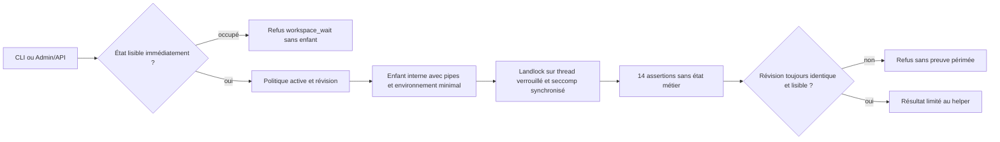

# Données des actions — premier contrôle T4

## CLI vers le serveur local persistant

`swarm --server http://127.0.0.1:PORT --json trust show` lit le serveur choisi.
Fournir sa session opérateur par `SWARM_WEB_SESSION`, et le jeton métier par
`SWARM_TRUST_TOKEN` pour les opérations authentifiées. Ne pas mettre ces valeurs
dans l'URL ou les arguments. Les POST utilisent les mêmes Cookie, Origin et CSRF
que le navigateur ; les droits et politiques sont ceux de l'API serveur.
Les autres opérations gardent `--input FICHIER|-` ; `confinement-check` et
`identity-context` acceptent un corps vide implicite. `export` et `anchor`
n'exigent pas d'entrée. `show` refuse `--input`.

Une adresse IP de boucle locale et un port explicite sont requis ; IPv6 `::1`
est accepté, les noms DNS, proxy et redirections refusés. `--root` n'est pas
ouvert dans ce mode, même si le serveur échoue. Sans `--server`, le CLI continue
de travailler localement. Un serveur inaccessible refuse avec code CLI5 ; une
session refusée avec code4. Les erreurs structurées conservent leur code, les
réponses vides, non JSON ou multiples sont refusées. Aucun repli ni rejeu
automatique. Ctrl-C/SIGTERM interrompt le transport avec code6, mais un effet
déjà engagé exige une réconciliation avant reprise. Le client n'ajoute aucun
délai métier ; l'attente réseau reste annulable, les délais d'opération restent
ceux du serveur. Le chargement de matière utilise les commandes dédiées décrites plus bas.

Recette isolée : `python3 tests/actions_confiance_remote.py --binary BIN --evidence-dir DOSSIER`.

Le service Processus dispose aussi du chemin local exact
`local-process-state/swarm/process-workflow`, décrit dans [T5](actions-confiance-T5.md).
Il impose une admission active. Ce chemin ne peut pas être utilisé pour un règlement
simulé, ni mélangé avec sa destination ou son outil.

Le pilote peut exiger un contexte de données avant d'admettre une demande.
Ce contrôle s'applique au registre simulé interne. Il ne constitue pas un
confinement des agents sur le système. Les fichiers, liens, URL, sockets,
exécutables externes et secrets ne sont pas des destinations prises en charge.
Pour ces actions métier, `confidential` et `restricted` restent refusées même présentes dans une liste. La matière secrète du helper fixe possède son propre chemin restricted décrit plus bas.

Dans **Modifier les paramètres → Politique des données**, activez le contrôle et
renseignez des tableaux JSON, par exemple :

```json
{"enabled":true,"classifications":["public","internal"],"destinations":["local-ledger"],"providers":["swarm"],"tools":["simulated-settlement"],"resources":[{"resource":"invoice/acme","classification":"internal"}]}
```

Chaque champ est explicite et non nul. Les doublons et valeurs inconnues sont
refusés, même lorsque la politique est désactivée. Une liste vide refuse toute
nouvelle action ; il n'existe ni valeur numérique ni sens particulier de zéro.
L'aperçu n'écrit aucun état. La sauvegarde persiste et invalide les anciens
mandats comme toute modification de configuration. Omettre `data_policy` dans
une application conserve sa valeur ; un état historique sans ce bloc est inactif.
`show.data_capabilities` expose le chemin effectivement pris en charge et les
limites de confinement et de secrets.

Une demande `request` via CLI ou API ajoute :

```json
{"data_context":{"classification":"internal","destination":"local-ledger","provider":"swarm","tool":"simulated-settlement"}}
```

Chaque ressource exige une règle de classification exacte définie par
l’opérateur dans `resources`. Une règle absente refuse l’admission. La
classification du demandeur doit lui correspondre ; elle ne peut pas déclasser
une ressource. Ces identifiants métier sont opaques, jamais résolus comme chemins
de fichiers. Les quatre valeurs doivent être autorisées et correspondre au chemin disponible.
Le contexte fait partie du digest exact de l'action. L'approbateur et le service
d'effet relisent celui conservé par le moteur ; fournir un nouveau contexte sur
ces opérations est refusé. L'identité authentifiée, le mandat, la séparation et
les autres contrôles continuent de s'appliquer. Une erreur d'admission renvoie
`authorization_required` avant conservation de l'original, de la preuve ou d'une
réponse rejouable ; corriger la demande puis la soumettre à nouveau. Aucun texte
fourni n'est repris dans ce diagnostic.

Les actions et les effets déjà engagés restent conservés. Une réponse perdue peut
être réconciliée après durcissement de politique sans nouvel effet. Un rejeu
historique conserve sa réponse. Sans contrôle actif, le pilote historique reste
utilisable sans contexte, sans qualification pour les données sensibles ; un
contexte explicite est refusé lorsque le contrôle est désactivé.

## Vérification isolée

```sh
go test -race -count=1 -run '^TestActionsConfianceT4DataPolicy' -v ./internal/engine
node tests/actions_confiance_data_policy_ui.cjs bin/swarm-actions-confiance-data-policy-resources /tmp/swarm-data-policy-recipe
```

La recette crée sa racine et ses identités locales : aperçu sans mutation,
sauvegarde/réouverture, demande CLI, accord exact, engagement API et affichage du
contexte, FR/EN et mobile. Elle tente des références de destination ou d'outil
interdites et vérifie les octets d'état et l'absence de capture du marqueur refusé.
Elle ne démontre pas l'impossibilité d'un accès direct au système par un processus
arbitraire. Le courtier décrit plus bas couvre seulement son helper fixe. Le
confinement des fournisseurs et connecteurs externes reste à implémenter ;
cette tranche ne termine pas R14.

## Vérifier le processus local scellé

La commande `trust confinement-check`, le POST API homonyme avec corps `{}` et
le bouton **Vérifier le processus scellé** exécutent la même vérification dans
un enfant interne distinct. L'API conserve la session opérateur et le CSRF
habituels. Le corps n'accepte ni acteur, ni chemin, ni commande utilisateur.

Dans Admin, **Vérifications de confinement** configure
`sealed_execution:{"enabled":true,"timeout_seconds":15}`. Le défaut historique
est désactivé avec15 secondes affichées. La durée est un entier strictement
positif, borné par la représentation Go ; 0, champ omis/nul ou fraction refusent
le bloc même inactif. La borne technique est exposée par `policy_bounds`.
Omettre tout le bloc conserve la politique. Aperçu, sauvegarde/réouverture et
validation Go/API/CLI partagent les valeurs effectives. L'aperçu ne lance rien.



La durée borne l'enfant ; son expiration ou l'annulation ferme son groupe et ses
descendants. Un état occupé refuse immédiatement sans attendre le verrou. Une
configuration modifiée pendant l'essai refuse son résultat. Aucune commande,
preuve officielle ou donnée métier n'est ajoutée par ce contrôle.

L'enfant ferme les descripteurs étrangers, vérifie ses pipes et son environnement,
interdit le dump mémoire, active `no_new_privs`, Landlock et seccomp synchronisé.
Les assertions couvrent lecture/écriture de travail, refus hors racine, traversée,
lien sortant, `/proc`, exécutable, TCP/UDP/Unix et descripteur hérité. La primitive
Linux x86-64 exige Landlock ABI6 ou plus ; absence de protection refuse sans
repli. Les constantes ABI sont des capacités techniques, pas des autorisations.
Sources primaires : [Landlock Linux6.17](https://docs.kernel.org/6.17/userspace-api/landlock.html),
[seccomp Linux](https://kernel.org/doc/html/latest/userspace-api/seccomp_filter.html).

Le modèle d'exécution est fixe : un thread d'opération verrouillé, aucun code
fourni par l'appelant, aucune extension ni goroutine de connecteur arbitraire.
Le résultat annonce `scope:sealed_helper_only`, `provider_containment:false` et
`secret_grants_supported:false`. Il ne qualifie pas les fournisseurs existants,
ne permet pas encore une action confidentielle et n'est pas un bac à sable
général pour des greffons. Ce contrôle ne charge aucune matière ; le canal
dédié suivant couvre seul le helper fixe.

```sh
swarm --root PROJET --json trust confinement-check
node tests/actions_confiance_sealed_ui.cjs BINAIRE /tmp/swarm-sealed-recipe
```

Le CLI utilise les codes5 pour indisponibilité/état occupé et6 pour interruption
ou délai dépassé. Corriger la précondition indiquée avant une reprise ; ne pas
augmenter le délai pour contourner une frontière indisponible.

## Courtier éphémère pour une attestation interne

Le courtier conserve la matière uniquement dans la mémoire du serveur et la
transmet au seul helper fixe `sealed-attestation`, destination
`local-attestation`. Il calcule un HMAC-SHA256 lié à l’octroi, l’action, son digest,
le principal, le connecteur, la destination et la révision. Il ne fournit aucun
secret à un fournisseur ou au règlement simulé. Utiliser une matière de signature
à forte entropie ; une attestation publique n'est pas un coffre pour mots de passe.
`data_capabilities.secret_grants_supported` reste faux pour les effets fournisseur.

Dans Admin, **Courtier de secrets éphémères** persiste `secret_broker` avec cinq
champs explicites : `enabled`, `material_ttl_seconds` (défaut300),
`grant_ttl_seconds` (60), `max_material_bytes` (4096), `max_entries` (16).
Le défaut est inactif ; 0, nul, fraction et champ interne omis sont refusés même
inactif. L’octroi ne dépasse pas la durée de matière, les durées sont représentables
et les octets bornés par HTTP1Mio. Les bornes effectives sont dans `policy_bounds`.
Omettre le bloc conserve la politique. Aperçu sans effet ; sauvegarde/réouverture
partagent la validation Go/API/CLI. Le statut distingue limites et consommation.
La politique scellée doit aussi être active ; son délai borne le helper.

Le parcours web explicite se trouve sous **Octroi secret au helper interne** :
charger avec le jeton adminI3, sélectionner l’action approuvée puis créer/consommer
avec le jeton du rôle effect/I2. L’identité est dérivée du jeton, jamais du corps.
Le champ de matière est effacé après tentative, sans stockage navigateur applicatif.
Les références, métadonnées et attestations peuvent être affichées ; aucune valeur
brute ne peut être relue. Les détails et le statut ne déclenchent aucun polling.

CLI : les commandes `secret-*` exigent `--server`, `SWARM_WEB_SESSION` et
`SWARM_TRUST_TOKEN`. `secret-load --input -` lit les octets sur stdin après une
préparation réussie ; il ne les encode pas en JSON métier. L’API dédiée utilise
`POST /api/v1/trust-secrets?action=secret-load`, type `application/octet-stream`.
Les autres commandes utilisent un objet JSON :

- `secret-ready` : `{}` ; contrôle réel du helper puis serveur non dumpable.
- `secret-grant` : `action_id`, `action_digest`, `secret_ref`,
  `connector_id:"sealed-attestation"`, `destination:"local-attestation"`.
- `secret-consume` : `grant_id` seulement ; une seule tentative.
- `secret-revoke` : adminI3, `grant_id` ou `secret_ref`, exclusifs.
- `secret-status` : `{}` ; métadonnées, disponibilité par octroi,
  `loaded_entries` et `loaded_bytes`, sans matière.

Session opérateur, Origin et CSRF restent requis sur tous ces chemins. La
préparation doit confirmer `ready:true` et `server_memory_nondumpable:true` avant
l’envoi. Cette restriction du serveur n'est pas rétablie en désactivant la
politique ; elle dure jusqu’à l’arrêt. Aucun privilège système ni sysctl modifié.
La documentation du [noyau Yama](https://docs.kernel.org/admin-guide/LSM/Yama.html)
distingue cette protection du traçage privilégié ; swap et administrateur système
restent hors qualification. Aucun fournisseur arbitraire ne reçoit de code ici.

L’octroi est lié à la session, la révision, l’action exactement approuvée et son
mandat actif. Durée bornée par matière, session et mandat. Une référence ne donne
qu’un octroi. Les refus ne capturent pas la matière. L’usage est durablement marqué
`consuming` avant l’envoi sur pipe, après les14 gardes du helper. Annulation,
expiration, révocation ou changement de configuration refusent un résultat périmé.
La matière est retirée puis effacée après tentative ; aucun rejeu automatique.
Un arrêt perd toute matière : les métadonnées `issued` ou `consuming` peuvent
rester, mais `grant_material_available` est faux. Recharger une nouvelle matière
et créer un nouvel octroi ; ne jamais réutiliser l’ancien. Une réponse perdue
après succès se lit avec `secret-status`. Une révocation après transfert ne peut
retirer des octets déjà remis ; aucun effet externe n’existe dans cette tranche.

Recettes isolées : `tests/actions_confiance_remote.py --secret-broker` et
`tests/actions_confiance_secret_ui.cjs`. Cette capacité ne termine pas R14.

Le chemin d'accès simulé R18 est également contrôlé :
`local-access-state/swarm/simulated-access-grant`, public/internal seulement,
avec ressource classée et sélection liée au mandat et au digest. Le registre
simulé reste distinct des permissions réelles et ne qualifie aucun fournisseur
sensible. Voir [les connecteurs](actions-confiance-T6.md).

## Identité du helper fixe

Les helpers de confinement et de secrets sont exécutés depuis un descripteur
ouvert sur l’image en cours du serveur (`/proc/self/exe`), puis transmis à
os/exec par `/proc/self/fd/N`. Le remplacement ou le retrait du fichier portant
le nom du serveur ne sélectionne donc pas une nouvelle image de helper. Les FD
de fixture conservent leur position ; le FD d’image ajouté est fermé dans
l’enfant avant la confirmation des contrôles scellés et le transfert sensible.
Le parent ferme aussi son descripteur. Le laboratoire et le diagnostic utilisent
le même mécanisme. Aucune politique, limite ou permission nouvelle n’est ajoutée.

Cette liaison prouve l’identité de l’image exécutée, pas une certification du
logiciel ni un confinement général des fournisseurs. La recette
`tests/actions_confiance_secret_image.py --secret-broker --binary BINAIRE
--evidence-dir DOSSIER` lance une copie possédée, remplace son chemin puis vérifie
l’attestation réelle et l’absence de capture de matière factice par le substitut.
Elle ne modifie aucun serveur existant et n’utilise aucun secret réel.

## Politique de données et transfert de matière secrète

Lorsque `data_policy.enabled` est actif, les listes administrées s’appliquent
également à la préparation, au chargement et à l’octroi/consommation de secrets.
La matière possède intrinsèquement la classification `restricted`, destination
`local-attestation`, fournisseur `swarm`, outil `sealed-attestation` ; les quatre
valeurs doivent être permises. `data_capabilities.secret_delivery` expose ce
seul tuple vérifié, dans la portée du helper fixe. Les effets fournisseur
continuent d’annoncer `secret_grants_supported:false`.

Les règles de ressources de l’action métier restent distinctes et sont relues
au moment de l’octroi et du transfert. Par exemple, une action `invoice/acme`
peut rester `internal`, tandis que la matière de signature est `restricted`.
Pour ce cas, Admin doit autoriser les classifications internal/restricted,
les destinations local-ledger/local-attestation et les outils
simulated-settlement/sealed-attestation, avec fournisseur swarm et règle de
ressource invoice/acme→internal. Autoriser seulement le règlement ne permet
plus d’envoyer une matière au helper. L’omission ou le retrait d’une permission
refuse ; aucun client ne choisit la classification de la matière.

Le refus de préparation empêche le CLI/web d’envoyer les octets. L’API contrôle
également la politique avant de lire le corps brut ; le courtier contrôle encore
avant copie mémoire et sous verrou lors de l’octroi/consommation. Un refus ne
crée ni octroi, original, preuve ni matière. Les révocations de session, mandat,
révision ou échéance conservent leurs contrôles. Le `data_context` calculé sur
l’octroi est inclus dans l’attestation, domaine `swarm-secret-delivery-v1`.
La matière et tous les octets métier restent absents de ce contexte.

Si la politique de données est inactive, le contrat historique du courtier fixe
reste disponible sous sa propre politique ; aucun `data_context` n’est ajouté,
et les préimages HMAC historiques sont conservées. Cette compatibilité ne
qualifie aucun fournisseur sensible ou destination externe.
