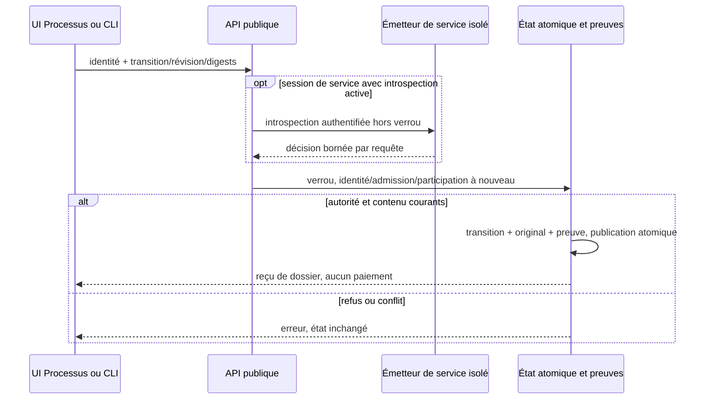

# Processus métier — définitions et dossiers locaux

Cette première tranche suit des dossiers sur une définition publiée. Une
validation de dossier ne crée aucune approbation de paiement ni engagement T2.
Le moteur commun fournit identité, admission des données, sérialisation atomique
et preuves ; la page `processes.html` possède son propre parcours et son build.

## Configurer et publier

Dans **Identité**, utiliser une identité existante. Le jeton reste en mémoire de
la page, sans stockage navigateur. Le cookie de session opérateur et la protection
CSRF restent nécessaires. Cette entrée locale ne remplace pas le parcours SSO.

Dans **Admin**, un administrateur I3 peut prévisualiser puis enregistrer
`process_policy:{"enabled":true}` et la politique de données. Le booléen est
strict ; défaut inactif, omission du bloc dans la configuration générale conserve
sa valeur. La révision attendue évite d’écraser une modification concurrente.
Tout changement révoque les sessions fédérées et mandats de l’ancienne révision.
Les historiques et effets engagés restent conservés.

L’admission T4 doit être active et autoriser exactement le chemin
`local-process-state / swarm / process-workflow`, une classification `public` ou
`internal` et la ressource administrée. Exemple de politique :

```json
{"enabled":true,"classifications":["internal"],"destinations":["local-process-state"],"providers":["swarm"],"tools":["process-workflow"],"resources":[{"resource":"invoice/acme","classification":"internal"}]}
```

Les identifiants de ressource ne sont pas des chemins de fichiers. Aucun document,
secret, URL, exécutable ou donnée sensible n’est admis dans cette tranche.
Les deux chemins locaux disponibles ne permettent pas de mélanger leur outil et
leur destination ; le règlement simulé conserve son propre contrôle exact.

Une définition `schema_version:1` contient `id`, `label:{fr,en}`, `start`,
`nodes:[{id,label,terminal}]` et `transitions:[{id,from,to,label,kind,roles,minimum_integrity}]`.
Une publication I3 fournit `expected_version` (0 pour la première) et un motif.
Chaque version est immuable et porte son empreinte canonique. Tous les nœuds sont
accessibles et disposent d’une issue normale vers une fin ; les cycles ordinaires
sont refusés. Une exception nommée peut rouvrir un dossier.

- `advance` : rôle local autorisé par la définition, intégrité minimale positive.
- `approval` : approbateur I2 au minimum, motif explicite et séparation du demandeur
  lorsque la politique commune l’exige.
- `exception` : administrateur I3, motif explicite, arête publiée et historique.

Aucun rôle, acteur, script ou saut arbitraire fourni par le client n’accorde de droit.
Les permissions externes passent par les règles locales d’identité existantes.

## Traiter un dossier

Un demandeur crée un dossier sur la dernière version explicitement choisie, avec
participants locaux actifs I2, ressource, titre, référence et contexte T4 exact.
Le serveur fixe propriétaire et identifiant. Le contenu d’entrée, les participants
et la version sont liés par empreinte et restent immuables dans cette tranche.
Publier v2 ne déplace jamais un dossier v1.

Chaque transition fournit dossier, révision attendue, empreintes de définition et
d’entrée, transition publiée et `event_id`. Le moteur relit identité, participation,
rôle/intégrité, source, séparation et admission sous verrou avant écriture. Deux
transitions concurrentes sur la même révision produisent un seul gagnant.
Une révision périmée demande de recharger, puis de confirmer le contenu courant.
Les refus ne capturent ni original ni nouvelle preuve. Un rejeu exact retourne
le résultat historique après contrôle de l’autorité et de l’admission actuelles ;
réutiliser un événement avec un autre contenu refuse.

L’inbox ne montre que les dossiers du propriétaire, des participants autorisés
ou d’un administrateur I3. Une politique retirée rend le contenu indisponible.
L’historique et l’export de preuves conservent acteur, contexte d’identité,
transition, motif et empreintes. Après redémarrage, versions et progression sont
relues du même état atomique ; aucun paiement n’est rejoué.

## API, CLI et construction indépendante

`GET /api/v1/processes` lit l’inbox ; `POST ?action=OPERATION` reçoit un objet JSON.
Le namespace CLI `process` expose `show`, `policy-preview`, `policy-apply`,
`definition-preview`, `definition-publish`, `case-create`, `case-show` et
`case-transition`. Sauf `show`, fournir `--input FICHIER|-` ; `case-show` reçoit
seulement `case_id`. Les mutations ajoutent `schema_version:1` et `event_id`.

```sh
swarm --server http://127.0.0.1:PORT --json process show
swarm --server http://127.0.0.1:PORT --json process definition-preview --input definition.json
swarm --server http://127.0.0.1:PORT --json process case-show --input case.json
npm run build:processes -- /tmp/swarm-process-app
```

Le client distant utilise `SWARM_WEB_SESSION` et `SWARM_TRUST_TOKEN`. Aucun repli
sur une racine locale n’a lieu après échec distant. Sans `--server`, les mêmes
opérations publiques travaillent sur la racine sélectionnée. Introspection des
services hors verrou, puis autorité et fraîcheur vérifiées sous verrou.

L’artefact web contient uniquement l’entrée Processus, son code/style et les
actifs locaux partagés de thème/i18n. Il n’importe aucun écran ou script Projets.
Le déployer avec les routes `/api/v1/session` et `/api/v1/processes` sur la même
origine et la protection opérateur existante ; le build seul ne configure ni
SSO inter-origines ni déploiement externe.

Bornes techniques exposées par `show` : commande 1 Mio, état partagé 8 Mio,
versions/révisions entières représentables exactement dans le navigateur. La
consommation est affichée séparément ; aucune purge ou limite métier implicite.
Les erreurs `authorization_required`, `revision_conflict` et `event_conflict`
refusent sans mutation. Corriger droit/politique ou recharger le contenu avant
confirmation ; une indisponibilité ne vaut pas un résultat vide réussi.

Recette isolée :

```sh
go test -race -count=1 -run '^TestActionsConfianceT5' -v ./internal/engine
node tests/actions_confiance_process_ui.cjs BIN /tmp/swarm-process-recipe
python3 tests/actions_confiance_t5.py --criterion 0 --root . --timeout-seconds 120 --binary BIN --evidence-dir /tmp/swarm-process-public
```

Le rattachement d’effets T2, l’archivage/migration de versions et la qualification
complète R15 restent des extensions. Les preuves locales de cette tranche ne
constituent pas une acceptation indépendante ni une qualification de diffusion.


