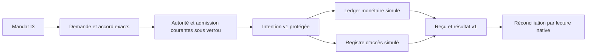

# Preuves durables — signatures, témoins et archives locales

Cette tranche ajoute un registre public de clés et des ancres Ed25519 pour les
exports v2 du pilote. Les preuves, originaux et ancres HMAC historiques gardent
leurs octets et leur vérificateur. Elle inclut deux connecteurs simulés ; stockage tiers immuable et conformité
globale R16–R19 restent hors de cette qualification locale.
La qualification locale se lit dans le reçu du plan de vérification, pas dans
la seule présence de ce document.

## Protéger et renouveler la clé

Un administrateur I3 active la politique dans **Admin — Signature publique**.
`evidence_signing` contient `enabled` (booléen strict) et `key_ttl_seconds`
(entier positif, en secondes). Défaut inactif et86400secondes ; zéro, null,
fraction et champ manquant sont refusés, même inactif. La borne de représentation
`time.Duration` est exposée dans `policy_bounds` ; aucune autre durée cachée.
Aperçu sans écriture, sauvegarde et réouverture gardent les valeurs effectives.
Omission du bloc dans la configuration générale conserve sa valeur. Comme les
autres politiques, une nouvelle révision invalide sessions/mandats et matières
privées de l’ancienne configuration ; historiques et effets restent conservés.

**Préparer une clé** génère sa matière privée uniquement dans la mémoire protégée
du serveur persistant. Aucun import privé ni clé sur disque dans ce nouveau
contrat. Le registre conserve la clé publique, son identifiant/empreinte, son
proposant, sa période et sa révision. Un candidat vivant attend son second
administrateur ; il n’existe pas de file cachée de candidats.

**Activer la clé** exige un autre administrateur I3, l’empreinte exacte et la
révision du registre attendue. L’ancienne clé active devient retirée. Une
**révocation** I3 est immédiate, attribuée et motivée, même si la politique de
signature est désactivée : pas d’attente de second
accord pour fermer une clé compromise. Retrait et révocation sont distincts.
Une clé expirée, révoquée, indisponible ou d’une autre configuration ne signe plus.
Après arrêt, le registre est conservé mais la matière privée est perdue. Une
nouvelle préparation et activation restaure la signature ; aucun repli sur une
ancienne clé ou sur le HMAC n’a lieu dans ce parcours public.

Les permissions de fichier seules ne prouvent pas la protection face au même UID.
La mémoire est non dumpable ; swap, traçage privilégié et fournisseurs arbitraires
restent hors qualification. Le nouveau registre n’est pas un coffre matériel.

## Ancrer et vérifier

L’opérateur confirme clé/révision du registre et séquence/empreinte finale exactes.
L’ancre publique schéma3 signe le domaine `swarm-public-evidence-anchor-v1`,
clé/révisions, séquence/empreinte, date et digest canonique de l’export v2 complet.
Une réponse contient `export` et `anchor`. Les originaux conservent leurs octets ;
le digest d’export utilise la sérialisation JSON canonique du producteur Go,
indépendamment des espaces ajoutés pour présenter le fichier. Le message signé
utilise `publicAnchorBytes` : champ `signature` remis à la chaîne vide puis
`json.Marshal` dans l’ordre déclaré de `TrustPublicAnchor`. Cette sérialisation
est propre à cette version du contrat ; un lecteur externe doit reproduire ces
octets, pas re-sérialiser arbitrairement les champs.

Le vérificateur reçoit séparément `trusted_key`, en plus de `export` et `anchor`.
Ce pin doit être acquis et conservé par un canal de confiance indépendant du
fichier à vérifier. Le contenu de l’export ne choisit jamais lui-même sa racine
de confiance. Le registre de fixture lu séparément n’est pas une attestation
externe de production.

La vérification contrôle signature, contexte/digest, originaux, ordre et complétude
sous l’ancre connue. Un pin de clé retirée permet de vérifier ses signatures
historiques dans leur période ; un pin révoqué refuse l’acceptation. Un ancien pin
hors ligne n’apprend pas automatiquement une révocation : renouveler sa source
de confiance selon la procédure opérateur. Une validité cryptographique ancienne
ne prouve pas l’acceptation actuelle d’une clé compromise.

La signature utilise la bibliothèque standard Go1.24 installée, compatible
[Ed25519/RFC8032](https://www.rfc-editor.org/rfc/rfc8032), sans nouvelle dépendance.
L’interface est documentée par [Go](https://pkg.go.dev/crypto/ed25519) ; aucune
mise à niveau de la chaîne du projet n’est induite.

## API et CLI

`GET /api/v1/trust-evidence` expose politique, révisions, clés, disponibilité en
mémoire et dernière séquence/empreinte. Les autres opérations sont des POST
`?action=policy-preview|policy-apply|key-prepare|key-activate|key-revoke|anchor|verify`.
Cookie opérateur, Host, Origin et CSRF restent ceux du serveur habituel. Les
opérations de clé et d’ancre exigent un administrateur I3 authentifié, avec
introspection de service hors verrou lorsqu’elle s’applique. La vérification
publique reçoit uniquement des données publiques et n’exige pas de clé privée.

```sh
swarm --server http://127.0.0.1:PORT --json evidence show
swarm --server http://127.0.0.1:PORT --json evidence key-prepare --input preparation.json
swarm --server http://127.0.0.1:PORT --json evidence key-activate --input activation.json
swarm --server http://127.0.0.1:PORT --json evidence anchor --input ancrage.json
swarm --json evidence verify --input verification.json
```

Le client distant utilise `SWARM_WEB_SESSION` et `SWARM_TRUST_TOKEN` ; les valeurs
ne passent ni dans l’URL ni dans les arguments métier. Aucun repli local ne suit
une erreur distante. La vérification locale est pure et ne résout pas `--root`.
Les mutations comportent `schema_version:1`, `event_id`, motif et révision attendue.
Préparation/activation/révocation attendent `expected_registry_revision` ; les deux
dernières ajoutent `key_id` et `key_digest`. L’ancrage exige `key_id`,
`expected_registry_revision`, `expected_sequence`, `expected_hash`. La mise à jour
de politique utilise `expected_revision` et `policy`.

Un rejeu exact conserve son reçu historique, sans nouvelle génération ni activation.
Le statut vivant doit être relu après perte de réponse : un ancien reçu d’activation
ne prouve pas une clé encore active ou disponible. `revision_conflict` exige de
recharger et confirmer ; `event_conflict` interdit un autre contenu sous le même
événement. `authorization_required` refuse les droits, état, disponibilité ou
contenu incohérents. `operation_pending` signale un candidat vivant déjà présent.
Une urgence de révocation ne supprime pas les effets engagés ni preuves historiques.

Les commandes de métadonnées sont bornées techniquement à1Mio ; l’entrée de
vérification est bornée à16Mio comme le transport CLI, pour accueillir l’export de
l’état partagé8Mio et son enveloppe. Ces bornes sont distinctes de la durée de clé
administrée et sont exposées ; aucune troncature ou purge silencieuse n’a lieu.

Recettes isolées, sans fournisseur ni paiement :

```sh
go test -race -count=1 -run '^TestActionsConfianceT6(Evidence|Archive)' -v ./internal/engine
python3 tests/actions_confiance_evidence.py --binary BIN --evidence-dir /tmp/swarm-evidence-public
node tests/actions_confiance_evidence_ui.cjs BIN /tmp/swarm-evidence-ui
```

La signature d’une ancre ne rend pas chaque ligne de log immuable ni tout effet
métier signé obligatoirement. Les mécanismes locaux décrits ci-dessous ne démontrent ni stockage tiers
immuable ni qualification globale. Ces recettes et l’auto-revue ne valent pas revue indépendante.

## Comparaison à une ancre témoin indépendante

Une signature valide seule accepte aussi un ancien export valide. Pour détecter
ce retour en arrière, `verify` accepte `trusted_checkpoint` :

```json
{"export":{},"anchor":{},"trusted_key":{},
 "trusted_checkpoint":{"anchor":{},"trusted_key":{}}}
```

Remplacez les objets vides par les valeurs réelles. Acquérez l’ancre et le pin
du témoin par un parcours de confiance distinct du bundle candidat, puis
conservez-les dans un emplacement séparé contrôlé par l’opérateur. La recette
`tests/actions_confiance_evidence.py --checkpoint --binary BIN --evidence-dir DIR`
utilise deux répertoires séparés et relit effectivement le témoin. Ce témoin
peut provenir d’un précédent appel `evidence anchor` et du registre lu séparément ;
ne le reprenez jamais automatiquement dans le fichier que vous contrôlez.

Le vérificateur contrôle la signature et le cycle de clé du témoin, sa séquence,
l’empreinte du préfixe et le digest exact des originaux correspondants. Une
extension peut utiliser une nouvelle clé explicitement approuvée ; le préfixe
connu doit rester identique. Un export signé antérieur, une divergence ou un
témoin invalide sont refusés sans écriture. La réponse porte
`checkpoint_verified:true`, `checkpoint_sequence` et `checkpoint_hash`. Sans
témoin, `checkpoint_verified:false` explicite la vérification de signature seule.
Les entrées nulles/incomplètes sont refusées, jamais ignorées.

Le dialogue de vérification FR/EN fournit un champ distinct facultatif pour ce
témoin. API et CLI utilisent le même validateur, y compris sans racine locale.
Une réouverture du fichier ne renouvelle pas son autorité : un ancien pin ne
reçoit pas automatiquement les révocations. La source indépendante et sa
conservation relèvent de l’opérateur ; le même UID peut toujours modifier ses
fichiers. Ce mécanisme n’établit ni temps tiers, ni stockage physiquement immuable,
ni service témoin externe. L’archivage et la protection minimale sont décrits ci-dessous.

## Archives locales et durée minimale de protection

`archive-preview` et `archive-create` prennent `schema_version:1`, `event_id`,
`expected_revision`, `expected_sequence`, `expected_hash`, `anchor` et `reason`.
L’ancre doit signer un préfixe exact de l’historique courant ; sa clé est résolue
dans le registre administré, jamais importée automatiquement du demandeur.
La copie contient export v2, originaux exacts, ancre et clé publique au moment
d’archivage. Identifiant = SHA-256 des octets JSON ; publication sans remplacement
dans `.swarm/trust-archives`. L’aperçu ne crée ni répertoire, ni copie, ni reçu.

`archive-show` reçoit `archive_id` et contrôle fichier régulier privé, absence de
lien symbolique, empreinte, signature et originaux avant restitution. L’état courant de clé
est rendu séparément : un pin figé dans l’archive n’apprend pas les révocations
ultérieures. Ne confondez pas lecture historique et acceptation courante de
signature. Le stockage local n’est pas isolé d’un même UID hostile ; la comparaison
au témoin indépendant reste nécessaire.

`evidence_retention_days`, déjà éditable dans Admin du pilote (jours entiers ≥1,
défaut365, zéro interdit), est une durée **minimale** depuis création de copie.
La copie persiste durée et instant ; réduire le réglage ensuite ne raccourcit
pas une protection existante. La comparaison utilise des jours révolus sans
multiplication débordante, y compris la borne technique exposée par le pilote.
Aucune limite maximale de conservation ni purge automatique n’est promise.

`archive-release` exige `schema_version:1`, `event_id`, `expected_revision`,
`archive_id` et motif ; Admin I3 courant, refus avant échéance, levée attribuée
après échéance. **La levée ne supprime rien**, ni copie, ni original, ni chaîne,
ni reçu. Il n’existe pas d’opération de suppression dans ce contrat. Le statut
`protected` reste vrai jusqu’à cette décision ; `minimum_retention_satisfied`
indique séparément l’échéance. Toute suppression physique reste hors tranche. La durée Admin est sauvegardée et réouverte dans les réglages existants du pilote ; le statut d’archive affiche sa valeur effective.

Une panne après publication du fichier mais avant son reçu peut laisser une
copie orpheline ; la même commande authentifiée adopte seulement ses octets
exacts, sans remplacement. Un rejeu de création vérifie encore l’intégrité de la
copie avant de rendre son reçu : absence/altération ne deviennent jamais succès.
Le contrôle de racine utilise un descripteur de répertoire et refuse les liens.
Les bornes techniques d’archive sont celles de vérification publique (16Mio).
Tous les parcours exigent Admin I3 et les gardes opérateur/CSRF usuelles.

Le corpus fixe R17 est décrit dans [Laboratoire](actions-confiance-laboratoire.md). Les résultats restent simulés ; les autres fournisseurs ne deviennent pas confinés.

## Connecteurs simulés et frontière d'effet v1

Le catalogue `trust show` expose `connector_catalog` : deux implémentations locales,
version 1, avec idempotence et lecture de confirmation, sans effet externe,
confinement de fournisseur ou octroi de secret. Aucun plugin, chemin, commande,
URL ou capacité déclarée par le client n'est chargé.

Le règlement historique utilise `local-ledger-simulation`. L'absence de champ
`connector` conserve son format et ses digests. Un sélecteur explicite est lié au
contenu : il doit être reproduit exactement, sans convertir une action historique.
Le second connecteur `local-access-simulation` ajoute une entrée dans
`access_ledger`, distinct du ledger monétaire. Il ne modifie ni compte, ni rôle,
ni ACL réels. C'est un modèle d'effet sensible simulé, pas un fournisseur qualifié.

Exemple de sélection à inclure dans le mandat, la demande et l'accord :

```json
{"connector":{"id":"local-access-simulation","version":1,
  "access":{"subject":"employee","role":"reader"}}}
```

L'administrateur I3 crée un mandat avec `actions:["grant-access"]`, une ressource
exacte et ces paramètres. Montant, plafond, devise et bénéficiaire doivent rester
nuls/vides pour cet effet. Le demandeur désigné crée l'action ; l'approbateur séparé
reproduit mandat, digest et sélection exacts ; le service `effect` I2 engage.
Les commandes restent `trust mandate-create/request/approve/commit/reconcile`,
également accessibles par API et `trust --server`. La carte **Connecteurs simulés**
permet ce parcours d'accès ; chaque opération utilise l'identité saisie.

Une politique de données active doit autoriser et classer la ressource :
`local-access-state / swarm / simulated-access-grant`, public ou internal seulement.
Le contexte du règlement reste `local-ledger / swarm / simulated-settlement`.
Intervertir ces chemins refuse avant conservation de l'original. Le contenu et les
ancêtres d'un mandat délégué doivent conserver le même sélecteur exact.

La frontière commune produit `effect-intent-v1` : identifiant, digest d'action et
de mandat, empreintes des accords, connecteur/version, ressource, paramètres,
idempotence et échéance du mandat. Elle relit autorité, admission et accord sous
le verrou métier. Les reçus publics `effect_receipts` comprennent ce contrat et
`effect-result-v1` : reçu stable, état, dates, digest du résultat natif, nécessité de
réconciliation et diagnostic. Ce résultat n'est pas une signature tierce.

Une réponse perdue produit `unknown`. Réengager ne répète pas l'effet ;
`reconcile` vérifie l'unique entrée native du connecteur et son digest avant de
confirmer. Une entrée absente, altérée ou incompatible ne devient jamais succès.
Le domaine d'idempotence est partagé : changer de connecteur ne réutilise pas une
clé avec un autre contenu. Réouverture et réconciliation gardent les effets déjà
engagés, même après retrait du mandat. Aucun délai ou budget supplémentaire n'est
introduit ; la politique de réconciliation existante reste applicable.

Recettes : `tests/actions_confiance_connectors.py` et
`tests/actions_confiance_connectors_ui.cjs`, binaire explicitement fourni et racines
isolées. Les résultats locaux ne valent pas acceptation indépendante ni diffusion.



Le formulaire d'accord sérialise le montant depuis sa représentation décimale
exacte fournie par le serveur, sans conversion par Number, y compris au-delà de
2^53. La borne de représentation est celle de int64 ; ce n'est pas un plafond
monétaire supplémentaire. Les paramètres d'accès restent distincts.

## Matrice contextualisée R19

La [matrice de contrôles et limites](actions-confiance-referentiels.md) relie douze
contrôles sélectionnés à des preuves historiques et leurs entrées pertinentes.
Validation CLI sans écriture et lecture produit explicite ; certification, conformité
globale et évaluation indépendante ne sont jamais déduites des tests locaux.

## Contextes de preuve des nouveaux événements

Les nouveaux événements portent `policy_context` version1 : révision, politique centrale et contrôles d’exécution effectifs, sans identité secrète, jeton ou matière. Les engagements et réconciliations portent aussi `effect_receipt` version1 : connecteur, intention, résultat et observation native exacte. Ces instantanés sont inclus dans le hash de l’événement ; l’export schéma2 et les ancres existantes les couvrent. Une réconciliation ne réécrit jamais l’observation précédente. Un reçu ancien dépourvu d’intention est identifié `legacy_receipt`, sans inventer une intention passée.

Le contrôle commun vérifie originaux, ordre, précédent, hash et liens des contextes avant une nouvelle mutation ; la frontière SPI le contrôle également. Une chaîne incohérente refuse sans nouvel effet. Une réponse historique déjà enregistrée reste lisible sous identité et autorité fraîches, sans mutation ni attestation d’intégrité de la chaîne : ce rejeu ne crée pas d’événement. Les anciens événements sans ces champs conservent leur préimage et leur vérification ; aucun recalcul historique n’est effectué.

La vérification des nouvelles preuves relie le résultat au digest canonique de l’observation native, l’intention au mandat et aux accords antérieurs, et conserve les politiques réellement capturées. L’UX des preuves préserve les entiers signés hors précision Number lors du transport, de l’export et du copier-coller. Si le navigateur ne dispose pas des primitives JSON exactes, il refuse explicitement ce parcours et indique le CLI. Aucune nouvelle limite ou politique métier n’est créée.
