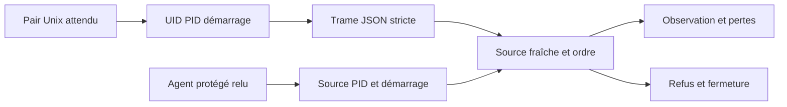

# T7 — contrat interne de réception des observations

R20 reste ouvert : le collecteur explicite ci-dessous n’a pas encore de qualification noyau positive.
La sonde locale a observé `BPF_MAP_CREATE: EPERM`, sans attachement ni collecte.
Les tests de réception utilisent des processus et messages de fixture possédés.

## Frontière implémentée

`internal/engine/kernel_observation_linux.go` définit une source locale issue
d'un `Agent` actif : agent, mission, tâche, tentative, PID, démarrage, hôte et
digest SHA-256 du contenu observé. La factory du registre dérive le digest des entrées enregistrées ; il ne provient ni du client public ni du collecteur. Chaque descendant exige son propre
enregistrement ; le seul PID parent ne lui donne aucun droit d'observation.

`kernel_observation_transport_linux.go` authentifie la connexion Unix avec
`SO_PEERCRED` : UID et PID attendus, puis démarrage relu dans `/proc/PID/stat`.
Le parseur utilise la dernière parenthèse du nom de processus. Une erreur de
lecture ou une identité terminale refuse ; elle ne prouve pas une disparition.
L'identité est contrôlée avant et après la lecture. Une source fraîche est
requise avant acceptation. Le lanceur explicite utilise la factory du registre vivant ; aucune API d’injection d’événements n’est exposée.



Le diagramme décrit les contrôles internes de réception ; le lanceur explicite et le backend sont décrits plus bas.

Les credentials désignent le processus à la connexion, selon
[unix(7)](https://man7.org/linux/man-pages/man7/unix.7.html). Ils ne prouvent ni
l'origine noyau des octets, ni l'absence de transfert ultérieur du descripteur.
Le collecteur fixe décrit plus bas maîtrise ses descripteurs et son exécutable.

## Trame `kernel-observation-v1`

Un objet JSON UTF-8 par ligne, sans champ facultatif, inconnu, nul ou dupliqué.
Borne technique : 16 384 octets par objet, séparateur de ligne exclu ; ce n'est
pas un budget d'observation. Aucun chemin, contenu, commande ou secret brut.

| Champ | Représentation et contrôle |
| --- | --- |
| `collector_boot_id` | 16 octets hexadécimaux minuscules, attendus par le lanceur |
| `sequence`, `ktime_ns`, `cgroup_id`, `lost_before` | uint64 sous forme de chaîne décimale canonique ; zéro autorisé pour cgroup/pertes seulement |
| `event_type` | `process`, `file` ou `network` |
| `pid`, `parent_pid` | entiers ; PID strictement positif, parent positif ou zéro |
| `pid_start_time` | ticks de démarrage `/proc`, chaîne décimale positive canonique |
| `mission_id`, `task_id`, `attempt_id` | valeurs exactes de la source protégée |
| `resource_digest` | SHA-256 exact de la source protégée |
| `probe_set` | contrat fermé `swarm-minimal-v1`, sans sélection arbitraire |

La première séquence vaut `1 + lost_before`, puis
`précédente + 1 + lost_before`. Rejeu, saut inexpliqué, débordement et recul de
l'horloge sont refusés sans avancer les compteurs. Le total des pertes est
explicite. Une erreur de réception ferme la connexion et marque la rupture.
Une fin de flux, un flux vide ou sans perte ne vaut jamais couverture complète :
`complete` reste faux. Le propriétaire ferme la connexion pour annuler l'attente ;
aucun timeout métier nouveau n'est introduit par ce contrat interne.

## Backend interne Linux amd64

`kernel_backend_linux_amd64.go` génère trois programmes TracePoint fixes :
`sched/sched_process_fork`, `syscalls/sys_enter_openat` et
`syscalls/sys_enter_connect`. Ils décrivent une création de processus, une
tentative d'ouverture et une tentative de connexion ; ils ne prouvent pas leur
réussite. Aucun argument, chemin, contenu ou adresse réseau n'est lu.

Le backend natif utilise cilium/ebpf v0.19.0, dont le
[module officiel](https://github.com/cilium/ebpf/blob/v0.19.0/go.mod) est compatible
avec Go et x/sys du projet. Il n'accepte ni ELF, programme, commande ou sonde
fournis par un client. Aucun compilateur ou service extérieur n'est requis.

Le descripteur perf cible uniquement le thread principal enregistré, sans
héritage. Un second filtre TGID/TID précède les maps et l'émission. La porte
reste inactive pendant l'acquisition ; source et pidfd sont recontrôlés avant
activation. Les autres threads et descendants restent hors portée. Cette
primitive n'est ni un lanceur public ni un collecteur général de fournisseurs.

La capacité du ring est un argument explicite : taille uint32 en octets,
puissance de deux au moins égale à une page OS. C'est une contrainte de
représentation, sans défaut ni budget métier implicite. Le
[contrat noyau du ring buffer](https://docs.kernel.org/bpf/ringbuf.html) autorise
un échec d'émission ; des compteurs atomiques distincts conservent tentatives,
émissions et pertes, y compris les dernières pertes sans événement suivant.
Le lecteur refuse les échantillons de taille, PID, catégorie ou horloge invalides.

`Stop` désactive la porte et les événements perf. Les statistiques finales
exigent cet arrêt et refusent des compteurs incohérents ; le propriétaire doit
arrêter la fixture puis drainer les enregistrements avant son verdict.
`Close` ferme toutes les ressources acquises en ordre inverse, y compris après
échec partiel. Les erreurs de nettoyage restent attribuées. Aucun pin, changement
memlock, sysctl ou capacité Linux n'est ajouté. La présence de ces instructions
et les tests hors noyau ne valent pas validation par le vérificateur BPF.

## Diagnostic public sur fixture possédée

`trust kernel-check` et `POST /api/v1/trust-actions?action=kernel-check`
acceptent uniquement `{}`. Un administrateur I3 courant est requis, ainsi que
l'accès opérateur et CSRF habituels pour l'API. Le client distant utilise
`--server http://127.0.0.1:PORT`, `SWARM_WEB_SESSION` et `SWARM_TRUST_TOKEN`.
Aucun PID, agent, chemin, commande, URL, ELF ou choix de sonde n'est accepté.

```sh
SWARM_TRUST_TOKEN="$TOKEN_ADMIN" bin/swarm --root RACINE --json trust kernel-check
SWARM_WEB_SESSION="$SESSION_OPERATEUR" SWARM_TRUST_TOKEN="$TOKEN_ADMIN" \
  bin/swarm --server http://127.0.0.1:PORT --json trust kernel-check
```

Admin persiste `kernel_check:{enabled,timeout_seconds,ring_bytes}`. Défaut :
inactif, 15 secondes, 65 536 octets. Chaque champ interne est explicite et non
nul ; zéro est refusé, même inactif. Le délai doit être un entier positif
représentable en durée Go ; le ring, une puissance de deux entre une page OS et
2^31 octets. Ces bornes techniques figurent dans `policy_bounds`. L'omission du
bloc conserve la politique. L'aperçu ne lance rien. Aucun retry, polling ou
budget fournisseur n'est ajouté ; le diagnostic est synchrone et borné par la
durée configurée. Chaque appel autorisé crée sa propre fixture.

Le parent démarre uniquement son exécutable fixe par pipe, environnement LANG/TZ
minimal et protocole Unix prêt/exécuter/terminer. UID, PID, démarrage et nonce
sont contrôlés. Le helper ferme les FD étrangers non CLOEXEC, se rend non dumpable
et impose no_new_privs ; les FD internes de Go restent privés. Son thread
principal crée un fichier public, tente une connexion Unix au canal parent et
lance uniquement le même exécutable en mode sortie immédiate. Le backend ne
cible que ce thread, sans héritage des descendants. Aucun événement synthétique
ne devient une observation noyau. L'attribution diagnostic/nonce ne désigne
aucune mission métier existante.

L'exécution et l'attente du helper sont hors verrou métier. Au retour,
identité, politique et révision sont relues avant restitution. Occupation du
verrou, retrait, expiration ou reconfiguration refusent le résultat. Annulation
et expiration terminent le groupe ; la mort du thread parent tue le helper.
Le parent attend la fin de son enfant et retire sa racine temporaire. Un arrêt
brutal peut laisser une racine temporaire orpheline ; aucune purge globale
n'est effectuée. Une erreur de fermeture/nettoyage interdit un verdict positif.

La réponse expose politique effective, disponibilité, portée, PID possédé,
événements minimisés, pertes, nettoyage, révision et verdict de fixture.
`global_qualification` reste faux. L'API rend un résultat de diagnostic HTTP200
avec `available:false` si le backend est indisponible ; CLI locale et distante
impriment ce résultat et sortent avec le code3. Un résultat disponible mais
incomplet sort également3. Refus d'autorité : code4 ; corps invalide : code2 ;
une erreur de protocole ou d'interruption n'est jamais un succès vide.
Le plafond IPC est 16 384 octets par objet JSON : un dépassement refuse la
restitution, sans tronquer les événements ni fabriquer un verdict positif.

Sur l'environnement courant, la création du ring refuse EPERM avant programme
et perf : aucun événement noyau n'est qualifié. La suggestion memlock de la
bibliothèque n'établit pas la cause. Aucun privilège, sysctl ou memlock n'est
modifié automatiquement. Un résultat `fixture_verified:true` exige les trois
catégories, l'ordre cohérent, aucune perte et le nettoyage ; il ne qualifie ni
les agents métier, les autres threads, les descendants ou les fournisseurs.

Recettes : `tests/actions_confiance_kernel.py --binary BINAIRE --evidence-dir DOSSIER`
attend explicitement l'indisponibilité de cet environnement ;
`tests/actions_confiance_kernel_ui.cjs BINAIRE DOSSIER` contrôle Admin, refus et
rendu FR/EN. Le watchdog de recette est distinct de la politique du produit.
Les tests Go `TestKernelCheck*` couvrent notamment la perte du parent,
l'annulation et le refus d'un verdict positif vide. Ces essais ne remplacent
pas la recette noyau positive et la mesure de surcoût.

R20 reste ouvert : raccord aux tentatives métier autorisées, observation noyau
positive, exclusion étrangère, pertes réelles et surcoût mesuré restent requis.
Un environnement autorisé et capable de charger le programme fixe est la
condition de cette qualification ; aucune observation globale n'est implicite.

## Source interne issue du registre des tentatives

`kernel_attempt_source_linux.go` fournit une source sans digest fourni par
l'appelant. Une seule lecture SQL joint agent, travail et pause. Les colonnes
SQL `status`/`desired` priment sur le corps JSON ; identifiants agent/travail/
tâche doivent correspondre aux clés du registre. La tâche doit être `running`
et sa dernière tentative `recorded`, avec `ended` vide. PID, démarrage et hôte
sont contrôlés sur le processus vivant. Pause, arrêt, remplacement, lecture
impossible ou incohérence refusent la source.

L'empreinte `swarm-registered-attempt-input-v1` lie les identifiants, fournisseur,
rôle, SHA-256 du prompt enregistré, de la commande/arguments/répertoire
**enregistrés**, et les digests de contexte/méthodes lorsqu'ils existent.
Heartbeat et progression ne changent pas cette empreinte. Une modification
d'entrée la change. Aucune entrée brute n'est restituée par la source.
Ce digest ne prouve ni l'image de l'exécutable effectif ni toutes ses entrées :
les adaptations d'arguments du lanceur et le contenu des fichiers restent
hors de cette empreinte. Le mode interactif est refusé dans cette portée.

`newKernelAttemptReceiver` lie le pair possédé et son nonce au récepteur ; il
relit cette source après l'I/O avant d'accepter chaque trame. Un retrait pendant
une attente empêche sa restitution et marque la rupture, sans avancer les
compteurs. La lecture SQL est un point de fraîcheur, pas une notification
instantanée du noyau. Le récepteur ne stoppe pas, à lui seul, une sonde attachée.

Tests `TestKernelAttempt*` : préparation réelle isolée, stabilité/changement de
contenu, refus des incohérences, messages attribués au mauvais contenu,
arrêt/pause/remplacement pendant lecture et processus de fixture réellement
lancé puis arrêté. Ces messages de test ne constituent pas des événements eBPF.
La factory reste interne : aucun endpoint d'injection ni activation automatique.
Le lanceur explicite et sa politique sont décrits ci-dessous ; la recette noyau positive reste ouverte. Le diagnostic public continue de n’observer que sa propre fixture.

## Observation explicite d’une session enregistrée

`trust kernel-observe --input '{"agent_id":"IDENTIFIANT_SESSION"}'` et
POST `/api/v1/trust-actions?action=kernel-observe` acceptent seulement l’identifiant
Swarm d’un agent actif du projet courant. Le jeton métier I3 et, pour HTTP,
la session opérateur et CSRF restent requis. Aucun PID, digest, chemin,
commande, ELF ou URL client n’est accepté. Le client distant utilise le même
contrat `trust --server` local authentifié. L’interface propose une action
explicite et son annulation ; aucune observation automatique ou mission nouvelle.

Admin persiste `kernel_observation` : `enabled`, `window_seconds`,
`timeout_seconds`, `ring_bytes`, `max_events`. Défaut inactif, fenêtre de 5 s,
délai total de 15 s, ring de 65 536 octets, 128 événements au maximum. Les champs internes
sont explicites, positifs et non nuls, même inactif ; omission du bloc conserve.
La fenêtre est inférieure au délai total. Ring puissance de deux entre pageOS
et 2^31 ; durées et nombre entier dans les bornes techniques `policy_bounds`.
La consommation observée est distincte de ces réglages. Aucun retry/polling.

Le parent relit autorité, révision et source du registre avant lancement, avant
armement, à chaque événement et au retour. Le helper fixe reçoit uniquement
politique et attribution, sans jeton métier ni fournisseur. Son image est
ouverte depuis `/proc/self/exe` puis exécutée par descripteur ; environnement
minimal et FD étrangers fermés. Unix lie protocole, nonce, UID/PID/démarrage.
L’attente se fait hors verrou métier. Changement de source, arrêt, pause,
révision, expiration d’autorité ou erreur de contrôle refuse le résultat.
Annulation et délai total ferment le groupe ; la perte du parent tue l’enfant.

Le résultat distingue `attempts`, `emitted`, `kernel_lost` et `omitted`, uint64
en chaînes décimales. `omitted` compte les émissions non restituées après la
fenêtre ou la limite ; aucune troncature muette. Une fenêtre calme peut rendre
zéro événement sans prétendre à une couverture complète. Portée
`registered_main_thread`, `complete:false`, `global_qualification:false`.
Les observations sont rendues par l’appel, sans journal durable ajouté ici.
Indisponibilité : résultat `available:false`, événements vides et code CLI 3 ;
une erreur de nettoyage refuse ce verdict. La simulation de protocole dans
les tests n’est jamais une observation noyau. Le noyau positif, exclusion
étrangère réelle, reprise et surcoût restent à qualifier dans un environnement
permettant BPF ; aucun privilège Linux n’est ajouté.
