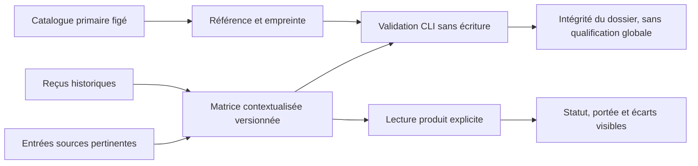

# Matrice de contrôles et limites

R19 fournit une correspondance contextualisée entre douze contrôles sélectionnés
et les preuves locales de Swarm. Elle couvre accès, identité, audit, cryptographie,
cycle de vie, fournisseurs et incidents. Ce sous-ensemble illustratif ne sélectionne
aucune baseline et ne démontre ni certification, ni conformité globale, ni revue
indépendante. Les neuf contrôles partiels, deux non évalués et un hors périmètre
ne sont pas un score de conformité.

Le contexte est `local-simulation-v1` : données public/internal, identités exercées
en fixtures et effets simulés. Le document ne qualifie pas la configuration du
serveur qui l'affiche. NIST précise que les correspondances ne suffisent pas à
établir l'équivalence de contrôles :
[source primaire](https://csrc.nist.gov/pubs/sp/800/53/r5/upd1/final).
Le catalogue OSCAL officiel 5.2.0 est figé par révision et SHA-256 dans
`docs/architecture/actions-confiance-controls-reference.json` ; sa copie originale
est conservée dans le dossier de vérification R19. Aucun catalogue distant n'est
chargé à l'exécution du produit ou du validateur.

## Lire et vérifier

La carte **Contrôles et limites**, dans Actions de confiance, charge explicitement
`web/trust-controls.json`. Un filtre sélectionne le domaine. Le statut et le premier
écart restent visibles ; les détails donnent portée, justification, responsable,
références/empreintes de preuves et évaluation externe manquante. Un fichier vide,
une assurance indue ou un contexte non pris en charge affiche une erreur et retire
les anciens résultats. Les libellés sont rendus comme texte, jamais comme HTML.
Le navigateur vérifie la structure affichable ; il ne lit pas les fichiers du dépôt.

Vérification complète et sans écriture, depuis la racine du candidat :

```sh
python3 tools/actions-confiance/controls.py --root /chemin/candidat
```

`--matrix` accepte un autre chemin relatif contenu dans ce candidat. La sortie JSON
`mapping_artifact_valid` signifie que structure, référence primaire, empreintes des
reçus et entrées pertinentes nommées correspondent. Elle porte toujours
`tests_rerun:false`, `runtime_qualified:false` et les trois revendications d'assurance
à false. Le code2 refuse une pièce manquante/altérée, une source périmée, un chemin
sortant ou un lien, une propriété/ligne inconnue et une revendication non établie.
Aucune preuve historique n'est modifiée pour rendre ce contrôle vert.

Chaque preuve nomme un reçu historique et un sous-ensemble explicite de ses entrées
pertinentes. Leur sélection délimite la portée de la correspondance ; elle ne rend
pas toutes les dépendances anciennes actuelles et ne remplace pas une recette
récente. Après changement pertinent, mettre à jour la recette et la correspondance
avec un nouveau reçu ; conserver l'ancien. Un changement de contexte exige une
nouvelle analyse et une nouvelle version. Les assertions true de certification,
conformité globale ou évaluation indépendante ne sont pas prises en charge par ce
contrat, même si un document les déclare.

## Interpréter les écarts

| Domaine | Pièce locale | Limite maintenue |
| --- | --- | --- |
| Accès | Mandat, accord exact, unicité | Fournisseur réel non qualifié |
| Identité | OIDC et introspection isolés | Cycle RH et annuaire réels non évalués |
| Audit | Chaîne, signature, témoin, archive | Revue humaine et immutabilité hors racine non démontrées |
| Cryptographie | Rotation et retrait | HSM, swap et traçage privilégié hors qualification |
| Cycle de vie | Révisions et versions fixées | Gouvernance des changements et reprise hors site non évaluées |
| Fournisseurs | Chemins locaux et helper fixe | Prestataires réels et confinement général non évalués |
| Incidents | Écart explicitement ouvert | Équipe, escalade et exercice organisationnel non évalués |

Codex possède les preuves locales de ce programme ; un responsable organisationnel
mandaté doit évaluer le contexte réel avant usage externe. Aucun délai ou budget
métier nouveau n'est introduit. La borne technique d'entrée du validateur est16Mio,
exposée dans `technical_bounds`; elle protège la lecture de fichiers, sans gouverner
une exécution Swarm. La matrice et la référence sont des sources versionnées, pas
un réglage de droits Admin. Consommation, données métier et politiques existantes
restent distinctes de ce dossier de preuves.

Recettes : `tools/actions-confiance/test_controls.py`,
`tests/actions_confiance_controls.py --root /chemin/candidat --evidence-dir /chemin/candidat/preuves --timeout-seconds 120`
et `node tests/actions_confiance_controls_ui.cjs /chemin/binaire /chemin/preuves`.
Elles contrôlent aussi refus, FR/EN, thèmes/mobile, absence de mutation métier et
séparation entre document historique et observation courante.


