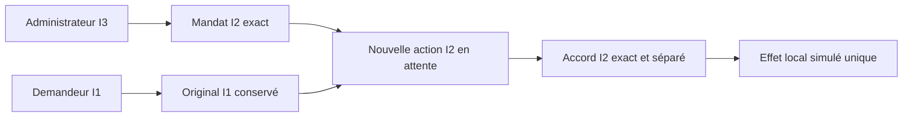

# Biba et actions de confiance en Rust

Biba est la règle d’intégrité de référence de Swarm. Les schémas Mermaid,
frontières de confiance, contrats de stockage et raccordements encore manquants
sont décrits dans [l’architecture technique Rust](architecture/BIBA-RUST.md).

Le moteur Rust fournit le noyau local des actions de confiance, en CLI et sur
`/trust-actions.html`. Le statut de vérification et de livraison se trouve dans
[le plan BIBA-RUST](plans/migration-rust/PLAN.md) et ses preuves datées. Cette
fonction ne rend pas toutes les missions Rust soumises à Biba et n’est pas un
contrôle d’accès Linux. Les effets restent strictement simulés.

La correction en cours du 27 octobre applique la lecture aux réponses métier
et aux replays : un sujet autorisé reçoit l’objet I2 ; sinon la procédure nommée
`trust-status-ack-v1` ne renvoie que `schema_version`, `kind`, `object_id`,
`state` et `content_redacted:true`. L’accusé borne le statut et l’identifiant ;
il ne relabelle pas l’objet et ne donne aucun nouveau droit. Les effets et
leurs preuves restent conservés. Vérification et installation de cette tranche
ne se déduisent pas de la présence du code ; voir le plan courant.

## Autorité et flux

Le moniteur commun utilise I0–I3 : lecture permise si le niveau du sujet est
inférieur ou égal à celui de l’objet ; écriture et invocation permises si le
niveau du sujet est supérieur ou égal à celui de la cible. Les identités locales
configurables sont I1–I3. Sans jeton reconnu, aucune commande métier n’est admise.
Les champs `actor` et `integrity` du client ne donnent aucun droit.

L’admission est une procédure de confiance nommée : un administrateur I3 admet
un **nouveau** mandat I2 ; une demande authentifiée et conforme produit un objet
I2 en attente. L’original I1 et son empreinte restent conservés. Cela n’élève
jamais le sujet I1. Un approbateur I2 doit confirmer le contenu exact avant que
le service d’effet I2 puisse l’engager.



Le jeton vient de `SWARM_TRUST_TOKEN` en CLI et d’`Authorization: Bearer …` en API.
Seule son empreinte est persistée. La page garde le jeton uniquement en mémoire.
La configuration est une opération d’opérateur local ; en HTTP elle exige aussi
la session native, Host/Origin et CSRF. Elle n’est pas autorisée par un champ de
niveau envoyé dans une commande. `show`, `export` et `anchor` sont des lectures
d’audit opérateur ; les lectures métier `read-object`/`read-original` passent
par le moniteur Biba et ne sont pas des vues opérateur.

Après la première initialisation d’une racine non configurée, les opérations
HTTP `config-preview` et `config-apply`, replays compris, exigent un jeton courant
d’identité I3 avec rôle `admin`, relu sous le verrou Trust (partagé en preview, exclusif à l’application). Le cookie
seul, I1/I2 ou une identité suspendue ne permettent pas la reconfiguration.
La modale possède un champ Admin distinct, effacé à la fermeture. La CLI locale
reste une voie d’opérateur propriétaire pour l’initialisation et la reprise ;
ce n’est pas une interface de délégation pour un agent ayant accès au Root.
Les autres routes opérateur et l’isolation globale ne sont pas qualifiées ici.

Les blocs avancés non portés ne peuvent pas être modifiés : null ou omission
conservent, et un bloc inactif déjà conservé peut seulement être retransmis avec
ses mêmes octets compacts. Champs inconnus, mauvais types, activation mal
orthographiée et clés de politique dupliquées refusent. Ce contrôle structurel
de compatibilité ne prétend pas porter tous les validateurs/consommateurs Go.

## Parcours public

La page propose un lien **Vérifications PAEA** vers le contrôle de correspondance
de fichiers, décrit dans le [contrat PAEA](architecture/PAEA-CONTRACT.md).
Les actions principales Exécuter et Enregistrer utilisent la paire sémantique
partagée d’action dans les deux thèmes. Le contrôle de contraste attend la fin
des transitions CSS et examine repos, survol et focus clavier. La recette
`trust-primary-ux.json` couvre la page réelle du workspace avec doubles de
lecture/prévisualisation : elle n’applique aucune configuration et ne prouve
pas les octets servis par un binaire. Voir le [suivi](plans/actions-confiance/paea/INCREMENT-13.md).

```sh
./swarm --root RACINE --json trust show
./swarm --root RACINE --json trust config-preview --input configuration.json
./swarm --root RACINE --json trust config-apply --input configuration.json
./swarm --root RACINE --json trust request --input demande.json
```

La configuration fournit `schema_version:1`, `event_id`, `expected_revision`,
`reason`, les quatre champs `policy` et toutes les `identities` : `subject`,
`token`, `integrity`, `roles`, et éventuellement `disabled`. Rôles reconnus :
`admin`, `requester`, `approver`, `effect`. Le jeton doit avoir au moins 16 octets,
sans espace ni marqueur d’exemple. La modale Admin fait aperçu puis application,
et relit les valeurs enregistrées. Les jetons ne sont jamais relus.

| Politique persistée | Défaut | Zéro et borne technique |
| --- | --- | --- |
| `mandate_ttl_seconds` | 3600 s | 0 sans échéance par défaut ; maximum 9223372036 s |
| `unknown_reconcile_seconds` | 0 s | 0 immédiat ; même maximum |
| `evidence_retention_days` | 365 jours | minimum 1 ; maximum 9007199254740991 |
| `require_separation` | true | booléen explicite |

Les champs de politique sont obligatoires ; null, fractions et valeurs hors
bornes refusent. La rétention est enregistrée, sans purge automatique dans ce
noyau. `show.policy_bounds` expose aussi les formats : état 8 Mio, commande
16 Mio, clé de preuve 32 octets. Ce sont des limites techniques, pas des budgets.

`mandate-create` fixe sujet, actions (`settle` ou `grant-access`), ressource,
paramètres, dates et révision. `request` reste dans ces limites. `approve`
transmet `action_id`, mandat, empreinte et tous les paramètres exacts ; `commit`
et `reconcile` utilisent l’identifiant de l’action protégée. Le connecteur par
défaut est `local-ledger-simulation`. Le second, `local-access-simulation`,
version 1, reçoit `connector.access:{subject,role}` et ne modifie que le registre
d’accès simulé. Il n’accorde aucun droit réel. Son tuple est lié au mandat et à
l’accord ; aucun plugin, destination réseau ou programme arbitraire n’est accepté.
La page guide le règlement ; le second connecteur utilise CLI/API.

`POST /api/v1/trust-actions?action=OPERATION` partage le même moteur et les mêmes
validations. `GET /api/v1/trust-actions` lit l’audit. Les POST de lecture utilisent
`{}`. Le mode CLI distant `--server` historique n’est pas porté dans ce noyau ;
utiliser le CLI local ou l’API protégée, sans repli vers une autre racine.

## Confidentialité Bell-LaPadula — administration de politique, sans contrôle d’exécution

Une politique de confidentialité Bell-LaPadula (niveau ordonné + compartiments,
distincte de l’intégrité Biba) est préparée par la modale Admin de la page
Trust et par les opérations suivantes. **État réel : administration et
diagnostic seulement.** Aucun contenu de projet n’est classé, aucune exécution
n’est médiée : `runtime_enforced:false` et `runtime_authorized:false` sont
conservés dans chaque réponse et l’interface l’annonce. Ne pas les interpréter
comme une protection active.

**Frontière lecteur du rapprochement PA-09 (`GET|HEAD
/api/v1/paea/reconcile-effects`)** : le rapport de rapprochement est classé —
ses findings portent les identifiants d'effets durables (`intent_id`,
`action_digest`) — et la session seule ne l'autorise jamais. Trois portes
ordonnées : (1) AVANT toute ouverture de Root/lecture de réglages/IO de grand
livre, une session sans identifiant lecteur reçoit le refus typé 403 portant
UNIQUEMENT `paea-reader-authentication-required` (HEAD : corps vide) ; (2)
APRÈS ouverture du Root de service (lecture seule) et TOUJOURS AVANT toute
lecture de réglages, ouverture de grand livre ou lecture de journal, un
identifiant PRÉSENT est décidé par le précontrôle d'identité partagé du moteur
(`RootStore::paea_reader_identity_precheck`) contre l'état de confiance COURANT
du Root de service : un jeton inconnu ou désactivé reçoit le refus typé
`authorization_required` (403, aucun état ni erreur de réglages, de grand livre
ou de rapprochement ne lui parvient) ; un journal de confiance absent refuse
`paea-reader-policy-required` ; un identifiant reconnu poursuit ; (3) après le
rapprochement, le verdict lecteur courant (`paea_reader_verdict`) est évalué
sur le digest exact des octets du rapport avant tout retour — il ré-authentifie
l'identifiant sur une NOUVELLE lecture de l'état courant (jamais une identité
cachée du précontrôle) et contrôle devise de politique, attribution et
habilitation ; politique obsolète → `paea-reader-policy-stale`, sans
attribution → `paea-reader-attribution-required`, habilitation insuffisante →
`paea-reader-access-denied`, tous refus typés 403 sans octet du rapport.
Aucune porte ne mute, ne journalise et ne produit de rapport partiel ; la
reprise passe par les opérations publiques (ré-application de politique,
ré-attribution). Contre-exemple conservé et corrigé (2026-11-02,
`glm-reconcile-auth-fix-20261102T093323Z`) : avant ce précontrôle, un jeton
PRÉSENT mais INCONNU observait l'erreur métier du grand livre (409
`paea-effect-reconcile-separate-ledger-required`) au lieu du refus d'identité —
le test exact `reconcile_effects_unknown_token_refused_identity_before_ledger_error`
(rouge reproduit puis vert, GET+HEAD+non-mutation exécutés) fixe le contrat.

**Témoin natif positif du lecteur PA-09 (binaire réel qualifié)** : ce contrat
est aussi prouvé sur le vrai ELF natif par le test d'intégration
`reconcile_effects_native_binary_positive_reader_frontier_empty_ledger`
(`rust/crates/swarm-web/tests/paea_reconcile.rs`, marqué `#[ignore]` pour ne
pas toucher aux six tests par défaut). Il REFUSE l'absence du binaire qualifié
passe par l'environnement documenté `SWARM_ENGINE_BINARY` (aucun hash codé dans
le dépôt ; exécution ciblée `cargo test -p swarm-web --test paea_reconcile
reconcile_effects_native_binary_positive_reader_frontier_empty_ledger --
--ignored --exact`, exactement un test exécuté). Le témoin démarre le vrai
binaire sur la Root de service configurée (port 0, événement de bind JSON
analysé, secret web-session réellement généré au bind, empreinte
`/proc/pid/exe` égale à celle du binaire fourni), sur deux Roots fixture privés
réellement distincts dont le grand livre de rapprochement reste explicitement
non initialisé, puis enchaîne : refus bare 403
`paea-reader-authentication-required`, lecteur fixture connu avant attribution
403 `paea-reader-attribution-required`, attribution publique du rapport exact
produit par `paea_reconcile_effect_journals`, lecture positive 200 aux octets
attendus (HEAD 200 corps vide), inconnu 403 `authorization_required`,
récupération 200 ; le snapshot complet des quatre fichiers est comparé après
CHAQUE phase de lecture (refus pré-attribution compris, attribution = seule
écriture publique intentionnelle entre deux baselines) ; les deux `state.db`
restent octet-identiques sur toute la séquence de lecture et les journaux de
confiance ne bougent que sur les écritures explicites du setup lui-même.
L'arrêt de l'enfant passe par un canal de signal possédé par le noyau : un
pidfd ouvert sur l'identité du processus enfant, avec repli sur le PID
numérique du seul enfant possédé et pas encore récolté si `pidfd_open`
lui-même échoue (aucun PID réutilisable ne peut alors être visé, la récolte
est conservée dans tous les cas, un refus de signal n'est jamais masqué,
jamais SIGKILL) et asserte le vrai contrat d'arrêt natif : sortie 0
et dernière ligne stdout = record `web-stopped`, avec stdout entièrement
drainé et retenu après l'événement de bind. La requête settings du témoin
réutilise VERBATIM la révision affichée par `engine-settings show` : le
contrat `SettingCount` (`rust/crates/swarm-engine/src/engine_settings.rs`)
impose une chaîne décimale canonique non négative (les nombres sont refusés),
donc `expected_revision` est cette chaîne elle-même, jamais convertie en
nombre — une conversion numérique produisait une requête invalide refusée
`settings-request-invalid`. La conservation des sorties brutes de l'enfant est portée par la variable
REQUISE `SWARM_PAEA_NATIVE_EVIDENCE_DIR` : sans elle le témoin refuse de
s'exécuter (pas de PASS sans preuve retenue), avec un chemin déjà existant la
réutilisation est refusée AVANT le démarrage (aucune écriture, aucun
écrasement de preuve antérieure) et le dossier est créé exclusivement 0700
DÈS SA NAISSANCE (`DirBuilderExt::mode`, jamais une fenêtre 0755 puis chmod ;
aucun ancêtre créé, un dossier étranger créé en concurrence ne peut être ni
revendiqué ni repermissionné). Le test conserve de façon durable les octets
EXACTS de stdout/stderr natifs (`stdout.log`/`stderr.log` : le tampon brut
n'est JAMAIS recherché ni tronqué par contenu — un texte enfant ressemblant à
une annotation de drain reste dans le flux brut), les échecs de drain dans
des états séparés au producteur (`drain-stdout.errors.log`/
`drain-stderr.errors.log`, vides sur le chemin nominal — tout état non vide y
est un échec dur), le statut de sortie réel (`exit.json` lu du créneau
partagé de sortie observée ; `"observed": false` si l'enfant n'a pas pu être
récolté — jamais un succès fabriqué) et l'identité binaire/argv (`spawn.json`,
aucun secret ni cookie), sur succès ET échec, chaque fichier via création
exclusive 0600 (temporaire privé `.name.partial`, fsync fichier, publication
par `hard_link` EXCLUSIF — un nom existant n'est jamais écrasé, un symlink
n'est jamais suivi — puis fsync du dossier et retrait du temporaire ; une
écriture partielle conserve le fichier publié original et sa cause). En
échec, le témoin d'échec récolte l'enfant PROPRE via le Drop du détenteur de
processus (ordre de déclaration : le témoin brut est créé AVANT l'écouteur,
donc l'écouteur est détruit AVANT le témoin — la récolte enregistre la vraie
sortie dans le créneau partagé), joint les deux drains jusqu'à EOF (les tuyaux
se ferment à la mort de l'enfant, aucun blocage), puis conserve les flux
COMPLETS et la vraie sortie — mêmes artefacts que le succès ; si un helper a
échoué avant le début de la capture (ex. échec de readiness), le témoin
conserve ce qui existe et déclare la frontière exacte (tampon jamais
branché = rien n'est prétendu pour ce flux), jamais une capture complète non
produite. Aucune attente textuelle, aucun watchdog, jamais SIGKILL. En échec,
un témoin imprime aussi les octets bruts retenus (limite : les octets émis
avant le branchement du lecteur stdout — fenêtre pré-bind — sont hors capture
test et ne sont pas prétendus). Aucun octet de secret n'est jamais
publié sur ces flux natifs (seulement `web-bound`/`web-outcome`/
`web-stopped` ; le secret de session ne vit que dans son fichier).
Le chemin d'échec RÉEL du témoin est rendu exerçable par un mode de faute
EXPLICITEMENT TEST-ONLY, propre à ce test d'intégration (jamais le produit,
l'ELF ni l'autorité) : la variable `SWARM_PAEA_NATIVE_WITNESS_FAULT`,
absente = parcours nominal inchangé ; seule valeur acceptée
`after-bare-refusal` = panique marqueur `PAEA_NATIVE_EXPECTED_WITNESS_FAILURE`
livrée après le contrôle bare-403 GET+HEAD et l'instantané S1 des refus
pré-attribution (écouteur encore vivant, aucun octet de rapport servi), pour
exercer le Drop de l'écouteur puis du témoin (récolte gracieuse SIGINT,
jointures drains jusqu'à EOF, conservation complète des mêmes artefacts) ;
toute autre valeur est refusée AVANT toute réservation de preuve ou
démarrage ; aucun watchdog, minuteur ni relance n'y participe. Preuve de ce
mode : ACQUISE — l'exécution de contrôle du superviseur a observé le
1 FAILED attendu (sortie 101) avec les artefacts retenus complets
(stdout/stderr bruts, états de drain, sortie réelle, récolte enfant
propre observée). Le contrat de ce mode a donc TROIS issues : nominal
(variable absente), faute armée `after-bare-refusal` (1 FAILED attendu,
artefacts = preuve), valeur invalide refusée avant tout démarrage.
Un deuxième mode TEST-ONLY, indépendant, ajoute le témoin navigateur
POSITIF : la variable `SWARM_PAEA_NATIVE_BROWSER_WITNESS`, absente =
parcours nominal inchangé (aucun navigateur) ; seule valeur acceptée `1` =
UN passage réel de navigateur headless
(`tests/paea_reconcile_native_reader_ui.cjs`, Puppeteer par le même chemin
d'installation réel que `tests/paea_effects_ui.cjs`/
`tests/paea_reconcile_reader_ui.cjs`) contre l'écouteur natif DÉJÀ
CONFIGURÉ, lancé après l'attribution publique et AVANT l'arrêt SIGINT ;
toute autre valeur est refusée AVANT toute réservation de preuve ou
démarrage — ce mode a lui aussi TROIS issues : nominal (absente), témoin
armé `1`, valeur invalide refusée avant démarrage. Le script reçoit
adresse, cookie de session générée, jeton lecteur fixture, jeton inconnu
synthétique, rapport attendu et son empreinte par STDIN JSON PRIVÉ (jamais
argv, jamais un journal) ; un échec d'écriture/flush de ce stdin ne tue PAS
le script : le flux est refermé (EOF), ses sorties et sortie réelle sont
collectées et conservées d'abord, puis l'échec est rapporté avec la cause
IO originale et la sortie observée (l'entrée est validée AVANT le
lancement d'un navigateur, donc aucune fenêtre orpheline) ; ses stdout,
stderr et sortie réelle sont conservés comme artefacts 0600 du dossier de
preuve, avec un sous-dossier
fresh exclusif 0700 (`browser-witness-<horodatage>-<suffixe>`, jamais
réutilisé, jamais /tmp) pour ses assertions nommées et captures d'écran
(jamais de secret) ; une sortie non nulle provoque l'échec du test natif,
dont le déroulement conserve le nettoyage natif réel (SIGINT gracieux +
récolte, jointures drains, conservation brute) ; le navigateur possédé est
fermé par le finally du script lui-même, en pilotage événementiel sans
minuteur global ni délai arbitraire. Assertions réelles du navigateur :
page protégée effets servie par le vrai ELF ; refus bare typé sans octet de
rapport ; jeton fixture via le champ dédié + relecture => 200, états
settlement/git `uninitialized` réellement rendus dans le DOM + JSON brut
exact, champ secret purgé ; inconnu 403 `authorization_required` sur la
MÊME page qui vient d'afficher un succès (la purge est ainsi prouvée après
un rapport réellement affiché, jamais sur un contexte vierge) supprimant
TOUT le DOM/brut du rapport, champ purgé ; récupération 200 exacte sur
cette même page ; le journal de requêtes du témoin ne retient des en-têtes
Authorization que leur classification booléenne (présence, forme Bearer,
jeton lecteur reconnu, jeton inconnu connu) — jamais une valeur, même dans
un artefact privé 0600, sans assainisseur post-fuite (le producteur
n'émet jamais de valeur) ; FR/EN, etat/sombre, 390/1280 (deux
combinaisons justifiées),
focus clavier, aucune erreur console ni réseau non classé, credentials
uniquement sur le GET reconcile, aucun POST ni écriture depuis le
navigateur. Capture EN prise DEUX fois : sombre AVANT la bascule puis etat
APRÈS. Preuve de ce mode : ACQUISE le 2026-11-03 sur l'ELF qualifié
(sha e2f0039a…, exécution supervisée : exact 1 PASS natif, sortie Node 0,
14 assertions nommées, 0 diagnostic inattendu, 4 refus 403 typés, 7 GET
reconcile, classification booléenne seule, purge same-page après succès
visible, revue visuelle personnelle des captures FR/EN) ; la recette
pérenne de requalification de la portée vide est
`tools/verification/recipes/paea-native-reader-ui.json` et la recette
pérenne nonempty existe désormais
`tools/verification/recipes/paea-native-reader-ui-nonempty.json` (id
distinct `paea-native-reader-ui-nonempty`, mêmes schéma, environnement et
contrôle i18n, le même wrapper appelé avec `--report-scope nonempty` et le
marqueur requis `PAEA_NATIVE_READER_UI_NONEMPTY_VERIFIED 14` ; exécution
UNVERIFIED jusqu'à l'exécution personnelle de Codex) (wrapper
`tests/paea_reconcile_native_reader_ui_recipe.py`, binaire géré
`{root}/bin/swarm`, parent de preuve `{root}/.cache`, portée de rapport
explicite `--report-scope empty|nonempty` (défaut empty : contrat vide
historique inchangé, marqueur `PAEA_NATIVE_READER_UI_VERIFIED 14` ;
nonempty : test natif dédié
`reconcile_effects_native_binary_positive_reader_frontier_nonempty_ledger`,
kind `paea-native-reader-ui-nonempty-v1`, marqueur distinct
`PAEA_NATIVE_READER_UI_NONEMPTY_VERIFIED 14`, qualifiant le finding
settlement réel rendu, la purge same-page des identifiants réels
précédemment rendus et le recovery identique ; une valeur invalide est
refusée par argparse avant toute création de répertoire ou spawn cargo) ;
le wrapper lance `cargo test --manifest-path rust/Cargo.toml
--offline --locked -p swarm-web --test paea_reconcile <test> -- --ignored
--exact --nocapture` avec CARGO_TARGET_DIR dédié, debug=0, INCREMENTAL=0,
fournit SWARM_ENGINE_BINARY et SWARM_PAEA_NATIVE_BROWSER_WITNESS=1, ne crée
PAS le répertoire SWARM_PAEA_NATIVE_EVIDENCE_DIR (le `from_env` Rust l'exige
inexistant, création exclusive), conserve stdout/stderr/returncode réels
avant toute qualification, refuse le format réel `9 filtered out` traité
comme une anomalie, et vérifie séparément les artefacts de chacun des
deux enfants au niveau du répertoire de preuve : métadonnées de sortie du
NAVIGATEUR (browser-witness.exit.json, run_dir = répertoire Rust externe
browser-witness-<heure>-<suffixe>) et sortie du RUST (exit.json + stdout.log
web-bound → web-stopped en dernière ligne + sidecars de drain vides, le
navigateur-witness.json restant dans le sous-répertoire JS imbriqué) ; un
run de recette ne vaut ni revue indépendante ni acceptation globale).
Trois gardes mémoire opt-in (`#[ignore]`, aucun processus ni écriture)
exercent le producteur partagé `drain_to_end` : le tampon brut conserve TOUS
les octets enfant même quand l'enfant émet lui-même le texte
`\n[stdout drain error:` / `\n[stderr drain error:` (découpage entre chunks,
octet non UTF-8, dernière ligne sans retour), et une vraie erreur de lecture
ne va QUE dans l'état séparé (jamais dans le tampon brut) — la séparation
erreur/contenu est prouvée sur le code producteur réel, pas une copie.
Seul `NotFound` est une absence
autorisée sur un journal de confiance (les autres erreurs sont des échecs
durs, jamais masquées). Portée partielle explicite : rapport vide seulement
pour le test natif ci-dessus (le témoin navigateur TEST-ONLY, opt-in
`SWARM_PAEA_NATIVE_BROWSER_WITNESS=1`, exerce la même portée rapport vide
côté rendu réel). Le contrat natif non vide existe désormais comme test
séparé dédié, `reconcile_effects_native_binary_positive_reader_frontier_nonempty_ledger`
(même binaire ELF qualifié via `SWARM_ENGINE_BINARY`, même contrat
d'`SWARM_PAEA_NATIVE_EVIDENCE_DIR` frais hors /tmp) : contre un registre
réellement enregistré — un effet settlement produit AVANT toute baseline et
avant l'enfant via les mêmes producteurs publics (`work.create`,
`config-apply`, `scope_of`, `seed_settlement_effect` sur un troisième root
projet privé ouvert comme work store, le service et le ledger restant deux
roots distincts), le test applique d'abord le gate témoin navigateur
TEST-ONLY au contrat EXACT du cas vide jumeau (aucune valeur par défaut
silencieusement ignorée) : variable absente => la séquence API non vide
reçue s'exécute INCHANGÉE ; valeur exacte `1` => UN témoin navigateur réel
(Chromium, script partagé `tests/paea_reconcile_native_reader_ui.cjs` dans
sa variante non vide CONSISTENT, kind distinct
`paea-native-reader-ui-nonempty-v1`, métadonnée `report_scope: "nonempty"`,
14 noms de contrôles non vide explicites pour les assertions spécifiques au
mode) s'exécute entre le recovery et l'arrêt SIGINT avec le rapport non vide
EXACT attribué — le script dérive son modèle de rendu du rapport lui-même
(jamais un JSON inventé) et asserte le rendu produit réel (phrase settlement
consistent, ligne de finding réelle avec `intent_id`/`action_digest`
servis, purge same-page des VRAIS identifiants précédemment rendus au refus
unknown puis recovery identique) ; toute autre valeur est refusée AVANT
toute réservation d'évidence ou spawn, puis le test déroule la séquence API
complète sur le rapport NON VIDE : bare 403 typé sans octet de rapport,
lecteur
connu avant attribution 403 typé, calcul du rapport attendu par le
producteur public réel (`paea_reconcile_effect_journals`, settlement
détruit en `Consistent{effect_count:1}` avec la finding `verified`, git
explicitement `Uninitialized`, encodage canonique `encode_model` et
empreinte dans le même domaine que la route), attribution via
`blp-object-attribute` sur le root SERVICE avec ce digest, GET positif 200
octets exactement égaux avec champs assertés depuis le vrai modèle
(`settlement.state == "consistent"`, `effectCount == 1`, `intent_id`/
`action_digest` réels, `verified == true`, `git.state == "uninitialized"`),
HEAD 200 vide, credential inconnu 403 typé sans identifiant réel ni état
divulgué, recovery 200 mêmes octets exacts, témoin navigateur éventuel
(GET only, entre deux comparaisons de snapshot), arrêt SIGINT (exit 0,
dernière
ligne stdout `web-stopped`), conservation brute complète des sorties enfant
et témoin quatre-fichiers après chaque phase de lecture. Le témoin navigateur non vide, NOT TESTED au lot d'origine, est désormais
soutenu par une exécution personnelle du superviseur sur l'ELF320 épinglé
(fbf41a82…) : les DEUX témoins navigateur (vide et non vide) et leurs tests
natifs exacts passent réellement (14 contrôles nommés chacun, finding
settlement réel 1, purge same-page des VRAIS identifiants puis recovery
identique, Node et natif exit 0 ; reçu conservé dans le lot
glm-pa09-scope-wrapper-20261103T110700Z) ; en conséquence le wrapper pérenne
`tests/paea_reconcile_native_reader_ui_recipe.py` porte
`--report-scope empty|nonempty` (défaut empty) et qualifie chaque portée
par son kind, son test natif exact et son inventaire de contrôles nommés ;
la recette JSON pérenne de la portée nonempty existe désormais
(`tools/verification/recipes/paea-native-reader-ui-nonempty.json`, id
distinct, marqueur nonempty requis) et son exécution reste UNVERIFIED tant
que Codex ne l'a pas personnellement courue ; l'incrément de portée du
wrapper a été reçu personnellement par le superviseur sur l'ELF322 épinglé
réellement actif (3146c837…) — les deux portées passent, la valeur invalide
sort 2 avant toute allocation de sortie, et les témoins conservés refusent
la portée croisée (reçu supervisor-wrapper-receipt.json, lot
glm-pa09-scope-wrapper-20261103T110700Z). Le test reste `#[ignore]` exact
(jamais lancé par défaut ; exécutions opt-in uniquement) et
les identités fixture restent une simulation same-UID explicite, jamais un
enrôlement humain, un confinement OS ou une acceptation revendiqués.

```sh
./swarm --root RACINE --json trust blp-show
./swarm --root RACINE --json trust blp-policy-preview --input politique.json
./swarm --root RACINE --json trust blp-policy-apply --input politique.json
./swarm --root RACINE --json trust blp-check --input diagnostic.json
./swarm --root RACINE --json trust blp-object-attribute --input attribution.json
```

- `blp-show` (lecture) : état persisté, historique révisionné et capacité.
  Exige un jeton I3/admin courant comme toute administration.
- `blp-policy-preview` (lecture) : valide une proposition complète
  (`schema_version`, `event_id`, `expected_revision`, `expected_trust_revision`,
  `reason`, `policy` avec niveaux `public`→`restreint` définis par l’opérateur,
  compartiments et habilitations). Aucune mutation.
- `blp-policy-apply` (écriture) : application révisionnée avec preuve attribuée
  ; un `event_id` déjà enregistré rejoue la réponse conservée, sans mutation.
  Un changement de politique de confiance rend l’historique obsolète : il exige
  un renouvellement explicite (`authority_current:false` le signale).
- `blp-check` (lecture) : diagnostic sur étiquettes **fournies** — jamais une
  attribution réelle d’un objet. Renvoie la combinaison/le refus et la
  classification de sortie calculée, sans contenu ni étiquette d’autrui.
  `runtime_authorized:false` ne constitue JAMAIS une autorisation de lecture.
- `blp-object-attribute` (écriture) : attribution courante d’une classification
  à des octets canoniques exacts (`canonical_digest` sha256 des octets
  `paea-json-v1`, `project_path` absolu, révision politique et de confiance
  courantes exigées) par un opérateur I3/admin dont l’habilitation DOMINE le
  label attribué (`check_read`). Persistée dans l’historique révisionné et
  RELUE à chaque consommation ; un changement de révision la rend refusée
  (`blp-policy-changed`) jusqu’à réattribution. Ce n’est pas une
  déclassification ni un droit de lecture : elle constate la classification
  que le contrôle autorisé lie aux octets.

**Frontière lecteur (preview/presentation PAEA)** : `GET
/api/v1/paea/git-call/preview` et `GET /api/v1/paea/git-call/approval/presentation`
ne servent une projection contenant des champs classifiés qu’à un lecteur
autorisé par la garde `paea_reader_verdict` : jeton `Bearer` en forme valide,
politique courante liée à la révision de confiance, attribution courante des
octets exacts, habilitation dominante. Un échec de politique, d’attribution ou
d’habilitation garde la réponse `200 {available:false, reason:paea-reader-*}`
sans aucun octet classifié — payload, identifiant, digest, erreur, header, log —
y compris pour un lecteur enrôlé de sommet de catalogue ; un jeton inconnu ou
une identité désactivée produit en revanche le refus typé
`authorization_required` (statut non-succès, 403) sans aucun octet classifié
non plus. La session seule reste `200 {available:false,
reason:paea-reader-authentication-required}` : session seule et enrôlement ne
sont jamais une autorisation implicite. Les labels `SourceRefJSON` et le cookie navigateur ne
font pas autorité. L’absence de source liée reste répondue avant la garde
(aucun champ classifié n’existe alors). La réponse positive porte
`runtime_enforced:false` : la provenance d’octets côté prompt reste un travail
ouvert de l’autre acteur. Le formulaire public d’approbation
(`web/paea-approval-form.js`) se raccorde à cette frontière sans la contourner :
une entrée éphémère « Jeton lecteur » est lue à l’appel, portée en
`Authorization: Bearer` sur la seule lecture gardée puis effacée sur TOUTES les
sorties du chargement — succès, erreur HTTP ou réseau, capacité non liée,
présentation refusée, réponse illisible (aucun stockage, URL ni log) ; les
refus `paea-reader-*` restent visibles avec leur code exact et le bouton
« Relire la présentation » relit la même endpoint après correction de
l’identifiant ; l’entrée ne porte aucune longueur maximale frontend (la forme
producteur `credential_valid` impose un minimum de 16 octets, interdit les
espacements et les préfixes réservés, sans maximum — une borne arbitraire
couperait des jetons valides ; les formes trop courtes sont refusées côté
service avec le verdict typé exact, jamais pré-coupées) ; la consommation POST
reste exclusivement enrôlement (mot de passe distinct, jamais réinterprété
comme clearance).

**Observations de démarrage minimales (routes status cookie seul)** : `GET
/api/v1/paea/git-call` et `GET /api/v1/paea/git-call/approval` ne servent
derrière la session ordinaire QUE le booléen `bound` et des constantes
littérales de protocole (`schema_version`, `event`) ; le champ `capability`
reste `Null` dès que la source est liée. AUCUNE valeur dérivée de la requête
préparée n'y passe — pas les digests, et pas le `call`/`service`/`operation`
sélectionné non plus : un vocabulaire fermé ne rend pas constante la valeur
sélectionnée par une action classifiée et ne crée aucun droit de
déclassification (BLP-RET-05). HEAD sert un corps vide. La métadonnée exacte
reste lisible uniquement via les routes gardées (preview et presentation)
sous le verdict lecteur courant. Les pages consommatrices
(`web/paea-effects.js`, `web/paea-consent.js`, `web/paea-approval-form.js`)
affichent cet état explicite (jamais de ligne vide ni de valeur présentée
comme inconnue) et traitent une `capability` non nulle comme un rapport hors
contrat qui arrête visiblement le chargement (`paea-status-out-of-contract`
côté formulaire). La page de consentement (`web/paea-consent.html`,
`web/paea-consent.js`) raccorde sa lecture classifiée à la même frontière sans
la contourner : l’empreinte exacte et l’opération liée ne passent que par la
lecture gardée de la présentation et l’aperçu, avec le même identifiant lecteur
éphémère lu à l’appel, porté en `Authorization: Bearer` sur ces seules lectures
puis effacé sur TOUTES les sorties du chargement (aucun stockage, URL ni log) ;
un refus `paea-reader-*` garde son code exact visible, le contrôle « Relire la
présentation » relit les mêmes endpoints après correction, et le formulaire de
consentement reste accessible (l’autorité d’enrôlement n’est jamais
réinterprétée comme clearance de lecture — la comparaison hors canal de
l’empreinte reste la décision de l’opérateur). Chaque sortie de l’aperçu rend
aussi un état terminal typé sur le statut d’approbation : un aperçu indisponible
ou refusé n’est jamais laissé dans un état « en cours », et la formulation de
succès n’est posée que lorsque les métadonnées exactes de la commande sont
réellement affichées. Une lecture gardée qui LÈVE (HTTP 403, transport, JSON
illisible) rend la même paire de refus typé que le verdict `available:false` :
un refus `paea-reader-*` reste un état `empty` portant le code exact, toute
autre erreur lève un état `error` visible — et chaque chargement purge
d’abord TOUTES les projections exactes antérieures (listes de présentation et
d’aperçu, conteneurs du résultat d’envoi POST), pour qu’aucune valeur d’une
réussite antérieure ne survive sous une formulation de refus ni de « données
non affichées » (défaut reproduit puis corrigé du 2026-11-01 : une relecture
HTTP 403 après une lecture autorisée laissait les deux digests antérieurs
dans le DOM ; contre-exemple maintenu
`tests/paea-consent-projection-erasure.cjs`, 11 vérifications sur la vraie
page en Chrome réel, runs rouge puis vert conservés dans le dossier de
preuve). La qualification navigateur réel `paea-consent-ui-rust` résout
désormais le binaire de test exact depuis le flux d’artefacts Cargo
(`cargo test --no-run --message-format=json`, outil lié
`bind_cargo_test_binary.py` + contre-preuves `test_bind_cargo_test_binary.py`)
— plus aucune purge `rm`, aucun glob ni watchdog global dans le driver, dont
les deux canaux bruts sont capturés en flux et attendus jusqu’à leur exit
réel. Contrat d’échec/vidage du driver (contre-exemples maintenus
`tests/paea_consent_driver_control.py`, 16 vérifications sur 8 variantes,
rouges mesurés sur l’instantané d’entrées déclaré du 2026-11-01 puis verts) :
chaque fluxeur des DEUX enfants est suivi et joint après leurs exits réels ;
un échec Rust pendant le harnais échoue immédiatement sans attendre un enfant
vivant ; le défaut INVERSE est couvert symétriquement (2026-11-01) : un échec
du harnais pendant que Rust attend encore la marque de phase tue Rust vivant
AVANT tout wait (la cause primaire harnais est décidée avant le kill, donc
jamais masquée par un -9), si bien qu’aucun wait ne vise un enfant vivant sur
un chemin d’échec dans les DEUX sens ; le nettoyage ne tue que les deux
enfants Popen possédés ; le verdict exige la
marque EOF de chaque canal (vidage partiel refusé) et refuse tout PASS sans
canal brut complet. La contre-preuve
`status_does_not_discriminate_two_prepared_intentions`
montre que deux intentions préparées distinctes produisent des réponses
d'octets identiques sur ces routes.

**Rendu mobile du rapport de rapprochement (PA-09)** : les lignes de finding
des deux listes (`#settlement-findings li`, `#git-findings li` dans
`web/paea.css`) passent désormais à la ligne n'importe où
(`overflow-wrap:anywhere`) au lieu de déborder de la carte et du viewport.
Défaut réel reproduit puis conservé (témoin navigateur natif, reçu
`glm-pa09-nonempty-overflow-guard-20261103T052147Z/supervisor-receipt.json`) :
sur la page réelle servie par l'ELF qualifié, en EN/390/sombre, le document
déborde de 260 px (scrollWidth 650 vs innerWidth 390) et la ligne de finding
de 306 px (564 vs 258 disponibles) — les digests canoniques longs
`intent`/`effet` étaient coupés au bord droit alors que les 14 contrôles
fonctionnels passaient ; l'assertion de débordement antérieure ne couvrait
que la page AVANT rapport peuplé, d'où la garde nommée post-positif et
post-recovery (mesures numériques seulement, capture privée avant échec)
livrée au lot précédent. La correction est générique sur le contrat réel de
la boîte à texte : retour à la ligne intégral des identifiants, AUCUNE
troncature, ellipse, masque ni barre de défilement ; le DOM et le rapport
technique gardent les octets exacts intégraux (aucune fonction produit JS
modifiée), FR/EN, les deux thèmes et les jetons sémantiques restent
inchangés. Reprise : le run de validation par le superviseur attend la garde
verte sur les deux frontières réelles (fr/1280 et en/390) avec toujours
exactement 14 contrôles nommés, puis la régression canonique du cas vide
(script partagé) ; aucune acceptation globale n'est déclarée par ce lot.

Chaque habilitation désigne un sujet d’identité existant non suspendu ; les
sujets inconnus refusent. Le catalogue ne peut pas supprimer ou réordonner des
niveaux existants : cela relabellerait l’historique. Aucune déclassification
n’existe : un résumé, une sortie vide ou un filtrage n’en est pas une. La
protection transversale (attribution des contenus réels, moniteurs fichiers/
réseau/fournisseurs, déclassification humaine liée aux octets) reste ouverte ;
suivi dans [BLP-APEX](plans/actions-confiance/BLP-APEX.md).

## Refus et reprise

`direct-write`, `elevate` et `elevate-integrity` refusent les contournements.
Un refus métier retourne `state:denied` et conserve une preuve attribuée sans
modifier mandat, action ou effet. Un défaut de schéma, d’autorité ou de conflit
reste une erreur : CLI 2, identité 4, conflit de révision/événement/idempotence 3 ;
HTTP 400, 403 ou 409 selon la cause. Une politique avancée active non portée
refuse explicitement, sans repli vers les identités statiques. Les identités
mappées fédérées ne deviennent pas locales parce que leur fédération est arrêtée.

Le verrou interprocessus historique sérialise les écritures. Une même clé ne
produit qu’une entrée native ; un autre contenu sous cette clé est refusé.
`lose_response:true` rend l’état `unknown` après l’effet simulé. Un nouvel
engagement ne le duplique pas ; `reconcile` relit le reçu natif exact après le
délai enregistré. Une révocation observée empêche un nouvel effet ; elle n’efface
pas un effet déjà engagé. Après erreur de sortie, de fermeture ou de transmission,
consulter l’état avec le même identifiant. Les marqueurs `trust_publication`
conservent l’issue connue ou incertaine ; ils ne prouvent pas réception client.

L’audit signale les originaux manquants au lieu de supposer leur présence.
L’état historique, les originaux exacts, exports v2 et ancres HMAC schéma 1 sont
conservés. `verify` fonctionne sans ouvrir de racine, avec `export`, `anchor` et
`verification_key` acquis séparément. Ne jamais prendre une clé depuis le seul
export à vérifier. Réordonnancement, altération, omission sous ancre et incohérence
entre reçu et paramètres refusent. La perte de clé ferme la signature, sans
régénération silencieuse ; une initialisation Go en attente reste protégée et
exige une reprise explicite, elle n’est pas écrasée.

Les signatures publiques, identités fédérées, admission de données sensibles,
processus et laboratoires historiques ne sont pas requalifiés par ce portage.
Une politique active correspondante ferme la mutation. Un fichier privé n’isole
pas du même UID ; les preuves ne fournissent ni horloge tierce, ni immutabilité
physique, ni acceptation indépendante.

Recette permanente : `tools/verification/recipes/trust-biba-rust.json`, avec
`tests/rust_trust_biba.py` et son parcours navigateur. Les preuves Go historiques
restent historiques ; seule une comparaison exécutée est attribuée à Rust.

Recette permanente complémentaire : `tools/verification/recipes/preparation-dialogue-history-rust.json`
avec `tests/rust_preparation_dialogue.py`. Contrat courant posé par ses
assertions : `prepare dialogue ID` et `GET /api/v1/preparations/dialogue`
observent les tours actifs historiques (pending/running/stopping) en lecture
seule — statut SQL exact restitué, prompt privé jamais publié, instantané SQL
inchangé, CLI et HTTP 200 égaux — sans arrêt, adoption, signal ni appel
fournisseur ; les lignes corrompues refusent toujours sans écrire. Seule une
enveloppe native liée à une autre Root refuse
(`preparation-turn-owner-mismatch`), contrat couvert par les tests moteur
`preparation_calls` et hors périmètre de ce test core. La correction du
3 novembre 2026 remplace l’ancienne attente de refus
`preparation-dialogue-active-unported`, périmée depuis la levée de la limite ;
marqueur core attendu `DIALOGUE_PASS 41` (exécution : superviseur, après
stabilisation des sources).

Le parcours navigateur de cette recette (`tests/rust_preparation_dialogue_browser.py`)
pose sa précondition de fixture : la configuration privée de fournisseurs est
publiée vide (`providers{}`, écriture atomique) dès la création de la Racine
possédée, avant le serveur HTTP et l'état témoin — le helper partagé écrirait
sinon un fournisseur CLI éligible, et le produit ne garde le lecteur historique
strict que sans fournisseur configuré. Avant tout navigateur, le vrai endpoint
public `/api/v1/preparations/capabilities` est asserté désactivé et sans
fournisseur ; aucune interception ne fabrique ce résultat. Le parcours avec
appels configurés reste couvert par la recette `preparation-calls-rust` et
n'est pas répété ici.

Réconciliation du 3 novembre 2026 des deux recettes de préparation
(`preparation-calls-rust.json`, `preparation-legacy-replay-rust.json`) sur
leur étape moteur commune `retained-root-faults` (`cargo test --manifest-path
rust/Cargo.toml -p swarm-engine --test preparation_calls -- --nocapture`) :
l'inventaire réel des assertions — pas un choix d'opérateur — compte
désormais sept gardes nommées. L'attente passe de `running 6 tests`/`6
passed` à `running 7 tests`/`7 passed` ; l'ancien nom
`legacy_active_replay_remains_explicitly_unported`, plus porté par aucun
test, devient `legacy_active_replay_is_readonly_without_native_authority` —
la lecture d'un replay actif historique exact est une observation sans
adoption ouvrière : dispatch et claim refusent
(`preparation-call-private-invalid`), la ligne et son budget réservé restent
inchangés ; et la septième garde
`confidential_admission_is_fixed_authenticated_and_never_dispatchable` entre
dans l'attente : l'admission de contexte fixe est authentifiée, attribuée et
relisible, mais n'est pas un envoi fournisseur (zéro tour, zéro réservation,
`runtime_authorized:false`). Les cinq autres gardes nommées, les commandes,
l'environnement et les autres étapes restent inchangés ; les échecs
historiques et les preuves antérieures sont conservés tels quels. Témoin de
l'état réel : sortie de contrôle du superviseur, sept gardes PASS, sortie 0
(`supervisor-legacy-marker-control/` du lot
`glm-pa09-nonempty-recipe-manifest-20261103T115459Z`). Édition GLM :
l'exécution des recettes réconciliées restait UNVERIFIED tant que Codex ne
les avait pas personnellement courues (`recipe.py run` puis `verify`) —
réception personnelle depuis acquise, voir le paragraphe de réception
ci-dessous.

Câblage du prérequis de fixture mémoire, même date : l'exécution personnelle
du superviseur de la recette complète `preparation-calls-rust` sur l'ELF322
épinglé a échoué au premier stade, avant navigateur, sur
`KeyError: SWARM_PROJECT_MEMORY_SEEDER` (`tests/rust_project_memory_source.py:26`
via `seed_lesson` dans `tests/rust_preparation_calls.py:131`) ; l'échec
original est conservé (lot
`glm-preparation-legacy-recipe-markers-20261103T120909Z`,
`supervisor-full-recipes/preparation-calls-rust/`). Les DEUX recettes de
préparation gagnent donc, avant leurs parcours publics, les deux prérequis
déjà qualifiés de la recette `blp-preparation-provenance-public`, repris à
l'identique : le test de garde de placement de fixture
`fixture-placement-guard` (`cargo test --example memory_source_fixture`,
attendu `explicit_fixture_area_guard_retains_refusals`, `1 passed; 0 failed`
— la garde refuse les racines hors zone configurée, imbriquées, mal
préfixées ou vives, et tout /tmp) et la construction `fixture-memory-sidecar`
du rédacteur de fixture natif (`cargo build --example
memory_source_fixture`). L'environnement porte désormais
`SWARM_PROJECT_MEMORY_SEEDER={root}/.cache/blp-verification-target/debug/examples/memory_source_fixture`
— le chemin réellement produit par ces étapes — et
`CARGO_TARGET_DIR={root}/.cache/blp-verification-target`, cible de test
dédiée cohérente avec le seeder, distincte des constructions de production
`.cache/rust-native-version846-target` ; aucun drapeau all-features, aucune
reconstruction ni substitution de l'ELF de production, le binaire source
restant fourni de l'extérieur par `SWARM_PREPARATION_UI_BINARY`. La source
de fixture réellement consommée `tests/fixture_area.py` entre dans
l'inventaire déclaré. Les sept gardes nommées et toutes les assertions
fonctionnelles restent inchangées ; les scripts de test ne sont pas modifiés
pour sauter l'ensemencement. Exécution des recettes recâblées : d'abord UNVERIFIED
tant que Codex ne les avait pas personnellement courues ; depuis reçue
personnellement (paragraphe de réception ci-dessous).

Réconciliation du compteur du producteur, même date : l'exécution recâblée
du superviseur a réellement passé la garde de placement (`1 passed; 0
failed`), la construction du sidecar (exit 0) puis le parcours public
complet CLI+HTTP+navigateur (sortie réelle 0 : 35 assertions nommées du
noyau, dont le contrôle `browser-public-journey`, et marqueur navigateur
`PREPARATION_CALLS_BROWSER_PASS 48`) ; la recette s'est arrêtée (exit 1)
uniquement sur l'attente périmée `PREPARATION_CALLS_PASS 34`. Cause
établie : le producteur `tests/rust_preparation_calls.py` imprime
`PREPARATION_CALLS_PASS` suivi du nombre dynamique de contrôles nommés
(ligne 144) ; le contrôle nommé `browser-public-journey` (ligne 143, dans
le parcours `--browser`) porte l'inventaire réel du noyau à 35. Les
attentes des DEUX recettes passent donc à `PREPARATION_CALLS_PASS 35` ;
le marqueur navigateur 48 et toutes les autres assertions restent
inchangés. Preuve conservée (ELF322 épinglé 3146c837…, lot
`glm-preparation-memory-fixture-wiring-20261103T124003Z`) :
`supervisor-full-recipes/preparation-calls-rust/` (`step-0003.stdout`,
`step-0003.json`, `result.json`), `supervisor-next-boundary.json` et le
témoin retained `supervisor-retained-calls35`. Les échecs historiques
antérieurs restent intacts ; à ce stade, les recettes n'étaient pas encore
entièrement vérifiées (stades `transport`, `engine-budget-policy`,
`retained-root-faults` et recette legacy non exécutés dans ce run) — les
exécutions complètes personnelles de Codex ont depuis été reçues (paragraphe
de réception ci-dessous).

Réconciliation du filtre moteur, même date : l'exécution poursuivie du
superviseur a ensuite réellement passé `transport` (4 tests) puis l'étape
`engine-budget-policy` elle-même (exit 0) ; la recette s'est arrêtée
uniquement sur l'attente périmée `running 7 tests`/`7 passed`. Inventaire
réel observé (`step-0005.stdout`, ELF322 épinglé 3146c837…) : 18 tests
nommés, tous PASS, 0 failed, 0 ignored, 735 filtrés — la commande
`--lib preparation_call` sélectionne désormais six groupes de modules :
5 `level_tests`, 2 `cli::level_tests`, 3 `preparation_call_budget`, 4
`engine_settings::preparation_calls`, 2 `legacy`, 2 `confidentiality_tests`.
L'attente de l'étape passe à `running 18 tests`/`18 passed; 0 failed` et
porte désormais l'inventaire nommé complet des 18 tests ; les commandes,
l'environnement, les prérequis et les autres étapes restent inchangés.
Preuve conservée au lot `glm-preparation-calls-count-20261103T132200Z`
(`step-0005.stdout/.stderr/.json`, `result.json`,
`supervisor-next-boundary.json`) ; échec historique préservé. À ce stade, la recette
n'était pas encore entièrement vérifiée : `retained-root-faults` (7 gardes)
et la recette legacy complète restaient à l'exécution personnelle de Codex —
depuis reçues (paragraphe de réception ci-dessous).

Réception personnelle des deux recettes, même date : Codex a personnellement
couru puis vérifié les deux recettes complètes (`recipe.py run` puis
`verify`, quatre sorties réelles 0) sur l'ELF322 épinglé
3146c83791e9cd5e98f264d3d4af0bdf2fc6ee9fb246d145dcc88fd8c4cc313a, sources et
production stables. `preparation-calls-rust`, 6 étapes : garde de placement
1 PASS, public 35 assertions + navigateur 48, transport 4, moteur 18,
retained-root-faults 7. `preparation-legacy-replay-rust`, 5 étapes : garde 1,
replay legacy public 33 — replay terminal exact, conflits d'événement
préservés, observation LECTURE SEULE des tours actifs
pending/running/stopping avec grands livres reserved/estimated inchangés,
aucune écriture de ligne ni de grand livre, aucun contact fournisseur — puis
public 35 + navigateur 48 et root-faults 7 ; les deux `verify` rendent
`integrity VERIFIED, recorded_status PASS`. Preuves conservées hors cache,
lot `glm-preparation-engine-count-20261103T140800Z` : `supervisor-receipt.json`,
`supervisor-full-recipes/preparation-calls-rust/result.json`,
`supervisor-full-recipes/preparation-legacy-replay-rust/result.json`,
`supervisor-full-recipes/preparation-calls-rust-verify.stdout`,
`supervisor-full-recipes/preparation-legacy-replay-rust-verify.stdout`,
parcours retained sous `supervisor-retained-journeys/`. Portée du reçu :
racines inertes possédées et faux fournisseur local ; ni PAEA globale,
enrôlement humain, revue indépendante, confinement de production ni
acceptation du dialogue de versions humain protégé ; l'admin JS étranger
diffère, pas d'équivalence whole-workspace. Les échecs intermédiaires
historiques des lots antérieurs restent conservés tels quels.

La classification HTTP publique des quatre refus lecteur BF-16a du dialogue
(`blp-dialogue-authentication-required`, `blp-dialogue-policy-required`,
`blp-dialogue-policy-stale`, `blp-dialogue-access-denied`) est régressée par le
test `service::status_tests::blp_dialogue_reader_refusals_are_forbidden_and_cleanup_stays_server_error`
(`rust/crates/swarm-web/src/service/status_tests.rs`) : les refus arrivent à la
couche HTTP enveloppés par l'adaptateur réel de la route dialogue
(`root("preparation-read", …)`, service/preparations.rs), et sont donc
classifiés dans le bras `Self::Root{operation,cause}` de `status()` — les quatre
codes exacts, sous l'opération réelle `preparation-read` et la variante stricte
`RootStoreError::Refused`, donnent 403 avec le code stable conservé. Un échec de
close/rollback portant le même refus primaire reste 500 dans sa famille
`root-cleanup` avec les deux causes typées conservées à travers le wrapper ; le
test inspecte réellement ces deux causes et witness aussi que la même code sous
une autre opération et un code voisin (famille reconcile) restent 500 : un
défaut interne n'est jamais déguisé en refus appelant, et le contrat dialogue ne
fuit pas hors de sa porte. Limite honnête : c'est une régression de conversion
pure — aucun Root/DB/processus, pas un GET réel, aucune couverture de bout en
bout du producteur (les décisions de refus du garde restent couvertes par les
tests moteur du dialogue) ; exécution : superviseur, jamais l'éditeur.

**UNVERIFIÉ (en attente de l'exécution personnelle de Codex)** — Première
frontière HTTP réelle ajoutée : `tests/blp_dialogue_reader_public.py` rejoue, sur
un Root possédé avec double fournisseur local inerte, une réponse réelle via le
producteur public (prepare create/budget/send), puis amorce la confiance et
avoue le même intent via les opérations publiques (config-apply,
blp-policy-apply, attribution par tranche, blp-preparation-admit). Avant
l'injection, un GET nu sur `/api/v1/preparations/dialogue` doit rester 200
(chemin hérité zéro-correspondance) ; après, le même GET nu refuse 403
`blp-dialogue-authentication-required` sans octet privé, et le lecteur habilité
relit 200 la même réponse non vide, prompt privé absent ; les instantanés
readonly SQL/journal/capsules restent identiques autour de chaque GET. Si
l'admission publique refuse le tour existant, le script s'arrête sur ce refus
exact avec ses preuves brutes au lieu de fabriquer un succès. Hors périmètre,
différé : recette, HEAD, stale/révélé/malformé — lots bornés suivants après
l'exécution de Codex.

Un bloc fédéré conservé `null` reste absent, sans autorité. Dans une commande métier, seul le champ `policy` historique entièrement nul (trois entiers zéro et séparation false) est toléré pour conserver les empreintes Go ; il ne configure rien. Toute autre valeur refuse sans mutation.
Les clés répétées refusent aussi au niveau supérieur de la configuration et de l’état, avant sélection des extensions.
L’omission de `policy` dans une commande métier équivaut au placeholder zéro et ne configure rien. Les formes internes nulles des politiques de données/groupes et les durées obligatoires nulles/zéro refusent aussi chez leurs producteurs Go : ce ne sont pas des configurations historiques valides à réactiver.

## Gouvernance et audit dans l’Admin

La fenêtre Admin permet de régler les conflits entre demandeur, approbateur,
exécuteur et administrateur, puis les principaux de contrôle déclarés. Prévisualiser,
enregistrer et rouvrir vérifie la politique persistée. Le jeton I3 courant reste
nécessaire côté serveur : un libellé ou une case ne confère aucun droit.

Choisir une transaction pour lire son audit lié et enregistrer cet accès. Le
panneau de preuve distingue préparation, activation par un second administrateur,
révocation et disponibilité privée en mémoire. La vérification publique demande
un pin acquis séparément ; une clé du bundle n’est jamais autoremplie comme autorité.
Voir le [contrat technique et les schémas](architecture/BIBA-GOUVERNANCE-RUST.md).
