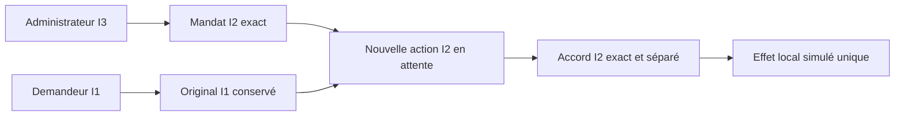

# Biba et actions de confiance en Rust

Biba est la règle d’intégrité de référence de Swarm. Les schémas Mermaid,
frontières de confiance, contrats de stockage et raccordements encore manquants
sont décrits dans [l’architecture technique Rust](architecture/BIBA-RUST.md).

Le moteur Rust fournit le noyau local des actions de confiance, en CLI et sur
`/trust-actions.html`. Le statut de vérification et de livraison se trouve dans
[le plan BIBA-RUST](plans/migration-rust/PLAN.md) et ses preuves datées. Cette
fonction ne rend pas toutes les missions Rust soumises à Biba et n’est pas un
contrôle d’accès Linux. Les effets restent strictement simulés.

La correction en cours du 27 octobre applique la lecture aux réponses métier
et aux replays : un sujet autorisé reçoit l’objet I2 ; sinon la procédure nommée
`trust-status-ack-v1` ne renvoie que `schema_version`, `kind`, `object_id`,
`state` et `content_redacted:true`. L’accusé borne le statut et l’identifiant ;
il ne relabelle pas l’objet et ne donne aucun nouveau droit. Les effets et
leurs preuves restent conservés. Vérification et installation de cette tranche
ne se déduisent pas de la présence du code ; voir le plan courant.

## Autorité et flux

Le moniteur commun utilise I0–I3 : lecture permise si le niveau du sujet est
inférieur ou égal à celui de l’objet ; écriture et invocation permises si le
niveau du sujet est supérieur ou égal à celui de la cible. Les identités locales
configurables sont I1–I3. Sans jeton reconnu, aucune commande métier n’est admise.
Les champs `actor` et `integrity` du client ne donnent aucun droit.

L’admission est une procédure de confiance nommée : un administrateur I3 admet
un **nouveau** mandat I2 ; une demande authentifiée et conforme produit un objet
I2 en attente. L’original I1 et son empreinte restent conservés. Cela n’élève
jamais le sujet I1. Un approbateur I2 doit confirmer le contenu exact avant que
le service d’effet I2 puisse l’engager.



Le jeton vient de `SWARM_TRUST_TOKEN` en CLI et d’`Authorization: Bearer …` en API.
Seule son empreinte est persistée. La page garde le jeton uniquement en mémoire.
La configuration est une opération d’opérateur local ; en HTTP elle exige aussi
la session native, Host/Origin et CSRF. Elle n’est pas autorisée par un champ de
niveau envoyé dans une commande. `show`, `export` et `anchor` sont des lectures
d’audit opérateur ; les lectures métier `read-object`/`read-original` passent
par le moniteur Biba et ne sont pas des vues opérateur.

Après la première initialisation d’une racine non configurée, les opérations
HTTP `config-preview` et `config-apply`, replays compris, exigent un jeton courant
d’identité I3 avec rôle `admin`, relu sous le verrou Trust (partagé en preview, exclusif à l’application). Le cookie
seul, I1/I2 ou une identité suspendue ne permettent pas la reconfiguration.
La modale possède un champ Admin distinct, effacé à la fermeture. La CLI locale
reste une voie d’opérateur propriétaire pour l’initialisation et la reprise ;
ce n’est pas une interface de délégation pour un agent ayant accès au Root.
Les autres routes opérateur et l’isolation globale ne sont pas qualifiées ici.

Les blocs avancés non portés ne peuvent pas être modifiés : null ou omission
conservent, et un bloc inactif déjà conservé peut seulement être retransmis avec
ses mêmes octets compacts. Champs inconnus, mauvais types, activation mal
orthographiée et clés de politique dupliquées refusent. Ce contrôle structurel
de compatibilité ne prétend pas porter tous les validateurs/consommateurs Go.

## Parcours public

La page propose un lien **Vérifications PAEA** vers le contrôle de correspondance
de fichiers, décrit dans le [contrat PAEA](architecture/PAEA-CONTRACT.md).
Les actions principales Exécuter et Enregistrer utilisent la paire sémantique
partagée d’action dans les deux thèmes. Le contrôle de contraste attend la fin
des transitions CSS et examine repos, survol et focus clavier. La recette
`trust-primary-ux.json` couvre la page réelle du workspace avec doubles de
lecture/prévisualisation : elle n’applique aucune configuration et ne prouve
pas les octets servis par un binaire. Voir le [suivi](plans/actions-confiance/paea/INCREMENT-13.md).

```sh
./swarm --root RACINE --json trust show
./swarm --root RACINE --json trust config-preview --input configuration.json
./swarm --root RACINE --json trust config-apply --input configuration.json
./swarm --root RACINE --json trust request --input demande.json
```

La configuration fournit `schema_version:1`, `event_id`, `expected_revision`,
`reason`, les quatre champs `policy` et toutes les `identities` : `subject`,
`token`, `integrity`, `roles`, et éventuellement `disabled`. Rôles reconnus :
`admin`, `requester`, `approver`, `effect`. Le jeton doit avoir au moins 16 octets,
sans espace ni marqueur d’exemple. La modale Admin fait aperçu puis application,
et relit les valeurs enregistrées. Les jetons ne sont jamais relus.

| Politique persistée | Défaut | Zéro et borne technique |
| --- | --- | --- |
| `mandate_ttl_seconds` | 3600 s | 0 sans échéance par défaut ; maximum 9223372036 s |
| `unknown_reconcile_seconds` | 0 s | 0 immédiat ; même maximum |
| `evidence_retention_days` | 365 jours | minimum 1 ; maximum 9007199254740991 |
| `require_separation` | true | booléen explicite |

Les champs de politique sont obligatoires ; null, fractions et valeurs hors
bornes refusent. La rétention est enregistrée, sans purge automatique dans ce
noyau. `show.policy_bounds` expose aussi les formats : état 8 Mio, commande
16 Mio, clé de preuve 32 octets. Ce sont des limites techniques, pas des budgets.

`mandate-create` fixe sujet, actions (`settle` ou `grant-access`), ressource,
paramètres, dates et révision. `request` reste dans ces limites. `approve`
transmet `action_id`, mandat, empreinte et tous les paramètres exacts ; `commit`
et `reconcile` utilisent l’identifiant de l’action protégée. Le connecteur par
défaut est `local-ledger-simulation`. Le second, `local-access-simulation`,
version 1, reçoit `connector.access:{subject,role}` et ne modifie que le registre
d’accès simulé. Il n’accorde aucun droit réel. Son tuple est lié au mandat et à
l’accord ; aucun plugin, destination réseau ou programme arbitraire n’est accepté.
La page guide le règlement ; le second connecteur utilise CLI/API.

`POST /api/v1/trust-actions?action=OPERATION` partage le même moteur et les mêmes
validations. `GET /api/v1/trust-actions` lit l’audit. Les POST de lecture utilisent
`{}`. Le mode CLI distant `--server` historique n’est pas porté dans ce noyau ;
utiliser le CLI local ou l’API protégée, sans repli vers une autre racine.

## Confidentialité Bell-LaPadula — administration de politique, sans contrôle d’exécution

Une politique de confidentialité Bell-LaPadula (niveau ordonné + compartiments,
distincte de l’intégrité Biba) est préparée par la modale Admin de la page
Trust et par les opérations suivantes. **État réel : administration et
diagnostic seulement.** Aucun contenu de projet n’est classé, aucune exécution
n’est médiée : `runtime_enforced:false` et `runtime_authorized:false` sont
conservés dans chaque réponse et l’interface l’annonce. Ne pas les interpréter
comme une protection active.

```sh
./swarm --root RACINE --json trust blp-show
./swarm --root RACINE --json trust blp-policy-preview --input politique.json
./swarm --root RACINE --json trust blp-policy-apply --input politique.json
./swarm --root RACINE --json trust blp-check --input diagnostic.json
./swarm --root RACINE --json trust blp-object-attribute --input attribution.json
```

- `blp-show` (lecture) : état persisté, historique révisionné et capacité.
  Exige un jeton I3/admin courant comme toute administration.
- `blp-policy-preview` (lecture) : valide une proposition complète
  (`schema_version`, `event_id`, `expected_revision`, `expected_trust_revision`,
  `reason`, `policy` avec niveaux `public`→`restreint` définis par l’opérateur,
  compartiments et habilitations). Aucune mutation.
- `blp-policy-apply` (écriture) : application révisionnée avec preuve attribuée
  ; un `event_id` déjà enregistré rejoue la réponse conservée, sans mutation.
  Un changement de politique de confiance rend l’historique obsolète : il exige
  un renouvellement explicite (`authority_current:false` le signale).
- `blp-check` (lecture) : diagnostic sur étiquettes **fournies** — jamais une
  attribution réelle d’un objet. Renvoie la combinaison/le refus et la
  classification de sortie calculée, sans contenu ni étiquette d’autrui.
  `runtime_authorized:false` ne constitue JAMAIS une autorisation de lecture.
- `blp-object-attribute` (écriture) : attribution courante d’une classification
  à des octets canoniques exacts (`canonical_digest` sha256 des octets
  `paea-json-v1`, `project_path` absolu, révision politique et de confiance
  courantes exigées) par un opérateur I3/admin dont l’habilitation DOMINE le
  label attribué (`check_read`). Persistée dans l’historique révisionné et
  RELUE à chaque consommation ; un changement de révision la rend refusée
  (`blp-policy-changed`) jusqu’à réattribution. Ce n’est pas une
  déclassification ni un droit de lecture : elle constate la classification
  que le contrôle autorisé lie aux octets.

**Frontière lecteur (preview/presentation PAEA)** : `GET
/api/v1/paea/git-call/preview` et `GET /api/v1/paea/git-call/approval/presentation`
ne servent une projection contenant des champs classifiés qu’à un lecteur
autorisé par la garde `paea_reader_verdict` : jeton `Bearer` en forme valide,
politique courante liée à la révision de confiance, attribution courante des
octets exacts, habilitation dominante. Un échec de politique, d’attribution ou
d’habilitation garde la réponse `200 {available:false, reason:paea-reader-*}`
sans aucun octet classifié — payload, identifiant, digest, erreur, header, log —
y compris pour un lecteur enrôlé de sommet de catalogue ; un jeton inconnu ou
une identité désactivée produit en revanche le refus typé
`authorization_required` (statut non-succès, 403) sans aucun octet classifié
non plus. La session seule reste `200 {available:false,
reason:paea-reader-authentication-required}` : session seule et enrôlement ne
sont jamais une autorisation implicite. Les labels `SourceRefJSON` et le cookie navigateur ne
font pas autorité. L’absence de source liée reste répondue avant la garde
(aucun champ classifié n’existe alors). La réponse positive porte
`runtime_enforced:false` : la provenance d’octets côté prompt reste un travail
ouvert de l’autre acteur. Le formulaire public d’approbation
(`web/paea-approval-form.js`) se raccorde à cette frontière sans la contourner :
une entrée éphémère « Jeton lecteur » est lue à l’appel, portée en
`Authorization: Bearer` sur la seule lecture gardée puis effacée sur TOUTES les
sorties du chargement — succès, erreur HTTP ou réseau, capacité non liée,
présentation refusée, réponse illisible (aucun stockage, URL ni log) ; les
refus `paea-reader-*` restent visibles avec leur code exact et le bouton
« Relire la présentation » relit la même endpoint après correction de
l’identifiant ; l’entrée ne porte aucune longueur maximale frontend (la forme
producteur `credential_valid` impose un minimum de 16 octets, interdit les
espacements et les préfixes réservés, sans maximum — une borne arbitraire
couperait des jetons valides ; les formes trop courtes sont refusées côté
service avec le verdict typé exact, jamais pré-coupées) ; la consommation POST
reste exclusivement enrôlement (mot de passe distinct, jamais réinterprété
comme clearance).

**Observations de démarrage minimales (routes status cookie seul)** : `GET
/api/v1/paea/git-call` et `GET /api/v1/paea/git-call/approval` ne servent
derrière la session ordinaire QUE le booléen `bound` et des constantes
littérales de protocole (`schema_version`, `event`) ; le champ `capability`
reste `Null` dès que la source est liée. AUCUNE valeur dérivée de la requête
préparée n'y passe — pas les digests, et pas le `call`/`service`/`operation`
sélectionné non plus : un vocabulaire fermé ne rend pas constante la valeur
sélectionnée par une action classifiée et ne crée aucun droit de
déclassification (BLP-RET-05). HEAD sert un corps vide. La métadonnée exacte
reste lisible uniquement via les routes gardées (preview et presentation)
sous le verdict lecteur courant. Les pages consommatrices
(`web/paea-effects.js`, `web/paea-consent.js`, `web/paea-approval-form.js`)
affichent cet état explicite (jamais de ligne vide ni de valeur présentée
comme inconnue) et traitent une `capability` non nulle comme un rapport hors
contrat qui arrête visiblement le chargement (`paea-status-out-of-contract`
côté formulaire). La page de consentement (`web/paea-consent.html`,
`web/paea-consent.js`) raccorde sa lecture classifiée à la même frontière sans
la contourner : l’empreinte exacte et l’opération liée ne passent que par la
lecture gardée de la présentation et l’aperçu, avec le même identifiant lecteur
éphémère lu à l’appel, porté en `Authorization: Bearer` sur ces seules lectures
puis effacé sur TOUTES les sorties du chargement (aucun stockage, URL ni log) ;
un refus `paea-reader-*` garde son code exact visible, le contrôle « Relire la
présentation » relit les mêmes endpoints après correction, et le formulaire de
consentement reste accessible (l’autorité d’enrôlement n’est jamais
réinterprétée comme clearance de lecture — la comparaison hors canal de
l’empreinte reste la décision de l’opérateur). Chaque sortie de l’aperçu rend
aussi un état terminal typé sur le statut d’approbation : un aperçu indisponible
ou refusé n’est jamais laissé dans un état « en cours », et la formulation de
succès n’est posée que lorsque les métadonnées exactes de la commande sont
réellement affichées. Une lecture gardée qui LÈVE (HTTP 403, transport, JSON
illisible) rend la même paire de refus typé que le verdict `available:false` :
un refus `paea-reader-*` reste un état `empty` portant le code exact, toute
autre erreur lève un état `error` visible — et chaque chargement purge
d’abord TOUTES les projections exactes antérieures (listes de présentation et
d’aperçu, conteneurs du résultat d’envoi POST), pour qu’aucune valeur d’une
réussite antérieure ne survive sous une formulation de refus ni de « données
non affichées » (défaut reproduit puis corrigé du 2026-11-01 : une relecture
HTTP 403 après une lecture autorisée laissait les deux digests antérieurs
dans le DOM ; contre-exemple maintenu
`tests/paea-consent-projection-erasure.cjs`, 11 vérifications sur la vraie
page en Chrome réel, runs rouge puis vert conservés dans le dossier de
preuve). La qualification navigateur réel `paea-consent-ui-rust` résout
désormais le binaire de test exact depuis le flux d’artefacts Cargo
(`cargo test --no-run --message-format=json`, outil lié
`bind_cargo_test_binary.py` + contre-preuves `test_bind_cargo_test_binary.py`)
— plus aucune purge `rm`, aucun glob ni watchdog global dans le driver, dont
les deux canaux bruts sont capturés en flux et attendus jusqu’à leur exit
réel. Contrat d’échec/vidage du driver (contre-exemples maintenus
`tests/paea_consent_driver_control.py`, 16 vérifications sur 8 variantes,
rouges mesurés sur l’instantané d’entrées déclaré du 2026-11-01 puis verts) :
chaque fluxeur des DEUX enfants est suivi et joint après leurs exits réels ;
un échec Rust pendant le harnais échoue immédiatement sans attendre un enfant
vivant ; le défaut INVERSE est couvert symétriquement (2026-11-01) : un échec
du harnais pendant que Rust attend encore la marque de phase tue Rust vivant
AVANT tout wait (la cause primaire harnais est décidée avant le kill, donc
jamais masquée par un -9), si bien qu’aucun wait ne vise un enfant vivant sur
un chemin d’échec dans les DEUX sens ; le nettoyage ne tue que les deux
enfants Popen possédés ; le verdict exige la
marque EOF de chaque canal (vidage partiel refusé) et refuse tout PASS sans
canal brut complet. La contre-preuve
`status_does_not_discriminate_two_prepared_intentions`
montre que deux intentions préparées distinctes produisent des réponses
d'octets identiques sur ces routes.

Chaque habilitation désigne un sujet d’identité existant non suspendu ; les
sujets inconnus refusent. Le catalogue ne peut pas supprimer ou réordonner des
niveaux existants : cela relabellerait l’historique. Aucune déclassification
n’existe : un résumé, une sortie vide ou un filtrage n’en est pas une. La
protection transversale (attribution des contenus réels, moniteurs fichiers/
réseau/fournisseurs, déclassification humaine liée aux octets) reste ouverte ;
suivi dans [BLP-APEX](plans/actions-confiance/BLP-APEX.md).

## Refus et reprise

`direct-write`, `elevate` et `elevate-integrity` refusent les contournements.
Un refus métier retourne `state:denied` et conserve une preuve attribuée sans
modifier mandat, action ou effet. Un défaut de schéma, d’autorité ou de conflit
reste une erreur : CLI 2, identité 4, conflit de révision/événement/idempotence 3 ;
HTTP 400, 403 ou 409 selon la cause. Une politique avancée active non portée
refuse explicitement, sans repli vers les identités statiques. Les identités
mappées fédérées ne deviennent pas locales parce que leur fédération est arrêtée.

Le verrou interprocessus historique sérialise les écritures. Une même clé ne
produit qu’une entrée native ; un autre contenu sous cette clé est refusé.
`lose_response:true` rend l’état `unknown` après l’effet simulé. Un nouvel
engagement ne le duplique pas ; `reconcile` relit le reçu natif exact après le
délai enregistré. Une révocation observée empêche un nouvel effet ; elle n’efface
pas un effet déjà engagé. Après erreur de sortie, de fermeture ou de transmission,
consulter l’état avec le même identifiant. Les marqueurs `trust_publication`
conservent l’issue connue ou incertaine ; ils ne prouvent pas réception client.

L’audit signale les originaux manquants au lieu de supposer leur présence.
L’état historique, les originaux exacts, exports v2 et ancres HMAC schéma 1 sont
conservés. `verify` fonctionne sans ouvrir de racine, avec `export`, `anchor` et
`verification_key` acquis séparément. Ne jamais prendre une clé depuis le seul
export à vérifier. Réordonnancement, altération, omission sous ancre et incohérence
entre reçu et paramètres refusent. La perte de clé ferme la signature, sans
régénération silencieuse ; une initialisation Go en attente reste protégée et
exige une reprise explicite, elle n’est pas écrasée.

Les signatures publiques, identités fédérées, admission de données sensibles,
processus et laboratoires historiques ne sont pas requalifiés par ce portage.
Une politique active correspondante ferme la mutation. Un fichier privé n’isole
pas du même UID ; les preuves ne fournissent ni horloge tierce, ni immutabilité
physique, ni acceptation indépendante.

Recette permanente : `tools/verification/recipes/trust-biba-rust.json`, avec
`tests/rust_trust_biba.py` et son parcours navigateur. Les preuves Go historiques
restent historiques ; seule une comparaison exécutée est attribuée à Rust.

Un bloc fédéré conservé `null` reste absent, sans autorité. Dans une commande métier, seul le champ `policy` historique entièrement nul (trois entiers zéro et séparation false) est toléré pour conserver les empreintes Go ; il ne configure rien. Toute autre valeur refuse sans mutation.
Les clés répétées refusent aussi au niveau supérieur de la configuration et de l’état, avant sélection des extensions.
L’omission de `policy` dans une commande métier équivaut au placeholder zéro et ne configure rien. Les formes internes nulles des politiques de données/groupes et les durées obligatoires nulles/zéro refusent aussi chez leurs producteurs Go : ce ne sont pas des configurations historiques valides à réactiver.

## Gouvernance et audit dans l’Admin

La fenêtre Admin permet de régler les conflits entre demandeur, approbateur,
exécuteur et administrateur, puis les principaux de contrôle déclarés. Prévisualiser,
enregistrer et rouvrir vérifie la politique persistée. Le jeton I3 courant reste
nécessaire côté serveur : un libellé ou une case ne confère aucun droit.

Choisir une transaction pour lire son audit lié et enregistrer cet accès. Le
panneau de preuve distingue préparation, activation par un second administrateur,
révocation et disponibilité privée en mémoire. La vérification publique demande
un pin acquis séparément ; une clé du bundle n’est jamais autoremplie comme autorité.
Voir le [contrat technique et les schémas](architecture/BIBA-GOUVERNANCE-RUST.md).
