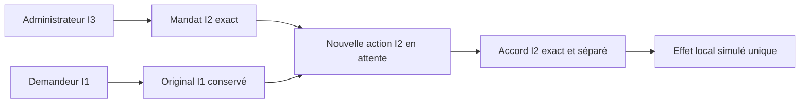

# Biba et actions de confiance en Rust

Biba est la règle d’intégrité de référence de Swarm. Les schémas Mermaid,
frontières de confiance, contrats de stockage et raccordements encore manquants
sont décrits dans [l’architecture technique Rust](architecture/BIBA-RUST.md).

Le moteur Rust fournit le noyau local des actions de confiance, en CLI et sur
`/trust-actions.html`. Le statut de vérification et de livraison se trouve dans
[le plan BIBA-RUST](plans/migration-rust/PLAN.md) et ses preuves datées. Cette
fonction ne rend pas toutes les missions Rust soumises à Biba et n’est pas un
contrôle d’accès Linux. Les effets restent strictement simulés.

La correction en cours du 27 octobre applique la lecture aux réponses métier
et aux replays : un sujet autorisé reçoit l’objet I2 ; sinon la procédure nommée
`trust-status-ack-v1` ne renvoie que `schema_version`, `kind`, `object_id`,
`state` et `content_redacted:true`. L’accusé borne le statut et l’identifiant ;
il ne relabelle pas l’objet et ne donne aucun nouveau droit. Les effets et
leurs preuves restent conservés. Vérification et installation de cette tranche
ne se déduisent pas de la présence du code ; voir le plan courant.

## Autorité et flux

Le moniteur commun utilise I0–I3 : lecture permise si le niveau du sujet est
inférieur ou égal à celui de l’objet ; écriture et invocation permises si le
niveau du sujet est supérieur ou égal à celui de la cible. Les identités locales
configurables sont I1–I3. Sans jeton reconnu, aucune commande métier n’est admise.
Les champs `actor` et `integrity` du client ne donnent aucun droit.

L’admission est une procédure de confiance nommée : un administrateur I3 admet
un **nouveau** mandat I2 ; une demande authentifiée et conforme produit un objet
I2 en attente. L’original I1 et son empreinte restent conservés. Cela n’élève
jamais le sujet I1. Un approbateur I2 doit confirmer le contenu exact avant que
le service d’effet I2 puisse l’engager.



Le jeton vient de `SWARM_TRUST_TOKEN` en CLI et d’`Authorization: Bearer …` en API.
Seule son empreinte est persistée. La page garde le jeton uniquement en mémoire.
La configuration est une opération d’opérateur local ; en HTTP elle exige aussi
la session native, Host/Origin et CSRF. Elle n’est pas autorisée par un champ de
niveau envoyé dans une commande. `show`, `export` et `anchor` sont des lectures
d’audit opérateur ; les lectures métier `read-object`/`read-original` passent
par le moniteur Biba et ne sont pas des vues opérateur.

Après la première initialisation d’une racine non configurée, les opérations
HTTP `config-preview` et `config-apply`, replays compris, exigent un jeton courant
d’identité I3 avec rôle `admin`, relu sous le verrou Trust (partagé en preview, exclusif à l’application). Le cookie
seul, I1/I2 ou une identité suspendue ne permettent pas la reconfiguration.
La modale possède un champ Admin distinct, effacé à la fermeture. La CLI locale
reste une voie d’opérateur propriétaire pour l’initialisation et la reprise ;
ce n’est pas une interface de délégation pour un agent ayant accès au Root.
Les autres routes opérateur et l’isolation globale ne sont pas qualifiées ici.

Les blocs avancés non portés ne peuvent pas être modifiés : null ou omission
conservent, et un bloc inactif déjà conservé peut seulement être retransmis avec
ses mêmes octets compacts. Champs inconnus, mauvais types, activation mal
orthographiée et clés de politique dupliquées refusent. Ce contrôle structurel
de compatibilité ne prétend pas porter tous les validateurs/consommateurs Go.

## Parcours public

La page propose un lien **Vérifications PAEA** vers le contrôle de correspondance
de fichiers, décrit dans le [contrat PAEA](architecture/PAEA-CONTRACT.md).
Les actions principales Exécuter et Enregistrer utilisent la paire sémantique
partagée d’action dans les deux thèmes. Le contrôle de contraste attend la fin
des transitions CSS et examine repos, survol et focus clavier. La recette
`trust-primary-ux.json` couvre la page réelle du workspace avec doubles de
lecture/prévisualisation : elle n’applique aucune configuration et ne prouve
pas les octets servis par un binaire. Voir le [suivi](plans/actions-confiance/paea/INCREMENT-13.md).

```sh
./swarm --root RACINE --json trust show
./swarm --root RACINE --json trust config-preview --input configuration.json
./swarm --root RACINE --json trust config-apply --input configuration.json
./swarm --root RACINE --json trust request --input demande.json
```

La configuration fournit `schema_version:1`, `event_id`, `expected_revision`,
`reason`, les quatre champs `policy` et toutes les `identities` : `subject`,
`token`, `integrity`, `roles`, et éventuellement `disabled`. Rôles reconnus :
`admin`, `requester`, `approver`, `effect`. Le jeton doit avoir au moins 16 octets,
sans espace ni marqueur d’exemple. La modale Admin fait aperçu puis application,
et relit les valeurs enregistrées. Les jetons ne sont jamais relus.

| Politique persistée | Défaut | Zéro et borne technique |
| --- | --- | --- |
| `mandate_ttl_seconds` | 3600 s | 0 sans échéance par défaut ; maximum 9223372036 s |
| `unknown_reconcile_seconds` | 0 s | 0 immédiat ; même maximum |
| `evidence_retention_days` | 365 jours | minimum 1 ; maximum 9007199254740991 |
| `require_separation` | true | booléen explicite |

Les champs de politique sont obligatoires ; null, fractions et valeurs hors
bornes refusent. La rétention est enregistrée, sans purge automatique dans ce
noyau. `show.policy_bounds` expose aussi les formats : état 8 Mio, commande
16 Mio, clé de preuve 32 octets. Ce sont des limites techniques, pas des budgets.

`mandate-create` fixe sujet, actions (`settle` ou `grant-access`), ressource,
paramètres, dates et révision. `request` reste dans ces limites. `approve`
transmet `action_id`, mandat, empreinte et tous les paramètres exacts ; `commit`
et `reconcile` utilisent l’identifiant de l’action protégée. Le connecteur par
défaut est `local-ledger-simulation`. Le second, `local-access-simulation`,
version 1, reçoit `connector.access:{subject,role}` et ne modifie que le registre
d’accès simulé. Il n’accorde aucun droit réel. Son tuple est lié au mandat et à
l’accord ; aucun plugin, destination réseau ou programme arbitraire n’est accepté.
La page guide le règlement ; le second connecteur utilise CLI/API.

`POST /api/v1/trust-actions?action=OPERATION` partage le même moteur et les mêmes
validations. `GET /api/v1/trust-actions` lit l’audit. Les POST de lecture utilisent
`{}`. Le mode CLI distant `--server` historique n’est pas porté dans ce noyau ;
utiliser le CLI local ou l’API protégée, sans repli vers une autre racine.

## Refus et reprise

`direct-write`, `elevate` et `elevate-integrity` refusent les contournements.
Un refus métier retourne `state:denied` et conserve une preuve attribuée sans
modifier mandat, action ou effet. Un défaut de schéma, d’autorité ou de conflit
reste une erreur : CLI 2, identité 4, conflit de révision/événement/idempotence 3 ;
HTTP 400, 403 ou 409 selon la cause. Une politique avancée active non portée
refuse explicitement, sans repli vers les identités statiques. Les identités
mappées fédérées ne deviennent pas locales parce que leur fédération est arrêtée.

Le verrou interprocessus historique sérialise les écritures. Une même clé ne
produit qu’une entrée native ; un autre contenu sous cette clé est refusé.
`lose_response:true` rend l’état `unknown` après l’effet simulé. Un nouvel
engagement ne le duplique pas ; `reconcile` relit le reçu natif exact après le
délai enregistré. Une révocation observée empêche un nouvel effet ; elle n’efface
pas un effet déjà engagé. Après erreur de sortie, de fermeture ou de transmission,
consulter l’état avec le même identifiant. Les marqueurs `trust_publication`
conservent l’issue connue ou incertaine ; ils ne prouvent pas réception client.

L’audit signale les originaux manquants au lieu de supposer leur présence.
L’état historique, les originaux exacts, exports v2 et ancres HMAC schéma 1 sont
conservés. `verify` fonctionne sans ouvrir de racine, avec `export`, `anchor` et
`verification_key` acquis séparément. Ne jamais prendre une clé depuis le seul
export à vérifier. Réordonnancement, altération, omission sous ancre et incohérence
entre reçu et paramètres refusent. La perte de clé ferme la signature, sans
régénération silencieuse ; une initialisation Go en attente reste protégée et
exige une reprise explicite, elle n’est pas écrasée.

Les signatures publiques, identités fédérées, admission de données sensibles,
processus et laboratoires historiques ne sont pas requalifiés par ce portage.
Une politique active correspondante ferme la mutation. Un fichier privé n’isole
pas du même UID ; les preuves ne fournissent ni horloge tierce, ni immutabilité
physique, ni acceptation indépendante.

Recette permanente : `tools/verification/recipes/trust-biba-rust.json`, avec
`tests/rust_trust_biba.py` et son parcours navigateur. Les preuves Go historiques
restent historiques ; seule une comparaison exécutée est attribuée à Rust.

Un bloc fédéré conservé `null` reste absent, sans autorité. Dans une commande métier, seul le champ `policy` historique entièrement nul (trois entiers zéro et séparation false) est toléré pour conserver les empreintes Go ; il ne configure rien. Toute autre valeur refuse sans mutation.
Les clés répétées refusent aussi au niveau supérieur de la configuration et de l’état, avant sélection des extensions.
L’omission de `policy` dans une commande métier équivaut au placeholder zéro et ne configure rien. Les formes internes nulles des politiques de données/groupes et les durées obligatoires nulles/zéro refusent aussi chez leurs producteurs Go : ce ne sont pas des configurations historiques valides à réactiver.

## Gouvernance et audit dans l’Admin

La fenêtre Admin permet de régler les conflits entre demandeur, approbateur,
exécuteur et administrateur, puis les principaux de contrôle déclarés. Prévisualiser,
enregistrer et rouvrir vérifie la politique persistée. Le jeton I3 courant reste
nécessaire côté serveur : un libellé ou une case ne confère aucun droit.

Choisir une transaction pour lire son audit lié et enregistrer cet accès. Le
panneau de preuve distingue préparation, activation par un second administrateur,
révocation et disponibilité privée en mémoire. La vérification publique demande
un pin acquis séparément ; une clé du bundle n’est jamais autoremplie comme autorité.
Voir le [contrat technique et les schémas](architecture/BIBA-GOUVERNANCE-RUST.md).
