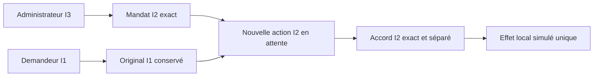

# Biba et actions de confiance en Rust

Biba est la règle d’intégrité de référence de Swarm. Les schémas Mermaid,
frontières de confiance, contrats de stockage et raccordements encore manquants
sont décrits dans [l’architecture technique Rust](architecture/BIBA-RUST.md).

Le moteur Rust fournit le noyau local des actions de confiance, en CLI et sur
`/trust-actions.html`. Le statut de vérification et de livraison se trouve dans
[le plan BIBA-RUST](plans/migration-rust/PLAN.md) et ses preuves datées. Cette
fonction ne rend pas toutes les missions Rust soumises à Biba et n’est pas un
contrôle d’accès Linux. Les effets restent strictement simulés.

La correction en cours du 27 octobre applique la lecture aux réponses métier
et aux replays : un sujet autorisé reçoit l’objet I2 ; sinon la procédure nommée
`trust-status-ack-v1` ne renvoie que `schema_version`, `kind`, `object_id`,
`state` et `content_redacted:true`. L’accusé borne le statut et l’identifiant ;
il ne relabelle pas l’objet et ne donne aucun nouveau droit. Les effets et
leurs preuves restent conservés. Vérification et installation de cette tranche
ne se déduisent pas de la présence du code ; voir le plan courant.

## Autorité et flux

Le moniteur commun utilise I0–I3 : lecture permise si le niveau du sujet est
inférieur ou égal à celui de l’objet ; écriture et invocation permises si le
niveau du sujet est supérieur ou égal à celui de la cible. Les identités locales
configurables sont I1–I3. Sans jeton reconnu, aucune commande métier n’est admise.
Les champs `actor` et `integrity` du client ne donnent aucun droit.

L’admission est une procédure de confiance nommée : un administrateur I3 admet
un **nouveau** mandat I2 ; une demande authentifiée et conforme produit un objet
I2 en attente. L’original I1 et son empreinte restent conservés. Cela n’élève
jamais le sujet I1. Un approbateur I2 doit confirmer le contenu exact avant que
le service d’effet I2 puisse l’engager.



Le jeton vient de `SWARM_TRUST_TOKEN` en CLI et d’`Authorization: Bearer …` en API.
Seule son empreinte est persistée. La page garde le jeton uniquement en mémoire.
La configuration est une opération d’opérateur local ; en HTTP elle exige aussi
la session native, Host/Origin et CSRF. Elle n’est pas autorisée par un champ de
niveau envoyé dans une commande. `show`, `export` et `anchor` sont des lectures
d’audit opérateur ; les lectures métier `read-object`/`read-original` passent
par le moniteur Biba et ne sont pas des vues opérateur.

Après la première initialisation d’une racine non configurée, les opérations
HTTP `config-preview` et `config-apply`, replays compris, exigent un jeton courant
d’identité I3 avec rôle `admin`, relu sous le verrou Trust (partagé en preview, exclusif à l’application). Le cookie
seul, I1/I2 ou une identité suspendue ne permettent pas la reconfiguration.
La modale possède un champ Admin distinct, effacé à la fermeture. La CLI locale
reste une voie d’opérateur propriétaire pour l’initialisation et la reprise ;
ce n’est pas une interface de délégation pour un agent ayant accès au Root.
Les autres routes opérateur et l’isolation globale ne sont pas qualifiées ici.

Les blocs avancés non portés ne peuvent pas être modifiés : null ou omission
conservent, et un bloc inactif déjà conservé peut seulement être retransmis avec
ses mêmes octets compacts. Champs inconnus, mauvais types, activation mal
orthographiée et clés de politique dupliquées refusent. Ce contrôle structurel
de compatibilité ne prétend pas porter tous les validateurs/consommateurs Go.

## Parcours public

La page propose un lien **Vérifications PAEA** vers le contrôle de correspondance
de fichiers, décrit dans le [contrat PAEA](architecture/PAEA-CONTRACT.md).
Les actions principales Exécuter et Enregistrer utilisent la paire sémantique
partagée d’action dans les deux thèmes. Le contrôle de contraste attend la fin
des transitions CSS et examine repos, survol et focus clavier. La recette
`trust-primary-ux.json` couvre la page réelle du workspace avec doubles de
lecture/prévisualisation : elle n’applique aucune configuration et ne prouve
pas les octets servis par un binaire. Voir le [suivi](plans/actions-confiance/paea/INCREMENT-13.md).

```sh
./swarm --root RACINE --json trust show
./swarm --root RACINE --json trust config-preview --input configuration.json
./swarm --root RACINE --json trust config-apply --input configuration.json
./swarm --root RACINE --json trust request --input demande.json
```

La configuration fournit `schema_version:1`, `event_id`, `expected_revision`,
`reason`, les quatre champs `policy` et toutes les `identities` : `subject`,
`token`, `integrity`, `roles`, et éventuellement `disabled`. Rôles reconnus :
`admin`, `requester`, `approver`, `effect`. Le jeton doit avoir au moins 16 octets,
sans espace ni marqueur d’exemple. La modale Admin fait aperçu puis application,
et relit les valeurs enregistrées. Les jetons ne sont jamais relus.

| Politique persistée | Défaut | Zéro et borne technique |
| --- | --- | --- |
| `mandate_ttl_seconds` | 3600 s | 0 sans échéance par défaut ; maximum 9223372036 s |
| `unknown_reconcile_seconds` | 0 s | 0 immédiat ; même maximum |
| `evidence_retention_days` | 365 jours | minimum 1 ; maximum 9007199254740991 |
| `require_separation` | true | booléen explicite |

Les champs de politique sont obligatoires ; null, fractions et valeurs hors
bornes refusent. La rétention est enregistrée, sans purge automatique dans ce
noyau. `show.policy_bounds` expose aussi les formats : état 8 Mio, commande
16 Mio, clé de preuve 32 octets. Ce sont des limites techniques, pas des budgets.

`mandate-create` fixe sujet, actions (`settle` ou `grant-access`), ressource,
paramètres, dates et révision. `request` reste dans ces limites. `approve`
transmet `action_id`, mandat, empreinte et tous les paramètres exacts ; `commit`
et `reconcile` utilisent l’identifiant de l’action protégée. Le connecteur par
défaut est `local-ledger-simulation`. Le second, `local-access-simulation`,
version 1, reçoit `connector.access:{subject,role}` et ne modifie que le registre
d’accès simulé. Il n’accorde aucun droit réel. Son tuple est lié au mandat et à
l’accord ; aucun plugin, destination réseau ou programme arbitraire n’est accepté.
La page guide le règlement ; le second connecteur utilise CLI/API.

`POST /api/v1/trust-actions?action=OPERATION` partage le même moteur et les mêmes
validations. `GET /api/v1/trust-actions` lit l’audit. Les POST de lecture utilisent
`{}`. Le mode CLI distant `--server` historique n’est pas porté dans ce noyau ;
utiliser le CLI local ou l’API protégée, sans repli vers une autre racine.

## Confidentialité Bell-LaPadula — administration de politique, sans contrôle d’exécution

Une politique de confidentialité Bell-LaPadula (niveau ordonné + compartiments,
distincte de l’intégrité Biba) est préparée par la modale Admin de la page
Trust et par les opérations suivantes. **État réel : administration et
diagnostic seulement.** Aucun contenu de projet n’est classé, aucune exécution
n’est médiée : `runtime_enforced:false` et `runtime_authorized:false` sont
conservés dans chaque réponse et l’interface l’annonce. Ne pas les interpréter
comme une protection active.

**Frontière lecteur du rapprochement PA-09 (`GET|HEAD
/api/v1/paea/reconcile-effects`)** : le rapport de rapprochement est classé —
ses findings portent les identifiants d'effets durables (`intent_id`,
`action_digest`) — et la session seule ne l'autorise jamais. Trois portes
ordonnées : (1) AVANT toute ouverture de Root/lecture de réglages/IO de grand
livre, une session sans identifiant lecteur reçoit le refus typé 403 portant
UNIQUEMENT `paea-reader-authentication-required` (HEAD : corps vide) ; (2)
APRÈS ouverture du Root de service (lecture seule) et TOUJOURS AVANT toute
lecture de réglages, ouverture de grand livre ou lecture de journal, un
identifiant PRÉSENT est décidé par le précontrôle d'identité partagé du moteur
(`RootStore::paea_reader_identity_precheck`) contre l'état de confiance COURANT
du Root de service : un jeton inconnu ou désactivé reçoit le refus typé
`authorization_required` (403, aucun état ni erreur de réglages, de grand livre
ou de rapprochement ne lui parvient) ; un journal de confiance absent refuse
`paea-reader-policy-required` ; un identifiant reconnu poursuit ; (3) après le
rapprochement, le verdict lecteur courant (`paea_reader_verdict`) est évalué
sur le digest exact des octets du rapport avant tout retour — il ré-authentifie
l'identifiant sur une NOUVELLE lecture de l'état courant (jamais une identité
cachée du précontrôle) et contrôle devise de politique, attribution et
habilitation ; politique obsolète → `paea-reader-policy-stale`, sans
attribution → `paea-reader-attribution-required`, habilitation insuffisante →
`paea-reader-access-denied`, tous refus typés 403 sans octet du rapport.
Aucune porte ne mute, ne journalise et ne produit de rapport partiel ; la
reprise passe par les opérations publiques (ré-application de politique,
ré-attribution). Contre-exemple conservé et corrigé (2026-11-02,
`glm-reconcile-auth-fix-20261102T093323Z`) : avant ce précontrôle, un jeton
PRÉSENT mais INCONNU observait l'erreur métier du grand livre (409
`paea-effect-reconcile-separate-ledger-required`) au lieu du refus d'identité —
le test exact `reconcile_effects_unknown_token_refused_identity_before_ledger_error`
(rouge reproduit puis vert, GET+HEAD+non-mutation exécutés) fixe le contrat.
La qualification navigateur réel du formulaire d'approbation
(`tests/paea-approval-form-ui.cjs`) affirme aussi cette première porte depuis
le vrai Chrome : la lecture nue de rapprochement déclenchée par chaque
chargement de page y est classifiée exactement (méthode GET, URL exacte, 403,
corps confirmé portant ce code exact sur `error` et `failure.code`), les refus
codés observés restant conservés tels quels dans la preuve JSON ; l'ancienne
attente HTTP 500 (précondition de grand livre) y est retirée comme
inatteignable derrière cette porte.

**Réception formulaire et raccord de la régression mauvais Root physique
(4 novembre 2026)** : réception personnelle du superviseur
(`glm-approval-observation-completion-20261104T042459Z/supervisor-reception.json`)
— recette permanente du formulaire
`tools/verification/recipes/paea-approval-form-rust.json` courue run 0/verify 0,
onze étapes stables ; vrai navigateur : quatre parcours FR/EN sans diagnostic
inattendu, quatre refus GET 403 au code lecteur exact conservés en preuve ;
trois tests HTTP nommés du canal d'approbation passent ensuite sur le même
artefact de test stable (`bf775a5b…`, profil de TEST distinct du produit 331),
chacun 1 PASS exit 0 : accord capturé sur le projet, mauvais rôle puis
récupération légitime, mauvais Root physique. Cette dernière régression
`approval_route_wrong_physical_project_root_refuses_without_effects`
(`rust/crates/swarm-web/tests/paea_git_call.rs`) est désormais retenue par la
recette permanente `tools/verification/recipes/paea-git-call-approval-rust.json`
— UNE étape ajoutée après le parcours positif, avant le mauvais rôle, les huit
autres étapes et leur ordre inchangés (édition GLM ; le run/verify de la
recette neuve reste à exécuter par Codex) : une préparation d'approbation de
la même famille dont le témoin physique vise un AUTRE Root projet réellement
distinct (jamais une copie) refuse le bind typé `trust-enrollment-root` sans
capturer d'accord ni consommer d'effet — magasins Trust projectA/serviceA et
du vrai projectB, refs gérées, absence de ref cible et journaux d'effet des
deux services restent octet pour octet identiques, aucun accord nulle part.
Ni approbation ni enrôlement humain Authority (demande du 3 novembre 2026,
jamais relancée ni contournée), ni séparation OS/services protégés, ni E3
indépendante, ni acceptation globale PA00–13/RETEX ne sont établis par ces
preuves de profil test.

**Témoin natif positif du lecteur PA-09 (binaire réel qualifié)** : ce contrat
est aussi prouvé sur le vrai ELF natif par le test d'intégration
`reconcile_effects_native_binary_positive_reader_frontier_empty_ledger`
(`rust/crates/swarm-web/tests/paea_reconcile.rs`, marqué `#[ignore]` pour ne
pas toucher aux six tests par défaut). Il REFUSE l'absence du binaire qualifié
passe par l'environnement documenté `SWARM_ENGINE_BINARY` (aucun hash codé dans
le dépôt ; exécution ciblée `cargo test -p swarm-web --test paea_reconcile
reconcile_effects_native_binary_positive_reader_frontier_empty_ledger --
--ignored --exact`, exactement un test exécuté). Le témoin démarre le vrai
binaire sur la Root de service configurée (port 0, événement de bind JSON
analysé, secret web-session réellement généré au bind, empreinte
`/proc/pid/exe` égale à celle du binaire fourni), sur deux Roots fixture privés
réellement distincts dont le grand livre de rapprochement reste explicitement
non initialisé, puis enchaîne : refus bare 403
`paea-reader-authentication-required`, lecteur fixture connu avant attribution
403 `paea-reader-attribution-required`, attribution publique du rapport exact
produit par `paea_reconcile_effect_journals`, lecture positive 200 aux octets
attendus (HEAD 200 corps vide), inconnu 403 `authorization_required`,
récupération 200 ; le snapshot complet des quatre fichiers est comparé après
CHAQUE phase de lecture (refus pré-attribution compris, attribution = seule
écriture publique intentionnelle entre deux baselines) ; les deux `state.db`
restent octet-identiques sur toute la séquence de lecture et les journaux de
confiance ne bougent que sur les écritures explicites du setup lui-même.
L'arrêt de l'enfant passe par un canal de signal possédé par le noyau : un
pidfd ouvert sur l'identité du processus enfant, avec repli sur le PID
numérique du seul enfant possédé et pas encore récolté si `pidfd_open`
lui-même échoue (aucun PID réutilisable ne peut alors être visé, la récolte
est conservée dans tous les cas, un refus de signal n'est jamais masqué,
jamais SIGKILL) et asserte le vrai contrat d'arrêt natif : sortie 0
et dernière ligne stdout = record `web-stopped`, avec stdout entièrement
drainé et retenu après l'événement de bind. La requête settings du témoin
réutilise VERBATIM la révision affichée par `engine-settings show` : le
contrat `SettingCount` (`rust/crates/swarm-engine/src/engine_settings.rs`)
impose une chaîne décimale canonique non négative (les nombres sont refusés),
donc `expected_revision` est cette chaîne elle-même, jamais convertie en
nombre — une conversion numérique produisait une requête invalide refusée
`settings-request-invalid`. La conservation des sorties brutes de l'enfant est portée par la variable
REQUISE `SWARM_PAEA_NATIVE_EVIDENCE_DIR` : sans elle le témoin refuse de
s'exécuter (pas de PASS sans preuve retenue), avec un chemin déjà existant la
réutilisation est refusée AVANT le démarrage (aucune écriture, aucun
écrasement de preuve antérieure) et le dossier est créé exclusivement 0700
DÈS SA NAISSANCE (`DirBuilderExt::mode`, jamais une fenêtre 0755 puis chmod ;
aucun ancêtre créé, un dossier étranger créé en concurrence ne peut être ni
revendiqué ni repermissionné). Le test conserve de façon durable les octets
EXACTS de stdout/stderr natifs (`stdout.log`/`stderr.log` : le tampon brut
n'est JAMAIS recherché ni tronqué par contenu — un texte enfant ressemblant à
une annotation de drain reste dans le flux brut), les échecs de drain dans
des états séparés au producteur (`drain-stdout.errors.log`/
`drain-stderr.errors.log`, vides sur le chemin nominal — tout état non vide y
est un échec dur), le statut de sortie réel (`exit.json` lu du créneau
partagé de sortie observée ; `"observed": false` si l'enfant n'a pas pu être
récolté — jamais un succès fabriqué) et l'identité binaire/argv (`spawn.json`,
aucun secret ni cookie), sur succès ET échec, chaque fichier via création
exclusive 0600 (temporaire privé `.name.partial`, fsync fichier, publication
par `hard_link` EXCLUSIF — un nom existant n'est jamais écrasé, un symlink
n'est jamais suivi — puis fsync du dossier et retrait du temporaire ; une
écriture partielle conserve le fichier publié original et sa cause). En
échec, le témoin d'échec récolte l'enfant PROPRE via le Drop du détenteur de
processus (ordre de déclaration : le témoin brut est créé AVANT l'écouteur,
donc l'écouteur est détruit AVANT le témoin — la récolte enregistre la vraie
sortie dans le créneau partagé), joint les deux drains jusqu'à EOF (les tuyaux
se ferment à la mort de l'enfant, aucun blocage), puis conserve les flux
COMPLETS et la vraie sortie — mêmes artefacts que le succès ; si un helper a
échoué avant le début de la capture (ex. échec de readiness), le témoin
conserve ce qui existe et déclare la frontière exacte (tampon jamais
branché = rien n'est prétendu pour ce flux), jamais une capture complète non
produite. Aucune attente textuelle, aucun watchdog, jamais SIGKILL. En échec,
un témoin imprime aussi les octets bruts retenus (limite : les octets émis
avant le branchement du lecteur stdout — fenêtre pré-bind — sont hors capture
test et ne sont pas prétendus). Aucun octet de secret n'est jamais
publié sur ces flux natifs (seulement `web-bound`/`web-outcome`/
`web-stopped` ; le secret de session ne vit que dans son fichier).
Le chemin d'échec RÉEL du témoin est rendu exerçable par un mode de faute
EXPLICITEMENT TEST-ONLY, propre à ce test d'intégration (jamais le produit,
l'ELF ni l'autorité) : la variable `SWARM_PAEA_NATIVE_WITNESS_FAULT`,
absente = parcours nominal inchangé ; seule valeur acceptée
`after-bare-refusal` = panique marqueur `PAEA_NATIVE_EXPECTED_WITNESS_FAILURE`
livrée après le contrôle bare-403 GET+HEAD et l'instantané S1 des refus
pré-attribution (écouteur encore vivant, aucun octet de rapport servi), pour
exercer le Drop de l'écouteur puis du témoin (récolte gracieuse SIGINT,
jointures drains jusqu'à EOF, conservation complète des mêmes artefacts) ;
toute autre valeur est refusée AVANT toute réservation de preuve ou
démarrage ; aucun watchdog, minuteur ni relance n'y participe. Preuve de ce
mode : ACQUISE — l'exécution de contrôle du superviseur a observé le
1 FAILED attendu (sortie 101) avec les artefacts retenus complets
(stdout/stderr bruts, états de drain, sortie réelle, récolte enfant
propre observée). Le contrat de ce mode a donc TROIS issues : nominal
(variable absente), faute armée `after-bare-refusal` (1 FAILED attendu,
artefacts = preuve), valeur invalide refusée avant tout démarrage.
Un deuxième mode TEST-ONLY, indépendant, ajoute le témoin navigateur
POSITIF : la variable `SWARM_PAEA_NATIVE_BROWSER_WITNESS`, absente =
parcours nominal inchangé (aucun navigateur) ; seule valeur acceptée `1` =
UN passage réel de navigateur headless
(`tests/paea_reconcile_native_reader_ui.cjs`, Puppeteer par le même chemin
d'installation réel que `tests/paea_effects_ui.cjs`/
`tests/paea_reconcile_reader_ui.cjs`) contre l'écouteur natif DÉJÀ
CONFIGURÉ, lancé après l'attribution publique et AVANT l'arrêt SIGINT ;
toute autre valeur est refusée AVANT toute réservation de preuve ou
démarrage — ce mode a lui aussi TROIS issues : nominal (absente), témoin
armé `1`, valeur invalide refusée avant démarrage. Le script reçoit
adresse, cookie de session générée, jeton lecteur fixture, jeton inconnu
synthétique, rapport attendu et son empreinte par STDIN JSON PRIVÉ (jamais
argv, jamais un journal) ; un échec d'écriture/flush de ce stdin ne tue PAS
le script : le flux est refermé (EOF), ses sorties et sortie réelle sont
collectées et conservées d'abord, puis l'échec est rapporté avec la cause
IO originale et la sortie observée (l'entrée est validée AVANT le
lancement d'un navigateur, donc aucune fenêtre orpheline) ; ses stdout,
stderr et sortie réelle sont conservés comme artefacts 0600 du dossier de
preuve, avec un sous-dossier
fresh exclusif 0700 (`browser-witness-<horodatage>-<suffixe>`, jamais
réutilisé, jamais /tmp) pour ses assertions nommées et captures d'écran
(jamais de secret) ; une sortie non nulle provoque l'échec du test natif,
dont le déroulement conserve le nettoyage natif réel (SIGINT gracieux +
récolte, jointures drains, conservation brute) ; le navigateur possédé est
fermé par le finally du script lui-même, en pilotage événementiel sans
minuteur global ni délai arbitraire. Assertions réelles du navigateur :
page protégée effets servie par le vrai ELF ; refus bare typé sans octet de
rapport ; jeton fixture via le champ dédié + relecture => 200, états
settlement/git `uninitialized` réellement rendus dans le DOM + JSON brut
exact, champ secret purgé ; inconnu 403 `authorization_required` sur la
MÊME page qui vient d'afficher un succès (la purge est ainsi prouvée après
un rapport réellement affiché, jamais sur un contexte vierge) supprimant
TOUT le DOM/brut du rapport, champ purgé ; récupération 200 exacte sur
cette même page ; le journal de requêtes du témoin ne retient des en-têtes
Authorization que leur classification booléenne (présence, forme Bearer,
jeton lecteur reconnu, jeton inconnu connu) — jamais une valeur, même dans
un artefact privé 0600, sans assainisseur post-fuite (le producteur
n'émet jamais de valeur) ; FR/EN, etat/sombre, 390/1280 (deux
combinaisons justifiées),
focus clavier, aucune erreur console ni réseau non classé, credentials
uniquement sur le GET reconcile, aucun POST ni écriture depuis le
navigateur. Capture EN prise DEUX fois : sombre AVANT la bascule puis etat
APRÈS. Preuve de ce mode : ACQUISE le 2026-11-03 sur l'ELF qualifié
(sha e2f0039a…, exécution supervisée : exact 1 PASS natif, sortie Node 0,
14 assertions nommées, 0 diagnostic inattendu, 4 refus 403 typés, 7 GET
reconcile, classification booléenne seule, purge same-page après succès
visible, revue visuelle personnelle des captures FR/EN) ; la recette
pérenne de requalification de la portée vide est
`tools/verification/recipes/paea-native-reader-ui.json` et la recette
pérenne nonempty existe désormais
`tools/verification/recipes/paea-native-reader-ui-nonempty.json` (id
distinct `paea-native-reader-ui-nonempty`, mêmes schéma, environnement et
contrôle i18n, le même wrapper appelé avec `--report-scope nonempty` et le
marqueur requis `PAEA_NATIVE_READER_UI_NONEMPTY_VERIFIED 14` ; exécution
UNVERIFIED jusqu'à l'exécution personnelle de Codex) (wrapper
`tests/paea_reconcile_native_reader_ui_recipe.py`, binaire géré
`{root}/bin/swarm`, parent de preuve `{root}/.cache`, portée de rapport
explicite `--report-scope empty|nonempty` (défaut empty : contrat vide
historique inchangé, marqueur `PAEA_NATIVE_READER_UI_VERIFIED 14` ;
nonempty : test natif dédié
`reconcile_effects_native_binary_positive_reader_frontier_nonempty_ledger`,
kind `paea-native-reader-ui-nonempty-v1`, marqueur distinct
`PAEA_NATIVE_READER_UI_NONEMPTY_VERIFIED 14`, qualifiant le finding
settlement réel rendu, la purge same-page des identifiants réels
précédemment rendus et le recovery identique ; une valeur invalide est
refusée par argparse avant toute création de répertoire ou spawn cargo) ;
le wrapper lance `cargo test --manifest-path rust/Cargo.toml
--offline --locked -p swarm-web --test paea_reconcile <test> -- --ignored
--exact --nocapture` avec CARGO_TARGET_DIR dédié, debug=0, INCREMENTAL=0,
fournit SWARM_ENGINE_BINARY et SWARM_PAEA_NATIVE_BROWSER_WITNESS=1, ne crée
PAS le répertoire SWARM_PAEA_NATIVE_EVIDENCE_DIR (le `from_env` Rust l'exige
inexistant, création exclusive), conserve stdout/stderr/returncode réels
avant toute qualification, refuse le format réel `9 filtered out` traité
comme une anomalie, et vérifie séparément les artefacts de chacun des
deux enfants au niveau du répertoire de preuve : métadonnées de sortie du
NAVIGATEUR (browser-witness.exit.json, run_dir = répertoire Rust externe
browser-witness-<heure>-<suffixe>) et sortie du RUST (exit.json + stdout.log
web-bound → web-stopped en dernière ligne + sidecars de drain vides, le
navigateur-witness.json restant dans le sous-répertoire JS imbriqué) ; un
run de recette ne vaut ni revue indépendante ni acceptation globale).
Trois gardes mémoire opt-in (`#[ignore]`, aucun processus ni écriture)
exercent le producteur partagé `drain_to_end` : le tampon brut conserve TOUS
les octets enfant même quand l'enfant émet lui-même le texte
`\n[stdout drain error:` / `\n[stderr drain error:` (découpage entre chunks,
octet non UTF-8, dernière ligne sans retour), et une vraie erreur de lecture
ne va QUE dans l'état séparé (jamais dans le tampon brut) — la séparation
erreur/contenu est prouvée sur le code producteur réel, pas une copie.
Seul `NotFound` est une absence
autorisée sur un journal de confiance (les autres erreurs sont des échecs
durs, jamais masquées). Portée partielle explicite : rapport vide seulement
pour le test natif ci-dessus (le témoin navigateur TEST-ONLY, opt-in
`SWARM_PAEA_NATIVE_BROWSER_WITNESS=1`, exerce la même portée rapport vide
côté rendu réel). Le contrat natif non vide existe désormais comme test
séparé dédié, `reconcile_effects_native_binary_positive_reader_frontier_nonempty_ledger`
(même binaire ELF qualifié via `SWARM_ENGINE_BINARY`, même contrat
d'`SWARM_PAEA_NATIVE_EVIDENCE_DIR` frais hors /tmp) : contre un registre
réellement enregistré — un effet settlement produit AVANT toute baseline et
avant l'enfant via les mêmes producteurs publics (`work.create`,
`config-apply`, `scope_of`, `seed_settlement_effect` sur un troisième root
projet privé ouvert comme work store, le service et le ledger restant deux
roots distincts), le test applique d'abord le gate témoin navigateur
TEST-ONLY au contrat EXACT du cas vide jumeau (aucune valeur par défaut
silencieusement ignorée) : variable absente => la séquence API non vide
reçue s'exécute INCHANGÉE ; valeur exacte `1` => UN témoin navigateur réel
(Chromium, script partagé `tests/paea_reconcile_native_reader_ui.cjs` dans
sa variante non vide CONSISTENT, kind distinct
`paea-native-reader-ui-nonempty-v1`, métadonnée `report_scope: "nonempty"`,
14 noms de contrôles non vide explicites pour les assertions spécifiques au
mode) s'exécute entre le recovery et l'arrêt SIGINT avec le rapport non vide
EXACT attribué — le script dérive son modèle de rendu du rapport lui-même
(jamais un JSON inventé) et asserte le rendu produit réel (phrase settlement
consistent, ligne de finding réelle avec `intent_id`/`action_digest`
servis, purge same-page des VRAIS identifiants précédemment rendus au refus
unknown puis recovery identique) ; toute autre valeur est refusée AVANT
toute réservation d'évidence ou spawn, puis le test déroule la séquence API
complète sur le rapport NON VIDE : bare 403 typé sans octet de rapport,
lecteur
connu avant attribution 403 typé, calcul du rapport attendu par le
producteur public réel (`paea_reconcile_effect_journals`, settlement
détruit en `Consistent{effect_count:1}` avec la finding `verified`, git
explicitement `Uninitialized`, encodage canonique `encode_model` et
empreinte dans le même domaine que la route), attribution via
`blp-object-attribute` sur le root SERVICE avec ce digest, GET positif 200
octets exactement égaux avec champs assertés depuis le vrai modèle
(`settlement.state == "consistent"`, `effectCount == 1`, `intent_id`/
`action_digest` réels, `verified == true`, `git.state == "uninitialized"`),
HEAD 200 vide, credential inconnu 403 typé sans identifiant réel ni état
divulgué, recovery 200 mêmes octets exacts, témoin navigateur éventuel
(GET only, entre deux comparaisons de snapshot), arrêt SIGINT (exit 0,
dernière
ligne stdout `web-stopped`), conservation brute complète des sorties enfant
et témoin quatre-fichiers après chaque phase de lecture. Le témoin navigateur non vide, NOT TESTED au lot d'origine, est désormais
soutenu par une exécution personnelle du superviseur sur l'ELF320 épinglé
(fbf41a82…) : les DEUX témoins navigateur (vide et non vide) et leurs tests
natifs exacts passent réellement (14 contrôles nommés chacun, finding
settlement réel 1, purge same-page des VRAIS identifiants puis recovery
identique, Node et natif exit 0 ; reçu conservé dans le lot
glm-pa09-scope-wrapper-20261103T110700Z) ; en conséquence le wrapper pérenne
`tests/paea_reconcile_native_reader_ui_recipe.py` porte
`--report-scope empty|nonempty` (défaut empty) et qualifie chaque portée
par son kind, son test natif exact et son inventaire de contrôles nommés ;
la recette JSON pérenne de la portée nonempty existe désormais
(`tools/verification/recipes/paea-native-reader-ui-nonempty.json`, id
distinct, marqueur nonempty requis) et son exécution reste UNVERIFIED tant
que Codex ne l'a pas personnellement courue ; l'incrément de portée du
wrapper a été reçu personnellement par le superviseur sur l'ELF322 épinglé
réellement actif (3146c837…) — les deux portées passent, la valeur invalide
sort 2 avant toute allocation de sortie, et les témoins conservés refusent
la portée croisée (reçu supervisor-wrapper-receipt.json, lot
glm-pa09-scope-wrapper-20261103T110700Z). Le test reste `#[ignore]` exact
(jamais lancé par défaut ; exécutions opt-in uniquement) et
les identités fixture restent une simulation same-UID explicite, jamais un
enrôlement humain, un confinement OS ou une acceptation revendiqués.

```sh
./swarm --root RACINE --json trust blp-show
./swarm --root RACINE --json trust blp-policy-preview --input politique.json
./swarm --root RACINE --json trust blp-policy-apply --input politique.json
./swarm --root RACINE --json trust blp-check --input diagnostic.json
./swarm --root RACINE --json trust blp-object-attribute --input attribution.json
```

- `blp-show` (lecture) : état persisté, historique révisionné et capacité.
  Exige un jeton I3/admin courant comme toute administration.
- `blp-policy-preview` (lecture) : valide une proposition complète
  (`schema_version`, `event_id`, `expected_revision`, `expected_trust_revision`,
  `reason`, `policy` avec niveaux `public`→`restreint` définis par l’opérateur,
  compartiments et habilitations). Aucune mutation.
- `blp-policy-apply` (écriture) : application révisionnée avec preuve attribuée
  ; un `event_id` déjà enregistré rejoue la réponse conservée, sans mutation.
  Un changement de politique de confiance rend l’historique obsolète : il exige
  un renouvellement explicite (`authority_current:false` le signale).
- `blp-check` (lecture) : diagnostic sur étiquettes **fournies** — jamais une
  attribution réelle d’un objet. Renvoie la combinaison/le refus et la
  classification de sortie calculée, sans contenu ni étiquette d’autrui.
  `runtime_authorized:false` ne constitue JAMAIS une autorisation de lecture.
- `blp-object-attribute` (écriture) : attribution courante d’une classification
  à des octets canoniques exacts (`canonical_digest` sha256 des octets
  `paea-json-v1`, `project_path` absolu, révision politique et de confiance
  courantes exigées) par un opérateur I3/admin dont l’habilitation DOMINE le
  label attribué (`check_read`). Persistée dans l’historique révisionné et
  RELUE à chaque consommation ; un changement de révision la rend refusée
  (`blp-policy-changed`) jusqu’à réattribution. Ce n’est pas une
  déclassification ni un droit de lecture : elle constate la classification
  que le contrôle autorisé lie aux octets.

**Frontière lecteur (preview/presentation PAEA)** : `GET
/api/v1/paea/git-call/preview` et `GET /api/v1/paea/git-call/approval/presentation`
ne servent une projection contenant des champs classifiés qu’à un lecteur
autorisé par la garde `paea_reader_verdict` : jeton `Bearer` en forme valide,
politique courante liée à la révision de confiance, attribution courante des
octets exacts, habilitation dominante. Un échec de politique, d’attribution ou
d’habilitation garde la réponse `200 {available:false, reason:paea-reader-*}`
sans aucun octet classifié — payload, identifiant, digest, erreur, header, log —
y compris pour un lecteur enrôlé de sommet de catalogue ; un jeton inconnu ou
une identité désactivée produit en revanche le refus typé
`authorization_required` (statut non-succès, 403) sans aucun octet classifié
non plus. La session seule reste `200 {available:false,
reason:paea-reader-authentication-required}` : session seule et enrôlement ne
sont jamais une autorisation implicite. Les labels `SourceRefJSON` et le cookie navigateur ne
font pas autorité. L’absence de source liée reste répondue avant la garde
(aucun champ classifié n’existe alors). La réponse positive porte
`runtime_enforced:false` : la provenance d’octets côté prompt reste un travail
ouvert de l’autre acteur. Le formulaire public d’approbation
(`web/paea-approval-form.js`) se raccorde à cette frontière sans la contourner :
une entrée éphémère « Jeton lecteur » est lue à l’appel, portée en
`Authorization: Bearer` sur la seule lecture gardée puis effacée sur TOUTES les
sorties du chargement — succès, erreur HTTP ou réseau, capacité non liée,
présentation refusée, réponse illisible (aucun stockage, URL ni log) ; les
refus `paea-reader-*` restent visibles avec leur code exact et le bouton
« Relire la présentation » relit la même endpoint après correction de
l’identifiant ; l’entrée ne porte aucune longueur maximale frontend (la forme
producteur `credential_valid` impose un minimum de 16 octets, interdit les
espacements et les préfixes réservés, sans maximum — une borne arbitraire
couperait des jetons valides ; les formes trop courtes sont refusées côté
service avec le verdict typé exact, jamais pré-coupées) ; la consommation POST
reste exclusivement enrôlement (mot de passe distinct, jamais réinterprété
comme clearance).

**Observations de démarrage minimales (routes status cookie seul)** : `GET
/api/v1/paea/git-call` et `GET /api/v1/paea/git-call/approval` ne servent
derrière la session ordinaire QUE le booléen `bound` et des constantes
littérales de protocole (`schema_version`, `event`) ; le champ `capability`
reste `Null` dès que la source est liée. AUCUNE valeur dérivée de la requête
préparée n'y passe — pas les digests, et pas le `call`/`service`/`operation`
sélectionné non plus : un vocabulaire fermé ne rend pas constante la valeur
sélectionnée par une action classifiée et ne crée aucun droit de
déclassification (BLP-RET-05). HEAD sert un corps vide. La métadonnée exacte
reste lisible uniquement via les routes gardées (preview et presentation)
sous le verdict lecteur courant. Les pages consommatrices
(`web/paea-effects.js`, `web/paea-consent.js`, `web/paea-approval-form.js`)
affichent cet état explicite (jamais de ligne vide ni de valeur présentée
comme inconnue) et traitent une `capability` non nulle comme un rapport hors
contrat qui arrête visiblement le chargement (`paea-status-out-of-contract`
côté formulaire). La page de consentement (`web/paea-consent.html`,
`web/paea-consent.js`) raccorde sa lecture classifiée à la même frontière sans
la contourner : l’empreinte exacte et l’opération liée ne passent que par la
lecture gardée de la présentation et l’aperçu, avec le même identifiant lecteur
éphémère lu à l’appel, porté en `Authorization: Bearer` sur ces seules lectures
puis effacé sur TOUTES les sorties du chargement (aucun stockage, URL ni log) ;
un refus `paea-reader-*` garde son code exact visible, le contrôle « Relire la
présentation » relit les mêmes endpoints après correction, et le formulaire de
consentement reste accessible (l’autorité d’enrôlement n’est jamais
réinterprétée comme clearance de lecture — la comparaison hors canal de
l’empreinte reste la décision de l’opérateur). Chaque sortie de l’aperçu rend
aussi un état terminal typé sur le statut d’approbation : un aperçu indisponible
ou refusé n’est jamais laissé dans un état « en cours », et la formulation de
succès n’est posée que lorsque les métadonnées exactes de la commande sont
réellement affichées. Une lecture gardée qui LÈVE (HTTP 403, transport, JSON
illisible) rend la même paire de refus typé que le verdict `available:false` :
un refus `paea-reader-*` reste un état `empty` portant le code exact, toute
autre erreur lève un état `error` visible — et chaque chargement purge
d’abord TOUTES les projections exactes antérieures (listes de présentation et
d’aperçu, conteneurs du résultat d’envoi POST), pour qu’aucune valeur d’une
réussite antérieure ne survive sous une formulation de refus ni de « données
non affichées » (défaut reproduit puis corrigé du 2026-11-01 : une relecture
HTTP 403 après une lecture autorisée laissait les deux digests antérieurs
dans le DOM ; contre-exemple maintenu
`tests/paea-consent-projection-erasure.cjs`, 11 vérifications sur la vraie
page en Chrome réel, runs rouge puis vert conservés dans le dossier de
preuve). La qualification navigateur réel `paea-consent-ui-rust` résout
désormais le binaire de test exact depuis le flux d’artefacts Cargo
(`cargo test --no-run --message-format=json`, outil lié
`bind_cargo_test_binary.py` + contre-preuves `test_bind_cargo_test_binary.py`)
— plus aucune purge `rm`, aucun glob ni watchdog global dans le driver, dont
les deux canaux bruts sont capturés en flux et attendus jusqu’à leur exit
réel. Contrat d’échec/vidage du driver (contre-exemples maintenus
`tests/paea_consent_driver_control.py`, 16 vérifications sur 8 variantes,
rouges mesurés sur l’instantané d’entrées déclaré du 2026-11-01 puis verts) :
chaque fluxeur des DEUX enfants est suivi et joint après leurs exits réels ;
un échec Rust pendant le harnais échoue immédiatement sans attendre un enfant
vivant ; le défaut INVERSE est couvert symétriquement (2026-11-01) : un échec
du harnais pendant que Rust attend encore la marque de phase tue Rust vivant
AVANT tout wait (la cause primaire harnais est décidée avant le kill, donc
jamais masquée par un -9), si bien qu’aucun wait ne vise un enfant vivant sur
un chemin d’échec dans les DEUX sens ; le nettoyage ne tue que les deux
enfants Popen possédés ; le verdict exige la
marque EOF de chaque canal (vidage partiel refusé) et refuse tout PASS sans
canal brut complet. La contre-preuve
`status_does_not_discriminate_two_prepared_intentions`
montre que deux intentions préparées distinctes produisent des réponses
d'octets identiques sur ces routes.

**Rendu mobile du rapport de rapprochement (PA-09)** : les lignes de finding
des deux listes (`#settlement-findings li`, `#git-findings li` dans
`web/paea.css`) passent désormais à la ligne n'importe où
(`overflow-wrap:anywhere`) au lieu de déborder de la carte et du viewport.
Défaut réel reproduit puis conservé (témoin navigateur natif, reçu
`glm-pa09-nonempty-overflow-guard-20261103T052147Z/supervisor-receipt.json`) :
sur la page réelle servie par l'ELF qualifié, en EN/390/sombre, le document
déborde de 260 px (scrollWidth 650 vs innerWidth 390) et la ligne de finding
de 306 px (564 vs 258 disponibles) — les digests canoniques longs
`intent`/`effet` étaient coupés au bord droit alors que les 14 contrôles
fonctionnels passaient ; l'assertion de débordement antérieure ne couvrait
que la page AVANT rapport peuplé, d'où la garde nommée post-positif et
post-recovery (mesures numériques seulement, capture privée avant échec)
livrée au lot précédent. La correction est générique sur le contrat réel de
la boîte à texte : retour à la ligne intégral des identifiants, AUCUNE
troncature, ellipse, masque ni barre de défilement ; le DOM et le rapport
technique gardent les octets exacts intégraux (aucune fonction produit JS
modifiée), FR/EN, les deux thèmes et les jetons sémantiques restent
inchangés. Reprise : le run de validation par le superviseur attend la garde
verte sur les deux frontières réelles (fr/1280 et en/390) avec toujours
exactement 14 contrôles nommés, puis la régression canonique du cas vide
(script partagé) ; aucune acceptation globale n'est déclarée par ce lot.

Chaque habilitation désigne un sujet d’identité existant non suspendu ; les
sujets inconnus refusent. Le catalogue ne peut pas supprimer ou réordonner des
niveaux existants : cela relabellerait l’historique. Aucune déclassification
n’existe : un résumé, une sortie vide ou un filtrage n’en est pas une. La
protection transversale (attribution des contenus réels, moniteurs fichiers/
réseau/fournisseurs, déclassification humaine liée aux octets) reste ouverte ;
suivi dans [BLP-APEX](plans/actions-confiance/BLP-APEX.md).

## Refus et reprise

`direct-write`, `elevate` et `elevate-integrity` refusent les contournements.
Un refus métier retourne `state:denied` et conserve une preuve attribuée sans
modifier mandat, action ou effet. Un défaut de schéma, d’autorité ou de conflit
reste une erreur : CLI 2, identité 4, conflit de révision/événement/idempotence 3 ;
HTTP 400, 403 ou 409 selon la cause. Une politique avancée active non portée
refuse explicitement, sans repli vers les identités statiques. Les identités
mappées fédérées ne deviennent pas locales parce que leur fédération est arrêtée.

**Délégation de mandat (portée, 4 novembre 2026)** — le bloc `delegation`
(`max_depth`, entier explicite ≥ 0 ; null, chaîne, fraction, booléen, négatif
refusent) est admis en configuration et porté au parcours complet : un enfant
`mandate-create` avec `parent_mandate_id` exige un administrateur I3, enregistre
l'identité et l'empreinte courante du parent, plafonne l'expiration par défaut
sur celle du parent, puis dérive la chaîne d'admission avant insertion — cycle,
empreinte altérée, identité absente, plafond de profondeur (chaque maillon
compte), parent absent/révoqué/inactif/expiré/périmé, empreinte parentale
périmée et tout élargissement (montant, ressource, devise, bénéficiaire,
actions, fenêtre, sujet, parent) refusent avec les raisons historiques Go, sans
mutation et avec une preuve conservée. La même chaîne rejoue aux frontières
`approve`/`commit` : une révocation d'ancêtre bloque avec
« mandat parent révoqué ». La projection publique rapporte l'état effectif de
chaque mandat (`mandate_status`) et propage typée une erreur technique de l'état
stocké. Le digest racine historique (sans connecteur ni ascendance) est épinglé
par un test unitaire : `17749c31acf37938ebabe43b794adf5726fbc565905e6c0eb059afdae9ab5ad3`.
Régression miroir du contrat Go :
`rust/crates/swarm-engine/tests/trust_delegation.rs` (10 tests, racines isolées
dans `.swarm-fixtures/trust-delegation/`, jamais `/tmp`). Reste fermée : la
création distante A2A — toute commande qui la porte refuse encore ; le
`data_context` n'y figure plus, porté depuis le 5 novembre (bloc suivant).

**Audience du mandat délégué (portion locale de T14 D3, 8 novembre 2026)** —
le sujet nommé du mandat vaut audience côté usage : un pair enrôlé autre que
le sujet rejoue le mandat délégué et est refusé à l'admission de lecture avec
la raison historique typée « mauvais sujet » (`trust_actions.go:1020`, miroir
`trust/operations.rs`), avant tout effet et sans mutation ; le pair auditeur
légitime conserve le parcours `request`→`approve`→`commit` complet et le
rejeu. La recette
`rust/crates/swarm-engine/tests/trust_delegation.rs::delegation_audience_binds_mandate_to_named_subject`
épingle ce refus sur le mandat enfant et sur la racine (10/10 verts, racines
isolées). La réception A2A en réseau (vérification à l'arrivée, code typé
`a2a-*`, reçus liés) reste entière, bloquée sur l'enrôlement humain IA3 et
l'intégration G1 réelle — la réception devra réutiliser ce refus, pas en
inventer un second.

**Contexte de données / provenance (porté, 5 novembre 2026)** — le bloc
`data_policy` (ressources classifiées, listes explicites
`classifications`/`destinations`/`providers`/`tools`, drapeau `enabled`) est
admis en configuration et porté au parcours complet, miroir de
`trust_data_policy.go` : la validation typée refuse listes nulles, valeurs
inconnues/doublées et règles de ressources invalides (code `format` famille
historique, sans `authorization_required`, réservé aux refus d'admission) ;
l'aperçu de configuration projette la politique effective (fournie ou stockée,
défaut quand absente) sans mutation. L'admission suit l'ordre Go exact —
rejeu, preuve, puis `data_policy::admission`, puis re-admission du contexte
stocké de l'action cible, puis connecteur : seul `request` peut porter un
`data_context` typé (classification/destination/provider/tool, champs
explicites), politique active exige un chemin classifié exact (ressource
cataloguée, classification `public|internal`, destination et tool figés par le
connecteur — `local-access-simulation` dérive `local-access-state`/
`simulated-access-grant`, sinon `local-ledger`/`simulated-settlement`,
provider `swarm`) ; `approve`/`commit` re-admettent le contexte stocké,
`reconcile` délibérément pas (récupération préservée après resserrement) ;
l'effet `commit` re-vérifie le chemin stocké à la frontière d'effet comme
`trustConnectorCommit`. Tout refus retourne
« authorization_required » avec raison sûre « données : contexte ou chemin non
autorisé ; aucune donnée conservée », sans persistance du contexte ni des
données fournies et sans mutation d'état (test sentinelle). La variante
d'erreur `TrustError::Data` conserve le code historique pour HTTP 403
(web) et CLI 4. Le stockage de l'action garde le contexte typé (ordre Go) :
le digest d'action reste identique pour un ordre de clés d'entrée non
canonique. Régression miroir du contrat Go :
`rust/crates/swarm-engine/tests/trust_data_policy.rs` (7 tests, racines
isolées dans `.swarm-fixtures/trust-data-policy/`, jamais `/tmp`) ; recette
permanente `tools/verification/recipes/trust-data-policy-rust.json`
(`tests/rust_trust_data_policy_unit.py`, évidence conservée). Restent fermés :
l'admission distante A2A, les outils réels (simulation seule) et les
classifications `confidential`/`restricted` en entrée.

**Mémoire de projet versionnée (moteur natif, 5 novembre 2026)** — le cycle
Go `projectMemoryOperation` est porté dans le moteur de mutation Rust
(`rust/crates/swarm-engine/src/project_memory.rs`, câblé dans
`work_engine.rs`, aperçu dans `root_store.rs`) : `memory.admit`,
`memory.replace`, `memory.withdraw` et `memory.select` décodent la requête
canonique (schéma 1, travail et motif requis, plafond transport 1 Mio, formes
par action — la sélection porte uniquement tâche/versions/motif, l'admission
n'accepte aucune sélection implicite, un tableau `selections: []` explicite
passe), puis s'appliquent sous la transaction de mutation. L'admission exige
identité sûre sans précondition d'empreinte, type `experience`/`procedure`,
contenu et conditions non vides, secret reconnaissable refusé, RETEX `verifie`
et source vérifiée fraîche recontrôlée à l'application (acceptation fraîche de
la tâche source via les limites de cycle de vie réelles, ou échange de
dialogue reconnu). Le remplacement et le retrait refusent l'import, le travail
étranger, la version altérée/périmée et le double retrait ; ils rejouent
l'inventaire des usages actifs (`memoryUses`) pour la liste d'impact. La
sélection ne vise qu'une tâche exécutante future (status `todo`, pas
sous-planificateur, pas brainstorm), refuse quand une tentative active réserve
déjà les instructions, marque `memory_selections`/`memory_decision`
(événement, opérateur, motif, horodatage de l'environnement), projette le bloc
« MÉMOIRE DE PROJET SÉLECTIONNÉE » et lie l'ensemble au jeton d'aperçu :
un jeton absent ou forgé refuse `project-memory-preview-stale` avant
l'engagement et la transaction roule en arrière. L'aperçu
`RootStore::preview_project_memory` rejoue le même contrat en lecture sous la
réservation de paramètres (jeton, aperçu, version courante, contexte, révision,
usages impactés). Un retrait n'efface pas les versions : les contextes déjà
reçus restent attribués ; une erreur d'inventaire n'est jamais transformée en
catalogue vide (R3). La filiation de conversation est désormais lisible : le
portage de `agentMemoryReferences` (`project_memory_dialogue.go`) parcourt la
chaîne `dialogue_restore` — reçus valides, source décodée et recontrôlée contre
son empreinte d'état, racine et tours strictement décroissants — et alimente
l'inventaire des usages actifs avec les sélections des ancêtres (dédupliquées
par référence complète, un même work/id à deux versions restant signalé deux
fois). Les filiations brisées refusent avec des codes stables
(`project-memory-lineage-invalid`, `-source-inaccessible`, `-source-modified`,
`-turns-not-decreasing`, `-root-mismatch`, `-selected-twice`, `-cyclic`) ; le
garde cyclique reste une défense en profondeur sans cas constructible (chaque
hop couvre le reçu suivant par son empreinte et les tours décroissent
strictement), comme le test Go qui n'affirme que le refus. Restent fermés dans
cette tranche : la surface HTTP/CLI
dedicée, le résumé extractif (M20) et les droits lire/résumer/transmettre/compacter.
Preuve :
`rust/crates/swarm-engine/tests/project_memory_engine.rs` (6 tests, SQL en
mémoire isolé) et `cargo test -p swarm-engine project_memory --lib` (11 tests).

**Catalogue mémoire en lecture (7 novembre 2026)** — le portage de
`projectMemoryCatalog` (`project_memory_public.go`) expose la consultation du
catalogue de mémoire de projet sur les trois surfaces : moteur
`rust/crates/swarm-engine/src/memory_catalog.rs` (`memory_catalog` assemblage
pur + `memory_catalog_from_connection` lecture transactionnelle, exporté
depuis `swarm-engine`), HTTP `GET /api/v1/project-memory` (lecture seule,
paramètre `q` unique obligatoire, doublon ou membre inconnu refusé
`project-memory-query-invalid`) et CLI `swarm-rust memory list --root ROOT
[--json]` (phase delivery, lecture seule). Contrats Go conservés : la requête
est repliée (`foldDialogue` — minuscules d'abord, accents mappés ensuite,
œ→oe) avant le filtre **et** renvoyée repliée dans la réponse
`{"entries", "method":"literal", "query"}` ; une entrée porte `ref`, `version`,
`status`, `reason`, `work_revision`, `source_title`, `used_by` ; la version
courante est `active` (« Version courante ; conditions à revérifier ») ou
`unavailable` avec le texte d'erreur exact (retirée, source modifiée, import
« Mémoire importée ou d’un autre projet : admission locale requise »), les
versions antérieures sont `historical` (« Version historique, non
sélectionnable ») ; le filtre porte sur corps et conditions repliés ;
`used_by` liste les usages actifs de la référence exacte. R3 conservé : un
échec de lecture/décodage d'une ligne refuse tout le catalogue (jamais un
résultat vide), octets conservés. Preuves : `cargo test -p swarm-engine
--lib memory_catalog` (5), `--test memory_catalog_root` (3, racine réelle
`RootStore::memory_catalog`, corruption externe `{"x":1}` refusée sans
catalogue partiel), `cargo test -p swarm-web --test project_memory` (1, GET/
HEAD, `?q=%C3%89TAPE` replié en `etape`, POST refusé, état inchangé),
`cargo test -p swarm-cli --test memory` (7) ; recette permanente
`tools/verification/recipes/versioned-memory-catalog-rust.json`.

**Surface de mutation HTTP/CLI (7 novembre 2026)** — les aperçus et commits
mémoire sont exposés sur les deux surfaces d'opérateur, avec le contrat Go
`projectMemoryOperation`/`projectMemoryPreview` : CLI
`swarm-rust memory admit-preview|admit|replace-preview|replace|
withdraw-preview|withdraw|select-preview|select WORK --root ROOT --input FILE
[--json]` et HTTP `POST /api/v1/project-memory?action=…` (mêmes huit actions).
L'aperçu (`-preview`) est une lecture seule : version proposée, version
courante (remplacement/retrait), contexte projeté (sélection), usages
impactés, jeton liant le tout, révision observée — il appelle le même
constructeur de candidat `next_memory`, donc il refuse exactement comme le
commit (`project-memory-source-unfresh` sur une source non fraîche, conflit
de révision sur un travail modifié). Le commit passe par
`RootStore::execute_external("memory.<action>")` — transaction, rejeu,
jeton d'aperçu et gardes moteur identiques au chemin Go `mutateWithHook` —
et rapporte l'état Work enregistré (`Recorded`/`PlanningStatePreserved`) si
une failure d'encodage/clôture suit l'enregistrement. La sélection exige un
jeton d'aperçu valide : absent ou forgé refuse `preview_stale` avant
engagement. `summary-source` (M20) reste refusé `project-memory-operation-
unported` sur les deux surfaces (usage CLI) — incrément séparé. Preuves :
`cargo test -p swarm-cli --test memory` (7 : aperçu+commit sélection
exécutante avec décision marquée, refus unfresh identiques aperçu/commit,
conflit de révision typé, refus d'usage), `cargo test -p swarm-web
--test project_memory` (2 : POST sélection preview+commit, refus unfresh
aperçu+commit sans entrée ajoutée, refus `summary-source`/action inconnue,
état inchangé). Restent fermés : le résumé extractif M20 et les droits
lire/résumer/transmettre/compacter.

**Résumé extractif M20 (7 novembre 2026)** — `memorySummarySource`
(`internal/engine/memory_summary_source.go`) est porté dans
`rust/crates/swarm-engine/src/memory_summary_source.rs` et servi sur les trois
surfaces. CLI `swarm-rust memory summary-source --root ROOT --input FILE
[--json]` (le corps est la demande, pas d'argument Work positionnel) ; HTTP
`POST /api/v1/project-memory?action=summary-source` ; moteur
`RootStore::memory_summary_source(&[u8])` (lecture seule, ouverture en
lecture, aucun réglage lu). Le contrat Go est conservé octet près : décode
strict avec plafond transport 1 Mio **avant** décodage, refus
`project-summary-source-request-schema-invalid` (schéma ≠ 1, révision < 1,
nom non sûr, dialogues vides), identité `project-summary-source-work-identity-
mismatch`, conflit `project-memory-work-changed`, tâche inconnue
`project-memory-task-unknown`, tâche brainstorm `project-summary-source-
brainstorm-target`, dialogue dupliqué `-dialogue-duplicate`, échange absent
`dialogue-exchange-missing` ou vide `-exchange-empty` ; HTTP refuse le pairage
`GET ?action=summary-source` par 405 avant tout décodage (ordre Go). Le paquet
`swarm_summary_source_v1` embarque le contrat de travail sérialisé
(`encode_model`, échappement identique à `json.Marshal` Go) comme source
`current-task-snapshot`, puis question (`operator_question`) et réponse
(`historical_answer`) par dialogue avec identifiant dérivé de l'empreinte de
la référence sérialisée ; le payload est une **chaîne** avec son `sha256`
(vérification inter-runtime possible contre le Go). Preuves : moteur
`cargo test -p swarm-engine --lib memory_summary_source` (6 : refus de
décodage/validation, identité/révision/tâche/brainstorm, doublon/absent/vide,
paquet exact — 5 sources avec snapshot contenant le JSON du contrat, ids
dérivés, digest par source, aucun échange déplacé), CLI `cargo test -p
swarm-cli --test memory` (8 : paquet exact, refus brainstorm et révision
périmée via CLI), web `cargo test -p swarm-web --test project_memory` (3 :
POST paquet exact sans mutation, GET pairage 405) ; recette permanente
`tools/verification/recipes/versioned-memory-catalog-rust.json` (5 étapes),
preuve `.swarm-fixtures/versioned-memory-catalog-evidence/run-20261107-4`.
Restent fermés : les droits lire/résumer/transmettre/compacter (droits
opérateur M20, incrément distinct).

**Consommateur extractif M20 (7 novembre 2026)** — la sélection extractive est
désormais consommée par la chaîne de lancement, pas seulement produite.
`memorySummarySelection` (`internal/engine/memory_summary_selection.go`) et
`memorySummaryReceipt` (`internal/engine/memory_summary_receipt.go`) sont
portés dans `rust/crates/swarm-engine/src/memory_summary_selection.rs` et
raccordés au moteur Rust. L'admission (`memory_summary_attachment` dans
`agent_launch.rs`) reconstruit le texte **depuis le Work persisté** — jamais
depuis une entrée externe —, refuse les branches réservées
(`agent-launch-summary-branch-unported`), une sélection incomplète ou sans
`context_hash` hors aperçu (`agent-launch-summary-selection-incomplete`,
`-context-hash-required`), des sources modifiées depuis l'export
(`agent-launch-summary-sources-changed`, conflit à re-examiner) et une
frontière invalide (`agent-launch-summary-selection-invalid`, cause chaînée).
Le texte est ajouté en dernière pièce du prompt, la réception tamponnée dans
`context.summary` et les échanges inclus/exclus vidés quand elle est présente ;
les champs de file d'attente (`queued_revision`, `queued_source_sha256`)
suivent le bump de révision du stage. Le contrôle avant démarrage
(`checked_memory_summary_receipt` dans `record_permission`,
`agent_execution_store.rs`) rejoue le paquet depuis le Work et refuse un reçu
invalide (`agent-execution-summary-receipt-invalid`), des sources périmées
(`agent-execution-summary-sources-stale`) ou modifiées
(`-sources-changed-before-start`), ou un échec de reconstruction
(`-reconstruction-failed`) — le provider ne démarre pas. Les codes voyagent
en `RootStoreError::Launch(AgentLaunchError)` (emballage
`agent_supervision.rs`), pas dans la famille `Agent`. Sur HTTP, les codes
d'admission mappent 400 (Refused) / 409 (sources modifiées), le contrôle
avant démarrage mappe 409, toute autre combinaison variante/opération reste
500 (`rust/crates/swarm-web/src/service.rs`, deux tests de garde) et les
erreurs mémoire project gardent leurs états (`project-memory-refused` 400,
`revision-conflict` 409, `project-memory-missing` 404,Row/Sql 500). Aucune
translation n'a été portée : le Go reste la référence. Preuves : moteur
`cargo test -p swarm-engine --lib memory_summary` (9 : construction du
rattachement et du reçu, refus de frontières invalides, ordre des champs Go)
et `cargo test -p swarm-engine --test agent_launch` (31 dont 5 intégrations :
aperçu sans mutation, admission sans `context_hash`, reçu confirmé, sources
driftées, branches réservées), web `cargo test -p swarm-web --lib`
(51 dont 2 gardes de mapping d'état). Recette permanente
`tools/verification/recipes/versioned-memory-summary-selection-rust.json`
(3 étapes), preuve
`.swarm-fixtures/versioned-memory-summary-selection-evidence/run-20261107-1`.
Restent fermés : les droits lire/résumer/transmettre/compacter (droits
opérateur M20, incrément distinct).

**Proposition d'usage M25 (8 novembre 2026)** — la liaison d'usage
`memorySummaryUsageBinding` (`internal/engine/memory_usage_binding.go`) est
portée dans `rust/crates/swarm-engine/src/memory_usage_binding.rs`. La
construction est pure : aucune SQL, aucune évaluation d'identité, aucune
réservation, aucun engagement ni aucune transmission ; le digest lie des
demandes, jamais des droits. Elle reconstruit le pipeline M19 supporté sur
l'instantané du Work fourni par l'appelant, refuse un contrat appelant
invalide (`memory-usage-binding-invalid` : racine non absolue ou non nette,
Work hors schéma 1, noms non sûrs, sélection absente, tâche cible différente
de la tâche de lancement, portée hors Work, destinataire sans instance) et
des sources invalides (`memory-usage-sources-invalid` : reçus dupliqués ou
inconnus, instantané opérateur jamais transmissible, texte non UTF-8 ou dont
le digest diverge, reçu reçu absent des sources sélectionnées). La projection
`swarm-memory-usage-v2` porte la cible (portée, tâche, destinataire), les
empreintes paquet/sélection/pièce jointe et une source exacte par source
sélectionnée (`memory:v2:<digest>` dérivé du contrat
`swarm-memory-resource-v2` projet/tâche/œuvre/id/genre/rôle) ; seules les
sources marquées reçues portent `transmit`. `requests()` produit par source
`memory.read` et `memory.summarize` (+ `memory.transmit` si reçu), liées au
digest complet de la proposition, avec des identifiants d'événement dérivés
du contrat `swarm-memory-usage-event-v1` ; ces demandes ne confèrent aucun
droit sans noyau d'identité (trame protégée + appelant frais requis par IA3).
La parité canonique avec Go est prouvée par digest croisé : la projection
fixe et un identifiant d'événement hachent aux empreintes de référence du
programme Go (mémorisées dans le test `projection_digest_matches_go_reference`,
ex-évidence `.swarm-fixtures/memory-usage-crosscheck`, conservées dans
run-20261108-1). Aucun chemin public ne consomme la liaison — comme en Go
(M24/M25, bibliothèque seule) : à la livraison M25, `evaluateMemorySummaryUsage`
(`memory_usage_decision.go`) restait non porté en attendant le noyau
d'identité, et la préparation isolée restait le seul usage supporté. Aucune
activation publique : M20-U01 à U10 ouverts, critères P4 requis avant toute
activation. Preuves :
`cargo test -p swarm-engine --lib memory_usage` (6 : sources exactes et
transmission, changement de contenu sous même projection, suivi de
destination/sélection, refus sans résultat partiel, portée/grant/digest des
demandes, parité de digest Go), rappel Go `TestMemoryUsageBinding*` +
`TestMemoryUsageRequests*` (32) au vert comme référence. Recette permanente
`tools/verification/recipes/versioned-memory-usage-binding-rust.json`
(3 étapes), preuve
`.swarm-fixtures/versioned-memory-usage-binding-evidence/run-20261108-1`
(PASS, `verify` → VERIFIED). Restent fermés : les droits
lire/résumer/transmettre/compacter (droits opérateur M20, incrément
distinct) et tout raccord public.

**Noyau d'identité IA2.2 + nœud de décision M25 portés (8 novembre 2026).**
Le noyau pur d'IA2.2 est porté dans
`rust/crates/swarm-engine/src/agent_identity_kernel.rs` : types
Principal/Actor/Grant/Instance/Snapshot/Request/Decision (encodage Go
canonique, noms JSON, omitempty, instants RFC3339), évaluateur
`evaluate_agent_identity` (horloge, demande, appelant frais, trame
d'autorité indépendante, snapshot ancré par digest, chaîne de délégation
parent/enfant — bornes temporelles héritées, droits et délégables décroissants,
racine ancrée, instance non révoquée — droits exacts, expiration agrégée au
minimum), réutilisation `reuse_agent_identity_decision` (re-évaluation
complète puis comparaison, refus `agent-identity-decision-stale`) et
transition `validate_agent_identity_transition` (révision +1, révocations
préservées, historique inchangé). Codes de refus kebab-case
`agent-identity-*` miroir des codes Go snake_case. Le snapshot porte
`deny_unknown_fields` (miroir du décodage strict Go) ; la trame
`Authority`/`Caller` n'est pas désérialisable en JSON — un import ne peut pas
devenir sa propre autorité. Périmètre porté = noyau pur IA2.2
(`agent_identity_contract.go` + `agent_identity_authority.go`, ~520 lignes) ;
le décodage d'admission JSON (`decodeAgentIdentityRequest/Snapshot` côté
consommateur Store), la résolution Trust (`resolveAgentIdentityCaller`) et le
consommateur applicatif restent au raccord Go/IA2.3-IA3 — les tests Go qui
exercent Trust (`TestAgentIdentityCaller*`,
`TestAgentIdentityInternalConsumer*`) restent Go-only. Huit tests noyau
portés (18 cases d'autorité invalide sans mutation, ré-authentification et
rejeu exact, snapshot=données et non autorité importée, altération sans
rafraîchissement indépendant, révocation multi-niveaux, transition avec
historique et révocation préservées, opacity issuer/subject) : 9/9 verts.
`evaluateMemorySummaryUsage` est maintenant porté dans
`rust/crates/swarm-engine/src/memory_usage_decision.rs` : reconstruction de
la liaison M25, contrôle racine projet et destinataire de la trame, demandes
requêteur + destinataire (domaine d'événement `swarm-memory-receive-event-v1`,
identifiants `memory-receive-<hash>`, opération `memory.read` par source
transmise), expiration agrégée au minimum des deux acteurs, comparaison de la
preuve précédente complète avant réutilisation (`memory-usage-decision-stale`)
— aucun verdict partiel n'échappe. Cinq tests décision portés (13+3
décisions, refus des 19 autorités incomplètes sans mutation, preuve précédente
éditée/partielle refusée, reconstruction et re-contrôle avant réutilisation) :
5/5 verts. Liaison M25 inchangée (6/6). Aucun chemin public ne consomme le
noyau ni la décision (bibliothèque seule, comme en Go) ; droits
lire/résumer/transmettre/compacter toujours fermés (M20-U01 à U10, critères
P4). Recette permanente
`tools/verification/recipes/versioned-agent-identity-kernel-rust.json`
(4 étapes), preuve
`.swarm-fixtures/evidence/run-20261108-identity-kernel` (PASS,
`verify` → VERIFIED).

**Inventaire des chargeurs mémoire (8 novembre 2026).** La clause G2 « tous
chargeurs recensés » est vérifiée par construction. En Go, la lecture des
travaux enregistrés passe par `internal/engine/memory_work.go`
(`scanMemoryWork`, `memoryWork`, `memoryWorks`, contextes d'erreur « Source
mémoire » / « Sources du catalogue mémoire inaccessibles »). En Rust, un
unique lecteur partagé, `recorded_work.rs` (`read_recorded_work`,
`list_recorded_works`, qualifié en R3e), satisfait les cinq chemins de
lecture mémoire — `memory_catalog.rs`, `memory_files.rs`,
`memory_summary_source.rs`, `memory_summary_selection.rs`,
`memory_usage_binding.rs` (via `summary_sources`) — sans chargeur par chemin
ni transformation d'une erreur d'inventaire en catalogue vide (R3).

Le verrou interprocessus historique sérialise les écritures. Une même clé ne
produit qu’une entrée native ; un autre contenu sous cette clé est refusé.
`lose_response:true` rend l’état `unknown` après l’effet simulé. Un nouvel
engagement ne le duplique pas ; `reconcile` relit le reçu natif exact après le
délai enregistré. Une révocation observée empêche un nouvel effet ; elle n’efface
pas un effet déjà engagé. Après erreur de sortie, de fermeture ou de transmission,
consulter l’état avec le même identifiant. Les marqueurs `trust_publication`
conservent l’issue connue ou incertaine ; ils ne prouvent pas réception client.

L’audit signale les originaux manquants au lieu de supposer leur présence.
L’état historique, les originaux exacts, exports v2 et ancres HMAC schéma 1 sont
conservés. `verify` fonctionne sans ouvrir de racine, avec `export`, `anchor` et
`verification_key` acquis séparément. Ne jamais prendre une clé depuis le seul
export à vérifier. Réordonnancement, altération, omission sous ancre et incohérence
entre reçu et paramètres refusent. La perte de clé ferme la signature, sans
régénération silencieuse ; une initialisation Go en attente reste protégée et
exige une reprise explicite, elle n’est pas écrasée.

Les signatures publiques, identités fédérées, admission de données sensibles,
processus et laboratoires historiques ne sont pas requalifiés par ce portage.
Une politique active correspondante ferme la mutation. Un fichier privé n’isole
pas du même UID ; les preuves ne fournissent ni horloge tierce, ni immutabilité
physique, ni acceptation indépendante.

Recette permanente : `tools/verification/recipes/trust-biba-rust.json`, avec
`tests/rust_trust_biba.py` et son parcours navigateur. Les preuves Go historiques
restent historiques ; seule une comparaison exécutée est attribuée à Rust.

Recette permanente complémentaire : `tools/verification/recipes/preparation-dialogue-history-rust.json`
avec `tests/rust_preparation_dialogue.py`. Contrat courant posé par ses
assertions : `prepare dialogue ID` et `GET /api/v1/preparations/dialogue`
observent les tours actifs historiques (pending/running/stopping) en lecture
seule — statut SQL exact restitué, prompt privé jamais publié, instantané SQL
inchangé, CLI et HTTP 200 égaux — sans arrêt, adoption, signal ni appel
fournisseur ; les lignes corrompues refusent toujours sans écrire. Seule une
enveloppe native liée à une autre Root refuse
(`preparation-turn-owner-mismatch`), contrat couvert par les tests moteur
`preparation_calls` et hors périmètre de ce test core. La correction du
3 novembre 2026 remplace l’ancienne attente de refus
`preparation-dialogue-active-unported`, périmée depuis la levée de la limite ;
marqueur core attendu `DIALOGUE_PASS 41` (exécution : superviseur, après
stabilisation des sources).

Le parcours navigateur de cette recette (`tests/rust_preparation_dialogue_browser.py`)
pose sa précondition de fixture : la configuration privée de fournisseurs est
publiée vide (`providers{}`, écriture atomique) dès la création de la Racine
possédée, avant le serveur HTTP et l'état témoin — le helper partagé écrirait
sinon un fournisseur CLI éligible, et le produit ne garde le lecteur historique
strict que sans fournisseur configuré. Avant tout navigateur, le vrai endpoint
public `/api/v1/preparations/capabilities` est asserté désactivé et sans
fournisseur ; aucune interception ne fabrique ce résultat. Le parcours avec
appels configurés reste couvert par la recette `preparation-calls-rust` et
n'est pas répété ici.

Réconciliation du 3 novembre 2026 des deux recettes de préparation
(`preparation-calls-rust.json`, `preparation-legacy-replay-rust.json`) sur
leur étape moteur commune `retained-root-faults` (`cargo test --manifest-path
rust/Cargo.toml -p swarm-engine --test preparation_calls -- --nocapture`) :
l'inventaire réel des assertions — pas un choix d'opérateur — compte
désormais sept gardes nommées. L'attente passe de `running 6 tests`/`6
passed` à `running 7 tests`/`7 passed` ; l'ancien nom
`legacy_active_replay_remains_explicitly_unported`, plus porté par aucun
test, devient `legacy_active_replay_is_readonly_without_native_authority` —
la lecture d'un replay actif historique exact est une observation sans
adoption ouvrière : dispatch et claim refusent
(`preparation-call-private-invalid`), la ligne et son budget réservé restent
inchangés ; et la septième garde
`confidential_admission_is_fixed_authenticated_and_never_dispatchable` entre
dans l'attente : l'admission de contexte fixe est authentifiée, attribuée et
relisible, mais n'est pas un envoi fournisseur (zéro tour, zéro réservation,
`runtime_authorized:false`). Les cinq autres gardes nommées, les commandes,
l'environnement et les autres étapes restent inchangés ; les échecs
historiques et les preuves antérieures sont conservés tels quels. Témoin de
l'état réel : sortie de contrôle du superviseur, sept gardes PASS, sortie 0
(`supervisor-legacy-marker-control/` du lot
`glm-pa09-nonempty-recipe-manifest-20261103T115459Z`). Édition GLM :
l'exécution des recettes réconciliées restait UNVERIFIED tant que Codex ne
les avait pas personnellement courues (`recipe.py run` puis `verify`) —
réception personnelle depuis acquise, voir le paragraphe de réception
ci-dessous.

Câblage du prérequis de fixture mémoire, même date : l'exécution personnelle
du superviseur de la recette complète `preparation-calls-rust` sur l'ELF322
épinglé a échoué au premier stade, avant navigateur, sur
`KeyError: SWARM_PROJECT_MEMORY_SEEDER` (`tests/rust_project_memory_source.py:26`
via `seed_lesson` dans `tests/rust_preparation_calls.py:131`) ; l'échec
original est conservé (lot
`glm-preparation-legacy-recipe-markers-20261103T120909Z`,
`supervisor-full-recipes/preparation-calls-rust/`). Les DEUX recettes de
préparation gagnent donc, avant leurs parcours publics, les deux prérequis
déjà qualifiés de la recette `blp-preparation-provenance-public`, repris à
l'identique : le test de garde de placement de fixture
`fixture-placement-guard` (`cargo test --example memory_source_fixture`,
attendu `explicit_fixture_area_guard_retains_refusals`, `1 passed; 0 failed`
— la garde refuse les racines hors zone configurée, imbriquées, mal
préfixées ou vives, et tout /tmp) et la construction `fixture-memory-sidecar`
du rédacteur de fixture natif (`cargo build --example
memory_source_fixture`). L'environnement porte désormais
`SWARM_PROJECT_MEMORY_SEEDER={root}/.cache/blp-verification-target/debug/examples/memory_source_fixture`
— le chemin réellement produit par ces étapes — et
`CARGO_TARGET_DIR={root}/.cache/blp-verification-target`, cible de test
dédiée cohérente avec le seeder, distincte des constructions de production
`.cache/rust-native-version846-target` ; aucun drapeau all-features, aucune
reconstruction ni substitution de l'ELF de production, le binaire source
restant fourni de l'extérieur par `SWARM_PREPARATION_UI_BINARY`. La source
de fixture réellement consommée `tests/fixture_area.py` entre dans
l'inventaire déclaré. Les sept gardes nommées et toutes les assertions
fonctionnelles restent inchangées ; les scripts de test ne sont pas modifiés
pour sauter l'ensemencement. Exécution des recettes recâblées : d'abord UNVERIFIED
tant que Codex ne les avait pas personnellement courues ; depuis reçue
personnellement (paragraphe de réception ci-dessous).

Réconciliation du compteur du producteur, même date : l'exécution recâblée
du superviseur a réellement passé la garde de placement (`1 passed; 0
failed`), la construction du sidecar (exit 0) puis le parcours public
complet CLI+HTTP+navigateur (sortie réelle 0 : 35 assertions nommées du
noyau, dont le contrôle `browser-public-journey`, et marqueur navigateur
`PREPARATION_CALLS_BROWSER_PASS 48`) ; la recette s'est arrêtée (exit 1)
uniquement sur l'attente périmée `PREPARATION_CALLS_PASS 34`. Cause
établie : le producteur `tests/rust_preparation_calls.py` imprime
`PREPARATION_CALLS_PASS` suivi du nombre dynamique de contrôles nommés
(ligne 144) ; le contrôle nommé `browser-public-journey` (ligne 143, dans
le parcours `--browser`) porte l'inventaire réel du noyau à 35. Les
attentes des DEUX recettes passent donc à `PREPARATION_CALLS_PASS 35` ;
le marqueur navigateur 48 et toutes les autres assertions restent
inchangés. Preuve conservée (ELF322 épinglé 3146c837…, lot
`glm-preparation-memory-fixture-wiring-20261103T124003Z`) :
`supervisor-full-recipes/preparation-calls-rust/` (`step-0003.stdout`,
`step-0003.json`, `result.json`), `supervisor-next-boundary.json` et le
témoin retained `supervisor-retained-calls35`. Les échecs historiques
antérieurs restent intacts ; à ce stade, les recettes n'étaient pas encore
entièrement vérifiées (stades `transport`, `engine-budget-policy`,
`retained-root-faults` et recette legacy non exécutés dans ce run) — les
exécutions complètes personnelles de Codex ont depuis été reçues (paragraphe
de réception ci-dessous).

Réconciliation du filtre moteur, même date : l'exécution poursuivie du
superviseur a ensuite réellement passé `transport` (4 tests) puis l'étape
`engine-budget-policy` elle-même (exit 0) ; la recette s'est arrêtée
uniquement sur l'attente périmée `running 7 tests`/`7 passed`. Inventaire
réel observé (`step-0005.stdout`, ELF322 épinglé 3146c837…) : 18 tests
nommés, tous PASS, 0 failed, 0 ignored, 735 filtrés — la commande
`--lib preparation_call` sélectionne désormais six groupes de modules :
5 `level_tests`, 2 `cli::level_tests`, 3 `preparation_call_budget`, 4
`engine_settings::preparation_calls`, 2 `legacy`, 2 `confidentiality_tests`.
L'attente de l'étape passe à `running 18 tests`/`18 passed; 0 failed` et
porte désormais l'inventaire nommé complet des 18 tests ; les commandes,
l'environnement, les prérequis et les autres étapes restent inchangés.
Preuve conservée au lot `glm-preparation-calls-count-20261103T132200Z`
(`step-0005.stdout/.stderr/.json`, `result.json`,
`supervisor-next-boundary.json`) ; échec historique préservé. À ce stade, la recette
n'était pas encore entièrement vérifiée : `retained-root-faults` (7 gardes)
et la recette legacy complète restaient à l'exécution personnelle de Codex —
depuis reçues (paragraphe de réception ci-dessous).

Réception personnelle des deux recettes, même date : Codex a personnellement
couru puis vérifié les deux recettes complètes (`recipe.py run` puis
`verify`, quatre sorties réelles 0) sur l'ELF322 épinglé
3146c83791e9cd5e98f264d3d4af0bdf2fc6ee9fb246d145dcc88fd8c4cc313a, sources et
production stables. `preparation-calls-rust`, 6 étapes : garde de placement
1 PASS, public 35 assertions + navigateur 48, transport 4, moteur 18,
retained-root-faults 7. `preparation-legacy-replay-rust`, 5 étapes : garde 1,
replay legacy public 33 — replay terminal exact, conflits d'événement
préservés, observation LECTURE SEULE des tours actifs
pending/running/stopping avec grands livres reserved/estimated inchangés,
aucune écriture de ligne ni de grand livre, aucun contact fournisseur — puis
public 35 + navigateur 48 et root-faults 7 ; les deux `verify` rendent
`integrity VERIFIED, recorded_status PASS`. Preuves conservées hors cache,
lot `glm-preparation-engine-count-20261103T140800Z` : `supervisor-receipt.json`,
`supervisor-full-recipes/preparation-calls-rust/result.json`,
`supervisor-full-recipes/preparation-legacy-replay-rust/result.json`,
`supervisor-full-recipes/preparation-calls-rust-verify.stdout`,
`supervisor-full-recipes/preparation-legacy-replay-rust-verify.stdout`,
parcours retained sous `supervisor-retained-journeys/`. Portée du reçu :
racines inertes possédées et faux fournisseur local ; ni PAEA globale,
enrôlement humain, revue indépendante, confinement de production ni
acceptation du dialogue de versions humain protégé ; l'admin JS étranger
diffère, pas d'équivalence whole-workspace. Les échecs intermédiaires
historiques des lots antérieurs restent conservés tels quels.

La classification HTTP publique des quatre refus lecteur BF-16a du dialogue
(`blp-dialogue-authentication-required`, `blp-dialogue-policy-required`,
`blp-dialogue-policy-stale`, `blp-dialogue-access-denied`) est régressée par le
test `service::status_tests::blp_dialogue_reader_refusals_are_forbidden_and_cleanup_stays_server_error`
(`rust/crates/swarm-web/src/service/status_tests.rs`) : les refus arrivent à la
couche HTTP enveloppés par l'adaptateur réel de la route dialogue
(`root("preparation-read", …)`, service/preparations.rs), et sont donc
classifiés dans le bras `Self::Root{operation,cause}` de `status()` — les quatre
codes exacts, sous l'opération réelle `preparation-read` et la variante stricte
`RootStoreError::Refused`, donnent 403 avec le code stable conservé. Un échec de
close/rollback portant le même refus primaire reste 500 dans sa famille
`root-cleanup` avec les deux causes typées conservées à travers le wrapper ; le
test inspecte réellement ces deux causes et witness aussi que la même code sous
une autre opération et un code voisin (famille reconcile) restent 500 : un
défaut interne n'est jamais déguisé en refus appelant, et le contrat dialogue ne
fuit pas hors de sa porte. Limite honnête : c'est une régression de conversion
pure — aucun Root/DB/processus, pas un GET réel, aucune couverture de bout en
bout du producteur (les décisions de refus du garde restent couvertes par les
tests moteur du dialogue) ; exécution : superviseur, jamais l’éditeur. La première exécution
personnelle a échoué avant la création de la fixture (TypeError : le helper
`digest(path)` reçoit des octets), avec réception brute conservée ; la
correction a été **REÇUE** le 3 novembre 2026 (exit 0 réel, 33 assertions
nommées, 136 empreintes d’artefacts vérifiées, binaire qualifié 322 ;
preuve : `paea/evidence/20261028-acquisition81-mvfdts57/
glm-bf16-first-boundary-fix-20261103T175700Z/supervisor-receipt.json`). Le
prolongement incrémental de la matrice lecteur sur le même parcours HTTP
réel (HEAD nu/autorisé à corps vide conservé brut, refus 403 exact
`authorization_required` pour un porteur inconnu, refus 403 exact
`blp-dialogue-access-denied` pour le lecteur `low` connu, récupération
autorisée vers le même DTO après chaque refus, chaque lecture encadrée par
les instantanés complets) est rédigé et reste **NON VÉRIFIÉ** en attendant
la nouvelle exécution personnelle de Codex ; le procès-verbal d’échec
historique est conservé tel quel. La première exécution de cette matrice a
couru jusqu’au HEAD nu (403, corps vide conservé brut, instantanés égaux),
puis a échoué sur l’oracle de récupération autorisée : le prédicat interdisait
à tort toute octet de question/réponse sur un corps 200 autorisé — cause
oracle du test, pas régression produit. La correction des quatre prédicats
de récupération (HTTP 200 + même DTO exact + instantanés complets avant/après
+ vraie absence du prompt privé assemblé ; les contrôles négatifs 403 gardent
l’interdiction de tous les secrets, HEAD inchangé) a été **REÇUE** le 3 novembre
2026 : exécution personnelle de Codex, exit 0 réel, 46 assertions nommées
(26 fixes + 20 sources explicites dynamiques), 160 empreintes d’artefacts
vérifiées, 11 paires d’instantanés complets identiques, binaire qualifié 322 ;
codes de refus exacts observés : HEAD nu 403 corps vide, HEAD autorisé 200
corps vide, porteur inconnu 403 `authorization_required`, lecteur `low` 403
`blp-dialogue-access-denied`, les quatre récupérations autorisées 200 avec le
même DTO exact et prompt privé absent (preuve :
`paea/evidence/20261028-acquisition81-mvfdts57/
glm-bf16-reader-recovery-oracle-20261103T182600Z/supervisor-receipt.json` ;
qualification limitée à la fixture 322 — le serveur partagé 323 n’est pas
qualifié par cette preuve). L’échec d’origine est préservé tel quel.

La recette permanente `tools/verification/recipes/blp-dialogue-reader-public.json`
est **REÇUE** le 3 novembre 2026 : `recipe.py` l’a exécutée et vérifiée réellement
sur les DEUX images, fixture 322 ET serveur partagé actif 323, chaque fois
run+verify exit 0, 46 assertions nommées, 0 sortie native, source stable, 160
empreintes d’artefacts, 11 paires d’instantanés complets identiques (preuves :
`paea/evidence/20261028-acquisition81-mvfdts57/
glm-bf16-reader-permanent-recipe-20261103T184100Z/supervisor-receipt.json` ;
pour 323, qualification personnelle de Codex dans
`glm-bf16-reader-permanent-recipe-20261103T184100Z/supervisor-recipe323/qualification.json` :
ELF actif v0.1.1-dev.323 sha `ccef210a…` identique au processus exécuté, profil
756 entrées d’archive vérifiées, 4 artefacts cœur `features []`/`test false`,
entrées effectives inchangées à travers le build, 323 préservé sans installation
Codex). Cette preuve porte toujours le script reçu à 46 contrôles ; la
limitation « 322 seulement » ci-dessus est donc remplacée pour la recette par la
couverture des deux images. La frontière suivante, fraîcheur puis récupération
publique, est rédigée dans le script mais reste **UNVERIFIÉ** en attente de
l’exécution et de la vérification personnelles de Codex. Restent ouverts et hors
de cette recette : la matrice révocation/capsule empoisonnée, la qualification
de `humanVersion`, l’acceptation PAEA globale.

**UNVERIFIÉ (en attente de l'exécution personnelle de Codex)** — Première
frontière HTTP réelle ajoutée : `tests/blp_dialogue_reader_public.py` rejoue, sur
un Root possédé avec double fournisseur local inerte, une réponse réelle via le
producteur public (prepare create/budget/send), puis amorce la confiance et
avoue le même intent via les opérations publiques (config-apply,
blp-policy-apply, attribution par tranche, blp-preparation-admit). Avant
l'injection, un GET nu sur `/api/v1/preparations/dialogue` doit rester 200
(chemin hérité zéro-correspondance) ; après, le même GET nu refuse 403
`blp-dialogue-authentication-required` sans octet privé, et le lecteur habilité
relit 200 la même réponse non vide, prompt privé absent ; les instantanés
readonly SQL/journal/capsules restent identiques autour de chaque GET. Si
l'admission publique refuse le tour existant, le script s'arrête sur ce refus
exact avec ses preuves brutes au lieu de fabriquer un succès.

**UNVERIFIÉ (correction produit révisée après revue source, en attente du build
normal puis de l'exécution personnelle de Codex)** — Après la matrice reçue, le
script renouvelle publiquement la MÊME politique (deuxième blp-policy-apply,
révision 2), exige un contrôle GET valide immédiatement avant, puis que le GET
et le HEAD habilités refusent 403 avec le code de stalèté lecteur déclaré
unique `blp-dialogue-policy-stale`, corps HEAD vide, aucun octet privé, paires
d'instantanés complets. La première exécution personnelle de Codex (3 novembre
2026, binaire qualifié 323 `ccef210a…`) a réellement passé les 47 assertions
nommées jusqu'au contrôle pré-renouvellement (GET 200 vers le même DTO exact,
instantanés égaux), puis le premier GET périmé a observé HTTP 500 avec le refus
exact `blp-admission-policy-changed`, aucune question/réponse servie : défaut
produit de cause première — `read_controlled` laissait le `Refused` interne de
`preparation_admission::verify` traverser la garde de lecture alors que la
couche HTTP ne connaît que la famille `blp-dialogue-*` (preuves conservées :
`paea/evidence/20261028-acquisition81-mvfdts57/
glm-bf16-reader-policy-freshness-20261103T185800Z/supervisor-personal-run323/
{stdout,stderr,exit.json}` et `journey/http-policy-stale-get.json`,
`supervisor-reception-failure.json` ; l'oracle du test, qui acceptait alors les
deux codes documentés, a été corrigé vers ce code lecteur unique — jamais pour
masquer le code interne, qui n'atteint plus la couche HTTP). La correction
produit, rédigée et **NON VÉRIFIÉE**, révisée après revue source du superviseur
(verdict OPEN avant build, conservée : `paea/evidence/20261028-acquisition81-mvfdts57/
glm-bf16-reader-stale-status-fix-20261103T192700Z/supervisor-reception-review.json`) :
la première porte rédigée `admission_stale`, évaluée AVANT `verify`, est
supprimée — son pré-contrôle court-circuitait l'ordre de validation de `verify`
et, pour un reçu apparié à la fois périmé et corrompu (mauvaise instance de
Root ou enregistrement invalide), aurait masqué un refus interne 500 sous le
403 lecteur ; contre-exemple de source, non exécuté. La correction remplacée :
`read_controlled`
(`rust/crates/swarm-engine/src/root_store/preparation_dialogue.rs`) appelle
d'abord `preparation_admission::verify` dans son ordre d'origine (principal,
validité d'enregistrement, instance de Root AVANT la devise de politique,
re-jointure des sources, étiquette de sortie), puis n'adapte que le résultat
complété : le seul `RootStoreError::Refused` portant le code stable partagé
`blp-admission-policy-changed` (constante `pub(super) POLICY_CHANGED` de
`preparation_admission.rs`, partagée par le producteur et le consommateur)
devient `E::Refused(POLICY_STALE)` — classification typée du variant
d'énumération exact, pas d'analyse de formulation libre ; tout autre variant
(refus voisins `blp-admission-not-found`, `blp-admission-record-invalid`,
`preparation-root-instance-changed`, erreurs Storage/Sql/Trust, wrappers de
close `TrustPublished`) est renvoyé inchangé, sans succès de secours ni
suppression de refus ; `verify` reste l'autorité de validité d'enregistrement,
d'instance de Root, de re-jointure des sources et d'étiquette de sortie. Une
régression unitaire focalisée de l'adaptateur
(`reader_stale_adapts_only_exact_stale_refusal`, module `tests` de
`preparation_dialogue.rs`) est écrite en sources seules (refus exact → code
lecteur ; refus voisins inchangés ; même code sous wrapper inchangé ; résultat
positif inchangé) ; l'exécution cargo exacte revient à Codex. Première
exécution ciblée de Codex : échec de compilation réel (cargo exit 101, trois
E0433 — dans le module `tests` imbriqué, `super` désigne
`preparation_dialogue`, pas `root_store` ; preuve brute conservée :
`supervisor-unit-and-build/` du lot
`glm-bf16-reader-verify-order-20261103T194100Z`, build normal non exécuté).
Correction rédigée, strictement limitée à `#[cfg(test)]` : les trois usages de
test importent le module frère par son chemin de crate réel
`crate::root_store::preparation_admission` — aucune visibilité élargie, aucun
comportement produit changé — NON VÉRIFIÉE en attendant la réexécution de
l'unité puis le build normal par Codex. Suit
la récupération publique supportée : ré-attribution de chaque source capturée
sous la révision 2 avec de nouveaux event ids, puis ré-admission du MÊME intent
comme nouvel événement d'admission (nouveau admission_id, `policy_revision '2'`,
`trust_revision '1'`), puis GET autorisé 200 attendu vers le même DTO exact ;
la récupération publique reste **NON VÉRIFIÉE** (l'ancienne admission appariée
ne peut jamais repasser `verify` sous la révision 2 sans retrait privé,
interdit — l'échec exact de récupération, s'il survient après le 403 corrigé,
restera conservé comme preuve de la frontière suivante). Aucune suppression de
capsule privée, aucun rollback de politique, aucun contournement de capacité.
Si l'admission publique refuse le tour existant, le script s'arrête sur ce
refus exact avec ses preuves brutes au lieu de fabriquer un succès.

**RÉSULTAT RÉEL (exécution personnelle de Codex, 3 novembre 2026, binaire
qualifié 324 `663b46…` non installé, run exit 1)** — Le build normal a passé
(exit 0) et l'exécution publique sur la fixture a réellement observé le
comportement corrigé : les 75 assertions nommées ont passé jusqu'à
`renewal-mutations-no-sql-mutation` inclus — contrôle pré-renouvellement GET
200 vers le même DTO exact, GET et HEAD post-renouvellement 403 avec le code
lecteur déclaré unique `blp-dialogue-policy-stale`, corps HEAD vide, octet
privé absent, paires d'instantanés complètes — puis le script a échoué à
l'assertion rouge attendue `authorized-recovery-after-policy-renewal`
(AssertionError, ligne 361) : la ré-attribution sous révision 2 et la
ré-admission du MÊME intent (nouvel admission_id, `policy_revision '2'`,
`trust_revision '1'`) ont réellement réussi sans mutation SQL, mais le GET
autorisé final reste 403 `blp-dialogue-policy-stale` au lieu du 200 attendu —
exactement la frontière de récupération prédite ci-dessus. Preuves conservées
telles quelles, jamais remplacées par un PASS :
`paea/evidence/20261028-acquisition81-mvfdts57/
glm-bf16-reader-unit-borrow-20261103T201100Z/supervisor-public-run324/
{stdout,stderr,exit.json}` et `supervisor-partial-receipt.json` ; nettoyage
natif 0, serveur partagé 323 préservé sans installation. Cause produit établie
de cause première : `read_controlled` exigeait que CHAQUE reçu apparié repasse
`verify` en entier pour toujours — or un reçu antérieur à un renouvellement ne
redevient jamais courant sans retrait privé, interdit : la récupération publique
était structurellement impossible.

**UNVERIFIÉ (correction produit de récupération rédigée, en attente du build
normal puis de l'exécution personnelle de Codex)** — Correction rédigée par
l'agent délégué sur les deux modules autorisés, sans autre changement produit ni
recette : `read_controlled` devient une récupération en trois passes qui
conserve l'ordre d'autorité de `verify` comme unique validation.
Passe 1 : chaque reçu apparié est revérifié EN ENTIER via
`preparation_admission::verify` dans son ordre d'origine (principal, validité
d'enregistrement, instance de Root AVANT la devise de politique, re-jointure
des sources, étiquette de sortie) et le résultat complété est classifié une
seule fois par le nouvel aide typé `classify_verify_result`
(`preparation_dialogue.rs`) : `Ok` → autorité COURANTE pleinement vérifiée ;
refus exact `Refused(POLICY_CHANGED)` → reçu identité-valide mais périmé
(l'ordre de `verify` prouve qu'un tel refus a déjà validé principal,
enregistrement et Root) ; tout autre refus (enregistrement invalide, mauvaise
Root, re-jointure, Storage/Sql, wrappers `TrustPublished`) est propagé
inchangé et refuse la lecture entière même si un équivalent courant existe —
aucune pré-validation dupliquée, aucune suppression d'erreur.
Passe 2 : un reçu périmé n'est couvert que par une admission COURANTE
pleinement vérifiée de même principal, même instance de Root ouverte,
étiquette de sortie STRICTEMENT égale et lignée capturée identique à l'octet —
nouvel aide partagé `equivalent_current_covers` (`preparation_admission.rs`,
`pub(super)`) : chaque champ `AdmissionCapture` comparé directement
(preparation_id, source_revision, provider, provider_source, request_level,
target, context_mode, request_hash, settings_digest, prompt) plus la
provenance `Manifest` comparée par ses octets sérialisés ; `admission_id`,
`event_id` et
`request_digest` ne sont volontairement PAS comparés (un renouvellement les
redéfinit légitimement) ; `trust_revision`, `policy_revision`,
`policy_digest` sont la stalèté même en cours de couverture ; toute stalèté
non couverte garde le refus lecteur déclaré via l'adaptateur typé exact
(`reader_stale` reste en usage production, code 403
`blp-dialogue-policy-stale`) — aucun ignore-stalèté global, aucun choix d'un
reçu récent quelconque, aucune exception mission/date/clé d'événement.
Passe 3 : chaque admission appariée, courante ou couverte-périmée, repasse
encore l'habilitation lecteur `Policy::check_read` contre son étiquette
enregistrée → `ACCESS_DENIED` sinon ; aucun filtrage partiel. Limitation
enregistrée explicitement : la couverture exige l'égalité STRICTE de
l'étiquette — une admission courante d'étiquette supérieure ne couvre PAS un
reçu périmé d'étiquette inférieure (pas de couverture générale
par-étiquette-supérieure) ; un renouvellement qui élève l'étiquette garde le
403 de stalèté jusqu'à ré-admission à l'étiquette égale. Couverture ciblée
ajoutée en tests unitaires purs (`tests` de `preparation_dialogue.rs`, aucune
IO, aucun store) :
`equivalent_current_covers_only_same_identity_and_lineage` (équivalent courant
recapturé via le producteur réel `assemble` → couvert ; principal étranger,
instance de Root différente sur tuples de fixture possédés — aucune prétention
d'identité OS —, lignée capturée changée, prompt changé à provenance valide
recomputée, étiquette différente → jamais couvert) et
`classify_verify_result_propagates_every_non_stale_refusal` (refus voisins
enregistrement-invalide, mauvaise-Root, not-found propagés inchangés) ;
`reader_stale_adapts_only_exact_stale_refusal` conservé inchangé. La preuve
bout-en-bout reste le flux public rouge existant
`authorized-recovery-after-policy-renewal` de `tests/blp_dialogue_reader_public.py`
(qui doit redevenir vert sans affaiblissement d'aucun garde négatif antérieur :
DTO/prompt/instantanés identiques). Cette correction n'a PAS été compilée ni
exécutée par l'agent rédacteur ; le run 324 rouge ci-dessus reste le dernier
résultat réel observé et n'est PAS remplacé par un PASS.

**UNVERIFIÉ (revue de source du superviseur traitée, correction de cause de
sérialisation rédigée, en attente du build normal puis de l'exécution
personnelle de Codex)** — La revue de source du superviseur
(`glm-bf16-reader-renewal-recovery-20261103T202800Z/supervisor-reception-review.json`)
a établi un défaut réel de l'aide `equivalent_current_covers` : la comparaison
des octets de provenance via `match (to_vec, to_vec)` ramenait un échec de
sérialisation réel à `_ => false`, refus fermé sans cause — l'échec fermé ne
justifie pas la perte de la cause d'erreur. Correction rédigée sur les seuls
modules autorisés : le retour de l'aide devient `Result<bool,E>` — inégalité
sémantique ordinaire (principal, instance de Root, étiquette, champ capturé ou
contenu de provenance sérialisé différents) → `Ok(false)` ; erreur de
sérialisation réelle de la provenance → `Err` typée via la conversion d'échec
existante du module (`serde_json::Error` → `TrustError` →
`E::Trust(Box<…>)`, même contexte sûr qu'aux autres points de conversion,
aucun octet d'entrée en diagnostic). L'appelant de la passe 2 n'utilise plus
de fermetures `.any` (une fermeture ne peut propager `?`) : boucles `for`
explicites à vérification couverte, `?` propage l'erreur typée telle quelle —
elle ne devient jamais une non-couverture (qui masquerait la cause derrière un
403 de stalèté) ni une couverture (qui servirait sans décision). Le contrat
métier trois passes, la stricte égalité Root/principal/capture/étiquette et
les champs volontairement non comparés sont inchangés ; aucune sélection de
récence élargie. Le test `equivalent_current_covers_only_same_identity_and_lineage`
s'adapte à `Result` sans affaiblissement et gagne la variante de non-couverture
mauvaise-Root (tuples de fixture possédés, aucune prétention d'identité OS) ;
`classify_verify_result_propagates_every_non_stale_refusal` et
`reader_stale_adapts_only_exact_stale_refusal` restent inchangés. Limitation
enregistrée : aucune injection de faute de sérialisation n'est inventée — une
représentation `Manifest` valide produite par le producteur ne peut pas
échouer à sérialiser, la branche `Err` typée est conservée dans le code sans
prétention de test de cette branche. Cette correction n'a PAS été compilée ni
exécutée par l'agent rédacteur ; le run 324 rouge ci-dessus reste le dernier
résultat réel observé et n'est PAS remplacé par un PASS.

**REÇU (exécution personnelle de Codex, 3 novembre 2026, candidat normal 325
`3d9438…`, 3 unités PASS, run public exit 0, 75 assertions PASS, natif 0,
sources stables, NON installé — le serveur actif 323 reste en place en
attente des contrôles restants)** — Le run 325 a réellement observé la
frontière fraîcheur corrigée (GET/HEAD 403 `blp-dialogue-policy-stale` après
renouvellement public, ré-attribution + ré-admission révision 2 sans mutation
SQL, puis GET autorisé final 200 vers le même DTO exact, prompt privé absent,
245 hachages d'artefacts et 15 paires d'instantanés complètes égales) :
`glm-bf16-recovery-fixture-format-20261103T211100Z/supervisor-receipt.json`
et `supervisor-public-run325/`. Le run 324 rouge reste conservé comme
historique, jamais réécrit. Pas d'acceptation globale.

**REÇU (gardes négatives de corruption STOCKÉE vérifiées par Codex sur
l'image 331)** — Après la récupération reçue,
`tests/blp_dialogue_reader_public.py` gagne exactement deux gardes négatives
(`corrupt_history_guard('wrong-root-stored','root')` et
`corrupt_history_guard('invalid-stored-schema','schema')`) sur le SEUL reçu
périmé OLD de la fixture (première capsule émise, périmée sous la révision 2),
le reçu courant valide restant intact : (1) contrôle GET autorisé 200 exact
avec paire d'instantanés complète ; (2) octets originaux conservés, corruption
par le `reframe` existant de `tests/blp_admission_public.py` ('root' →
identité Root stockée modifiée, checksum d'encadrement SR1 préservé ;
'schema' → `schema_version='STORED_SECRET'`) via la publication atomique
existante — injection de faute explicite sur des données de test possédées,
jamais un producteur de production ni une acceptation fabriquée ; (3) le GET
autorisé réel doit échouer 500 — ni un 403 lecteur ordinaire (une faute de
stockage est un échec de vérificateur/stockage, pas une décision
d'habilitation) ni un 200 servant un tour — sans octet question/réponse/
prompt privé/STORED_SECRET, réponse brute conservée avant toute assertion,
code d'erreur asserté exactement seulement si le corps retenu en porte un
(explicitement enregistré, jamais une réussite par regex), paire
d'instantanés autour de la lecture fautive sur une base prise APRÈS la
mutation ; (4) restauration des octets originaux exacts dans un `finally`
(même en cas d'échec d'assertion), preuve octet-octet original+muté conservée,
puis GET autorisé 200 même DTO + paire d'instantanés complète. Aucun retrait
de capsule privée : la restauration n'est que le nettoyage de la faute de
fixture, jamais un substitut de récupération opérationnelle. Les 75 contrôles
positifs originaux, la fraîcheur stricte 403 / récupération courante 200 et
tous les canaux bruts/nettoyage réel/hachages manifeste sont conservés ; deux
fautes seulement, aucune expansion de matrice ou de recette ; aucun
watchdog/plafond/retry nouveau. Gardes NON exécutées par l'agent rédacteur ;
réception 331 du 4 novembre 2026 : recette BLP run/verify 0 sur l'image 331
activée, 93 contrôles nommés du script dont ces gardes, 268 hachages
d'artefacts, 21 paires lecture-seule complètes.

**REÇU (exécution personnelle de Codex des gardes, 3 novembre 2026, même
candidat 325 `3d9438…` non installé, serveur actif 323 préservé)** — 93
assertions PASS (les 75 originales + les 18 de gardes), 268 hachages
d'artefacts, paires d'instantanés complètes égales, restauration octet-octet
vérifiée, natif 0, sources stables ; codes de faute observés EXACTS :
`preparation-root-instance-changed` (mauvaise Root stockée) et
`blp-admission-record-invalid` (schéma stocké invalide) —
`glm-bf16-reader-corrupt-history-20261103T212900Z/supervisor-receipt.json` et
`supervisor-stored-guards325/`. Les 7 tests `trust_delegation` existants
passent aussi sur les sources Rust inchangées, sans fermer les hypothèses
ouvertes de chemins d'erreur avalées dans config/state. Anomalie enregistrée
par Codex : le contrôle `fault-<name>-explicit-code` ne vérifiait qu'un code
non vide conditionnel, pas l'égalité.

**REÇU (oracle d'erreur exact et contrat de recette vérifiés par Codex sur
l'image 331)** — Correction de l'anomalie dans
`tests/blp_dialogue_reader_public.py` : chaque garde (`corrupt_history_guard`)
asserte maintenant l'ÉGALITÉ OBLIGATOIRE du code retenu avec l'oracle attendu
de son type de faute — `preparation-root-instance-changed` pour
`wrong-root-stored` (mauvaise Root stockée), `blp-admission-record-invalid`
pour `invalid-stored-schema` (schéma stocké invalide), codes réellement
observés sur le run 325 reçu — via deux contrôles : l'égalité intégrée dans
`fault-<name>-refuses-500` (un code manquant, non-chaîne ou différent échoue,
le placeholder non-vide conditionnel est supprimé) et un contrôle dédié
renommé `fault-<name>-exact-code`. HTTP 500, sans-fuite
(question/réponse/prompt privé/STORED_SECRET), readonly, restauration `finally`
et récupération 200 sont inchangés ; les docstrings (module, `main`, garde)
sont corrigées dans le même incrément — la fausse promesse « exact code
seulement si le corps en porte un » est remplacée par l'égalité obligatoire.
La recette permanente `tools/verification/recipes/blp-dialogue-reader-public.json`
est alignée : `tests/blp_admission_public.py` (fournisseur du `reframe`) est
ajouté aux entrées déclarées, et les noms fixes requis couvrent explicitement
la fraîcheur (GET/HEAD 403 `blp-dialogue-policy-stale`,
`renewal-admission-same-intent`, `renewal-mutations-no-sql-mutation`,
`authorized-recovery-after-policy-renewal`), les deux gardes complètes
(control/mutation/fault/exact-code/readonly/restore/recovery pour
`wrong-root-stored` et `invalid-stored-schema`), tout en conservant les
exigences antérieures ; le compteur final reste dynamique
(`BLP_DIALOGUE_READER_PUBLIC_PASS` sans valeur figée — 93 reçu aujourd'hui, ne
pas figer) et le hash de parcours est exigé
(`BLP_DIALOGUE_READER_JOURNEY_SHA256`). Oracle et recette NON exécutés par
l'agent rédacteur ; réception 331 du 4 novembre 2026 : recette BLP run/verify
0 sur l'image 331 activée — 93 contrôles nommés dont les égalités d'oracle
exact, 268 hachages d'artefacts, 21 paires lecture-seule complètes. Pas
d'acceptation globale.

**REÇU (perte de cause dans la projection mandat corrigée ; test ciblé, build
et parcours CLI personnels de Codex réalisés, activé dans 331)** — Reproduction
personnelle de Codex sur le candidat 325 (`3d9438…`, aucune donnée live) :
avec configuration et mandat racine valides, `trust show` sort 0 avec « Mandat
disponible » ; après remplacement de la seule `starts_at` stockée par
`STORED_INVALID_TIMESTAMP`, `trust show` sort ENCORE 0 avec « Mandat
disponible », sans mutation — l'erreur typée de timestamp est avalée puis
présentée comme disponibilité
(`glm-bf16-guard-recipe-contract-20261103T214400Z/supervisor-receipt.json`,
`supervisor-trust-error-boundary325-valid-identities/`). Cause source :
`rust/crates/swarm-engine/src/trust/state.rs` `State::public` appelait
`operations::active(...).unwrap_or_default()`, transformant toute erreur
technique en chaîne vide puis en libellé disponible. Correction générale sur
le seul module : la projection itère `self.mandates.keys()` dans une boucle
explicite et propage l'erreur typée originale via `?` (`E::Invalid("date
RFC3339 requise")` d'un timestamp stocké hors contrat RFC3339, erreurs de hash
de délégation) — l'erreur technique
refuse la projection entière, elle ne devient jamais un succès disponible ;
les refus métier Ok(nonempty) (« mandat absent/révoqué/inactif/expiré/… »)
restent affichés tels quels. Précision après revue source du superviseur : un
mandat absent reste ce refus métier « mandat absent » de `active_base`, jamais
une erreur ; la branche `E::Integrity("trust-mandate-missing")` qui suit dans
`active` est défensive et inaccessible : `active` garde une seule référence
partagée `&State` pour tout son corps, donc le contenu de `mandates` vu par le
get défensif égale celui vu par `active_base` — Ok("") de `active_base`
prouve déjà la présence du mandat. Les trois autres appelants
de `active` (request,
approve, effect_transition) propageaient déjà `?` et sont inchangés ;
`show` dans `trust_store.rs` refusait déjà l'opération entière sur `Err` de
`public()`. Contrat des fonctions documenté dans le même incrément
(`public`, `active`, `active_base`). Régression bornée ajoutée dans
`rust/crates/swarm-engine/tests/trust_delegation.rs`
(`mandate_status_projection_propagates_stored_timestamp_error`) sur un Root
isolé possédé, miroir de la reproduction : contrôle valide « Mandat
disponible » avec les mêmes préconditions (config 3+ identités, mandat
racine), faute stockée possédée (`starts_at` → `STORED_INVALID_TIMESTAMP`),
`show` refuse typé sans aucune mutation des octets stockés, restauration
exacte des octets originaux puis récupération « Mandat disponible » octet-octet ;
en cas d'échec, la fixture est conservée. Hypothèse distincte reprise
depuis : la profondeur de délégation lue par
`delegation_max_depth` avec `.ok()...unwrap_or(0)` avalait aussi des erreurs
— reproduite par Codex sur image330 (racine isolée via CLI publique, config
`delegation.max_depth=1`, mandats root puis child valides ; seul champ
stocké remplacé par la chaîne `INVALID_STORED_DEPTH` : `show` exit 0 avec
child « délégations désactivées », root disponible, aucune mutation,
restauration exacte puis récupération ; preuve
`supervisor-depth-discriminant330/result.json`) et corrigée dans un lot
propre : `delegation_max_depth` est typée `Result<i64, E>` et réutilise le
code d'admission existant `trust-delegation-shape` — aucun nouveau code
d'erreur ni plafond : le zéro explicite reste le refus métier légitime
« délégations désactivées », le bloc absent garde la compatibilité
historique vers la valeur par défaut enregistrée, et une forme stockée non
entière ou négative — exactement ce que l'admission de configuration refuse
déjà — propage typée via `?` au lieu du fallback silencieux. Régression
nommée ajoutée dans `rust/crates/swarm-engine/tests/trust_delegation.rs`
(`mandate_status_projection_propagates_stored_depth_error`) : témoin
child/root disponibles, fautes stockées chaîne puis négative, `show` refuse
typé sans aucune mutation, restauration exacte puis récupération des deux
mandats, tests zéro/chaîne de profondeur existants conservés. Réception
Codex du 4 novembre 2026
(`glm-trust-depth-fixture-target-20261104T024053Z/supervisor-delivery-reception331.json`)
: le test ciblé `mandate_status_projection_propagates_stored_depth_error`
passe avec les 8 tests `trust_delegation` existants inchangés réutilisés, et
le build normal est livré puis activé — v0.1.1-dev.331, SHA
`e695ab1cdde2ea3e15094905a5445878f463dfdfac05ddde4b1c5b06159d0c71`, PID
3330501, 756 membres d'archive contrôlés, artefacts cœur features vides et
test false. Parcours CLI public re-vérifié sur cette image : profondeur
stockée chaîne ou négative refuse en sortie 2 sous la famille publique
`trust-proof-integrity` — la raison interne Rust reste
`Integrity("trust-delegation-shape")`, l'oracle de code interne du premier
run superviseur ayant été corrigé par Codex sur le contrat d'erreur réel —
et le zéro explicite reste la sortie 0 refus métier « délégations
désactivées » ; trois restaurations exactes sans mutation puis récupération
observées. Pas d'acceptation globale.

**REÇU (correction capacité propriétaire/démon construite, exécutée par
Codex et activée dans 331)** —
Anomalie reçue (3 novembre 2026, image 328 `3ba746a8…`, PID d'activation
2507781, image activée non déclarée installée-et-vérifiée) : en mode clé
propriétaire, le module `web/native-authority-admin.js` interrogeait
inconditionnellement `GET /api/v1/authority/me`, route non servie par le
serveur natif réel — une requête 404 `web-route-unported` systématique dans la
console et le flux serveur, sans faute injectée (nettoyage serveur 0). La
correction est générale capacité/consommateur : le document de capacités natif
existant (`GET /api/v1/native-capabilities`) expose désormais le mode de la
porte d'accès réellement démarrée sous la seule clé ajoutée `access.mode`
(« owner-key » ou « authority » ; helper `capabilities_document` dans
`rust/crates/swarm-web/src/service.rs`, injecté dans le bras de route
existante — les deux profils de dispatch et toutes les autres clés restent
inchangés). Cette divulgation est une information en lecture seule qui
n'accorde aucun droit : le démon continue d'autoriser chaque route
indépendamment, et aucune matière de clé, fenêtre de fraîcheur, nonce ou
enregistrement du registre n'est exposé. Le consommateur
`web/native-authority-admin.js` lit d'abord cette capacité : en mode
« authority » le parcours existant (GET /me puis carte) est inchangé ; en mode
« owner-key » la carte reste absente SANS aucune requête autorité ; une lecture
de capacité refusée, injoignable ou malformée reste un diagnostic explicite
visible (mode résolu `error`, message rendu dans l'hôte rendu visible,
`console.error`, codes
stables `authority-capability-unreachable|refused|invalid`) — jamais un repli
de succès caché ni un fondu owner-key silencieux. En mode « authority » positif,
un premier `GET /me` en échec, refusé ou malformé refuse aussi explicitement en
mode `error` visible (diagnostic rendu, `console.error`), jamais un repli
« none » ni un succès vide ; seul un mode « owner-key » positif reste « none »
sans aucune requête démon. Les échecs réseau et d'analyse de la lecture de
capacité conservent la cause originale sur `Error.cause`, et le mode `error`
résolu expose un `error` structuré (code stable, `status` éventuel, cause
originale) pour les consommateurs ; seuls le message traduit sûr et le code
stable sont rendus ou journalisés — jamais de pile, secret ni objet requête.
`web/cockpit-authority.js`
traite ce mode `error` en gardant l'entrée de menu visible avec le diagnostic,
et son catch d'échec inattendu du montage rend désormais le diagnostic visible
avec cause conservée au lieu d'absorber l'erreur ; `web/native-runtime.js`
(second consommateur du montage) ne masque plus silencieusement un échec
inattendu : il journalise le code sûr et rend le diagnostic dans la carte,
cause conservée.
Régression pure ajoutée
(`capabilities_document_discloses_access_mode_without_gate_secrets`, module
tests de `service.rs`) : forme owner-key, forme authority construite purement
(aucune IO), témoin que seule la clé `access` diffère des deux DTO de
capacités. Corrections consommateurs du même incrément (code non exécuté) :
conservation de la cause dans `accessMode`, premier `/me` en échec refusé en
mode `error` visible au lieu d'un « none », diagnostic visible des échecs de
montage inattendus dans `cockpit-authority.js` et `native-runtime.js`.
Garde comportementale du contrat (rédigée, NON exécutée côté GLM ; exécutée
par Codex dans la réception 331 ci-dessous) :
`tests/authority_capability_consumer_test.cjs` exécute les sources réelles des
trois fichiers dans des contextes `node:vm` avec doubles explicites (fetch
enregistré par route et journal d'appels, doubles DOM minimaux, console
enregistrante), charge la vraie table `web/i18n-en.js` et lit quatre clés
ciblées de `locales/en.json` (parité catalogue/généré vérifiée dans la garde,
sans pagination du catalogue) ; les sentinelles `PRIVATE_*` sont des fixtures
d'unité (jamais données réelles) et aucun UID, enrôlement ni acceptation
n'est fabriqué — le premier `/me` est compté puis refusé. Assertions nommées
reçues par le superviseur : 90 PASS / 0 FAIL (le run réel du 4 novembre 2026
a validé 90 assertions nommées — les 87 du lot FIX puis trois de plus ; le
« 89 » annoncé en FINAL du lot runtime était périmé), sources stables,
exit 0. Owner-key ⇒ « none », carte cachée, 1 fetch capacité / 0 démon ;
authority ⇒ `/me` offert puis refusé, statut 403 conservé ; cap 403/réseau/
parse/clé absente/mode inconnu ⇒ `error` visible avec cause identitaire
conservée et aucune fuite `PRIVATE` dans DOM/console/`reason` ; `/me`
malformé/refusé/réseau/parse ⇒ `error` visible, statut et cause conservés ;
rejet inattendu du montage chez les deux consommateurs, avec rejet PRIVÉ brut
(la sentinelle elle-même, pas un wrapper stable) ⇒ carte visible, entrée non
masquée, message traduit EN + code stable, sentinelle originelle joignable
sans mutation sur la chaîne `cause` du wrapper stable (parcours
détectant les cycles, sans plafond, observé via un `Error` enregistreur dans
le bac à sable) ; récupération explicite par nouveau montage sur hôte neuf
avec capacité owner-key valide ⇒ zéro retry auto, zéro `/me` parasite.
Lot rendu sûr `glm-authority-renderer-safe-code-20261104T005700Z` (code
rédigé, NON exécuté côté GLM — exécuté par Codex et embarqué dans l'image
331 activée, vérifié par la garde JS de la réception 331 ci-dessous) : le discriminant
du superviseur a montré que l'ancien renderer partagé `explain` ajoutait
sans filtre `(<e.message>)` — un code démon inconnu
(`PRIVATE_UNKNOWN_DAEMON_DETAIL`, sentinelle, `private_leaked:true`) était
rendu tel quel dans l'état du dialogue. Le rendu partagé est corrigé dans
`web/native-authority-admin.js` : le code affiché est dérivé (clé locale
connue → elle-même ; code de surface démon sûr → lui-même ; inconnu ou
hostile, clé héritée de prototype incluse → code générique
`authority-refused`), la traduction reste celle du message générique, et
l'erreur originale est lue sans mutation (message, `status`, `reason`
conservés pour le diagnostic) ; les codes déjà connus restent rendus
(`authority-response-unreadable` et `authority-config-invalid` ajoutés à la
surface sûre pour ne pas régresser). La garde de régression exécute
réellement le chemin dialog-submit : montage non administrateur avec un DTO
`/me` strictement fictif déclaré donnée d'unité (jamais UID, enrôlement,
session ni acceptation) ; une route de contrôle répond réellement à ce
premier `GET /me` avec le DTO — déclarée après les routes spécifiques
`/me/password` et `/me/keys`, l'appariement du double fetch étant par
sous-chaîne — et les préconditions positives (mode `authority` avec
`administer:false`, un seul `GET /me` exact en URL et méthode, bouton
« Mon mot de passe » présent dans la nav) sont asserées avant l'injection
du refus ; une précondition invalide arrête la garde en échec fort au lieu
de continuer vers un faux témoin. Le témoin positif reçu du lot renderer
était faux : le DTO déclaré n'était jamais servi (`meDto` déclaré, jamais
raccordé), le fetch non apparié faisait résoudre le montage en mode erreur
visible et la seule vérification de carte visible a pris ce mode erreur
pour un témoin valide (rouge réel Codex, exit 1, `own=absent`, preuves
personnelles Codex conservées dans le dossier du lot renderer) ; réparé en
test seul dans `glm-dialog-guard-control-route-20261104T012700Z`, produit
inchangé. Ouverture du dialogue « Mon mot de passe », POST
`/me/password` refusé 500 avec le code démon inconnu ⇒ refus visible
« notice alert », bouton réactivé, rendu = message générique traduit +
`authority-refused`, aucune occurrence de la sentinelle dans DOM/console,
erreur originale non mutée avec statut 500 observée via l'`Error`
enregistreur du bac à sable admin ; récupération explicite par bascule de
la route en succès et re-soumission réelle du même dialogue ⇒ notice de
succès traduite et POST compté 2 (pas de rechargement ni de reset). Le
total d'assertions du prochain run réel n'est pas figé (résumé de garde
dynamique). Le lot
FIX `glm-capability-safe-error-fix-20261104T001200Z` a corrigé les trois
rouges réellement observés par Codex le 4 novembre 2026 (sortie 1, 84 PASS /
3 FAIL / 87 assertions, sources stables) : échec transport `/me` wrappé sous
`authority-me-unreachable` (erreur originelle non mutée sur `.cause`),
échec de décodage JSON 2xx sous `authority-response-unreadable` (cause de
décodage sur `.cause`, aplati en `authority-me-invalid` côté `/me`), rendu/
journalisation du seul code stable (message générique traduit existant), pas
de mutation de l'erreur originelle pour fabriquer un succès ; les trois
assertions restent des obligations de contrat (aucun mécanisme « rouge
attendu » ne subsiste, tout échec nommé est un rouge à diagnostiquer). La
terminaison du harnais est observée, jamais devinée : les scénarios admin et
cockpit awaitent la promesse réellement retournée par `mount()`/le handler
capturé ; les scénarios runtime passent par le cycle de vie RÉELLEMENT offert
par le source (`readyState:'loading'` → le source enregistre lui-même son
écouteur global `load`, le harnais capture CE handler exact — un seul,
`{once:true}`, sinon échec fort — le déclenche comme le navigateur et await
la vraie promesse retournée par `start()`). La barrière à promesses suivies
(fetch, lectures de corps, rejets de stubs, vagues jusqu'à quiescence du
graphe suivi) ne draine que les jobs détachés APRÈS cette completion réelle
awaitée ; une quiescence à graphe vide n'établit jamais la completion des
awaits non suivis du produit (rouge harnais du 4 novembre 2026 : barrière
rendue avant que le démarrage asynchrone n'ait planifié le moindre fetch ;
dossier `glm-runtime-guard-lifecycle-20261104T004200Z`). Défaut produit =
accrochage diagnostiquable, jamais un PASS masqué ; ni plafond de rounds, ni
minuteur, ni retry.
Commande : `node tests/authority_capability_consumer_test.cjs`. Limites :
aucune compilation ni exécution côté agent rédacteur ; la garde comportementale
et le build normal ont été exécutés et livrés par Codex — réception 331 du
4 novembre 2026 (détails et liens dans la recette ci-dessous) : recette
run/verify 0 sur l'image activée v0.1.1-dev.331 (SHA `e695ab1c…`, PID
3330501) avec 106 assertions JS et 56 assertions UI possédées, et version
FR/EN personnellement vue sur cette même image ; l'UI possédée reste une
FIXTURE_UI, pas une connexion humaine réelle ; le front autorité réel
(connexion humaine demandée le 3 novembre 2026, jamais recommencée ni
contournée) reste un volet distinct non clôturé ; l'UID fixture 4242 des
tests autorité existants n'est pas repris ; la recette
`tests/paea_local_delivery_test.cjs` n'est pas adaptée pour ignorer des
erreurs ; tout intitulé d'échec est un rouge à diagnostiquer.
Pas d'acceptation globale.

Recette permanente du contrat capacité/consommateur owner-key :
`tools/verification/recipes/authority-capability-ownerkey-ui.json` (rédigée,
NON exécutée côté GLM ; exécutée par Codex sur l'image 331 activée,
run/verify 0 — réception331 ci-dessous). Quatre étapes séquentielles sous
`recipe.py run` :
(1) liaison d'entrées `tests/authority_capability_inputs.py --binary
$SWARM_BLP_BINARY --profile $SWARM_BLP_PROFILE` — refuse avant toute suite si
le SHA-256 du vrai ELF diffère du champ `sha256` du profil qualifié normal,
si une précondition du profil normal n'est pas exactement du type et de la
valeur attendus (`status` chaîne `VERIFIED_DEFAULT_NATIVE_PROFILE` ;
`no_fixture_feature`, `all_core_features_empty`, `all_core_test_false`
booléens exactement `True` — faux, absent ou d'un autre type = refus nommé),
ou si l'une des sept entrées consommatrices réelles du workspace (les trois
sources JS consommatrices `web/cockpit-authority.js`,
`web/native-authority-admin.js`, `web/native-runtime.js` et leur
`web/i18n-en.js` réel, `locales/en.json`,
`rust/crates/swarm-web/src/service.rs`, `version_history.json`) diffère du
hash enregistré dans le `after.json` du profil. Un refus imprime
immédiatement `AUTHORITY_CAPABILITY_INPUTS_REFUSED <cause>` sur stderr et
termine en code 2 ; (2) la garde négative `python3
tests/authority_capability_binding_negative.py` — témoin valide d'abord,
puis une perturbation minimale par classe de refus (préconditions fausses,
absentes ou de mauvais type ; `sha256` binaire divergent ; entrée absente
puis divergente), enfin re-exécution du témoin (récupération), via le
helper réel en sous-processus sans mock de la frontière CLI, sans copie
d'ELF et sans archive — marqueurs `AUTHORITY_CAPABILITY_BINDING_NEGATIVE_
PASS cases=` (compteur informatif, non figé) et
`AUTHORITY_CAPABILITY_BINDING_NEGATIVE_WITNESS_SHA256` ; (3) la garde
`node tests/authority_capability_consumer_test.cjs` ; (4) la vraie UI
possédée `tests/blp_admission_ui.py --binary --profile --output neuf` sur la
même image. L'étape 4 suit le patron de la recette
`blp-dialogue-reader-public.json` : sortie preuve par la variable explicite
`SWARM_CAPABILITY_PROOF_OUTPUT` si posée, sinon
`fixture_area.fixture_root('authority-capability-proof-')/ownerkey-ui`
(jamais `/tmp`) ; `SWARM_BLP_BINARY`/`SWARM_BLP_PROFILE` existants sont
réutilisés sans nouveau secret. La liaison est nécessaire : la garde lit les
JS du workspace quand l'UI lit l'image, son archive `effective-sources.tar.gz`
(le helper, lui, ne lit jamais cette archive — il re-hache les fichiers du
workspace) et son `after.json` de profil — sans elle, une garde pourrait
valider des sources qui ne sont plus celles embarquées
dans l'image vérifiée par l'UI. Le helper ne fait que du hachage et de la
validation en lecture ; aucune reconstruction ni activation ; il établit une
cohérence d'entrées au moment du contrôle, pas une qualification indépendante
du graphe effectif ni de l'archive, ni un droit. Assertions nommées exigées
sur stdout :
owner-key (mode `none`, zéro daemon, aucun retry), erreurs/cause conservées
des capacités et `/me`, refus `/me` visible, les deux consommateurs
cockpit/runtime, dialogue sûr et récupération, marqueurs finaux
`AUTHORITY_CAPABILITY_CONSUMER_GUARD_PASS` et `BLP_ADMISSION_FIXTURE_UI_PASS
56` / `LIVE_AUTHORITY_UI_OPEN` ; le compteur JS n'est pas figé (le résumé
`GUARD_SUMMARY` reste dynamique). Limites et réception : l'UI possédée reste
`FIXTURE_UI` (jamais de `/me` fabriqué comme acceptation) ; les doubles JS
restent unitaires ; la garde négative du 4 novembre 2026 reçoit l'anomalie
`all_core_features_empty=false` puis `all_core_test_false=false` acceptés
exit 0 par la première version du helper — corrigée par la validation stricte
des quatre préconditions ci-dessus ; la réception330 (image 330 possédée,
SHA 67a8ec31bee4e5672a185ce2767cac2ccefec259d67087a4d6fd51d915d4df33, PID
3109042) puis la réception331 du 4 novembre 2026
(`glm-trust-depth-fixture-target-20261104T024053Z/supervisor-delivery-reception331.json`,
image activée v0.1.1-dev.331, SHA `e695ab1c…`, PID 3330501) ont vérifié
run/verify 0 la recette complète : 17 cas négatifs de la garde, 106
assertions JS, 56 assertions navigateur FR/EN, ELF `/proc` égal à l'image
qualifiée, sonde de version native 200 avec historique complet égal à
l'archive, captures version FR/EN vues. Ni le login humain Authority
(demandé le 3 novembre 2026, jamais relancé), ni E3, ni une acceptation ne
sont établis ; les volets PA00–PA13/RETEX restent ouverts.

Un bloc fédéré conservé `null` reste absent, sans autorité. Dans une commande métier, seul le champ `policy` historique entièrement nul (trois entiers zéro et séparation false) est toléré pour conserver les empreintes Go ; il ne configure rien. Toute autre valeur refuse sans mutation.
Les clés répétées refusent aussi au niveau supérieur de la configuration et de l’état, avant sélection des extensions.
L’omission de `policy` dans une commande métier équivaut au placeholder zéro et ne configure rien. Les formes internes nulles des politiques de données/groupes et les durées obligatoires nulles/zéro refusent aussi chez leurs producteurs Go : ce ne sont pas des configurations historiques valides à réactiver.

## Gouvernance et audit dans l’Admin

La fenêtre Admin permet de régler les conflits entre demandeur, approbateur,
exécuteur et administrateur, puis les principaux de contrôle déclarés. Prévisualiser,
enregistrer et rouvrir vérifie la politique persistée. Le jeton I3 courant reste
nécessaire côté serveur : un libellé ou une case ne confère aucun droit.

Choisir une transaction pour lire son audit lié et enregistrer cet accès. Le
panneau de preuve distingue préparation, activation par un second administrateur,
révocation et disponibilité privée en mémoire. La vérification publique demande
un pin acquis séparément ; une clé du bundle n’est jamais autoremplie comme autorité.
Voir le [contrat technique et les schémas](architecture/BIBA-GOUVERNANCE-RUST.md).
