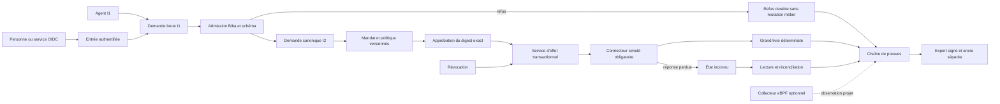
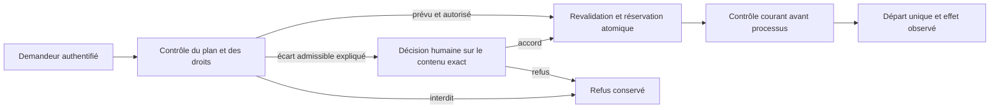

# Actions de confiance — architecture cible

## Statut, portée et décision

Ce document définit la cible de T1. Il ne prétend pas que les services métier,
OIDC, Biba, les connecteurs ou le collecteur eBPF sont déjà implémentés. Le
pilote reste une **facturation simulée** dans une racine isolée : aucun paiement,
compte tiers, publication ou déploiement externe.

Décision : retenir un **moniteur de référence par action**. Les contrôles de
départ d’un agent restent nécessaires, mais ils ne suffisent pas : le service
métier revalide l’identité, le mandat, la politique, les approbations et les
paramètres exacts dans la transaction qui engage l’effet simulé. Le connecteur
est un passage obligatoire. Toute voie directe non inventoriée reste un écart et
désactive l’action sensible concernée.

## Socle inspecté et écarts

| Mécanisme | État observé | Réemploi | Écart à traiter |
| --- | --- | --- | --- |
| Mutations `works`/`events` | Existant : révision optimiste, événement unique et transaction SQLite dans `internal/engine/store.go` | Conflits de révision, attribution et historique des commandes | Pas de modèle de mandat, approbation ou grand livre métier |
| Session web | Existant : jeton privé par projet/adresse dans `web_session.go`, cookie/CSRF au serveur | Protection de la session locale | Ce jeton n’authentifie ni une personne d’entreprise ni un service ; `operatorIdentity()` est hôte/UID, pas une identité fédérée (R01, R13) |
| Reçus de commande | Existant : `pilotage_receipts.go` lie `event_id` au digest et conserve l’état incertain | Modèle de rejeu, conflit de contenu et résultat inconnu | Limité à certaines commandes d’agents ; à généraliser au connecteur métier (R06) |
| Autorisation de règlement géré | Existant : `managed_settlement_authorization.go` lie consentement, résultat, tentative, candidat et contrat | Précédent de consentement exact et révocation/pause | Autorise une intégration Git locale, pas un effet métier ni une séparation demandeur/approbateur |
| Validation et revue | Existant : reçus liés au candidat/entrées, originaux préservés, garde de fraîcheur dans `automatic_validation.go` et `independent_review.go` | Preuves R11, attribution, contrôle exact du candidat | Une revue ne constitue pas une autorisation d’effet et ne doit pas devenir approbation métier |
| Journaux | Existant : activité et logs attribués, pagination et lacunes de rétention visibles | Diagnostic opérateur | Journaux ordinaires modifiables/soumis à rétention ; pas une preuve durable signée (R07, R16) |
| Configuration | Existant : exemples preview/apply, révision, historique et Admin (`validation_policy_config.go`, `web_requests_config.go`, `web/admin.js`) | Patron commun de configuration | Les nouvelles politiques n’existent pas encore et ne doivent pas introduire de limites cachées (R08) |
| UX | Existant : système commun, thèmes `etat`/`sombre`, focus et i18n | Composants et jetons communs | L’UX Processus métier séparée est une cible, pas un écran livré (R10, R15) |
| eBPF | Étude seulement dans `CURSOR-ENGINE-EVOLUTION-20261010.md` | Contraintes de permissions, BTF, pertes, nettoyage et coût | Aucun collecteur ou chargement privilégié observé (R20) |

La lecture seule de la console ne prouve pas une interdiction d’écriture au
stockage. Les nouvelles tables métier doivent être mutées uniquement par leurs
services propriétaires et opérations publiques.

## Menaces et propriétés de sécurité

Acteurs hostiles ou défaillants : appelant qui forge `actor` ou un niveau
d’intégrité ; agent qui étend son mandat ; demandeur qui s’autoapprouve ; mandat
révoqué pendant l’engagement ; paramètres modifiés après approbation ; double
envoi ou réponse perdue ; connecteur direct ; exfiltration par fichier, réseau,
outil ou fournisseur ; altération/réordonnancement/omission de preuves ; plugin
sur-déclarant son isolation ; PID réutilisé ou événement eBPF perdu ; opérateur
qui confond simulation, observation, contrôle local, revue et acceptation.

Propriétés : refus par défaut ; aucune autorité issue d’un texte d’agent ; droits
non compensables par un score ; séparation demandeur/approbateur ; effet et
autorisation cohérents au même point de sérialisation ; idempotence liée au
contenu ; inconnu réconcilié avant rejeu ; provenance et niveau conservés ;
preuve durable vérifiable avec clé et ancre acquises séparément ; absence de
collecte eBPF visible et non assimilée à une autorisation.

## Variante Biba et admission

La cible applique **Biba strict** aux objets officiels, avec une procédure
d’endorsement explicite et étroite comme seul changement de niveau :

- règle simple d’intégrité : un sujet ne lit pas un objet d’intégrité inférieure
  (`no read down`) ;
- règle étoile : un sujet n’écrit pas un objet d’intégrité supérieure
  (`no write up`) ;
- règle d’invocation : un sujet inférieur n’invoque pas directement un service
  supérieur (`no invoke up`) ;
- une admission de confiance n’est pas une exception implicite : c’est un sujet
  de confiance nommé, autorisé par politique, qui valide un schéma, une identité,
  un mandat, une provenance et des invariants précis, puis crée un **nouvel objet**
  supérieur lié au digest de l’original. Elle n’altère jamais l’original.

| Niveau | Sujets | Objets | Droits principaux |
| --- | --- | --- | --- |
| I0 externe | entrée réseau, fixture externe, processus agent non endossé | requête brute, sortie agent, télémétrie brute | écrire I0 ; jamais politiques, clés, approbations ou preuves officielles |
| I1 attribué | sujet authentifié ou agent lié à mission/tâche/tentative | brouillon, proposition, scénario de simulation | lire/écrire I1 et invoquer les contrôles I1 ; aucune promotion autonome |
| I2 métier protégé | admission, approbation et service d’effet dédiés | mandat admis, demande canonique, approbation, intention, grand livre | créer/muter seulement par opérations publiques et transactions propriétaires |
| I3 contrôle | administrateur séparé, service de clés, ancre/verificateur | politique, mapping d’identité, clé, ancre et preuve officielle | double contrôle et interfaces dédiées ; agents I0/I1 sans écriture |

L’API d’entrée écrit une requête I0/I1. L’admission produit une demande canonique
I2 ou un refus conservé. Un agent ne choisit ni son niveau, ni le niveau d’un
objet, ni la procédure d’admission. Les niveaux sont dérivés de l’identité
authentifiée et de la politique versionnée. Les accès stockage directs, imports,
CLI internes, migrations, restaurations et connecteurs sont inventoriés comme
chemins de contournement ; chacun doit refuser une écriture montante ou être un
sujet de confiance borné avec reçu.

### Frontières d’effet

1. **Intention** : la demande canonique et son digest n’ont encore aucun effet.
2. **Décision** : mandat et approbations exactes autorisent une intention de
   connecteur, sans prouver son engagement.
3. **Engagement** : le service d’effet revalide dans sa transaction, réserve
   l’idempotence et appelle uniquement le connecteur accordé.
4. **Résultat observé** : `committed`, `denied`, `unknown` ou `reconciled` est
   enregistré ; un accusé de réception transport n’est pas un engagement.
5. **Preuve** : l’enveloppe relie les quatre étapes ; elle ne réécrit pas l’effet.

## Flux de référence

Le point de sérialisation de R04 est la transaction du stockage métier : une
révocation acceptée avant la lecture verrouillée du mandat fait échouer
l’engagement ; un engagement déjà validé et persisté avant la révocation reste
conservé. La date seule ne tranche pas la course : l’ordre transactionnel et les
séquences de preuve le font.

## Identité, mandats et approbations

T3 retient OIDC : Authorization Code + PKCE pour les personnes et jetons de
service obtenus par `private_key_jwt` pour les workloads. L’issuer, l’audience,
la signature, le nonce/PKCE, les dates, l’identifiant de clé et les attributs de
sécurité sont validés. Les rôles/groupes externes sont transformés par un mapping
local versionné ; ils ne deviennent jamais directement une permission. Le
contexte persistant conserve des identifiants et digests, jamais le jeton brut.
Un issuer factice isolé couvre rotation, révocation et cycle de vie ; aucun compte
tiers n’est créé (R01, R13).

Le mandat R02 contient sujet, délégant et chaîne de délégation, actions,
sélecteurs de ressources, contraintes, version, politique, début, expiration,
révocation, niveau et digest. L’approbation R05 contient le digest canonique de
l’action (dont montant, devise, bénéficiaire et ressource), l’identité
authentifiée de l’approbateur, son rôle, sa décision et son expiration. Toute
modification couverte rend l’approbation incompatible. La séparation des tâches
est une règle booléenne explicite, jamais un score.

### Extension requise : identité et création des agents

**Cible à réaliser et à qualifier.** Les contrôles d'identité Trust existants ne
prouvent pas l'authentification du demandeur dans le cycle de vie général des
agents. `prepareLaunch` vérifie notamment tâche, révision et idempotence ; son
`event_id` n'est pas une preuve d'identité. Voir le
[plan et les 18 scénarios IDA](../plans/actions-confiance/identites-agents-replan.md).

Le moteur doit attribuer l'instance et ses liens mission/tâche/tentative à partir
d'un principal authentifié. Un agent légitime ne peut créer un enfant que dans
le plan adopté et ses droits délégables. Tout écart admissible reste bloqué avec
justification et demande à une personne authentifiée et habilitée, distincte du
demandeur. Le service demandeur ne peut pas tenir lieu de validation humaine.

L'accord doit lier le contenu exact, les droits, le plan et les ressources.
Rejeu, concurrence, révocation, changement de plan, reprise et départ différé
doivent appliquer les mêmes contrôles CLI/API et internes. Les autorisations
historiques importées restent historiques. Les droits sur le cadrage distinguent
propriétaire, auteur et usage ; aucune diffusion implicite à un agent légitime.

Ce flux est une cible, pas une description du lancement actuel. La protection
du registre, des secrets et des journaux contre le processus fournisseur exige
une frontière d'exécution vérifiée. Le helper scellé, la télémétrie ou un journal
append-only côté API ne prouvent pas le confinement des agents généraux.

## Effet, idempotence et reprise

Le grand livre de facturation est déterministe et isolé. L’engagement R03 écrit
en une transaction l’intention, le contrôle d’autorité courant, la réservation
d’idempotence et le résultat métier lorsqu’il est connu. La clé R06 est unique
par connecteur et liée au digest canonique : même clé/même contenu retourne
l’état connu ; même clé/contenu différent donne `409 conflict` sans mutation.

Après arrêt ou réponse perdue, l’état reste `unknown`. Le connecteur expose
`status/reconcile` et relit son reçu stable avant tout nouvel engagement. Une
réconciliation crée un événement, ne remplace pas l’historique. Une panne de
preuve avant engagement sensible ferme l’action selon politique ; une panne
après engagement laisse une lacune explicite à réparer, sans nier l’effet.

## Données, secrets et connecteurs

T4 associe à chaque action : classification des entrées/sorties, destinations,
fournisseurs/outils permis, chemins contrôlés et octroi de secret éphémère. Les
secrets sont résolus hors des copies d’agents, injectés au connecteur minimal et
jamais placés dans requête, journal ou export. Une protection non démontrée,
notamment accès à un binaire, socket, chemin ou réseau direct, désactive l’action
sensible. Les recettes attaquent exfiltration, chemin `..`, lien symbolique,
destination interdite, secret réutilisé et connecteur non médié (R14).

Le SPI R18 est versionné : `manifest`, `validate`, `prepare`, `commit`, `status`,
`reconcile`. Le manifeste déclare schémas, ressources, isolation et capacités ;
le moteur ne lui accorde que la politique autorisée. Le pilote de facturation et
un second connecteur sensible simulé exécutent la même suite contractuelle. Une
capacité déclarée sans isolation vérifiée est refusée.

## Preuves durables et simulation

R07 relie par digest intention, identité, mandat, politique, décision,
engagement et observation. Chaque enveloppe porte séquence, digest précédent,
type, références, digest du contenu, temps d’occurrence/enregistrement, clé et
signature. Refus et états inconnus sont des résultats conservés.

T6 ajoute rotation/révocation de clés, période de chevauchement, ancre acquise
séparément et politique de rétention. Le vérificateur reçoit la clé publique et
l’ancre par un canal distinct de l’export. Il détecte contenu altéré,
réordonnancement et omission sous l’ancre ; il ne conclut rien au-delà de la
dernière ancre connue. Les journaux d’activité existants restent diagnostics,
pas substituts à cette chaîne (R16).

Le laboratoire R17 utilise une racine et un stockage de fixture séparés, des
connecteurs explicitement simulés et des scénarios versionnés. Il refuse toute
destination de production, conserve graine/entrées/politiques/résultats/limites
et permet le rejeu. Une simulation n’est jamais étiquetée preuve fournisseur ou
effet réel.
Le corpus fixe R17 et ses parcours Go/API/CLI/Admin FR/EN sont implémentés ;
voir [Laboratoire](../actions-confiance-laboratoire.md). Une tentative garde
version/digest/graine/politiques/résultats et son lien de rejeu. Les14 contrôles
OS du helper fixe précèdent les scénarios ; cela ne confine pas les providers
arbitraires. Aucun chemin ou connecteur de production n’est accepté.

Première tranche locale R16 : le registre public et les ancres Ed25519 sont
implémentés, avec activation par un second I3 et révocation attribuée immédiate.
Les clés privées restent éphémères en mémoire protégée ; les preuves historiques
HMAC sont conservées. Voir [T6](../actions-confiance-T6.md) pour les contrats et
limites. La comparaison à un témoin acquis et conservé séparément est disponible ; elle
ne garantit pas un stockage immuable contre le même UID. Les copies d’archive
conservent les originaux sous durée minimale Admin, avec levée explicite après
échéance sans suppression. Le second connecteur reste à livrer ;
stockage tiers et qualification globale ne sont pas démontrés.

## Processus métier et UX

T5 porte définition versionnée, dossier lié à une version, transitions,
validations et exceptions attribuées. Les modèles de processus devront suivre
`swarm-model-design` lors de leur création et employer uniquement des opérations
publiques effectivement supportées. Une exception ne réécrit pas la définition
ni l’historique (R15).

Première tranche locale maintenant implémentée et vérifiée : définitions publiées,
dossiers fixés à leur version, validations et exceptions via `/api/v1/processes`,
CLI `process` et build web séparé. Le comportement courant, les droits, bornes et
recettes figurent dans [T5](../actions-confiance-T5.md). Aucun effet T2 n’est créé
par ces transitions ; liaison aux effets et cycle de retrait/migration restent
des extensions. Le tableau de socle ci-dessus conserve le constat initial T1.

Deux frontends restent séparables conformément à `PRODUCT-ARCHITECTURE.md` :

- **Projets** : demandes et preuves dans le contexte mission/tâche ; build,
  navigation et tests propres ;
- **Processus métier** : définitions, boîte de dossiers, validations, exceptions
  et supervision ; build, navigation et tests propres ;
- seuls les jetons `swarm-design.css`, composants accessibles et clients de
  l’API versionnée sont partagés. Aucun frontend ne lit SQLite.

Les états écrits sont brouillon, en attente d’approbation, refusé, expiré,
révoqué, engagé, inconnu et réconcilié. Le motif bloquant et la prochaine action
restent visibles. Les dialogues Admin ont titre/label/fermeture, clavier, Échap
et restitution du focus. Les contrôles couvrent FR/EN, `etat`/`sombre`,
1440/1024/760/390/320 px, chargement/vide/erreur/succès et erreurs réseau. Une
couleur ne porte jamais seule le statut (R10).

## Configuration comme contrat produit

Chaque domaine (actions, identité, données, processus, preuves, connecteurs,
eBPF) possède une source persistée versionnée. L’aperçu normalise et valide sans
mutation ; l’application lie jeton d’aperçu, `event_id` et révision attendue,
préserve l’historique et rejette un état périmé. API, CLI, Go et Admin utilisent
le même validateur et affichent valeurs configurées, effectives, consommation et
limites techniques séparément (R08).

Unités et zéro : durées nomment `ms`, `s` ou `days`; le zéro n’est accepté que
si chaque champ définit explicitement « désactivé », « illimité » ou « hérité ».
Les politiques de sécurité (durée de jeton, absence de classification ou règle
de destination) n’emploient pas zéro comme permission implicite. Aucun `max`
frontend ou constante Go ne crée un second plafond métier.

## Observation eBPF (cible T7)

Le collecteur Linux optionnel est un processus séparé utilisant `cilium/ebpf` et
un transport Unix local. Le moteur fonctionne sans lui. Le démarrage sonde noyau,
BTF et capacités (`CAP_BPF` et `CAP_PERFMON`, avec tout repli `CAP_SYS_ADMIN`
signalé), verrouillage mémoire et disponibilité de chaque sonde. L’observation
historique noyau/BTF du 10 octobre n’est pas une preuve pour le candidat futur.

Jeu minimal étudié : tracepoints `sched_process_exec`/`sched_process_exit` pour
le cycle de vie ; tracepoints syscalls `openat`/`openat2` et `connect` pour les
métadonnées disque/réseau. Le chemin final ou le socket n’est collecté que si la
politique de confidentialité l’autorise ; sinon seul un digest/bucket est émis.
Une sonde LSM éventuelle appartient à un lot d’**enforcement** distinct : elle
n’est pas nécessaire et ne doit pas être présentée comme livrée par R20.

L’attribution lie PID + temps de départ (contre réutilisation), descendants et
cgroup disponible aux identités mission/tâche/tentative fournies par le moteur.
Seuls les PID du projet sont admis ; les événements étrangers sont rejetés. Le
transport vérifie les credentials du pair. Numéros de séquence, compteurs de ring
buffer perdus, jeu de sondes, boot ID et état de nettoyage restent visibles.
Arrêt normal ou crash détache/épingle selon politique puis nettoie sans observer
d’autres processus. T7 mesure événements et CPU/mémoire/latence avec/sans
collecte sur la même fixture. Permissions manquantes retournent l’échec
d’environnement prévu ; elles ne bloquent pas les lots indépendants (R20).

## Stories et exigences

| Story | Résultat | Exigences | Mécanismes / propriétaire / contrôle |
| --- | --- | --- | --- |
| `s01-mandat` | Définir et révoquer un mandat | R02, R04, R09 | T2 ; mandat versionné, admission Biba, course révocation/engagement |
| `s02-reglement` | Demander, approuver et engager une facture simulée | R01, R03, R05 | T2/T3 ; identité authentifiée, digest exact, SoD, transaction du grand livre |
| `s03-reprise` | Reprendre une réponse perdue sans doublon | R06 | T2 ; clé liée au contenu, `unknown`, status/reconcile, redémarrage |
| `s04-preuve` | Exporter et vérifier le parcours d’une action | R07, R16 | T6 ; chaîne signée, ancre séparée, altération/ordre/omission |
| `s05-pilotage` | Administrer règles et voir les états | R08, R10 | T2–T7 ; preview/apply, historique, Admin FR/EN accessible |
| `s06-recette` | Qualifier le candidat exact | R11, R12 | T8 ; opérations publiques, tests nommés, revue fraîche, RETEX |
| `s07-identites` | Connecter personnes et services | R01, R13 | T3 ; OIDC PKCE/private_key_jwt, mapping, délégation/révocation |
| `s08-donnees` | Restreindre données, destinations et secrets | R14 | T4 ; classification et octroi par action, attaques d’exfiltration |
| `s09-processus` | Versionner un processus et traiter ses dossiers | R10, R15 | T5 ; définitions/dossiers/exceptions, UX séparée |
| `s10-conservation` | Gérer clés, ancrage et rétention | R07, R16 | T6 ; rotation/révocation, vérification indépendante |
| `s11-simulation` | Rejouer des scénarios hostiles isolés | R17 | T6 ; racine dédiée, aucun connecteur production, résultats persistés |
| `s12-connecteurs` | Étendre le catalogue sans contourner les invariants | R03, R06, R18 | T6 ; SPI et deux connecteurs simulés, suite contractuelle |
| `s13-referentiels` | Relier contrôles et écarts applicables | R19 | T6 ; matrice contextualisée, propriétaire et preuve, aucune certification déduite |
| `s14-ebpf` | Observer les processus du projet | R20 | T7 ; sondes bornées, pertes/permissions/nettoyage/coût visibles |

La couverture détaillée est : R01 identité ; R02 mandat ; R03 effet ; R04
révocation ; R05 approbation ; R06 reprise ; R07 preuves ; R08 configuration ;
R09 intégrité Biba ; R10 interface ; R11 recette ; R12 livraison ; R13 identités
d’entreprise ; R14 données ; R15 processus ; R16 preuves durables ; R17
simulation ; R18 connecteurs ; R19 référentiels ; R20 eBPF.

## Lots, dépendances et interfaces

| Lot | Entrées | Sorties contractuelles | Recette négative minimale |
| --- | --- | --- | --- |
| T2 pilote/Biba | T1 | `mandate-v1`, `action-request-v1`, `approval-v1`, `effect-intent/result-v1` | acteur/niveau forgé, mandat expiré/révoqué, autoapprobation, dérive de paramètres, conflit de rejeu, crash/réconciliation, bypass direct |
| T3 identités | T1, jointure T2 | `identity-context-v1` | issuer/audience/nonce faux, expiré/révoqué, workload usurpé, délégation périmée |
| T4 données | T2, T3 | `data-policy-v1`, `secret-grant-v1` | exfiltration, chemin/lien, destination/outil/fournisseur interdit, secret réutilisé |
| T5 processus | T2–T4 | `process-definition-v1`, `case-v1`, UX métier | transition/version fausse, exception non autorisée, accès inter-dossier, build séparé |
| T6 preuves/épreuves | T2–T4 | `evidence-envelope-v1`, `connector-spi-v1`, scénario et mapping | altération/ordre/omission, clé révoquée, fuite du labo, sur-capacité, doublon, claim conformité |
| T7 eBPF | attribution T2, confidentialité T4 | `kernel-observation-v1` | capacité/BTF absente, PID étranger/réutilisé, pertes, rupture, nettoyage, surcoût |
| T8 qualification/RETEX | T2–T7 figés | matrice R01–R20, recette exacte, RETEX | dérive candidat, original absent, zéro test, contrôle mandatory échoué, simulation confondue, autoacceptation |

Chaque lot publie schémas versionnés et tests contractuels avant ses consommateurs.
T3 et T4 peuvent avancer sur leurs services propres après gel de la jointure T2 ;
T5/T6 consomment seulement des versions publiées. T7 reste optionnel pour le
fonctionnement mais obligatoire pour déclarer R20 vérifié. T8 ne modifie pas le
candidat pendant contrôles et revue.

## Référentiels et preuve de conformité

T6 fournit une matrice d’applicabilité au contexte local simulé pour contrôles d’accès,
identité, audit, cryptographie, cycle de vie, fournisseurs et réponse aux
incidents. Chaque ligne indique référentiel/version, contrôle, justification,
périmètre, propriétaire, preuve, statut et écart. Une recette locale ou une
simulation n’établit ni certification, ni conformité organisationnelle globale,
ni efficacité d’un processus humain externe (R19).

La version1 utilise douze contrôles du catalogue NIST SP800-53 5.2.0, sélection
illustrative sans baseline. `web/trust-controls.json` est la source commune ;
`tools/actions-confiance/controls.py` vérifie référence primaire figée, pièces et
entrées pertinentes, puis refuse les revendications d'assurance non établies.
La carte produit lit le dossier explicitement, sans contrôler les fichiers du
dépôt ou la configuration courante. Voir [le contrat R19](../actions-confiance-referentiels.md).

## Qualification et conditions de fermeture

Les recettes publiques utilisent des racines isolées et vérifient mutations
réelles, refus sans mutation, concurrence, reprise et persistance. Elles séparent
double local, collecte noyau réelle, fournisseur réel, intervention opérateur,
reçus moteur, revue indépendante et acceptation. Les contrôles et la revue portent
sur le même SHA ; un fichier modifié les périme (R11).

Le livrable final comprend documentation courante FR/EN, schémas, recettes,
matrice R01–R20, originaux nécessaires à la revue et RETEX après qualification.
Tout critère non testé reste ouvert. Le producteur ne s’autoaccepte pas ; le
superviseur décide sous les contrôles et la revue imposés par le moteur (R12).
