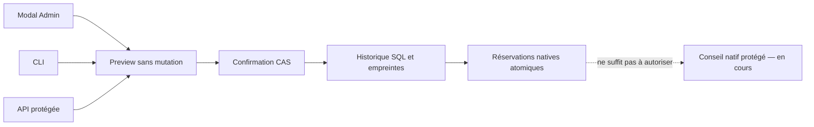

# Conseil IA Admin : budget dédié

État du 21 octobre 2026 : le budget est disponible dans le composant Admin natif,
par API protégée et par CLI. Le conseil IA direct reste en cours de raccordement ;
un enregistrement de budget ne déclenche aucun modèle. Le parcours manuel de
préparation/import de proposition reste disponible.

## Paramètres et sens des valeurs

La fenêtre « Budget du conseil IA Admin » est séparée des réglages des missions.
Elle montre le plafond, l’estimation par conseil, sa provenance, l’historique et
la somme des estimations réservées. Aucun montant ou tarif n’est choisi en silence.
Sans configuration, l’état est explicitement « non configuré ».

| Champ | Contrat actuel |
| --- | --- |
| Plafond | USD saisis dans l’interface ; `limit_micro_usd` en entier décimal exact dans le protocole. Zéro refuse une nouvelle réservation ; `null` désactive explicitement le plafond. |
| Estimation par conseil | `reserve_per_call_micro_usd`, strictement positif, choisi par l’opérateur avec une source non vide. Ce n’est pas un tarif embarqué ni une facture du fournisseur. |
| Source | Texte explicite de provenance, date et hypothèses ; sa présence ne prouve pas un tarif vérifié ou récent. Ne pas y saisir de secret. |
| Motif | Texte non vide, conservé avec l’événement, la révision, l’horodatage et l’acteur local observé ; ce dernier n’est pas une identité humaine authentifiée. |

Un microdollar vaut 10^-6 USD : six décimales au maximum dans la saisie. Les
chaînes décimales du protocole conservent les entiers au-delà de 2^53 ; le stockage
utilise une représentation non négative allant jusqu’à i64::MAX micro-USD. Cette
borne technique n’est pas un plafond commercial. Une valeur non représentable
est refusée sans arrondi ou troncature.

L’interface prévisualise sans mutation, puis demande une confirmation. Un état
monétaire modifié entre-temps invalide l’aperçu. Les paramètres de stockage sans
effet sur ce choix monétaire ne changent pas son token ; ils restent lus pour
l’opération réelle. Un refus conserve les saisies. Une confirmation vide n’est
pas acceptée comme sauvegarde. Après une perte de réponse, confirmer de nouveau
la même intention permet un rejeu exact ; relire l’historique en cas d’incertitude.

## Réservations et limites de la preuve

L’admission comptable native utilise une transaction immédiate et les réglages
de contention enregistrés. Deux appels concurrents ne peuvent dépenser la même
capacité. Le même identifiant et la même empreinte rejouent la réservation
originale ; un autre contenu avec ce même identifiant est refusé. Cette réservation
ne confère jamais à elle seule un droit d’exécuter un fournisseur.

Les réservations passées sont conservées lorsque le plafond ou l’estimation change.
Abaisser le plafond sous le total réservé bloque les admissions suivantes ;
cela ne remet aucune consommation à zéro. Aucun remboursement automatique n’est
inféré d’un échec ou d’un résultat incertain. La somme affichée est une **estimation
réservée**, pas un coût réel mesuré. La facture réelle reste inconnue et ce contrat
ne garantit pas que le fournisseur ne dépassera pas une estimation par appel.

Les colonnes SQL de `admin_advice_budget_history` et
`admin_advice_budget_reservations` sont normalisées, sans BLOB opérationnel. Les
révisions doivent être contiguës ; les sources/montants, références et empreintes
sont vérifiés à la lecture. Chaque entrée historique est chaînée à la précédente.
Cela détecte une altération non accompagnée des bonnes empreintes, sans protéger
contre un propriétaire malveillant du même UID ou un rollback complet de la base.
Une incohérence est un refus sûr, jamais une balance vide : conserver le Root et
les preuves, diagnostiquer la source de l’incohérence avant une reprise qualifiée.

## Parcours publics

- `swarm-rust admin-budget show --root ROOT --json`
- `swarm-rust admin-budget preview --root ROOT --input FILE --json`
- `swarm-rust admin-budget apply --root ROOT --input FILE --json`
- GET/HEAD `/api/v1/admin-advice-budget` ; POST aux sous-routes `/preview` et `/apply`.

Les routes utilisent les mêmes contrôles de session, Host et CSRF que l’Admin
existant et sa voie de traitement dédiée. Aucun secret fournisseur n’est lu par
ces opérations. Le corps de changement est strict :

```json
{
  "schema_version": 1,
  "event_id": "EXEMPLE-UNIQUE",
  "expected_revision": "0",
  "policy": {
    "limit_micro_usd": "1000000",
    "reserve_per_call_micro_usd": "10000",
    "estimate_source": "EXEMPLE : estimation opérateur à remplacer"
  },
  "reason": "EXEMPLE de configuration volontaire"
}
```

Ces montants sont des **entrées d’exemple**, ni des tarifs ni des défauts du
produit. L’application reprend exactement ce document en ajoutant le
`preview_token` renvoyé par l’aperçu. `null` doit être explicite ; omettre le
plafond ne signifie pas « sans plafond ». Les clés inconnues et doublons refusent.



## Vérifications rejouables

`npm run test:admin-budget-ui-unit` vérifie les conversions exactes et la
corrélation des confirmations. `npm run test:admin-budget-native -- --binary
CHEMIN_CLI --output DOSSIER_PREUVES` vérifie le serveur HTTP et le navigateur
réels, en FR/EN et etat/sombre, dans un Root temporaire, sans fournisseur.

Le lot `docs/plans/migration-rust/evidence/20261021-admin-budget/` conserve les
échecs de compilation 16/18, puis source19 (6 tests unitaires, 3 intégrations Root
avec concurrence, build normal) et native-http20 (4 parcours navigateur/HTTP).
Les essais ne prouvent ni appel IA, ni facture réelle, ni installation du serveur
utilisateur, ni acceptation indépendante ou migration globale terminée.

## Réponse fournisseur partagée

`ProviderResponseStream` porte le cadrage JSONL, les limites explicites de réponse
et la limite d’événement des paramètres enregistrés. Un terminal valide fournit
les octets complets et les déclarations non authentifiées d’usage/modèle. Il ne
valide pas le domaine de la réponse et n’autorise aucun processus ou changement.
`PlanningOutputStream` conserve son interface et valide ensuite `PlanningProposal` ;
le futur conseil Admin doit appliquer son propre contrat strict avant publication.
Une erreur, un terminal absent ou ambigu et une limite dépassée refusent la réponse,
sans succès tronqué. Les codes historiques `planning-output-*` sont conservés pour
les consommateurs existants. Aucun délai ou tarif supplémentaire n’est introduit.

La recette `shared-response22` conserve les neuf cas antérieurs du planificateur
et trois cas génériques : réponse non Planning, limites distinctes, données non
JSON et terminaux invalides. Ces douze tests passent ; cela ne prouve pas encore
un appel Admin protégé ni la parité globale de la migration.
