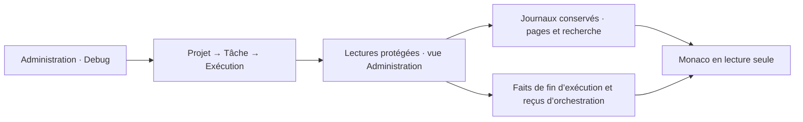

# Console Debug de Swarm

Dans **Administration → Console Debug**, activez l’interrupteur puis ouvrez
la console. L’interrupteur est désactivé à chaque chargement de la page.
La console charge ses données et Monaco à l’ouverture. Fermer la fenêtre
libère son éditeur et son journal en mémoire. Désactiver Debug ferme aussi
la fenêtre. Ces commandes ne modifient ni l’enregistrement des logs ni les
paramètres des agents.

Dans l’arborescence **Projet → Tâche → Exécution**, sélectionnez une tentative.
Le groupe **Orchestration et exécutions hors tâche** donne accès aux lancements
des orchestrateurs et aux tentatives non rattachées à une tâche enregistrée.

| Détail maximal | Événements visibles |
| --- | --- |
| Erreur | Erreurs, incidents et refus signalés |
| Avertissement | Erreurs, avertissements et limites |
| Info | Événements d’exécution et niveaux précédents. C’est le niveau initial. |
| Debug | Niveaux précédents, événements détaillés et faits disponibles dans les reçus |

La recherche d’une tentative utilise le filtre littéral du journal conservé,
sur l’ensemble des pages accessibles. Un curseur permet de parcourir les
correspondances. Le filtre de niveau agit sur la page affichée. Ctrl+F dans
Monaco recherche dans cette page. Retirez la recherche pour retrouver les faits
de fin d’exécution au niveau Debug sur la première page. Les journaux antérieurs
à la rétention ne sont pas récupérables dans cette console.

Les compteurs indiquent les niveaux présents sur la page chargée, y compris
ceux masqués par le filtre. **Erreur précédente** et **Erreur suivante** révèlent
chaque erreur dans Monaco et annoncent son rang. La navigation revient à
l’autre extrémité de la page quand elle atteint la première ou la dernière
erreur. Les faits de fin d’exécution portent l’heure du reçu quand elle est
disponible. En mode texte de secours, les compteurs restent visibles.

Les faits de fin d’exécution sont limités à des valeurs autorisées, comme le
code de sortie, le volume de sortie et l’état de la capture. Pour une tentative
d’orchestration, la console montre la phase enregistrée, les codes de refus et
les faits du reçu dont le moteur a enregistré l’empreinte. En l’absence de
cette empreinte, le diagnostic reste provisoire. Les projections de reçus
excluent les prompts, captures brutes, chemins et secrets. Les messages du
journal conservent le contrat de visibilité déjà appliqué à leur production.

Si Monaco ne peut pas être chargé, le journal reste disponible en texte.
Un refus de lecture reste visible dans la console avec son code quand celui-ci
est fourni. Pour reprendre une lecture de projet en échec, refermez et rouvrez
sa branche. Consultez la [version anglaise](../en/ADMIN-DEBUG.md).

## Journal d’accès

**Connexions**, les exports et le **Tableau de bord** partagent les filtres
de période et de session. Le tableau de bord compte aussi les connexions
refusées sans session quand elles satisfont les critères applicables. Les
dernières connexions listent les ouvertures réussies. **Actions d’administration**
présente le résultat corrélé aux intentions de l’administration Authority. Un
résultat historique sans corrélation reste inconnu. Pour purger, il faut le
droit d’audit et celui de gestion des comptes. La lecture seule ne permet pas
la purge.

## Logs applicatifs du relais

Dans **Administration → Comptes et accès → Logs applicatifs**, ouvrez la
console dédiée. Le démon vérifie l’habilitation de gestion des comptes sur
chaque lecture et écriture. Les appels HTTP aux missions, tâches, actions
Trust et revues de préparation enregistrent les étapes du relais. Les codes
Biba ou Bell–LaPadula issus de la projection autorisée restent visibles. Les
journaux de mission ont leurs propres frontières de lecture.

La vue de rotation affiche la taille du journal actif par rapport au seuil,
le nombre d’archives comparé à la rétention enregistrée, le volume archivé et
la dernière rotation observée. Si la rétention a baissé, elle indique le nombre
d’archives à retirer au prochain déclenchement. La colonne **Source** distingue
le journal actif des événements archivés et indique la date de l’archive. Dans **Options de lecture**, le
filtre de source applique recherche, fenêtre d’octets et pagination au seul
ensemble sélectionné. Une écriture dans le journal actif ne rend pas une
lecture des archives obsolète tant que les archives n’ont pas changé.

La recherche littérale et le seuil de gravité s’appliquent à la fenêtre
d’octets choisie sur les archives conservées suivies du journal actif.
**Début** et **Fin** retiennent seulement les lignes entières comprises dans
la fenêtre, bornée par la taille de rotation enregistrée. **Tout l’historique**
parcourt l’ensemble conservé par pages. Le nombre de lignes par page peut
être réduit pour la consultation. L’ordre, les boutons de page et de
correspondance, le retour à la ligne et le compteur guident la lecture.
Les téléchargements TXT et HTML contiennent les colonnes de la page affichée.
Échap ferme la console et replace le focus sur son raccourci.

**Actualiser** rejoue les critères appliqués et ouvre une nouvelle lecture.
Entre deux pages, une rotation ou de nouvelles écritures peuvent rendre la
lecture précédente obsolète. Un refus ou une erreur de lecture s’affiche et
efface les anciennes lignes.

Les filtres appliqués de recherche, de niveau, de source et de position
s’affichent au-dessus du tableau. Retirer une pastille relance la première page
avec les autres critères appliqués. Si l’instantané expire entre deux pages,
**Reprendre la lecture** recharge la première page avec ces mêmes critères.
La source Archives signale explicitement l’absence d’archives conservées.

L’onglet **Journal** s’ouvre par défaut et regroupe la recherche, les résultats
et les exports. L’onglet **Rotation et rétention** affiche les mesures et les
réglages. Les flèches gauche et droite, Début et Fin changent d’onglet au clavier.
La recherche surligne le texte exact dans les cellules affichées, avec la casse
saisie. Un rapprochement dans un champ du journal non affiché peut produire une
ligne sans surlignage. Les réglages commencés et les filtres restent disponibles
quand on change d’onglet. Les exports conservent le texte des cellules.

Le démon Rust inscrit le démarrage de son écoute au niveau Info dans le
journal applicatif. Une lecture invalide ou un instantané expiré émet un
événement Warn sur la sortie d’erreur du démon. Un échec interne de lecture
y émet un événement Error. Le diagnostic contient le statut HTTP et le code
stable. Cette destination préserve les instantanés de `authority.log`.
Le texte des filtres et la valeur de l’instantané restent hors de ces événements.

Le journal actif reste dans le répertoire déclaré du démon, sous
`authority.log`. Lorsque l’événement suivant dépasserait la taille configurée,
le fichier actif devient une archive entière. La rétention réduite s’applique
à la rotation suivante. Les valeurs livrées sont 8 Mio, 3 archives et 200
lignes. Les réglages conservent leur contrôle de révision. Le contrat historique
de `GET /log?q&level` reste disponible. La console reconnaît l’extension par
`history_version` et reconnaît les compteurs et sources par `rotation_version`. Une ancienne version du démon conserve la consultation
du lot récent avec les commandes compatibles.

La [recette de consultation](../../tools/verification/recipes/authority-application-logs-ui.json)
exerce la fenêtre dans Chromium avec des réponses simulées. Elle vérifie les
commandes, le clavier, les refus, la reprise, les réponses obsolètes et les
deux langues et thèmes sur mobile. Les vérifications HTTP des fichiers
conservés s’exécutent avec un moteur et un démon de fixture via
`tests/authority_app_logs_http_ui.cjs MOTEUR DÉMON SORTIE_NEUVE`.

Le contrôle GitHub Actions **Check authority log rotation and history through Admin**
exécute les tests ciblés puis le parcours authentifié avec le moteur de distribution
et le démon de production compilé en release. Il conserve les empreintes des deux
binaires et le rapport des assertions.

[Règle de codage des journaux](../../.claude/rules/structured-logging.md).
