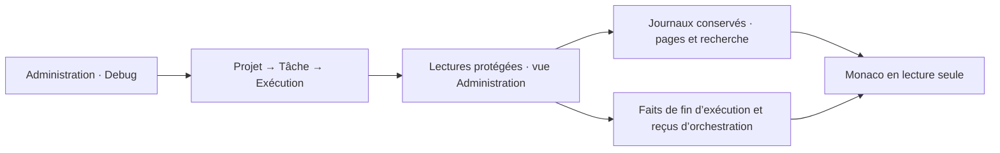

# Console Debug de Swarm

Dans **Administration → Console Debug**, activez l’interrupteur puis ouvrez
la console. L’interrupteur est désactivé à chaque chargement de la page.
La console charge ses données et Monaco à l’ouverture. Fermer la fenêtre
libère son éditeur et son journal en mémoire. Désactiver Debug ferme aussi
la fenêtre. Ces commandes ne modifient ni l’enregistrement des logs ni les
paramètres des agents.

Dans l’arborescence **Projet → Tâche → Exécution**, sélectionnez une tentative.
Le groupe **Orchestration et exécutions hors tâche** donne accès aux lancements
des orchestrateurs et aux tentatives non rattachées à une tâche enregistrée.

| Détail maximal | Événements visibles |
| --- | --- |
| Erreur | Erreurs, incidents et refus signalés |
| Avertissement | Erreurs, avertissements et limites |
| Info | Événements d’exécution et niveaux précédents. C’est le niveau initial. |
| Debug | Niveaux précédents, événements détaillés et faits disponibles dans les reçus |

La recherche d’une tentative utilise le filtre littéral du journal conservé,
sur l’ensemble des pages accessibles. Un curseur permet de parcourir les
correspondances. Le filtre de niveau agit sur la page affichée. Ctrl+F dans
Monaco recherche dans cette page. Retirez la recherche pour retrouver les faits
de fin d’exécution au niveau Debug sur la première page. Les journaux antérieurs
à la rétention ne sont pas récupérables dans cette console.

Les compteurs indiquent les niveaux présents sur la page chargée, y compris
ceux masqués par le filtre. **Erreur précédente** et **Erreur suivante** révèlent
chaque erreur dans Monaco et annoncent son rang. La navigation revient à
l’autre extrémité de la page quand elle atteint la première ou la dernière
erreur. Les faits de fin d’exécution portent l’heure du reçu quand elle est
disponible. En mode texte de secours, les compteurs restent visibles.

Les faits de fin d’exécution sont limités à des valeurs autorisées, comme le
code de sortie, le volume de sortie et l’état de la capture. Pour une tentative
d’orchestration, la console montre la phase enregistrée, les codes de refus et
les faits du reçu dont le moteur a enregistré l’empreinte. En l’absence de
cette empreinte, le diagnostic reste provisoire. Les projections de reçus
excluent les prompts, captures brutes, chemins et secrets. Les messages du
journal conservent le contrat de visibilité déjà appliqué à leur production.



Si Monaco ne peut pas être chargé, le journal reste disponible en texte.
Un refus de lecture reste visible dans la console avec son code quand celui-ci
est fourni. Pour reprendre une lecture de projet en échec, refermez et rouvrez
sa branche. Consultez la [version anglaise](../en/ADMIN-DEBUG.md).

### Échec d’une revue dans Conduite

La fiche d’une tâche soumise peut relire l’incident de sa revue courante avec
les droits des journaux et la révision affichée. Le moteur rapproche le reçu
avec la ligne d’exécution, l’événement et le certificat d’origine. La fiche
affiche la frontière atteinte, le code de sortie quand il est connu et la limite
de reprise sur un dépôt géré. Un échec de lecture garde son propre message.

Le message Unix est une catégorie issue du texte rapporté par le fournisseur.
Swarm renvoie un code fixe, sans recopier les captures, les chemins, ni les
prompts. Cette lecture ne donne aucun droit de relance ni de validation.

### Phases d’une revue native Rust

Filtrez sur `"phase":"summary"` pour lire une synthèse de fin de tentative.
Elle regroupe la durée totale, le dernier jalon observé, la cause stable,
la révision connue, les tailles du prévol et la version compilée. Les champs
d’issue absents ou nuls correspondent à des faits non établis. Les lignes
d’étape restent disponibles pendant l’exécution et le rejeu exact ne crée pas
de synthèse. La ligne `receipt` confirme la conservation du reçu ou en indique
l’échec. `process` expose aussi les expirations, l’interruption et le nombre
d’erreurs du transport observées.

Dans **Suivi → Journaux**, ouvrez le journal de l’agent producteur de la tâche
soumise. Cherchez `review_attempt`, puis copiez son empreinte complète dans le
filtre de texte pour suivre une tentative. Le filtre de type reconnaît
`review-info`, `review-warn` et `review-error`. La lecture native filtrée
`GET /api/v1/logs` applique la politique de pagination enregistrée. Avec le
relais Authority, cette lecture et `GET /api/v1/agent-logs` exigent les droits
de lecture et de vue Journaux. Le flux Agents en direct omet ces lignes. Le
journal applicatif du relais conserve ses propres droits et sa rotation.

Le moteur produit les événements pour l’exécution de `task review`, y compris
l’entrée de mission qui réutilise ce chemin. Il associe le prévol à une tentative
productrice vérifiée avant l’assemblage. Les inspections `review-preview` et
`review-inputs` et le rejeu d’un résultat conservé ne produisent aucune nouvelle
ligne. Un refus avant l’identification du producteur ne crée aucune entrée dans
un journal de mission. Les écritures utilisent le journal existant avec son
horodatage et son plafond de message. Le moteur écarte un message structuré
entier si le plafond ne permet pas de le conserver. Le résultat expose séparément le code sûr d’un
défaut d’écriture. En cas de refus, il rejoint les causes de la réponse JSON.
L’issue métier reste celle de l’opération d’origine.

| Phase | Faits observables |
| --- | --- |
| `preflight` | Limites effectives de sources, de fichiers et du prompt, avec les tailles déjà observées. Le refus de taille peut précéder la réservation. |
| `reservation` | Identifiant de revue créé, révision, consommation et plafond d’appels après l’engagement, ou code du refus. |
| `execution` | Début de la préparation du processus après réservation, avec identifiant de revue et révision des réglages. |
| `grant` et `process` | Enregistrement du helper, autorisation de porte, envoi du grant, état du canal et refus sûrs, dont les codes d’identité et Biba connus. L’envoi du grant laisse l’exécution du fournisseur indéterminée. |
| `reply` et `receipt` | Issue du décodage, avis agrégé, code de sortie, compteurs et troncature observés. Un échec de conservation du reçu a sa propre phase. |
| `publication` | Avis enregistré, applicabilité et état de la tâche lorsque le moteur les connaît. |

La corrélation est l’empreinte de l’intention structurée, visible dans le
périmètre du producteur. Une tentative peut avoir plusieurs issues distinctes
pour une même phase. L’écriture garde une seule ligne par phase et code d’issue
pour cette empreinte. La durée est mesurée avec l’horloge monotone, les compteurs
absents restent indéterminés, et seuls les motifs canoniques connus ont une
condition de reprise. La projection exclut le texte des sources, prompts,
réponses, erreurs privées, chemins, jetons et identifiants fournisseur. Aucun
contrôle Bell–LaPadula supplémentaire n’est exécuté dans ces frontières de
revue. Les refus du relais restent soumis à son diagnostic existant.

La [recette de revue native gérée](../../tools/verification/recipes/native-managed-reviewer.json)
inclut le succès, le refus de taille, le rejeu et le filtrage CLI/HTTP dans une
racine isolée. Le test de politique Authority
`exclusive_route_requires_view_permission` couvre le refus de vue et sa
contrepartie autorisée.

## Erreurs du moteur Rust dans le journal système

Sous Linux avec journald, la CLI `swarm-rust` publie un événement structuré
lorsqu’une commande échoue, y compris avant l’ouverture d’une mission.
L’observateur HTTP natif publie les échecs et les lectures dégradées qu’il reçoit.
Le journal contient des codes stables, la famille de commande, le niveau, le
statut ou le code de sortie et, pour une commande, sa durée. Un indicateur
signale qu’un effet Work est connu. Les identifiants, arguments, requêtes,
réponses et messages privés restent hors de cette projection.

```sh
journalctl SYSLOG_IDENTIFIER=swarm-rust SWARM_COMPONENT=swarm-cli
journalctl SYSLOG_IDENTIFIER=swarm-rust SWARM_COMPONENT=swarm-web
```

L’accès et la conservation suivent la configuration du journal système.
Si le datagramme est refusé, la réponse JSON garde son erreur d’origine
et indique `application_log.code = application-journal-unavailable` quand
ce canal de réponse est disponible. L’observateur web ajoute le même champ
à l’événement de sortie. Ces événements couvrent les frontières observées,
pas tous les `Result` intermédiaires, les arrêts forcés ou les paniques.
Le journal applicatif du relais et les journaux de mission restent distincts.

## Logs applicatifs du relais

Dans **Administration → Comptes et accès → Logs applicatifs**, ouvrez la
console dédiée. Le démon vérifie l’habilitation de gestion des comptes sur
chaque lecture et écriture. Les appels HTTP aux missions, tâches, actions
Trust et revues de préparation enregistrent les étapes du relais. Les codes
Biba ou Bell–LaPadula issus de la projection autorisée restent visibles. Les
journaux de mission ont leurs propres frontières de lecture.

La vue de rotation affiche la taille du journal actif par rapport au seuil,
le nombre d’archives comparé à la rétention enregistrée, le volume archivé et
la dernière rotation observée. Si la rétention a baissé, elle indique le nombre
d’archives à retirer au prochain déclenchement. La colonne **Source** distingue
le journal actif des événements archivés et indique la date de l’archive. Dans **Options de lecture**, le
filtre de source applique recherche, fenêtre d’octets et pagination au seul
ensemble sélectionné. Une écriture dans le journal actif ne rend pas une
lecture des archives obsolète tant que les archives n’ont pas changé.

La recherche littérale et le seuil de gravité s’appliquent à la fenêtre
d’octets choisie sur les archives conservées suivies du journal actif.
**Début** et **Fin** retiennent seulement les lignes entières comprises dans
la fenêtre, bornée par la taille de rotation enregistrée. **Tout l’historique**
parcourt l’ensemble conservé par pages. Le nombre de lignes par page peut
être réduit pour la consultation. L’ordre, les boutons de page et de
correspondance, le retour à la ligne et le compteur guident la lecture.
Les téléchargements TXT et HTML contiennent les colonnes de la page affichée.
Échap ferme la console et replace le focus sur son raccourci.

**Actualiser** rejoue les critères appliqués et ouvre une nouvelle lecture.
Entre deux pages, une rotation ou de nouvelles écritures peuvent rendre la
lecture précédente obsolète. Un refus ou une erreur de lecture s’affiche et
efface les anciennes lignes.

Les filtres appliqués de recherche, de niveau, de source et de position
s’affichent au-dessus du tableau. Retirer une pastille relance la première page
avec les autres critères appliqués. Si l’instantané expire entre deux pages,
**Reprendre la lecture** recharge la première page avec ces mêmes critères.
La source Archives signale explicitement l’absence d’archives conservées.

L’onglet **Journal** s’ouvre par défaut et regroupe la recherche, les résultats
et les exports. L’onglet **Rotation et rétention** affiche les mesures et les
réglages. Les flèches gauche et droite, Début et Fin changent d’onglet au clavier.
La recherche surligne le texte exact dans les cellules affichées, avec la casse
saisie. Un rapprochement dans un champ du journal non affiché peut produire une
ligne sans surlignage. Les réglages commencés et les filtres restent disponibles
quand on change d’onglet. Les exports conservent le texte des cellules.

Le démon Rust inscrit le démarrage de son écoute au niveau Info dans le
journal applicatif. Une lecture invalide ou un instantané expiré émet un
événement Warn sur la sortie d’erreur du démon. Un échec interne de lecture
y émet un événement Error. Le diagnostic contient le statut HTTP et le code
stable. Cette destination préserve les instantanés de `authority.log`.
Le texte des filtres et la valeur de l’instantané restent hors de ces événements.

Le journal actif reste dans le répertoire déclaré du démon, sous
`authority.log`. Lorsque l’événement suivant dépasserait la taille configurée,
le fichier actif devient une archive entière. La rétention réduite s’applique
à la rotation suivante. Les valeurs livrées sont 8 Mio, 3 archives et 200
lignes. Les réglages conservent leur contrôle de révision. Le contrat historique
de `GET /log?q&level` reste disponible. La console reconnaît l’extension par
`history_version` et reconnaît les compteurs et sources par `rotation_version`. Une ancienne version du démon conserve la consultation
du lot récent avec les commandes compatibles.

La [recette de consultation](../../tools/verification/recipes/authority-application-logs-ui.json)
exerce la fenêtre dans Chromium avec des réponses simulées. Elle vérifie les
commandes, le clavier, les refus, la reprise, les réponses obsolètes et les
deux langues et thèmes sur mobile. Les vérifications HTTP des fichiers
conservés s’exécutent avec un moteur et un démon de fixture via
`tests/authority_app_logs_http_ui.cjs MOTEUR DÉMON SORTIE_NEUVE`.

Le contrôle GitHub Actions **Check authority log rotation and history through Admin**
exécute les tests ciblés puis le parcours authentifié avec le moteur de distribution
et le démon de production compilé en release. Il conserve les empreintes des deux
binaires et le rapport des assertions.

[Règle de codage des journaux](../../.claude/rules/structured-logging.md).
