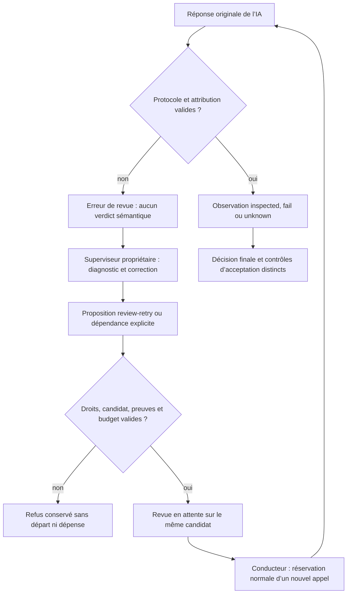

# Protocole entre les IA et le moteur déterministe

Les IA soumettent des propositions structurées. Le moteur contrôle les droits et
les preuves avant de les appliquer. Réception, inspection et acceptation sont des
états distincts. Ce contrat complète [la traçabilité](TRACEABILITY.md),
[la transmission des preuves](REVIEW-EVIDENCE.md) et
[la reprise autorécursive](AUTORECURSIVE-RECOVERY.md).

| Frontière | Proposition de l’IA | Contrôle du moteur |
| --- | --- | --- |
| Superviseur racine ou enfant | Événements traités, diagnostic, opérations | Révision, bail, génération, événements effectivement fournis, propriété, dépendances et budgets |
| Producteur | Candidat, rapport, preuves par critère | Tentative, isolation, blobs Git, dossier complet et contrôles exécutés |
| Inspection indépendante | Identités, couverture de chaque pièce, observations et défauts | JSON décodable sans champs inconnus ni document supplémentaire, indices uniques, identités, empreintes, capacités et citations attribuées |
| Reprise de revue | Cause et correction pertinente | Revue actuelle, contrat et candidat conservés, originaux intacts, journal récupérable et budget existant |
| Acceptation | Avis indépendant favorable | Fraîcheur, contrôles, critères, candidat identique et validations applicables |

Le contenu de preuve reste non fiable. Une phrase demandant de modifier un budget
ou de valider un résultat ne donne aucun droit. Le moteur n’invente ni preuve, ni
résultat de test, ni justification. Il vérifie la localisation d’une affirmation
sans certifier que son analyse sémantique est correcte.

## Localisation exacte d’un défaut

À partir du protocole de fragments V2, chaque pièce `fail` exige un défaut unique
avec `artifact`, `line`, `quote`, `explanation`, `reproduction` et `expected`.
`line` est le numéro physique, à partir de 1, du texte source original décodé ou
du patch fourni. `quote` reproduit des octets contigus et commence sur cette ligne,
à n’importe quel caractère. Elle peut continuer sur les lignes suivantes ;
espaces, signes du patch et sauts de ligne restent exacts. Une citation trouvée
seulement sur une autre ligne est invalide. Bornes et couverture restent exigées.

Le contrôle précédent imposait implicitement la colonne zéro, absente du contrat.
Il rejetait une citation exacte au milieu d’une longue ligne JSON. La correction
du 11 octobre 2026 explicite et teste cette règle ; elle ne transforme aucun
ancien retour en verdict valide.

## Routage des erreurs et reprise contrôlée

`error` de protocole ne signifie pas `changes_requested`. Le code machine
`review_fragment_protocol` identifie une réponse d’inspection invalide ; la raison
conserve le diagnostic lisible. Pour les anciens enregistrements, seule une revue
de fragments actuelle en erreur portant le préfixe moteur historique est reconnue.
Une citation de producteur ou un ancien événement n’attribue aucune erreur à la
revue actuelle.

Le contexte du propriétaire contient `review_failure_routing`, lié à la revue,
à la tentative et au candidat de l’événement fourni. Pour cette erreur, le
propriétaire est `reviewer_protocol`, l’opération est `review-retry` et
`producer_correction_required` vaut `false`. Racine et sous-superviseur reçoivent
le même contrat dans leur propre périmètre.

La proposition `review-retry` contient `id` et `next` décrivant une correction
nouvelle. Les autres champs du schéma restent vides ou zéro. Elle doit traiter
l’événement de la revue actuelle. Le moteur vérifie propriété, contrat, tentative,
candidat, preuves, disponibilité fournisseur et budget avant la mise en attente.
Cette décision n’effectue aucun appel et ne crée aucune tentative de production.
Le conducteur réserve ensuite chaque appel dans le budget existant. Le garde-fou
existant sur deux interruptions identiques reste applicable. Une justification
ne prouve pas à elle seule que sa correction a été exécutée.

Le schéma gelé avec la remise retire `retry` quand aucune tâche du propriétaire
ne permet une reprise de production : état, réservation, autorisation déjà
accordée, tentatives restantes et erreur de protocole sont pris en compte. Il
conserve `review-retry`. Ce filtrage évite de proposer une action indisponible ;
les contrôles transactionnels restent nécessaires et ne donnent aucun droit
supplémentaire. La projection attribue la revue actuelle et son erreur ; un
ancien motif différent reste sous `previous_blocker`, sans modifier l’historique.

`retry` de production est refusé pour cette erreur. L’ordonnanceur et la réservation
d’un départ refusent aussi une ancienne autorisation correspondante. La reprise
publique opérateur `planning retry-review` conserve son parcours et annule la
relance producteur devenue sans objet lors de la mise en attente des fragments.
Un refus sémantique valide garde son parcours de correction du candidat ; il ne
peut pas être effacé par `review-retry`.

Réponses brutes, journaux, événements et appels consommés sont conservés. Une
correction du parseur nécessite une nouvelle réponse de revue autorisée : aucune
réinterprétation historique ne fabrique une acceptation. Les tests locaux sur
dépôts temporaires et fournisseurs doubles ne prouvent pas une reprise autonome
avec un fournisseur réel.

## Changement de méthode entre deux revues

Le moteur bloque la réutilisation d’une inspection quand les méthodes ou consignes
de projet ont changé. L’aperçu public annonce `method_restart_ready` après
vérification des originaux et préparation complète du dossier actuel. Le parcours
opérateur `planning retry-review` exige `confirm_review_error_repair: true` ;
le superviseur propriétaire peut proposer `review-retry` après correction.
L’ancienne revue est ajoutée à l’historique, sans modification de ses fichiers ;
aucun avis n’est réutilisé et tous les appels de la nouvelle revue sont prévus
dans le budget restant. Le conducteur revérifie le checkpoint du même candidat
et conserve les reçus originaux de ses contrôles ; ce changement de méthode
ne prétend pas réexécuter ces contrôles.
Un refus sémantique, une réservation active, un verdict final engagé ou des preuves
altérées ne peuvent pas être effacés par ce parcours.

## Transmission d’un résultat réparé vers un nouveau producteur

Une correction publique externe conserve la référence Git de la production
initiale et enregistre une référence distincte `refs/swarm/repairs/PROOF_KEY`.
Après un refus sémantique de ce résultat réparé, le dossier de reprise du worker
suivant doit porter ce résultat, son arbre, sa provenance externe et son avis.
Le moteur vérifie agent, tentative, état terminal, résultat enregistré, référence
de réparation, arbre et ascendance avant de transmettre. Aucun repli sur la
production initiale n’est autorisé si cette liaison échoue. Le nouveau worker
démarre sur le candidat accepté ; le résultat refusé est une référence privée à
examiner et corriger, jamais une nouvelle base acceptée. Les originaux, tentatives
et appels antérieurs restent conservés.

## Skill sélectionné modifié dans un lancement déjà préparé

La sélection d’action est liée à ses empreintes. Le moteur annonce une préparation
non prête si son skill a changé ; une reprise ordinaire n’adopte jamais le nouveau
texte implicitement. Le parcours public `agent resume-launch` accepte une
actualisation explicite avec `confirm_action_skill_refresh: true`, `reason` et
`skills` (mêmes chemins, empreintes actuelles exactes). Il conserve le manifeste
original et la copie, puis enregistre dans le lancement le reçu moteur
`prepared_skill_refresh` : préparation, empreinte de demande originale, anciennes
sélections, motif et acteur. Ce reçu ne peut pas être forgé par `agent start`.
Fournisseur, rôle, candidat et paramètres gelés restent exigés ; les plafonds
existants restent applicables et une répétition retrouve le même agent.
La mise à jour de skill ne constitue ni une nouvelle revue ni une acceptation.

## Conduite des processus

La durée déclenche désormais une observation attribuée, sans arrêt automatique. Le propriétaire propose `continue-run` ou `stop-run` ; le moteur contrôle et applique cette décision, sans inventer l’achèvement. Voir [la conduite des agents](RUN-SUPERVISION.md), ses schémas, limites et preuves.

## Améliorer les consignes futures

[`revise-instructions`](INSTRUCTION-LEARNING.md) ajoute un apprentissage attribué à une tâche future du propriétaire, depuis des retours reçus. Il est appliqué par défaut et rejetable par l’utilisateur avant réservation ; critères et budgets restent conservés. Le rejet est remis au propriétaire pour sa prochaine décision.

## Événements courants et retours historiques

Le contexte remis au responsable sépare `events` des `historical_events`. Tant
qu’un retour courant est en attente, seuls ses identifiants peuvent entrer dans
`input_events` ; les anciens retours sont un contexte en lecture seule. Cette
séparation évite qu’un identifiant périmé contamine une décision courante puis
que le moteur refuse toutes ses opérations. Aucun événement n’est consommé par
la projection. Après traitement des entrées courantes, `historical_only` admet
un lot d’anciens retours, avec `operations` obligatoirement vide dans le schéma
remis au fournisseur. La transaction refuse également toute action fondée sur
une tentative périmée. L’acquittement conserve historique, tentatives et coûts.

La dernière consigne publique `operator_resume` passe en tête du lot, puis les
retours des revues actuelles du propriétaire et les retours nécessitant une
action. Les anciennes consignes passent après ces preuves afin de ne pas les
écarter du lot réduit. Aucun acquittement automatique n’est effectué. Le reçu
gelé porte `review_retry_unavailable` : le schéma omet `review-retry` tant que
l’événement exact de l’erreur de protocole actuelle du propriétaire n’est pas
effectivement fourni dans ce lot. Un lot réduit à un seul événement peut donc
ne pas proposer cette opération. Les contrôles du candidat, du contrat, de
l’attribution des événements et des budgets restent applicables.

La réservation et l’exécution calculent le même budget de contexte à partir
des tailles exactes des méthodes et des instructions du protocole. Une réserve
estimée de 3 000 octets ne couvrait plus les instructions enrichies et pouvait
faire échouer le message complet après réservation, avant l’appel. Le lot réduit
contient désormais des événements entiers dont le message complet tient dans la
borne existante de 64 000 octets ; les retours écartés restent en attente. Si même un
lot minimal ne tient pas, le diagnostic arrive avant réservation, sans troncature.

Les budgets et droits restent contrôlés. Une autorisation utilisateur explicite
peut permettre leur augmentation par les opérations publiques ; la démarche
replan, un agent ou une documentation ne crée pas cette autorité. Les dépenses
et les refus précédents restent visibles.

Quand le dernier lot historique est acquitté sans autre entrée en attente, le
moteur remet `historical_acknowledged` au responsable. Ce constat courant permet
une nouvelle décision sur les exigences ouvertes ou une proposition de clôture
avec les vérifications ordinaires ; le moteur ne choisit aucune de ces actions.
Le reçu, la décision source, les consommations et l’historique restent durables.

## Propositions de planification refusées

Une proposition JSON comprise mais refusée par la transaction revient à son
propriétaire via `planning_rejected`, avant les anciennes entrées. Le moteur garde
la réponse JSON retournée par l’adaptateur, le reçu gelé, les méthodes, l’index,
le type et l’identifiant de l’opération fautive et les identités de toutes les
opérations proposées. La proposition complète reste conservée séparément : le
diagnostic fournit sa référence avec empreinte, l’inventaire des identités et
l’opération fautive complète comme proposition non fiable. Le responsable sans
outils reçoit ainsi la consigne `next` à corriger ; ce n’est ni une preuve validée
ni l’application de l’opération. Les autres opérations restent dans l’original. Un doublon dans la même proposition atomique est ainsi
explicable même si la tâche n’existe pas après rollback. `existing_task_ids` fournit
tous les identifiants globaux, y compris ceux hors projection bornée des tâches.
Aucune opération refusée ni entrée de cette proposition n’est appliquée.

L’inférence suivante peut corriger la proposition dans les droits et budgets.
Si la même opération échoue pour la même cause sur un état pertinent inchangé,
le propriétaire reçoit un `rejection_wait` durable ; les baux, compteurs consommés
et l’activité d’un autre périmètre ne constituent pas une preuve nouvelle. Une
entrée publique du propriétaire, une modification de ses tâches/revues, du dépôt
ou d’une politique explicite rouvre l’éligibilité. Le claim revérifie cette garde.
Les autres périmètres continuent. Une décision valide efface cette attente et
conserve les deux refus et leurs consommations. C’est l’idempotence d’un refus,
pas une durée couperet ni une décision moteur d’achèvement du projet. Les erreurs
fournisseur/configuration/transport conservent leur parcours existant ; ce correctif
ne prétend pas à une reprise autonome de toutes les catégories d’erreur.

Chaque refus possède son événement et déclare diagnostic et réponse comme artefacts, y compris le refus répété. La clé du problème sert uniquement à l’éligibilité ; export/import conserve les deux originaux et l’attente sans fusionner les avis.
Les pièces importées restent archivées dans le parcours existant ; leur présence ne réactive ni ne certifie une preuve dans le projet de destination.

## Réduire les aperçus sans perdre le retour courant

Si le message complet dépasse la borne, le moteur peut retirer les seuls aperçus
`next` de tâches `todo` ou `accepted` non désignées par les événements reçus.
Il conserve toutes les lignes, identifiants, états, dépendances et exigences,
le `next` complet des tâches désignées, les autres tâches actives ou bloquées,
et chaque événement complet. Le contexte indique `inactive_task_next_omitted`.
Les consignes persistées ne changent pas ; le reçu gèle et empreinte la projection
réellement transmise. Aucun retour n’est tronqué ou acquitté par cette réduction.
Si ce contexte ne tient toujours pas, le parcours de réduction par événements
entiers puis le diagnostic préalable restent applicables. La reproduction avec
huit tâches et un refus courant volumineux exerce l’appel du fournisseur double,
pas la compréhension autonome d’un fournisseur réel.
