# Contrat interne d'identité et d'autorité des agents

17 octobre 2026 — [English](../en/AGENT-IDENTITY-CONTRACT.md).
Périmètre : noyau IA2.2, canal IA2.3a, source durable IA2.3b, liaison au plan
IA3a, émission humaine IA3b, reçu IA3c.1 et protocole isolé IA3c.2a. Ces composants
internes restent non raccordés aux lanceurs publics. Le raccord privé 03c décrit
plus bas est vérifié avec un helper de fixture, sans admission d’agent.
Les défauts de l'[audit IA1](../plans/actions-confiance/verification-identites-agents-20261016/RAPPORT-IA1.md)
restent ouverts. Il n'existe aucun nouvel endpoint, commande, paramètre Admin,
bootstrap public ou confinement fournisseur livré par ce contrat.

## Responsabilités et parcours actuel

Le [contrat sémantique IA2](../plans/actions-confiance/identites-agents-contrat-IA2.md)
définit la cible complète. Le noyau concret vérifie des données et construit un
reçu de décision. Une décision positive n'est ni une réservation, ni une
approbation humaine, ni un processus attesté, ni un effet métier observé.

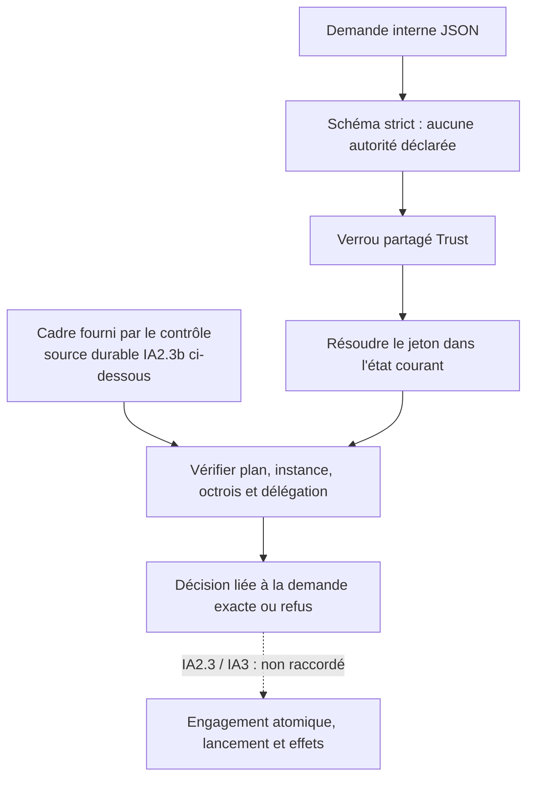

Le producteur Trust fournit l'émetteur et le sujet, la catégorie `local`, `human`
ou `service`, la révision et l'expiration. Le noyau ne promeut pas un accès local
en personne ni les rôles métier `requester`, `approver`, `admin` ou `effect` en
droit de création. Il ne déduit aucune instance du seul jeton.

## Données et sources d'autorité

Types privés dans `internal/engine/agent_identity_contract.go` :

| Objet | Contenu / sens |
| --- | --- |
| `agentIdentityPrincipal` | Identifiant local, catégorie, émetteur et sujet externe distincts. Aucun jeton brut ni condensat de jeton dans l'attribution. |
| `agentIdentityActor` | Principal et éventuelle instance. Ce rattachement doit être établi par le contrôle. |
| `agentIdentityScope` | Mission, génération persistée et empreinte du contrat enregistré. IA3a le lit dans SQLite ; cela ne prouve pas une adoption humaine attestée. |
| `agentIdentityGrant` | Émetteur, détenteur, parent, portée, révision Trust, permissions exactes, permissions déléguables, dates et révocation. |
| `agentIdentityInstance` | Instance, agent logique, principal, portée, octroi et référence de liaison d'exécution. Comparer cette référence n'atteste pas le processus. |
| `agentIdentitySnapshot` | Schéma 1, révision, octrois et instances sérialisables. Une sauvegarde ou un import reste une donnée. |
| `agentIdentityRequest` | Schéma 1, événement, portée, octroi, opération, ressource et empreinte de contenu. Aucun champ auteur/approbateur/autorité autorisant. |
| `agentIdentityDecision` | Contexte de projet, événement, acteur, empreintes de demande et d'instantané, révisions et expiration maximale. Aucun effet ni consommation implicites. |

`agentIdentityAuthority` est un cadre privé, non sérialisable depuis JSON :
racine canonique du projet, empreinte et révision courantes de l'instantané, révision Trust, plan courant et
octrois racine explicitement reconnus. Le producteur durable interne est décrit
en IA2.3b ; les émetteurs protégés de permis/checkpoint restent à raccorder.
Recalculer ce cadre depuis l'instantané à vérifier créerait une autorité circulaire.
Les tests historiques IA2.2 construisent une fixture ; IA2.3b lit les données
persistées sous un checkpoint de contrôle, sans déployer d'ancre externe.

Les empreintes sont des SHA-256 en hexadécimal minuscule. Les identifiants
réutilisent la syntaxe commune `safeName`. Les ressources sont comparées
exactement, sans jokers ni règle implicite de préfixe de chemin. Les opérations
reconnues sont `agent.create`, `memory.read`, `memory.summarize`,
`memory.transmit`, `tool.invoke`, `effect.execute` ; leurs consommateurs ne sont
pas raccordés par cette livraison. Il n'existe ni délai ni plafond opérateur
nouveau caché dans ce noyau.

Émetteur et sujet sont des chaînes opaques : les crochets d'un émetteur IPv6
ou d'un sujet ne sont pas traités comme des jokers. La validation du texte
refuse vide, UTF-8 invalide, contrôles et espaces périphériques ; l'interdiction
`*?[]` concerne seulement les ressources de permission.

Le digest du contenu doit venir de la proposition réelle, de ses paramètres et
de son contexte résolu. Le noyau lie la décision au digest reçu ; il ne prouve
pas la bonne production de ce digest ni sa correspondance avec un futur effet.
Le producteur et la frontière d'engagement appartiennent à IA2.3/IA3.

## Vérifications et reprise

`decodeAgentIdentityRequest` refuse champs inconnus, variantes de casse des
champs, doublons de clés y compris imbriqués/échappés, document multiple,
entrée vide/null/invalide, autorité déclarée et octrois à joker. Le décodeur
d'instantané refuse aussi les champs inconnus, les doublons et les objets absents.

`evaluateAgentIdentity` exige un appelant vérifié au même instant d'évaluation,
un cadre courant, un instantané correspondant et la même portée. Il vérifie
détenteur, référence d'instance, permission, dates, révocations et chaîne jusqu'à
une racine reconnue. Chaque lien conserve la portée ; ses droits sont inclus
dans les droits déléguables du parent et sa validité temporelle y est incluse.
La chaîne est parcourue avec détection des cycles, sans récursion par octroi.

Le consommateur lie l'appelant à `Store.root`, déjà canonisé à l'ouverture.
Le cadre privé doit désigner cette même racine ; le reçu porte l'empreinte de
ce contexte. Deux projets aux mêmes noms et jetons de fixture ne peuvent ainsi
échanger cadre et reçu. Ce contrôle local n'est ni un identifiant de projet
durable entre hôtes, ni une preuve de propriété du compte système. Une migration
de racine ou une fédération devra établir explicitement son nouveau contexte
et son ancre protégée dans IA2.3.

Une modification de la configuration Trust invalide les anciens octrois dans
ce contrat conservateur : renouvellement explicite requis. La réauthentification
ne remet pas ces octrois à jour. L'expiration d'une décision ne dépasse ni celle
du demandeur ni celle des octrois utilisés.

`Store.evaluateAgentIdentityRequest` résout l'identité et évalue sous le même
verrou Trust. Un rejeu repasse par cette résolution, puis par les mêmes contrôles
et la comparaison complète du reçu. Il ne retourne pas un ancien résultat avant
authentification. Le temps réel est échantillonné après acquisition du verrou ;
une horloge de fixture peut être injectée par les tests internes. Aucune horloge
JSON n'est acceptée. Ce consommateur interne ne fournit pas encore de voie
pour un appelant agent : celle-ci attend le courtier protégé.

`validateAgentIdentityTransition` exige la révision suivante et la conservation
des anciens enregistrements. Une révocation ne peut être effacée ou déplacée ;
les autres champs d'un ancien octroi ou d'une instance ne sont pas réécrits.
Un remplacement utilise un nouvel identifiant et ne supprime pas l'histoire.
Le contrôle de transition n'autorise ni ne publie la modification : le futur
écrivain devra vérifier l'état courant et publier son ancre sous le protocole
atomique approprié. Aucun stockage de production n'utilise encore ce validateur.

## Limites et suite obligatoire

La vérification des tests est conservée dans le
[rapport IA2.2](../plans/actions-confiance/verification-identites-agents-20261016/ia2-contract-kernel-20261017/RAPPORT-IA2.2.md).
Les essais emploient des racines isolées, des acteurs d'instance simulés et des
émetteurs OIDC/service locaux. Ils ne prouvent ni fournisseur réel ni revue
indépendante. Les régressions du contexte d'appelant réutilisé et du cadre échangé
entre projets sont conservées avant et après leurs corrections.

Restent à réaliser : bootstrap et émetteurs protégés du cadre/checkpoint,
engagement de l'admission dans les verrous, intégration du canal d'instance, liaison au contenu préparé, approbation humaine exacte, consommation unique, course
départ/révocation, réconciliation après panne et raccord de **tous** les
consommateurs CLI/API/fournisseur/mémoire. Les deux fichiers de stockage actuels
ne deviennent pas atomiques par l'ajout d'un évaluateur. La matrice IDA-01–18 et
le RETEX restent la condition de qualification globale.

## Expérience de canal IA2.3, distincte du noyau

Le [prototype du 17 octobre](../plans/actions-confiance/verification-identites-agents-20261016/ia2-runtime-binding-20261017/RAPPORT-IA2.3-CANAL.md)
vérifie 13 contrôles locaux sur deux cages Linux. PID/montage sont épinglés avant
exécution ; l'émetteur est attribué par les credentials de chaque message. Une
connexion B copiée à A conserve le pair B, mais le message est attribué à A et
refusé sous l'identité B déclarée. Trois joins vers B avec des descripteurs de
namespace copiés sont refusés. Le namespace utilisateur change au bootstrap et
n'est pas supposé stable. Ce prototype Python n'est ni un courtier Go intégré ni
une source d'autorité ; registre et révocation sont en mémoire. Les lanceurs
ne sont pas qualifiés par cette expérience.

## Canal Go d'instance — IA2.3a

Le récepteur et le registre de liaisons sont maintenant implémentés dans
`agent_identity_channel_linux.go` et `agent_identity_runtime_linux.go`.
`Store.evaluateAgentIdentityMessage` les relie au noyau IA2.2 en interne.
Ils ne sont enregistrés dans aucun serveur ni lanceur. Le [rapport IA2.3a](../plans/actions-confiance/verification-identites-agents-20261016/ia2-go-channel-20261017/RAPPORT-IA2.3a.md)
porte les contrôles et limites de cette tranche.

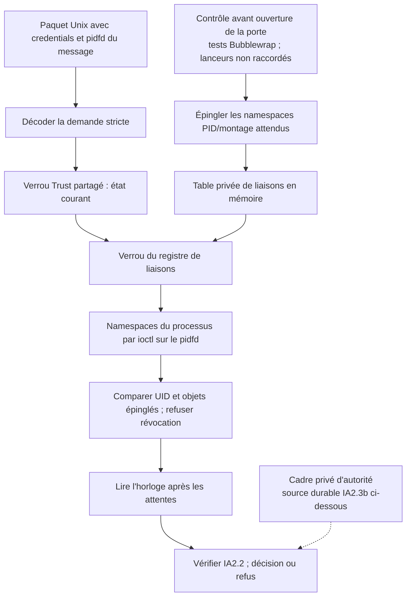

Le contrôle appelle `pin` à partir d'un bootstrap de lanceur tenu par une porte,
puis conserve les descripteurs PID/montage. Le namespace PID de l'hôte, les
références incompatibles et la réutilisation d'une instance, liaison ou namespace
PID déjà réservé sont refusés. Le premier message ne peut pas remplir cette table.
Son caractère privé au processus ne protège pas le compte contrôleur hôte non
confiné ; le lanceur et le bootstrap protégés restent des obligations d'intégration.

`configureAgentIdentityChannel` exige un socket Unix `SOCK_SEQPACKET` et active
`SO_PASSCRED` et `SO_PASSPIDFD`. La réception exige credentials et un unique
`SCM_PIDFD`. Les namespaces sont obtenus depuis ce descripteur, sans rouvrir le
numéro de PID du message. Un émetteur disparu n'est pas réidentifié par son numéro.
Le pair de connexion n'est pas utilisé pour attribuer le message. Il s'agit du
processus/groupe de threads indiqué par ce mécanisme, pas d'une attestation de
chaque thread ou du binaire exécuté. Les primitives manquantes entraînent un refus,
sans repli numérique ; seule la plateforme du rapport a été exécutée.

Le consommateur fournit son tampon et sa deadline de transport. Aucun plafond ni
délai opérateur nouveau n'est introduit. Un paquet tronqué, des credentials
manquants ou des droits de fichier injectés sont refusés ; les descripteurs reçus
sont fermés en cas de rejet. Le consommateur ferme le message accepté. Les
namespaces restent épinglés jusqu'à fermeture du registre, même après révocation,
pour conserver l'exclusion des anciennes références. Une table vide après reprise
n'adopte pas l'autorité du premier émetteur.

La réception a lieu hors du verrou Trust. L'évaluation prend Trust partagé puis
le registre, vérifie révision/liaison/UID/namespaces, échantillonne le temps réel
après ces attentes et appelle le noyau sous les deux verrous. La révocation de
liaison et la fermeture sont sérialisées avec cette évaluation. Cela ne constitue
aucun engagement Trust/SQLite, aucune consommation unique ni aucun arrêt observé.
Les instantanés et cadres d'autorité employés par les essais restent des fixtures.

Le verrou runtime protège les liaisons, pas les maps d'un instantané fourni par
un autre composant. IA2.3b fournit sa propre copie courante. Les consommateurs
primitifs IA2.2/IA2.3a recevant encore un cadre et un instantané supposent que leur
appelant respecte cette propriété et leur fraîcheur ; ils ne consultent pas le
registre durable. Une opération publique devra utiliser le parcours durable.

## Source durable et publication récupérable — IA2.3b

Le registre privé est maintenant produit depuis SQLite et une tête Trust
indépendante. La version **36** a ajouté les tables suivantes ; le stockage
courant est **37**, avec le stamp de plan IA3a décrit ci-dessous :
`agent_identity_snapshots` conserve les versions, `agent_identity_publications`
les reçus chaînés. La migration sauvegarde le stockage et ne crée aucun droit
pour les anciens travaux. La consultation refuse une migration implicite.
Le [rapport IA2.3b](../plans/actions-confiance/verification-identites-agents-20261016/ia2-durable-authority-20261017/RAPPORT-IA2.3b.md)
lie les sources, commandes et résultats ; les sections précédentes restent les
étapes IA2.2/IA2.3a, avec leurs fixtures d'origine.

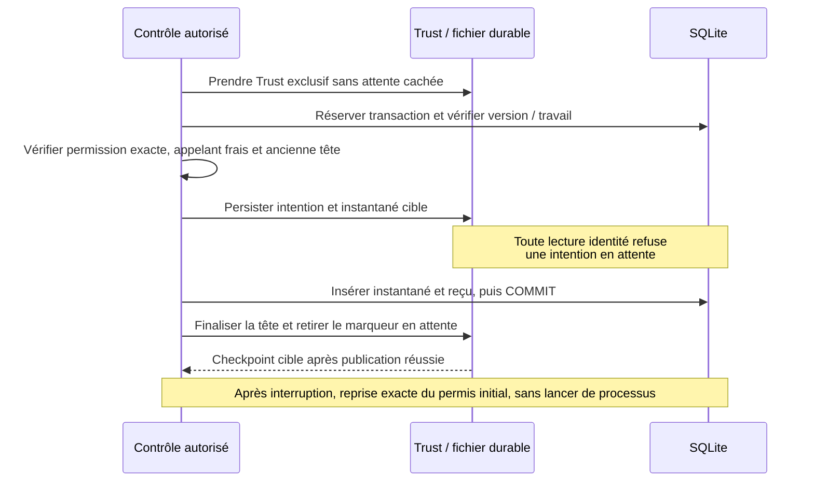

La tête stocke contexte du projet, portée, révision et digest de l'instantané,
révision Trust, racines reconnues, principal publiant, événement et lien vers la
tête précédente. Elle provient d'un `agentIdentityRegistryPermit` privé liant
le contenu exact, la portée et les racines autorisées. La voie normale résout
le jeton courant sous Trust, après attente de SQLite et de nouveau avant
l'intention. Un rôle métier ou un corps JSON ne construit pas ce permis.
IA3b ajoute le producteur humain interne décrit ci-dessous ; son enrôlement réel
et son raccord public restent à réaliser.

La publication prend Trust exclusif en mode non bloquant, puis réserve SQLite
avant lecture. Elle vérifie le travail, la version et le checkpoint précédent,
les liens, l'histoire non réécrite et le contenu approuvé. Elle persiste une
intention dans `agent_identity_authorities` de Trust avant COMMIT, puis publie
la nouvelle tête. Une panne après intention ou après COMMIT laisse une reprise
exacte à effectuer. `recoverAgentIdentityRegistry` exige le permis et l'instantané
initiaux ; il ne prépare pas une nouvelle opération. Une révision Trust changée
est conservée : finaliser un historique ancien ne réactive pas ses droits.

`atomicWrite` ouvre désormais le répertoire avant mutation, synchronise le
fichier, renomme, puis synchronise le répertoire. Une erreur après renommage
signifie un résultat incertain à réconcilier. Les tests ne simulent pas une
coupure électrique ou un stockage qui ment sur `fsync`.

La lecture d'inspection exige un `agentIdentityRegistryCheckpoint` privé et
courant, fourni par le contrôle, puis vérifie tête Trust, chaîne, instantané et
plan dans une transaction de lecture, avant de libérer sa copie. Le consommateur
de message `evaluateAgentIdentityRegistryMessage` obtient aussi ses données
dans le registre, sans snapshot/cadre déclaré dans le message ; depuis IA3a,
il réserve l'écrivain SQLite jusqu'à la décision runtime, comme décrit ci-dessous.
Le temps réel est lu après les attentes. Aucun de ces chemins ne consomme un
droit ni ne lance un effet métier.

Le checkpoint n'est pas recalculé depuis une base importée ou le même ensemble
de fichiers restaurés. Les tests le conservent hors de l'état restauré ; ils
ne déploient aucun témoin externe. Si tous les fichiers et un ancien témoin sont
restaurés ensemble, la fraîcheur n'est pas prouvée. L'émission et la conservation
indépendantes du témoin restent une condition d'intégration ouverte. La portée
est liée au permis du contrôle et au contrat enregistré lu en IA3a. Une
adoption humaine attestée et l’appartenance exacte de la création restent à raccorder. La confidentialité du paquet Go ne protège pas à elle seule le compte
hôte, les fichiers du contrôle ou une image SQLite hostile arbitraire. F01–F07
restent ouverts, de même que l'admission publique, le confinement fournisseur,
l'accord humain exact, la réservation/départ et les droits mémoire.

## Liaison au contrat courant du plan — IA3a

`agent_identity_plan_linux.go` lit le corps et la révision du travail, avec
`agent_identity_plan_heads`, dans la même transaction SQLite que l'autorité.
Il exige un plan enregistré dans `Work.Plans` ou une planification hiérarchique
valide ; le plan classique adopté, la conversion d'une préparation et les
décisions hiérarchiques alimentent cette source commune. Leur enregistrement
ne constitue pas une preuve d'approbation humaine ni un droit de création.

La projection **v1** conserve les définitions, instructions, propriétaires, rôles,
dépendances, hiérarchie, budgets, profils et champs inconnus. Elle retire les
champs identifiés de résultat, statut, tentative, revue, bail, compteur et
candidat intégré. Les sélections mémoire restent des entrées ; leur présence
n'autorise aucun usage. Les résultats/cadrages et leur transmission demandent
toujours leurs propres droits. Les listes gardent leur ordre ; les clés
d'objets sont canonisées à tous les niveaux, sans arrondir les entiers en
`float64`. Changer un champ conservé exige un nouveau permis exact.

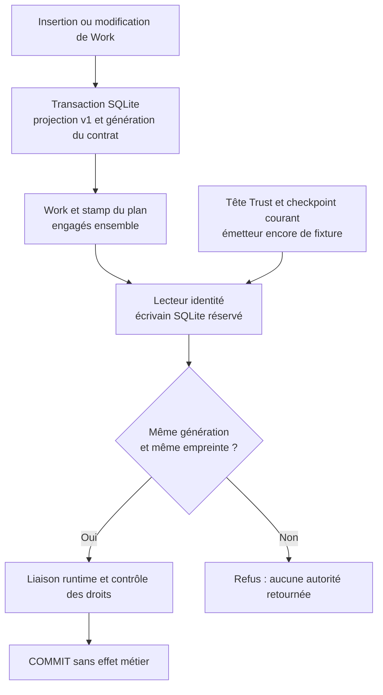

La migration **37** sauvegarde le stockage, crée les stamps initiaux de
génération 1 et installe les triggers d'insertion/modification de `works`.
Chaque modification du contrat augmente sa génération dans cette transaction ;
un simple résultat runtime identifié la conserve. Modifier puis rétablir
l'ancien contenu ne réactive donc pas son ancienne portée, même après
réouverture. Un rollback de transaction annule aussi son stamp. Le compteur
doit rester un entier SQLite positif ; son dépassement technique refuse toute
la modification. Ce compteur n'est pas une limite de ressources opérateur.

Les triggers utilisent `swarm_identity_plan_digest_v1`, fonction pure enregistrée
une seule fois dans le pilote avant ouverture des connexions. Ils vérifient
le stamp précédent avant réécriture. Le lecteur recalcule l'empreinte du corps
et compare le stamp, sa version de projection et la portée de la tête Trust.
L'absence d'un plan retourne `agent_identity_plan_unavailable`, une portée
différente `agent_identity_plan_mismatch`, et un stamp absent/incohérent
`agent_identity_plan_stamp_changed`. Un refus normal ne prépare pas d'intention,
ne publie pas de droit et ne crée pas d'agent. Une erreur de trigger annule
l'écriture du travail, sans résultat vide présenté comme succès.

`readAgentIdentityNextPlanScope` propose en lecture seule la portée constatée
pour un futur permis. Il exige le checkpoint de la tête existante, refuse une
publication en attente et ne déduit aucune autorité d'un import. La publication
normale compare le permis à cette même source après réservation SQLite,
avant intention. La reprise exacte peut terminer un historique préparé avant
un changement de plan ; la lecture normale de cet historique reste refusée.
Pour une décision d'instance, l'ordre est Trust partagé → réservation
d'écrivain SQLite → lecture courante → verrou runtime → temps frais et
évaluation pure → COMMIT. La réservation interdit un changement de Work
pendant l'attente runtime. Le callback fermé ne réentre pas dans Store et les
méthodes runtime appelées n'accèdent pas à SQLite ; les futurs consommateurs
doivent respecter cette précondition. Une erreur, y compris de COMMIT, ne
retourne aucune décision positive. Cette sérialisation a un coût de concurrence
non mesuré et ne réalise toujours ni consommation ni lancement. Le composant
reste privé et ne rend pas l'admission des lanceurs effective.

Le stamp et ses triggers sont des mécanismes d'intégrité applicative, pas une
frontière contre un administrateur hôte ou un processus fournisseur non confiné.
Une restauration physique de tout SQLite peut aussi restaurer l'ancien stamp.
Un checkpoint ne couvrant que la tête d'identité inchangée ne prouve pas la
fraîcheur d'un changement de plan non publié dans cette tête : le futur témoin
indépendant doit couvrir aussi le watermark du plan. Son émetteur/protection
restent ouverts, propriétaires Codex et opérateur. L'appartenance de la création
au plan, son contenu résolu, l'accord humain, sa consommation et tous les
lanceurs publics restent à intégrer ; F01–F07 et IDA ne sont pas requalifiés.

## Émettre un permis depuis une autorité humaine explicite — IA3b

`mintAgentIdentityRegistryPermit` reçoit l'instantané complet, le jeton, le
checkpoint précédent, l'événement et les racines proposées. Le contrôleur lui
fournit séparément un `agentIdentityIssuerAuthority` privé : principal exact
(identifiant local, catégorie `human`, issuer et sujet externe), projet, portée
du plan, révision Trust, référence d'enrôlement, permissions exactes, sous-ensemble
délégable et intervalle de validité. Il s'agit d'une autorité explicite de
publication du registre, distincte des permissions qu'elle plafonne pour ses
nouvelles racines ; ni `agent.create` seul ni un rôle Admin ne l'impliquent.

Cet objet est une entrée de contrôle, pas une configuration lue depuis le JSON
demandé. La référence d'enrôlement est contrôlée syntaxiquement ; sa seule
empreinte ne prouve pas un enrôlement. Le service protégé qui atteste, persiste,
révoque et rafraîchit cette autorité reste à raccorder. Les tests fournissent
une autorité explicite de fixture et effectuent réellement le protocole OIDC
contre un fournisseur local à jetons signés ; aucun compte humain externe
ou service d'enrôlement déployé n'est qualifié par ces contrôles.

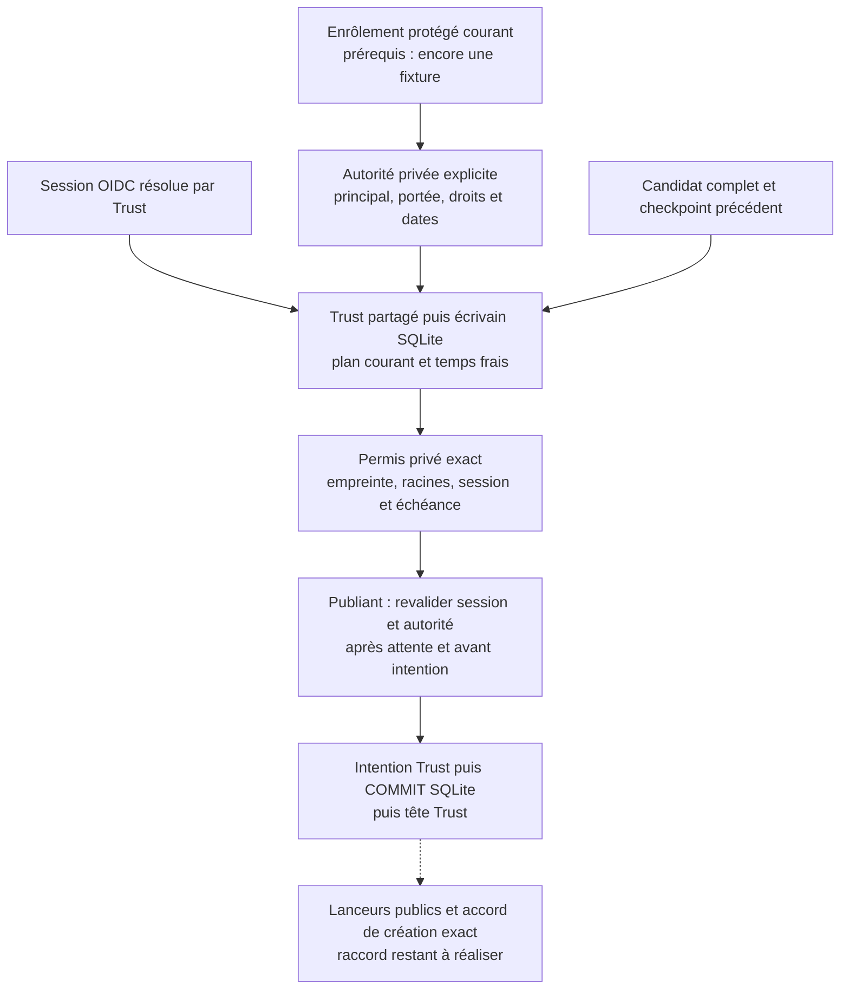

L'émission vérifie d'abord l'identité et l'autorité sous Trust, avant SQL et
recherche du travail. Elle réserve ensuite l'écrivain SQLite, réauthentifie après
cette attente, puis lit le plan et le registre courant. Une session locale, un service workload, une instance,
un homonyme d'un autre issuer/sujet ou une identité non enrôlée est refusé.
Un import ne devient pas une autorité. Les nouvelles racines, y compris celles
non activées, et la réactivation d'une ancienne racine non reconnue respectent
l'émetteur, les permissions, les dates et le plafond délégable explicites.
L'historique est conservé ; l'émission ne publie ni ne consomme un droit.
La validité de ces liens n'atteste pas qu'une délégation a réellement été
demandée par son acteur ; la réception et l'origine des créations restent
à vérifier au consommateur d'admission.

Le permis possède ses listes, lie l'instantané complet, les racines, le
principal, le projet, le plan, la révision Trust et l'événement. Sa preuve privée
lie aussi la session d'émission et une échéance bornée par l'enrôlement et cette
session. L'identité et l'autorité sont vérifiées de nouveau après les lectures.
Une erreur de COMMIT retourne un permis nul. Aucun jeton brut n'est conservé
dans le permis ou le journal. Il n'y a ni durée cachée ni nouveau réglage ;
les dates sont des conditions de cette autorité fournie par le contrôle.

Le publiant recontrôle ces conditions après la réservation SQL et avant
l'intention durable. Une autre session du même humain ne peut reprendre ce
permis ; une échéance passée pendant l'attente est refusée sans intention ni
ligne de registre. `agent_identity_human_issuer_required` distingue un appelant
non humain ; `agent_identity_issuer_authority_required`, une autorité absente
ou incompatible ; `agent_identity_issuer_authority_stale`, des dates ou une
session périmées ; `agent_identity_issuer_ceiling_exceeded`, des racines excédant
l'octroi. Une demande corrigée nécessite une nouvelle émission explicite. La
reprise après intention ne fait que terminer cet historique exact ; elle peut
le finaliser après expiration de la session, sans produire de nouvel accord.

Le chemin bas niveau antérieur reste une capacité privée de contrôleur, utilisée
par les fixtures sans cette preuve humaine. Ce noyau ne rend donc pas tous les
permis du paquet humains et ne sécurise aucun endpoint public existant. Le futur
adaptateur public devra imposer le nouveau producteur et sa source d'enrôlement
protégée ; aucun booléen reçu d'un agent ne choisit un chemin. Le stockage et la
reprise des capacités privées hors processus restent à réaliser. Une copie
ancienne de l'autorité ne prouve pas sa non-révocation externe. Une session
OIDC catégorisée humaine ne prouve ni présence humaine physique, ni authentification
renforcée, ni accord d'un approbateur distinct sur le contenu résolu d'une création.
Ces critères, le témoin du plan, F01–F07 et les droits mémoire restent ouverts.

Recette locale : `go test ./internal/engine -run '^TestAgentIdentityIssuer'
-count=1 -v -timeout=0`, puis les contrôles ciblés du registre et du plan. Les commandes,
sources figées, deux échecs initiaux et résultats sont conservés dans le
[rapport IA3b](../plans/actions-confiance/verification-identites-agents-20261016/ia3-issuer-20261017/RAPPORT-IA3b.md).

## Conserver le reçu humain dans l’historique — IA3c.1

La tête de publication humaine passe au format 2 et contient un
`issuance_receipt` version 1. La tête lie déjà l’instantané exact, les racines,
l’événement et la tête précédente ; son empreinte couvre désormais aussi le reçu.
Le reçu conserve le principal humain exact, le projet, le plan, la révision Trust,
la référence d’enrôlement fournie, les permissions et dates de cette autorité,
l’empreinte de session, sa date d’expiration, l’instant d’émission et la fin de
validité du permis. Cette fin est le minimum des deux expirations. Aucun jeton
brut n’y figure. Les listes retournées sont possédées par leur lecteur.

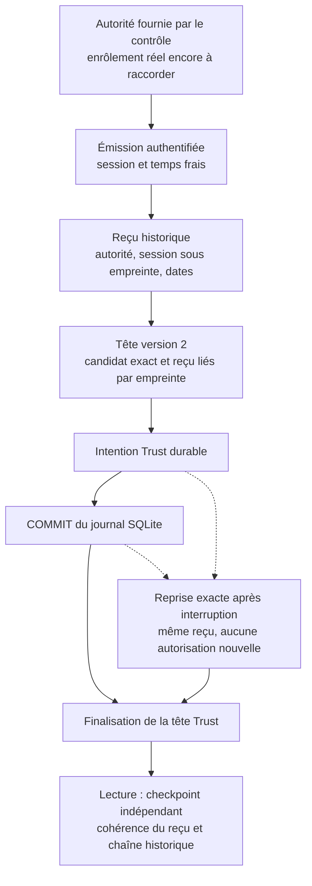

Le format 2 exige le reçu ; le format 1 reste réservé aux capacités privées
antérieures sans reçu. Les combinaisons incohérentes sont refusées. Les anciens
lecteurs ne comprenant que le format 1 refusent les nouvelles têtes ; le schéma
SQLite reste 37. Le protocole existant stocke exactement le même reçu dans
l’intention, le journal et la tête finale, y compris après réouverture et reprise
aux deux frontières de durabilité. La lecture historique valide les dates au
moment d’émission ; elle ne transforme pas un reçu expiré en autorité courante.

Ce reçu est une trace liée au contrôle, pas une signature indépendante ni une
preuve d’enrôlement réel, de non-révocation externe ou de présence physique.
Sa lecture exige toujours le checkpoint protégé indépendant. Restaurer ensemble
le stockage et son témoin, ou contrôler le même UID sans confinement, reste hors
de la garantie. Le reçu ne permet pas de reconstruire un permis privé ni de
reprendre sans la capacité de contrôle originale. Bootstrap, témoin couvrant le
plan, admission publique, approbation distincte et droits mémoire restent ouverts.

Vérification : les résultats et limites de cet incrément sont conservés dans le
[rapport IA3c.1](../plans/actions-confiance/verification-identites-agents-20261016/ia3-issuance-receipt-20261017/RAPPORT-IA3c1.md).

## Authentifier une réponse du futur service d’enrôlement — IA3c.2a

Le paquet isolé `internal/enrollmentproof` implémente un format de réponse signée,
sans raccord au moteur ou à un transport réseau. `NewVerifier` reçoit la clé
publique épinglée par le contrôle et le digest de projet ; aucune clé de confiance
n’est extraite d’une réponse. `NewChallenge` génère un nonce aléatoire de 256 bits
et lie clé/projet/digest de la demande complète. `SignResponse` signe le cadre
avec Ed25519 et une séparation de domaine/version ; il ne décide pas des droits.
Les clés privées des tests sont éphémères et locales ; aucun bootstrap réel
n’est activé.

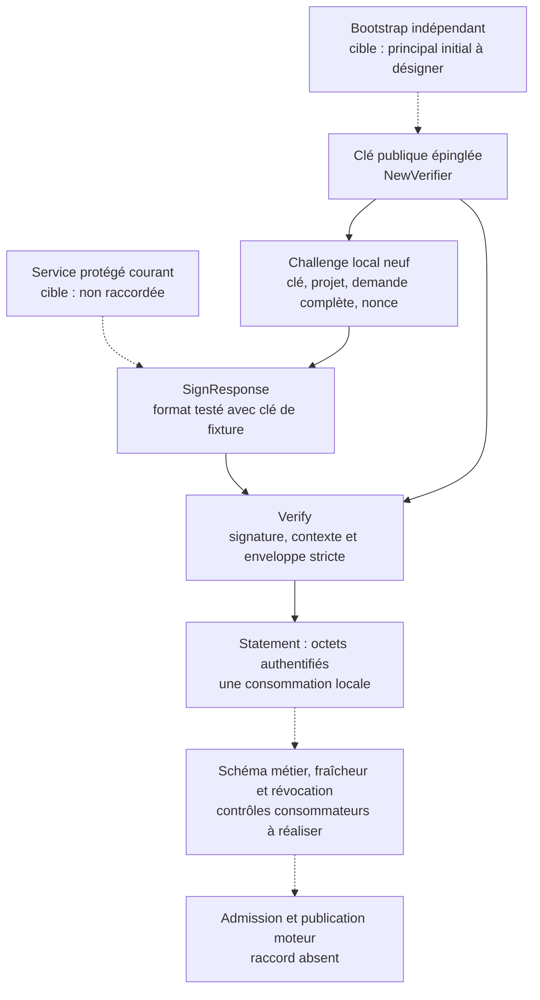

`Verify` exige les quatre clés exactes `protocol`, `challenge_digest`, `payload`,
`signature`, toutes de type chaîne ; doublons, variantes de casse, champs inconnus,
valeurs null/non textuelles et données supplémentaires sont refusés. Le payload
et la signature utilisent base64url canonique sans padding. Le payload reste
opaque : une chaîne vide authentifiée ne signifie ni enrôlement ni autorisation.
`Statement.Payload()` rend une copie ; le client doit encore valider le schéma,
les droits et la source courante. Une signature n’apporte pas de confidentialité.

Une réponse valide consomme une seule fois son challenge local, sous mutex.
Le handle partage son état interne même après copie de valeur Go.
Une réponse refusée ne le consomme pas ; une nouvelle requête emploie un nouveau
nonce. Les replays simultanés, le changement de projet/demande, la réécriture
d’un digest sur une signature capturée, une clé non épinglée et une signature
d’un autre domaine sont refusés. Le challenge n’est pas reconstructible depuis
JSON ; son état n’est pas durable et ne réserve aucune publication ou exécution.

**Limite explicite :** un service peut signer « actif » puis révoquer avant la
réception ou l’application. Cette réponse peut encore être authentique ; le
paquet ne prouve aucune fraîcheur à la décision finale. Ni signature, ni nonce,
ni reçu historique ne remplacent une lecture courante et un point de
linéarisation de révocation. Aucun TTL, timeout, plafond métier ou réglage
opérateur n’est ajouté ici. Les tailles Ed25519/SHA-256 et le nonce définissent
le format cryptographique ; elles ne sont pas des budgets d’exécution.

Le [contrat cible d’enrôlement](../plans/actions-confiance/identites-agents-enrolement-IA3c2.md)
distingue ce module vérifié, les garanties encore absentes et les décisions de
déploiement. Recette isolée : `go test ./internal/enrollmentproof -count=1
-timeout=0`, puis `-race` et `go vet` sur ce paquet. Les preuves et limites sont
conservées dans le [rapport IA3c.2a](../plans/actions-confiance/verification-identites-agents-20261016/ia3-enrollment-proof-20261017/RAPPORT-IA3c2a.md).

## Journal durable de l’enrôlement — IA3c.2b

`internal/enrollmentstate` ajoute un journal SQLite dédié, isolé du moteur.
`Open` reçoit un chemin contrôlé, une clé publique épinglée et le digest de
projet. Le stockage exige WAL et des transactions `BEGIN IMMEDIATE`, avec
`synchronous=FULL` sur chaque connexion. Aucune clé privée n’est persistée ;
aucun service ou compte système réel n’est créé. Le journal n’est pas une source
d’autorité métier : le corps de chaque enregistrement reste un tableau d’octets
opaque, dont le schéma et les permissions doivent être validés au futur raccord.

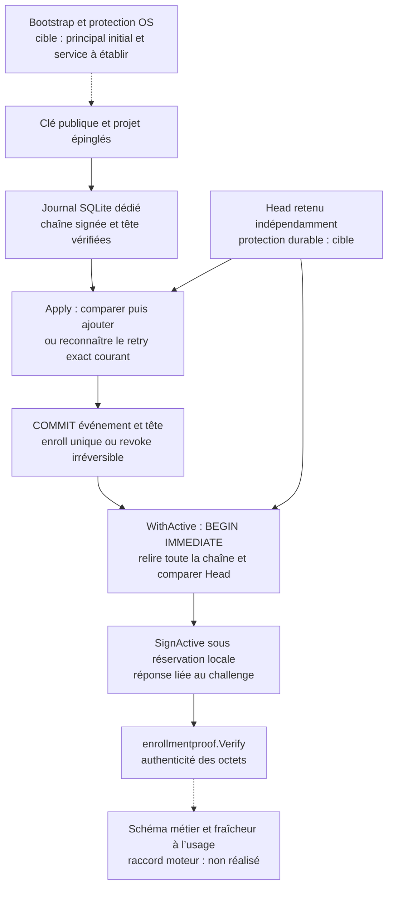

Le protocole `swarm-enrollment-change-v1` impose un JSON canonique à dix champs :
`protocol`, `authority_key_id`, `project_digest`, `sequence`, `previous`,
`operation`, `id`, `body`, `signature`. La signature Ed25519 couvre le préfixe
du protocole, NUL, `change`, NUL, puis ce JSON avec `signature` vide. `body` et
`signature` sont en base64url canonique sans padding. La tête contient la séquence
et SHA-256 du cadre signé complet. Le format refuse les clés inconnues, doublons,
variantes de casse, null, types erronés et encodages non canoniques. Les identifiants
sont opaques, jamais des chemins ou du SQL ; les requêtes sont paramétrées.
Les identifiants vides, UTF-8 invalides ou avec caractères de contrôle sont refusés.

`SignChange` ne signe qu’une proposition. `Apply` vérifie la clé, le projet,
l’intégralité de la chaîne et la tête attendue avant d’ajouter un événement.
`enroll` ne peut créer un identifiant qu’une fois ; `revoke` exige un identifiant
actif et un corps vide. Un identifiant révoqué reste dans l’historique et ne peut
être réactivé ; une autre création exige un nouvel identifiant. Un retry exact
après réponse perdue ne réussit que si cet événement est encore la tête courante.
Une révocation ultérieure empêche de rejouer l’ancien enrôlement avec succès.
L’événement et sa tête sont écrits dans la même transaction ; une erreur de
stockage n’est jamais convertie en succès vide.

Chaque lecture `WithActive` prend la réservation écrivain avant de relire la
chaîne, puis garde cette réservation pendant le callback. Une révocation concurrente
ne peut pas committer pendant ce callback ; après son propre COMMIT, une lecture
active est refusée. Le callback ne doit ni réentrer dans le journal, ni attendre
un autre écrivain, ni produire d’effet externe irréversible : une erreur de fin
de transaction reste possible après son appel. `SignActive` ne retourne les
octets signés qu’après succès de la transaction ; son `ActiveReply` contient
`schema_version: 1`, `head` (`sequence`, `digest`) et `record` (`id`, `body`, encodé en base64 JSON,
et `enrolled_sequence`, séquence de création dérivée de la chaîne).
Cette réponse peut devenir ancienne dès la réservation libérée.

Le contrôleur doit fournir un `Head` conservé indépendamment du journal/import.
La tête zéro signifie uniquement une genèse explicitement autorisée. Restaurer
un ancien journal cohérent est détecté contre le témoin plus récent ; restaurer
le témoin lui-même retire cette garantie. Le journal ne persiste pas ce témoin
indépendant et ne résout pas le transfert atomique entre journal et témoin externe.
Une réponse perdue est récupérable avec le changement exact signé ; cela ne prouve
pas une reprise distribuée, un arrêt effectif ou la livraison d’une révocation.

Les refus distinguent contexte, tête, changement invalide, identifiant absent,
déjà enrôlé et révoqué ; les erreurs SQLite et d’annulation conservent leur cause.
La contention remonte immédiatement, sans `busy_timeout` ni retry automatique.
WAL exige un système de fichiers local compatible ; ses fichiers auxiliaires
font partie du stockage à protéger, pas seulement le fichier principal.
La séquence SQLite/Go est un entier signé sur 64 bits : son dépassement est refusé
comme limite de représentation, pas comme politique d’exécution. Aucune durée,
budget ou limite métier n’est introduit. Une lecture reconstruit toute la chaîne :
son coût croît avec l’historique ; aucune performance à grande échelle n’est prouvée.

Recette isolée : `go test ./internal/enrollmentstate -count=1 -timeout=0`, puis
`-race`, `go vet` et `go build` sur ce paquet. Le
[rapport IA3c.2b](../plans/actions-confiance/verification-identites-agents-20261016/ia3-enrollment-state-20261017/RAPPORT-IA3c2b.md)
conserve les refus, l’échec concurrent initial, la correction et les preuves finales.
Les tests de réouverture et d’erreur transactionnelle ne simulent pas une panne
matérielle. Service protégé, témoin externe durable, schéma d’autorité humaine,
révocation/départ distribués et admission publique restent ouverts ; F01–F07
et les droits mémoire ne sont pas requalifiés.

## Valider le document d’autorité des deux côtés — IA3c.2c

`internal/enrollmentauthority` définit le document d’autorité humaine et son
producteur/consommateur local. Le journal générique conserve des corps opaques ;
ce paquet refuse de les traiter comme autorité sans schéma complet et contexte
attendu indépendant. Il retourne des données validées, jamais un permis privé
moteur. Aucun endpoint ou lanceur n’importe ce paquet.

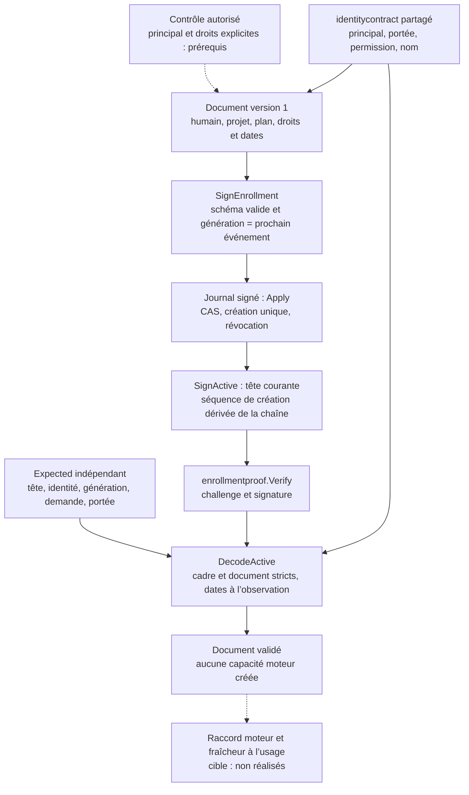

Le document version 1 exige les onze champs `schema_version`, `enrollment_id`,
`generation`, `project_context_digest`, `principal`, `scope`,
`trust_configuration_revision`, `permissions`, `delegable`, `not_before`,
`expires_at`. `principal` contient `principal_id`, `principal_kind`, `issuer`, `subject` ;
`scope` contient `work_id`, `plan_version`, `plan_digest`. Chaque permission a
`operation` et `resource`. Les clés sont exactes et l’encodage JSON canonique
est celui d’`Encode`, y compris l’ordre déclaré, les dates UTC RFC3339Nano et
`delegable: []` pour une liste vide. `Decode` refuse omission, null, doublon,
champ inconnu, variante de casse, type erroné ou encodage différent, même imbriqués.
Le producteur peut fournir des dates avec un autre fuseau : `Encode` conserve
leurs instants et les écrit en UTC, sans inventer de durée.

`identitycontract` partage les structures et validations avec les types privés
moteur ; `safeName` délègue aussi à cette source. Le JSON et les règles existantes
restent inchangés : noms locaux ASCII de 1 à 100 octets, version de plan et
révision Trust positives, digest SHA-256 en hex minuscule, ressources exactes
sans glob, six opérations existantes (`agent.create`, `memory.read`,
`memory.summarize`, `memory.transmit`, `tool.invoke`, `effect.execute`). Cette
syntaxe existante des noms ne s’applique pas aux issuer/sujets OIDC : ils restent
opaques, comparés exactement sans normalisation d’URL, casse ou espaces.
Le document d’enrôlement exige un principal `human` valide ; ni `local`, ni
`service`, ni rôle métier ou nom identique ne satisfait cette condition.

Les droits doivent être non vides, valides et sans doublon. Les délégables sont
valides, sans doublon et inclus dans les droits. Les deux dates sont explicites,
avec `not_before < expires_at`. La fenêtre est fermée au début et ouverte à
l’expiration. `Encode`/`Decode` vérifient sa structure, sans affirmer que l’autorité
est valable maintenant ; `DecodeActive` exige l’instant d’observation du contrôle.
Ce paramètre n’est pas une preuve d’horloge fraîche ; le raccord final devra
le fournir au bon point sous sérialisation.

`SignEnrollment` lie la génération à `base.Sequence + 1`, au projet exact et
à l’identifiant du document avant signature. L’ajout doit encore réussir sous CAS.
Le journal dérive ensuite `Record.EnrolledSequence` de l’événement `enroll`
vérifié, sans prendre ce nombre dans son corps. La génération reste stable
lorsque d’autres enregistrements ou révocations font avancer la tête. Le format
SQLite et les événements signés antérieurs ne changent pas ; leurs lectures
reconstruisent ce champ. Les anciens cadres de réponse sans ce champ ne sont
pas acceptés par le nouveau consommateur strict ; aucun client moteur existant
n’était raccordé à ce format isolé.

`DecodeActive` reçoit un `Statement` authentifié et `Expected` fourni par le
contrôle : tête courante attendue, ID d’enrôlement, génération, projet, principal
complet, portée complète, révision Trust et digest de demande. Il exige leur
égalité exacte dans la requête authentifiée, le cadre, le document et la séquence
de création du journal. Un document pourtant signé via le chemin opaque avec
une génération déclarée différente de l’événement est refusé. Le contrat du
contenu complet de `request_digest` reste à raccorder au moteur (EP-02).

Les erreurs distinguent document invalide, contexte incompatible et fenêtre
inactive ; aucun document partiel n’est retourné. Un document JSON seul peut
être structurellement valide sans être authentifié ; sa reconstruction n’accorde
aucun droit. Un ancien `Statement` vérifié avec son ancien `Expected` peut encore
passer : ce contrôle ne relit pas le service et ne prouve pas une non-révocation
à l’usage. Aucun budget, TTL, timeout ou réglage opérateur nouveau n’est ajouté.

Recette : `go test ./internal/identitycontract ./internal/enrollmentauthority
./internal/enrollmentstate -count=1 -timeout=0`, puis le même lot `-race`,
`go vet` et compilation ciblée ; vérifier séparément les consommateurs privés
moteur après extraction. Le [rapport IA3c.2c](../plans/actions-confiance/verification-identites-agents-20261016/ia3-enrollment-authority-20261017/RAPPORT-IA3c2c.md)
conserve ces contrôles et leurs limites. Enrôlement réel, source de temps,
témoin durable indépendant, point de linéarisation final, admission publique,
descendants et F01–F07 restent ouverts.

## Lier la demande complète au challenge — IA3c.2d

`internal/enrollmentrequest` définit une seule finalité :
`agent_identity_registry_publication`. Le paquet couvre le candidat complet,
pas seulement son ID ou une empreinte fournie. `Prepare` valide les données,
les encode et en conserve une copie immuable ; il n’authentifie pas leur source.
`Decode` peut reconstruire cette donnée depuis un cadre canonique, sans créer
une capacité privée moteur ni prouver l’identité déclarée.

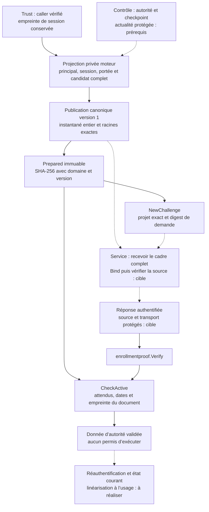

`Publication` version 1 a seize champs, tous présents : `schema_version`,
`purpose`, `project_context_digest`, `principal`, `session_digest`,
`session_verified_at`, `session_expires_at`, `scope`,
`trust_configuration_revision`, `enrollment`, `event_id`, `snapshot_revision`,
`snapshot_digest`, `snapshot`, `root_grants`, `previous_registry_head_digest`.
`enrollment` contient `id`, `generation`, `head` (`sequence`, `digest`) et
`document_digest`. Principal et portée réutilisent `identitycontract`.
Le checkpoint précédent est une chaîne vide explicite pour la seule genèse
fournie par le contrôle ; l’omission et null sont refusés. L’enrôlement ciblé
exige une génération positive, une tête la couvrant et le digest du document.

Le JSON canonique suit l’ordre des champs Go et écrit les dates en UTC, sans
inventer de durée. `snapshot` transporte en base64 JSON les octets entiers de
l’instantané ; `snapshot_digest` doit être leur SHA-256 exact. Ce paquet vérifie
un contenu JSON de type objet, sans réimplémenter son schéma de grants, ses transitions
ou l’autorité de publication. La projection moteur applique ses validations
existantes puis utilise le JSON canonique complet du snapshot. L’ordre des
racines reste exact, comme dans la tête du registre ; ni tri ni déduplication
silencieuse. Doublons de racines, noms invalides, cadres non canoniques et
clés inconnues/dupliquées, même imbriquées dans le cadre, sont refusés. Les
règles du contenu embarqué restent celles du moteur.

Le digest de demande est SHA-256 de `swarm-enrollment-publication-request-v1`,
NUL, `request`, NUL, puis du cadre canonique entier. Ce digest diffère de celui
du seul snapshot. Il couvre aussi la référence et les dates de session,
l’enrôlement attendu, son document exact et les deux checkpoints distincts :
tête d’enrôlement et tête précédente de publication. Modifier l’une de ces
dimensions change la demande ; une réponse liée à l’ancienne demande ne couvre
pas la nouvelle. La finalité est fixe : un autre type d’action exige un contrat
explicite, pas une chaîne libre réutilisant ce format.

`Prepared.Bytes()` et `Publication()` rendent des copies possédées. Les copies
de valeur Go du handle ne peuvent modifier ni ses octets ni son digest ; les
champs internes ne se reconstruisent pas par JSON. Cela protège la cohérence
locale, pas une frontière OS. `Expected()` projette depuis ces mêmes octets
les attendus du consommateur d’autorité, au lieu de maintenir deux descriptions.
`NewChallenge` refuse un vérificateur d’un autre projet. Le service futur doit
recevoir le cadre complet et appeler `Bind` pour comparer projet et digest ;
`Bind` n’authentifie pas le pair ni l’enveloppe cryptographique. Ces vérifications
restent celles de `SignResponse`/`Verify` et du contrôle protégé.

`CheckActive` vérifie la fenêtre de session observée, les attendus complets puis
le digest du document d’autorité retourné. Un autre document authentique pour
le même ID/génération, avec des droits ou plafonds différents, est refusé.
L’observation de session est incluse ; l’expiration est exclue. Une date fournie
ne prouve ni horloge fraîche ni session encore active. Le digest ne contient
aucun jeton brut et ne doit jamais servir lui-même de credential d’accès.

Dans le moteur, `resolveAgentIdentityCaller` conserve désormais dans son résultat
privé le `TokenDigest` produit par Trust. La projection
`prepareAgentIdentityEnrollmentRequest` ne reçoit donc pas un autre jeton à
associer au caller. Elle vérifie caller/autorité/portée/checkpoint, la référence
d’enrôlement et le snapshot avec les validateurs existants. Cette fonction pure
ne lit ni Trust ni SQLite : son appelant futur doit résoudre et sérialiser leur
état courant. Elle ne remplace pas le producteur de permis, la validation des
nouveaux plafonds sur l’historique, l’approbation humaine ou le départ d’un agent.
Les callers runtime sans session humaine ne deviennent pas des émetteurs.

Aucun endpoint, transport ou service réel ne consomme ce format. Les octets et
les empreintes ne démontrent pas une adoption humaine du plan, une non-révocation
courante ou un effet unique. Le coût croît avec la taille du candidat ; aucune
limite de transport, durée, TTL, budget ou politique nouvelle n’est ajoutée.
La source courante, la fraîcheur finale, le témoin durable indépendant et le
versionnement du cadre de lecture avant client externe restent ouverts.

Recette : `go test ./internal/enrollmentrequest -count=1 -timeout=0`, même lot
avec `-race`, puis `go vet` et `go build` du paquet. Vérifier séparément la
projection et les consommateurs privés moteur. Le [rapport IA3c.2d](../plans/actions-confiance/verification-identites-agents-20261016/ia3-enrollment-request-20261017/RAPPORT-IA3c2d.md)
conserve commandes, collecte réelle, sources et limites. Aucun PASS global
F01–F07, IDA ou droits mémoire n’en découle.

## Version explicite du cadre de lecture — IA3c.2e

Le cadre `ActiveReply` est désormais versionné : `schema_version` vaut exactement
`1` (`enrollmentstate.ActiveReplySchema`). Le format a trois champs de premier
niveau : `schema_version`, `head`, `record`. `SignActive` écrit cette version sous
la réservation du journal ; la signature couvre tous les octets, version comprise.
Ce numéro décrit le cadre de lecture : il ne change pas le schéma SQLite, les
événements signés, le challenge, le document d’autorité ou la demande complète.

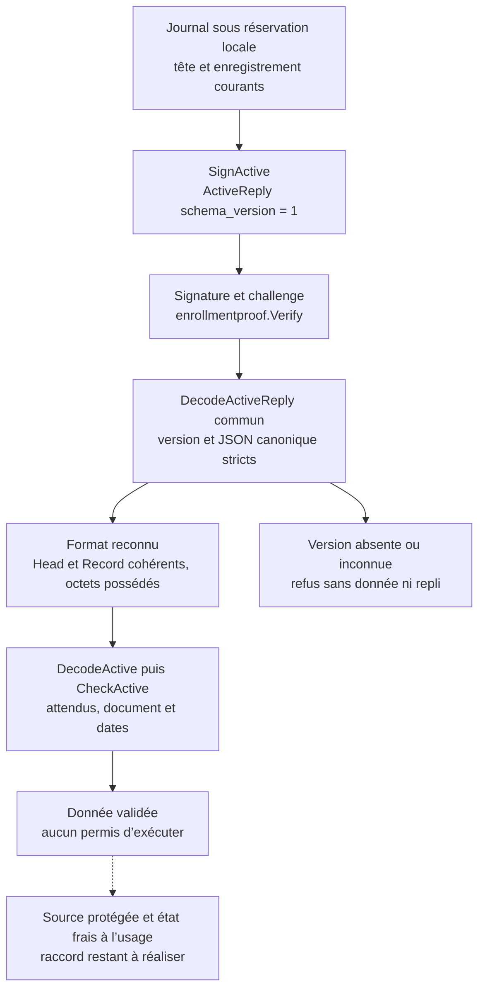

`enrollmentstate.DecodeActiveReply` est l’unique décodeur de ce cadre. Une version
absente, nulle, zéro, négative ou inconnue est refusée ; une version d’un type
erroné aussi. Les clés inconnues, doublons, variantes de casse, omissions,
encodages non canoniques et données supplémentaires sont refusés. La tête doit
être positive avec un digest valide ; la séquence de création doit être positive
et couverte par cette tête. L’identifiant conserve les règles opaques du journal.
`body` est une chaîne base64 JSON, éventuellement vide, pas null. Un corps opaque
vide reste valide pour le journal ; il ne devient pas un document d’autorité.

Le consommateur `enrollmentauthority.DecodeActive` délègue le décodage à ce point
commun puis applique ses propres contrôles d’autorité. Il conserve la cause par
chaînage : une version non supportée reste détectable avec `ErrReplyVersion`,
tout en étant un `ErrDocument` pour le consommateur. Une forme incorrecte produit
`ErrReply`. Aucun résultat partiel n’est retourné ; un paquet authentique d’une
version inconnue reste refusé. Le décodage seul ne vérifie pas sa signature :
il doit porter sur le payload d’un Statement authentifié.

**Compatibilité : rupture explicite du prototype de lecture.** L’ancien cadre
sans version est refusé, sans réessai automatique dans un format antérieur. Les
producteurs et consommateurs doivent sélectionner la version 1 explicitement ;
le seul ensemble supporté est `{1}`. Aucun client externe n’était raccordé.
La négociation et l’interopérabilité entre véritables pairs restent à vérifier
avant leur premier raccord (I2c-06 partiel au déploiement). Les réponses historiques
et leurs preuves ne sont pas réécrites ; aucune migration du journal n’est requise.
Une version correcte ne prouve ni fraîcheur, ni non-révocation, ni droit d’action.

Recette : `go test ./internal/enrollmentstate ./internal/enrollmentauthority
./internal/enrollmentrequest -count=1 -timeout=0`, même lot avec `-race`, puis
`go vet` et compilation ciblée. Le [rapport IA3c.2e](../plans/actions-confiance/verification-identites-agents-20261016/ia3-enrollment-reply-20261017/RAPPORT-IA3c2e.md)
conserve le contre-exemple sans version, les refus, sources et limites. Aucun
TTL, timeout, budget ou politique opérateur nouveau n’est ajouté.

## Frontière adoptée — local pilote, distant prévu

Décision utilisateur du 17 octobre 2026 : service local sous compte système
distinct avec confinement vérifié pour le développement et le pilote. Une
autorité sur une machine et une administration séparées est prévue pour les
installations futures, notamment clientes. Leur demande commerciale reste une
hypothèse utilisateur ; aucun service ni parcours de configuration n’est encore
livré. Le [plan d’enrôlement](../plans/actions-confiance/identites-agents-enrolement-IA3c2.md)
détaille la configuration initiale, le modal Admin et les critères IA3c.2f-01 à -06.
Le choix d’hébergement n’est plus en attente. Le parcours humain retenu est
précisé ci-dessous ; son implémentation, l’enrôlement effectif et l’activation
restent ouverts.

Le local conserve noyau et administration hôte dans la base de confiance.
Le distant vise une séparation face à la compromission de l’hôte Swarm, sous
réserve d’administration distincte et de contrôles propres à l’autorité. Le
contrat métier reste commun : demande exacte, identité, délégation, source
courante et révocation. Les adaptateurs de transport ne remplacent aucun de ces
contrôles. Portabilité et migration entre services réels restent à prouver.

L’installation initiale devra préparer le mode retenu, puis le modal Admin gérer
une configuration protégée, persistante et révisée. Setup, API, CLI et UX doivent
utiliser la même validation ; preview sans mutation, refus des révisions périmées
et conservation de l’historique sont requis. Choix enregistré, configuration
appliquée et preuve effective restent distincts. Aucun secret dans le navigateur,
les sources agents ou l’export d’un projet ; aucune racine apprise du pair.
L’option distante sera indiquée comme prévue tant que non implémentée.
Docker/natif décrit l’installation de Swarm, pas la frontière de son autorité.

### Authentification locale par défaut et réglage UX

Précision utilisateur du 17 octobre 2026 : aucun fournisseur d’identité existant.
La cible est un **compte humain local personnel par défaut**, proposé par un
assistant au premier lancement, puis configurable dans Admin. Le fournisseur
d’entreprise est optionnel. Ce choix d’authentification est indépendant de
l’hébergement local/distant de l’autorité et du fournisseur du modèle IA.
Aucun fournisseur externe n’est requis pour démarrer le workflow après
l’enrôlement local et la vérification de ses prérequis de sécurité.

Le défaut concerne le parcours d’une installation vierge, jamais un compte,
un mot de passe commun ou une autorisation automatique. Le bootstrap exige une
preuve d’installation indépendante du premier visiteur et du canal des agents,
consommée une seule fois. Le compte est vérifié par l’autorité ; un UID, un cookie
cockpit ou `principal_kind: human` déclaré ne suffit pas. Le principal authentifié
est de catégorie `human`, avec émetteur propre à l’installation et sujet stable ;
il ne se confond pas avec la catégorie technique `local` non attestée.

Mode demandé, effectif et preuves sont affichés séparément. Persistance, preview
sans mutation, contrôle de révision et validation sont communs à setup/API/CLI/Go/UX.
Une erreur ou perte de configuration ne relance pas l’enrôlement initial. Changer
de fournisseur exige des droits vérifiés et une liaison explicite des comptes ;
ni nom ni email ne fusionnent identités ou droits. Récupération et révocation
préservent l’historique. Les secrets ne sont ni persistés côté navigateur ni
communiqués au modèle. L’identité doit être contrôlée sur tout le workflow.

**État : décision et critères documentés, assistant et authentification locale
non implémentés.** Le format de configuration actuel ne contient pas ce réglage.
Le [contrat d’enrôlement](../plans/actions-confiance/identites-agents-enrolement-IA3c2.md)
décrit le graphe cible et les sept critères IA3c.2f-04-UX1 à UX7 ; aucun n’est
clos par ce texte. Les preuves du stockage et du canal restent réutilisables
dans leur périmètre ; elles ne prouvent pas ce parcours humain.

La protection de la clé et l’identification du pair ne suffisent pas : l’autorité
doit contrôler les droits de la demande exacte et son état courant. SO_PEERCRED
rapporte des credentials de processus, pas un rôle de workflow
([Linux unix(7)](https://man7.org/linux/man-pages/man7/unix.7.html)). Un canal
accessible à un agent sous le même UID peut défaire la séparation recherchée.
Aucune indisponibilité n’ouvre de secours permissif ni de bascule automatique
vers local. Le passage local → distant sera une migration autorisée conservant
preuves, consommation, réservations et checkpoints ; aucun effacement ou
réenrôlement implicite. Le contexte pilote ne dispense d’aucun contrôle.

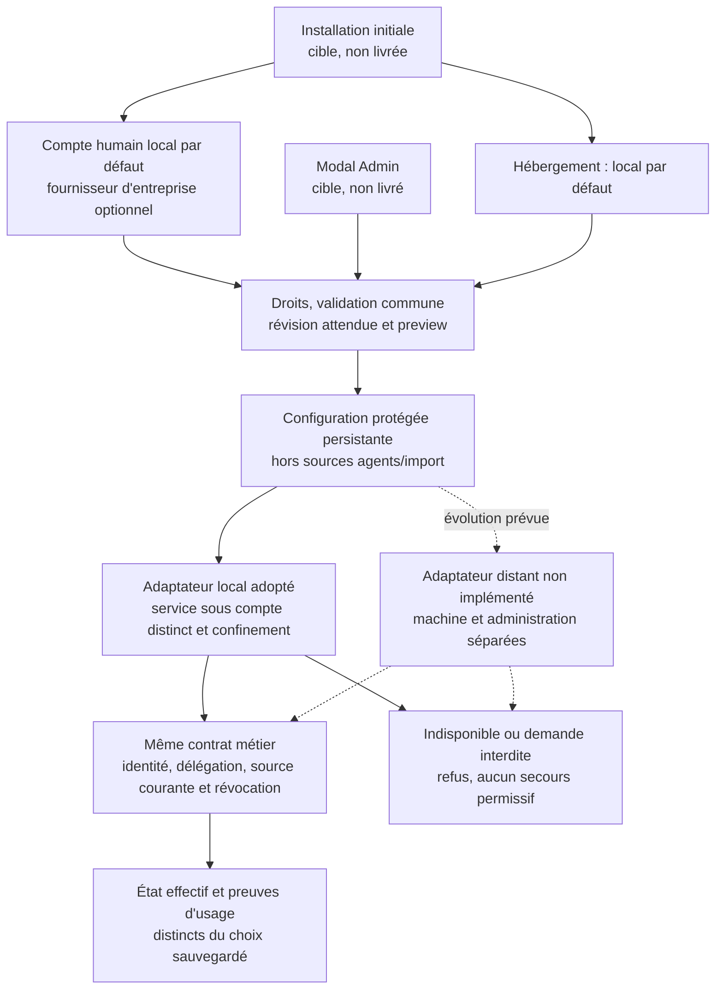

État vérifié de cette tranche : décision et documentation seulement. install.sh
connaît Docker/natif, compose.yaml ne définit qu’un service Swarm sous l’UID/GID
opérateur, et trustRemoteOrigin n’accepte qu’une origine HTTP de boucle locale
pour Trust. Aucun ne fournit ce nouveau service ni son adaptateur distant.
Les modules IA3c.2a à .2e restent vérifiés en fixtures ; F01–F07 et EP-01 à EP-10
ne sont pas clos par la décision d’hébergement. Le [rapport IA3c.2f](../plans/actions-confiance/verification-identites-agents-20261016/ia3-deployment-choice-20261017/RAPPORT-IA3c2f.md)
lie la décision, les sources observées, les rendus et les contrôles documentaires.

## Noyau de configuration d’installation — IA3c.2f-02a

`internal/enrollmentconfig` fournit désormais un format strict et un stockage
Linux pour la **configuration souhaitée** de l’autorité locale. Ce paquet n’est
importé par aucun adaptateur moteur, CLI, HTTP, installateur ou écran Admin ;
aucun réglage n’est actif dans l’application. Il prépare IA3c.2f-02, encore partiel.
Le mode `remote` est connu mais refusé par ErrMode, sans repli local.

Le bootstrap fournit indépendamment `Pins` : `installation_digest` (SHA-256 hex
minuscule), `authority_public_key` (32 octets Ed25519 en base64url sans padding)
et `bootstrap_principal` humain complet selon identitycontract. Le fichier ouvert
ne fournit pas sa propre racine. Le principal et la racine sont immuables dans
les changements ordinaires ; aucune clé privée n’est un champ du format.
Une valeur bien formée ne prouve pas sa provenance ni une authentification OIDC.

Le cadre `Change` comporte exactement `schema_version:1`, `event_id`,
`expected_head`, `values` et `reason`. `values` contient `mode:"local"` et
`local_socket_path`, absolu et canonique. La limite Linux de 107 octets est dérivée
de sockaddr_un et exposée par `LocalSocketPathMaxBytes` : limite technique du
transport, sans rapport avec un délai ou un budget. Head contient `revision`
comme **chaîne décimale uint64** et `digest` hex ; le checkpoint de genèse seul
est `{"revision":"0","digest":""}`. Zéro n’est pas une révision courante.
Les clients doivent conserver ces révisions comme chaînes, sans Number JavaScript.

EncodeChange/DecodeChange valident la demande commune des futurs adaptateurs.
Encode/Decode valident le snapshot complet (`schema_version`, `pins`, `history`).
Chaque entrée porte `change`, `actor`, `at` ; son hash SHA-256, séparé par domaine
et lié aux pins, dépend aussi de la tête précédente dans change. Dates UTC,
identifiants/raisons textuels non vides, absence de doublons d’événements et chaîne
exacte sont vérifiés. Les décodeurs exigent les octets canoniques ; champs inconnus,
doublons, casse, nulls, omissions, types erronés et trailing sont refusés, sans
résultat partiel. Le hash de chaîne n’est pas une signature numérique.

| Opération Go | Entrée attendue / résultat | Limite |
| --- | --- | --- |
| Open | Répertoire existant, UID réel attendu, pins indépendants, Authorizer non nil ; handle de stockage | Peut initialiser config.lock ; aucun fichier config.json ni valeur par défaut créé |
| Preview | Change et instant explicite ; Projection avec base, proposed et current_event_replay | Réservation, validation complète et autorisation ; aucune écriture de configuration ni événement |
| Create | Bootstrap explicite à tête zéro ; View sauvegardée | Ne remplace pas une configuration existante ; seul retry exact du premier événement encore courant reconnu |
| Apply | Change avec tête attendue ; View sauvegardée | Configuration absente refusée, CAS, événement unique et retry exact du seul événement courant |
| Read | Head courant fourni indépendamment ; View avec snapshot possédé | Refus des pins/tête divergents ; ne découvre pas son témoin dans le fichier |

Le répertoire final doit appartenir à l’UID du processus et être exactement 0700.
Les composants sont ouverts par descripteurs sans suivre les symlinks ; les
ancêtres appartiennent à root ou au service et ne sont pas modifiables par
groupe/autres, sauf un répertoire sticky appartenant à root tel /tmp. Verrou et
configuration doivent être des fichiers réguliers 0600, même propriétaire et un
seul lien. FIFO, symlink, lien physique supplémentaire et métadonnées trop ouvertes
sont refusés. Répertoire revérifié à la réservation et avant persistance ; le
fichier temporaire réel est vérifié, sans contourner un umask restrictif.
Ces contrôles ne confinent pas un agent partageant l’UID du service.

La réservation non bloquante retourne ErrBusy sans timer ou retry interne.
Authorizer reçoit des copies et s’exécute sous cette réservation : son résultat
humain doit égaler le principal épinglé ; il doit résoudre l’autorité authentifiée,
pas recopier un champ de demande, et ne doit pas réentrer dans le Store. Les
fixtures de callback ne prouvent pas cette authentification réelle. Read reste
une API interne de données ; le futur transport devra en autoriser l’accès aussi.

L’application écrit un temporaire privé, synchronise le fichier, effectue un
rename atomique (sans remplacement lors du bootstrap), puis synchronise le
répertoire. Une erreur après rename retourne ErrIndeterminate et aucun View :
une mutation peut déjà être visible. Observer avec le checkpoint indépendant,
puis reprendre l’événement courant exact, de nouveau autorisé, sans ajouter
l’historique et avec une nouvelle barrière de synchronisation. Une révision
périmée retourne ErrConflict ; un événement différent/réutilisé/historique ErrEvent.
ErrPath/ErrFormat/ErrVersion/ErrPins/ErrHead distinguent les autres refus.
Une erreur d’autorisation conserve sa cause via errors.Is ; annulation observée avant
l’entrée en persistance refuse l’écriture. Après cette entrée, une annulation
concurrente ne prouve pas l’absence de mutation : observer le résultat courant. L’absence de progression ne donne aucun droit de retry.

Preview valide la même représentation que l’écriture pour les mêmes entrées,
instant compris. L’instant d’application réel peut produire une autre empreinte :
le proposed Head d’un aperçu n’est jamais le témoin d’une écriture effectuée.
Révisions ordonnent les événements ; les horodatages ne constituent pas une
politique d’expiration. Aucun plafond de volume/historique, timeout ou budget ajouté.

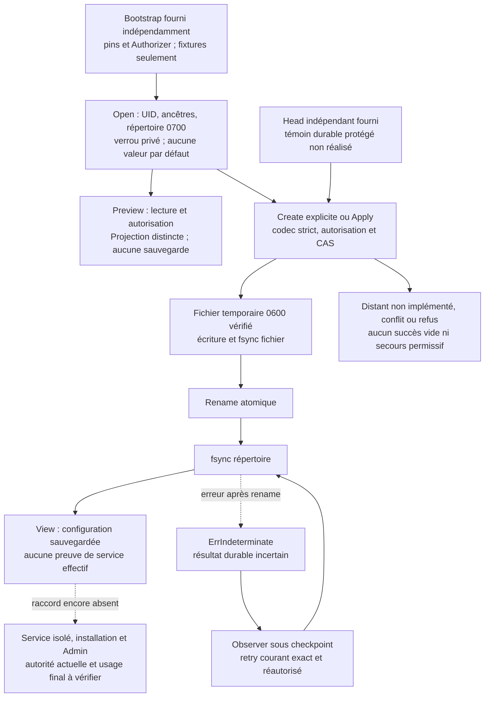

70 noms de tests/sous-tests passent en normal/race, vet et build ciblés passent.
Trois contre-exemples du candidat ont échoué avant correction : permissions
modifiées après Open, date non sérialisable acceptée par Preview et umask rendant
le nouveau fichier illisible. Ils sont conservés dans le [rapport IA3c.2f-02a](../plans/actions-confiance/verification-identites-agents-20261016/ia3-installation-config-20261017/RAPPORT-IA3c2f02a.md).
La panne de fsync est injectée localement ; aucune coupure matérielle n’est testée.
Restaurer le fichier ET le Head fourni retire la détection de rollback : le témoin
durable indépendant, les frontières OS réelles, le service, les opérations
publiques et l’UX restent ouverts. Le service doit aussi distinguer bootstrap
neuf et restauration ; Create n’est pas un endpoint de remise à zéro.
L’évolution vers le distant devra conserver les octets et règles des versions
historiques, pas recalculer discrètement leur chaîne avec un nouveau codec.

## Témoin local et reprise coordonnée — IA3c.2f-02b

Le même paquet fournit maintenant `Coordinator`, ouvert par OpenCoordinated avec
les chemins explicites de configuration et de témoin, l’UID réel, les pins et
Authorizer. Les répertoires égaux, imbriqués, ou de même inode sont refusés ; les
contrôles Linux existants de propriétaire, mode, liens et type de fichier sont
partagés, sans nouvelle copie de Store. Deux répertoires distincts ne prouvent
pas deux domaines d’administration ou de sauvegarde. Ce coordinateur reste une
API Go interne, sans service, installateur, CLI/HTTP ou Admin raccordé.

`witness.json` a quatre champs canoniques exacts : `schema_version:1`, `pins`,
`committed` (Head confirmé) et `pending` (null ou intention). Une intention contient
`entry` (change, actor, at) et `target` (Head calculé de cette entrée et des pins).
La base de change doit égaler committed, acteur/date/schéma sont vérifiés ; le
codec refuse champs inconnus, doublons, casse, nulls/omissions, trailing et cible
contradictoire. Le témoin est un état local protégé par les contrôles de stockage,
pas une signature ni un compteur matériel monotone. Pins restent indépendants.

| Opération coordonnée | Comportement réel |
| --- | --- |
| Create | Bootstrap explicite seulement si les deux états sont absents ; préparer une intention durable avant config, puis confirmer ; retry exact de l’initialisation encore courante reconnu |
| Apply | Réserver config puis témoin sans attente/retry interne ; vérifier le Head confirmé, autoriser, préparer l’intention, écrire config, confirmer |
| Read | Vérifier config contre committed, refuser toute intention ouverte, vérifier les barrières des deux répertoires avant View |
| Preview | Même validation/autorisation, aucune écriture d’état ; refuser pending ; genèse projetée seulement si les deux états sont absents |
| Recover | Si pending, comparer uniquement base/cible exactes, réautoriser et synchroniser l’intention avant effet ; si déjà confirmé, observation et barrières seulement |

L’absence de témoin avec une config existante retourne ErrWitnessMissing, sans
le reconstruire depuis cette config. Une config manquante hors genèse est refusée.
Une divergence de Head, même cohérente syntaxiquement, est refusée ; restaurer
seulement config OU témoin est détecté. Un appel au Store bas niveau hors du
protocole ne fait pas avancer le témoin et reste refusé par Coordinator. Le futur
service doit consommer Coordinator, pas contourner ces comparaisons.

Une intention conserve l’entrée exacte et son instant. Si config est encore à la
base, reprise de cette entrée après nouvelle autorisation ; si la cible est déjà
visible, synchronisation sans second événement ni réécriture. Une autre histoire,
une demande différente pendant pending ou une autorité refusée ne déclenche
aucune réparation implicite ; l’intention est conservée. Read/Preview restent
fermés avec ErrPending. Aucun View partiel n’est retourné en cas d’erreur.

Une confirmation visible mais dont le fsync échoue reste un résultat incertain :
relire, comparer puis synchroniser les deux répertoires, ou reprendre l’événement
courant exact avec autorisation. L’erreur conserve ErrIndeterminate, sa cause et
l’étape (prepare witness / write configuration / confirm witness ou barrière).
Un échec de préparation avant rename peut laisser les deux fichiers absents :
il faut alors un bootstrap explicite, jamais déduire un succès. Annuler après
l’intention et avant config conserve la décision en attente ; une annulation
concurrente plus tard ne prouve pas l’absence de mutation.

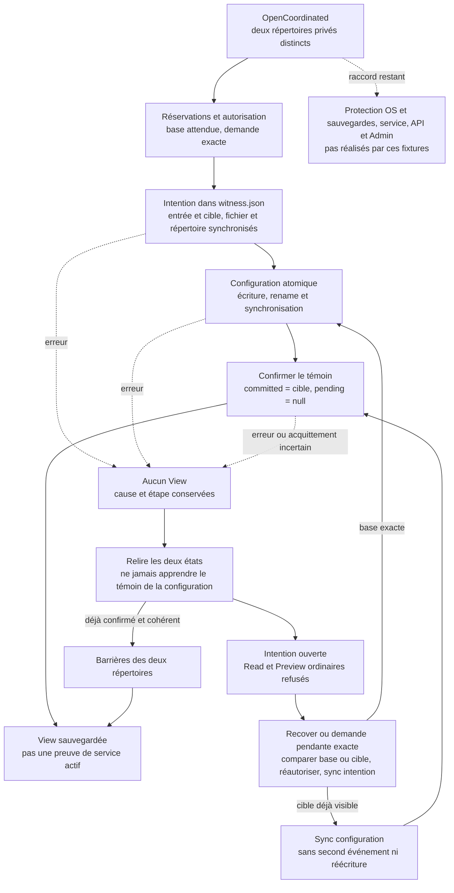

Les 70 gardes précédentes sont rejouées dans un lot final de 101 noms PASS en
normal/race, vet/build ciblés PASS, 12 entrées stables. Une fixture enfant écrit
une intention, rencontre une barrière en faute et sort sans Close ; un nouveau
coordinateur reconstruit la reprise depuis les fichiers. Ce n’est ni SIGKILL,
ni panne électrique, ni preuve de séparation d’UID. Le même inode par bind mount
est contrôlé dans le code mais non monté dans ces fixtures. Le [rapport](../plans/actions-confiance/verification-identites-agents-20261016/ia3-config-witness-20261017/RAPPORT-IA3c2f02b.md)
conserve les fenêtres de faute injectées, le défaut de contexte d’erreur reproduit
puis corrigé, sources et limites.

Restaurer les deux stockages ensemble reste accepté dans le cas limite conservé :
la protection de l’hôte, des copies de sauvegarde et du témoin ne vient pas du
nom du répertoire. La livraison du noyau local ne clôt donc pas F07 ni EP-06.
Aucune annulation/abandon automatique d’intention n’est livré : si reprise refusée
ou histoire manquante, garder le blocage, sa cause et son propriétaire ; une
restauration ou migration doit passer par une opération autorisée à concevoir,
pas une édition d’état privé. Propriétaire : opérateur pour protection/identité,
Codex pour service et parcours publics. Distant toujours refusé par le codec
courant ; aucun secours permissif ou nouveau timeout/budget ajouté.

## Adaptateur local de contrôle IA3c.2f-03a — interne et non activé

Le moteur possède maintenant un adaptateur privé qui reçoit un paquet Linux
SOCK_SEQPACKET, attribue chaque message via SCM_CREDENTIALS et SCM_PIDFD, puis
consomme exclusivement le coordinateur configuration/témoin. Il réutilise le
canal IA2 ; un PID déclaré dans le JSON ou l’identité du créateur de la connexion
ne remplace pas l’émetteur fourni par le noyau. Le canal doit être configuré avant
libération de l’émetteur. Aucun listener, commande CLI, route HTTP, compte ou
service système n’est créé ; le binaire du serveur en cours n’est pas remplacé.

Le prototype 03a initial utilisait le schéma 1. Depuis 03b, la demande canonique
utilise le schéma 2 avec challenge et pins indépendants, décrit ci-dessous ;
l’ancienne version 1 est refusée. read exige change:null ; preview, create et
apply exigent le Change strict existant. Acteur, date, champs inconnus, dupliqués
ou de casse différente et octets non canoniques sont refusés.

Le bootstrap de confiance fournit chemins, propriétaire, pins et contrôleur
d’autorité indépendamment du projet. Ce contrôleur reçoit le message attribué et
une copie de la demande exacte ; il authentifie, autorise l’opération et maintient
sa sérialisation avec la révocation pendant toute l’exécution. Même read exige ce
contrôle. Le principal retourné doit être l’humain épinglé. La demande de mutation
est de nouveau comparée sous les réservations du coordinateur ; le client ne
choisit pas l’heure. Les callbacks de test ne réalisent pas une connexion OIDC,
une délégation courante ou un confinement de fournisseur réel.

| Opération | Effet de l’adaptateur |
| --- | --- |
| read | Lire uniquement une View confirmée après autorisation |
| preview | Projeter sans écrire config.json ou witness.json ; ce n’est pas un état sauvegardé |
| create | Bootstrap explicite selon les deux états, sans choisir l’autorité depuis la demande |
| apply | CAS courant et reprise de la demande pendante exacte, réautorisée ; aucun second événement pour le retry courant |

Il n’expose pas Recover sans demande : l’opérateur peut reprendre le Change exact
par apply. Un pending, un conflit ou une histoire manquante ne déclenche aucune
réinitialisation ni reconstruction automatique. Une implémentation du contrôleur
qui n’exécute pas son callback, en absorbe l’erreur, l’appelle deux fois ou le
retient après son retour ne peut produire un succès sans contrôle : absence et
retard sont refusés, erreur conservée, second effet empêché. Une erreur après un
effet réussi conserve une issue incertaine ; elle n’annule pas une écriture.
Le contrôleur doit exécuter synchroniquement et maintenir ses protections ; ces
gardes ne remplacent pas son implémentation et sa vérification indépendante.

La réponse comporte schema_version, request_digest, operation, view, projection
et error, avec
null pour les résultats absents. Une erreur n’expose aucun résultat ; seuls des
codes limités traversent le canal : invalid_request, denied, conflict, busy,
pending, not_configured, indeterminate ou unavailable. Les causes Go originales
restent du côté service, sans envoi de chemins privés. Un paquet tronqué ou ses
métadonnées invalides sont refusés avant accès au stockage, sans réponse métier.

Après une écriture réussie, perdre l’acquittement retourne une erreur incertaine
côté service et ne provoque aucun rollback. Reprendre la même demande avec son
EventID et sa base permet la relecture/réautorisation sans événement supplémentaire.
Le propriétaire fournit le buffer de transport et gère la connexion ; une réponse
qui dépasse les possibilités du socket échoue, sans découpage implicite. Aucun
timeout, retry, volume ou concurrence de politique supplémentaire. Un contexte
annulé seul n’interrompt pas une réception bloquée ; le propriétaire doit fermer
sa connexion. Le futur service devra rendre cette gestion observable.

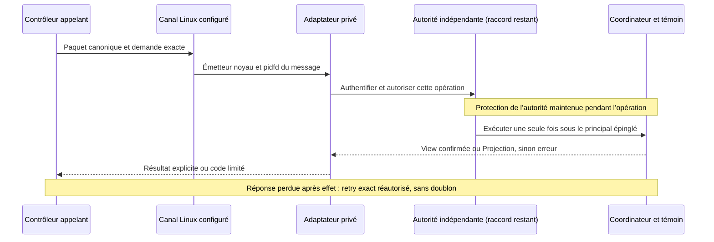

Le [rapport de raccord](../plans/actions-confiance/verification-identites-agents-20261016/ia3-local-service-20261017/RAPPORT-IA3c2f03a.md)
lie les tests aux sources et conserve leurs limites. L’échange enfant attribue le
processus émetteur réel, sous le même compte en fixture. Il ne prouve pas une
séparation de comptes, un service protégé actif ou l’authentification du service
par un client public. EP-01/04/05/07, F01–F07 et l’admission publique restent ouverts.
Avant activation : désigner l’humain initial, fournir le contrôle d’autorité réel,
protéger les fichiers/clefs/compte, établir le pair service côté client et vérifier
le confinement, puis raccorder commandes, installation et Admin FR/EN. Le mode
distant reste prévu ; aucune bascule permissive.

Le contrôleur des workflows utilise aussi -timeout 0 pour son test de contexte :
l’ancien watchdog global hérité de 30 secondes a été retiré faute de contrat
temporel justifié. Ce contrôle de méthode ne mesure pas une performance produit.

Le même contrôleur exige maintenant les événements JSON run/pass du test nommé
et la fin du paquet ; un sélecteur vide, un skip ou une preuve incomplète ne peut
plus produire OK. Les doubles de sortie Go et le contrôle réel sont deux preuves
distinctes, conservées dans le rapport de raccord.

## Client local IA3c.2f-03b — paire serveur et réponse vérifiées en fixture

Le client privé complète le raccord de contrôle ; il n’installe aucun service.
Son constructeur reçoit les pins d’installation, l’UID attendu et un pidfd du
serveur fourni indépendamment par le lanceur de confiance. Il duplique et détient
ce descripteur. Il ne l’ouvre jamais à partir d’un PID reçu dans une réponse et
n’apprend ni racine ni principal depuis le serveur. Chaque message retour est
attribué par le même canal Linux que la demande ; son UID et son objet processus
sont comparés à ces éléments indépendants avant de lire le résultat métier.

L’identifiant comparé est le couple périphérique/inode du pidfd sur pidfs, sous
Linux 64 bits. Le type de système de fichiers est contrôlé ; un fichier ordinaire,
un ancien pidfd à inode anonyme ou une architecture 32 bits est refusé, sans
repli vers un PID numérique. L’objet est lié au processus dans le démarrage hôte
courant, pas à une identité persistante ou à son exécutable. Cette vérification
ne prouve ni le confinement ni l’identité humaine ; une exécution différente
dans le même processus conserve ce besoin de protection. Le contrat noyau est
vérifié dans [Linux v6.17, pidfs](https://raw.githubusercontent.com/torvalds/linux/v6.17/fs/pidfs.c).

Le transport passe explicitement au schéma 2. La configuration persistée, son
journal et ses empreintes restent au schéma 1 ; aucune histoire n’est réinitialisée.
Le client crée un challenge aléatoire de 32 octets pour chaque nouvel échange et
fournit les pins attendus dans la demande. Le service compare ces pins aux siens
avant le contrôle d’autorité ; leur égalité ne donne aucun droit. La réponse porte
request_digest, SHA-256 avec domaine `swarm-installation-control-v2` sur les octets
canoniques de la demande complète : challenge, pins, opération et Change exact.
Un ancien paquet version 1, même émis par le bon processus, n’est pas réinterprété.

| Cadre | Champs exacts de version 2 |
| --- | --- |
| Demande | schema_version, challenge, pins, operation, change |
| Réponse | schema_version, request_digest, operation, view, projection, error |

Après contrôle du processus, le client refuse version/opération/empreinte autres,
formats non canoniques ou champs inconnus, résultat absent, mélange View/Projection,
code inconnu et erreur accompagnée de données. Le paquet enrollmentconfig fournit
ValidateView/ValidateProjection : schéma, historique complet, tête recalculée et
base/replay sont contrôlés au même endroit que le stockage. Le client compare
les pins du résultat et le dernier Change à sa demande. Ces vérifications ne
font pas d’une configuration souhaitée une capacité d’agent ou un service actif.

Le client possède sa connexion et son pidfd dupliqué ; un seul échange y est
admis, puis les deux sont fermés. Le descripteur original du lanceur n’est pas
fermé par le client. Une annulation avant l’envoi reste une absence d’envoi ;
après tentative de mutation, toute réponse non authentifiée, tronquée ou perdue
retourne un résultat nul et une issue incertaine. Une erreur métier authentifiée
reste son refus explicite. La connexion propre au client est fermée pour
interrompre réception/envoi lors de l’annulation ; aucun délai fixe ni répétition
automatique. Reprise métier avec le même EventID/base sur un nouveau canal et
un nouveau challenge, après réautorisation du service.

La fixture de taille réduit uniquement le buffer d’émission de son socket et
relit SO_SNDBUF pour construire une réponse au-delà de la capacité observée.
EMSGSIZE doit être constaté, distinct d’un timeout ; l’effet déjà confirmé est
relu au retry exact sans second événement. Cette expérience ne choisit pas une
politique de volume produit. Une réponse trop grande reste une limite du
transport paquet, sans découpage automatique : transfert paginé ou autre cadrage
reste à concevoir avant d’en faire un parcours public à historique arbitraire.
Le propriétaire contrôle aussi le buffer de réception ; un préfixe tronqué est
refusé, jamais traité comme une réponse valide.

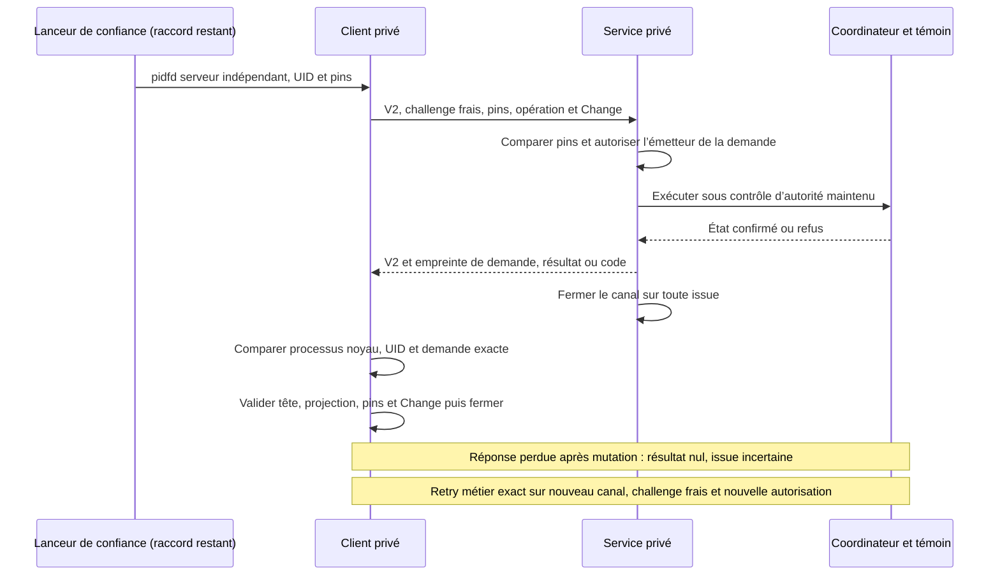

Le [rapport client](../plans/actions-confiance/verification-identites-agents-20261016/ia3-local-client-20261017/RAPPORT-IA3c2f03b.md)
conserve les résultats et conditions de la preuve. Le lanceur public fournissant
le pidfd indépendant, l’autorité humaine, le compte séparé, le confinement et
Admin restent à raccorder. Un client vérifié en fixture ne clôt pas EP-01/04/05/07,
F01–F07, IA3 ou l’acceptation globale. Pas de bascule locale/distance permissive.

Le canal serveur est lui aussi possédé pour un seul échange et fermé sur succès,
refus ou erreur ; un second serve est refusé. La garde EMSGSIZE ne ferme plus le
socket à sa place : elle observe directement POLLHUP sans attente (poll à zéro),
puis l’échange client constate la fin du canal. Cela corrige une attente possible
après réponse non envoyée sans inventer de timeout. Le code unavailable demeure
une indisponibilité générale du service ; il ne prouve pas une faute de stockage.
Les deux contre-exemples avant correction et leurs reprises sont conservés.

Le canal doit provenir du lanceur de confiance et être remis au serveur attendu
sans fuite de descripteur ; le client vérifie ici l’émetteur du retour, après
l’envoi de la demande. Ce contrôle seul ne prouve pas le destinataire avant
l’envoi et ne chiffre pas le contenu. Un simple chemin de socket non établi ne
remplace pas cette précondition ; le raccord public doit prouver cette remise
ou établir le serveur avant tout contenu sensible. Cette obligation reste
ouverte avec la protection du compte et des descripteurs (EP-07).

Encodage du challenge : base64url canonique sans padding, représentant exactement
32 octets. L’empreinte est l’hexadécimal minuscule de SHA-256 sur le préfixe
`swarm-installation-control-v2\x00request\x00` suivi de la demande canonique ;
chaque `\x00` représente un octet NUL. Le format canonique est celui du codec Go
partagé, pas une promesse que JSON.stringify produit les mêmes octets. Un futur
client d’un autre langage devra vérifier cet encodage, notamment les échappements,
ou consommer le codec via l’adaptateur Go. Cette interopérabilité n’est pas prouvée.

## Remise privée IA3c.2f-03c — preuve avant demande métier

Le lanceur interne `runAgentIdentityConfigProcess` exécute une commande neuve de
l’image courante, épinglée par descripteur avec `pinTrustFixedHelperImage`. Son
appelant de confiance fournit explicitement arguments, environnement, UID serveur
attendu et pins publics ; aucune donnée de projet ne choisit le programme ou
l’autorité. Environnement implicite, ExtraFiles préexistants, commande déjà
démarrée, Cancel, WaitDelay et PidFD préconfigurés sont refusés. Les autres
attributs système sont conservés. Ce composant reste sans entrée CLI ni service
installé ; `acceptAgentIdentityConfigLaunch` est appelé par un helper de test.

Deux socketpairs privées SOCK_SEQPACKET reçoivent PASSCRED/PASSPIDFD avant exec :
une pour le démarrage, une pour la demande métier. Le parent transmet les FDs 3
(métier), 4 (démarrage), 5 (pidfd parent indépendant) et 6 (image courante).
Le parent obtient le pidfd enfant atomiquement par SysProcAttr.PidFD/CLONE_PIDFD ;
il ne rouvre jamais un numéro de PID enfant. Les tokens pidfs 64 bits et
UID de chaque message sont comparés aux objets détenus indépendamment des deux
côtés. Les préconditions Linux du client 03b s’appliquent aussi ici.

Démarrage **version 1**, format canonique strict : schema_version, purpose,
challenge, pins_digest. Challenge frais de 32 octets, base64url sans padding ;
pins_digest est SHA-256 hexadécimal minuscule du préfixe
`swarm-installation-startup-v1\x00pins\x00` suivi des pins JSON canoniques Go.
Les deux `\x00` désignent des octets NUL. Les trois messages hello, ready et
release doivent partager challenge et empreinte attendus. L’enfant apprend le
challenge du parent attribué, mais compare les pins à sa propre source ; le
parent vérifie ready contre son pidfd enfant et ses propres pins, avant release
et avant toute demande métier. L’enfant n’admet le canal métier qu’après release
exacte et attribuée. Le buffer de démarrage est calculé sur le plus long message
valide de ce format fixe ; ce n’est pas un plafond de contenu métier.

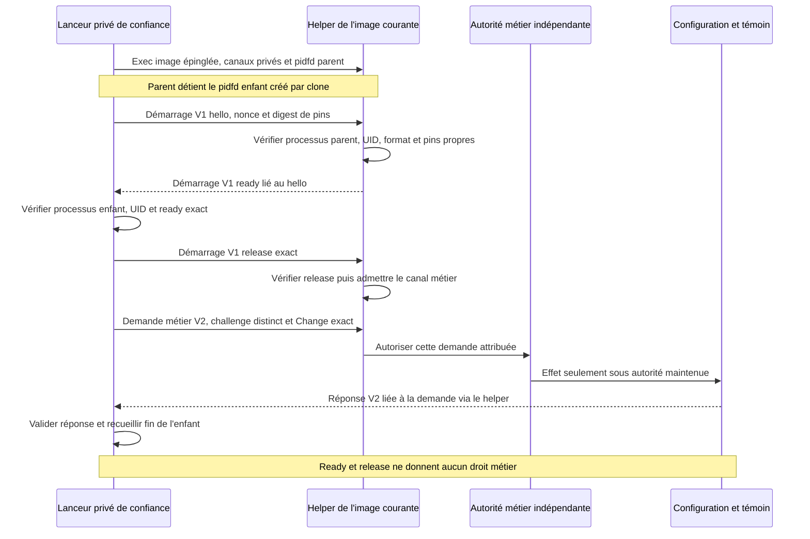

Les copies parent des FDs hérités sont fermées après exec. Le helper vérifie que
le FD image correspond à son exécutable, adopte les sockets en CLOEXEC et ferme
les originaux, le canal de démarrage et le pidfd parent. Le client conserve son
duplicata de pidfd jusqu’à la fin de l’échange ; le lanceur conserve l’original
jusqu’à la collecte de Wait, puis le ferme et invalide son numéro dans Cmd.
Annulation : fermeture des canaux possédés, SIGKILL via le seul pidfd enfant et
collecte de Wait ; aucune recherche de PID, aucun signal de groupe, délai ou retry
automatique. Les flux standard et le code de l’image restent de confiance : un
writer fourni par l’appelant qui se bloque peut aussi bloquer la collecte Go.

Succès = réponse métier valide **et** fin de l’enfant à zéro. Un refus métier
attribué reste un refus, même après ready. Une fin non nulle après réponse de
mutation valide conserve l’erreur de processus, retourne zéro résultat et
ErrIndeterminate ; l’historique n’est pas réinitialisé. Après tentative de
mutation sans réponse valide, les règles 03b s’appliquent. Avant demande métier,
un échec de démarrage ne prétend pas qu’une mutation a été tentée.

Le [rapport 03c](../plans/actions-confiance/verification-identites-agents-20261016/ia3-local-launch-20261017/RAPPORT-IA3c2f03c.md)
lie les tests aux sources exactes. La preuve concerne deux processus de fixture
du même compte. Elle ne démontre ni confidentialité, compte système séparé,
protection contre ptrace/root ou fuite depuis un bootstrap compromis, ni identité
humaine, délégation ou admission publique. Le raccord métier reste V2 et le
stockage V1. EP-07 demeure partiel jusqu’au bootstrap protégé, au confinement et
à l’activation réelle ; F01–F07 et l’acceptation globale restent ouverts.

Ce helper enfant à usage unique ne remplace pas le cycle d’un service permanent.
Le pidfd ne donne pas le droit de changer de compte ni de signaler un autre UID.
Le raccord public doit établir qui peut lancer/superviser le compte séparé :
bootstrap privilégié protégé ou service/broker authentifié, avec droits et collecte
vérifiés. Ne pas exécuter le cockpit entier avec des privilèges pour obtenir cette
propriété ; cette intégration reste à concevoir après désignation de la source
d’autorité, puis à vérifier dans le parcours réellement retenu.

## Précontrôle du bootstrap IA3c.2f-03d

`swarm identity bootstrap-check EMPREINTE_SHA256 --input /chemin/absolu/bootstrap.json --json`
effectue un contrôle local en lecture seule, avant toute ouverture de projet.
`--root`, `--server`, stdin et les opérations d’activation ne sont pas des sources
de bootstrap acceptées. Le paquet commun `internal/enrollmentbootstrap` fournit
Encode, Decode et Load ; ses données ne sont pas des capacités d’autorité.

Le manifeste canonique V1 contient schema_version, pins (installation_digest,
authority_public_key, bootstrap_principal), service_uid, controller_uid,
configuration_directory et witness_directory. Les pins utilisent la validation
existante ; humain déclaré et clé publique ne constituent pas une connexion
humaine ou une approbation. Les deux UID déclarés doivent différer et service_uid
doit égaler l’UID effectif du processus qui contrôle le fichier. Le contrôle ne
prouve pas que les agents utilisent réellement controller_uid.

L’empreinte SHA-256 hexadécimale minuscule attendue vient d’un contrôle
d’installation approuvé et protégé indépendamment. La calculer depuis le fichier
à accepter, puis la lui faire vérifier, ne prouve pas cette approbation. Le
fichier est ouvert sans suivre de lien : fichier régulier, propriétaire service,
mode 0600, un seul lien. Son parent et les répertoires configuration/témoin sont
ouverts avec le même `enrollmentconfig.OpenPrivateDirectory` que le stockage :
UID effectif, parcours sans symlink, ancêtres root/service non modifiables par
groupe/autres (exception sticky root telle que /tmp), répertoire final 0700.
Les trois chemins doivent être distincts, non imbriqués ; les handles ne doivent
pas désigner le même inode. Root et les administrateurs hôte restent de confiance.

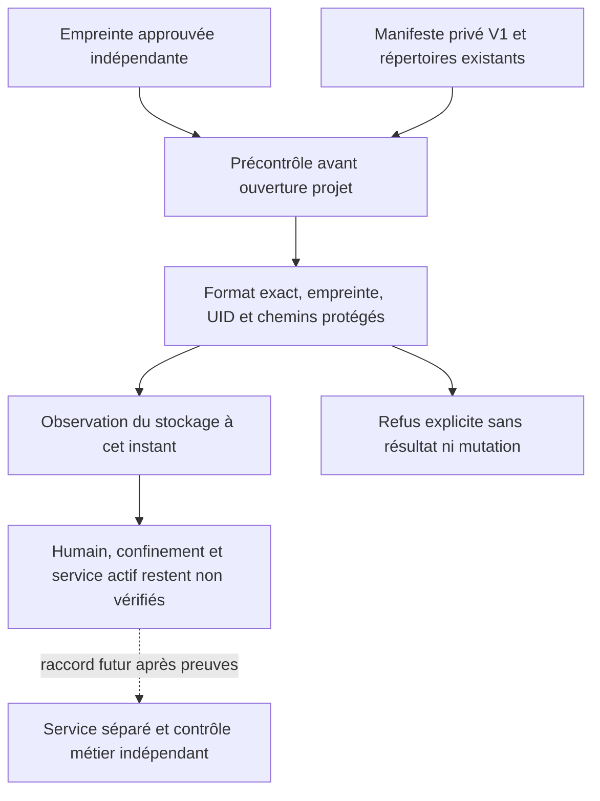

Le résultat expose bootstrap_digest, bootstrap et storage_verified=true ;
human_authentication_verified, confinement_verified et service_started restent
false. Il ne crée ni répertoire, lock, clé, compte, journal, session ou service.
Un refus ne retourne aucun résultat. Les handles sont fermés ; les futurs
consommateurs doivent revalider les chemins à l’usage, pas réutiliser cette
observation comme une permission. La configuration mutable et son historique ne
sont pas ce manifeste ; une migration de racine n’est pas implémentée ici.
Le service protégé, la source humaine, le confinement et Admin restent ouverts.

## Noyau Rust de contrôle courant — incrément PAEA26

`swarm_enrollment_authority::control` compose désormais le journal signé natif
et `swarm_enrollment_config::store::Coordinator` sous Linux. C'est une API de
bibliothèque, sans écouteur, session humaine ni consommateur dans le profil
normal de la CLI. Le précontrôle `bootstrap-check` ne l'active pas. Les anciens
contrats de transport décrits ci-dessus ne prouvent pas leur portage Rust.

Le démarrage protégé doit fournir indépendamment les clés publiques, le projet,
les répertoires privés, le propriétaire et `Binding` : enrollment_id, génération,
principal humain exact, portée de plan et révision de confiance. `Startup` vérifie
leur cohérence ; il n'authentifie pas son producteur. Ces données ne doivent venir
ni de la requête, ni du cookie du cockpit, ni d'une simple égalité d'UID.

`BoundJournal` ouvre un journal WAL existant, valide son historique signé et garde
la connexion réelle. Il ne recrée aucune base et ne rouvre jamais son chemin par
opération. `NOFOLLOW` protège le dernier composant ; la protection des ancêtres
et le bootstrap restent des préconditions externes. Un déplacement peut entraîner
un refus SQLite : il ne faut pas le convertir en réouverture ou succès vide.
Ce lien à l'objet ouvert ne fournit ni confinement ni protection contre la
restauration simultanée des données/témoins par leur propriétaire ou root.

Chaque `execute` vérifie la tête courante, l'absence de révocation, le document
canonique, la génération et le contexte exacts, la validité à l'heure du service
et une permission signée `effect.execute` dont la ressource vaut exactement
`enrollment-config/<installation_digest>/<read|preview|create|apply>`.
Ces quatre discriminants définissent le protocole ; aucun grant par défaut,
délai, plafond ou politique de reprise n'est introduit. Les grants résident dans
le journal signé ; aucun nouveau formulaire Admin de politique n'est ajouté.
Lire et rejouer exigent aussi leur permission. Une délégation n'est pas utilisée.

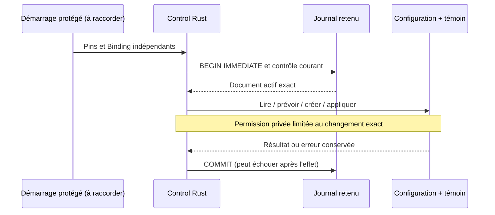

La réservation d'autorité reste tenue jusqu'au retour du stockage et au COMMIT.
La contention locale refuse immédiatement avec Busy, sans attente ou relance
cachée. Une révocation obtenue avant l'usage refuse cet usage ; une révocation
concurrente à un usage réservé refuse puis nécessite une reprise explicite après
sa fin. Ce contrat ne rend pas l'expiration murale atomique avec les écritures.

`Preview` conserve les fichiers de configuration, `Create` et `Apply` emploient
le protocole existant configuration/témoin. EventID, base et contenu exacts
permettent le rejeu sans doublon, après une nouvelle autorisation courante.
Aucun recover/reset/adopt brut n'est exposé. Un témoin pending exige la reprise
du même changement autorisé ; `Read` ne le masque pas. Le stockage conserve ses
causes, les fautes de flush/close et les refus de chemins.

Tout échec d'une invocation mutante reste conservativement UNKNOWN : même un Err
ne garantit pas l'absence d'effet. Si l'autorité échoue après le stockage,
`AfterStorage` conserve sa cause et le résultat complet du stockage, succès ou
échec secondaire. Ne pas réémettre une action différente ; lire sous autorité
courante et/ou reprendre l'événement exact. Si le grant est révoqué, cette reprise
exige un contrôleur disposant d'une autorité indépendante valide. `close` refuse
la contention, ferme explicitement les trois stockages et conserve les erreurs
secondaires ; Drop seul ne prouve pas cette fermeture.

Recette maintenue : `tools/verification/recipes/paea-control-core.json`.
[Résultats et limites26](../plans/actions-confiance/paea/INCREMENT-26.md).
Tests sur stockage réel isolé et hooks réservés aux tests, distincts du build
normal sans `test-fixtures`. Transport authentifié, identité humaine réelle,
compte service, confinement, installation de service, PA-03 et acceptation E2/E3
restent ouverts ; aucune nouvelle garantie globale sur les 17 invariants.
