# Contrat interne d'identité et d'autorité des agents

17 octobre 2026 — [English](../en/AGENT-IDENTITY-CONTRACT.md).
Périmètre : noyau IA2.2, canal IA2.3a, source durable IA2.3b, liaison au plan
IA3a, émission humaine IA3b, reçu IA3c.1 et protocole isolé IA3c.2a. Ces composants
internes restent non raccordés aux lanceurs publics. Le raccord privé 03c décrit
plus bas est vérifié avec un helper de fixture, sans admission d’agent.
Les défauts de l'[audit IA1](../plans/actions-confiance/verification-identites-agents-20261016/RAPPORT-IA1.md)
restent ouverts. Il n'existe aucun nouvel endpoint, commande, paramètre Admin,
bootstrap public ou confinement fournisseur livré par ce contrat.

## Responsabilités et parcours actuel

Le [contrat sémantique IA2](../plans/actions-confiance/identites-agents-contrat-IA2.md)
définit la cible complète. Le noyau concret vérifie des données et construit un
reçu de décision. Une décision positive n'est ni une réservation, ni une
approbation humaine, ni un processus attesté, ni un effet métier observé.

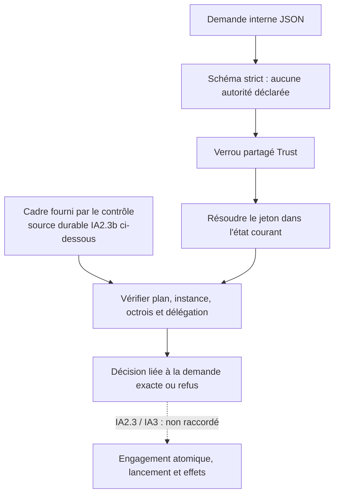

Le producteur Trust fournit l'émetteur et le sujet, la catégorie `local`, `human`
ou `service`, la révision et l'expiration. Le noyau ne promeut pas un accès local
en personne ni les rôles métier `requester`, `approver`, `admin` ou `effect` en
droit de création. Il ne déduit aucune instance du seul jeton.

## Données et sources d'autorité

Types privés dans `internal/engine/agent_identity_contract.go` :

| Objet | Contenu / sens |
| --- | --- |
| `agentIdentityPrincipal` | Identifiant local, catégorie, émetteur et sujet externe distincts. Aucun jeton brut ni condensat de jeton dans l'attribution. |
| `agentIdentityActor` | Principal et éventuelle instance. Ce rattachement doit être établi par le contrôle. |
| `agentIdentityScope` | Mission, génération persistée et empreinte du contrat enregistré. IA3a le lit dans SQLite ; cela ne prouve pas une adoption humaine attestée. |
| `agentIdentityGrant` | Émetteur, détenteur, parent, portée, révision Trust, permissions exactes, permissions déléguables, dates et révocation. |
| `agentIdentityInstance` | Instance, agent logique, principal, portée, octroi et référence de liaison d'exécution. Comparer cette référence n'atteste pas le processus. |
| `agentIdentitySnapshot` | Schéma 1, révision, octrois et instances sérialisables. Une sauvegarde ou un import reste une donnée. |
| `agentIdentityRequest` | Schéma 1, événement, portée, octroi, opération, ressource et empreinte de contenu. Aucun champ auteur/approbateur/autorité autorisant. |
| `agentIdentityDecision` | Contexte de projet, événement, acteur, empreintes de demande et d'instantané, révisions et expiration maximale. Aucun effet ni consommation implicites. |

`agentIdentityAuthority` est un cadre privé, non sérialisable depuis JSON :
racine canonique du projet, empreinte et révision courantes de l'instantané, révision Trust, plan courant et
octrois racine explicitement reconnus. Le producteur durable interne est décrit
en IA2.3b ; les émetteurs protégés de permis/checkpoint restent à raccorder.
Recalculer ce cadre depuis l'instantané à vérifier créerait une autorité circulaire.
Les tests historiques IA2.2 construisent une fixture ; IA2.3b lit les données
persistées sous un checkpoint de contrôle, sans déployer d'ancre externe.

Les empreintes sont des SHA-256 en hexadécimal minuscule. Les identifiants
réutilisent la syntaxe commune `safeName`. Les ressources sont comparées
exactement, sans jokers ni règle implicite de préfixe de chemin. Les opérations
reconnues sont `agent.create`, `memory.read`, `memory.summarize`,
`memory.transmit`, `tool.invoke`, `effect.execute` ; leurs consommateurs ne sont
pas raccordés par cette livraison. Il n'existe ni délai ni plafond opérateur
nouveau caché dans ce noyau.

Émetteur et sujet sont des chaînes opaques : les crochets d'un émetteur IPv6
ou d'un sujet ne sont pas traités comme des jokers. La validation du texte
refuse vide, UTF-8 invalide, contrôles et espaces périphériques ; l'interdiction
`*?[]` concerne seulement les ressources de permission.

Le digest du contenu doit venir de la proposition réelle, de ses paramètres et
de son contexte résolu. Le noyau lie la décision au digest reçu ; il ne prouve
pas la bonne production de ce digest ni sa correspondance avec un futur effet.
Le producteur et la frontière d'engagement appartiennent à IA2.3/IA3.

## Vérifications et reprise

`decodeAgentIdentityRequest` refuse champs inconnus, variantes de casse des
champs, doublons de clés y compris imbriqués/échappés, document multiple,
entrée vide/null/invalide, autorité déclarée et octrois à joker. Le décodeur
d'instantané refuse aussi les champs inconnus, les doublons et les objets absents.

`evaluateAgentIdentity` exige un appelant vérifié au même instant d'évaluation,
un cadre courant, un instantané correspondant et la même portée. Il vérifie
détenteur, référence d'instance, permission, dates, révocations et chaîne jusqu'à
une racine reconnue. Chaque lien conserve la portée ; ses droits sont inclus
dans les droits déléguables du parent et sa validité temporelle y est incluse.
La chaîne est parcourue avec détection des cycles, sans récursion par octroi.

Le consommateur lie l'appelant à `Store.root`, déjà canonisé à l'ouverture.
Le cadre privé doit désigner cette même racine ; le reçu porte l'empreinte de
ce contexte. Deux projets aux mêmes noms et jetons de fixture ne peuvent ainsi
échanger cadre et reçu. Ce contrôle local n'est ni un identifiant de projet
durable entre hôtes, ni une preuve de propriété du compte système. Une migration
de racine ou une fédération devra établir explicitement son nouveau contexte
et son ancre protégée dans IA2.3.

Une modification de la configuration Trust invalide les anciens octrois dans
ce contrat conservateur : renouvellement explicite requis. La réauthentification
ne remet pas ces octrois à jour. L'expiration d'une décision ne dépasse ni celle
du demandeur ni celle des octrois utilisés.

`Store.evaluateAgentIdentityRequest` résout l'identité et évalue sous le même
verrou Trust. Un rejeu repasse par cette résolution, puis par les mêmes contrôles
et la comparaison complète du reçu. Il ne retourne pas un ancien résultat avant
authentification. Le temps réel est échantillonné après acquisition du verrou ;
une horloge de fixture peut être injectée par les tests internes. Aucune horloge
JSON n'est acceptée. Ce consommateur interne ne fournit pas encore de voie
pour un appelant agent : celle-ci attend le courtier protégé.

`validateAgentIdentityTransition` exige la révision suivante et la conservation
des anciens enregistrements. Une révocation ne peut être effacée ou déplacée ;
les autres champs d'un ancien octroi ou d'une instance ne sont pas réécrits.
Un remplacement utilise un nouvel identifiant et ne supprime pas l'histoire.
Le contrôle de transition n'autorise ni ne publie la modification : le futur
écrivain devra vérifier l'état courant et publier son ancre sous le protocole
atomique approprié. Aucun stockage de production n'utilise encore ce validateur.

## Limites et suite obligatoire

La vérification des tests est conservée dans le
[rapport IA2.2](../plans/actions-confiance/verification-identites-agents-20261016/ia2-contract-kernel-20261017/RAPPORT-IA2.2.md).
Les essais emploient des racines isolées, des acteurs d'instance simulés et des
émetteurs OIDC/service locaux. Ils ne prouvent ni fournisseur réel ni revue
indépendante. Les régressions du contexte d'appelant réutilisé et du cadre échangé
entre projets sont conservées avant et après leurs corrections.

Restent à réaliser : bootstrap et émetteurs protégés du cadre/checkpoint,
engagement de l'admission dans les verrous, intégration du canal d'instance, liaison au contenu préparé, approbation humaine exacte, consommation unique, course
départ/révocation, réconciliation après panne et raccord de **tous** les
consommateurs CLI/API/fournisseur/mémoire. Les deux fichiers de stockage actuels
ne deviennent pas atomiques par l'ajout d'un évaluateur. La matrice IDA-01–18 et
le RETEX restent la condition de qualification globale.

## Expérience de canal IA2.3, distincte du noyau

Le [prototype du 17 octobre](../plans/actions-confiance/verification-identites-agents-20261016/ia2-runtime-binding-20261017/RAPPORT-IA2.3-CANAL.md)
vérifie 13 contrôles locaux sur deux cages Linux. PID/montage sont épinglés avant
exécution ; l'émetteur est attribué par les credentials de chaque message. Une
connexion B copiée à A conserve le pair B, mais le message est attribué à A et
refusé sous l'identité B déclarée. Trois joins vers B avec des descripteurs de
namespace copiés sont refusés. Le namespace utilisateur change au bootstrap et
n'est pas supposé stable. Ce prototype Python n'est ni un courtier Go intégré ni
une source d'autorité ; registre et révocation sont en mémoire. Les lanceurs
ne sont pas qualifiés par cette expérience.

## Canal Go d'instance — IA2.3a

Le récepteur et le registre de liaisons sont maintenant implémentés dans
`agent_identity_channel_linux.go` et `agent_identity_runtime_linux.go`.
`Store.evaluateAgentIdentityMessage` les relie au noyau IA2.2 en interne.
Ils ne sont enregistrés dans aucun serveur ni lanceur. Le [rapport IA2.3a](../plans/actions-confiance/verification-identites-agents-20261016/ia2-go-channel-20261017/RAPPORT-IA2.3a.md)
porte les contrôles et limites de cette tranche.

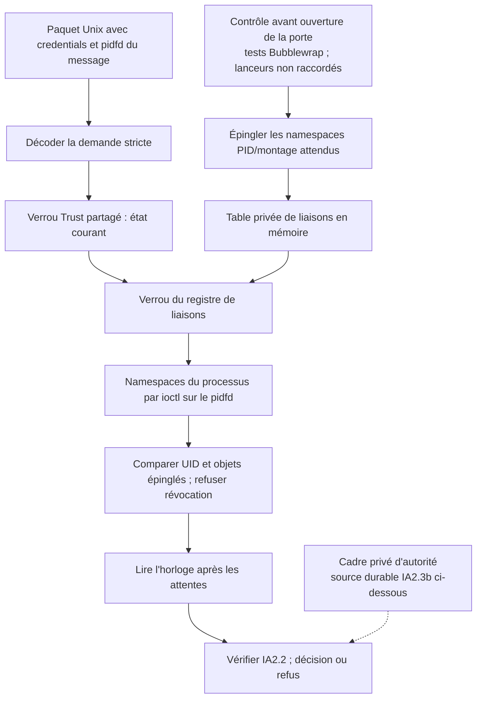

Le contrôle appelle `pin` à partir d'un bootstrap de lanceur tenu par une porte,
puis conserve les descripteurs PID/montage. Le namespace PID de l'hôte, les
références incompatibles et la réutilisation d'une instance, liaison ou namespace
PID déjà réservé sont refusés. Le premier message ne peut pas remplir cette table.
Son caractère privé au processus ne protège pas le compte contrôleur hôte non
confiné ; le lanceur et le bootstrap protégés restent des obligations d'intégration.

`configureAgentIdentityChannel` exige un socket Unix `SOCK_SEQPACKET` et active
`SO_PASSCRED` et `SO_PASSPIDFD`. La réception exige credentials et un unique
`SCM_PIDFD`. Les namespaces sont obtenus depuis ce descripteur, sans rouvrir le
numéro de PID du message. Un émetteur disparu n'est pas réidentifié par son numéro.
Le pair de connexion n'est pas utilisé pour attribuer le message. Il s'agit du
processus/groupe de threads indiqué par ce mécanisme, pas d'une attestation de
chaque thread ou du binaire exécuté. Les primitives manquantes entraînent un refus,
sans repli numérique ; seule la plateforme du rapport a été exécutée.

Le consommateur fournit son tampon et sa deadline de transport. Aucun plafond ni
délai opérateur nouveau n'est introduit. Un paquet tronqué, des credentials
manquants ou des droits de fichier injectés sont refusés ; les descripteurs reçus
sont fermés en cas de rejet. Le consommateur ferme le message accepté. Les
namespaces restent épinglés jusqu'à fermeture du registre, même après révocation,
pour conserver l'exclusion des anciennes références. Une table vide après reprise
n'adopte pas l'autorité du premier émetteur.

La réception a lieu hors du verrou Trust. L'évaluation prend Trust partagé puis
le registre, vérifie révision/liaison/UID/namespaces, échantillonne le temps réel
après ces attentes et appelle le noyau sous les deux verrous. La révocation de
liaison et la fermeture sont sérialisées avec cette évaluation. Cela ne constitue
aucun engagement Trust/SQLite, aucune consommation unique ni aucun arrêt observé.
Les instantanés et cadres d'autorité employés par les essais restent des fixtures.

Le verrou runtime protège les liaisons, pas les maps d'un instantané fourni par
un autre composant. IA2.3b fournit sa propre copie courante. Les consommateurs
primitifs IA2.2/IA2.3a recevant encore un cadre et un instantané supposent que leur
appelant respecte cette propriété et leur fraîcheur ; ils ne consultent pas le
registre durable. Une opération publique devra utiliser le parcours durable.

## Source durable et publication récupérable — IA2.3b

Le registre privé est maintenant produit depuis SQLite et une tête Trust
indépendante. La version **36** a ajouté les tables suivantes ; le stockage
courant est **37**, avec le stamp de plan IA3a décrit ci-dessous :
`agent_identity_snapshots` conserve les versions, `agent_identity_publications`
les reçus chaînés. La migration sauvegarde le stockage et ne crée aucun droit
pour les anciens travaux. La consultation refuse une migration implicite.
Le [rapport IA2.3b](../plans/actions-confiance/verification-identites-agents-20261016/ia2-durable-authority-20261017/RAPPORT-IA2.3b.md)
lie les sources, commandes et résultats ; les sections précédentes restent les
étapes IA2.2/IA2.3a, avec leurs fixtures d'origine.

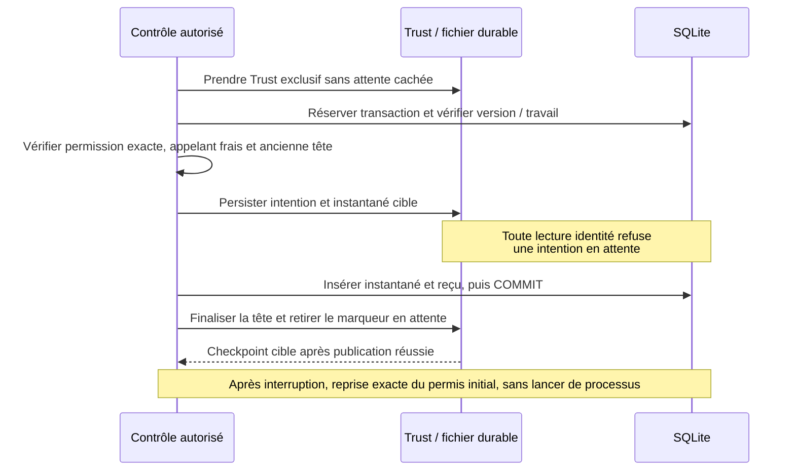

La tête stocke contexte du projet, portée, révision et digest de l'instantané,
révision Trust, racines reconnues, principal publiant, événement et lien vers la
tête précédente. Elle provient d'un `agentIdentityRegistryPermit` privé liant
le contenu exact, la portée et les racines autorisées. La voie normale résout
le jeton courant sous Trust, après attente de SQLite et de nouveau avant
l'intention. Un rôle métier ou un corps JSON ne construit pas ce permis.
IA3b ajoute le producteur humain interne décrit ci-dessous ; son enrôlement réel
et son raccord public restent à réaliser.

La publication prend Trust exclusif en mode non bloquant, puis réserve SQLite
avant lecture. Elle vérifie le travail, la version et le checkpoint précédent,
les liens, l'histoire non réécrite et le contenu approuvé. Elle persiste une
intention dans `agent_identity_authorities` de Trust avant COMMIT, puis publie
la nouvelle tête. Une panne après intention ou après COMMIT laisse une reprise
exacte à effectuer. `recoverAgentIdentityRegistry` exige le permis et l'instantané
initiaux ; il ne prépare pas une nouvelle opération. Une révision Trust changée
est conservée : finaliser un historique ancien ne réactive pas ses droits.

`atomicWrite` ouvre désormais le répertoire avant mutation, synchronise le
fichier, renomme, puis synchronise le répertoire. Une erreur après renommage
signifie un résultat incertain à réconcilier. Les tests ne simulent pas une
coupure électrique ou un stockage qui ment sur `fsync`.

La lecture d'inspection exige un `agentIdentityRegistryCheckpoint` privé et
courant, fourni par le contrôle, puis vérifie tête Trust, chaîne, instantané et
plan dans une transaction de lecture, avant de libérer sa copie. Le consommateur
de message `evaluateAgentIdentityRegistryMessage` obtient aussi ses données
dans le registre, sans snapshot/cadre déclaré dans le message ; depuis IA3a,
il réserve l'écrivain SQLite jusqu'à la décision runtime, comme décrit ci-dessous.
Le temps réel est lu après les attentes. Aucun de ces chemins ne consomme un
droit ni ne lance un effet métier.

Le checkpoint n'est pas recalculé depuis une base importée ou le même ensemble
de fichiers restaurés. Les tests le conservent hors de l'état restauré ; ils
ne déploient aucun témoin externe. Si tous les fichiers et un ancien témoin sont
restaurés ensemble, la fraîcheur n'est pas prouvée. L'émission et la conservation
indépendantes du témoin restent une condition d'intégration ouverte. La portée
est liée au permis du contrôle et au contrat enregistré lu en IA3a. Une
adoption humaine attestée et l’appartenance exacte de la création restent à raccorder. La confidentialité du paquet Go ne protège pas à elle seule le compte
hôte, les fichiers du contrôle ou une image SQLite hostile arbitraire. F01–F07
restent ouverts, de même que l'admission publique, le confinement fournisseur,
l'accord humain exact, la réservation/départ et les droits mémoire.


## Liaison au contrat courant du plan — IA3a

`agent_identity_plan_linux.go` lit le corps et la révision du travail, avec
`agent_identity_plan_heads`, dans la même transaction SQLite que l'autorité.
Il exige un plan enregistré dans `Work.Plans` ou une planification hiérarchique
valide ; le plan classique adopté, la conversion d'une préparation et les
décisions hiérarchiques alimentent cette source commune. Leur enregistrement
ne constitue pas une preuve d'approbation humaine ni un droit de création.

La projection **v1** conserve les définitions, instructions, propriétaires, rôles,
dépendances, hiérarchie, budgets, profils et champs inconnus. Elle retire les
champs identifiés de résultat, statut, tentative, revue, bail, compteur et
candidat intégré. Les sélections mémoire restent des entrées ; leur présence
n'autorise aucun usage. Les résultats/cadrages et leur transmission demandent
toujours leurs propres droits. Les listes gardent leur ordre ; les clés
d'objets sont canonisées à tous les niveaux, sans arrondir les entiers en
`float64`. Changer un champ conservé exige un nouveau permis exact.

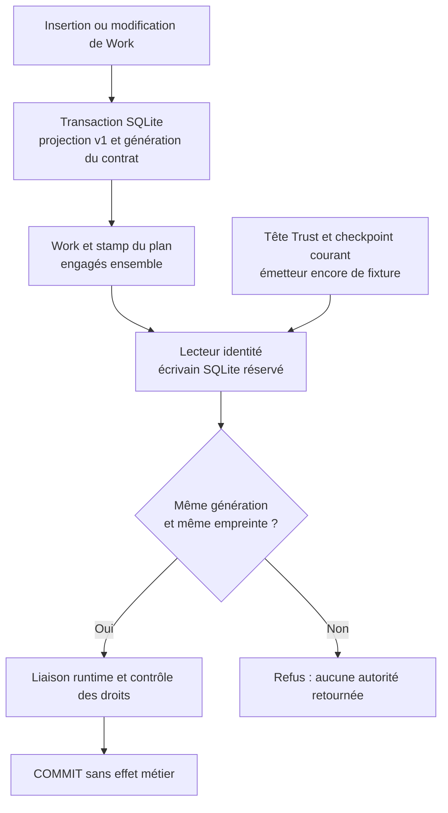

La migration **37** sauvegarde le stockage, crée les stamps initiaux de
génération 1 et installe les triggers d'insertion/modification de `works`.
Chaque modification du contrat augmente sa génération dans cette transaction ;
un simple résultat runtime identifié la conserve. Modifier puis rétablir
l'ancien contenu ne réactive donc pas son ancienne portée, même après
réouverture. Un rollback de transaction annule aussi son stamp. Le compteur
doit rester un entier SQLite positif ; son dépassement technique refuse toute
la modification. Ce compteur n'est pas une limite de ressources opérateur.

Les triggers utilisent `swarm_identity_plan_digest_v1`, fonction pure enregistrée
une seule fois dans le pilote avant ouverture des connexions. Ils vérifient
le stamp précédent avant réécriture. Le lecteur recalcule l'empreinte du corps
et compare le stamp, sa version de projection et la portée de la tête Trust.
L'absence d'un plan retourne `agent_identity_plan_unavailable`, une portée
différente `agent_identity_plan_mismatch`, et un stamp absent/incohérent
`agent_identity_plan_stamp_changed`. Un refus normal ne prépare pas d'intention,
ne publie pas de droit et ne crée pas d'agent. Une erreur de trigger annule
l'écriture du travail, sans résultat vide présenté comme succès.

`readAgentIdentityNextPlanScope` propose en lecture seule la portée constatée
pour un futur permis. Il exige le checkpoint de la tête existante, refuse une
publication en attente et ne déduit aucune autorité d'un import. La publication
normale compare le permis à cette même source après réservation SQLite,
avant intention. La reprise exacte peut terminer un historique préparé avant
un changement de plan ; la lecture normale de cet historique reste refusée.
Pour une décision d'instance, l'ordre est Trust partagé → réservation
d'écrivain SQLite → lecture courante → verrou runtime → temps frais et
évaluation pure → COMMIT. La réservation interdit un changement de Work
pendant l'attente runtime. Le callback fermé ne réentre pas dans Store et les
méthodes runtime appelées n'accèdent pas à SQLite ; les futurs consommateurs
doivent respecter cette précondition. Une erreur, y compris de COMMIT, ne
retourne aucune décision positive. Cette sérialisation a un coût de concurrence
non mesuré et ne réalise toujours ni consommation ni lancement. Le composant
reste privé et ne rend pas l'admission des lanceurs effective.

Le stamp et ses triggers sont des mécanismes d'intégrité applicative, pas une
frontière contre un administrateur hôte ou un processus fournisseur non confiné.
Une restauration physique de tout SQLite peut aussi restaurer l'ancien stamp.
Un checkpoint ne couvrant que la tête d'identité inchangée ne prouve pas la
fraîcheur d'un changement de plan non publié dans cette tête : le futur témoin
indépendant doit couvrir aussi le watermark du plan. Son émetteur/protection
restent ouverts, propriétaires Codex et opérateur. L'appartenance de la création
au plan, son contenu résolu, l'accord humain, sa consommation et tous les
lanceurs publics restent à intégrer ; F01–F07 et IDA ne sont pas requalifiés.

## Émettre un permis depuis une autorité humaine explicite — IA3b

`mintAgentIdentityRegistryPermit` reçoit l'instantané complet, le jeton, le
checkpoint précédent, l'événement et les racines proposées. Le contrôleur lui
fournit séparément un `agentIdentityIssuerAuthority` privé : principal exact
(identifiant local, catégorie `human`, issuer et sujet externe), projet, portée
du plan, révision Trust, référence d'enrôlement, permissions exactes, sous-ensemble
délégable et intervalle de validité. Il s'agit d'une autorité explicite de
publication du registre, distincte des permissions qu'elle plafonne pour ses
nouvelles racines ; ni `agent.create` seul ni un rôle Admin ne l'impliquent.

Cet objet est une entrée de contrôle, pas une configuration lue depuis le JSON
demandé. La référence d'enrôlement est contrôlée syntaxiquement ; sa seule
empreinte ne prouve pas un enrôlement. Le service protégé qui atteste, persiste,
révoque et rafraîchit cette autorité reste à raccorder. Les tests fournissent
une autorité explicite de fixture et effectuent réellement le protocole OIDC
contre un fournisseur local à jetons signés ; aucun compte humain externe
ou service d'enrôlement déployé n'est qualifié par ces contrôles.

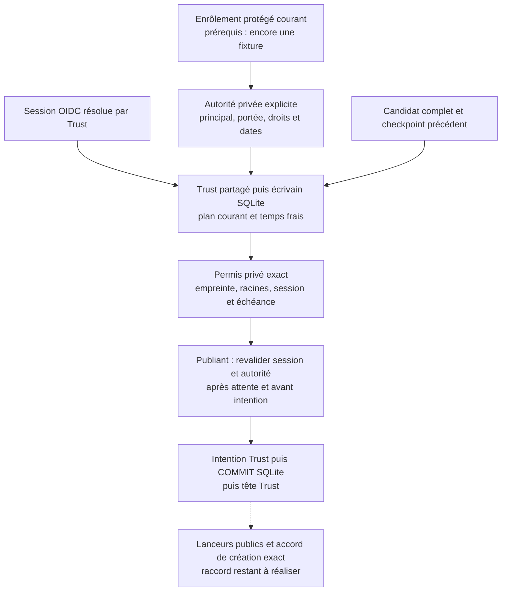

L'émission vérifie d'abord l'identité et l'autorité sous Trust, avant SQL et
recherche du travail. Elle réserve ensuite l'écrivain SQLite, réauthentifie après
cette attente, puis lit le plan et le registre courant. Une session locale, un service workload, une instance,
un homonyme d'un autre issuer/sujet ou une identité non enrôlée est refusé.
Un import ne devient pas une autorité. Les nouvelles racines, y compris celles
non activées, et la réactivation d'une ancienne racine non reconnue respectent
l'émetteur, les permissions, les dates et le plafond délégable explicites.
L'historique est conservé ; l'émission ne publie ni ne consomme un droit.
La validité de ces liens n'atteste pas qu'une délégation a réellement été
demandée par son acteur ; la réception et l'origine des créations restent
à vérifier au consommateur d'admission.

Le permis possède ses listes, lie l'instantané complet, les racines, le
principal, le projet, le plan, la révision Trust et l'événement. Sa preuve privée
lie aussi la session d'émission et une échéance bornée par l'enrôlement et cette
session. L'identité et l'autorité sont vérifiées de nouveau après les lectures.
Une erreur de COMMIT retourne un permis nul. Aucun jeton brut n'est conservé
dans le permis ou le journal. Il n'y a ni durée cachée ni nouveau réglage ;
les dates sont des conditions de cette autorité fournie par le contrôle.

Le publiant recontrôle ces conditions après la réservation SQL et avant
l'intention durable. Une autre session du même humain ne peut reprendre ce
permis ; une échéance passée pendant l'attente est refusée sans intention ni
ligne de registre. `agent_identity_human_issuer_required` distingue un appelant
non humain ; `agent_identity_issuer_authority_required`, une autorité absente
ou incompatible ; `agent_identity_issuer_authority_stale`, des dates ou une
session périmées ; `agent_identity_issuer_ceiling_exceeded`, des racines excédant
l'octroi. Une demande corrigée nécessite une nouvelle émission explicite. La
reprise après intention ne fait que terminer cet historique exact ; elle peut
le finaliser après expiration de la session, sans produire de nouvel accord.

Le chemin bas niveau antérieur reste une capacité privée de contrôleur, utilisée
par les fixtures sans cette preuve humaine. Ce noyau ne rend donc pas tous les
permis du paquet humains et ne sécurise aucun endpoint public existant. Le futur
adaptateur public devra imposer le nouveau producteur et sa source d'enrôlement
protégée ; aucun booléen reçu d'un agent ne choisit un chemin. Le stockage et la
reprise des capacités privées hors processus restent à réaliser. Une copie
ancienne de l'autorité ne prouve pas sa non-révocation externe. Une session
OIDC catégorisée humaine ne prouve ni présence humaine physique, ni authentification
renforcée, ni accord d'un approbateur distinct sur le contenu résolu d'une création.
Ces critères, le témoin du plan, F01–F07 et les droits mémoire restent ouverts.

Recette locale : `go test ./internal/engine -run '^TestAgentIdentityIssuer'
-count=1 -v -timeout=0`, puis les contrôles ciblés du registre et du plan. Les commandes,
sources figées, deux échecs initiaux et résultats sont conservés dans le
[rapport IA3b](../plans/actions-confiance/verification-identites-agents-20261016/ia3-issuer-20261017/RAPPORT-IA3b.md).


## Conserver le reçu humain dans l’historique — IA3c.1

La tête de publication humaine passe au format 2 et contient un
`issuance_receipt` version 1. La tête lie déjà l’instantané exact, les racines,
l’événement et la tête précédente ; son empreinte couvre désormais aussi le reçu.
Le reçu conserve le principal humain exact, le projet, le plan, la révision Trust,
la référence d’enrôlement fournie, les permissions et dates de cette autorité,
l’empreinte de session, sa date d’expiration, l’instant d’émission et la fin de
validité du permis. Cette fin est le minimum des deux expirations. Aucun jeton
brut n’y figure. Les listes retournées sont possédées par leur lecteur.

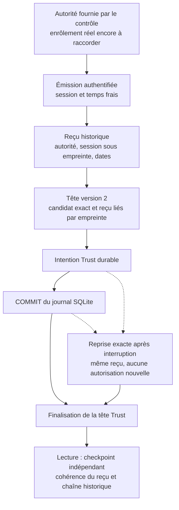

Le format 2 exige le reçu ; le format 1 reste réservé aux capacités privées
antérieures sans reçu. Les combinaisons incohérentes sont refusées. Les anciens
lecteurs ne comprenant que le format 1 refusent les nouvelles têtes ; le schéma
SQLite reste 37. Le protocole existant stocke exactement le même reçu dans
l’intention, le journal et la tête finale, y compris après réouverture et reprise
aux deux frontières de durabilité. La lecture historique valide les dates au
moment d’émission ; elle ne transforme pas un reçu expiré en autorité courante.

Ce reçu est une trace liée au contrôle, pas une signature indépendante ni une
preuve d’enrôlement réel, de non-révocation externe ou de présence physique.
Sa lecture exige toujours le checkpoint protégé indépendant. Restaurer ensemble
le stockage et son témoin, ou contrôler le même UID sans confinement, reste hors
de la garantie. Le reçu ne permet pas de reconstruire un permis privé ni de
reprendre sans la capacité de contrôle originale. Bootstrap, témoin couvrant le
plan, admission publique, approbation distincte et droits mémoire restent ouverts.

Vérification : les résultats et limites de cet incrément sont conservés dans le
[rapport IA3c.1](../plans/actions-confiance/verification-identites-agents-20261016/ia3-issuance-receipt-20261017/RAPPORT-IA3c1.md).


## Authentifier une réponse du futur service d’enrôlement — IA3c.2a

Le paquet isolé `internal/enrollmentproof` implémente un format de réponse signée,
sans raccord au moteur ou à un transport réseau. `NewVerifier` reçoit la clé
publique épinglée par le contrôle et le digest de projet ; aucune clé de confiance
n’est extraite d’une réponse. `NewChallenge` génère un nonce aléatoire de 256 bits
et lie clé/projet/digest de la demande complète. `SignResponse` signe le cadre
avec Ed25519 et une séparation de domaine/version ; il ne décide pas des droits.
Les clés privées des tests sont éphémères et locales ; aucun bootstrap réel
n’est activé.

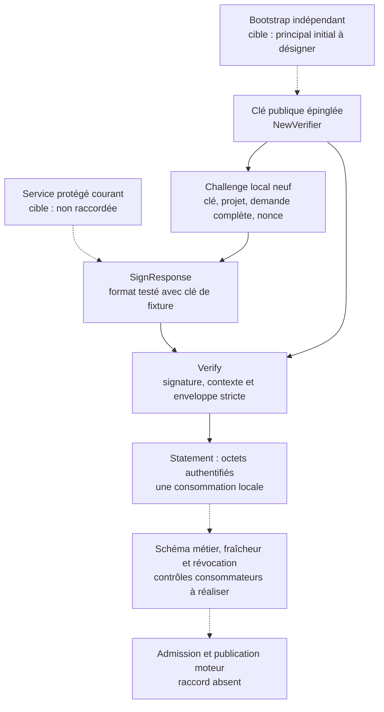

`Verify` exige les quatre clés exactes `protocol`, `challenge_digest`, `payload`,
`signature`, toutes de type chaîne ; doublons, variantes de casse, champs inconnus,
valeurs null/non textuelles et données supplémentaires sont refusés. Le payload
et la signature utilisent base64url canonique sans padding. Le payload reste
opaque : une chaîne vide authentifiée ne signifie ni enrôlement ni autorisation.
`Statement.Payload()` rend une copie ; le client doit encore valider le schéma,
les droits et la source courante. Une signature n’apporte pas de confidentialité.

Une réponse valide consomme une seule fois son challenge local, sous mutex.
Le handle partage son état interne même après copie de valeur Go.
Une réponse refusée ne le consomme pas ; une nouvelle requête emploie un nouveau
nonce. Les replays simultanés, le changement de projet/demande, la réécriture
d’un digest sur une signature capturée, une clé non épinglée et une signature
d’un autre domaine sont refusés. Le challenge n’est pas reconstructible depuis
JSON ; son état n’est pas durable et ne réserve aucune publication ou exécution.

**Limite explicite :** un service peut signer « actif » puis révoquer avant la
réception ou l’application. Cette réponse peut encore être authentique ; le
paquet ne prouve aucune fraîcheur à la décision finale. Ni signature, ni nonce,
ni reçu historique ne remplacent une lecture courante et un point de
linéarisation de révocation. Aucun TTL, timeout, plafond métier ou réglage
opérateur n’est ajouté ici. Les tailles Ed25519/SHA-256 et le nonce définissent
le format cryptographique ; elles ne sont pas des budgets d’exécution.

Le [contrat cible d’enrôlement](../plans/actions-confiance/identites-agents-enrolement-IA3c2.md)
distingue ce module vérifié, les garanties encore absentes et les décisions de
déploiement. Recette isolée : `go test ./internal/enrollmentproof -count=1
-timeout=0`, puis `-race` et `go vet` sur ce paquet. Les preuves et limites sont
conservées dans le [rapport IA3c.2a](../plans/actions-confiance/verification-identites-agents-20261016/ia3-enrollment-proof-20261017/RAPPORT-IA3c2a.md).


## Journal durable de l’enrôlement — IA3c.2b

`internal/enrollmentstate` ajoute un journal SQLite dédié, isolé du moteur.
`Open` reçoit un chemin contrôlé, une clé publique épinglée et le digest de
projet. Le stockage exige WAL et des transactions `BEGIN IMMEDIATE`, avec
`synchronous=FULL` sur chaque connexion. Aucune clé privée n’est persistée ;
aucun service ou compte système réel n’est créé. Le journal n’est pas une source
d’autorité métier : le corps de chaque enregistrement reste un tableau d’octets
opaque, dont le schéma et les permissions doivent être validés au futur raccord.

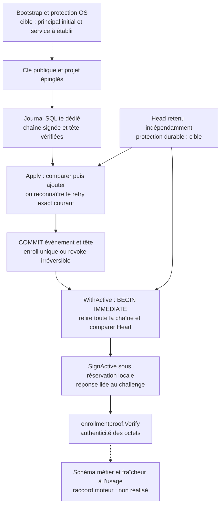

Le protocole `swarm-enrollment-change-v1` impose un JSON canonique à dix champs :
`protocol`, `authority_key_id`, `project_digest`, `sequence`, `previous`,
`operation`, `id`, `body`, `signature`. La signature Ed25519 couvre le préfixe
du protocole, NUL, `change`, NUL, puis ce JSON avec `signature` vide. `body` et
`signature` sont en base64url canonique sans padding. La tête contient la séquence
et SHA-256 du cadre signé complet. Le format refuse les clés inconnues, doublons,
variantes de casse, null, types erronés et encodages non canoniques. Les identifiants
sont opaques, jamais des chemins ou du SQL ; les requêtes sont paramétrées.
Les identifiants vides, UTF-8 invalides ou avec caractères de contrôle sont refusés.

`SignChange` ne signe qu’une proposition. `Apply` vérifie la clé, le projet,
l’intégralité de la chaîne et la tête attendue avant d’ajouter un événement.
`enroll` ne peut créer un identifiant qu’une fois ; `revoke` exige un identifiant
actif et un corps vide. Un identifiant révoqué reste dans l’historique et ne peut
être réactivé ; une autre création exige un nouvel identifiant. Un retry exact
après réponse perdue ne réussit que si cet événement est encore la tête courante.
Une révocation ultérieure empêche de rejouer l’ancien enrôlement avec succès.
L’événement et sa tête sont écrits dans la même transaction ; une erreur de
stockage n’est jamais convertie en succès vide.

Chaque lecture `WithActive` prend la réservation écrivain avant de relire la
chaîne, puis garde cette réservation pendant le callback. Une révocation concurrente
ne peut pas committer pendant ce callback ; après son propre COMMIT, une lecture
active est refusée. Le callback ne doit ni réentrer dans le journal, ni attendre
un autre écrivain, ni produire d’effet externe irréversible : une erreur de fin
de transaction reste possible après son appel. `SignActive` ne retourne les
octets signés qu’après succès de la transaction ; son `ActiveReply` contient
`schema_version: 1`, `head` (`sequence`, `digest`) et `record` (`id`, `body`, encodé en base64 JSON,
et `enrolled_sequence`, séquence de création dérivée de la chaîne).
Cette réponse peut devenir ancienne dès la réservation libérée.

Le contrôleur doit fournir un `Head` conservé indépendamment du journal/import.
La tête zéro signifie uniquement une genèse explicitement autorisée. Restaurer
un ancien journal cohérent est détecté contre le témoin plus récent ; restaurer
le témoin lui-même retire cette garantie. Le journal ne persiste pas ce témoin
indépendant et ne résout pas le transfert atomique entre journal et témoin externe.
Une réponse perdue est récupérable avec le changement exact signé ; cela ne prouve
pas une reprise distribuée, un arrêt effectif ou la livraison d’une révocation.

Les refus distinguent contexte, tête, changement invalide, identifiant absent,
déjà enrôlé et révoqué ; les erreurs SQLite et d’annulation conservent leur cause.
La contention remonte immédiatement, sans `busy_timeout` ni retry automatique.
WAL exige un système de fichiers local compatible ; ses fichiers auxiliaires
font partie du stockage à protéger, pas seulement le fichier principal.
La séquence SQLite/Go est un entier signé sur 64 bits : son dépassement est refusé
comme limite de représentation, pas comme politique d’exécution. Aucune durée,
budget ou limite métier n’est introduit. Une lecture reconstruit toute la chaîne :
son coût croît avec l’historique ; aucune performance à grande échelle n’est prouvée.

Recette isolée : `go test ./internal/enrollmentstate -count=1 -timeout=0`, puis
`-race`, `go vet` et `go build` sur ce paquet. Le
[rapport IA3c.2b](../plans/actions-confiance/verification-identites-agents-20261016/ia3-enrollment-state-20261017/RAPPORT-IA3c2b.md)
conserve les refus, l’échec concurrent initial, la correction et les preuves finales.
Les tests de réouverture et d’erreur transactionnelle ne simulent pas une panne
matérielle. Service protégé, témoin externe durable, schéma d’autorité humaine,
révocation/départ distribués et admission publique restent ouverts ; F01–F07
et les droits mémoire ne sont pas requalifiés.


## Valider le document d’autorité des deux côtés — IA3c.2c

`internal/enrollmentauthority` définit le document d’autorité humaine et son
producteur/consommateur local. Le journal générique conserve des corps opaques ;
ce paquet refuse de les traiter comme autorité sans schéma complet et contexte
attendu indépendant. Il retourne des données validées, jamais un permis privé
moteur. Aucun endpoint ou lanceur n’importe ce paquet.

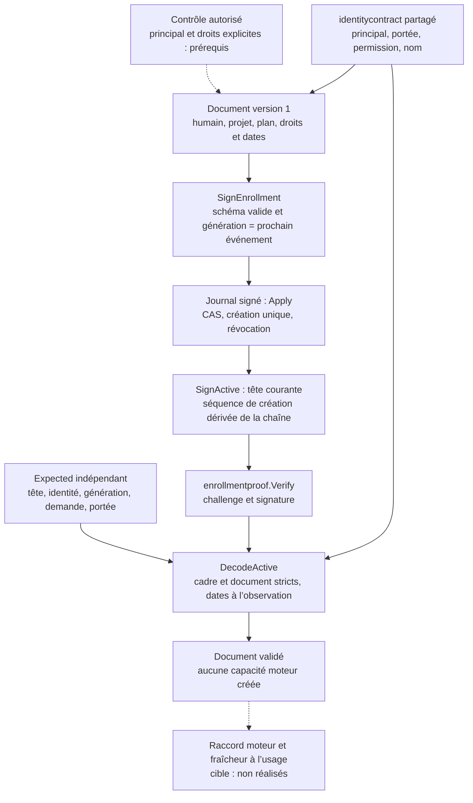

Le document version 1 exige les onze champs `schema_version`, `enrollment_id`,
`generation`, `project_context_digest`, `principal`, `scope`,
`trust_configuration_revision`, `permissions`, `delegable`, `not_before`,
`expires_at`. `principal` contient `principal_id`, `principal_kind`, `issuer`, `subject` ;
`scope` contient `work_id`, `plan_version`, `plan_digest`. Chaque permission a
`operation` et `resource`. Les clés sont exactes et l’encodage JSON canonique
est celui d’`Encode`, y compris l’ordre déclaré, les dates UTC RFC3339Nano et
`delegable: []` pour une liste vide. `Decode` refuse omission, null, doublon,
champ inconnu, variante de casse, type erroné ou encodage différent, même imbriqués.
Le producteur peut fournir des dates avec un autre fuseau : `Encode` conserve
leurs instants et les écrit en UTC, sans inventer de durée.

`identitycontract` partage les structures et validations avec les types privés
moteur ; `safeName` délègue aussi à cette source. Le JSON et les règles existantes
restent inchangés : noms locaux ASCII de 1 à 100 octets, version de plan et
révision Trust positives, digest SHA-256 en hex minuscule, ressources exactes
sans glob, six opérations existantes (`agent.create`, `memory.read`,
`memory.summarize`, `memory.transmit`, `tool.invoke`, `effect.execute`). Cette
syntaxe existante des noms ne s’applique pas aux issuer/sujets OIDC : ils restent
opaques, comparés exactement sans normalisation d’URL, casse ou espaces.
Le document d’enrôlement exige un principal `human` valide ; ni `local`, ni
`service`, ni rôle métier ou nom identique ne satisfait cette condition.

Les droits doivent être non vides, valides et sans doublon. Les délégables sont
valides, sans doublon et inclus dans les droits. Les deux dates sont explicites,
avec `not_before < expires_at`. La fenêtre est fermée au début et ouverte à
l’expiration. `Encode`/`Decode` vérifient sa structure, sans affirmer que l’autorité
est valable maintenant ; `DecodeActive` exige l’instant d’observation du contrôle.
Ce paramètre n’est pas une preuve d’horloge fraîche ; le raccord final devra
le fournir au bon point sous sérialisation.

`SignEnrollment` lie la génération à `base.Sequence + 1`, au projet exact et
à l’identifiant du document avant signature. L’ajout doit encore réussir sous CAS.
Le journal dérive ensuite `Record.EnrolledSequence` de l’événement `enroll`
vérifié, sans prendre ce nombre dans son corps. La génération reste stable
lorsque d’autres enregistrements ou révocations font avancer la tête. Le format
SQLite et les événements signés antérieurs ne changent pas ; leurs lectures
reconstruisent ce champ. Les anciens cadres de réponse sans ce champ ne sont
pas acceptés par le nouveau consommateur strict ; aucun client moteur existant
n’était raccordé à ce format isolé.

`DecodeActive` reçoit un `Statement` authentifié et `Expected` fourni par le
contrôle : tête courante attendue, ID d’enrôlement, génération, projet, principal
complet, portée complète, révision Trust et digest de demande. Il exige leur
égalité exacte dans la requête authentifiée, le cadre, le document et la séquence
de création du journal. Un document pourtant signé via le chemin opaque avec
une génération déclarée différente de l’événement est refusé. Le contrat du
contenu complet de `request_digest` reste à raccorder au moteur (EP-02).

Les erreurs distinguent document invalide, contexte incompatible et fenêtre
inactive ; aucun document partiel n’est retourné. Un document JSON seul peut
être structurellement valide sans être authentifié ; sa reconstruction n’accorde
aucun droit. Un ancien `Statement` vérifié avec son ancien `Expected` peut encore
passer : ce contrôle ne relit pas le service et ne prouve pas une non-révocation
à l’usage. Aucun budget, TTL, timeout ou réglage opérateur nouveau n’est ajouté.

Recette : `go test ./internal/identitycontract ./internal/enrollmentauthority
./internal/enrollmentstate -count=1 -timeout=0`, puis le même lot `-race`,
`go vet` et compilation ciblée ; vérifier séparément les consommateurs privés
moteur après extraction. Le [rapport IA3c.2c](../plans/actions-confiance/verification-identites-agents-20261016/ia3-enrollment-authority-20261017/RAPPORT-IA3c2c.md)
conserve ces contrôles et leurs limites. Enrôlement réel, source de temps,
témoin durable indépendant, point de linéarisation final, admission publique,
descendants et F01–F07 restent ouverts.


## Lier la demande complète au challenge — IA3c.2d

`internal/enrollmentrequest` définit une seule finalité :
`agent_identity_registry_publication`. Le paquet couvre le candidat complet,
pas seulement son ID ou une empreinte fournie. `Prepare` valide les données,
les encode et en conserve une copie immuable ; il n’authentifie pas leur source.
`Decode` peut reconstruire cette donnée depuis un cadre canonique, sans créer
une capacité privée moteur ni prouver l’identité déclarée.

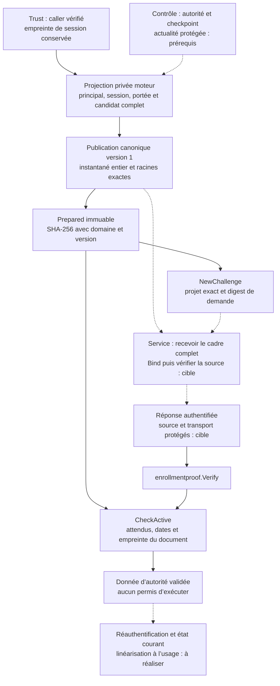

`Publication` version 1 a seize champs, tous présents : `schema_version`,
`purpose`, `project_context_digest`, `principal`, `session_digest`,
`session_verified_at`, `session_expires_at`, `scope`,
`trust_configuration_revision`, `enrollment`, `event_id`, `snapshot_revision`,
`snapshot_digest`, `snapshot`, `root_grants`, `previous_registry_head_digest`.
`enrollment` contient `id`, `generation`, `head` (`sequence`, `digest`) et
`document_digest`. Principal et portée réutilisent `identitycontract`.
Le checkpoint précédent est une chaîne vide explicite pour la seule genèse
fournie par le contrôle ; l’omission et null sont refusés. L’enrôlement ciblé
exige une génération positive, une tête la couvrant et le digest du document.

Le JSON canonique suit l’ordre des champs Go et écrit les dates en UTC, sans
inventer de durée. `snapshot` transporte en base64 JSON les octets entiers de
l’instantané ; `snapshot_digest` doit être leur SHA-256 exact. Ce paquet vérifie
un contenu JSON de type objet, sans réimplémenter son schéma de grants, ses transitions
ou l’autorité de publication. La projection moteur applique ses validations
existantes puis utilise le JSON canonique complet du snapshot. L’ordre des
racines reste exact, comme dans la tête du registre ; ni tri ni déduplication
silencieuse. Doublons de racines, noms invalides, cadres non canoniques et
clés inconnues/dupliquées, même imbriquées dans le cadre, sont refusés. Les
règles du contenu embarqué restent celles du moteur.

Le digest de demande est SHA-256 de `swarm-enrollment-publication-request-v1`,
NUL, `request`, NUL, puis du cadre canonique entier. Ce digest diffère de celui
du seul snapshot. Il couvre aussi la référence et les dates de session,
l’enrôlement attendu, son document exact et les deux checkpoints distincts :
tête d’enrôlement et tête précédente de publication. Modifier l’une de ces
dimensions change la demande ; une réponse liée à l’ancienne demande ne couvre
pas la nouvelle. La finalité est fixe : un autre type d’action exige un contrat
explicite, pas une chaîne libre réutilisant ce format.

`Prepared.Bytes()` et `Publication()` rendent des copies possédées. Les copies
de valeur Go du handle ne peuvent modifier ni ses octets ni son digest ; les
champs internes ne se reconstruisent pas par JSON. Cela protège la cohérence
locale, pas une frontière OS. `Expected()` projette depuis ces mêmes octets
les attendus du consommateur d’autorité, au lieu de maintenir deux descriptions.
`NewChallenge` refuse un vérificateur d’un autre projet. Le service futur doit
recevoir le cadre complet et appeler `Bind` pour comparer projet et digest ;
`Bind` n’authentifie pas le pair ni l’enveloppe cryptographique. Ces vérifications
restent celles de `SignResponse`/`Verify` et du contrôle protégé.

`CheckActive` vérifie la fenêtre de session observée, les attendus complets puis
le digest du document d’autorité retourné. Un autre document authentique pour
le même ID/génération, avec des droits ou plafonds différents, est refusé.
L’observation de session est incluse ; l’expiration est exclue. Une date fournie
ne prouve ni horloge fraîche ni session encore active. Le digest ne contient
aucun jeton brut et ne doit jamais servir lui-même de credential d’accès.

Dans le moteur, `resolveAgentIdentityCaller` conserve désormais dans son résultat
privé le `TokenDigest` produit par Trust. La projection
`prepareAgentIdentityEnrollmentRequest` ne reçoit donc pas un autre jeton à
associer au caller. Elle vérifie caller/autorité/portée/checkpoint, la référence
d’enrôlement et le snapshot avec les validateurs existants. Cette fonction pure
ne lit ni Trust ni SQLite : son appelant futur doit résoudre et sérialiser leur
état courant. Elle ne remplace pas le producteur de permis, la validation des
nouveaux plafonds sur l’historique, l’approbation humaine ou le départ d’un agent.
Les callers runtime sans session humaine ne deviennent pas des émetteurs.

Aucun endpoint, transport ou service réel ne consomme ce format. Les octets et
les empreintes ne démontrent pas une adoption humaine du plan, une non-révocation
courante ou un effet unique. Le coût croît avec la taille du candidat ; aucune
limite de transport, durée, TTL, budget ou politique nouvelle n’est ajoutée.
La source courante, la fraîcheur finale, le témoin durable indépendant et le
versionnement du cadre de lecture avant client externe restent ouverts.

Recette : `go test ./internal/enrollmentrequest -count=1 -timeout=0`, même lot
avec `-race`, puis `go vet` et `go build` du paquet. Vérifier séparément la
projection et les consommateurs privés moteur. Le [rapport IA3c.2d](../plans/actions-confiance/verification-identites-agents-20261016/ia3-enrollment-request-20261017/RAPPORT-IA3c2d.md)
conserve commandes, collecte réelle, sources et limites. Aucun PASS global
F01–F07, IDA ou droits mémoire n’en découle.


## Version explicite du cadre de lecture — IA3c.2e

Le cadre `ActiveReply` est désormais versionné : `schema_version` vaut exactement
`1` (`enrollmentstate.ActiveReplySchema`). Le format a trois champs de premier
niveau : `schema_version`, `head`, `record`. `SignActive` écrit cette version sous
la réservation du journal ; la signature couvre tous les octets, version comprise.
Ce numéro décrit le cadre de lecture : il ne change pas le schéma SQLite, les
événements signés, le challenge, le document d’autorité ou la demande complète.

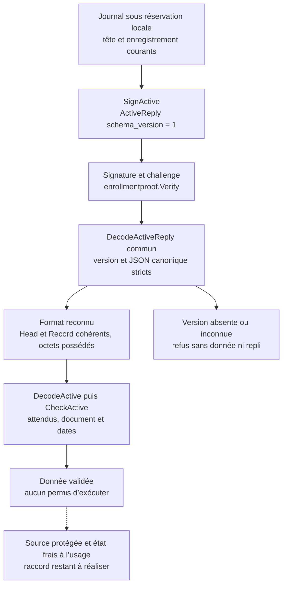

`enrollmentstate.DecodeActiveReply` est l’unique décodeur de ce cadre. Une version
absente, nulle, zéro, négative ou inconnue est refusée ; une version d’un type
erroné aussi. Les clés inconnues, doublons, variantes de casse, omissions,
encodages non canoniques et données supplémentaires sont refusés. La tête doit
être positive avec un digest valide ; la séquence de création doit être positive
et couverte par cette tête. L’identifiant conserve les règles opaques du journal.
`body` est une chaîne base64 JSON, éventuellement vide, pas null. Un corps opaque
vide reste valide pour le journal ; il ne devient pas un document d’autorité.

Le consommateur `enrollmentauthority.DecodeActive` délègue le décodage à ce point
commun puis applique ses propres contrôles d’autorité. Il conserve la cause par
chaînage : une version non supportée reste détectable avec `ErrReplyVersion`,
tout en étant un `ErrDocument` pour le consommateur. Une forme incorrecte produit
`ErrReply`. Aucun résultat partiel n’est retourné ; un paquet authentique d’une
version inconnue reste refusé. Le décodage seul ne vérifie pas sa signature :
il doit porter sur le payload d’un Statement authentifié.

**Compatibilité : rupture explicite du prototype de lecture.** L’ancien cadre
sans version est refusé, sans réessai automatique dans un format antérieur. Les
producteurs et consommateurs doivent sélectionner la version 1 explicitement ;
le seul ensemble supporté est `{1}`. Aucun client externe n’était raccordé.
La négociation et l’interopérabilité entre véritables pairs restent à vérifier
avant leur premier raccord (I2c-06 partiel au déploiement). Les réponses historiques
et leurs preuves ne sont pas réécrites ; aucune migration du journal n’est requise.
Une version correcte ne prouve ni fraîcheur, ni non-révocation, ni droit d’action.

Recette : `go test ./internal/enrollmentstate ./internal/enrollmentauthority
./internal/enrollmentrequest -count=1 -timeout=0`, même lot avec `-race`, puis
`go vet` et compilation ciblée. Le [rapport IA3c.2e](../plans/actions-confiance/verification-identites-agents-20261016/ia3-enrollment-reply-20261017/RAPPORT-IA3c2e.md)
conserve le contre-exemple sans version, les refus, sources et limites. Aucun
TTL, timeout, budget ou politique opérateur nouveau n’est ajouté.

## Frontière adoptée — local pilote, distant prévu

Décision utilisateur du 17 octobre 2026 : service local sous compte système
distinct avec confinement vérifié pour le développement et le pilote. Une
autorité sur une machine et une administration séparées est prévue pour les
installations futures, notamment clientes. Leur demande commerciale reste une
hypothèse utilisateur ; aucun service ni parcours de configuration n’est encore
livré. Le [plan d’enrôlement](../plans/actions-confiance/identites-agents-enrolement-IA3c2.md)
détaille la configuration initiale, le modal Admin et les critères IA3c.2f-01 à -06.
Le choix d’hébergement n’est plus en attente. Le parcours humain retenu est
précisé ci-dessous ; son implémentation, l’enrôlement effectif et l’activation
restent ouverts.

Le local conserve noyau et administration hôte dans la base de confiance.
Le distant vise une séparation face à la compromission de l’hôte Swarm, sous
réserve d’administration distincte et de contrôles propres à l’autorité. Le
contrat métier reste commun : demande exacte, identité, délégation, source
courante et révocation. Les adaptateurs de transport ne remplacent aucun de ces
contrôles. Portabilité et migration entre services réels restent à prouver.

L’installation initiale devra préparer le mode retenu, puis le modal Admin gérer
une configuration protégée, persistante et révisée. Setup, API, CLI et UX doivent
utiliser la même validation ; preview sans mutation, refus des révisions périmées
et conservation de l’historique sont requis. Choix enregistré, configuration
appliquée et preuve effective restent distincts. Aucun secret dans le navigateur,
les sources agents ou l’export d’un projet ; aucune racine apprise du pair.
L’option distante sera indiquée comme prévue tant que non implémentée.
Docker/natif décrit l’installation de Swarm, pas la frontière de son autorité.

### Authentification locale par défaut et réglage UX

Précision utilisateur du 17 octobre 2026 : aucun fournisseur d’identité existant.
La cible est un **compte humain local personnel par défaut**, proposé par un
assistant au premier lancement, puis configurable dans Admin. Le fournisseur
d’entreprise est optionnel. Ce choix d’authentification est indépendant de
l’hébergement local/distant de l’autorité et du fournisseur du modèle IA.
Aucun fournisseur externe n’est requis pour démarrer le workflow après
l’enrôlement local et la vérification de ses prérequis de sécurité.

Le défaut concerne le parcours d’une installation vierge, jamais un compte,
un mot de passe commun ou une autorisation automatique. Le bootstrap exige une
preuve d’installation indépendante du premier visiteur et du canal des agents,
consommée une seule fois. Le compte est vérifié par l’autorité ; un UID, un cookie
cockpit ou `principal_kind: human` déclaré ne suffit pas. Le principal authentifié
est de catégorie `human`, avec émetteur propre à l’installation et sujet stable ;
il ne se confond pas avec la catégorie technique `local` non attestée.

Mode demandé, effectif et preuves sont affichés séparément. Persistance, preview
sans mutation, contrôle de révision et validation sont communs à setup/API/CLI/Go/UX.
Une erreur ou perte de configuration ne relance pas l’enrôlement initial. Changer
de fournisseur exige des droits vérifiés et une liaison explicite des comptes ;
ni nom ni email ne fusionnent identités ou droits. Récupération et révocation
préservent l’historique. Les secrets ne sont ni persistés côté navigateur ni
communiqués au modèle. L’identité doit être contrôlée sur tout le workflow.

**État : décision et critères documentés, assistant et authentification locale
non implémentés.** Le format de configuration actuel ne contient pas ce réglage.
Le [contrat d’enrôlement](../plans/actions-confiance/identites-agents-enrolement-IA3c2.md)
décrit le graphe cible et les sept critères IA3c.2f-04-UX1 à UX7 ; aucun n’est
clos par ce texte. Les preuves du stockage et du canal restent réutilisables
dans leur périmètre ; elles ne prouvent pas ce parcours humain.

La protection de la clé et l’identification du pair ne suffisent pas : l’autorité
doit contrôler les droits de la demande exacte et son état courant. SO_PEERCRED
rapporte des credentials de processus, pas un rôle de workflow
([Linux unix(7)](https://man7.org/linux/man-pages/man7/unix.7.html)). Un canal
accessible à un agent sous le même UID peut défaire la séparation recherchée.
Aucune indisponibilité n’ouvre de secours permissif ni de bascule automatique
vers local. Le passage local → distant sera une migration autorisée conservant
preuves, consommation, réservations et checkpoints ; aucun effacement ou
réenrôlement implicite. Le contexte pilote ne dispense d’aucun contrôle.

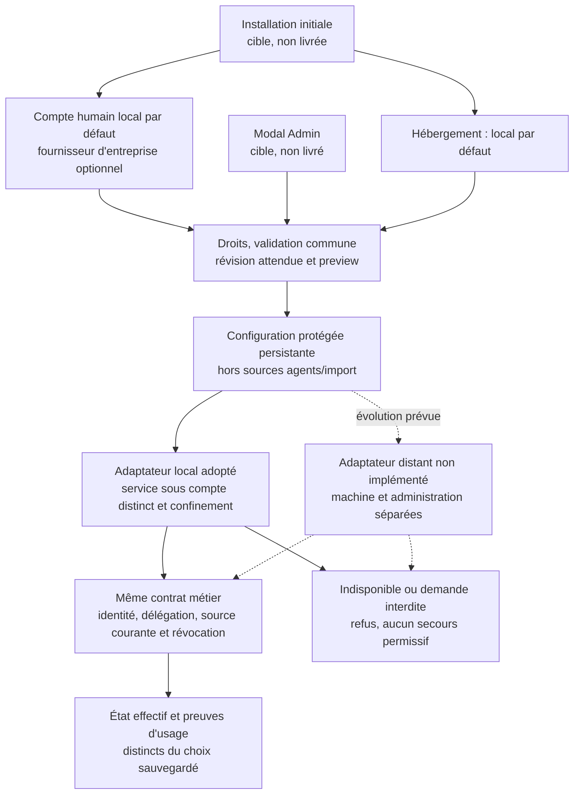

État vérifié de cette tranche : décision et documentation seulement. install.sh
connaît Docker/natif, compose.yaml ne définit qu’un service Swarm sous l’UID/GID
opérateur, et trustRemoteOrigin n’accepte qu’une origine HTTP de boucle locale
pour Trust. Aucun ne fournit ce nouveau service ni son adaptateur distant.
Les modules IA3c.2a à .2e restent vérifiés en fixtures ; F01–F07 et EP-01 à EP-10
ne sont pas clos par la décision d’hébergement. Le [rapport IA3c.2f](../plans/actions-confiance/verification-identites-agents-20261016/ia3-deployment-choice-20261017/RAPPORT-IA3c2f.md)
lie la décision, les sources observées, les rendus et les contrôles documentaires.

## Noyau de configuration d’installation — IA3c.2f-02a

`internal/enrollmentconfig` fournit désormais un format strict et un stockage
Linux pour la **configuration souhaitée** de l’autorité locale. Ce paquet n’est
importé par aucun adaptateur moteur, CLI, HTTP, installateur ou écran Admin ;
aucun réglage n’est actif dans l’application. Il prépare IA3c.2f-02, encore partiel.
Le mode `remote` est connu mais refusé par ErrMode, sans repli local.

Le bootstrap fournit indépendamment `Pins` : `installation_digest` (SHA-256 hex
minuscule), `authority_public_key` (32 octets Ed25519 en base64url sans padding)
et `bootstrap_principal` humain complet selon identitycontract. Le fichier ouvert
ne fournit pas sa propre racine. Le principal et la racine sont immuables dans
les changements ordinaires ; aucune clé privée n’est un champ du format.
Une valeur bien formée ne prouve pas sa provenance ni une authentification OIDC.

Le cadre `Change` comporte exactement `schema_version:1`, `event_id`,
`expected_head`, `values` et `reason`. `values` contient `mode:"local"` et
`local_socket_path`, absolu et canonique. La limite Linux de 107 octets est dérivée
de sockaddr_un et exposée par `LocalSocketPathMaxBytes` : limite technique du
transport, sans rapport avec un délai ou un budget. Head contient `revision`
comme **chaîne décimale uint64** et `digest` hex ; le checkpoint de genèse seul
est `{"revision":"0","digest":""}`. Zéro n’est pas une révision courante.
Les clients doivent conserver ces révisions comme chaînes, sans Number JavaScript.

EncodeChange/DecodeChange valident la demande commune des futurs adaptateurs.
Encode/Decode valident le snapshot complet (`schema_version`, `pins`, `history`).
Chaque entrée porte `change`, `actor`, `at` ; son hash SHA-256, séparé par domaine
et lié aux pins, dépend aussi de la tête précédente dans change. Dates UTC,
identifiants/raisons textuels non vides, absence de doublons d’événements et chaîne
exacte sont vérifiés. Les décodeurs exigent les octets canoniques ; champs inconnus,
doublons, casse, nulls, omissions, types erronés et trailing sont refusés, sans
résultat partiel. Le hash de chaîne n’est pas une signature numérique.

| Opération Go | Entrée attendue / résultat | Limite |
| --- | --- | --- |
| Open | Répertoire existant, UID réel attendu, pins indépendants, Authorizer non nil ; handle de stockage | Peut initialiser config.lock ; aucun fichier config.json ni valeur par défaut créé |
| Preview | Change et instant explicite ; Projection avec base, proposed et current_event_replay | Réservation, validation complète et autorisation ; aucune écriture de configuration ni événement |
| Create | Bootstrap explicite à tête zéro ; View sauvegardée | Ne remplace pas une configuration existante ; seul retry exact du premier événement encore courant reconnu |
| Apply | Change avec tête attendue ; View sauvegardée | Configuration absente refusée, CAS, événement unique et retry exact du seul événement courant |
| Read | Head courant fourni indépendamment ; View avec snapshot possédé | Refus des pins/tête divergents ; ne découvre pas son témoin dans le fichier |

Le répertoire final doit appartenir à l’UID du processus et être exactement 0700.
Les composants sont ouverts par descripteurs sans suivre les symlinks ; les
ancêtres appartiennent à root ou au service et ne sont pas modifiables par
groupe/autres, sauf un répertoire sticky appartenant à root tel /tmp. Verrou et
configuration doivent être des fichiers réguliers 0600, même propriétaire et un
seul lien. FIFO, symlink, lien physique supplémentaire et métadonnées trop ouvertes
sont refusés. Répertoire revérifié à la réservation et avant persistance ; le
fichier temporaire réel est vérifié, sans contourner un umask restrictif.
Ces contrôles ne confinent pas un agent partageant l’UID du service.

La réservation non bloquante retourne ErrBusy sans timer ou retry interne.
Authorizer reçoit des copies et s’exécute sous cette réservation : son résultat
humain doit égaler le principal épinglé ; il doit résoudre l’autorité authentifiée,
pas recopier un champ de demande, et ne doit pas réentrer dans le Store. Les
fixtures de callback ne prouvent pas cette authentification réelle. Read reste
une API interne de données ; le futur transport devra en autoriser l’accès aussi.

L’application écrit un temporaire privé, synchronise le fichier, effectue un
rename atomique (sans remplacement lors du bootstrap), puis synchronise le
répertoire. Une erreur après rename retourne ErrIndeterminate et aucun View :
une mutation peut déjà être visible. Observer avec le checkpoint indépendant,
puis reprendre l’événement courant exact, de nouveau autorisé, sans ajouter
l’historique et avec une nouvelle barrière de synchronisation. Une révision
périmée retourne ErrConflict ; un événement différent/réutilisé/historique ErrEvent.
ErrPath/ErrFormat/ErrVersion/ErrPins/ErrHead distinguent les autres refus.
Une erreur d’autorisation conserve sa cause via errors.Is ; annulation observée avant
l’entrée en persistance refuse l’écriture. Après cette entrée, une annulation
concurrente ne prouve pas l’absence de mutation : observer le résultat courant. L’absence de progression ne donne aucun droit de retry.

Preview valide la même représentation que l’écriture pour les mêmes entrées,
instant compris. L’instant d’application réel peut produire une autre empreinte :
le proposed Head d’un aperçu n’est jamais le témoin d’une écriture effectuée.
Révisions ordonnent les événements ; les horodatages ne constituent pas une
politique d’expiration. Aucun plafond de volume/historique, timeout ou budget ajouté.

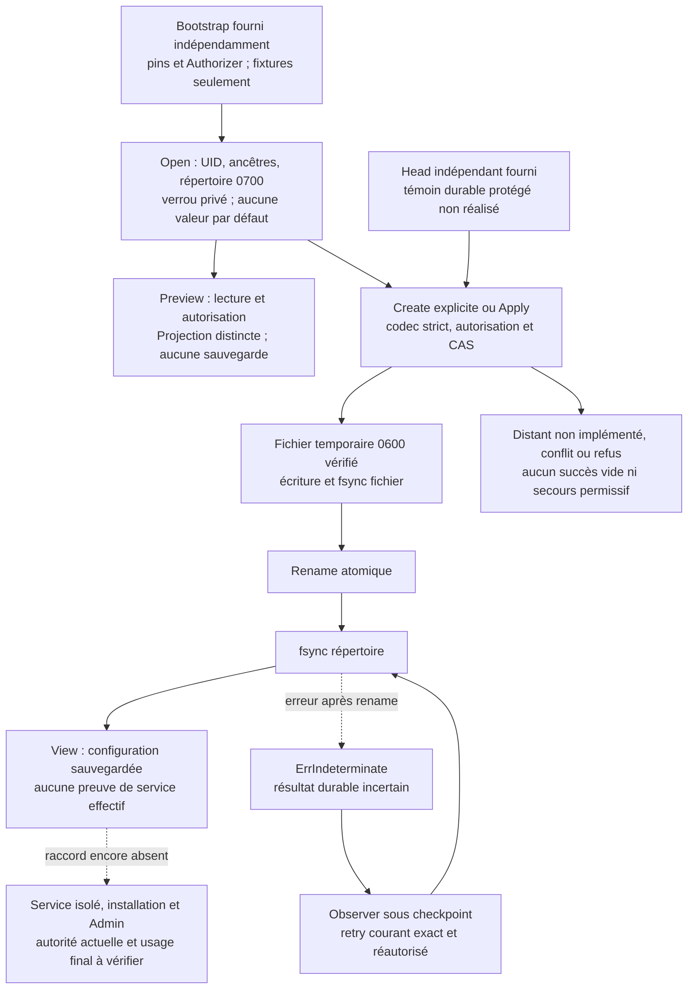

70 noms de tests/sous-tests passent en normal/race, vet et build ciblés passent.
Trois contre-exemples du candidat ont échoué avant correction : permissions
modifiées après Open, date non sérialisable acceptée par Preview et umask rendant
le nouveau fichier illisible. Ils sont conservés dans le [rapport IA3c.2f-02a](../plans/actions-confiance/verification-identites-agents-20261016/ia3-installation-config-20261017/RAPPORT-IA3c2f02a.md).
La panne de fsync est injectée localement ; aucune coupure matérielle n’est testée.
Restaurer le fichier ET le Head fourni retire la détection de rollback : le témoin
durable indépendant, les frontières OS réelles, le service, les opérations
publiques et l’UX restent ouverts. Le service doit aussi distinguer bootstrap
neuf et restauration ; Create n’est pas un endpoint de remise à zéro.
L’évolution vers le distant devra conserver les octets et règles des versions
historiques, pas recalculer discrètement leur chaîne avec un nouveau codec.

## Témoin local et reprise coordonnée — IA3c.2f-02b

Le même paquet fournit maintenant `Coordinator`, ouvert par OpenCoordinated avec
les chemins explicites de configuration et de témoin, l’UID réel, les pins et
Authorizer. Les répertoires égaux, imbriqués, ou de même inode sont refusés ; les
contrôles Linux existants de propriétaire, mode, liens et type de fichier sont
partagés, sans nouvelle copie de Store. Deux répertoires distincts ne prouvent
pas deux domaines d’administration ou de sauvegarde. Ce coordinateur reste une
API Go interne, sans service, installateur, CLI/HTTP ou Admin raccordé.

`witness.json` a quatre champs canoniques exacts : `schema_version:1`, `pins`,
`committed` (Head confirmé) et `pending` (null ou intention). Une intention contient
`entry` (change, actor, at) et `target` (Head calculé de cette entrée et des pins).
La base de change doit égaler committed, acteur/date/schéma sont vérifiés ; le
codec refuse champs inconnus, doublons, casse, nulls/omissions, trailing et cible
contradictoire. Le témoin est un état local protégé par les contrôles de stockage,
pas une signature ni un compteur matériel monotone. Pins restent indépendants.

| Opération coordonnée | Comportement réel |
| --- | --- |
| Create | Bootstrap explicite seulement si les deux états sont absents ; préparer une intention durable avant config, puis confirmer ; retry exact de l’initialisation encore courante reconnu |
| Apply | Réserver config puis témoin sans attente/retry interne ; vérifier le Head confirmé, autoriser, préparer l’intention, écrire config, confirmer |
| Read | Vérifier config contre committed, refuser toute intention ouverte, vérifier les barrières des deux répertoires avant View |
| Preview | Même validation/autorisation, aucune écriture d’état ; refuser pending ; genèse projetée seulement si les deux états sont absents |
| Recover | Si pending, comparer uniquement base/cible exactes, réautoriser et synchroniser l’intention avant effet ; si déjà confirmé, observation et barrières seulement |

L’absence de témoin avec une config existante retourne ErrWitnessMissing, sans
le reconstruire depuis cette config. Une config manquante hors genèse est refusée.
Une divergence de Head, même cohérente syntaxiquement, est refusée ; restaurer
seulement config OU témoin est détecté. Un appel au Store bas niveau hors du
protocole ne fait pas avancer le témoin et reste refusé par Coordinator. Le futur
service doit consommer Coordinator, pas contourner ces comparaisons.

Une intention conserve l’entrée exacte et son instant. Si config est encore à la
base, reprise de cette entrée après nouvelle autorisation ; si la cible est déjà
visible, synchronisation sans second événement ni réécriture. Une autre histoire,
une demande différente pendant pending ou une autorité refusée ne déclenche
aucune réparation implicite ; l’intention est conservée. Read/Preview restent
fermés avec ErrPending. Aucun View partiel n’est retourné en cas d’erreur.

Une confirmation visible mais dont le fsync échoue reste un résultat incertain :
relire, comparer puis synchroniser les deux répertoires, ou reprendre l’événement
courant exact avec autorisation. L’erreur conserve ErrIndeterminate, sa cause et
l’étape (prepare witness / write configuration / confirm witness ou barrière).
Un échec de préparation avant rename peut laisser les deux fichiers absents :
il faut alors un bootstrap explicite, jamais déduire un succès. Annuler après
l’intention et avant config conserve la décision en attente ; une annulation
concurrente plus tard ne prouve pas l’absence de mutation.

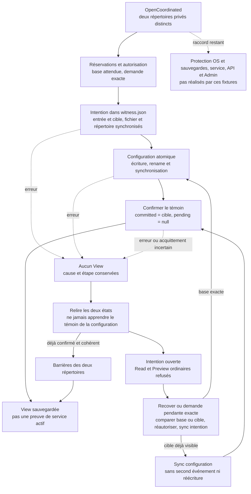

Les 70 gardes précédentes sont rejouées dans un lot final de 101 noms PASS en
normal/race, vet/build ciblés PASS, 12 entrées stables. Une fixture enfant écrit
une intention, rencontre une barrière en faute et sort sans Close ; un nouveau
coordinateur reconstruit la reprise depuis les fichiers. Ce n’est ni SIGKILL,
ni panne électrique, ni preuve de séparation d’UID. Le même inode par bind mount
est contrôlé dans le code mais non monté dans ces fixtures. Le [rapport](../plans/actions-confiance/verification-identites-agents-20261016/ia3-config-witness-20261017/RAPPORT-IA3c2f02b.md)
conserve les fenêtres de faute injectées, le défaut de contexte d’erreur reproduit
puis corrigé, sources et limites.

Restaurer les deux stockages ensemble reste accepté dans le cas limite conservé :
la protection de l’hôte, des copies de sauvegarde et du témoin ne vient pas du
nom du répertoire. La livraison du noyau local ne clôt donc pas F07 ni EP-06.
Aucune annulation/abandon automatique d’intention n’est livré : si reprise refusée
ou histoire manquante, garder le blocage, sa cause et son propriétaire ; une
restauration ou migration doit passer par une opération autorisée à concevoir,
pas une édition d’état privé. Propriétaire : opérateur pour protection/identité,
Codex pour service et parcours publics. Distant toujours refusé par le codec
courant ; aucun secours permissif ou nouveau timeout/budget ajouté.


## Adaptateur local de contrôle IA3c.2f-03a — interne et non activé

Le moteur possède maintenant un adaptateur privé qui reçoit un paquet Linux
SOCK_SEQPACKET, attribue chaque message via SCM_CREDENTIALS et SCM_PIDFD, puis
consomme exclusivement le coordinateur configuration/témoin. Il réutilise le
canal IA2 ; un PID déclaré dans le JSON ou l’identité du créateur de la connexion
ne remplace pas l’émetteur fourni par le noyau. Le canal doit être configuré avant
libération de l’émetteur. Aucun listener, commande CLI, route HTTP, compte ou
service système n’est créé ; le binaire du serveur en cours n’est pas remplacé.

Le prototype 03a initial utilisait le schéma 1. Depuis 03b, la demande canonique
utilise le schéma 2 avec challenge et pins indépendants, décrit ci-dessous ;
l’ancienne version 1 est refusée. read exige change:null ; preview, create et
apply exigent le Change strict existant. Acteur, date, champs inconnus, dupliqués
ou de casse différente et octets non canoniques sont refusés.

Le bootstrap de confiance fournit chemins, propriétaire, pins et contrôleur
d’autorité indépendamment du projet. Ce contrôleur reçoit le message attribué et
une copie de la demande exacte ; il authentifie, autorise l’opération et maintient
sa sérialisation avec la révocation pendant toute l’exécution. Même read exige ce
contrôle. Le principal retourné doit être l’humain épinglé. La demande de mutation
est de nouveau comparée sous les réservations du coordinateur ; le client ne
choisit pas l’heure. Les callbacks de test ne réalisent pas une connexion OIDC,
une délégation courante ou un confinement de fournisseur réel.

| Opération | Effet de l’adaptateur |
| --- | --- |
| read | Lire uniquement une View confirmée après autorisation |
| preview | Projeter sans écrire config.json ou witness.json ; ce n’est pas un état sauvegardé |
| create | Bootstrap explicite selon les deux états, sans choisir l’autorité depuis la demande |
| apply | CAS courant et reprise de la demande pendante exacte, réautorisée ; aucun second événement pour le retry courant |

Il n’expose pas Recover sans demande : l’opérateur peut reprendre le Change exact
par apply. Un pending, un conflit ou une histoire manquante ne déclenche aucune
réinitialisation ni reconstruction automatique. Une implémentation du contrôleur
qui n’exécute pas son callback, en absorbe l’erreur, l’appelle deux fois ou le
retient après son retour ne peut produire un succès sans contrôle : absence et
retard sont refusés, erreur conservée, second effet empêché. Une erreur après un
effet réussi conserve une issue incertaine ; elle n’annule pas une écriture.
Le contrôleur doit exécuter synchroniquement et maintenir ses protections ; ces
gardes ne remplacent pas son implémentation et sa vérification indépendante.

La réponse comporte schema_version, request_digest, operation, view, projection
et error, avec
null pour les résultats absents. Une erreur n’expose aucun résultat ; seuls des
codes limités traversent le canal : invalid_request, denied, conflict, busy,
pending, not_configured, indeterminate ou unavailable. Les causes Go originales
restent du côté service, sans envoi de chemins privés. Un paquet tronqué ou ses
métadonnées invalides sont refusés avant accès au stockage, sans réponse métier.

Après une écriture réussie, perdre l’acquittement retourne une erreur incertaine
côté service et ne provoque aucun rollback. Reprendre la même demande avec son
EventID et sa base permet la relecture/réautorisation sans événement supplémentaire.
Le propriétaire fournit le buffer de transport et gère la connexion ; une réponse
qui dépasse les possibilités du socket échoue, sans découpage implicite. Aucun
timeout, retry, volume ou concurrence de politique supplémentaire. Un contexte
annulé seul n’interrompt pas une réception bloquée ; le propriétaire doit fermer
sa connexion. Le futur service devra rendre cette gestion observable.

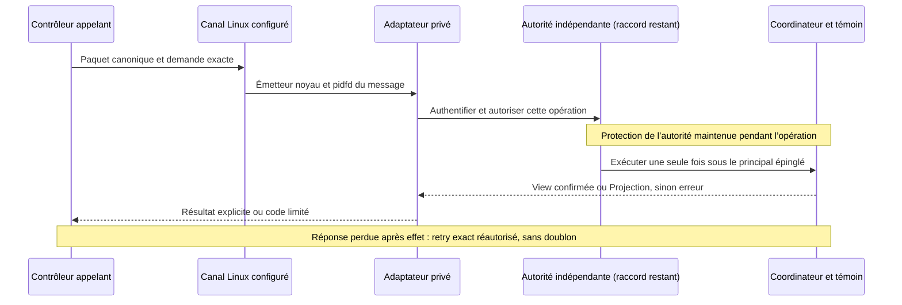

Le [rapport de raccord](../plans/actions-confiance/verification-identites-agents-20261016/ia3-local-service-20261017/RAPPORT-IA3c2f03a.md)
lie les tests aux sources et conserve leurs limites. L’échange enfant attribue le
processus émetteur réel, sous le même compte en fixture. Il ne prouve pas une
séparation de comptes, un service protégé actif ou l’authentification du service
par un client public. EP-01/04/05/07, F01–F07 et l’admission publique restent ouverts.
Avant activation : désigner l’humain initial, fournir le contrôle d’autorité réel,
protéger les fichiers/clefs/compte, établir le pair service côté client et vérifier
le confinement, puis raccorder commandes, installation et Admin FR/EN. Le mode
distant reste prévu ; aucune bascule permissive.

Le contrôleur des workflows utilise aussi -timeout 0 pour son test de contexte :
l’ancien watchdog global hérité de 30 secondes a été retiré faute de contrat
temporel justifié. Ce contrôle de méthode ne mesure pas une performance produit.

Le même contrôleur exige maintenant les événements JSON run/pass du test nommé
et la fin du paquet ; un sélecteur vide, un skip ou une preuve incomplète ne peut
plus produire OK. Les doubles de sortie Go et le contrôle réel sont deux preuves
distinctes, conservées dans le rapport de raccord.


## Client local IA3c.2f-03b — paire serveur et réponse vérifiées en fixture

Le client privé complète le raccord de contrôle ; il n’installe aucun service.
Son constructeur reçoit les pins d’installation, l’UID attendu et un pidfd du
serveur fourni indépendamment par le lanceur de confiance. Il duplique et détient
ce descripteur. Il ne l’ouvre jamais à partir d’un PID reçu dans une réponse et
n’apprend ni racine ni principal depuis le serveur. Chaque message retour est
attribué par le même canal Linux que la demande ; son UID et son objet processus
sont comparés à ces éléments indépendants avant de lire le résultat métier.

L’identifiant comparé est le couple périphérique/inode du pidfd sur pidfs, sous
Linux 64 bits. Le type de système de fichiers est contrôlé ; un fichier ordinaire,
un ancien pidfd à inode anonyme ou une architecture 32 bits est refusé, sans
repli vers un PID numérique. L’objet est lié au processus dans le démarrage hôte
courant, pas à une identité persistante ou à son exécutable. Cette vérification
ne prouve ni le confinement ni l’identité humaine ; une exécution différente
dans le même processus conserve ce besoin de protection. Le contrat noyau est
vérifié dans [Linux v6.17, pidfs](https://raw.githubusercontent.com/torvalds/linux/v6.17/fs/pidfs.c).

Le transport passe explicitement au schéma 2. La configuration persistée, son
journal et ses empreintes restent au schéma 1 ; aucune histoire n’est réinitialisée.
Le client crée un challenge aléatoire de 32 octets pour chaque nouvel échange et
fournit les pins attendus dans la demande. Le service compare ces pins aux siens
avant le contrôle d’autorité ; leur égalité ne donne aucun droit. La réponse porte
request_digest, SHA-256 avec domaine `swarm-installation-control-v2` sur les octets
canoniques de la demande complète : challenge, pins, opération et Change exact.
Un ancien paquet version 1, même émis par le bon processus, n’est pas réinterprété.

| Cadre | Champs exacts de version 2 |
| --- | --- |
| Demande | schema_version, challenge, pins, operation, change |
| Réponse | schema_version, request_digest, operation, view, projection, error |

Après contrôle du processus, le client refuse version/opération/empreinte autres,
formats non canoniques ou champs inconnus, résultat absent, mélange View/Projection,
code inconnu et erreur accompagnée de données. Le paquet enrollmentconfig fournit
ValidateView/ValidateProjection : schéma, historique complet, tête recalculée et
base/replay sont contrôlés au même endroit que le stockage. Le client compare
les pins du résultat et le dernier Change à sa demande. Ces vérifications ne
font pas d’une configuration souhaitée une capacité d’agent ou un service actif.

Le client possède sa connexion et son pidfd dupliqué ; un seul échange y est
admis, puis les deux sont fermés. Le descripteur original du lanceur n’est pas
fermé par le client. Une annulation avant l’envoi reste une absence d’envoi ;
après tentative de mutation, toute réponse non authentifiée, tronquée ou perdue
retourne un résultat nul et une issue incertaine. Une erreur métier authentifiée
reste son refus explicite. La connexion propre au client est fermée pour
interrompre réception/envoi lors de l’annulation ; aucun délai fixe ni répétition
automatique. Reprise métier avec le même EventID/base sur un nouveau canal et
un nouveau challenge, après réautorisation du service.

La fixture de taille réduit uniquement le buffer d’émission de son socket et
relit SO_SNDBUF pour construire une réponse au-delà de la capacité observée.
EMSGSIZE doit être constaté, distinct d’un timeout ; l’effet déjà confirmé est
relu au retry exact sans second événement. Cette expérience ne choisit pas une
politique de volume produit. Une réponse trop grande reste une limite du
transport paquet, sans découpage automatique : transfert paginé ou autre cadrage
reste à concevoir avant d’en faire un parcours public à historique arbitraire.
Le propriétaire contrôle aussi le buffer de réception ; un préfixe tronqué est
refusé, jamais traité comme une réponse valide.

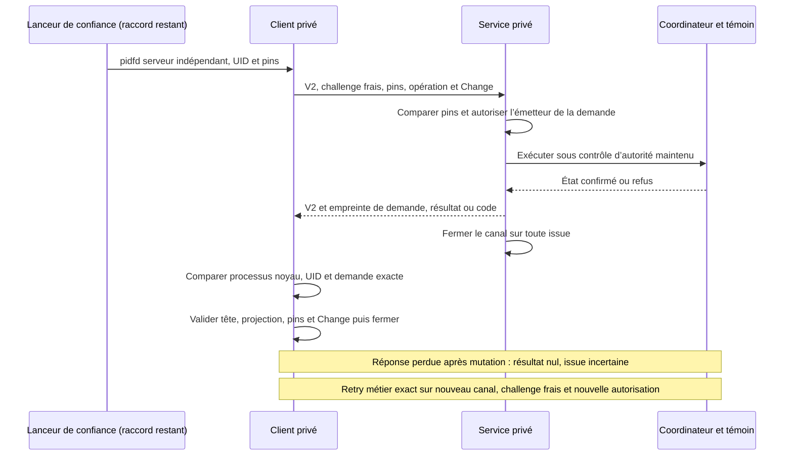

Le [rapport client](../plans/actions-confiance/verification-identites-agents-20261016/ia3-local-client-20261017/RAPPORT-IA3c2f03b.md)
conserve les résultats et conditions de la preuve. Le lanceur public fournissant
le pidfd indépendant, l’autorité humaine, le compte séparé, le confinement et
Admin restent à raccorder. Un client vérifié en fixture ne clôt pas EP-01/04/05/07,
F01–F07, IA3 ou l’acceptation globale. Pas de bascule locale/distance permissive.


Le canal serveur est lui aussi possédé pour un seul échange et fermé sur succès,
refus ou erreur ; un second serve est refusé. La garde EMSGSIZE ne ferme plus le
socket à sa place : elle observe directement POLLHUP sans attente (poll à zéro),
puis l’échange client constate la fin du canal. Cela corrige une attente possible
après réponse non envoyée sans inventer de timeout. Le code unavailable demeure
une indisponibilité générale du service ; il ne prouve pas une faute de stockage.
Les deux contre-exemples avant correction et leurs reprises sont conservés.

Le canal doit provenir du lanceur de confiance et être remis au serveur attendu
sans fuite de descripteur ; le client vérifie ici l’émetteur du retour, après
l’envoi de la demande. Ce contrôle seul ne prouve pas le destinataire avant
l’envoi et ne chiffre pas le contenu. Un simple chemin de socket non établi ne
remplace pas cette précondition ; le raccord public doit prouver cette remise
ou établir le serveur avant tout contenu sensible. Cette obligation reste
ouverte avec la protection du compte et des descripteurs (EP-07).

Encodage du challenge : base64url canonique sans padding, représentant exactement
32 octets. L’empreinte est l’hexadécimal minuscule de SHA-256 sur le préfixe
`swarm-installation-control-v2\x00request\x00` suivi de la demande canonique ;
chaque `\x00` représente un octet NUL. Le format canonique est celui du codec Go
partagé, pas une promesse que JSON.stringify produit les mêmes octets. Un futur
client d’un autre langage devra vérifier cet encodage, notamment les échappements,
ou consommer le codec via l’adaptateur Go. Cette interopérabilité n’est pas prouvée.

## Remise privée IA3c.2f-03c — preuve avant demande métier

Le lanceur interne `runAgentIdentityConfigProcess` exécute une commande neuve de
l’image courante, épinglée par descripteur avec `pinTrustFixedHelperImage`. Son
appelant de confiance fournit explicitement arguments, environnement, UID serveur
attendu et pins publics ; aucune donnée de projet ne choisit le programme ou
l’autorité. Environnement implicite, ExtraFiles préexistants, commande déjà
démarrée, Cancel, WaitDelay et PidFD préconfigurés sont refusés. Les autres
attributs système sont conservés. Ce composant reste sans entrée CLI ni service
installé ; `acceptAgentIdentityConfigLaunch` est appelé par un helper de test.

Deux socketpairs privées SOCK_SEQPACKET reçoivent PASSCRED/PASSPIDFD avant exec :
une pour le démarrage, une pour la demande métier. Le parent transmet les FDs 3
(métier), 4 (démarrage), 5 (pidfd parent indépendant) et 6 (image courante).
Le parent obtient le pidfd enfant atomiquement par SysProcAttr.PidFD/CLONE_PIDFD ;
il ne rouvre jamais un numéro de PID enfant. Les tokens pidfs 64 bits et
UID de chaque message sont comparés aux objets détenus indépendamment des deux
côtés. Les préconditions Linux du client 03b s’appliquent aussi ici.

Démarrage **version 1**, format canonique strict : schema_version, purpose,
challenge, pins_digest. Challenge frais de 32 octets, base64url sans padding ;
pins_digest est SHA-256 hexadécimal minuscule du préfixe
`swarm-installation-startup-v1\x00pins\x00` suivi des pins JSON canoniques Go.
Les deux `\x00` désignent des octets NUL. Les trois messages hello, ready et
release doivent partager challenge et empreinte attendus. L’enfant apprend le
challenge du parent attribué, mais compare les pins à sa propre source ; le
parent vérifie ready contre son pidfd enfant et ses propres pins, avant release
et avant toute demande métier. L’enfant n’admet le canal métier qu’après release
exacte et attribuée. Le buffer de démarrage est calculé sur le plus long message
valide de ce format fixe ; ce n’est pas un plafond de contenu métier.

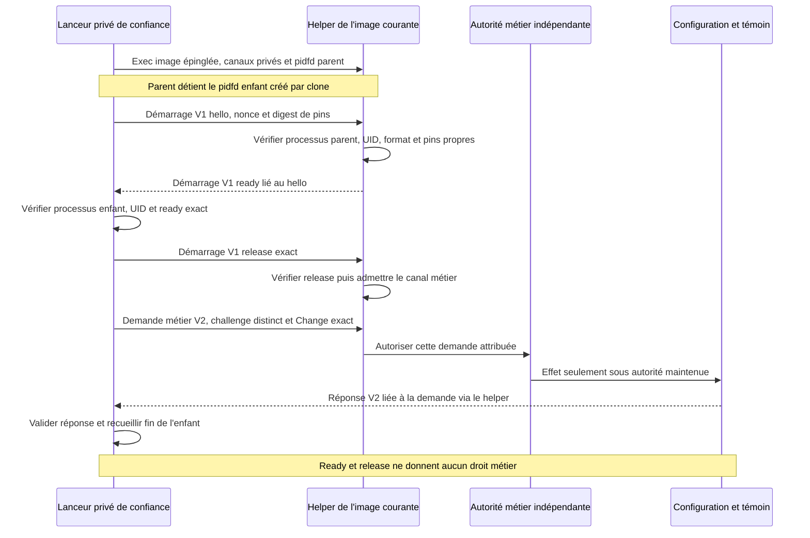

Les copies parent des FDs hérités sont fermées après exec. Le helper vérifie que
le FD image correspond à son exécutable, adopte les sockets en CLOEXEC et ferme
les originaux, le canal de démarrage et le pidfd parent. Le client conserve son
duplicata de pidfd jusqu’à la fin de l’échange ; le lanceur conserve l’original
jusqu’à la collecte de Wait, puis le ferme et invalide son numéro dans Cmd.
Annulation : fermeture des canaux possédés, SIGKILL via le seul pidfd enfant et
collecte de Wait ; aucune recherche de PID, aucun signal de groupe, délai ou retry
automatique. Les flux standard et le code de l’image restent de confiance : un
writer fourni par l’appelant qui se bloque peut aussi bloquer la collecte Go.

Succès = réponse métier valide **et** fin de l’enfant à zéro. Un refus métier
attribué reste un refus, même après ready. Une fin non nulle après réponse de
mutation valide conserve l’erreur de processus, retourne zéro résultat et
ErrIndeterminate ; l’historique n’est pas réinitialisé. Après tentative de
mutation sans réponse valide, les règles 03b s’appliquent. Avant demande métier,
un échec de démarrage ne prétend pas qu’une mutation a été tentée.

Le [rapport 03c](../plans/actions-confiance/verification-identites-agents-20261016/ia3-local-launch-20261017/RAPPORT-IA3c2f03c.md)
lie les tests aux sources exactes. La preuve concerne deux processus de fixture
du même compte. Elle ne démontre ni confidentialité, compte système séparé,
protection contre ptrace/root ou fuite depuis un bootstrap compromis, ni identité
humaine, délégation ou admission publique. Le raccord métier reste V2 et le
stockage V1. EP-07 demeure partiel jusqu’au bootstrap protégé, au confinement et
à l’activation réelle ; F01–F07 et l’acceptation globale restent ouverts.

Ce helper enfant à usage unique ne remplace pas le cycle d’un service permanent.
Le pidfd ne donne pas le droit de changer de compte ni de signaler un autre UID.
Le raccord public doit établir qui peut lancer/superviser le compte séparé :
bootstrap privilégié protégé ou service/broker authentifié, avec droits et collecte
vérifiés. Ne pas exécuter le cockpit entier avec des privilèges pour obtenir cette
propriété ; cette intégration reste à concevoir après désignation de la source
d’autorité, puis à vérifier dans le parcours réellement retenu.

## Précontrôle du bootstrap IA3c.2f-03d

`swarm identity bootstrap-check EMPREINTE_SHA256 --input /chemin/absolu/bootstrap.json --json`
effectue un contrôle local en lecture seule, avant toute ouverture de projet.
`--root`, `--server`, stdin et les opérations d’activation ne sont pas des sources
de bootstrap acceptées. Le paquet commun `internal/enrollmentbootstrap` fournit
Encode, Decode et Load ; ses données ne sont pas des capacités d’autorité.

Le manifeste canonique V1 contient schema_version, pins (installation_digest,
authority_public_key, bootstrap_principal), service_uid, controller_uid,
configuration_directory et witness_directory. Les pins utilisent la validation
existante ; humain déclaré et clé publique ne constituent pas une connexion
humaine ou une approbation. Les deux UID déclarés doivent différer et service_uid
doit égaler l’UID effectif du processus qui contrôle le fichier. Le contrôle ne
prouve pas que les agents utilisent réellement controller_uid.

L’empreinte SHA-256 hexadécimale minuscule attendue vient d’un contrôle
d’installation approuvé et protégé indépendamment. La calculer depuis le fichier
à accepter, puis la lui faire vérifier, ne prouve pas cette approbation. Le
fichier est ouvert sans suivre de lien : fichier régulier, propriétaire service,
mode 0600, un seul lien. Son parent et les répertoires configuration/témoin sont
ouverts avec le même `enrollmentconfig.OpenPrivateDirectory` que le stockage :
UID effectif, parcours sans symlink, ancêtres root/service non modifiables par
groupe/autres (exception sticky root telle que /tmp), répertoire final 0700.
Les trois chemins doivent être distincts, non imbriqués ; les handles ne doivent
pas désigner le même inode. Root et les administrateurs hôte restent de confiance.

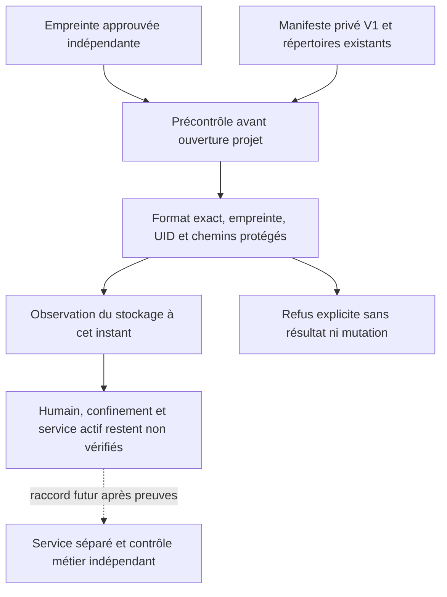

Le résultat expose bootstrap_digest, bootstrap et storage_verified=true ;
human_authentication_verified, confinement_verified et service_started restent
false. Il ne crée ni répertoire, lock, clé, compte, journal, session ou service.
Un refus ne retourne aucun résultat. Les handles sont fermés ; les futurs
consommateurs doivent revalider les chemins à l’usage, pas réutiliser cette
observation comme une permission. La configuration mutable et son historique ne
sont pas ce manifeste ; une migration de racine n’est pas implémentée ici.
Le service protégé, la source humaine, le confinement et Admin restent ouverts.


## Noyau Rust de contrôle courant — incrément PAEA26

`swarm_enrollment_authority::control` compose désormais le journal signé natif
et `swarm_enrollment_config::store::Coordinator` sous Linux. C'est une API de
bibliothèque, sans écouteur, session humaine ni consommateur dans le profil
normal de la CLI. Le précontrôle `bootstrap-check` ne l'active pas. Les anciens
contrats de transport décrits ci-dessus ne prouvent pas leur portage Rust.

Le démarrage protégé doit fournir indépendamment les clés publiques, le projet,
les répertoires privés, le propriétaire et `Binding` : enrollment_id, génération,
principal humain exact, portée de plan et révision de confiance. `Startup` vérifie
leur cohérence ; il n'authentifie pas son producteur. Ces données ne doivent venir
ni de la requête, ni du cookie du cockpit, ni d'une simple égalité d'UID.

`BoundJournal` ouvre un journal WAL existant, valide son historique signé et garde
la connexion réelle. Il ne recrée aucune base et ne rouvre jamais son chemin par
opération. `NOFOLLOW` protège le dernier composant ; la protection des ancêtres
et le bootstrap restent des préconditions externes. Un déplacement peut entraîner
un refus SQLite : il ne faut pas le convertir en réouverture ou succès vide.
Ce lien à l'objet ouvert ne fournit ni confinement ni protection contre la
restauration simultanée des données/témoins par leur propriétaire ou root.

Chaque `execute` vérifie la tête courante, l'absence de révocation, le document
canonique, la génération et le contexte exacts, la validité à l'heure du service
et une permission signée `effect.execute` dont la ressource vaut exactement
`enrollment-config/<installation_digest>/<read|preview|create|apply>`.
Ces quatre discriminants définissent le protocole ; aucun grant par défaut,
délai, plafond ou politique de reprise n'est introduit. Les grants résident dans
le journal signé ; aucun nouveau formulaire Admin de politique n'est ajouté.
Lire et rejouer exigent aussi leur permission. Une délégation n'est pas utilisée.

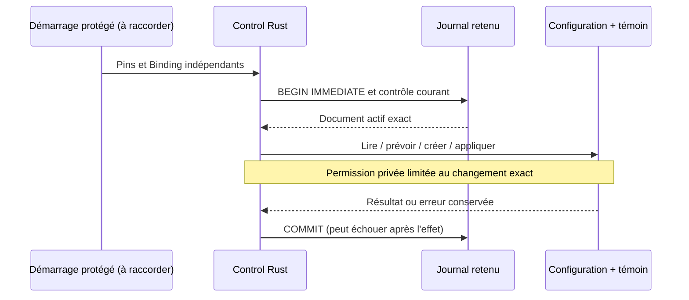

La réservation d'autorité reste tenue jusqu'au retour du stockage et au COMMIT.
La contention locale refuse immédiatement avec Busy, sans attente ou relance
cachée. Une révocation obtenue avant l'usage refuse cet usage ; une révocation
concurrente à un usage réservé refuse puis nécessite une reprise explicite après
sa fin. Ce contrat ne rend pas l'expiration murale atomique avec les écritures.

`Preview` conserve les fichiers de configuration, `Create` et `Apply` emploient
le protocole existant configuration/témoin. EventID, base et contenu exacts
permettent le rejeu sans doublon, après une nouvelle autorisation courante.
Aucun recover/reset/adopt brut n'est exposé. Un témoin pending exige la reprise
du même changement autorisé ; `Read` ne le masque pas. Le stockage conserve ses
causes, les fautes de flush/close et les refus de chemins.

Tout échec d'une invocation mutante reste conservativement UNKNOWN : même un Err
ne garantit pas l'absence d'effet. Si l'autorité échoue après le stockage,
`AfterStorage` conserve sa cause et le résultat complet du stockage, succès ou
échec secondaire. Ne pas réémettre une action différente ; lire sous autorité
courante et/ou reprendre l'événement exact. Si le grant est révoqué, cette reprise
exige un contrôleur disposant d'une autorité indépendante valide. `close` refuse
la contention, ferme explicitement les trois stockages et conserve les erreurs
secondaires ; Drop seul ne prouve pas cette fermeture.

Recette maintenue : `tools/verification/recipes/paea-control-core.json`.
[Résultats et limites26](../plans/actions-confiance/paea/INCREMENT-26.md).
Tests sur stockage réel isolé et hooks réservés aux tests, distincts du build
normal sans `test-fixtures`. Transport authentifié, identité humaine réelle,
compte service, confinement, installation de service, PA-03 et acceptation E2/E3
restent ouverts ; aucune nouvelle garantie globale sur les 17 invariants.


## Déclaration de contrôle v2 et précontrôle natif PAEA27

Le bootstrap v1 et la réponse de `identity bootstrap-check` restent inchangés ;
les options suivent la garde commune37a. Le format v2,
`swarm_enrollment_bootstrap::ControlDocument`, ajoute une déclaration fermée pour
le noyau26 : `schema_version:2`, `installation` (v1 complet), `journal_path`,
`project_context_digest`, `authority_head` (sequence/digest), `enrollment_id`,
`generation`, `scope` et `trust_configuration_revision`. Le principal provient des
pins de l'installation, jamais d'un champ d'acteur fourni à une opération.

La génération est positive et ne dépasse pas le checkpoint. Les racines privées
bootstrap/configuration/témoin/journal sont distinctes ; chemins propres absolus,
ancêtres sans liens ni écriture groupe/autrui (sauf sticky root), répertoires0700,
fichiers0600 appartenant au service effectif, fichiers réguliers sans hardlink.
Le chargeur refuse doublons/champs inconnus, nulls, versions/digests non canoniques,
chemins traversants, liens, types spéciaux et stockage absent. Il ferme tous ses
descripteurs et conserve les fautes secondaires. Il ne crée aucune donnée.

L'empreinte du fichier et le checkpoint doivent provenir d'un contrôle approuvé
hors canal agent. Ni un hash auto-appris du fichier, ni une chaîne JSON `human`
ne fournissent cette preuve. `authority_head` est une attente indépendante,
pas une valeur à recalculer automatiquement depuis le journal : une évolution
le rend périmé. La reprise exige un checkpoint courant autorisé ; ne pas effacer
l'historique, réenrôler ou accepter le premier appelant pour contourner ce refus.

```sh
swarm-rust identity control-check EMPREINTE_SHA256 --input /repertoire/protege/control.json --json --lang fr
```

La commande charge le v2 épinglé puis ouvre le journal signé existant avec la
connexion retenue26. Sous réservation SQLite, elle vérifie tête exacte,
non-révocation, document canonique, identité/génération/principal/projet/portée/
révision exacts et dates à l'heure du contrôle. Elle partage les validateurs du
vrai noyau. Une erreur refuse ; elle ne devient pas une liste vide réussie ou un
nouveau checkpoint. COMMIT et fermeture précèdent la sérialisation du résultat ;
write/flush en échec restent nonzero avec cause conservée. Aucun délai/retry,
quota, plafond ou grant par défaut n'est ajouté.

La sortie v1 contient `bootstrap_digest`, `declaration` v2, `checked_at`,
`current_enrollment_verified:true` et toujours `human_authentication_verified`,
`confinement_verified`, `request_authorized`, `service_started` àfalse. Elle est
une observation datée, jamais un permis transférable. Aucun projet/Coordinator,
configuration ou témoin n'est ouvert ou créé par cette commande ; SQLite peut
gérer ses fichiers techniques WAL/SHM. Les valeurs non standard des paramètres d'exécution/projet, stdin,
sortie fichier et commandes supplémentaires sont refusés avant ce parcours.

`swarm_enrollment_authority::startup::open` fournit aussi au futur service le
`Control` réel et le checkpoint déclaré, après le même chargement protégé. Cette
ouverture peut créer les lockfiles du Coordinator ; elle ne crée ni configuration
ni droit, session ou listener. Le prochain `execute` doit encore revalider son
autorité courante et la permission exacte. Le contrôle CLI n'appelle pas `open`.
Les vérifications de chemin et la connexion retenue ne protègent pas contre
l'administrateur ou un agent disposant du même UID et de son accès aux fichiers.
Le confinement et l'origine réellement indépendante des pins restent requis.

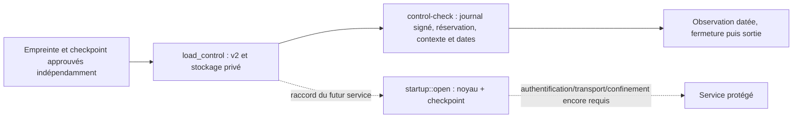

Préparation personnelle locale, enrôlement humain initial consommé une seule fois,
transport authentifié, compte service réel, confinement et PA-03 restent ouverts.
La commande n'ajoute aucun endpoint HTTP/Admin ni écran ; les notes d'évolution
FR/EN du binaire décrivent ce précontrôle. Recette :
`tools/verification/recipes/paea-control-startup.json` ;
[preuves et RETEX27](../plans/actions-confiance/paea/INCREMENT-27.md).


Pour vérifier une livraison locale, partir de l'identité du processus et de son
binaire servi (version, commit, SHA), puis sélectionner le profil effectif et ses
sources archivées correspondants. Le dernier état de build préparé peut appartenir
à une livraison parallèle pas encore activée ; ce fichier seul ne prouve jamais
le binaire en cours. Rejouer le parcours sur le vrai binaire normal sans fixtures.


## Dérivé personnel et preuve de connaissance PAEA28

`swarm_enrollment_authority::credentials` fournit le contrat du futur compte
local, sans ouvrir de service ni créer de compte. `create` reçoit installation,
principal humain stable, génération positive, paramètres explicites et octets du
secret. Le sel32octets vient de l'OS ; RustCrypto Argon2id v19 produit32octets.
`Record` conserve schéma1, algorithme, contexte, paramètres mémoireKiB/passes/
parallélisme, sel et dérivé base64url canoniques. `encode/decode` exigent un JSON
fermé exact, sans champs supplémentaires/doublons/nulls/trailing ni autre algorithme.
Ces octets sont des vérificateurs sensibles, à protéger ; Debug les masque.

Aucun coût KDF implicite : le consommateur doit persister ses choix et utiliser
`Parameters::validate`, validation de représentation/algorithme qui ne constitue
pas une recommandation de sécurité. La future installation et Admin/API/CLI doivent
gérer ces mêmes valeurs avant exposition du service ; aucun endpoint de mot de
passe n'est ouvert dans28. Les coûts minimaux algorithmiques ne prouvent pas une
politique sûre. Pas de durée, compteur d'essais ou délai ajouté.

`fingerprint` est SHA256(`swarm-personal-credential-v1` NUL JSON canonique).
L'empreinte attendue doit être approuvée indépendamment du record reçu.
`verify` vérifie ce pin et installation/principal/génération avant tout travail
Argon2, puis compare le dérivé en temps constant. Un secret erroné refuse ; panne
d'entropie, paramètre, allocation ou JSON conserve sa cause typée et une catégorie
publique sans secret. Aucun échec n'est un humain vide réussi. Le `Proof` opaque,
emprunté, non clonable/non sérialisable, ne prouve que la connaissance du secret
du record exact ; pas sa fraîcheur, la présence humaine ou un droit métier.

Le résultat dérivé temporaire et l'allocation de travail détenue sont gardés par
`Zeroizing`, succès et erreur. Le source Argon2 résolu montre que la feature
`zeroize` seule n'efface pas son allocation interne ;28 fournit donc sa propre
allocation gardée via `hash_password_into_with_memory`. Cela ne prouve pas
l'effacement de toutes les copies du compilateur, OS, pile ou dump. Le secret
emprunté reste à effacer par son propriétaire ; aucune normalisation/troncature.

L'enrôlement réel nécessite encore preuve d'installation consommée une fois,
stockage protégé courant/révocable, session ou requête authentifiée, compte service
séparé et contrôle avant effet. `Proof` ne remplace pas ces frontières. Contrat et
[preuves28](../plans/actions-confiance/paea/INCREMENT-28.md) ; recette permanente
`tools/verification/recipes/paea-personal-credentials.json`.


## Bootstrap personnel transactionnel PAEA29

`swarm_enrollment_authority::personal::Source` compose le dérivé28 et un vrai
journal signé existant avec connexion retenue. Le service doit sélectionner hors
requête des pins publics, contexte de journal, installation, principal humain et
génération (`Expected`), puis un checkpoint indépendant à chaque opération.
Il n'initialise pas le journal ni les chemins et ne choisit aucun premier appelant.
Le stockage et la clé privée restent à protéger par le futur déploiement.

Le record canonique `Bootstrap` v1 contient installation/principal/génération,
coûts KDF explicites et engagement SHA256 du domaine
`swarm-personal-bootstrap-v1` NUL installationhex64 secret32. Le secret aléatoire
32octets doit être remis indépendamment hors canal agent ; cette API ne prouve
ni sa génération ni sa remise. Le bootstrap signé est sous l'ID de protocole
`personal-bootstrap-v1`, le compte immutable sous `personal-account-v1`, dans un
journal personnel distinct des droits métier.

`prepare` relit le bootstrap actif au checkpoint, vérifie identité/engagement et
clé signataire, puis dérive le secret personnel et signe deux événements chaînés :
révocation bootstrap et enrôlement du vérificateur. Elle n'écrit rien. `Prepared`
reste opaque et privé ; son prochain head n'est qu'une prédiction. Conserver la
proposition exacte en stockage service protégé pour reprise incertaine. `enroll`
utilise `BoundJournal::apply_batch` : toutes signatures/chaîne contrôlées avant
stockage, CAS et événements dans la même transaction SQLite. La seconde écriture
refusée annule la première ; même proposition terminale rejouée sans doublon.
Une proposition concurrente différente, head périmé ou bootstrap consommé refuse.
Un compte révoqué ne réouvre jamais le bootstrap. Une erreur d'application laisse
la publication UNKNOWN jusqu'à reprise exacte/lecture autorisée ; pas d'effacement.

`with_authenticated` relit le compte signé actif, contexte et digest de vérificateur
indépendants, vérifie le mot de passe puis garde la réservation pendant le callback
et COMMIT. Le callback ne reçoit pas d'acteur déclaré mais une preuve28 empruntée.
Un refus n'appelle pas le callback. Son erreur métier reste un résultat distinct ;
si l'autorité échoue après usage, `UseError::AfterUse` conserve son succès ou son
échec complet et l'incertitude d'effet. Les consommateurs doivent examiner cette
branche et les causes secondaires de `Error::Joined`, sans les réduire à un simple
`source()` ni rendre un succès vide. Aucun rollback SQL ne répare un effet externe.

Ordre de réservation obligatoire : **compte personnel → droits métier → configuration**.
Ne pas réentrer le compte ni attendre un de ses writers dans un callback. La
révocation concurrente reçoit Busy pendant l'usage ; après libération et révocation
réussie, une nouvelle authentification refuse. Il n'y a pas de retry/queue/durée
implicite ni de limite de lot opérateur cachée. Les bornes i64 de séquence sont
techniques. Les anciens refus single-event gardent leur ordre base/frame/closed/
annulation ; la recette les couvre avec des entrées simultanément invalides.

Ces bibliothèques ne créent encore ni session, HTTP/socket, compte système,
écran d'enrôlement ou droit métier. Protéger répertoires/ancêtres, pins/checkpoints,
propositions et clé ; configurer les coûts KDF via installation/Admin/API/CLI avant
service, authentifier le transport et vérifier confinement restent requis. Le secret
connu ne prouve pas consentement ou présence humaine. [Preuves29](../plans/actions-confiance/paea/INCREMENT-29.md),
recette `tools/verification/recipes/paea-personal-bootstrap.json`.


## Proposition personnelle restaurable PAEA30

`Source::encode_prepared` produit des octets sensibles canoniques v1, trois champs
exacts : `schema_version`, `base` (head indépendant) et `changes` (deux chaînes
base64url des événements signés originaux). Ce format ne contient ni mot de passe
ni secret d'installation. Base64 ne chiffre pas les vérificateurs : conserver ces
octets uniquement dans le stockage intent/checkpoint protégé de PAEA32, jamais dans
un log ou export public. Aucun fichier n'est lu ou écrit par le codec.

`restore_prepared` refuse JSON ambigu/non canonique, autre version, clé/projet/
chaîne/signature erronés, événement inversé ou d'un autre type/ID et record
personnel non canonique ou d'une autre installation/identité/génération. Il utilise
les pins déjà détenus par Source ; aucun principal/clé/checkpoint n'est appris du
fichier. Les événements exacts doivent être revoke bootstrap puis enroll account.
Une signature atteste l'approbation de ces octets par l'autorité signataire
protégée ; restaurer n'effectue pas une nouvelle preuve du secret initial ni une
nouvelle décision humaine. Sel, dérivé et signatures ne sont pas régénérés.

`BoundJournal::preview_batch` vérifie les données cryptographiques sans SQLite,
lock ni observation d'état courant, même après fermeture de connexion. Son type
`BatchPreview` n'expose qu'un `predicted_head`, distinct d'un résultat appliqué.
Le codec fonctionne donc sous writer tenu, ce que vérifie un témoin valide avant
les défauts. `enroll` reste seul à tenter le CAS réel et l'état irréversible ;
le rejeu après restauration ne peut réouvrir bootstrap ni dupliquer le compte.
Les échecs base64 de credential/proposal gardent maintenant le DecodeError concret,
sous une catégorie publique expurgée, sans secret dans Debug/Display.

```mermaid
flowchart LR
  P["Proposition exacte après preuve initiale"] --> E["encode_prepared : octets privés"]
  E -. "bibliothèque PAEA32" .-> W["Intent/checkpoint protégé durable"]
  W -. "bibliothèque PAEA32" .-> R["restore_prepared : racine indépendante et forme exacte"]
  E --> R
  R --> V["BatchPreview : prédiction, aucun état courant observé"]
  V --> A["enroll : CAS et lot atomique du journal réel"]
  A -. "bibliothèque PAEA32" .-> W
```

Le codec seul fournit la représentation de reprise et ne fait aucun IO. La
bibliothèque PAEA32 ajoute écriture atomique, fsync et reprise de checkpoint au-dessus
de cette représentation. Startup est raccordé par PAEA34/36 ; transport/Admin/UX et service réellement activé
restent à raccorder ; les preuves locales ne constituent pas cette activation.
Les paramètres KDF restent explicites et partagés, aucune
politique de délai/retry/volume n'est ajoutée. Format de deux événements = invariant
de l'opération bootstrap, pas plafond de la primitive générale. [Preuves30](../plans/actions-confiance/paea/INCREMENT-30.md),
recette `tools/verification/recipes/paea-personal-proposal.json`.


## Documents privés atomiques PAEA31 — bibliothèque qualifiée et incluse localement

`swarm_enrollment_config::store::documents::Documents` ouvre un dossier existant
0700de l'UID effectif, retient ses descripteurs de dossier/verrou et ne crée que
`private-documents.lock` (0600, regular/single-link, NOFOLLOW). Réserver utilise
mutex/flock immédiats, sans queue/retry/délai. Utiliser un dossier dédié ; ce type
ne valide aucun schéma métier, pin, identité ou droit humain. Les noms sont des
noms internes ASCII simples (alphanumérique puis alphanumérique/point/underscore/
tiret), jamais un chemin ; nom du verrou et temporaires cachés réservés. Les
limites de représentation du FS restent des erreurs IO, aucun plafond opérateur.

Sous `Reservation`, `read` ne remplace pas l'absence par des octets vides ; `create`
refuse tout existant et utilise NOREPLACE ; `replace` exige les octets attendus
exacts sous le verrou coopératif. Le dossier retenu continue de viser son objet
si son chemin est renommé. Le verrou retenu doit aussi correspondre au nom actuel
par dev/inode ; une substitution refuse plutôt que créer deux domaines d'exclusion.
Annulation, modes, liens, hardlinks, types et fermetures sont contrôlés. La vérification
du nom de verrou est aussi portée au Store de configuration consommé par Coordinator,
après reproduction séparée, sans prétendre défendre contre root/un écrivain non
coopératif du même UID. Compte service séparé/confinement restent requis.

Le parcours physique commun conserve temporaire privé dans le même dossier,
write_all→fsync fichier→close→rename→fsync dossier, sans tronquer l'original.
`WriteError` conserve cause primaire/cleanup et phase `Publication` :
`NotAttempted` (rename non appelé), `Unknown` (appel sans acquittement de succès),
`Visible` (rename acquitté, durabilité non acquittée), `Durable` (fsync dossier
acquitté). Un cleanup peut échouer après Durable. L'erreur seule ne prouve jamais
absence d'effet ; garder les octets/proposition exacts pour reprise autorisée.
`sync` permet un acquittement après readback autorisé, aucune adoption de racine.
Les acquittements reflètent le FS local, pas une garantie matérielle universelle.

Toujours appeler `finish` et traiter sa sortie séparément du résultat déjà connu
pour ne pas perdre l'effet après erreur d'unlock. Drop ne prouve pas de fermeture :
il retient les erreurs pour `close`, interdit la réutilisation en état incertain/
poisonné ; close explicite est immédiat et refuse Busy. Relâcher cette réservation
avant de prendre l'autorité SQLite personnelle et avant un effet métier externe.
Descripteurs protégés et protocole ne constituent ni confinement OS ni stockage
indépendant d'un attaquant capable de restaurer tous les témoins.

Recette permanente `tools/verification/recipes/paea-private-documents.json` :
scénarios privés, NOREPLACE réel et régressions Store/Coordinator/Control ; les
assertions nommées et compteurs courants sont maintenus dans le manifeste. Hooks ENOSPC/write partiel/sync/close/unlock uniquement
sur fixtures, feature test-fixtures absente du profil normal. État réel/preuves :
[31](../plans/actions-confiance/paea/INCREMENT-31.md). Le coordinateur personnel32
utilise cette primitive ; le startup34/36 est raccordé, le transport reste requis ; ne pas annoncer
un service actif sur la seule présence de cette bibliothèque.


## Coordinateur personnel durable PAEA32 — bibliothèque vérifiée localement

`personal::coordinator::Coordinator` possède Source et un dossier Documents dédié,
sans IO/adoption dans `new`. Le contexte annule explicitement journal et fichiers,
sans minuterie ni annulation atomique/preemptive de syscalls. `initialize` exige
un head bootstrap positif indépendant, observe son bootstrap signé actif et lié
au contexte, puis crée seulement le checkpoint absent. Aucun mot de passe partagé,
premier appelant ou pin appris du journal. Cette API interne n'effectue pas la
remise humaine du secret, le provisioning OS ni le démarrage d'un service.

Le checkpoint fermé/canonique v1 lie installation/principal/génération/clé/projet
indépendants, head, pin de credential optionnel et intent signé exact optionnel.
Le pin n'existe qu'en phase compte ; intent uniquement avant confirmation. Les
nulls sont explicites. `enroll` lit/valide sous réservation FS, vérifie la preuve
initiale, prépare et persiste+fsync l'intent AVANT le lot journal ; confirme le
checkpoint compte après l'acquittement. Aucun callback métier sous ce verrou.
`recover` restaure exclusivement l'intent protégé signé exact, fsync puis rejeu
CAS/lot et confirmation, sans nouveau secret/sel/signature. Un compte déjà confirmé
est relu au head+pin protégés dans le journal actuel. Aucun head appris de la DB.
Manquant/corrompu/pending mal lié/divergence refuse, aucun reset ni retry implicite.

`CommitError.progress` distingue `intent`, `checkpoint` (phases de publication31)
et journal `NotAttempted`, `Unknown`, `Acknowledged(head)` ou `Observed(head)`.
Observed est une observation courante réussie, sans nouvelle application. Même
si confirmation/unlock échoue après application, l'acquittement n'est pas perdu.
Le diagnostic ne formate aucun head, verifier, path ou résultat métier privé ;
source et branche cleanup gardent les causes concrètes. Le consommateur doit
traiter les observations séparément du simple Err. `with_authenticated` valide
le checkpoint compte sans pending, le synchronise puis libère et vérifie l'unlock FS AVANT la preuve
de mot de passe sur le journal actuel tenu jusqu'à l'effet et sa fin d'autorité.
`AfterUse` garde intégralement succès/échec métier après échec d'autorité.
`close` tente les deux fermetures et conserve leurs échecs ; un côté peut être
fermé et l'autre Busy. Cela ne réinitialise ni état ni autorité.

```mermaid
flowchart LR
  B["Head bootstrap indépendant"] --> I["Intent signé exact + fsync privé"]
  I --> J["Lot atomique : révoquer bootstrap / créer compte"]
  J --> C["Checkpoint compte + fsync privé"]
  I --> R["Reprise exacte sous pins indépendants"]
  R --> J
  C --> F["Lire checkpoint / fsync / libérer FS et vérifier cleanup"]
  F --> A["Journal courant + secret : autorité tenue pendant effet"]
```

Recette permanente `paea-personal-coordinator.json` attend32tests/5étapes :9nouveaux
scénarios (dont3arrêts réels de sous-processus après témoins valides),6credentials,
3codec,5Source,9control. L'exit73 est un protocole de fixture pour un arrêt sans
Drop, pas une limite/politique produit ; il ne simule pas une coupure électrique.
Hooks de phase absents du profil normal. Des43tests31,34couvrent les sources config inchangées ; les9control sont
réexécutés dans32. Nouvelle composition personnelle vérifiée à part.
[État32](../plans/actions-confiance/paea/INCREMENT-32.md). Transport/Admin/UX,
provisioning protégé/compte OS/confinement et véritables enrôlement/E2/E3 restent
requis ; cette bibliothèque ne prouve pas le parcours humain ou un endpoint actif.


## Raccord compte personnel / mandat courant PAEA33 — bibliothèque vérifiée localement

`authenticated_control::AuthenticatedControl` possède les deux noyaux préouverts.
`execute` accepte contexte, head métier attendu (CAS seul), secret personnel emprunté
et Request existante, sans acteur ni preuve fournie par le client. Son contexte
annule les consommateurs personnel/métier/config sans minuterie, délai, retry ou
rollback d'effet. Le wrapper vérifie le compte personnel réel au secret, après
fsync/release du témoin privé, puis conserve cette autorité jusqu'au mandat métier,
son effet de configuration et les fins des deux transactions d'autorité.

Le helper Control `execute_from_current_personal` est privé au crate : il exige
que la composition tienne déjà le compte protégé configuré. `credentials::Proof`
ne prouve que la connaissance d'un record attendu, pas une autorité courante ;
create/verify publics ne deviennent pas un admission endpoint. Le getter
`installation_digest` est une donnée de ce record, jamais un grant. Le helper
refuse principal OU installation incompatibles avant toute opération métier.
Projet/périmètre/droits proviennent ensuite du mandat signé réel ; génération de
compte et génération de mandat sont distinctes (témoin7/1), pas égalité inventée.

`Outcome` conserve le Result métier complet et le UseError personnel distinct.
Un AfterUse garde aussi un Error::AfterStorage et son propre résultat/erreur de
stockage : chaque consommateur doit inspecter ces couches, sans succès vide ni
absence d'effet inférée de Err. Le diagnostic Debug de Control est maintenant aussi
expurgé que Display ; la réponse privée et les causes restent structurées.
`CloseError` conserve les deux branches de fermeture (partiellement fermées/Busy
possibles) sans formater leurs contenus privés. Aucun historique n'est remis à zéro.

```mermaid
flowchart LR
  F["Témoin privé validé + fsync / release"] --> P["Compte courant + secret, tenu"]
  P --> B["Principal et installation exacts"]
  B --> G["Mandat métier courant, tenu"]
  G --> C["Configuration / témoin / résultat"]
  C --> GB["Fin autorité métier + résultat conservé"]
  GB --> PB["Fin autorité personnelle + résultat conservé"]
```

Les journaux personnel et métier doivent être distincts et sélectionnés par
startup protégé ; `new` ne vérifie ni custody OS ni racines physiques. Le raccord
34/36 vérifie ces racines et clés ; transport et routes de profil
protégé restent requis. Le Control brut reste une bibliothèque de bas niveau, pas une route à
exposer comme contournement. Aucun listener/session/confinement ou humain réel
n'est créé par ce wrapper. Les profils/public routes existants ne deviennent pas
protégés par la seule compilation de33. État/preuves : [33](../plans/actions-confiance/paea/INCREMENT-33.md),
recette `paea-authenticated-control.json` (39tests attendus/5étapes).


## Déclaration composite v3 PAEA34 — codec canonique

AuthenticatedDocument contient schema_version3, control (v2inchangé) et personal :
authority_public_key,project_context_digest,journal_path,checkpoint_directory,
generation,bootstrap_head. Installation/principal personnels dérivent du contexte
installation protégé. bootstrap_head est l’entrée indépendante du provisioning
initial ; il n’est pas adopté comme head courant après consommation. Génération
personnelle positive distincte du mandat ; contexte de signature personnel distinct
du projet métier, clés identiques autorisées si protégées. Les cinq racines déclarées
ne peuvent se recouvrir. Codec fermé/canonique, versions/ambiguïtés/nulls/unknown
refusés, pas de fallbackv1/v2. Binding conserve le refus Pins structuré en catégorie
document ; aucun secret/clé privée/KDF implicite et aucun IO. Chargeur physique et
ouverture de sources sont implémentés ci-dessous ; service personnel encore requis. [État34](../plans/actions-confiance/paea/INCREMENT-34.md).


## Ouverture des deux sources PAEA34 — API interne

`load_authenticated` réutilise le parcours commun des versions1/2 : pin SHA256
indépendant sur les octets exacts, codec fermé, parents/racines privés de l'euid
service, modes0700/0600, fichiers réguliers/single-link, NOFOLLOW et comparaison
dev/inode de tous dossiers détenus. Les cinq racines de stockage et le parent du
bootstrap sont distincts. Le layout provient d'accesseurs Rust, jamais d'un callable
JSON. Lire les métadonnées des deux journaux n'ouvre pas SQLite, ne crée aucun lock
et ne valide aucun historique signé. Chaque FD acquis est fermé explicitement,
avec les causes read/stat/close et secondaires. Test d'alias sur FD réels, sans
prétendre prouver un montage hostile ou le confinement OS.

`authenticated_startup::open(ctx,path,pin)` charge cette déclaration, résout les
entrées indépendantes, ouvre le Source personnel et son Documents/Coordinator,
puis le Control métier. Les objets réussis appartiennent au wrapper33, avec le
head métier attendu issu du document. Les opérations utilisent les connexions
SQLite retenues et dossiers retenus, aucun root/acteur choisi par requête. Une
ouverture peut créer les lockfiles privés et SQLite gérer ses WAL/SHM ; le loader
seul ne les crée pas. Aucune initialisation de checkpoint/compte, head appris de
la DB, clé privée, listener ou session humaine dans cet adaptateur.

Après échec d'ouverture Documents, fermer Source ; après échec du Control,
fermer le Coordinator personnel. Error garde la cause primaire et les branches
source_cleanup/coordinator_cleanup ; Display/Debug ne formatent aucun contenu
privé. La remise en état ne réinitialise rien. Fixture de post-close EIO uniquement
sous feature test-fixtures, explicitement propagée vers la même feature config ;
le profil normal devra rester sans fixture. Cette preuve n'est pas un démarrage
de service ou un enrôlement réel. Lifecycle/provisioning/transport/confinement et
routage des anciennes voies restent nécessaires avant activation protégée.

```mermaid
flowchart LR
  D["Déclaration v3 épinglée"] --> L["Loader commun : 6dossiers / 2fichiers"]
  L --> P["Source personnel + dossier témoin détenus"]
  P --> B["Control métier détenu"]
  B --> A["Wrapper authentifié33"]
  P -. "échec suivant : fermer et conserver les causes" .-> E["Erreur structurée / reprise explicite"]
  B -. "échec suivant" .-> E
```

[État et preuves34](../plans/actions-confiance/paea/INCREMENT-34.md), recettes
`paea-authenticated-bootstrap.json` et `paea-authenticated-startup.json`.


## Clé de signature personnelle — chargeur interne PAEA35

`protected_signer::load(path, expected_public_key)` lit un seed Ed25519 de
32 octets bruts depuis un chemin de démarrage indépendant. Il ne crée aucun
fichier et ne reçoit pas de chemin ou de clé choisis par une requête. Le helper
partagé marche tous les ancêtres sans suivre de lien : owner root/service,
pas d’écriture groupe/autres sauf ancêtre root-sticky ; parent final0700 de
euid réel. Le fichier est régulier0600, un seul lien, ouvert sans suivre de lien
et sans blocage sur FIFO. Des FD détenus et le nom courant sont recontrôlés après
lecture ; la clé dérivée doit correspondre au public attendu indépendant.

Le seed détenu et le tampon de détection d’octet supplémentaire sont Zeroizing ;
la feature zeroize de dalek est explicitement requise pour la destruction du
SigningKey. Le wrapper n’est ni Clone ni Serialize, n’exporte aucun seed et ne
fournit aucune signature publique arbitraire. Il reste un instantané en mémoire :
changer le fichier ne renouvelle pas cet objet. Compte courant, autorisation et
journal doivent encore être vérifiés par les consommateurs. L’effacement de
copies compilateur/OS, swap/cache disque et le confinement OS ne sont pas établis.

Chaque FD acquis est fermé explicitement avant succès ; une fermeture en échec
annule le résultat clé et conserve les causes indépendantes dans Error::Joined.
Display/Debug donnent une catégorie sûre, source() la cause primaire ; les branches
cleanup restent à parcourir. Aucun fallback vide, retry, délai ou politique de
volume. Les32 octets sont le format du seed. Défauts uniquement dans les tests
unitaires, avec vrais closes. Recette permanente `paea-protected-signer.json` :
tests de fichier/clé et de démarrage des deux sources (comptes actuels dans les recettes). Ce chargeur ne raccorde
pas encore le service, l’enrôlement humain ni la rotation/récupération.
[Suivi et preuves35](../plans/actions-confiance/paea/INCREMENT-35.md).


## Lifecycle personnel détenu — PAEA36

`authenticated_startup::open_lifecycle(ctx, path, pin, signer_path)` lit une seule
fois la déclaration v3 épinglée. Le chemin de seed est une entrée de démarrage
protégée indépendante, jamais un champ de requête. Le public attendu vient du
document validé ; le chargeur de clé s’exécute avant toute ouverture des sources
pouvant créer des locks/WAL/SHM. Le même open_document interne ouvre ensuite les
sources et conserve les causes de fermeture partielle. Un refus ultérieur détruit
la clé détenue. Aucun checkpoint, compte, secret ou listener créé implicitement.

PersonalLifecycle possède le contrôle des deux sources, la clé et les heads
initial personnel/métier. Son constructeur n’est accessible qu’au crate.
initialize(ctx) utilise le head personnel initial épinglé, sans valeur client.
enroll(ctx, secret, password) utilise cette clé et la preuve d’installation
vérifiée par le bootstrap réel ; intention signée durable avant consommation,
puis confirmation du checkpoint. recover(ctx) ne reçoit aucun nouveau secret,
mot de passe, seed ou head : seuls les octets signés protégés sont rejoués.
execute(ctx,password,request) conserve compte et mandat courants au point d’effet,
avec le CAS métier épinglé. Un changement d’autorité requiert une nouvelle
entrée protégée/reprise, jamais l’adoption d’un head depuis la base.

Les résultats restent CommitError/Progress et Outcome structurés : intention,
publication, journal et effets connus/incertains restent distincts. close(self)
consomme le propriétaire, tente les deux fermetures et détruit la clé même en
cas d’erreur ; toutes les causes de close sont conservées. Après refus, diagnostic
et réouverture explicite depuis sources protégées, sans reset ni compensation
implicite. Les secrets empruntés restent à effacer par leur propriétaire.
Le test de close injecté constate réellement la fermeture et conserve l’effet
antérieur à la réouverture ; il ne prouve pas l’effacement de copies OS.

```mermaid
flowchart TD
  D["Déclaration v3 épinglée"] --> K["Charger clé privée liée au public attendu"]
  K --> O["Ouvrir sources personnelle et métier"]
  O --> L["PersonalLifecycle propriétaire"]
  L --> I["initialize : head initial indépendant"]
  L --> E["enroll : preuve et mot de passe empruntés"]
  E --> J["Intention durable → journal → checkpoint"]
  L --> R["recover : intention signée exacte"]
  L --> X["execute : compte et mandat tenus"]
  L --> C["close consommant : deux fermetures puis destruction clé"]
```

Recette `paea-personal-lifecycle.json` : démarrage froid et contrôles d’autorité,
clé privée, trois phases durables et reprise après sorties de processus, sans
base vivante de fixture. Les recettes antérieures restent maintenues avec leurs
comptes actuels ; leurs preuves historiques ne sont pas réécrites. Le transport,
l’UX d’enrôlement, l’humain réel, l’UID séparé, le confinement et la rotation/
récupération des mots de passe restent nécessaires. Aucune nouvelle politique.
[Suivi36](../plans/actions-confiance/paea/INCREMENT-36.md).


## Options CLI identity — correction37a

Les contrôles identity exécutables acceptent --input, --json et --lang une seule
fois chacun. Les options de projet/service et les inconnues sont refusées dans
parse avant toute lecture de bootstrap, y compris --root ., --phase delivery,
--task "" ou --output "". Les doublons sont refusés même s’ils donnent la même
valeur ; --lang=fr et --lang fr désignent la même option. L’aide publique conserve
son comportement sans exécution. Aucun RootStore ni service ouvert.

La garde suit les noms d’options au niveau du parseur ; elle ne compare plus
seulement leurs valeurs finales aux defaults et ne conserve pas leurs valeurs.
Aucune règle d’exécution ou limite opérateur ajoutée. Les autres commandes gardent
leurs consommateurs. Les erreurs de parsing sont en texte, même avec --json ;
les refus d’exécution après parsing gardent leurs diagnostics JSON habituels.
Cas reproduit sur dev142, puis corrigé et gardé dans identity_control.rs ; recette
permanente paea-identity-options couvre aussi bootstrap et le helper privé sans
appel réel à setsid/Agent. Enrôlement CLI personnel37b qualifié localement ci-dessous.
[Suivi37](../plans/actions-confiance/paea/INCREMENT-37.md).


## Enrôlement personnel en CLI — 37b, qualification locale

Trois commandes natives utilisent PersonalLifecycle et ses sources protégées :

```text
swarm-rust identity personal-init PIN_SHA256 CHEMIN_SEED_PRIVE --input BOOTSTRAP_V3 --json --lang fr
swarm-rust identity personal-enroll PIN_SHA256 CHEMIN_SEED_PRIVE --input BOOTSTRAP_V3 --json --lang fr < FRAME_PRIVEE
swarm-rust identity personal-recover PIN_SHA256 CHEMIN_SEED_PRIVE --input BOOTSTRAP_V3 --json --lang fr
```

Prérequis opérateur : déclaration v3 préalablement épinglée, journaux signés,
clé privée et preuve d’installation livrées hors du domaine agent, dossiers/fichiers
privés de l’UID service. L’installateur initial, l’UID séparé, le service et l’UX
restent des travaux distincts. Le modèle n’enrôle aucun humain réel ici.
Aucun RootStore/projet ouvert et aucune requête métier autorisée par ces commandes.
Les generations personnelle et métier ont des sens distincts : génération métier
égale au numéro du nouvel événement d’enrôlement ; génération personnelle liée au
record attendu indépendant. La fixture personnelle7/métier1 l’exerce.

personal-init crée seulement un checkpoint absent depuis le head initial protégé,
sans adopter un head de base. personal-enroll lit uniquement stdin binaire non
terminal, vérifie la preuve réelle puis consomme une fois le bootstrap avec la clé
détenue. personal-recover lit l’intention protégée exacte ou confirme le compte
courant ; aucun mot de passe, nouveau salt ou signature n’est demandé. Les deux
commandes sans secret ne lisent/verrouillent pas stdin. Le terminal est refusé
avant lecture pour éviter l’écho d’un secret ; aucun prompt interactif implémenté.

Format de FRAME_PRIVEE, fichier/pipe dont la confidentialité relève de l’appelant :
en-tête ASCII exact `swarm-personal-enrollment-v1` suivi de LF,32 octets bruts de
preuve d’installation, puis mot de passe non vide exact jusqu’à EOF. Aucun hex,
JSON, trim ou normalisation ; NUL/LF du mot de passe restent des octets. La borne
native commune16Mio inclut l’en-tête et la preuve, avec un octet sentinelle ; ce
n’est pas une politique opérateur de mot de passe. Une seule allocation réservée
avant lecture, effacée par Zeroizing à chaque issue, sans réallocation contenant
le secret. Seules les lectures EINTR continuent ; aucun retry d’opération/délai.
Le lecteur/FD emprunté reste au propriétaire. Copies stdio/OS/compilateur et arrêt
brutal ne sont pas couverts par l’affirmation d’effacement du buffer détenu.

Le rapport JSON v1 suit `schemas/paea/personal-lifecycle-cli-v1.schema.json` :
opération/résultat, intention/journal/checkpoint, séquence publique sans digest
et état de fermeture. Les trois assertions humain/service/confinement restent
fausses. Un échec d’opération après acquisition rend le rapport de phases sur
stdout puis un diagnostic non nul sur stderr ; un refus de parsing/input/startup
n’a pas ce rapport. Diagnostics après parsing JSON avec --json ; erreurs de
parsing en texte. Affichage FR/EN, vocabulaire machine commun.

Chaque issue d’opération ferme les deux sources et détruit la clé. Le buffer
secret est détruit avant close/sortie. Erreurs encode/write/flush conservent le
rapport connu et l’éventuel échec initial/close. Le diagnostic sûr garde les causes
secondaires et IO custom sans texte privé. Un statut failed ne prouve aucune
absence d’effet. Une reprise réussie dit current_verified, sans inventer si elle
a appliqué l’intention ou seulement observé un compte déjà confirmé. Les témoins
natifs couvrent compte unique/reprise, preuve/clé/frame invalides, lecture réelle
EISDIR, borne transport et perte de stdout ENOSPC après compte réel créé en fixture.
[Suivi37](../plans/actions-confiance/paea/INCREMENT-37.md).


```mermaid
flowchart TD
  A["Arguments identity fermés"] --> B["Enrôlement : stdin binaire non terminal"]
  A --> P["Init ou reprise : aucun stdin"]
  B --> F["Frame bornée : preuve et mot de passe empruntés"]
  F --> S["Démarrage épinglé et clé privée détenue"]
  P --> S
  S --> L["PersonalLifecycle"]
  L --> O["Init / enrôlement unique / reprise exacte"]
  O --> R["Rapport des phases connues, même après erreur"]
  R --> C["Effacer le buffer, fermer les deux sources, détruire la clé"]
  C --> W["Encoder puis écrire et flush"]
  W --> J["JSON de phases et diagnostic sûr"]
  W -. "échec de sortie : résultat conservé" .-> E["Erreur structurée avec rapport et causes secondaires"]
```


## Matière initiale de provisionnement — PAEA38

`provisioning::prepare` prend un Request fermé/canonique explicite : installation,
racine absolue propre, UID service/contrôleur distincts, grant métier complet,
contexte personnel distinct, génération personnelle positive et paramètres KDF.
Le grant doit être humain/génération1, numéro réel du premier événement métier.
Aucun droit, coût KDF, durée ou UID n'est choisi par défaut. L'opérateur doit
avoir autorité pour ce grant ; le codec n'établit pas son approbation. Pas de
nouvelle commande CLI/route/service/réglage dans cette tranche bibliothèque.

Toutes validations précèdent l'entropie. Un seul appel kernel produit96 octets :
deux seeds Ed25519 distinctes et une preuve32. Aucune tentative supplémentaire
ou clé déterministe de secours. Égalité des clés refuse. Les deux propositions
initiales exactes partent de Head::default : grant métier et bootstrap personnel
(engagement de preuve, coûts explicites). Aucun compte/mot de passe n'est créé.
`declaration` produit les heads attendus séquence1/SHA256 des événements signés,
conformément à Journal::apply ; ne lit ni n'adopte un head de base. Les tests
appliquent les événements dans les vrais journaux puis comparent les deux heads.

Disposition logique sous la racine : configuration, configuration-witness,
business/journal.sqlite, personal/journal.sqlite et personal-witness. Le futur
éditeur de fichiers ajoute bootstrap/startup.json et bootstrap/personal.seed.
Ces noms internes ne prouvent aucun mode/propriétaire/inode ni confinement.

`encode_private` donne un buffer Zeroizing à garder dans le domaine opérateur
protégé, jamais dans le domaine agent ou le stockage du service personnel :
en-tête ASCII exact `swarm-initial-provisioning-v1` + LF, seed métier32, seed
personnelle32, preuve32, puis Request JSON canonique exact jusqu'à EOF. Format
binaire privé, sans MAC/chiffrement/authentification : un pin et une remise
indépendants restent requis. `decode_private` restaure les mêmes propositions et
la même déclaration, sans entropie ; ne réinitialise aucun fichier/journal.
Unknown/null/ambiguïtés/encodage alternatif/troncature refusent, sans fallback.

Prepared est non Clone/non Serialize et expurge Debug ; clés Dalek et preuve
détenues effacées au drop. Encodage réserve une seule allocation avant les secrets,
copies seed temporaires et buffer résultat Zeroizing. Les octets empruntés de
l'appelant, copies compilateur/OS/runtime et arrêt brutal restent hors de cette
preuve. `write_personal_seed` livre uniquement la clé personnelle au sink privé,
jamais la clé métier. `write_installation_proof` livre la preuve à un sink opérateur
indépendant ; pas de preuve de réception humaine. Ces sinks sont empruntés :
write/flush peuvent échouer après des octets livrés ; causes typées conservées,
diagnostics sans entrée privée, propriétaire responsable de close/fsync/publication.
Ces fonctions de matière n'ouvrent aucun FD/fichier/journal et n'émettent aucune permission.

Publication/reprise protégées, CLI d'installation, réglage Admin des coûts KDF,
transport/UX, UID séparé et confinement restent nécessaires. [Plan/preuves38](../plans/actions-confiance/paea/INCREMENT-38.md).


```mermaid
flowchart TD
 R["Décisions opérateur explicites"] --> V["Valider avant entropie"]
 V --> K["Un tirage : deux clés distinctes + preuve"]
 K --> E["Deux propositions signées base0"]
 K --> P["Paquet privé opérateur : les deux clés"]
 P --> D["Décodage exact sans nouvelle entropie"]
 D --> E
 E --> B["Déclaration attendue : heads des octets exacts"]
 P -. "suite39, non implémentée" .-> I["Publication protégée et reprise"]
 E -.-> I
 B -.-> I
 I -.-> S["Service : clé personnelle seulement"]
 K --> H["Preuve vers sink indépendant : réception humaine non établie"]
```

Les erreurs de sink portent OutputPhase : WriteUnknown conserve l’incertitude de
quantité, WrittenFlushFailed confirme les32 octets acquittés avant refus de flush.
Cela ne confirme ni close/fsync/durabilité ni réception par un humain.


## Lecture privée effaçable et contrôle avant écriture — PAEA39

`Documents::Reservation::read_private` est distinct du read historique Vec. Il
retourne PrivateBytes non Clone/non Serialize avec Debug expurgé ; as_bytes est
un emprunt explicite, sans droit/authentification/schéma/pin ou fraîcheur déduits.
Les fichiers absents restent NotConfigured, jamais un succès vide de secours.
Un fichier vide réel est une valeur vide valide, pas une configuration adoptée.

Le nom protocolaire et la réservation conservée sont validés avant ouverture.
Fichier régulier0600/single-link du propriétaire, NOFOLLOW/CLOEXEC/NONBLOCK ;
le nom doit désigner le dev/inode retenu. Taille stat convertie sans troncature,
plus un octet sentinelle, une seule allocation Zeroizing réservée AVANT lecture.
Aucun plafond opérateur ajouté : impossibilité usize/allocation garde son refus
technique. Croissance/troncature refusent Conflict ; aucun agrandissement contenant
un secret. Seules lectures EINTR continuent, annulation entre lectures/à la fin ;
pas de timeout ou préemption de syscall. Après EOF : nom/inode, taille, mtime/ctime
et réservation recontrôlés. La fermeture réelle est explicite et ses erreurs
secondaires gardées, même après un refus primaire ; bytes ne sont pas rendus si
close ou dernier contrôle refuse. Atime peut changer, aucune absence d'effet FS
déduite d'une erreur. Propriétaire/root non coopératif, snapshots/rollback,
copies empruntées/OS/runtime/compilateur restent hors de cette protection.

create et replace utilisent aussi ce parcours pour inspecter l'ancien contenu,
y compris avant un refus Exists et la comparaison exacte CAS. Le reste de leur
publication31 reste inchangé : temporaire privé, write/fsync/close/rename/fsync,
NOREPLACE ou expected exact, phases UNKNOWN/Visible/Durable et cleanup. Un ancien
paquet contenant des clés n'est plus lu dans un Vec réallouable pendant ce contrôle.
Le read historique non secret reste disponible et n'acquiert aucune garantie
d'effacement. La lecture privée ne corrige ni authenticité du paquet38 (sans MAC)
ni droits humains ; publication/reprise des fichiers de service et interfaces restent requises.
[Plan/preuves39](../plans/actions-confiance/paea/INCREMENT-39.md).


```mermaid
flowchart TD
 R["Réservation : dossier et verrou retenus"] --> N["Ouvrir nom privé sans lien"]
 N --> S["Stat et nom : même inode, taille réelle"]
 S --> B["Réserver buffer effaçable : taille + sentinelle"]
 B --> L["Lire sans agrandir, vérifier annulation"]
 L --> V["EOF exact, nom/inode et métadonnées inchangés"]
 V --> C["Fermer fichier et conserver toutes les causes"]
 C --> P["PrivateBytes : emprunt explicite, Debug expurgé"]
 P --> W["Lecture appelant ou contrôle Exists / CAS avant écriture"]
 L -. "refus" .-> E["Refuser les octets : buffer effacé, fermeture unique traitée, causes conservées"]
 V -. "refus" .-> E
 C -. "échec" .-> E
```


## Paquet opérateur immuable — PAEA40

provisioning::repository::seal consomme Prepared et garde son encodage privé dans
Seal non Clone/non Serialize, Debug expurgé. Pin est la référence SHA256 exacte,
connue avant IO, clonable comme donnée uniquement ; parse exige l'hex minuscule
canonique. L'appelant doit protéger/persister ce pin indépendamment AVANT tout
effet. Aucun pin n'est appris du fichier, aucun droit ou humain n'en est déduit.

PackageStore::new prend Documents déjà ouvert/lié à ses descripteurs, sans IO ni
preuve de séparation physique. Dossier opérateur dédié0700 du propriétaire réel ;
ne pas donner ses clones au domaine agent. Le paquet contient la clé métier :
jamais dans le stockage du service personnel. Cette API ne construit aucun layout
de service, journal, compte OS ou endpoint. La séparation effective reste requise41.

create écrit uniquement le singleton interne initial-provisioning-v1.bin avec
NOREPLACE et octets du Seal détenu. Tout existant physiquement sûr refuse Exists, même identique ; les objets
invalides gardent leur cause de refus.
pas d'adoption, rotation, reset ou nouvelle entropie pour une reprise. CommitError
conserve Publication NotAttempted/Unknown/Visible/Durable et la cause structurée.
La réservation finit explicitement pour les deux issues ; l'échec d'unlock conserve
le résultat de publication déjà connu. Les causes primaires et secondaires restent
accessibles séparément et expurgées dans Display/Debug.

load attend le Pin extérieur, lit par read_private39, compare le digest en temps
constant puis décode exactement le paquet38. ReadObservation garde NotAttempted
(lecture du paquet non tentée, pas absence de tout IO antérieur), ReadUnknown
(tentative pouvant être partielle), BytesRead, PinMatched ou Decoded. Si libération
refuse, la matière décodée est détruite/effacée au lieu d'être rendue. Pin correct
sur frame invalide refuse après PinMatched, aucun fallback. La lecture réussie
ne réalise ni fsync implicite, ni acquittement de durabilité/fraîcheur, ni remise
humaine. Après une création Visible/Unknown,41doit établir explicitement la
durabilité de la matière vérifiée avant tout effet d'installation.

close consomme le propriétaire et traite la fermeture Documents réelle, sans
supprimer/reset le paquet. La présence de l'API ne prouve ni confinement du même
UID/root ni effacement des copies OS/compilateur/empruntées. [Plan/preuves40](../plans/actions-confiance/paea/INCREMENT-40.md).


```mermaid
flowchart TD
 M["Prepared"] --> S["Seal : octets privés effaçables"]
 S --> P["Pin connu avant IO"]
 P -. "précondition appelant" .-> I["Protéger et conserver le pin indépendamment"]
 S --> C["create : singleton NOREPLACE"]
 C --> F["Fichier privé ou refus avec phase conservée"]
 I --> L["load : read_private sous réservation"]
 F --> L
 L --> V["Comparer pin puis décoder exactement"]
 V --> R["Finir réservation une seule fois"]
 R --> A["Matière rendue : observation, aucune durabilité implicite"]
 R -. "échec" .-> E["Matière effacée, observation et causes conservées"]
```


## Relecture sous pin avec durabilité explicite — PAEA41

Documents::Reservation::read_private_durable(name,expected_sha256) est distinct
du read_private d'observation. Nom/pin canonique avant IO, même lecture39 protégée
sans réallocation, EOF et métadonnées stables, SHA256 exact comparé en temps constant
AVANT fsync. Un mauvais pin ne déclenche pas de synchronisation. Puis fsync du FD
fichier détenu, fsync du dossier retenu sans fermer le fichier, nouveaux contrôles
inode/nom/métadonnées/annulation, enfin fermeture unique. Les copies empruntées/OS/
compilateur et la garantie matérielle universelle restent hors de cette preuve.

DurableReadError sépare ReadValidation NotAttempted/ReadUnknown/BytesRead/PinMatched
et ReadDurability NotAcknowledged/FileAcknowledged/DirectoryAcknowledged. Une erreur
après fsync/close/cancel ne détruit pas l'acquittement déjà obtenu ; le buffer de
données est cependant détruit plutôt que retourné. Les causes de refus initial et
de fermeture indépendante restent structurées dans cause, y compris Joined.
Ces états sont des observations techniques, pas des réglages/politiques opérateur.
Aucun délai/tentative/plafond/coût KDF ni nouveau droit ajouté.

PackageStore::load_durable demande explicitement ce parcours. Le pin extérieur
reste obligatoire ; décodage exact38 ensuite, libération FS explicite puis clés
rendues seulement si toute la chaîne réussit. ReadError conserve maintenant aussi
durability après échec de décodage ou libération : bytes épinglés mais mal formés
peuvent être DirectoryAcknowledged et pourtant refusés, sans rendre de matière.
La cause primaire de pin, même avec erreur de fermeture, garde operator-package-pin ;
le diagnostic n'expose ni contenu ni pin. load historique reste une observation,
sans fsync implicite et sans acquittement inventé. Un succès durable acquitte le
FS local, pas consentement, fraîcheur, confinement ou survie d'une alimentation.

Les sources du stockage commun changent : lecteur simple, publication, Control,
coordinateur personnel et paquet opérateur sont requalifiés par des cas ciblés.
Le manifeste39 attend désormais8tests unitaires au lieu des7 historiques ; leurs
preuves51/39 restent historiques et ne sont pas réécrites. Publication effective
des fichiers/journaux et séparation physique vault/service restent42 ; aucun
installateur, endpoint personnel ou compte OS créé ici. [Plan/preuves41](../plans/actions-confiance/paea/INCREMENT-41.md).


```mermaid
flowchart TD
 P["Pin extérieur canonique"] --> R["Lecture privée exacte, EOF et métadonnées"]
 R --> V["Digest attendu vérifié avant synchronisation"]
 V --> F["fsync du fichier détenu : FileAcknowledged"]
 F --> D["fsync du dossier, FD fichier encore ouvert : DirectoryAcknowledged"]
 D --> C["Recontrôler, fermer une fois"]
 C --> K["Décoder matière exacte, finir réservation"]
 K --> O["Matière rendue après réussite complète"]
 F -. "échec ultérieur" .-> E["Refus sans clés, validation et acquittement connu conservés"]
 D -.-> E
 C -.-> E
 K -.-> E
```


## Remise limitée au service personnel — PAEA42

`provisioning::service_artifact::from_prepared` extrait la clé personnelle, la
déclaration v3 et les deux événements initiaux déjà signés. La clé métier et la
preuve initiale restent dans le paquet opérateur. `ServiceArtifact` ne propose ni
Clone ni Serialize ; son diagnostic est expurgé, sa seed et son encodage privé
sont effacés à leur destruction. Les copies empruntées, du compilateur ou du
système restent hors de cette garantie.

Le format exact est `swarm-service-installation-v1\n`, 32 octets de seed
personnelle, puis trois cadres longueur u64 big endian + contenu : déclaration,
événement métier, événement personnel. EOF exact, conversions et additions
vérifiées ; aucune limite de volume ou politique opérateur ajoutée. L'encodage
réserve sa mémoire avant de copier la seed. Le SHA256 attendu doit être conservé
indépendamment avant remise ; `decode` vérifie ce pin canonique avant parsing.
Les octets sont privés mais ne sont pas chiffrés.

La déclaration passe le validateur v3 fermé ; la clé publique personnelle doit
correspondre à la seed. Les générations métier et séquences initiales valent 1,
les digests des deux événements doivent correspondre exactement aux heads. Les
cinq chemins de stockage suivent le layout initial sous une racine commune,
distincte de `/`. Ces contraintes définissent ce protocole initial ; elles ne
prouvent ni propriétaire réel, ni fraîcheur, ni décision humaine.

Les événements restent opaques au codec. Un événement dont la signature a été
altérée peut être remis comme donnée sous un nouveau pin cohérent : le vrai
journal le refuse. Le test vérifie ensuite que le même journal accepte l'événement
valide depuis la base zéro. Le publieur43 applique donc les événements
aux journaux réels et vérifier leurs contrats avant publication du nom final.
L'erreur d'écriture de seed conserve la cause et la phase write/flush ; elle ne
prouve pas l'absence d'octets écrits. Aucun fichier, service, compte ou grant créé
par ce codec. [Plan et preuves42](../plans/actions-confiance/paea/INCREMENT-42.md).

```mermaid
flowchart TD
 O["Paquet opérateur protégé"] --> E["Extraire seulement la matière du service"]
 E --> A["Seed personnelle + déclaration + événements signés"]
 A --> P["Pin conservé indépendamment avant remise"]
 A --> D["Décodage sous pin : format et liaisons vérifiés"]
 P --> D
 D --> J["Étape suivante : vrais journaux et contrôles d'autorité"]
 J --> F["Publication protégée du nom final : encore à réaliser"]
 O -. "restent hors service" .-> S["Clé métier et preuve initiale"]
```


## Publication initiale d’une racine privée — PAEA43 (livraison locale dev168)

`provisioning::service_installation::install(ctx, artifact, pin, mode)` utilise
uniquement la matière42 et un pin attendu conservé indépendamment. L’UIDservice
déclarée doit être l’euid réel. Le parent doit déjà exister en0700, appartenir à
cet UID et passer le parcours d’ancêtres sans liens symboliques. Cela ne crée pas
de compte OS et ne prouve pas que le service est séparé du domaine agent.

`Create` refuse toute destination ou stage existant. Le stage est le voisin
`<nom-final>.paea-stage-v1`. Il contient six dossiers0700 : `identity`, `business`,
`personal`, `configuration`, `configuration-witness`, `personal-witness`. Leurs
FD restent détenus, leurs noms/inodes sont recontrôlés et un flock immédiat exclut
les autres installateurs coopératifs. Le dossier de déclaration `identity` reste
séparé des cinq racines de stockage, conformément au chargeur protégé existant.

L’intention canonique, à la racine du stage, lie le pin42 à la destination. Elle
précède toute création ou réparation des six sous-dossiers ainsi que les journaux.
L’ouverture peut créer uniquement son verrou technique avant cette validation. Documents publie en0600 l’intention, la seed personnelle et les déclarations
finales/de stage ; la relecture compare le pin exact avant fsync. Les réservations
métadonnées sont finies et fermées avant l’acquisition d’autorité personnelle.
La durabilité du nom de stage est acquittée après vérification de l’intention,
jamais par une simple ouverture d’un dossier existant.

`ResumeStage` ne change ni matière ni pin. Les fichiers existants doivent égaler
exactement ceux attendus ; un fichier manquant peut être créé après intention
vérifiée. Sans intention, seul un stage entièrement vide, hormis le verrou créé
par l’installateur, peut reprendre. Une base ou une autre donnée sans intention
refuse. Aucune racine partielle ni fichier inconnu n’est supprimé automatiquement.
Les seuls noms initiaux, verrous et sidecars SQLite connus sont autorisés ; DB,
WAL et SHM préexistants doivent être des fichiers0600 du bon UID, sans lien dur
supplémentaire ni lien symbolique, avant toute ouverture SQLite.

Les vrais journaux appliquent les deux événements à la base zéro ; seul le rejeu
exact du dernier événement séquence1 est admis. Aucune tête courante n’est apprise.
`startup::check` vérifie le mandat métier actuel et le nouveau
`PersonalLifecycle::check_bootstrap` réutilise le validateur personnel existant
au head initial épinglé, sans initialiser de checkpoint, compte ou mot de passe.
Ce contrôle ponctuel ne constitue aucun permis transférable pour un effet métier.
Les déclarations de stage ne modifient que les chemins protégés, jamais les clés,
contextes, générations, droits ou événements signés.

Après fermeture des noyaux et synchronisation des fichiers/dossiers, un rename
Linux NOREPLACE publie la racine entière. Le fsync du parent acquitte son nom final.
`Failure.progress` conserve séparément stage/intention, tentative ou acquittement
des journaux et publication finale NotAttempted/Unknown/Visible/Durable. Une erreur
après rename garde Visible, une erreur après acquittement garde Durable ; toutes
les causes de fermeture/libération sont conservées, y compris indépendantes.
Les diagnostics n’affichent ni seed, pin, chemins ni texte privé des erreurs IO.

`RecoverPublished` ne crée pas de fichier manquant et ne rejoue pas les journaux :
il vérifie les fichiers immuables, les sources initiales actuelles et acquitte
explicitement les fichiers/dossiers déjà publiés. Ses observations de journal
sont `Observed`, distinctes d’un nouvel `Acknowledged`. Une installation déjà
avancée, enrôlée ou révoquée refuse ce parcours initial ; jamais de reset vers
séquence1. Le service courant reste propriétaire de sa reprise normale.

Le résultat donne les chemins privés du bootstrap final et de la seed ainsi que
le pin dérivé de la déclaration attendue ; conserver ce pin avant démarrage du
service. Aucun listener, authentification humaine, privilège OS, confinement ou
intégration publique CLI/API/UX d’installation n’est apporté par cette bibliothèque.
Les garanties d’effacement excluent les copies empruntées/compilateur/OS et la
frontière reste inopérante contre un acteur privilégié du même UID.
[Plan et preuves43](../plans/actions-confiance/paea/INCREMENT-43.md).

```mermaid
flowchart TD
 A["Artefact42 + pin indépendant + euid réel"] --> S["Racine de stage privée exclusive"]
 S --> I["Intention exacte durable avant journaux"]
 I --> X["Créer ou compléter les six dossiers détenus"]
 X --> F["Seed personnelle et déclarations exactes"]
 F --> J["Vrais journaux : signature, base zéro, rejeu exact"]
 J --> V["Mandat courant et bootstrap personnel vérifiés"]
 V --> C["Fermer les noyaux ; fsync fichiers et dossiers"]
 C --> R["Rename racine NOREPLACE : Visible"]
 R --> D["Fsync parent : Durable"]
 R -. "erreur" .-> E["Effet visible conservé ; reprise publiée explicite"]
 I -. "interruption" .-> P["Reprise de stage sous même matière et pin"]
 P --> F
```


## Installation CLI initiale — PAEA44 (livraison locale dev168)

`identity service-install SHA256 --input /chemin/prive/service-v1.bin --json`
appelle le mode43Create. `service-resume` appelle ResumeStage et `service-reconcile`
RecoverPublished, sans choix automatique après échec. Seules les options input,
json et lang, chacune unique, sont acceptées. Les flags de projet interdits sont
refusés même avec leur valeur par défaut, avant accès à l’entrée. Le chemin doit
être absolu ; stdin et `-` refusent. Le nom du fichier suit le contrat Documents :
ASCII alphanumérique initial, puis alphanumérique/point/tiret/underscore. Les noms
de dossier suivent le contrôle de chemin protégé existant, sans canonicalisation
qui suivrait un lien symbolique.

Le pin extérieur canonique est vérifié avant ouverture du parent. Parent0700 et
fichier0600 du véritable euid, sans lien symbolique/lien dur supplémentaire :
Documents effectue la lecture privée exacte, vérifie le pin avant fsync, puis le
codec42 décode. Les buffers et la clé sont retenus jusqu’à finish et close réussis ;
un échec de libération/fermeture détruit la matière décodée, conserve ses causes et
les observations validation/durabilité/decoded. Un verrou technique peut être créé
dans le dossier d’entrée avant un refus ; l’entrée et la cible ne sont pas réécrites.

Le rapport fermé `swarm-service-installation-cli-v1` distingue résultat, stage,
intention, journaux et publication finale. Sur succès, `startup` contient les
chemins privés du bootstrap/seed et le pin du bootstrap dérivé de l’entrée attendue.
Cette sortie est destinée au seul opérateur, à protéger et conserver indépendamment
avant démarrage ; jamais un pin appris par lecture du fichier installé. Elle ne
contient ni seed, ni mot de passe, ni preuve d’installation. Sur erreur d’opération,
startup vaut null. Une erreur ultérieure d’encodage/write/flush conserve le rapport
connu et l’arbre d’erreurs antérieur, même si l’effet est déjà Durable. stderr ne
projette que catégories et phases ; Debug et message omettent les chemins/pins.
Les indicateurs human_presence_verified, service_started et confinement_verified
restent faux. Aucun compte, listener, RootStore ou fournisseur n’est créé/utilisé.

Après succès, l’opérateur peut transmettre les données startup au parcours37
personal-init/enroll/recover. La réconciliation43 reste initiale et refuse un compte
avancé sans le remettre à zéro. Une installation physique acquittée ne constitue
ni authentification humaine, ni séparation de comptes OS ni permis métier.
[Plan44](../plans/actions-confiance/paea/INCREMENT-44.md) et
[schéma du rapport](../../schemas/paea/service-installation-cli-v1.schema.json).


```mermaid
flowchart TD
 O["Opérateur : pin indépendant et artefact privé42"] --> L["Lecture privée : pin avant fsync ; décodage exact"]
 L --> C["Finir et fermer l’entrée avant de rendre la matière"]
 C --> A["Choix explicite : installer, reprendre stage, réconcilier initial"]
 A --> P["Publieur43 : phases conservées, propriétaires fermés"]
 P --> Z["Détruire la matière privée avant sortie"]
 Z --> R["Rapport : état observé et startup privé si succès"]
 R -. "write/flush refuse" .-> E["Garder le rapport connu et les erreurs antérieures"]
 R --> S["Opérateur conserve le pin attendu avant personal-init/enroll"]
```


## Prérequis Linux observés —45

Le [contrôle Linux en lecture seule](PAEA-LINUX-PREREQUISITES.md) et sa recette
distinguent disponibilité de fichier et lancement vérifié. Les essais unshare/
bwrap auto-mappés conservent la lecture d’un fichier privé du même UID hôte ; ils
ne prouvent pas la séparation requise. UIDmap manque sur cet hôte, sudo requiert
authentification locale. Aucune UID allouée, politique hôte modifiée ou protection
abaissée ; lancement protégé, service et humain restent ouverts.

## Messages privés et noyau du service personnel — PAEA46

`service_request` fournit uniquement le codec de données du futur service. Ce
protocole binaire possède son propre domaine ; il ne réinterprète pas le contrôle
Go `installation-control-v2`. Aucun décodeur ne constitue une authentification de
pair ni un droit. L'appelant doit recevoir un paquet complet dans un
`Zeroizing<Vec<u8>>`, protéger ses éventuelles copies de transport et admettre le
contrôleur réel avant toute opération.

| Partie, dans cet ordre | Contrat exact |
| --- | --- |
| En-tête | ASCII `swarm-personal-service-request-v1` suivi de LF |
| Cible | 64octets ASCII SHA256 canonique de la déclaration bootstrap attendue |
| Corrélation | 32octets fournis par le client ; aucune fraîcheur déduite |
| Opération | 1init,2enroll,3recover,4read,5preview,6create,7apply |
| Longueur Change | u64 big-endian, longueur des seuls octets publics suivants |
| Change | vide pour1…4 ; codec canonique existant pour5…7, sans acteur/date/grant |
| Secrets | aucun pour1/3 ; proof brut32 puis mot de passe non vide pour2 ; mot de passe non vide pour4…7, jusqu'à la fin exacte du paquet |

Les NUL/LF du mot de passe sont conservés. Les secrets décodés empruntent le
buffer gardé ; aucune allocation de secret ni normalisation. L'encodeur réserve
la capacité complète avant la première copie de secret, avec additions contrôlées,
puis ne fait pas croître ce stockage. Le transport devra définir sa limite
technique effective : ce codec n'ajoute aucun plafond opérateur, délai ou retry.
`Debug` et erreurs ordinaires excluent contenu, cible, challenge et tailles ; les
causes configuration/allocation restent typées. Les copies antérieures, le noyau
et un arrêt brutal restent hors de la preuve d'effacement.

Le challenge est une corrélation, pas une unicité ni une session. Aucune empreinte
publique du paquet contenant le mot de passe : elle créerait un oracle de
vérification rapide qui contournerait le coût de dérivation. Le futur transport
lie le résultat à la demande publique et au canal authentifié sans publier de
hachage du secret.

`personal_service::Service::open` possède le lifecycle ouvert depuis chemins/pin
indépendants et signing snapshot protégé. Il ne crée aucun compte, listener ni
preuve de publication durable : l'opérateur doit conserver l'acquittement de
l'installateur avant première utilisation. `dispatch(&mut self,…)` compare la cible
au pin de démarrage avant toute action puis appelle les opérations explicites
existantes. Read/preview/create/apply revérifient compte personnel et mandat
métier actuels jusqu'à l'engagement. Init/enroll/recover restent les opérations
opérateur explicites et exigent une admission du contrôleur par le futur canal.
Aucun acteur, head personnel/métier, chemin, horloge ou clé n'est fourni par la
requête ; le CAS configuration demeure celui du Change existant.

`Reply` conserve le résultat typé complet : CommitError et ses phases, ou les
Result imbriqués du contrôle et AfterUse. Un retour de routage ne signifie pas
succès métier. `close(self)` consomme le propriétaire, ferme les deux sources et
efface le signer même sur refus ; toutes les causes restent inspectables. La
sérialisation mutable couvre ce propriétaire seulement ; les transactions et
réservations existantes restent nécessaires. Aucun replay automatique, fallback,
reset, génération de droit ni acceptation humaine.

Ce noyau Rust est interne. Le canal attribué, les UID distinctes, le confinement,
la reprise physique après progression du compte, Admin et UX restent à raccorder
et vérifier. Un test de bibliothèque ne prouve pas ces parcours publics.
[Plan46](../plans/actions-confiance/paea/INCREMENT-46.md).

## Réponse du service et erreurs d’envoi — PAEA47

Reply retient maintenant l’opcode validé et `request_digest`, SHA256 avec domaine
`swarm-personal-service-public-request-v1` suivi de NUL, puis le préfixe public
exact : header, cible, challenge, opcode, longueur et Change. Proof/password sont
exclus. Changer ces secrets seuls ne change donc pas cette liaison ; elle ne
prouve pas leur connaissance. Le client devra générer une corrélation fraîche,
authentifier le processus émetteur et comparer la demande attendue avant résultat.
Aucun hash rapide du mot de passe ni capacité d’autorité n’est exporté.

`service_response::Observation` rend un JSON canonique fermé version1/domaine
`swarm-personal-service-response-v1`. Schéma :
[enveloppe](../../schemas/paea/personal-service-response-v1.schema.json).
Il couvre l’enveloppe ; la sémantique et l’histoire des View/Projection doivent
encore passer les validateurs configuration existants, puis être liées à la
requête attendue. Le consommateur48 ci-dessous ajoute la validation des données ; aucun canal public n’est activé.

La réponse contient opcode, digest public, challenge base64url, completed,
failure_layers, phases intent/journal/checkpoint et sequence sans digest privé,
configuration_effect_unknown et View/Projection connues optionnelles. Init réussi
acquitte seulement checkpoint ; enroll acquitte intent/journal/checkpoint ; recover
réussi rend current_verified, sans prétendre un nouveau apply ni l’intention connue.
Les erreurs CommitError conservent leurs phases exactes. Les couches personal,
business, personal_after_use et business_after_storage distinguent les niveaux.
Une View connue peut rester présente avec completed=false et une incertitude
conservative ; ne jamais la confondre avec une opération globalement acceptée.

`send` consomme Reply et le conserve complet dans Sent ou SendError, avec son
Observation. Les erreurs typées initiales ne sont donc pas abandonnées par un
succès de write/flush. Un envoi réussi n’implique aucun succès métier. Encode
refusé précède IO ; WriteUnknown peut contenir une écriture partielle/complète ;
WrittenFlushFailed conserve write_all réussi, sans affirmer réception du pair.
Aucun rollback ni retry d’effet. `source()` décrit la cause de sortie ; le
consommateur doit aussi parcourir Reply.outcome et toutes ses causes indépendantes.
Debug/Display excluent payload, identité, liaison et texte IO brut.

```mermaid
flowchart LR
  P["Paquet gardé, pair admis requis"] --> R["Requête fermée, digest public sans secrets"]
  R --> S["Service : cible épinglée puis lifecycle actuel"]
  S --> T["Reply : résultat et toutes les causes typées"]
  T --> O["Observation : phases, résultat connu, couches d’échec"]
  O --> W["Encode puis write et flush"]
  T --> K["Reply retenu dans Sent ou SendError"]
  W --> K
  K -. "Canal attribué, UID et client restant à vérifier" .-> C["Client protégé futur"]
```

Les tests nested/encode invalides ajoutent des fautes synthétiques explicites à
une vraie réponse de mutation de fixture ; ils ne prouvent pas qu’une faute de
transaction distribuée s’est effectivement produite. L’authentification du canal,
la séparation OS, la livraison publique et les critères globaux restent ouverts.
[Plan47](../plans/actions-confiance/paea/INCREMENT-47.md).

## Consommateur lié à la demande — PAEA48

`service_response::consumer::decode` complète la validation de données. Son
appelant doit déjà authentifier le pair réel et fournir la Request attendue et
les pins de configuration tirés de la même installation protégée indépendante.
Le consommateur n’apprend aucun de ces éléments depuis la réponse.

Il refuse champs inconnus/dupliqués et octets non canoniques, compare version,
opcode, challenge exact et digest du préfixe public. Il contrôle ensuite verdict,
couches d’échec, phases personnelles et exclusivité du résultat. Un contrôle
réussi doit porter le type de résultat attendu ; l’erreur personnelle AfterUse
seule conserve nécessairement un résultat métier réussi, donc son retrait refuse
même si completed=false. Les autres erreurs peuvent conserver des phases durables
ou un résultat connu, sans devenir un succès. Les séquences ne sont positives
qu’avec les observations de journal compatibles.

Les View/Projection passent `validate_view`/`validate_projection` existants :
histoire complète, acteur, tête recalculée, valeurs et base/replay. Les pins doivent
égaler les pins indépendants. Pour preview/create/apply, le dernier Change doit
égaler exactement la demande ; une autre configuration valide ne suffit pas.
Read vérifie l’histoire et les pins sans prétendre l’avoir modifiée. Une projection
ne vaut toujours pas sauvegarde.

Le retour `BoundResponse`, sans constructeur public ni Deserialize, garantit
seulement ces vérifications ponctuelles sur les données. `Observation` seule peut
être désérialisée comme donnée non fiable ; son existence ne vaut aucune de ces
vérifications. Le wrapper n’établit ni pair, fraîcheur, connaissance du mot de
passe, mandat encore courant, observation indépendante de l’effet ou confinement.
La révocation et l’autorité au commit restent vérifiées par le service au moment
de l’opération. Aucun appel IO, mutation, retry ou politique de volume ajouté.

```mermaid
flowchart LR
  A["Admission du pair : prérequis externe"] --> B["Réponse canonique fermée"]
  B --> C["Request attendue : opcode, challenge, digest public"]
  C --> D["Verdict, phases et résultat cohérents"]
  D --> E["Validateurs configuration existants"]
  E --> F["Pins indépendants, Change exact et base/replay"]
  F --> G["BoundResponse : données vérifiées ponctuellement"]
```

Les tests de refus sémantiques réencodent l’objet typé dans l’ordre canonique avant
l’altération ciblée ; réordonner un objet JSON générique provoquerait un refus de
forme trop tôt et masquerait le contrôle visé. Le contre-exemple de perte de View
AfterUse a réellement échoué avant correction, après témoin valide ; originaux
conservés. Ce nouveau consommateur non livré a été corrigé, pas une preuve d’un
défaut historique du producteur47 qui conservait déjà cette View.
[Plan48](../plans/actions-confiance/paea/INCREMENT-48.md).

## Appel opérateur natif — PAEA49

```sh
swarm-rust identity service-call SHA256_BOOTSTRAP CLE_PERSONNELLE_ABSOLUE --input BOOTSTRAP_ABSOLU --json --lang fr
```

Ce raccord est une commande opérateur locale, pas un listener ni une connexion
humaine ou pair authentifié. Les chemins et le pin sont des entrées de démarrage
indépendantes protégées de l’opérateur ; aucun RootStore ni acteur/mandat/head/
horloge/clé/chemin métier n’est appris du paquet. Le service doit déjà avoir été
publié et son acquittement durable conservé avant usage.

Stdin reçoit exactement le paquet binaire46jusqu’à EOF ; aucun mot de passe ou
proof dans argv/env. Un terminal stdin refuse avant lecture pour éviter l’écho.
Ne pas taper de secret dans le terminal ni utiliser une commande shell qui le
place en ligne de commande. L’outil n’a pas encore de formulaire de saisie sûr :
le futur contrôleur/UX doit posséder le canal de secrets. Le lecteur partagé avec
personal-enroll garde la même limite technique de commande16MiB+sentinel, pas une
politique KDF/temps/opérateur ; allocation gardée complète avant lecture, aucune
réallocation de secrets. L’ancien Frame37conserve son contrat de stockage.

Flags autorisés uniques input/json/lang seulement, y compris présence explicite
d’un flag interdit égal à son défaut. Forme/pin/chemins absolus vérifiés avant IO,
paquet décodé et cible comparée avant ouverture du bootstrap/signer/journaux.
Dispatch unique via Service, abandon/effacement du paquet, fermeture consommante
puis sortie. Aucune réinitialisation, adoption, récupération implicite ou retry.

Stdout est l’Observation canonique47. `completed` qualifie l’opération uniquement :
un échec ultérieur de close/write/flush rend la commande nonzero et conserve ce
résultat connu, même completed=true. Le diagnostic sûr donne phases et fermeture,
jamais payload/pin/challenge/chemins ou texte IO brut. Le code de sortie ne prouve
pas absence d’effet. Conserver et relire l’état avant reprise explicite.

La matrice de causes parcourt Reply.outcome, CommitError, AfterUse.outcome et
AfterStorage.storage ainsi que les deux fermetures indépendantes, même à travers
une erreur IO custom. Les erreurs d’envoi conservent l’opération d’origine ;
source() seul ne suffit pas. Le consommateur48est disponible en bibliothèque pour
le futur client après admission réelle ; ce raccord producteur local ne constitue
pas un client de transport authentifié.

Les tests utilisent de vrais journaux/installations isolées et un helper compilé
séparément pour la matière synthétique. prepare-control lui donne explicitement
les quatre permissions de configuration, sans changer ses autres modes ni les
droits réels. Les refus de fermeture injectés à l’adaptateur sont synthétiques,
distincts des tests existants de fermeture réelle du lifecycle. Les essais PTY et
/dev/full sont de vrais processus ; aucun compte OS, humain, daemon ou mission
vivante n’est créé. Profil normal et fixture restent séparés.
```mermaid
flowchart LR
 A["Forme et flags, puis refus TTY"] --> B["Stdin gardé et paquet complet"]
 B --> C["Cible comparée avant startup protégé"]
 C --> D["Service : dispatch explicite unique"]
 D --> E["Paquet secret abandonné"]
 E --> F["Fermeture des deux sources et signer"]
 F --> G["Observation puis write et flush"]
 G --> H["Reply et fermetures retenus même sur erreur"]
```

[Plan49](../plans/actions-confiance/paea/INCREMENT-49.md).

## Credentials Linux : représentation brute avant validation — PAEA50

Le getter commun `linux_peer_credentials::read` lit SO_PEERCRED par Nix0.30.1,
dont UnixCredentials conserve les champs entiers de libc::ucred. Il refuse PID<=0
et les sentinelles UID/GID invalides avant utilisation du PID ou lecture d’un
grant. Une lecture noyau échouée conserve son vrai Errno ; des données invalides
rendent `linux-peer-credentials-invalid`, sans fabriquer errno0. Les diagnostics
sûrs gardent cette distinction, y compris à travers une erreur IO custom, sans
exposer les valeurs privées.

Le contexte vient d’un [signalement amont Rustix](https://github.com/bytecodealliance/rustix/issues/1698)
et de la source1.1.5installée : son UCred.pid est un Pid non nul, alors que le
noyau peut rendre PID0. Un témoin connecté valide et un essai isolé user/PID/mount
namespace ont confirmé PID0 pour un créateur de connexion invisible, avec parent
immédiat visible. L’ancien binaire175refusait les3gates avant le grant mais rendait
un faux errno0 ; aucun effet/Root ou exploitation réussie observé. Le getter Nix
permet de refuser cette représentation sans construire de PID fort invalide.

Les gates planification, validation de tâche et revue utilisent ce même getter ;
leurs contrôles UID/PDEATH, grant, source, propriétaire, fraîcheur et droits
courants restent requis. Le helper SDK de revue (cfgtest) utilise aussi ce getter ;
sa compilation et son usage restent distincts d’un parcours SDK fonctionnel complet.
Le changement de feature socket ajoute memoffset/autocfg, sans changer les versions
existantes du lockfile. Aucun droit, délai, retry, politique opérateur, compte,
namespace hôte ou défaut de configuration modifié ; aucun unsafe ajouté au dépôt.

SO_PEERCRED identifie le créateur/établissement de la connexion. Il ne prouve ni
l’émetteur réel de chaque message, ni l’image exécutée, ni un mandat, ni un humain.
Ce correctif ne remplace donc pas SCM_CREDENTIALS/SCM_PIDFD, les pidfd détenus,
l’admission du pair et les vérifications de confinement encore nécessaires au
canal personnel. Les limitations des wrappers installés restent à traiter sans
fallback vers un PID déclaré ou une simple identité de connexion.
[Plan50](../plans/actions-confiance/paea/INCREMENT-50.md).

## Frontière du canal personnel — PAEA51, bibliothèque sans listener

Le crate `swarm-linux-identity-channel` reçoit un paquet AF_UNIX/SOCK_SEQPACKET
avec SCM_CREDENTIALS et le SCM_PIDFD attaché par Linux. Il conserve le pidfd comme
descripteur possédé, puis ouvre les namespaces PID/montage par ses ioctls, sans
rouvrir `/proc/<pid>`. Il refuse les types de socket inadéquats, options absentes,
paquets vides, données ou contrôles tronqués, PID non positif, contrôles inconnus
et SCM_RIGHTS inattendus. Tous les FD connus reçus sont pris en charge avant de
rendre un refus, y compris MSG_CTRUNC ; les causes de fermeture explicite restent
accessibles séparément. Drop est un secours, pas une preuve de fermeture réussie.

Le demandeur fournit un buffer déjà initialisé et gardé par Zeroizing ; sa longueur
est la capacité de transport, sans nouvelle politique d’exécution cachée. Le buffer
ancillaire correspond exactement aux deux contrôles du protocole Linux attendu.
Les droits inattendus dépassant cette enveloppe refusent après nettoyage des FD
livrés ; Linux ferme ceux qu’il ne livre pas. Aucun retry ni délai automatique.
Une erreur avant recvmsg ne retire pas le paquet ; une erreur après peut l’avoir
consommé. Rejouer une demande d’effet exige toujours le contrat de reprise existant.

La FFI est une exception **explicite et isolée** dans `src/kernel.rs` de ce seul
nouveau crate : getsockopt/setsockopt/recvmsg, vues des buffers initialisés,
transfert de propriété des FD renvoyés par le noyau et ioctls de namespace.
Les types et constantes viennent de libc 0.2.186 ; SCM_PIDFD=0x04 est vérifié
contre les en-têtes Linux 6.17 conservés. Les autres crates Swarm conservent
forbid(unsafe_code). Ce choix ne constitue pas une preuve automatique de sûreté
mémoire : contrats, bornes, propriété et nettoyages sont revus avec leurs octets.

Ces credentials décrivent le sujet vérifié par le noyau selon les règles Linux,
y compris les possibilités d’un émetteur privilégié. Le test non privilégié
confirme le refus d’un PID forgé ; il ne couvre pas tous les privilèges. Un enfant
sur une connexion créée par son parent est observé comme sujet de son propre
message ; les opérations par pidfd refusent après sa fin. UID, namespace, image,
mandat et droits courants doivent encore être validés par l’admission indépendante.
Transport, namespace identique ou pidfd seul ne donnent aucun de ces droits.

Neuf cas Rust et deux parcours de fixture native sont vérifiés, avec témoin avant
injection, comptes de FD et reprise. Rustdoc strict passe dans un supplément après
correction d’un commentaire ; l’agrégat initial en échec reste conservé. La fixture
requiert `test-fixtures` et reste distincte du binaire serveur. Le crate est encore
sans consommateur public : aucune activation de daemon, séparation UID, session
humaine ou conformité globale n’en découle. [Plan51](../plans/actions-confiance/paea/INCREMENT-51.md).

```mermaid
flowchart LR
 A["Socket emprunté, options vérifiées"] --> B["recvmsg, buffers initialisés gardés"]
 B --> C["Propriété des FD noyau reçus"]
 C --> D{"Paquet complet, contrôles attendus ?"}
 D -->|Refus| E["Fermetures explicites et causes conservées"]
 D -->|Valide| F["Packet possède le pidfd du sujet"]
 F --> G["Namespaces via pidfd, données seulement"]
 G --> H["Namespaces : fermeture explicite"]
 F --> I["Packet : fermeture explicite"]
 F -. "Raccordement futur" .-> J["Admission indépendante puis service"]
```

## Rôle du contrôleur et prêt exact du paquet — PAEA52

Le chargement épinglé v3 transmet désormais son `controller_uid` au lifecycle,
puis au service, depuis la même lecture du bootstrap. `Service::controller_uid`
observe ce rôle immuable ; il ne consulte ni paquet, journal courant ni compte OS.
Changer une installation exige toujours une nouvelle déclaration et une réouverture
protégée ; ce rôle n’est pas une autorité métier courante ni une preuve humaine.

`Service::controller_namespaces` compare le sujet UID du paquet noyau à ce rôle,
sans décoder le contenu ni exécuter d’opération métier. Un écart refuse avant toute
requête de namespace. Si le rôle correspond, les namespaces sont obtenus par le
pidfd détenu ; leurs objets et le paquet restent sous la responsabilité de l’appelant
pour l’admission indépendante et leurs fermetures explicites. Une égalité, un objet
namespace ou cette méthode ne constituent pas un permis. L’implémentation concrète
de l’admission et le raccordement au dispatch restent ouverts.

`Packet::guarded_data` prête le buffer Zeroizing exact au décodeur existant. Après
réception valide, la réserve initialisée inutilisée est effacée puis la longueur
réduite, sans copie ni réallocation du secret. Le pidfd reste détenu pendant cet
emprunt. Les refus gardent le buffer entier jusqu’à son effacement. Les tests
vérifient l’adresse de l’allocation, la capacité, les octets nuls/retours à la ligne
et le cas sans secret ; des octets de réserve ne deviennent pas un mot de passe.

Les fixtures du service portent un rôle de contrôleur différent mais synthétique :
le refus réel d’un sujet noyau avec mauvais rôle et le checkpoint inchangé sont
prouvés, pas le succès d’un contrôleur réellement sous un second UID. Le noyau
opérateur, les namespaces valides de bibliothèque et ce refus restent des preuves
distinctes. Pas de listener, session, connexion frontend ou confinement activé.
[Plan52](../plans/actions-confiance/paea/INCREMENT-52.md).

```mermaid
flowchart LR
 B["Bootstrap protégé, même lecture épinglée"] --> L["Lifecycle puis Service : rôle UID retenu"]
 L --> P["controller_namespaces : précondition UID"]
 K["Packet noyau, pidfd détenu"] --> P
 P -->|Écart| E["Refus, aucun usage métier"]
 P -->|Correspondance| N["Namespaces détenus, données seulement"]
 K --> G["Emprunt Zeroizing exact, sans copie"]
 G --> R["Décodeur de requête existant"]
 N -. "À raccorder" .-> A["Admission indépendante puis dispatch"]
 R -. "À raccorder" .-> A
```

### Représentation des UID — incrément 53

Les codecs bootstrap Go/Rust et la préparation initiale refusent `4294967295`
pour les deux rôles avant génération de matière. C’est le marqueur UID invalide
de Linux, pas un plafond opérateur. Les rôles restent distincts ; `0` et
`4294967294` sont représentables, sans prouver un compte, une autorité ou une
séparation réelle. Les données de fixture choisissent un partenaire valide
même si leur processus tourne sous UID0 ; elles ne créent aucun compte.

Une ancienne déclaration contenant le marqueur invalide est désormais refusée.
Les fichiers privés et identités existants ne sont ni réécrits ni réinitialisés.
La reprise exige une configuration valide explicitement autorisée ; la migration
d’un état physique avancé et le raccordement du canal restent ouverts. Les
preuves et limites figurent dans le plan de l’incrément 53.

### Précontrôle public de la demande initiale — incrément 54

`swarm-rust identity provisioning-check EMPREINTE_SHA256 --input
/chemin-prive/demande.json --json` valide une demande initiale canonique
explicitement épinglée. Le parent doit être privé0700, appartenir à l’UID
effectif courant ; le fichier0600 doit être régulier, sans lien symbolique
ou autre lien physique. Les contrôles Documents sont liés aux descripteurs
ouverts ; la commande ne prend pas l’UID de lecture dans le document.

La lecture vérifie le pin indépendant avant fsync du fichier et du répertoire,
puis applique le codec de demande partagé. Elle termine la réservation et
ferme les handles avant de retourner le rapport. Un échec tardif interdit
tout retour de demande utilisable et conserve validation, durabilité locale
et causes indépendantes. La lecture peut créer son lock privé et modifier
l’atime ; elle ne publie aucun paquet, cible, journal ou mandat. Une empreinte
obtenue depuis le fichier reçu ne devient pas indépendante par cette commande.

```mermaid
flowchart LR
  P["Chemin privé et pin indépendant"] --> R["Lecture protégée ; pin puis fsync"]
  R --> V["Codec canonique de demande ; sans entropie"]
  V --> C["Fin de réservation et fermetures"]
  C --> O["Rapport de validation de données"]
  R --> E["Refus ; observations et causes conservées"]
  V --> E
  C --> E
  O --> S["Écriture et flush ; validation connue si échec"]
```

Le rapport fermé `swarm-provisioning-request-cli-v1` contient le pin fourni,
les deux UID déclarées, `request_validated: true` et l’acquittement local
`input_durability: directory_acknowledged`. Les champs
`provisioning_started`, `human_authentication_verified`,
`current_authority_verified`, `service_started`, `confinement_verified`
restent faux. Ce contrôle ne vérifie ni compte réel, mandat courant/expiration
actuelle, accord humain ou matériel durable hors de cette lecture. Il ne
génère aucun secret et ne prépare ni n’installe un service.

Mauvais pin, demande non canonique/invalide, UID réservée, fichier dangereux
ou option supplémentaire refusent sans cible. Les options input/json/lang
uniques restent les seules admises. Une sortie partielle ou un flush refusé
est un échec : la validation connue est conservée dans le diagnostic sûr,
les octets reçus et leur persistance restent à l’appelant. Restaurer des
données valides et leur pin indépendant avant reprise explicite. La génération,
publication/reprise du paquet opérateur reste à raccorder ; la lecture/export
protégés sont décrits ci-dessous. Aucun octroi ne découle de ce précontrôle.

Le nom du fichier d’entrée suit aussi la grammaire technique de Documents :
premier caractère ASCII alphanumérique, puis caractères ASCII alphanumériques,
point, tiret ou soulignement. `private-documents.lock` est réservé au verrou et
refusé comme document. Ce contrat de nommage est distinct d’une politique
opérateur ; utiliser par exemple `demande.json`.

### Paquet opérateur et export privé de service — incrément 55

`identity operator-check PIN --input DOSSIER_OPERATEUR_PRIVE --json` relit le
paquet immuable `initial-provisioning-v1.bin` sous son pin indépendant, acquitte
le fichier/répertoire puis ferme le stockage. L’UID contrôleur des données doit
correspondre à l’UID effectif réel du lecteur, dans sa vue noyau. Ce rapprochement
n’authentifie ni compte, humain, namespace ou mandat courant. Une fermeture
refusée interdit tout retour de clés utilisables, même après décodage.

`identity service-export PIN SORTIE_PRIVEE --input DOSSIER_OPERATEUR_PRIVE
--json` dérive seulement l’artefact de service depuis ce paquet. Le pin de
l’artefact est calculé depuis la source protégée avant écriture ; il est aussi
retourné par operator-check. Aucun pin n’est appris depuis la sortie. La clé
métier et la preuve initiale restent hors de l’artefact ; les clés du paquet
sont abandonnées avant l’ouverture de la destination. Seul un fichier privé
est créé avec NOREPLACE dans un répertoire0700 appartenant au contrôleur.
Les répertoires doivent déjà exister, aucun chmod/chown ou copie de dossier.
Un autre fichier privé d’un même répertoire n’est ni copié ni remplacé.

`identity service-export-reconcile PIN SORTIE_PRIVEE --input
DOSSIER_OPERATEUR_PRIVE --json` relit la même source, retrouve le même pin
attendu, puis vérifie/acquitte la sortie correspondante. Aucun nouvel aléa ou
secret régénéré. Une création répétée refuse un fichier existant, même égal ;
seule la réconciliation explicite l’observe. Un fichier différent ou dangereux
reste intact et refusé. Un échec de sortie ou fermeture conserve publication
NotAttempted/Unknown/Visible/Durable et les acquittements connus : il ne prouve
jamais l’absence du fichier. Les deux causes indépendantes restent accessibles.

Le rapport fermé `swarm-operator-package-cli-v1` sépare résultat de l’opération,
publication de cet appel et lecture/acquittement de sortie. NotAttempted n’est
pas une preuve d’absence d’un ancien fichier. Les erreurs de transport restent
un échec global même si un rapport complet a pu être écrit avant refus du flush.
Les pins sont des sorties explicites privées ; aucun seed, preuve, chemin ou
mandat n’est sérialisé dans ce rapport ni dans les diagnostics ordinaires.
Humain, autorité courante, installation/démarrage du service, séparation réelle
des UID et confinement restent non établis par ces commandes.

La sortie est encore un artefact appartenant au contrôleur. La remise protégée
de ses seuls octets à un dossier appartenant au compte du service, puis
service-install, est distincte. Ne jamais remettre le paquet opérateur ou
copier son répertoire vers le service. La création initiale du paquet sous
garde d’un pin indépendant, l’enrôlement humain et le canal restent à raccorder.

Précision : l’export ne régénère ni clés ni preuve. La publication atomique
partagée tire néanmoins de l’aléa pour nommer son temporaire privé. Un refus
de cette source précède la publication ; une reprise explicite conserve les
mêmes octets d’artefact dérivés du paquet, sans régénérer le matériel secret.

Le noyau public `provisioning::operator_handoff::run` porte lecture privée, UID
effectif et remise déterministe. La CLI ne porte que grammaire/sortie et conserve
les causes du noyau après échec de transport. Aucun UID n’est fourni par appelant.

```mermaid
flowchart LR
 P["Paquet privé + pin indépendant"] --> K["Noyau : lecture durable + UID effectif"]
 K --> C["Fermeture source vérifiée"]
 C --> D["Artefact déterministe ; abandon clé métier et preuve"]
 D --> Q{"Opération explicite"}
 Q -->|operator-check| R["Rapport sans secret ; aucune autorité accordée"]
 Q -->|service-export| W["Création privée NOREPLACE"]
 Q -->|service-export-reconcile| V["Relire sous le pin dérivé ; acquitter"]
 W --> E["Résultat et publication connus ; causes conservées"]
 V --> E
 E --> R
 R --> O["CLI : sérialiser, écrire, flush ; conserver tout échec"]
```

### Lecture durable d’une ancre privée — incrément56 en cours

`Reservation::read_trusted_private_durable` requiert un LOCALISATEUR déjà protégé
par l’appelant. Il acquitte fichier/répertoire et ferme le fichier sous les mêmes
gardes privées ; il n’invente aucun pin indépendant. Les erreurs gardent BytesRead,
jamais PinMatched, et les acquittements connus. L’appelant doit encore valider le
record d’ancrage, terminer la réservation et fermer Documents avant utilisation.
Cette entrée ne remplace jamais la lecture épinglée d’un paquet reçu ; la
confiance du localisateur, l’autorité courante et le rollback ne sont pas prouvés.
La persistance canonique de l’ancre et la création publique restent à raccorder.

`provisioning::checkpoint` définit un record canonique fermé
`swarm-operator-anchor-v1` (schema_version,protocol,request_pin,package_pin).
Aucun seed/preuve : les deux empreintes restent des métadonnées privées, pas
une autorité. L’opérateur protège le localisateur séparément du paquet reçu.
`create` refuse toute ancre existante avec NOREPLACE, conserve publication et
toutes causes, termine/ferme avant retour. Le créateur futur doit attendre
Durable sans erreur avant publication du paquet. `load` lit/acquitte sous ce
localisateur déjà protégé, valide octets canoniques et pin de demande attendu,
termine/ferme avant retour utilisable ; fermeture tardive refuse avec decoded
et acquittements conservés. Une ancre orpheline ne permet aucune régénération
implicite. Le schéma JSON couvre la forme ; le codec Rust impose aussi l’ordre
et les octets exacts. Les64 caractères hex sont une taille de représentation.

`identity checkpoint-check PIN_DEMANDE --input ANCRE_PRIVEE_ABSOLUE --json`
contrôle/reacquitte une ancre déjà protégée : le pin de demande est fourni
indépendamment, le pin du paquet vient du record, jamais d’un paquet lu par cette
commande. UID réel/permissions/liens/nom sont contrôlés, réservation et stockage
fermés avant rapport. Cette commande ne vérifie pas la provenance fiable du
localisateur choisi par l’appelant ; `locator_trust_verified:false` l’explicite.
Le rapport `swarm-operator-anchor-cli-v1` garde bytes_read/ack/décodage séparés
des affirmations toujours fausses : autorité/humain/autreUID/paquetlu/matière/
installation. Les pins sont des sorties privées explicites. Une écriture/flush
refusée garde les faits de lecture acquis et reste un échec, sans relire ni
régénérer. Les options autres que input/json/lang et leurs doublons refusent
avant IO ; aucun Root ou fichier de paquet ouvert/créé.

```mermaid
flowchart TB
 A["Localisateur protégé par l’appelant : précondition"] --> R["Lecture privée + fsync fichier/répertoire ; BytesRead"]
 R --> C["Record canonique + pin de demande attendu"]
 C --> X["Fin et fermeture ; valeur refusée si échec tardif"]
 X --> O["Rapport CLI ; confiance/humain/autorité non prouvés"]
 P["Pin de Seal déjà connu + pin de demande"] --> W["Ancre immuable NOREPLACE ; publication conservée"]
 W --> D["Fin et fermeture réussies ; Durable"]
 D -. "précondition de la suite" .-> F["Création initiale du paquet : à implémenter"]
```

Préparation57 : repository/checkpoint partagent leurs lectures et publications réelles via helpers privés de réservation empruntée. Ces helpers ne réservent/libèrent/ferment rien ; leur appelant doit achever toute la garde, sans laisser sortir de valeur utilisable après fermeture refusée. Les interfaces existantes conservent validation avant réservation et refus/publication/lecture/acquittement/cause. Aucun nouvel ordre de confiance ou politique créé par ce partage.

### Création initiale sous intention — incrément57 en qualification

Le noyau initial_creation reçoit les octets strictement canoniques de Request
et leur pin indépendant. Il contrôle pin/décodage/UID contrôleur effectif avant
IO cible ; op et ancre sont deux dossiers privés existants, réservés sans attente.
Tout paquet/ancre/intention existant refuse avant génération. Le fichier
`ANCRE.intent` est un record canonique immuable `swarm-initial-provisioning-intent-v1`
(schema_version,protocol,request_pin), sans clé ou autorisation. Durable avant
génération : une fois la matière préparée, le pin d’ancre doit être Durable avant
les octets privés du paquet. Le paquet est conservé sous les deux réservations,
puis toutes les gardes se terminent/ferment : un refus tardif reste échec mais
conserve les effets/pins/matières pour réconciliation. Ne pas imposer à l’écrivain
local d’une ancre connue le même ordre que la lecture d’un pin non encore clos.

La réconciliation ferme son lecteur d’ancre avant lecture du paquet sous le pin
attendu, vérifie la Request canonique exacte et ferme/abandonne toute clé avant
sortie de métadonnées. Aucune nouvelle matière ou publication. Une intention
orpheline refuse toute régénération implicite ; remédiation opérateur conservant
l’historique restant à définir. Aléa des noms temporaires distinct des clés/proof.
Ni humain/autorité courante/compte/service/Root d’installation créés ou démontrés.

`identity initial-create PIN_DEMANDE DOSSIER_OPERATEUR ANCRE_PRIVEE --input
DEMANDE_PRIVEE --json` puis `initial-reconcile` avec les mêmes arguments utilisent
le lecteur privé canonique existant, fermé avant le noyau. Le dossier d’ancre et
le dossier opérateur doivent exister et être privés ; aucun mkdir/chmod/chown.
Rapport fermé `swarm-initial-creation-cli-v1` : résultat du NOYAU complété, pins
privés explicites, publications/lectures/acquittements/tentatives de génération
distincts ; un échec write/flush reste un échec CLI après ce résultat du noyau.
Les champs de lecture désignent les validations/décodages explicites ; les sondes
d’absence peuvent observer/rejeter un fichier existant et modifier atime, sans
constituer une telle validation. NotAttempted ne signifie jamais absence d’IO.

Les erreurs après effet conservent les phases et toutes causes ; conserver les
fichiers et utiliser initial-reconcile, sans nouveau create implicite. L’intention
orpheline reste refusée sans régénération ; pas de reset/abandon destructif fourni.
Aucun seed/proof/chemin/grant dans rapport ou diagnostic ordinaire, aucun compte/
Root de service/démarrage/humain/autreUID/confinement/autorité courante établi.
Le contrôle du pin ne prouve pas que le localisateur d’ancre choisi est fiable.

```mermaid
flowchart TB
 A["Demande canonique privée + pin indépendant ; source fermée"] --> B["Vérifier pin/UID ; deux réservations privées immédiates"]
 B --> C{"Opération explicite"}
 C -->|initial-create| D["Refuser tout emplacement existant"]
 D --> I["Intention immuable Durable avant génération"]
 I --> G["Une préparation ; Seal privé"]
 G --> P["Ancre de pin Durable"]
 P --> W["Paquet NOREPLACE sous les deux réservations"]
 W --> F["Abandonner Seal ; terminer/fermer toutes gardes"]
 C -->|initial-reconcile| R["Lire intention/ancre ; fermer lecteur d’ancre"]
 R --> K["Paquet sous pin attendu ; Request exacte"]
 K --> E["Abandonner clés ; terminer/fermer"]
 F --> O["Métadonnées ou erreur avec effets/cause connus"]
 E --> O
 R -. "intention orpheline" .-> X["Refus conservé ; aucune régénération ou suppression"]
```


### Paquet réel lié à un domaine retenu — incrément58

`Namespaces::same_domain` compare les objets montage ET PID par fstat(dev,ino)
sur des FD possédés encore ouverts. Nix fs est déclaré dans la dépendance normale,
sans supposer l’unification des features de test. Aucun PID, chemin, inode ou UID
fourni dans les octets de requête n’est une attente indépendante. L’appelant doit
sélectionner/approuver le domaine attendu hors du premier appel non fiable et
conserver ses handles ; cette API ne prouve pas cette approbation.

`Service::dispatch_controller_packet` reçoit Packet et attente empruntés ; vérifie
UID bootstrap retenu, namespaces du sujet noyau par pidfd, égalité des deux objets,
puis décode le buffer gardé et appelle le dispatch existant. Les handles observés
restent ouverts pendant l’usage. Leurs fermetures explicites suivent l’usage ;
un refus tardif conserve Reply ENTIER et cause. L’appelant ferme encore Packet
et attente après retour. Aucun listener, premier-caller adopté, image/confinement,
humain, mandat ou politique de retry ajoutés ; les droits courants restent
vérifiés par le contrôle existant.

`controller_packet::Error` expose cause, cleanup et reply ; `error_branches`
conserve erreur métier imbriquée et AfterUse.outcome au-delà du seul source().
Refus avant dispatch n’invente pas de Reply ; absence de Reply ne prouve jamais
rollback. Cette bibliothèque ne suffit pas à valider le domaine fourni, à
installer le daemon ni à démontrer un succès sous deux UID réels.

Les handles retiennent les objets observés, sans figer le pair : changement de namespace ou fin du processus restent possibles après observation. Pas de bail de fraîcheur ni prévention de setns/unshare prouvés par cette comparaison ponctuelle.


```mermaid
flowchart TD
 P["Packet noyau gardé + domaine attendu approuvé ailleurs"] --> U["UID du sujet = rôle bootstrap retenu"]
 U --> N["Namespaces du sujet par pidfd retenu"]
 N --> D["Comparer les objets montage ET PID"]
 D --> R["Décoder le buffer gardé sans copie"]
 R --> B["Dispatch existant : cible et autorité courante"]
 B --> C["Fermer les namespaces observés après usage"]
 C --> O["Reply complet OU erreur conservant Reply et cleanup"]
 U -->|refus| E["Aucun usage métier, aucune réponse inventée"]
 D -->|refus| E
 R -->|refus| E
 N -->|refus ioctl| E
 B -->|refus cible| E
 E --> F["Fermer les handles déjà acquis"]
 O --> A["Appelant ferme Packet et attente"]
 F --> A
```

Ce flux est celui de la bibliothèque ; approbation du domaine, daemon et succès
métier sous deux UID réels restent à prouver. Comparaison ponctuelle, sans gel du pair.


### Processus contrôleur créé et retenu — incrément59

`ProcessAnchor::capture_child` reçoit un Child existant du lanceur, jamais le PID
fourni par une requête. try_wait refuse une fin observée/récoltée ; pidfd_open
capture ensuite son objet noyau. L’appelant doit empêcher toute récolte externe
ou SIGCHLD auto-reap pendant cette fenêtre : ce n’est pas une création atomique
avec CLONE_PIDFD, et std Child seul ne prouve pas cette garde. Aucune adoption du
premier paquet. La capture ne crée, n’arrête, ne signale ni ne relance le processus.

L’identité impose pidfs et une représentation complète d’inode64 sous FD retenu ;
ancien anon_inode ou représentation32 incomplète refusent sans fallback PID.
Le sondage poll ZERO observe une fin sans attente/retry : limite technique de
sondage, pas politique d’exécution ou watchdog. Le fils peut encore terminer ou
changer d’image/namespace après observation ; aucun gel/bail/approbation d’image,
humain ou droit courant n’est établi. Fermer l’ancre ferme uniquement le pidfd,
pas le Child. Tout refus après ouverture tente la fermeture et conserve sa cause.

`Service::dispatch_spawned_controller_packet` ajoute une exigence explicite :
UID bootstrap avant observation de l’ancre, même objet de processus que le sujet
kernel du paquet, puis TOUS les contrôles namespace58/décodage/cible/autorité et
fermetures. Un même processus dans un mauvais domaine reste refusé ; même UID,
namespace ou créateur de connexion ne remplace pas le processus attendu. L’ancre
et l’attente de domaine viennent d’un lancement protégé approuvé indépendamment,
non de l’appelant non fiable. Les sémantiques SCM_CREDENTIALS privilégiées restent
celles du noyau ; ceci ne défend pas contre l’OS de confiance compromis.

Le contrat transport/JSON existant ne change pas : types d’ancre non sérialisables,
aucun schéma ou paramètre Admin nouveau. Le consommateur daemon, la garde du
lanceur, l’inspection inter-UID58 et l’approbation indépendante restent ouverts.


```mermaid
flowchart TD
 L["Child existant : approbation et garde de récolte à établir ailleurs"] --> C["Capture non atomique : try_wait puis pidfd_open"]
 C --> T["pidfs + inode64 + sondage de fin sans attente"]
 T --> A["ProcessAnchor détenu : aucun mandat"]
 P["Paquet noyau gardé"] --> U["UID bootstrap retenu"]
 A --> M["Comparer le sujet au processus attendu encore vivant"]
 U --> M
 M --> N["TOUS les contrôles58 : namespaces, décodage, cible, opération"]
 N --> R["Reply et effets connus conservés avec erreurs de fermeture"]
 M -->|refus| E["Erreur, aucun appel métier, pas de Reply inventé"]
 U -->|refus| E
 R --> F["Appelant ferme paquet, attentes et ancre"]
 E --> F
 F --> O["Fermer ancre = fermer FD, sans tuer ni récolter Child"]
```

Flux de bibliothèque, sans consommateur daemon actif. La garde du lanceur,
les permissions inter-UID et le succès métier sous deux comptes restent ouverts.

## Raccord Biba humain exact — candidat G05.1

`AuthenticatedControl::with_trust_action` réutilise ses deux sources retenues
pour un callback Biba distinct de l'administration d'enrôlement. La permission
signée lie une opération fermée, l'empreinte de racine et l'empreinte de demande
sous `trust-action/...`, sans dériver de droit depuis `enrollment-config/...`.
Le principal emprunté n'est pas désérialisable ni clonable comme autorité.
Les résultats métier et les erreurs d'autorité après usage restent séparés.
[Contrat et limites du consommateur](BIBA-GOUVERNANCE-RUST.md#raccord-courant-humain--g051-en-vérification).
Le consommateur RootStore et le transport d’une intention préparée sont décrits ci-dessous ; ce raccord ne constitue pas un service public d’identité ou une authentification de service.

Biba G05.2 dispose du consommateur natif RootStore : autorité courante retenue, permission/plan/révision exacts et preuves attribuées. Le lanceur explicite G05.3 peut lier une intention préparée à la source humaine commune ; le serveur normal conserve une source absente ; voir [le contrat Biba courant](BIBA-GOUVERNANCE-RUST.md). Aucune authentification de service ni acceptation globale n’en découle.
