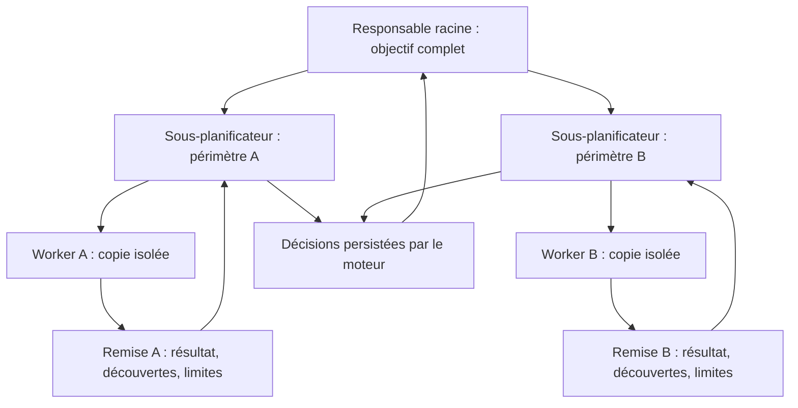
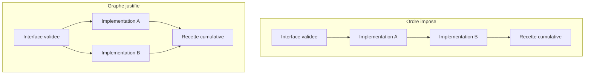
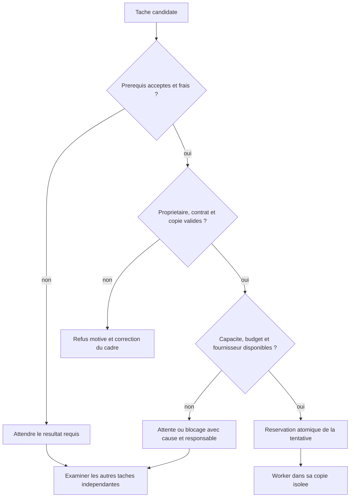
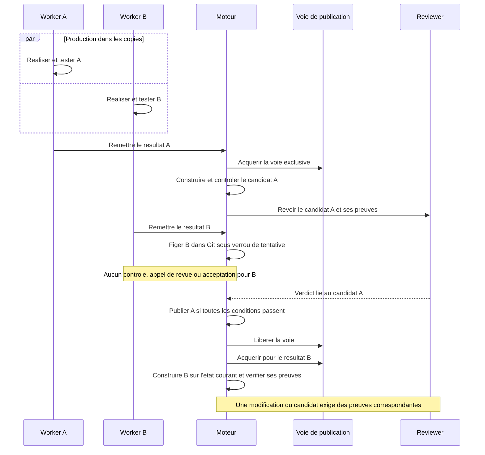
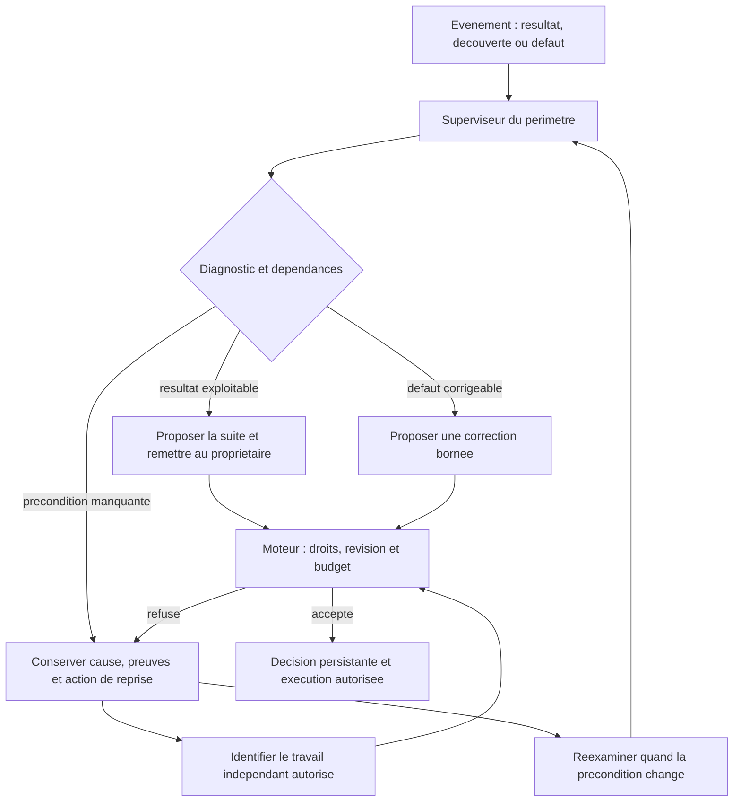
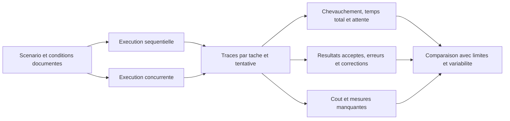

# Parallélisme des agents : besoins, contraintes et preuves

[English](../en/AGENT-PARALLELISM.md)

## Portée et statut

Ce document définit le parallélisme attendu dans Swarm, les conditions de son
exécution et les preuves nécessaires. Il accompagne le
[contrat Cursor JAN/FEB](CURSOR-ENGINE-CONTRACT.md) et le
[plan d’évolution](CURSOR-ENGINE-EVOLUTION-20261010.md).

Au constat du 10 octobre 2026, le plan adopté de la mission d’évolution forme
une chaîne T1 → T2 → T3 → T4 → T5 → T6 → T7. La
[décision enregistrée](../publications/20261005-cursor-moteur/dossier-recherche/revisions/20261010-parallelisme-plan.md)
précise les remises futures sans changer ce graphe. Les schémas marqués **cible**
ne décrivent pas un résultat déjà démontré par cette mission.

## Ce qui peut être parallèle

La concurrence signifie que plusieurs travaux sont engagés pendant une même
période. Le parallélisme observé exige un chevauchement de leur activité utile :
deux processus ouverts dont l’un attend toute la durée ne suffisent pas. Un
appel IA et une commande locale sont des activités différentes à mesurer.

| Niveau | Travail qui peut se chevaucher | Condition | Preuve attendue |
| --- | --- | --- | --- |
| Sous-planification | Explorer et décomposer plusieurs périmètres | Propriétaire exact, informations datées, décisions atomiques | Deux activations distinctes simultanées et décisions persistées |
| Production | Réaliser des tâches indépendantes | Entrées disponibles, copies distinctes, périmètre et contrat explicites | Activité utile de deux tentatives, puis résultats remis |
| Vérification locale | Tester chaque résultat dans sa copie | Ressources et jeux de données séparés | Commandes, sorties et périodes d’exécution |
| Acceptation | Contrôler, revoir et publier un candidat | Candidat exact et preuves fraîches | Reçus et verdict liés au même candidat ; attente mesurée |

La dernière ligne n’est pas une promesse de revues simultanées : le chemin
d’intégration géré actuel possède une voie exclusive par mission.

## Pourquoi le parallélisme est nécessaire

Les travaux indépendants peuvent avancer sans attendre le plus long. Des
sous-planificateurs responsables de périmètres bornés répartissent l’exploration
et évitent de charger un seul contexte avec tout le projet. Une indisponibilité
locale doit laisser visibles les actions indépendantes encore autorisées.

Cette nécessité dépend du problème. Une tâche consommatrice d’un résultat non
disponible doit attendre. Multiplier les agents sur une chaîne de dépendances
ou un état partagé peut augmenter le coût sans améliorer le débit. Le nombre
d’agents est une capacité ; les livraisons acceptées mesurent le résultat utile.

**Cible : responsabilités réparties, retours au propriétaire.** Les flèches de
remise ne sont pas des autorisations de coordination directe entre workers.

Le responsable propose la décomposition et réévalue les découvertes. Le moteur
arbitre les réservations, les droits, la fraîcheur et les transitions. Le
reviewer indépendant examine le candidat ; le juge global décide de la suite
du cycle. Ces responsabilités ne se remplacent pas mutuellement.

## Dépendances nécessaires et dépendances artificielles

Chaque flèche du plan doit nommer ce que la tâche suivante consomme : interface,
décision, données, résultat vérifié ou effet préalable. L’ordre d’une liste ne
constitue pas cette justification. Distinguer une dépendance de résultat d’une
exclusion temporaire sur une ressource, et de la limite de capacité.

**Exemple de conception, distinct de la mission actuelle.** Après une interface
commune validée, deux implémentations indépendantes peuvent avancer ensemble.
La recette cumulative attend leurs deux résultats.

Une modification de graphe doit conserver les identifiants, exigences, budgets,
tentatives et preuves historiques ; enregistrer son motif, sa révision et les
contrats affectés ; vérifier l’absence de cycle, les entrées et les conflits.
Les anciennes validations ne couvrent pas automatiquement un contrat modifié.

Dans le moteur actuel, `task update` peut préciser `next` sans relancer ni
réaccepter une tâche. Un changement de définition est refusé pendant une tâche
en cours ; le contrat hiérarchique géré impose des restrictions supplémentaires.
Une consigne de remise ne modifie donc pas les dépendances. T3 doit démontrer
l’adaptation par une opération publique effectivement prise en charge, et
documenter ses refus. Une mise à jour directe de la base n’est pas une solution.

## Conditions de lancement et réglages

Le moteur doit distinguer une tâche prête d’une tâche simplement présente dans
le plan. La largeur du graphe prêt, les créneaux disponibles, les budgets, le
fournisseur et les ressources bornent ensemble la concurrence effective.

Ce schéma résume les conditions ; leur évaluation réelle peut les regrouper
dans une transaction. Le refus doit nommer la cause, l’action autorisée et
la condition de reprise. Une attente de dépendance n’est pas un échec du worker.

| Contrainte ou politique | Nécessité | Traitement attendu |
| --- | --- | --- |
| Dépendance et fraîcheur | Éviter une consommation de résultat absent ou périmé | Contrat explicite et contrôle avant lancement |
| Propriété du périmètre | Éviter la double délégation et les effets hors scope | Réservation exclusive et remise au propriétaire exact |
| Copies et données de test | Éviter les écritures concurrentes dans un état partagé | Copie par tentative, fixtures temporaires |
| Révision et identité | Refuser une décision issue d’un état ancien | Vérification atomique de révision, tentative et bail |
| Créneaux et admission fournisseur | Éviter une saturation et des appels non autorisés | Politiques persistées ; délai/quota visible, pas de contournement |
| Budgets et tentatives | Borner le coût et conserver l’historique | Décompte atomique partagé, aucune remise à zéro pour débloquer |
| Contexte et preuves | Permettre une décision fondée sur les originaux | Sources complètes, empreintes, limites visibles, refus avant appel |
| Publication | Préserver l’identité du candidat contrôlé et revu | Voie actuelle exclusive ; optimisation à mesurer en T4 |

Les réglages de politique ajoutés par l’évolution doivent être persistés et
exposés dans l’Admin FR/EN, avec provenance, révision et effet réel dans le
moteur. La capacité configurée n’est pas un ordre d’occuper tous les créneaux.
T5 doit distinguer les politiques réglables des invariants techniques ; les
limites actuelles ne sont pas toutes déjà transformées en réglages Admin.

Une copie Git isole les fichiers et références de travail. Elle n’est pas une
frontière de sécurité contre un processus utilisant les mêmes droits du compte
hôte. Des tests doivent aussi isoler ports, bases, services et fichiers temporaires.

## Production parallèle et publication exclusive

**Chemin actuel, constaté dans le code source.**
`managedPublicationLane` utilise un verrou non bloquant par mission.
`integrateManagedAttempt` le garde pendant l’intégration, les contrôles, la revue
et la publication ; le verrou Git est distinct. Les workers peuvent poursuivre
leur production pendant cette période. Un résultat retenu faute de voie libre
ne nécessite pas à lui seul une nouvelle production ou une nouvelle revue payante.

Le chemin de conservation anticipée `stageManagedResult` peut figer le résultat
d'un worker terminé pendant la revue d'un autre candidat. Il reprend les mêmes
gardes d'identité, tentative, autorisation et pauses que l'intégration, sous les
verrous Git et de propriété de tentative. `retainManagedResult` conserve le commit
et son rapport dans le dépôt géré, sans modifier la révision métier, accepter une
tâche, exécuter un contrôle ni réserver une revue. Si le verrou Git est occupé,
le conducteur conserve l'attente ; ce conflit de réservation n'est pas un défaut
du résultat.

La reprise lit ce commit immuable, même si la copie de travail a changé entretemps.
Lorsque la voie se libère, le moteur construit le candidat sur la base courante,
traite les conflits et fournit des contrôles et une revue liés à ce candidat.
La conservation anticipée améliore la remise ; elle ne rend pas les revues
simultanées et ne prouve pas, à elle seule, un gain de débit global.

L’objectif de T4 est de réduire l’attente centrale tout en conservant la liaison
entre candidat, contrôles, revue et publication. Retirer le verrou sans mécanisme
équivalent permettrait à une publication concurrente de périmer une revue.
Un conflit de fusion, un fichier commun ou une interface modifiée exige un
diagnostic puis un candidat cohérent ; un `PASS` précédent ne suffit pas.

## Supervision, attente et reprise

Le superviseur doit interpréter les événements, exploiter les remises et proposer
les corrections dans son périmètre. Une minuterie ne peut pas déterminer seule
la qualité d’un résultat. Les mécanismes de bail, silence et arrêt restent
nécessaires pour détecter un processus perdu et prévenir les effets doubles ;
leur [politique de vivacité](PROVIDER-LIVENESS.md) reste distincte de la décision IA.

**Cible de coordination : avancer sur les travaux indépendants pendant une attente.**

Une indisponibilité du fournisseur bloque les appels concernés ; elle n’est pas
résolue par la création d’agents supplémentaires. Après panne ou redémarrage,
réconcilier processus, baux et effets observés avant de relancer. Une réservation
périmée n’autorise ni appel double ni remboursement d’une tentative. Les travaux
indépendants ne peuvent continuer que si leurs propres conditions sont réunies.

Le jugement global attend les preuves requises par l’objectif. Cette contrainte
de clôture ne doit pas devenir une barrière générale entre chaque remise et
toutes les productions encore possibles.

## Mesurer le gain et vérifier les refus

T6 compare le même objectif, les mêmes critères et contrôles, avec révision,
fournisseur, modèle, ressources et cache documentés. Répéter les essais pour
exposer la variabilité ; fixer le protocole avant la comparaison. Le rapport
sépare les temps d’exploration, production, attente, contrôle, revue et publication.

L’accélération est le temps séquentiel divisé par le temps concurrent sur un
travail comparable. Le débit utile est le nombre de résultats acceptés par unité
de temps. Publier aussi leur qualité et leur couverture : produire davantage de
résultats refusés n’est pas un gain de livraison. Un coût non mesuré reste inconnu.

| Cas | Résultat attendu | Preuve |
| --- | --- | --- |
| Deux tâches indépendantes prêtes | Activité utile simultanée | Identités, événements horodatés et copies distinctes |
| Dépendance réelle non satisfaite | Consommateur retenu, travail indépendant admissible | Motif d’attente et autre lancement autorisé |
| Deux décisions sur la même révision | Effet atomique, état périmé refusé | Révisions et absence de double effet |
| Deux producteurs touchent un fichier commun | Conflit traité, pas d’écrasement silencieux | Candidat, refus/correction, contrôles et revue frais |
| Redémarrage pendant réservation ou remise | Réconciliation et remise unique | Identités et compteurs conservés |
| Quota, silence ou preuve périmée | Cause visible, pas de répétition à conditions identiques | Diagnostic et précondition changée avant reprise |

T3 prouve la concurrence de sous-planification et l’adaptation du plan. T4
mesure la voie de publication et les conflits. T5 expose les politiques. T6
vérifie ces propriétés en racines isolées. T7 les observe avec fournisseur réel,
en comptant les interventions humaines séparément. Aucune de ces preuves ne
peut être remplacée par le nombre de goroutines ou d’agents déclarés.

## Sources et limites de l’inspection

La [traçabilité des agents concurrents](TRACEABILITY.md) précise la chaîne de
preuve, la répartition entre superviseurs et moteur déterministe, et la reprise
d’un manque de preuve avec six schémas Mermaid.

Les deux références Cursor sont conservées. Janvier décrit la séparation des
planificateurs et workers, la sous-planification et le jugement de cycle ; février
décrit une hiérarchie continue et les remises au propriétaire. Leur évolution
ne constitue pas une preuve Swarm. Sources consultées le 10 octobre 2026 :
[janvier](https://cursor.com/blog/scaling-agents),
[février](https://cursor.com/blog/self-driving-codebases).

L’inspection porte sur `internal/engine/managed_publication_lane.go`,
`managed_integration.go`, `managed_result_staging.go`, `planning_runner.go`, `mission.go` et
`task_definition.go` du dépôt source, HEAD `1169df70` avec modifications locales.
Les éléments actuels décrits ici sont une inspection de mécanismes, pas une
mesure de débit ni une recette autonome. Le candidat géré de chaque lot doit
intégrer ses changements et fournir ses propres preuves.
