# Diagnostic autorécursif et reprise vérifiée

[English](../en/AUTORECURSIVE-RECOVERY.md)

## Comportement attendu

Un agent ne doit pas attendre une relance de l’utilisateur pour traiter un défaut
diagnostiquable dans son périmètre autorisé. Il confronte l’objectif aux faits,
diagnostique l’écart, corrige ou transmet au propriétaire, vérifie le résultat
puis réexamine l’objectif. Si sa méthode, son diagnostic, sa remise ou son contrôle
échoue, il applique cette même démarche à cet échec et revient au problème initial.
La récursion porte sur le raisonnement et les problèmes liés ; elle ne crée pas
automatiquement une pile d’agents, des appels payants ou de nouvelles tentatives.

Ce contrat complète la [traçabilité](TRACEABILITY.md), les
[preuves de revue](REVIEW-EVIDENCE.md) et le [parallélisme](AGENT-PARALLELISM.md).
Il prescrit une méthode et des vérifications de développement. Il ne déclare pas
une reprise autonome déjà implémentée ni démontrée par cette mission.

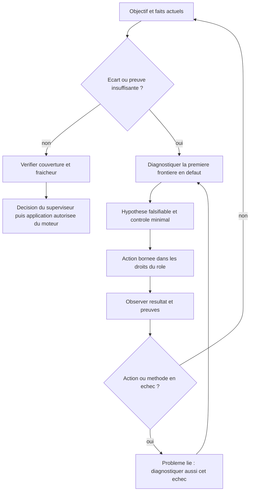

## Une itération doit faire progresser la preuve

Pour chaque problème, conserver dans le rapport ou la décision existante :
exigence, problème parent éventuel, candidat, événement, résultat attendu/observé,
cause démontrée ou hypothèse, propriétaire, contrôle discriminant, précondition
modifiée et résultat de l’opération publique. L’historique distingue ce que l’agent
a proposé, ce qui a été transmis, ce qui a été décidé et ce qui a été exécuté.

Un progrès utile est une preuve pertinente nouvellement fournie, une hypothèse
éliminée par un contrôle, une précondition corrigée ou une transition effectivement
observée. Réécrire le même diagnostic, citer davantage un rapport ou produire une
nouvelle documentation ne démontre pas une reprise opérationnelle.

Comparer le problème courant au précédent : même candidat, même cause supposée,
mêmes entrées et même action ne justifient pas une relance inchangée. Choisir un
contrôle discriminant différent, transmettre au propriétaire compétent ou conserver
un blocage motivé. Les plafonds et réservations existants restent applicables.
Aucun nombre de tours arbitraire supplémentaire n’est introduit ici.

## Responsabilités de la boucle

| Acteur | Démarche autorisée | Ce qu’il doit vérifier |
| --- | --- | --- |
| Worker | Diagnostiquer et corriger son livrable avec ses outils et droits | Même scénario après correction, sorties réelles et remise attribuée |
| Sous-superviseur | Exploiter les retours, relier les problèmes et décider dans son périmètre | Cause ou hypothèse, entrée manquante, action et propriétaire exacts |
| Superviseur racine | Arbitrer les causes entre périmètres et les écarts globaux | Que le défaut n’appartient pas au moteur, à une règle ou à la méthode ; objectif encore couvert |
| Reviewer | Motiver le défaut ou le manque à partir des originaux reçus | Aucun PASS inventé ; distinction anomalie du résultat et manque de preuve |
| Moteur déterministe | Fournir faits et inventaires, contrôler droits/révisions/réservations et appliquer les opérations publiques | Attribution, effets uniques, fraîcheur et conservation des consommations |
| Agent natif opérateur | Poursuivre les investigations et corrections autorisées, vérifier ses propres remontées | Relation checkout/serveur, contexte réellement fourni et résultat public ; intervention explicite |

Le planificateur sans outils propose une action prise en charge ; il ne prétend
pas avoir lu une source absente de son contexte. Le moteur ne devient pas un
diagnosticien sémantique parce qu’il applique une transition déterministe.
Une intervention opérateur n’est pas attribuée rétroactivement au superviseur IA.

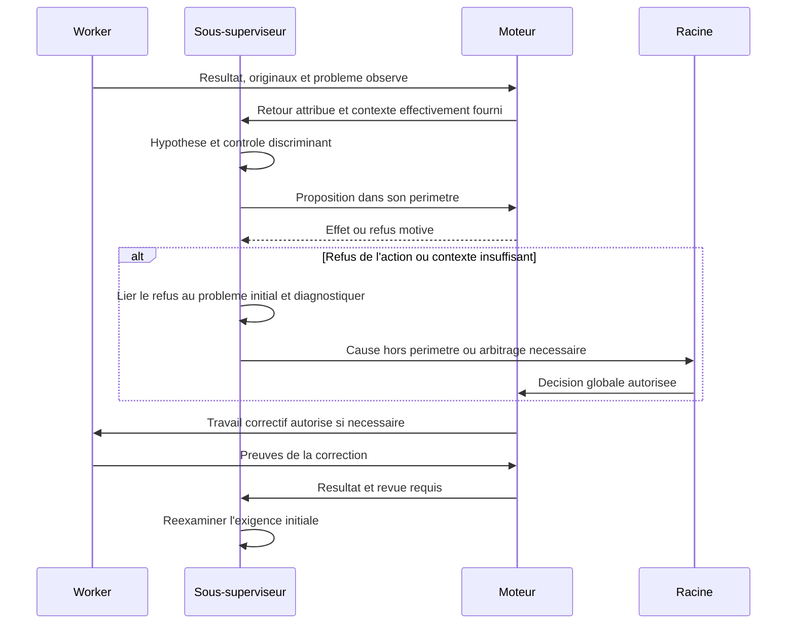

## Vérifier aussi la méthode et la transmission

Examiner à chaque frontière ce qui est réellement disponible : commande et code
de retour, original joint, projection reçue, droits du décideur, opération prise
en charge, état persistant et candidat effectivement publié. Un chemin inscrit
dans une consigne n’est pas un contenu joint ; un événement enregistré n’est pas
une preuve d’exploitation ; un appel terminé n’est pas une acceptation.

**Défaut observé dans nos remontées du 10 octobre 2026.** Les nouvelles consignes
avaient été ajoutées à la fin de longs champs `next`. `planningContextLimit`
projette les 1 000 premiers caractères ; `recoveryTaskFocus` en conserve 600.
Un décideur pouvait donc ne pas voir le diagnostic et la prochaine action.
La correction immédiate place un résumé opératoire en tête, avec un renvoi vers
les originaux. Les détails et historiques sont conservés. Vérifier les projections
des deux parcours ; cela ne prouve pas encore leur lecture par le modèle.

Ces bornes existantes sont un constat de code, pas de nouvelles valeurs recommandées.
T5 doit distinguer résumé courant, sources complètes et réglages persistés dans
API/CLI/Admin FR/EN. Agrandir arbitrairement le contexte ne résout pas l’attribution
ni la pertinence des preuves. Le dossier de revue conserve ses originaux intégraux.

## Arrêts et escalades justifiés

Une demande de statut ou un jalon terminé ne clôt pas le besoin initial : répondre
puis poursuivre l’action utile autorisée, sans attendre une relance. Pendant une
exécution ou une revue native, observer son état public, traiter les travaux
indépendants et exploiter son résultat. Clore sur le besoin vérifié, un arrêt ou
report explicite, ou l’absence d’action utile autorisée en indiquant cause, preuve,
propriétaire et condition concrète de reprise. Ne pas promettre un suivi futur
non organisé. Ces consignes ne créent ni appels payants ni surveillance récurrente.

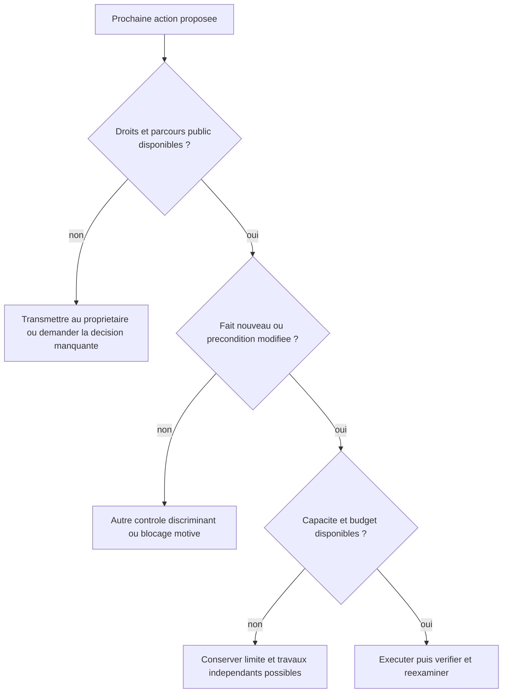

Une revue en cours protège son candidat : préparer une correction indépendante,
attendre son verdict avant toute mutation correspondante. Un fournisseur indisponible
ou un budget épuisé reste visible ; continuer le travail indépendant autorisé.
Demander à l’utilisateur seulement une décision nécessaire ou une autorisation
absente, avec les options concrètes et la raison. Ne pas lui déléguer un diagnostic
ou une correction déjà réalisable dans le périmètre autorisé.

## Mise en œuvre et validation dans le plan Cursor

| Lot | Vérification issue de cette démarche |
| --- | --- |
| T3 | Sous-superviseur traite une découverte et le refus d’une première proposition ; décisions liées et persistées |
| T4 | Remise incomplète ou contrôle en échec produit une correction attribuée ; retour à l’exigence initiale sans effets doubles |
| T5 | Consignes APEX/replan communes, projections utiles et parcours publics cohérents ; nouvelles politiques persistées Admin FR/EN |
| T6 | Scénarios normal, diagnostic incorrect, source absente, règle/moteur défectueux, redémarrage et concurrence ; progression et coût observés |
| T7 | Fournisseur réel : exploitation effective des retours et distinction corrections autonomes/interventions humaines |

Dans des racines temporaires, provoquer un défaut connu puis une erreur de diagnostic
ou de transmission. Vérifier une nouvelle preuve discriminante, l’action correspondant
à la cause, la décision enregistrée et le réexamen de l’exigence initiale. Tester
également qu’un échec inchangé ne provoque pas une cascade de dépenses, tâches ou
acceptations. Une simple consigne ajoutée à un prompt ne suffit pas à ce résultat.

## Diagnostic des seuils de durée

Une durée écoulée n’est pas une cause démontrée de non-progrès. Le signal, sa remise et la décision du propriétaire suivent [le contrat de conduite](RUN-SUPERVISION.md). Une absence de décision ne devient pas un arrêt automatique ; droits, dépenses et historique restent conservés.

## Transmission de la correction d'une revue

Le diagnostic du 11 octobre a identifié une rupture : `review-retry` écrivait
`Task.Next`, mais le vérificateur reprenait sans recevoir cette consigne. Le
correctif capture séparément la décision, le périmètre, l'événement reçu, la revue,
le candidat, la tentative, la cause et la consigne dans `retry_directive`.
Les nouveaux appels d'inspection, sélection et décision finales reçoivent cette
enveloppe avant les preuves. Les journaux gardent la consigne reçue et l'empreinte
du prompt ; modifier ensuite `Task.Next` ne modifie pas cette reprise.

La transaction vérifie attribution, droits, candidat, budget et capacité de
transmission avant tout appel. Les réservations et originaux restent conservés.
Un diagnostic de plusieurs défauts pour une même pièce rappelle la contrainte
existante d'une entrée par pièce en échec, sans fabriquer un nouvel avis.
Les lecteurs actuels conservent les anciens journaux sans directive. La lecture
stricte des journaux ne protège pas à elle seule le corps JSON du travail : un
ancien processus peut ignorer puis perdre un champ inconnu lors d'une écriture.
Le contrat de stockage passe donc en version 28 avec sauvegarde privée, sans
réécrire le travail, ses événements, sa révision ou ses consommations. La consultation
avec migration désactivée refuse une ancienne version ; chaque mutation contrôle
la version sous la réservation d'écriture, avant décodage et effets du callback.
Un ancien CLI refuse une version future dès l'ouverture. Avant la migration publique
par `swarm init`, l'opérateur doit arrêter les anciens processus après réconciliation
et absence d'acteurs actifs ; un processus ancien déjà ouvert ne reçoit pas
rétroactivement cette nouvelle protection. Les tests de migration et de connexion
périmée utilisent exclusivement des racines isolées.

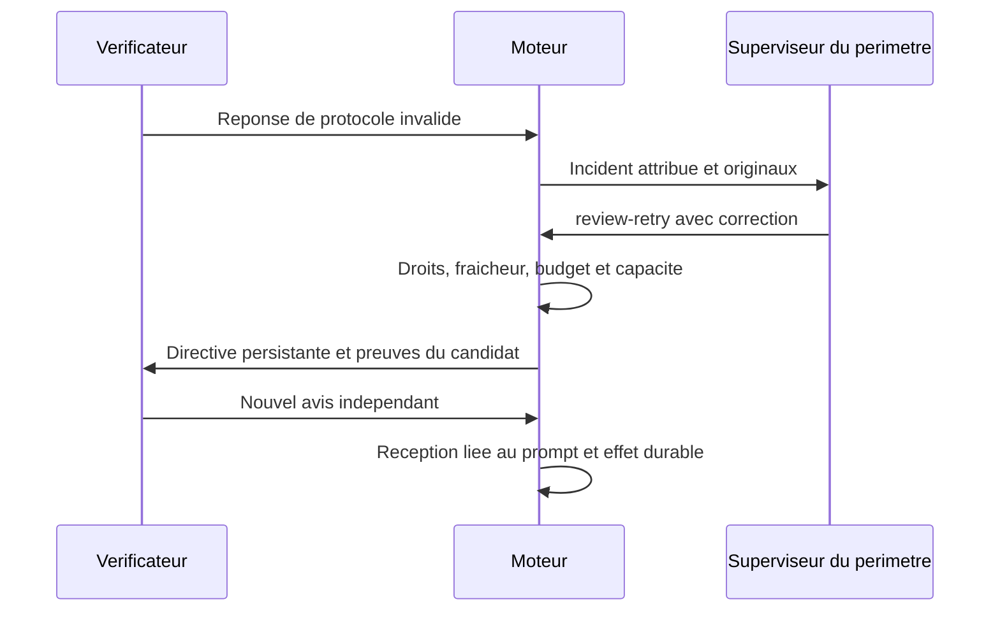

La régression `TestPlanningReviewRetryDeliversSupervisorCorrectionAfterReopen`
vérifie cette chaîne avec un processus fournisseur simulé dans une racine isolée,
y compris réouverture, réception effective et résultat final durable. Elle ne
prouve ni une correction par un modèle réel ni la fonction globale d'incidents.
Le changement de méthode qui crée une revue neuve et les autres classes
d’incidents restent à compléter et à vérifier dans T3–T7. Aucune clôture globale
n’est déduite de cette régression.

## Avis local défavorable et décision sur le candidat complet

Le journal conserve un `changes_requested` local sans décider à la place du
vérificateur final. Les autres paquets sont inspectés ; la sélection et la revue
finale reçoivent les défauts originaux et une question attribuée par pièce.
Confirmer ou réfuter exige le contexte original pertinent. Toute réserve ouverte
empêche une acceptation. Le moteur vérifie la couverture et les citations ; la
pertinence de l’avis appartient au vérificateur, puis au superviseur pour la
conduite du travail. Les contrôles frais et la publication restent requis.

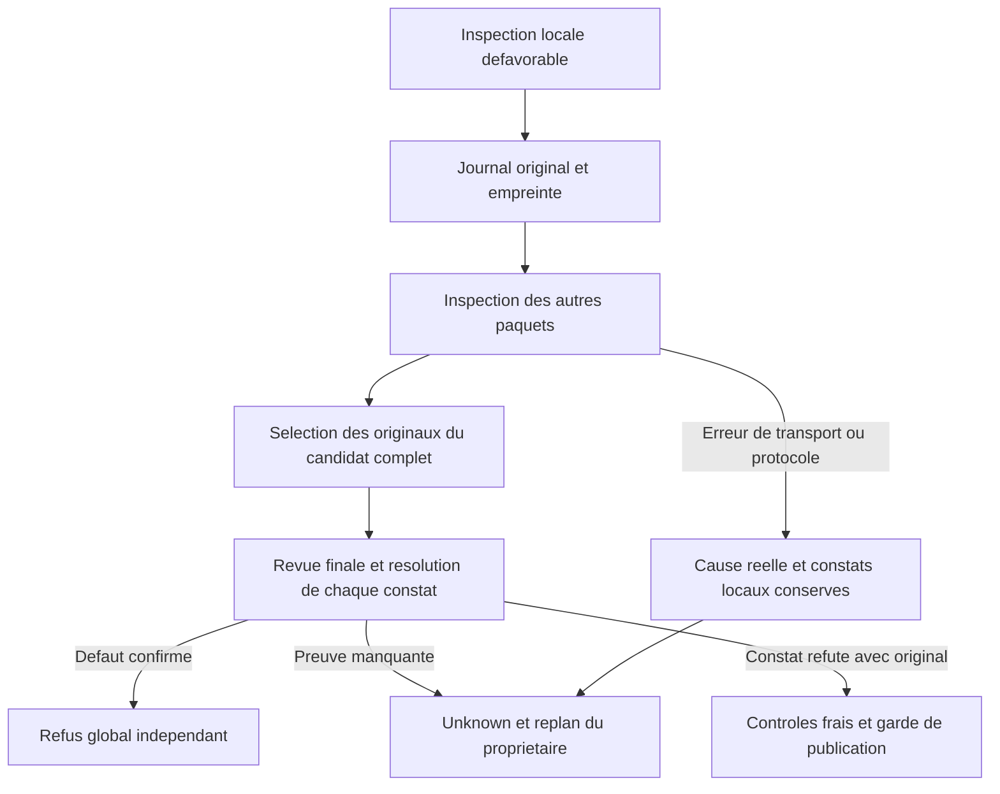

Les régressions isolées vérifient refus final, réfutation sur originaux réellement
reçus, interruption après avis local et conservation des dépenses/historiques.
Elles utilisent un processus fournisseur simulé ; une réception et une décision
par un modèle réel dans la mission restent à prouver. Un incident acquitté ne
signifie pas que son défaut est corrigé ; cette frontière de reprise est suivie
séparément et aucune fonction globale achevée n’est annoncée.

## Acquitter un incident conserve son obligation de correction

Une décision sans opération constate la réception d’un événement ; elle ne
résout pas son erreur. Lorsqu’une entrée publique actuelle donne lieu à une
nouvelle activation, le moteur remet séparément `unresolved_review_incidents` :
les événements originaux déjà acquittés dont l’erreur de protocole reste actuelle
pour cette tâche, cette tentative, ce candidat et ce périmètre. Leur ancienne
décision est conservée. Ils ne sont pas réintroduits dans `input_events`.

La réception persistée `unresolved_review_sources` lie leurs identités exactes.
`review-retry` exige cette réception, une entrée fraîche reçue, une nouvelle
correction pertinente, les preuves intactes, les droits et les budgets actuels.
Un avis sémantique défavorable, un événement obsolète, un autre périmètre ou une
tâche retenue ne bénéficient pas de cette reprise. Le moteur ne réveille pas un
périmètre sur ce seul rappel et ne relance pas automatiquement une action
inchangée ; le superviseur choisit la correction. La réservation de production
ne change pas et l’événement initial conserve son acquittement.

Le contrat de stockage 29 protège ce nouveau rattachement contre les décodeurs
28 qui pourraient l’ignorer. La migration publique conserve les corps des
missions et crée une sauvegarde privée ; les anciens processus doivent être
arrêtés après vérification de l’absence d’acteurs actifs. Chaque écriture vérifie
la version dans sa transaction. L’arrêt et la migration ne valent pas reprise
vérifiée : contrôler ensuite la réception, la décision et le prompt réellement
reçu, puis son effet durable.

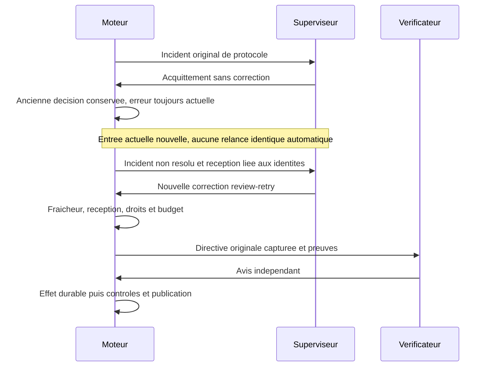

La régression publique isolée couvre acquittement, reprise, réouverture,
nouvelle réception, décision, entrée du processus fournisseur et avis final
durable. Les cas obsolète/hors périmètre, candidat non reçu et migration sont
vérifiés séparément. Le fournisseur est simulé : cela ne prouve pas encore la
reprise native par un modèle réel ni la fin du projet jusqu’au RETEX.

## Reprise après un avis local et une erreur ultérieure

Si un paquet contient un constat local défavorable achevé puis qu’un appel
ultérieur échoue, l’erreur réelle reste `error`. Le précontrôle de reprise et la
transaction publique peuvent réutiliser cet avis sur le même plan intact, sans
le repayer ni le transformer en verdict global. Ils reprennent seulement les
inspections manquantes et les deux appels finaux nécessaires. Les réservations
interrompues restent consommées et les anciens journaux restent inchangés.
L’avis final peut confirmer le défaut ; cette reprise ne présume aucun succès.
Une revue déjà terminée par refus sémantique ne devient pas une simple erreur de
transport récupérable. Une preuve, un candidat ou un budget modifié conserve ses
gardes existants.

Le diagnostic de réponse distingue aussi une citation absente d’un
`v=inspected` avec `n` non vide. Pour cette incohérence, il remet les pièces
concernées et la règle `n=[]`, ou `unknown` avec besoin précis. Il ne prétend pas
que la citation était fausse et ne prescrit jamais un avis favorable.

La régression isolée couvre avis local original→transport échoué→précontrôle
public→reprise autorisée→réouverture→sélection et refus global indépendant. Elle
vérifie les octets originaux et le nombre exact d’appels encore dépensés. Les
réponses sont simulées. La chaîne native et les autres classes d’incidents
restent des preuves distinctes. Les suites complètes conservent leurs échecs ;
une assertion historique enrichie décrit un avis absent au lieu d’un panic nil,
sans affaiblir la garde des citations ni attribuer une cause non observée.

## Corriger les frontières générales de preuve et de capacité

Une correction durable traite le contrat en défaut, sans exception fondée sur
l'identifiant d'une mission, une date ou le texte d'un incident. Les cas natifs
servent à reproduire la cause ; les régressions couvrent aussi d'autres candidats,
les deux niveaux de supervision, les reprises et les entrées invalides.

`review_evidence_inventory` relit le contexte original déjà admis par la revue.
La limite d'admission d'un dossier de reprise n'est pas une limite de ce contexte.
Le lecteur dédié vérifie le fichier régulier entier en flux contre son empreinte,
puis vérifie de nouveau le flux JSON complet pendant le décodage, jusqu'à EOF.
Cette deuxième lecture ne peut dépasser la taille originale vérifiée. Une autre
empreinte, un autre candidat, des données supplémentaires ou une source incohérente
refusent toute attestation. Le superviseur reçoit les chemins, objets Git,
empreintes et tailles, jamais une copie silencieusement tronquée des sources.

Après acquittement, les avis `unknown`, `changes_requested` et `error` encore
courants pour la même tâche, tentative, origine et périmètre restent consultables
sur une entrée fraîche dans `acknowledged_current_review_evidence`. Leur décision
originale et l'inventaire associé sont conservés en lecture seule. Ce rappel ne
réveille pas un périmètre, ne réintroduit pas l'événement dans `input_events` et
n'ajoute aucun droit de `review-retry`. Les droits de reprise de protocole restent
ceux de `unresolved_review_sources` ; un refus sémantique ne devient pas une erreur.

La sélection des pièces finales calcule la place restante à partir des
inspections originales validées et désormais immuables, y compris leurs réserves
et questions réelles. La réserve pour les constats encore hypothétiques sert au
précontrôle avant les appels ; elle ne doit plus masquer la place disponible
après réception. Le message final complet est de nouveau mesuré sous le contrat
de transport en octets/tokens avant toute dépense. Une preuve nécessaire réellement
trop grande reste `unknown`, sans omission ni approbation automatique.

Le journal final version 2 attribue ce calcul aux nouveaux appels. La version 1
reconstruit exactement le calcul historique pour vérifier ses anciens prompts,
réponses et dépenses ; elle n'est jamais réécrite pour lui attribuer la nouvelle
capacité. Une version inconnue ou un prompt attribué à la mauvaise version est
refusé. Ce contrat de fichier ne change aucun champ du stockage des missions.
Un ancien moteur ne sait pas traiter un journal final version 2 : installer le
nouveau moteur sans appel interne ni producteur actif avant les nouvelles revues.

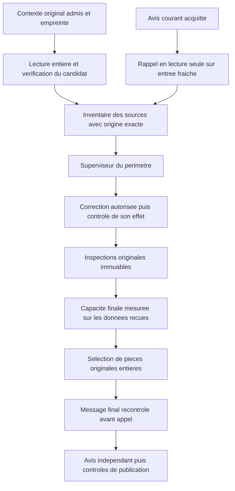

Les tests isolés reproduisent les deux omissions dans le superviseur racine et
un sous-superviseur, vérifient les origines étrangères/anciennes, l'absence de
droit implicite, les grandes sources admises et les fichiers invalides. Un autre
test établit qu'une pièce entière tient dans le message final alors que le budget
spéculatif l'excluait ; les limites réelles et les anciens journaux restent
contrôlés. Cette qualification ne prouve ni une correction native autonome de
toutes les classes d'incident, ni l'acceptation de la mission jusqu'au RETEX.

## Reprendre une ancienne sélection après correction générale de capacité

`review_selection_capacity_changed` exige un journal final version 1 entièrement
attesté, terminé à la phase de sélection `unknown`, sans verdict final de tâche,
avec toutes ses inspections réutilisables et une augmentation calculée de la
capacité sous le contrat courant. Le texte du motif ne crée pas cette autorité.
Candidat, contrat, tentative, fournisseur, modèle, méthode et preuves restent
attribués et intacts. Cette route ne reprend ni une sélection sous le contrat
courant ni un refus ou un `unknown` final de tâche.

Une entrée fraîche fournit les faits avant/après et rattache l'avis exact, même
déjà acquitté, à la réception persistée. Le superviseur propriétaire décide
`review-retry` avec une consigne nouvelle. Le moteur revérifie droits, preuves,
budget pour deux appels finaux et fin confirmée du producteur dans la transaction.
La projection ne reprend pas une connexion au stockage qu'elle détient déjà.
Aucune réservation n'est faite pendant cette projection ou décision.

L'ancien journal, l'avis, l'acquittement et tous les appels consommés sont conservés.
Un nouveau journal final version 2 reçoit la décision identifiée pour la sélection
et le vérificateur final. Les inspections originales restent immuables ; aucune
nouvelle production n'est engagée. Le parcours opérateur exige sa confirmation
explicite. Une preuve remplacée ou une précondition inchangée refuse la reprise.
Un refus final reste refusé : cette correction n'invente aucune acceptation.

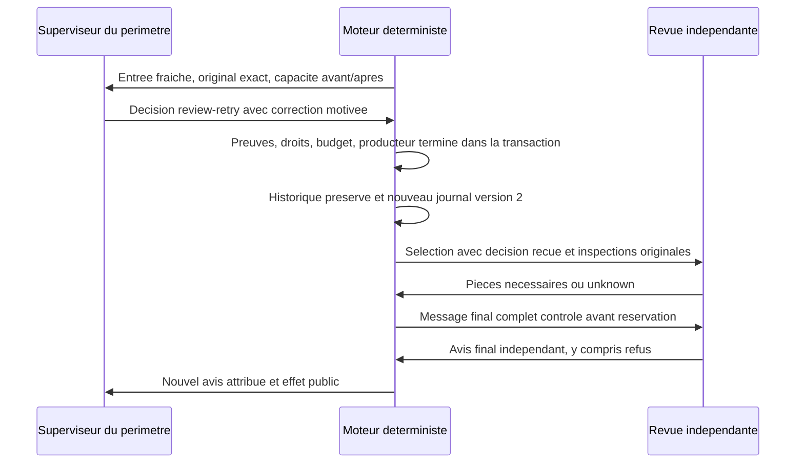

La régression traverse réception→décision→réouverture du stockage→deux vrais
processus de revue simulée→refus indépendant, pour la racine et le sous-superviseur.
Elle contrôle aussi origines étrangères, réception historique, budget insuffisant,
producteur actif ou processus encore vivant, preuves ou contrats remplacés et
décision périmée. Elle ne constitue ni une revue par un vrai modèle ni une
acceptation native.

## Prévenir les récidives dans les tâches suivantes

Codex et Claude partagent la règle personnelle de correction générale. Les rôles
Swarm de supervision et d'exécution reçoivent aussi cette exigence dans leur cadrage :
conserver le contre-exemple, contrôler les variantes et entrées invalides, transmettre
l'apprentissage puis vérifier son effet. Le superviseur utilise `revise-instructions`
pour les tâches futures dans ses droits ; l'utilisateur garde son choix de rejet.
Une mesure provisoire reste provisoire et ne clôt pas sa cause. Une correction
durable exige non-régression et réception→décision→application→effet observés.
La méthode de la revue déjà commencée reste inchangée afin que ses preuves
historiques demeurent vérifiables.

## Résoudre une réserve sur le contrat effectivement fourni

Le message final de revue fournit le contrat courant de chaque tâche : identifiant,
titre, livrable et critères. Une question sur le périmètre ou le libellé d'un critère
peut être résolue par une citation littérale de ces champs. Le validateur doit
reconnaître exactement les octets JSON remis, y compris les échappements, sans
admettre les opinions du producteur, d'une ancienne revue ou d'une inspection.

Ce texte de contrat ne prouve pas l'implémentation. La vérification du `pass`
continue d'exiger une preuve du candidat, du rapport ou des contrôles visibles.
La projection admise pour résoudre la question reste distincte de ces preuves ;
elle n'est jamais ajoutée aux sources d'implémentation. Un ancien critère, une
citation reformulée ou une preuve absente reste refusé. L'avis et les réserves
indépendants conservent leur portée, sans acceptation opérateur implicite.

Le contre-exemple conserve la citation native du critère JAN/FEB, avec variantes
FR/EN, guillemets, caractères spéciaux et saut de ligne. Les gardes refusent opinions,
contrats anciens et invention ; elles refusent aussi une conformité fondée sur le
seul contrat. Cette correction locale ne prouve pas encore la reprise native.

Pour une pièce source entière effectivement sélectionnée, le message transporte
son texte dans une enveloppe JSON. La validation des citations reconnaît aussi les
octets originaux attestés par la taille et l'empreinte de cette enveloppe, comme
la validation des lignes d'un constat local. Elle garde les types et frontières
d'origine : code et données restent littéraux ; seules les tolérances existantes
de présentation de prose Markdown sont conservées, hors blocs de code.
Elle ne consulte aucun corps de source non sélectionné. Le cas de
régression couvre guillemets, caractères spéciaux, saut de ligne et tabulation,
avec refus du même texte reformulé ou absent du message admis.

Concaténer rapport, code et JSON sous une étiquette Markdown permettrait à tort
une normalisation de code ou une citation traversant deux pièces. Le validateur
reçoit donc leurs pièces typées distinctes ; les régressions couvrent ces refus
et conservent la lecture de prose autorisée. Le cadrage worker conserve champs de
preuve et limites du rôle, en supprimant les répétitions ; le cadrage des revues
et superviseurs reste inchangé, sans relever la limite ni tronquer une méthode.

## Inclure les ressources réellement embarquées dans la qualification

Copier seulement les chemins d'un ancien manifeste peut omettre une ressource
`go:embed` nécessaire à la compilation. La liste courante doit donc compléter
l'inventaire historique avec `go list -json .` et ses `EmbedFiles`, puis figer leurs
empreintes. Le même mécanisme couvre configurations, schémas, consignes et fichiers
web embarqués sans liste parallèle de noms supposés. Les manifestes historiques
et leurs résultats restent inchangés ; un nouvel inventaire n'en renouvelle pas
l'acceptation. Les entrées observées de l'utilisateur ne deviennent pas des
changements attribués à l'opérateur.

## Rendre les états de constat compatibles avec leur schéma

Le rejet natif d'une inspection peut venir d'une contradiction de forme : déclarer
`inspected` tout en demandant des originaux supplémentaires. Une ancre valide ne
supprime pas cette contradiction. Le diagnostic sépare désormais une citation
absente d'un état incompatible avec les besoins ; aucun état n'est converti par
le moteur en avis favorable. Une incertitude reste `unknown` et un défaut exige
toujours son original et sa reproduction.

Les nouveaux paquets ancrent `finding_contract_version=1`, indépendant des
versions de plan, réutilisation et budget d'entrée. Leur schéma distingue deux
formes : `inspected` fournit `v/r/e` sans champ `n` ; `unknown` ou `fail` fournit
`v/r/e/n`. Les unions partagent leurs définitions pour ne pas répéter une union
par original. L'ancien marqueur absent conserve exactement le schéma et le
message historiques ; les anciens constats valides restent lisibles et vérifiés
sous leur original. Un marqueur inconnu reste refusé. Le parseur conserve aussi
ses gardes de preuve et rejette une ancienne forme contradictoire après transport.

[Anthropic documente](https://platform.claude.com/docs/en/build-with-claude/structured-outputs)
le support d'`anyOf` et des références locales, ainsi que la transformation de
contraintes non prises en charge. L'absence structurale du champ évite de faire
reposer cette règle sur `maxItems=0`. L'oracle JSON Schema indépendant vérifie
le contre-exemple natif, les cas mixtes valides et les entrées invalides. Ce
contrôle local ne prouve pas encore le comportement du fournisseur : réception
du nouveau contrat, nouvelle réponse et effet natif doivent être observés.

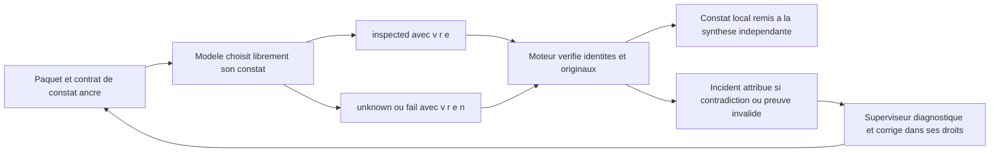

Le même principe vaut pour les décisions du superviseur. Le schéma courant
distingue chaque type d'opération : `review-retry`, `revise-instructions`,
`continue-run`, `stop-run` et `retry` n'offrent que `kind/id/next`. Un titre ou
des exigences ajoutés à une reprise de revue sont refusés dès la génération
structurée, comme ils l'étaient déjà par le contrat d'exécution. Les opérations
`task`, `delegate`, `review-plan` et `close` conservent leurs champs propres.
Les restrictions de disponibilité et les identifiants d'événements reçus restent
ancrés au lot courant ; aucune reprise ni clôture ne devient automatiquement
autorisée. L'ancien format complet reste une représentation historique lisible.
Le contre-exemple natif et les neuf formes valides sont vérifiés séparément par
l'oracle de schéma ; seule une nouvelle décision reçue et appliquée montrera
l'effet réel sur le superviseur.

## Citation exacte et localisation calculée

Un constat natif citait exactement `+exit=1\n` à la bonne ligne ; sa longueur
après suppression des blancs était7caractères. Le minimum historique8 provoquait
un rejet présenté à tort comme une citation absente. Un autre constat citait un
extrait présent, mais déclarait la mauvaise ligne du patch. Les originaux de ces
refus restent conservés ; ils ne deviennent pas des avis valides après correction.

Le marqueur indépendant `defect_citation_contract_version=1` retire `line` du
schéma de génération des nouveaux défauts. L'IA fournit le numéro de pièce, un
extrait exact, cause, reproduction et attendu. Le moteur authentifie la pièce,
exige une occurrence unique de cet extrait et calcule sa ligne physique, puis
revérifie la position. Il ne corrige aucun octet : blancs, signes du patch,
sauts de ligne et texte Unicode restent originaux. Un extrait court non vide
reste utilisable lorsqu'il est unique ; une citation absente ou ambiguë reste
refusée. Une ambiguïté demande un extrait plus précis ou un constat `unknown`.

Le marqueur absent conserve l'ancien schéma, le message et ses exigences de
localisation. Les erreurs de longueur et de position sont désormais distinguées.
Une revue interrompue sous l'ancien contrat exige une décision explicite de
reprise complète : anciens constats, paquets, journaux et appels sont conservés,
sans réutilisation d'avis sous le nouveau contrat. Un avis terminé historique
garde son propre contrat. Les méthodes reviewer/planner ne sont pas réécrites.
La localisation calculée prouve la présence de la citation, jamais l'existence
d'un défaut métier : revue et superviseur restent responsables de cette décision.

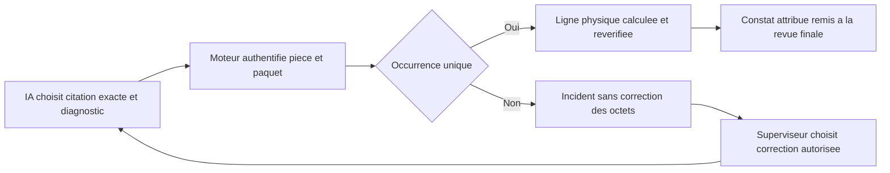

Une même pièce peut contenir plusieurs défauts distincts sous le nouveau contrat,
dans la capacité totale déjà réservée. Chaque défaut garde sa citation unique,
sa cause, sa reproduction et son attendu ; un même constat identique répété est
refusé. L'ancienne restriction d'un seul défaut par pièce reste historique.

## Reprise armée et pauses distinctes

La pause de mission (`paused`) et celle de planification (`Planning.Paused`)
sont deux autorisations distinctes. Un réarmement public peut conserver un résultat
pendant une maintenance ; il ne doit déclencher ni contrôle ni appel de revue tant
que l'une de ces pauses reste active. Le règlement du résultat conserve l'intention
`integrating`, les preuves et les compteurs, puis le conducteur la réexamine après
la reprise. Une pause volontaire ne devient pas un défaut du candidat.

Exemple : mission dépausée, planification encore en pause. Auparavant la revue
par lots pouvait consommer un appel, tandis que la préparation fragmentée refusait
comme périmée et annulait le réarmement. Le garde commun à l'intégration retient
désormais le résultat dans les deux cas. Après levée des deux pauses, le même
candidat suit contrôles et revue ; aucune production ni acceptation n'est inventée.

Le scénario de régression utilise le POST public `retry-review`, les trois
combinaisons de pauses, deux passages du conducteur, une reprise partielle puis
complète et un second règlement après verdict. Le reviewer de ce scénario est
un processus de test déterministe : les assertions sur les compteurs, l'identité
et la conservation ne prouvent pas l'autonomie d'un fournisseur réel.

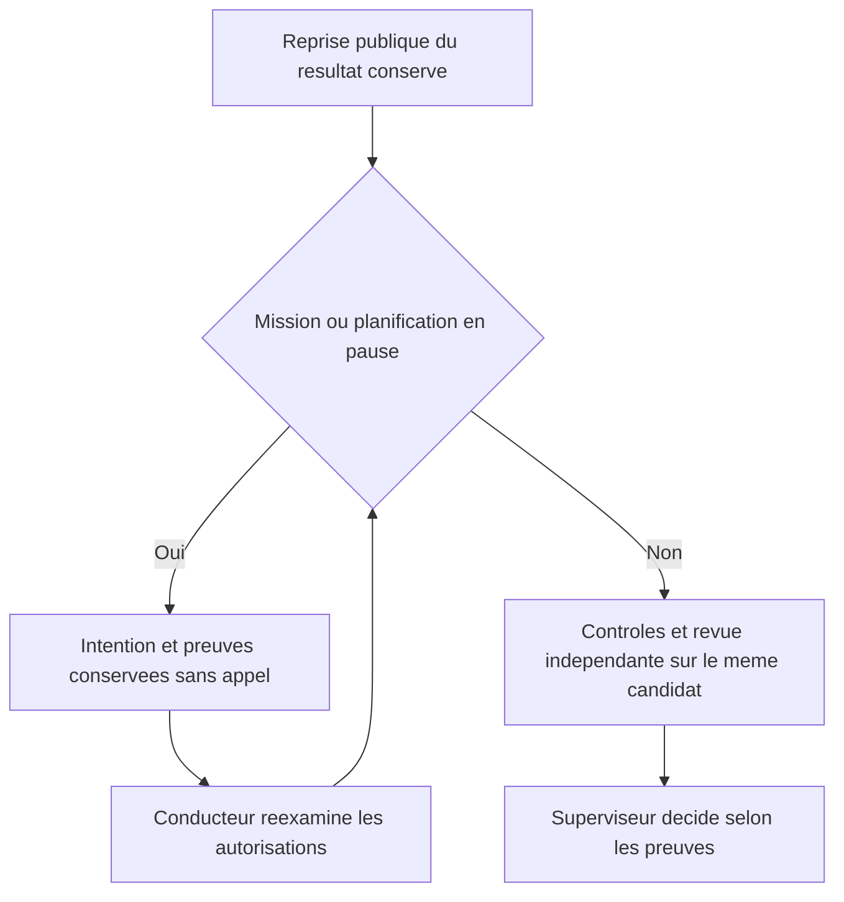

Lors d'une installation, l'opérateur vérifie les deux états par lecture publique
et l'effet réel après reprise. Un HTTP200 ou l'activation du superviseur ne
suffit pas à prouver le redémarrage de la revue. Ce garde porte sur l'entrée du règlement ; il ne constitue pas une preuve de
chaque course concurrente après admission. Un incident ou une revue déjà
interrompue garde sa propre condition de reprise explicite.

## Reprendre les contrôles du résultat conservé avec un budget explicite

L’Admin expose le réglage de durée par le périmètre **rôle**, la clé
`validation`, la mission et `tool_seconds`. Ce réglage persistant porte uniquement
sur le temps d’exécution des contrôles déterministes. Sans durée explicitement
configurée, chaque contrôle conserve sa durée approuvée. Les autres champs de
limites des agents ne s’appliquent pas à ce rôle. Aucun nouveau seuil de durée
n’est ajouté au moteur. La politique approuvée et ses critères restent inchangés ;
le reçu capture le budget extérieur dans `runtime_limits`.

Pour `go test`, une seconde portée Admin **rôle**, clé `validation-go-test`,
configure explicitement `tool_seconds` pour le délai interne. Ce budget doit être
strictement inférieur au budget extérieur explicitement configuré ; leur différence
est la marge observable pour le lancement et la compilation. Sans ce second réglage,
les options de la commande restent inchangées. Avec ce réglage, l’adaptateur remplace
uniquement `-timeout` ou le `-test.timeout` transmis après `-args`, ou ajoute le délai
Go s’il était absent. Aucun programme, filtre de tests, argument métier, critère ou
commande historique n’est modifié. Le reçu `command` montre les arguments réellement
exécutés et `command_runtime_limits` conserve la révision et l’auteur du budget
interne. Les deux configurations participent à l’empreinte de réservation ; une
modification de l’une invalide cette réservation. Les autres programmes conservent
leurs arguments : cet adaptateur ne prétend pas gérer leurs délais internes.

Le contrat de stockage 31 protège ce nouveau reçu attribué contre les anciens
écrivains. La migration passe par le CLI public, sans réécrire les travaux existants.
Le cas original T3, budget extérieur 180 secondes et `go test -timeout 25s`, montre
pourquoi une augmentation du seul délai extérieur était insuffisante. Ces valeurs
sont des observations historiques, jamais des valeurs par défaut du moteur.

Après un échec de contrôle attribué, `planning retry-integration` peut reprendre
le **même résultat récupéré**, sans nouveau worker. La requête lie mission, tâche,
producteur, tentative, résultat, base attendue et `confirm_recovery: true` à un
budget explicite plus récent que l’échec. Le moteur conserve le diagnostic
original, le candidat refusé, les tentatives et la consommation. Il refuse une
liaison périmée, un budget absent ou inchangé et un dossier de revue déjà acquis.
Il vérifie l’empreinte du budget à la réservation puis avant intégration. Un
changement ultérieur exige un nouveau diagnostic et une nouvelle reprise explicite.
La reprise lance les contrôles cumulés puis la revue indépendante prévue ; elle
ne crée ni avis favorable ni acceptation.

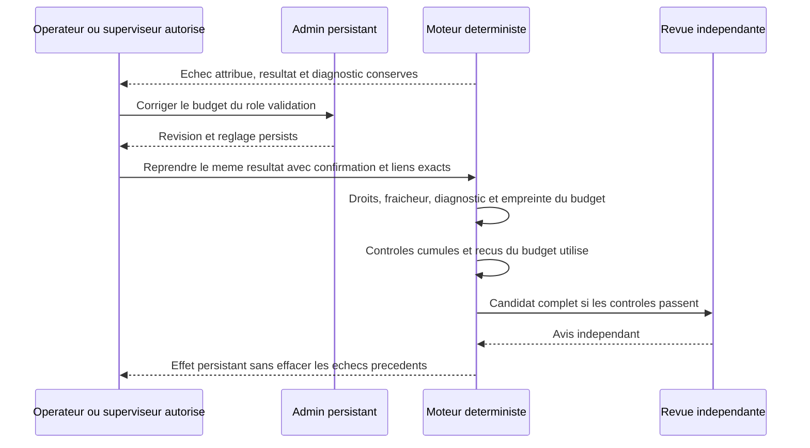

La conduite des incidents d’infrastructure est décrite dans [RUN-SUPERVISION.md](RUN-SUPERVISION.md). La reprise de contrôles ne prouve pas, à elle seule, une correction autonome de l’environnement par un modèle réel.

## Original d’un contrôle refusé accessible par le parcours public

Le parcours authentifié `GET /api/v1/control-diagnostic?work=…&task=…` retourne
l’original du contrôle lié au résultat actuellement bloqué : commande, sortie
conservée en base64, empreinte, code de sortie, dates, budget appliqué et borne de
capture. Il ne reçoit aucun chemin privé arbitraire. Le moteur vérifie mission,
tâche, producteur, tentative, conflit courant, commande approuvée, candidat conservé,
empreintes et fraîcheur de la lecture. La consultation ne modifie aucun travail,
ne dépense aucun appel et ne vaut ni correction ni acceptation. Une ancienne
sortie absente reste absente ; une capture bornée n’est pas présentée comme complète.

Une référence de fichier seule ne donne pas son contenu au superviseur sans outils.
L’opérateur peut consulter cette preuve publiquement puis transmettre le diagnostic
et les originaux par le handoff autorisé. Cette API ne prouve pas, à elle seule, une
transmission automatique dans chaque contexte ni une décision autonome d’un modèle.

### Inventorier un candidat non examinable sans autoriser sa revue

Le précontrôle de revue et l’inventaire de reprise ont des finalités distinctes.
Une modification binaire reste refusée par le vérificateur textuel et ne peut
produire de verdict implicite. `scope-preview` et la préparation d’une correction
explicite peuvent cependant lire le candidat conservé, après vérification de la
production terminée, du résultat, du checkpoint et de tous les contrôles réussis.
Le contexte est marqué `inspection_only` ; l’inventaire garde tous les chemins,
critères et l’empreinte, sans suppression silencieuse de binaire, appel ou mutation.
Un reçu altéré, un contrôle non réussi ou une attribution remplacée reste refusé.
Les reprises ordinaires et les lots de revue textuelle gardent leur refus binaire.
Le responsable choisit ensuite une correction de périmètre explicite et tracée,
ou un mode de revue adapté. L’inventaire n’est ni une acceptation ni une inspection
visuelle du contenu. Les travaux hors périmètre restent conservés avec leur origine.

## Reprise de revue après un bilan déjà transmis

`planning retry-review` remet le résultat immuable courant en intégration après
précontrôle et décision publique fraîche. Le conducteur doit appliquer cette
intention même lorsque l’agent terminé a déjà relayé son bilan : le relais d’origine
reste conservé et n’est pas envoyé une seconde fois. Un agent interrompu exige
en plus un résultat récupéré attribuable. Une ancienne tentative n’autorise pas
la reprise du résultat courant.

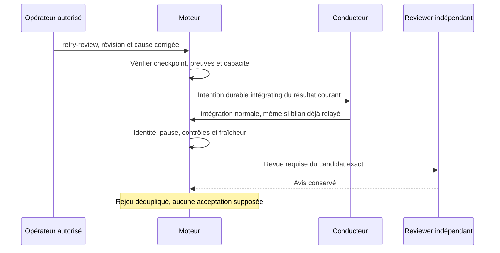

La suspension reste opposable ; le mode manuel empêche de nouveaux départs de
production et de planification, tout en permettant le règlement du résultat
existant lorsque la suspension est levée. Les verrous de publication et de
revue, les checkpoints et les réservations protègent le rejeu. La recette
`TestDurableCoordinatorExecutesAuthorizedReviewRetryAfterCompletedHandoff`
reproduit l’intention ignorée, puis vérifie son effet et un second rejeu sans
appel supplémentaire. Elle utilise un reviewer déterministe, pas un fournisseur
réel ; les effets natifs sont consignés séparément dans le replan de mission.
