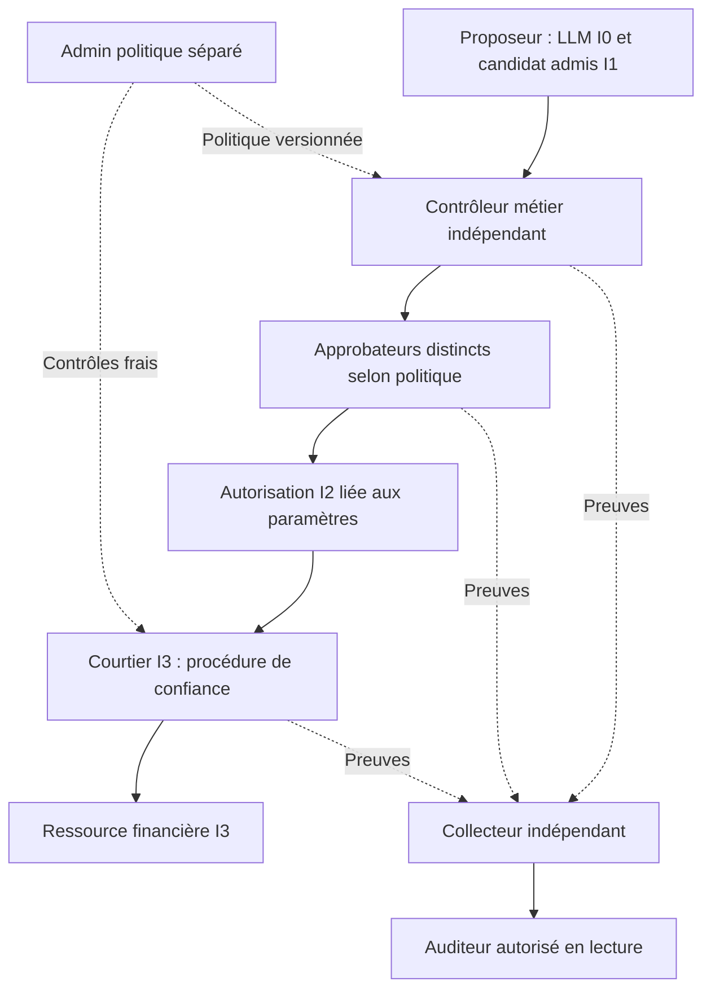
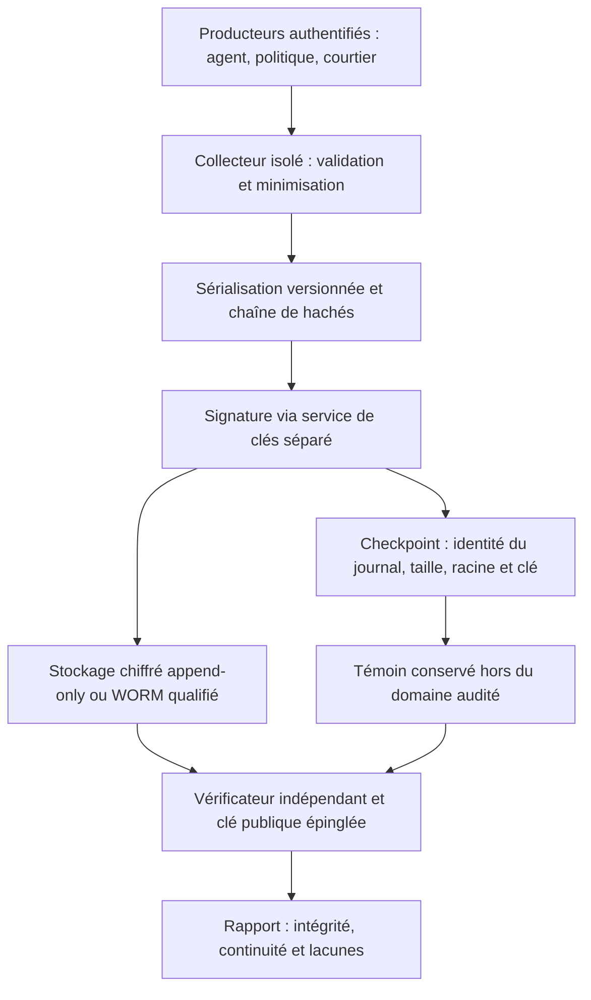

# Biba — séparation des rôles et preuves d’audit

[Contrat du candidat Rust et Admin](BIBA-GOUVERNANCE-RUST.md)

[Exemples financiers](BIBA-AGENTS.md) · [Contrat Rust](BIBA-RUST.md) ·
[English](../en/BIBA-GOVERNANCE-AUDIT.md)

Cette architecture de référence prolonge les exemples de remboursement et de
facture fournisseur. Elle ne déclare ni connecteur bancaire réel, ni journal
WORM, ni service de signature externe installé dans Swarm. Les niveaux portent
sur les objets ; le LLM reste I0. Une procédure de confiance crée une décision
validée sans promouvoir le modèle. Une écriture I3 exige un courtier privilégié
et une procédure contrôlée, pas un accès ordinaire I2 vers I3.

## Séparer les fonctions incompatibles

Biba contrôle les flux d’intégrité ; la séparation des fonctions est une
politique complémentaire. NIST AC-5 demande d’identifier les fonctions à séparer
et d’y adapter les autorisations. La matrice stricte ci-dessous est un **exemple
de politique financière**, pas une obligation universelle déduite de Biba.
[NIST SP 800-53 Rev. 5, AC-5](https://nvlpubs.nist.gov/nistpubs/SpecialPublications/NIST.SP.800-53r5.pdf#page=63)

| Rôle | Fonction | Incompatibilités dans cet exemple |
| --- | --- | --- |
| Proposeur | Préparer une proposition issue de sources I0 | Ne valide, n’approuve et ne paie pas |
| Contrôleur métier | Vérifier références, rapprochement, IBAN et doublons | Ne crée pas l’obligation, n’approuve et n’exécute pas |
| Approbateur | Autoriser les paramètres exacts selon la politique | Ne modifie ni facture, ni IBAN, ni règles ; ne paie pas |
| Exécuteur | Revalider et appliquer une autorisation liée à l’action | Ne décide, n’approuve et ne modifie pas l’ordre |
| Admin politique | Administrer seuils, destinations et règles | N’autorise pas une transaction opérationnelle |
| Auditeur | Examiner les preuves et exceptions autorisées | Ne modifie ni transaction, ni politique, ni approbation |

Matrice de l’exemple, pour une même transaction (`X` = cumul interdit) :

| | Proposeur | Contrôleur | Approbateur | Exécuteur | Admin |
| --- | --- | --- | --- | --- | --- |
| Proposeur | — | X | X | X | X |
| Contrôleur | X | — | X | X | X |
| Approbateur | X | X | — | X | X |
| Exécuteur | X | X | X | — | X |
| Admin | X | X | X | X | — |

Dans cette politique, chaque paire de rôles opérationnels distincts est
incompatible sur une même transaction. Les approbateurs multiples doivent
également être distincts. L’auteur de la facture ou du changement de référentiel
fournisseur ne peut pas approuver son paiement. Les contrôles portent sur le
principal canonique, ses comptes, délégations et mandants : deux identifiants
ou deux agents contrôlés par la même personne ne prouvent pas l’indépendance.
Des identités et processus séparés réduisent le cumul technique ; ils ne
suppriment pas le risque de collusion.

Le moteur de politique et le courtier vérifient ces incompatibilités à
l’affectation, à l’approbation et juste avant l’effet, sous autorité courante.
Une délégation restreint les droits aux droits du mandant et à la tâche ; elle
ne les augmente pas. Aucun rôle annoncé par le modèle ne fait autorité.
L’état « approuvé » seul est insuffisant : contenu, périmètre, échéance,
révision, séparation et absence d’effet antérieur doivent rester valides.
[OWASP — contrôle des actions à fort impact](https://cheatsheetseries.owasp.org/cheatsheets/AI_Agent_Security_Cheat_Sheet.html#high-impact-action-integrity-controls)



L’urgence ne lève pas les incompatibilités. Prévoir une délégation de secours
enregistrée, une justification et une revue attribuée ; sinon mettre en attente.
Un nouvel IBAN exige une vérification indépendante hors bande avant réadmission.
Un conflit tardif ferme l’exécution ; il ne renvoie pas au LLM le droit de
réécrire sa propre autorisation. Le maintien de lectures après retrait des
écritures dépend des droits restants et de Biba, jamais d’un repli automatique.

## Construire une chaîne de preuve transactionnelle

L’audit relie qui a demandé, proposé, contrôlé, approuvé et exécuté, sur quels
objets et paramètres, sous quelle politique et avec quel résultat. Le collecteur
authentifie les producteurs et distingue leurs déclarations de ses observations.
Une assertion du modèle n’est pas une preuve de validation indépendante.

| Événement pédagogique | Informations minimales à relier |
| --- | --- |
| `input.received` | Source, référence et empreinte de l’original, résultat d’analyse |
| `llm.proposal` | Agent, route/version observée du modèle, entrée et proposition hachées ; sortie I0 |
| `candidate.admitted` | Procédure d’admission, nouvel objet I1, original conservé |
| `policy.evaluation` | Politique et révision, règles, références métier, verdict et motif |
| `approval.requested` | Action exacte, rôles requis, échéance et paramètres liés |
| `approval.granted` / `approval.denied` | Principal, délégation, mécanisme d’authentification attesté, décision |
| `execution.precheck` | Autorité fraîche, artefact I2, digest, expiration et séparation |
| `tool.invoked` | Identité de service, outil/destination autorisés, clé idempotente et corrélation |
| `tool.result` / `execution.reconciled` | Reçu natif, effet connu ou inconnu, état relu sans duplication |
| `policy.violation` | Contrôle refusé, incident et suite attribuée |
| `log.access` / `log.admin` | Lecture/export, rétention, rotation ou modification du service d’audit |

Ces noms sont un schéma illustratif, pas des événements/API déjà exposés par
Swarm. Ne pas enregistrer de raisonnement interne du modèle ni traiter son score
de confiance comme une autorisation. Une route de modèle ne prouve pas sa version
réelle ; conserver seulement ce que le fournisseur ou l’exécution atteste.

Extrait d’événement conceptuel : les empreintes ci-dessous sont des placeholders,
non une preuve valide. Le contrat final doit définir types, champs obligatoires,
contrôles et préimages avant implémentation.

```json
{
  "schema": "example.agent.audit.v1",
  "log_id": "finance-audit",
  "sequence": "4821",
  "event_type": "execution.precheck",
  "occurred_at": "2026-10-27T12:03:00Z",
  "recorded_at": "2026-10-27T12:03:00.120Z",
  "transaction_id": "PAY-2026-00931",
  "attempt_id": "attempt-2",
  "actor_id": "payment-broker@svc",
  "initiator_id": "requester@corp",
  "agent_id": "agent.invoice-reader@svc",
  "action_digest": "sha256:...",
  "policy_revision": "payments-v12",
  "authorization_id": "apr-5521",
  "decision": "allow",
  "evidence_refs": ["invoice:INV-2026-0412", "approval:apr-5521"],
  "result": "precheck-only"
}
```

Un précontrôle positif ne prouve pas un paiement. L’intention doit être durable
avant l’effet, puis liée au reçu. Une panne d’audit avant effet ferme l’opération
si cette preuve est requise ; après effet, conserver l’issue connue ou inconnue
et réconcilier. Ne pas transformer une erreur de publication en « aucun effet ».
Séquences manquantes, doublons, pertes et reprises doivent être visibles.

Pour reconstruire un flux, ordonner par `(log_id, sequence)`, avec séquence
numérique, et lier transaction, tentative et digests. Les heures seules ne
déterminent ni l’ordre causal ni l’absence de rejeu ; plusieurs journaux exigent
des références causales explicites. Une jointure sur le seul numéro de facture
peut accepter l’accord d’un autre paiement.

Contrôles d’enquête à exprimer dans le schéma effectivement déployé :

```text
Pour chaque invocation financière :
  retrouver l’autorisation par transaction + action_digest + politique ;
  vérifier outil, destination, identité, délégation et validité à l’exécution ;
  compter les approbateurs indépendants requis, en excluant refus et révocations ;
  comparer montant, devise, bénéficiaire, IBAN et pièces approuvés/exécutés ;
  vérifier clé idempotente, reçu et réconciliation de toute issue inconnue.
```

L’absence d’approbation humaine n’est pas nécessairement une violation si une
politique autorise une décision automatique contrôlée. En revanche, l’absence
de décision valide, un conflit de rôles, un digest changé ou un appel hors
périmètre exige une alerte. Une rupture cryptographique, un journal silencieux
ou un accès d’administration inattendu exige aussi investigation ; le seul
volume d’alertes ne prouve ni une attaque ni l’exhaustivité de la collecte.

## Protéger cryptographiquement le journal

NIST AU-9 traite la protection contre les accès, modifications et suppressions
non autorisés ; ses renforcements couvrent notamment les supports non
réinscriptibles, le stockage séparé et la protection cryptographique. Ils sont
à sélectionner selon le contexte, pas une certification automatique du journal.
[NIST SP 800-53 Rev. 5, AU-9](https://nvlpubs.nist.gov/nistpubs/SpecialPublications/NIST.SP.800-53r5.pdf#page=101)



### Octets canoniques et chaîne

Définir un schéma versionné, l’encodage UTF-8, les types et une sérialisation
canonique, par exemple JCS. Refuser les clés dupliquées ; représenter les entiers
au-delà de la précision JSON interopérable par des chaînes décimales canoniques.
Une option Protobuf « déterministe » ne garantit pas à elle seule une forme
canonique stable entre toutes les implémentations et versions.
[RFC 8785](https://www.rfc-editor.org/rfc/rfc8785)
et [limites de Protobuf](https://protobuf.dev/programming-guides/serialization-not-canonical/).

Les valeurs temporelles observées sont fixées à la création et incluses dans
l’enveloppe authentifiée : **non déterministe à la collecte ne signifie pas
exclu du hachage**. Documenter horloge, dérive et incertitude. Les champs exclus
ne sont pas protégés ; un temps local signé ne prouve pas un temps tiers.

Exemple de construction à spécifier complètement avant usage :

```text
p_i = SHA256(canonical(event_i))
h_i = SHA256(encode(domain, schema, log_id, epoch, sequence, h_previous, p_i))
signature_i = Sign(key, encode(signature_domain, log_id, epoch, sequence, h_i))
```

`encode` doit être non ambigu (types, longueurs, ordre), les domaines distincts,
la valeur initiale définie et les identifiants couverts. Ne pas inclure un champ
`entry_hash` dans sa propre préimage. Une chaîne non authentifiée peut être
entièrement recalculée. Même une chaîne signée ne révèle pas une fin supprimée
ou un ancien export authentique sans taille/racine attendues acquises séparément.

### Merkle, signatures et témoins

Pour les grands volumes, un arbre de Merkle permet une preuve d’inclusion de
taille logarithmique. Une preuve de cohérence relie deux tailles/racines d’un
**même arbre append-only** ; signer des racines de lots indépendants ne fournit
pas automatiquement cette preuve. Certificate Transparency illustre ces
mécanismes ; son protocole n’est pas ici adopté comme journal financier.
[RFC 9162, section 2.1](https://www.rfc-editor.org/rfc/rfc9162#section-2.1)

Signer les entrées ou checkpoints avec un algorithme et un encodage versionnés
(par exemple Ed25519 ou ECDSA), en liant `log_id`, époque, taille, racine,
algorithme et identifiant de clé. Acquérir clé publique et checkpoint par une
voie de confiance distincte du bundle à vérifier. Conserver les anciennes clés
publiques et leurs périodes d’usage ; définir rotation, révocation, compromission
et vérification historique. Une signature n’établit ni vérité métier ni
non-répudiation juridique à elle seule.

Une clé privée non exportable en HSM/KMS ou service séparé réduit l’exposition ;
ses appels doivent aussi être autorisés et audités. Un service compromis ayant
encore le droit de signer peut signer des mensonges. Un témoin extérieur aide à
détecter réécriture et rollback, sous sa propre hypothèse d’indépendance. Un
second compte administré par la même autorité n’est pas automatiquement indépendant.
Un service de temps tiers reste une option distincte à justifier.

### Stockage, confidentialité et rétention

Séparer producteur, collecteur, signataire, administrateur de rétention et
vérificateur. L’agent ne doit pas pouvoir réécrire ni effacer ses preuves ; le
collecteur doit également contrôler leur ajout pour empêcher l’injection de
faux événements. « Append-only » dans l’API ne protège pas d’un administrateur
du stockage. Un mécanisme WORM doit démontrer les acteurs effectivement exclus,
le mode de verrouillage, la durée, les exceptions et la restauration vérifiable.

Chiffrer les transports authentifiés et les données au repos selon la politique
de sécurité ; la gestion des clés, nonces, accès et sauvegardes fait partie du
contrat. Le chiffrement ne prouve pas l’exhaustivité du journal. Les empreintes
d’IBAN ou de données personnelles prévisibles ne sont pas une anonymisation :
elles peuvent permettre des essais par dictionnaire. Préférer références
opaques ou empreintes à clé sous contrôle séparé lorsque nécessaire.

Conserver les détails utiles dans un magasin distinct à accès tracé, sans
credentials, jetons, prompts sensibles ni contenu brut inutiles dans l’audit.
Un auditeur ne contourne pas Biba parce qu’il est en lecture seule : son
extraction doit suivre les droits et la procédure d’export de confiance prévus.

Durée de rétention, taille/fréquence des lots, vérification périodique et réponse
à l’indisponibilité sont des **choix opérateur** à persister et rendre éditables
avec validation commune API/CLI/Admin, pas des constantes « cinq minutes »,
« mille événements » ou « une fois par jour » copiées d’un exemple. Une expiration
ne vaut pas autorisation de suppression ; préserver les protections et gels
applicables. Aucun archivage/purge automatique n’est ajouté par cette page.

## Vérifier l’audit et sa reprise

La recette de déploiement doit couvrir un témoin valide avant chaque injection :

| Contrôle | Résultat attendu |
| --- | --- |
| Altération, réordre, omission interne, doublon | Refus avec position et cause sûres |
| Troncature ou ancien bundle signé | Refus par comparaison au checkpoint acquis séparément |
| Mauvaise clé, époque ou journal | Refus sans prendre la clé fournie par le bundle comme autorité |
| Rotation, révocation, perte de matière | Application de la politique historique explicite, jamais repli muet |
| Panne avant/après effet, reprise et rejeu | Issue conservée, reçu relu, aucun double paiement |
| Stockage plein, collecteur indisponible | Perte/rupture visible et réponse conforme à la politique persistée |
| Restauration et réouverture | Octets, séquences, signatures et témoins vérifiables |
| Lecture/export/admin d’audit | Accès attribué, limité et lui-même audité |

Le vérificateur contrôle les octets, signatures, liens, inclusion/cohérence si
utilisées, checkpoint indépendant et complétude attendue du flux métier. Une
preuve cryptographique valide ne prouve pas que le producteur a envoyé tous
les événements réels. Suivre les compteurs/pertes et les ruptures de collecte.
L’audit de l’audit doit éviter une récursion infinie : un plan distinct trace
les accès au journal, avec une politique explicite pour ses propres accès.

## État réellement porté dans Rust

`rust/crates/swarm-engine/src/trust/proof.rs` conserve l’export historique v2,
les originaux et une ancre HMAC-SHA256 schéma 1, sur séquence/empreinte, vérifiée
avec une clé symétrique de 32 octets acquise séparément. HMAC n’est pas une
signature publique : le vérificateur détenteur de la clé peut aussi fabriquer
un MAC. Sans checkpoint indépendant attendu, un ancien export authentique ne
constitue pas une preuve de fraîcheur. Le noyau actuel n’est pas transformé ici
en journal Merkle, HSM/KMS ou stockage WORM ; les mécanismes historiques Go ne
prouvent pas leur portage ou leur activation Rust. Voir le
[contrat technique courant](BIBA-RUST.md#persistance-politiques-et-erreurs).

Le candidat APEX ajoute la séparation des rôles, la consultation transactionnelle
attribuée et le contrat de signature publique Rust décrit dans le
[contrat de gouvernance](BIBA-GOUVERNANCE-RUST.md). Sa présence dans les sources
ne prouve pas son installation ; le plan conserve les résultats et limites.
