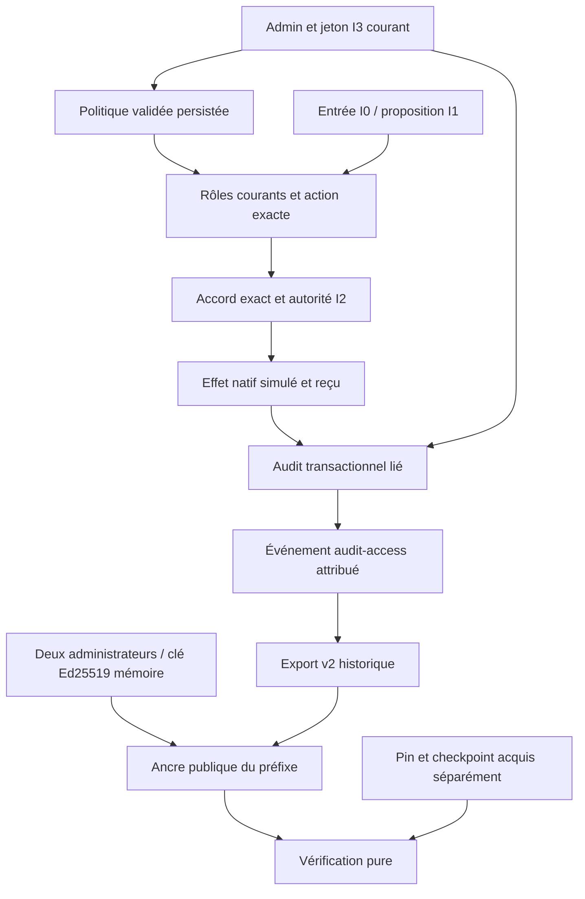
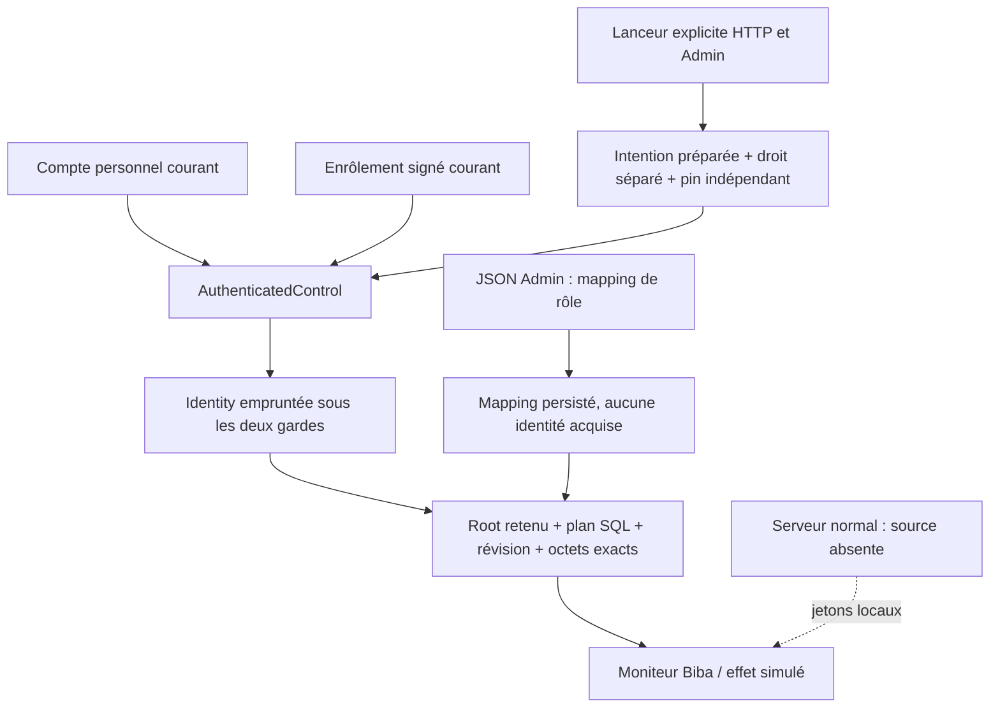
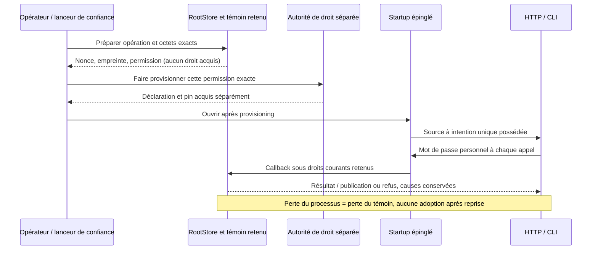

# Gouvernance Biba Rust — contrat du candidat

[Modèle et exemples](BIBA-GOUVERNANCE-AUDIT.md) · [Noyau Biba](BIBA-RUST.md) ·
[English](../en/BIBA-GOVERNANCE-RUST.md)

Cette page décrit le candidat APEX du 27 octobre 2026. Sa preuve de livraison
reste le [plan et les reçus](../plans/migration-rust/evidence/20261027-biba-governance-apex/PLAN.md),
pas la présence de ce document. Les effets restent simulés. La protection
transversale des fournisseurs, le WORM et les HSM/KMS externes ne sont pas
qualifiés par cette tranche.

## Configuration et rôles

`trust config-preview/config-apply` et l’API Actions de confiance partagent la
validation. Après bootstrap, l’HTTP exige une autorité I3/admin courante (jeton local, ou identité enrôlée courante sur le lanceur dédié) en plus de
la session native, Host/Origin et CSRF. La CLI opérateur conserve sa voie locale.
Les quatre champs historiques de `policy` et les identités privées restent
obligatoires dans une proposition complète.

Le bloc additionnel `role_separation` porte trois champs explicites :

```json
{
  "enabled": true,
  "incompatible_roles": [
    ["requester", "approver"],
    ["requester", "effect"],
    ["approver", "effect"],
    ["admin", "effect"]
  ],
  "principals": {
    "requester": "principal-demande",
    "approver": "principal-finance",
    "executor": "principal-execution",
    "admin": "principal-politique"
  }
}
```

Extrait à intégrer dans une configuration complète ; les sujets doivent être
ceux effectivement configurés. Les rôles consommés sont `requester`, `approver`,
`effect`, `admin`. Les paires sont symétriques, sans doublon ni paire d’un rôle
avec lui-même. Une liste vide signifie explicitement aucun conflit additionnel.
Quand le contrôle est actif, chaque identité configurée, même désactivée, doit
avoir son principal déclaré. Un principal n’est jamais inféré du nom du sujet.
Deux sujets du même groupe sont incompatibles lorsqu’ils occupent les rôles de
la paire sur une transaction. Les déclarations administratives ne prouvent pas
une identité humaine, une indépendance organisationnelle ou l’absence de collusion.

L’omission du bloc conserve la politique existante ; `null`, champs inconnus,
doublons, rôles inconnus ou mapping incomplet actif sont refusés. Sans bloc, la
préimage historique est conservée. La politique s’applique avant admission,
accord, effet et rejeu ; la réconciliation reste la relecture d’un effet existant.
Un conflit neuf produit un refus attribué sans mutation du paiement. Un ancien
rejeu devenu incompatible refuse, sans réécrire le résultat d’origine.

Dans l’Admin : cocher les paires, déclarer les groupes, prévisualiser puis
enregistrer. « Relire les sujets du formulaire » actualise les lignes depuis les
identités saisies, sans lire leurs jetons. Les jetons restent dans leurs champs
privés en mémoire et sont effacés à la fermeture.

## Consultation et traçabilité

`trust audit-transaction --input query.json` et
`POST /api/v1/trust-actions?action=audit-transaction` prennent uniquement :

```json
{"action_id":"act-identifiant-enregistre"}
```

Le jeton courant I3/admin est requis, y compris dans `SWARM_TRUST_TOKEN` pour la
CLI locale. La consultation prend une réservation exclusive afin d’inscrire
`audit-access` avant de rendre le rapport. Elle ne modifie ni l’action ni le
registre d’effets. Un Root non inscriptible refuse : la lecture distante ne doit
pas réussir en silence si l’accès ne peut pas être enregistré.

Le rapport `trust-transaction-audit-v1` distingue :

- `chain_verified` : chaîne et originaux du préfixe relus ;
- `transaction_verified` : liens mandat/demande/accord/état/reçu cohérents ;
- `complete` : effet connu terminé, distinct d’une attente ou d’un résultat inconnu ;
- `missing_evidence` : liens manquants, sans inventer une preuve ;
- `report_prefix_sequence` : préfixe consulté avant l’enregistrement de cet accès ;
- `audit_access` : séquence, empreinte, acteur et digest du rapport exact ;
- `report_base64` : octets UTF-8 exacts du rapport avant ajout de son reçu d’accès.

Le digest du rapport doit être comparé au contenu de l’événement d’accès dans
l’export signé. La vérification interne ne génère pas récursivement un nouvel
événement d’accès. Ce mécanisme couvre cette consultation transactionnelle ; il
ne qualifie pas la journalisation de toutes les lectures de fichiers ou de toutes
les anciennes routes opérateur. L’Admin présente un résumé et replie les preuves
techniques. Les erreurs et liens manquants restent visibles.

## Signature publique et cycle de clé

Le bloc existant `evidence_signing` devient consommé : `enabled` booléen et
`key_ttl_seconds` entier strictement positif, même inactif. Le défaut explicite
de projection est inactif/86400 secondes. La borne 9223372036 secondes vient de
la représentation historique Go des durées ; zéro n’est pas « illimité ».
Omission ou bloc `null` conservent la valeur existante. Ce réglage autorise la
signature à la demande ; il ne signifie pas que chaque entrée est signée séparément.

Opérations du service persistant, via Admin/API et bibliothèque `RootStore` :

1. `evidence-key-prepare` : I3/admin courant, candidat unique et matière privée
   générée une fois en mémoire, sans import/fichier privé ;
2. `evidence-key-activate` : autre administrateur courant, candidat et révision
   de registre exacts ; contrôle du groupe déclaré lorsqu’il est actif ;
3. rotation : ancienne clé retirée, période historique conservée, matière ancienne
   libérée ;
4. `evidence-key-revoke` : révocation attribuée, possible même signature désactivée ;
5. `public-anchor` : signature du préfixe courant avec la seule clé active,
   configuration courante, période valide et matière privée disponible.

Les décisions de clé utilisent `schema_version:1`, `event_id`,
`expected_registry_revision`, `reason`, et `key_id` pour activation/révocation.
Le registre public et ses décisions sont persistés et liés à la chaîne d’audit.
Le rejeu retourne l’état public courant, sans prétendre régénérer une clé perdue.
La présence mémoire est une observation distincte du statut « active ».

Les descripteurs retenus du répertoire et de SQLite lient la matière à l’instance
réellement ouverte et empêchent le réemploi d’inode pendant cette liaison. Le
processus devient non dumpable à la préparation ; cette réduction de droits
n’est pas annulée ensuite. La graine et la clé sont effacées à leur libération.
Cela ne qualifie ni swap, ni traçage privilégié, ni confinement général des agents.
Après arrêt ou perte mémoire, la signature refuse sans repli HMAC : préparer et
activer une nouvelle clé. Expiration ou révision de configuration ferme également
la capacité de signer. Un candidat devenu inutilisable doit être révoqué avant
d’en préparer un autre ; aucune relance ou régénération automatique n’est cachée.

Une invocation CLI locale a sa propre durée de vie : elle ne conserve pas la
matière entre deux processus. Utiliser l’Admin/API du service pour le cycle de
clé persistant en mémoire. La CLI sert notamment à configurer la politique et
à vérifier les preuves hors ligne ; un registre relu dans un autre processus
ne prouve pas la disponibilité du signataire.

## Vérification indépendante et octets

`public-anchor` prend `{}` et retourne `trust-public-anchor-bundle-v1` avec
`anchor`, `anchor_base64` et `export_base64`. Les champs base64url sans padding
conservent les octets JSON exacts, notamment les entiers et les contextes bruts
historiques. Ne pas les réordonner ou les arrondir via une conversion générique.
L’export v2 et l’ancre HMAC schéma 1 historiques restent séparés.

`trust public-verify --input verification.json` est pur, sans Root :

```text
{
  "export": <export décodé sans modification des contextes bruts>,
  "anchor": <ancre décodée>,
  "trusted_key": <enregistrement public acquis séparément>,
  "trusted_checkpoint": {
    "anchor": <ancre de référence conservée séparément>,
    "trusted_key": <pin de cette ancienne clé>
  }
}
```

Forme descriptive, pas JSON exécutable. Le checkpoint peut être omis : résultat
`checkpoint_verified:false`. `null` et un checkpoint incomplet refusent. Une
extension après rotation accepte des clés distinctes, chacune épinglée par une
voie de confiance ; une troncature ou divergence du préfixe attendu refuse.
Les champs `trusted_*` expriment une précondition de l’appelant : les prendre dans
le seul bundle attaquable ne constitue pas une acquisition indépendante.

Le nouveau domaine est `swarm-rust-public-evidence-v1`, schéma 1. Sa préimage
Ed25519 est un objet sérialisé par le codec Go-compatible partagé, dans cet ordre :
`domain`, `schema_version`, `key_id`, `registry_revision`,
`configuration_revision`, `sequence`, `hash`, `export_digest`, `signed_at`.
La signature n’entre pas dans sa propre préimage. Le digest d’export couvre le
type export v2 complet et ses originaux référencés, pas le seul dernier événement.
Ce contrat est distinct de JCS et du schéma public historique Go.

Le pin doit être cohérent, non faible, activé et valide à l’instant signé. Une
clé retirée reste vérifiable dans sa période historique ; un pin révoqué refuse.
Un ancien pin hors ligne ne reçoit pas les révocations ultérieures. Le décodeur
de ce nouveau contrat refuse Unicode invalide et clés JSON dupliquées à toute
profondeur ; aucune normalisation historique Go ne remplace ces refus.

Références : [Ed25519 / RFC8032](https://www.rfc-editor.org/rfc/rfc8032) et
[vérification stricte dalek 2.2.0](https://docs.rs/ed25519-dalek/2.2.0/ed25519_dalek/struct.VerifyingKey.html#method.verify_strict).
Ces primitives ne prouvent ni certification cryptographique, ni heure tierce,
ni stockage physiquement immuable, ni complétude des événements collectés.

## Architecture du candidat



La décision I2 autorise le chemin contrôlé du courtier ; elle ne transforme pas
une proposition I1 en écrivain I3 arbitraire. Politique de groupes, accord exact et
autorité d’exécution se complètent. Le confinement des fournisseurs réels n’est
pas établi. Les capacités privées périmées sont libérées à la prochaine observation
de cette racine par le processus, sans prétendre à une minuterie de purge autonome.

La réconciliation vérifie le reçu et l’autorité courante ; la séparation des
participants de l’effet est prouvée par le commit historique. Changer ensuite
les groupes ne doit ni créer un nouvel effet ni empêcher sa relecture autorisée.

Une cible absente dans une nouvelle commande produit le déni métier attribué
ordinaire ; un cache dont le contexte courant est absent ne devient pas une
autorisation de rejeu. La révocation est attachée au registre de la racine
ouverte : elle ne retire pas la matière privée d’une autre instance. Une copie
de registre n’hérite jamais de cette matière ; les erreurs de fermeture locales
restent des erreurs, sans succès vide.

## Raccord à la couche d’identité commune

Le serveur HTTP normal utilise les jetons locaux Trust. Le lanceur explicite G05.3 peut lier une source commune à une seule intention préparée. Le callback natif
`AuthenticatedControl::with_trust_action` réutilise le compte personnel et
l’enrôlement signé courants, sans créer de compte. Il ne fournit une `Identity`
empruntée, non clonable et non désérialisable que pendant les deux réservations.
Une copie de Principal ou de Head reste une observation, sans autorité future.
Le noyau utilisé authentifie des humains ; le type `service` n’établit pas son
raccord. Les groupes `role_separation.principals` restent des déclarations Admin.

Une identité configurée fournit subject, integrity, roles et, au choix :
- un token local ;
- `enrollment_principal` avec principal_id, principal_kind="human", issuer et
  subject exacts. Aucun token local n’est accepté dans ce second cas.

Deux alias du même issuer/subject, ou un même principal_id répété, refusent.
Le mapping persiste et apparaît dans l’Admin ; il ne constitue pas une preuve
courante. Désactivation et révision sont relues par le consommateur natif.

### Consommateur natif RootStore

`trust_enrollment_request` retient les descripteurs de l’instance et dérive une
liaison fraîche pour la permission signée exacte `effect.execute` sur
`trust-action/<digest-racine>/<opération>/<digest-demande>`. Aucun joker ni droit
`enrollment-config/...` ne correspond. Le propriétaire conserve le témoin pendant
provisionnement et usage, puis appelle close. Un redémarrage ne permet pas de
réutiliser cet objet ou de fabriquer le même contexte depuis un chemin.

`trust_as_enrolled` compare témoin, opération et octets, réserve le plan SQL
courant (projection enregistrée reconnue, sans migration), vérifie portée/révision/
expiration et reprend les transitions Biba existantes. Rôles, accord exact,
mandat et idempotence ne viennent pas du seul grant. Les nouvelles preuves portent
le principal réel et la tête courante d’enrôlement. Les contextes locaux omettent
le champ nouveau et conservent leur encodage ; le contexte enrôlé exige le
vérificateur courant.

`Use.authority` et `Use.action` doivent être inspectés séparément, y compris
l’erreur personnelle AfterUse. Une erreur de clôture/expiration après usage peut
coexister avec un résultat enregistré. Aucune relance automatique ou conclusion
de rollback. Une panique ne promet pas de résultat : le poison ferme les appels
suivants et exige une récupération exacte du métier.



Le premier parcours natif est vérifié en fixture : attribution, rejeu et refus
sans mutation. Contrôles élargis et livraison sont liés aux reçus du plan.
L’Admin affiche la capacité effective : source absente sur le serveur normal, ou une seule intention liée par le lanceur explicite.
Ce n’est ni un second service de comptes, ni une isolation OS, ni une acceptation
globale. La recette `trust-identity-bridge.json` couvre dix tests de démarrage
et le doc-test anti-JSON ; les tests `trust_enrollment` couvrent le consommateur.

Contrôle SDK complémentaire : `tests/rust_trust_enrollment_sdk.py --profile PROFIL_BUILD --fixture-deps CACHE_FIXTURE_DEPS --output PREUVE_NEUVE`. Il compile le test financier sur les artefacts de bibliothèque déclarés par le profil, conserve leurs empreintes actuelles et les sources avant/après. Il ne fabrique pas un hash historique de bibliothèque absent et ne remplace pas la recette du binaire exécuté.

### Appel commun des transports pour une intention préparée

`Operation::parse` accepte uniquement les treize noms du vocabulaire signé ;
les alias, espaces, lectures historiques et écritures directes sont refusés.
`RootStore::call_trust_as_enrolled` compose le consommateur existant avec les
réservations personnelles/métier. `TrustEnrollmentCallError` conserve le résultat
complet après un échec de terminaison, la publication connue et les causes
indépendantes. Les consommateurs doivent parcourir `branches()` et ne jamais
déduire un rollback d’une erreur. Ces API ne provisionnent aucun droit et ne
raccordent pas, à elles seules, la source au serveur HTTP. Leur vérification et
leur livraison sont suivies dans le plan G05.3, distinctement de l’instance servie.

Le raccord G05.3 utilise une intention préparée unique par lanceur de confiance :
`trust enrollment-call OPERATION DECLARATION_ABSOLUE --input REQUETE` ou
`trust enrollment-serve OPERATION DECLARATION_ABSOLUE [ADRESSE] --input REQUETE`.
La sortie JSONL `trust-enrollment-prepared` contient le droit exact à faire
provisionner séparément ; elle ne crée pas ce droit. Le processus conserve son
témoin pendant cette étape. L’entrée privée doit ensuite contenir les octets
`swarm-trust-source-v1\n`, le pin SHA256 de 64 caractères, `\n`, puis le mot de
passe pour `enrollment-call` seulement, jusqu’à EOF. Le mode serveur n’accepte
aucun mot de passe au startup : chaque appel utilise `Authorization: Enrollment`
suivi du mot de passe encodé base64url sans padding. HTTPS externe n’est pas
fourni ; le transport reste le loopback administré existant. Le lanceur serveur
n’exécute aucun conducteur de mission. Aucun chemin/pin n’est accepté par HTTP.

La préparation n’a ni file d’attente, ni délai implicite, ni restauration après
redémarrage : une nouvelle instance exige un nouveau témoin et un nouveau droit
exact. La politique de transport sauvegardée reste applicable. Les copies de
headers HTTP et la mémoire du runtime ne sont pas une preuve d’effacement OS.
Les contrôles de transport et du navigateur réel sont conservés dans le suivi G05.3 ; la version installée et l’activation réelle restent des preuves distinctes. Un refus métier HTTP200 est affiché comme refus journalisé ; une panne de relecture conserve la décision reçue, sans répétition automatique.



La disponibilité du bouton enrôlé est resynchronisée après chaque action locale et tient compte du geste en cours. Une source absente, inconnue ou hors portée reste inactive, même après succès ou erreur d’un autre formulaire. Cette mise à jour ne réécrit ni l’opération préparée ni les champs privés et ne constitue jamais une autorisation serveur.

Livraison locale : la réutilisation d’un candidat inchangé exige aussi ses preuves de qualification conservées. Leur disparition impose une nouvelle construction ; une incohérence refuse. Le seul fichier binaire ne suffit pas à réinstaller une image qualifiée.
