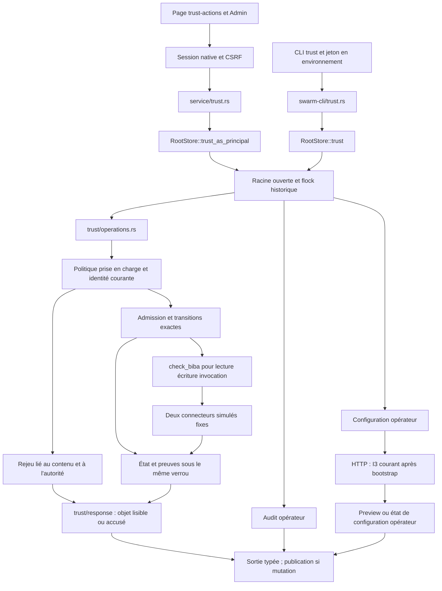
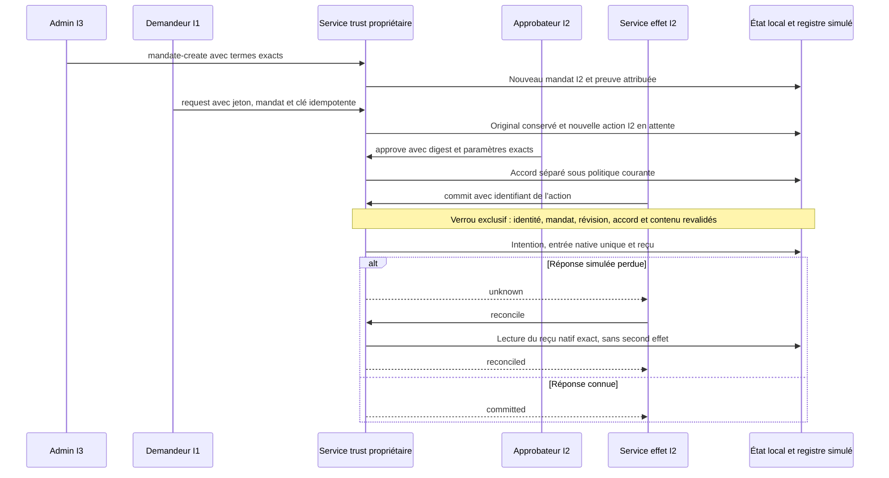
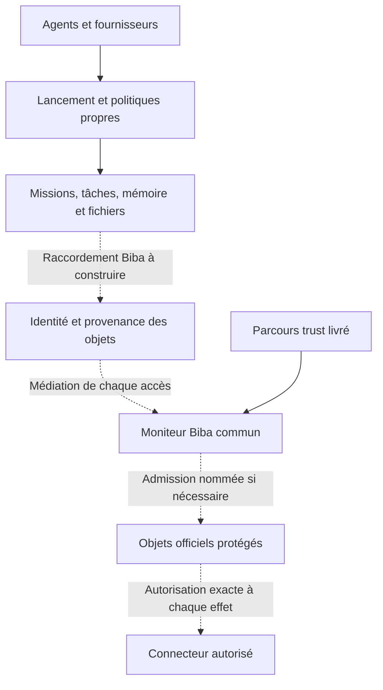
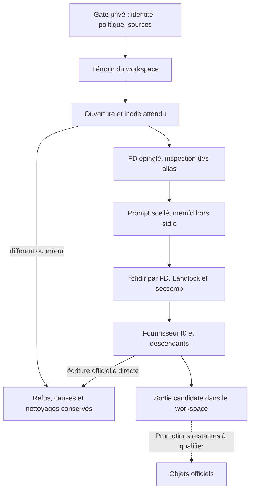

# Biba Rust — architecture et contrat technique

Biba est la règle d’intégrité de référence de Swarm, confirmée par l’utilisateur
le 26 octobre 2026. Cette exigence concerne la cible ; le raccordement actuel
couvre le noyau `trust` local, pas toutes les missions Rust. Cette page décrit
les producteurs et consommateurs inspectés, sans transformer une cible en
fonction livrée. [Guide opérateur](../actions-confiance-rust.md) ·
[English](../en/BIBA-RUST.md) ·
[audit daté](../plans/migration-rust/evidence/20261026-biba-integration-audit/PLAN.md).

## Modèle et frontière de confiance

Pour l’introduction, la distinction avec Bell–LaPadula et les exemples de
remboursement client et de facture fournisseur, voir
[Biba et agents IA](BIBA-AGENTS.md). Leurs diagrammes décrivent une architecture
de référence, distincte des connecteurs simulés implémentés ci-dessous.

La [séparation des rôles et la chaîne d’audit](BIBA-GOUVERNANCE-AUDIT.md)
complètent cette cible, avec les limites des chaînes de hachés, signatures et
témoins indépendants ; elles n’étendent pas les mécanismes livrés par cette page.

Le contrat retient Biba strict, avec quatre niveaux ordonnés I0–I3.
Pour les accès ordinaires, `check_biba` applique : lecture si sujet ≤ objet ;
écriture et invocation si sujet ≥ cible. C’est un contrôle d’intégrité, distinct
de la confidentialité, de l’authentification et du confinement Linux.
Référence historique : K. J. Biba,
[MTR-3153, 1975](https://seclab.cs.ucdavis.edu/projects/history/papers/biba75.pdf) ;
la [notice CERIAS de la révision 1977](https://www.cerias.purdue.edu/apps/reports_and_papers/view/2834/)
identifie ESD-TR-76-372. Les niveaux et procédures ci-dessous sont le contrat
Swarm ; ils ne constituent pas une certification externe.

| Frontière | Autorité réelle | Limite |
| --- | --- | --- |
| CLI locale / configuration | opérateur possédant la racine ouverte | pas une identité métier déduite de `actor` |
| HTTP / configuration | session native, Host/Origin, CSRF et racine liée | le cookie opérateur est distinct du jeton métier |
| Commande métier | identité courante retrouvée par empreinte du jeton | `actor` et `integrity` envoyés ne confèrent aucun droit |
| Objet officiel I2 | mandat admis, action, accord et effet simulé | labels fixes du protocole, pas une classification client |
| Lectures métier | `read-object` I2, `read-original` I1 | passent par le moniteur de lecture |
| Audit opérateur | `show`, `export`, `anchor` | hors contrôle de lecture du principal métier |

Les admissions sont des procédures de confiance nommées : I3 crée un nouveau
mandat I2 ; une demande authentifiée conforme au mandat crée une nouvelle action
I2 en attente. L’original et son empreinte restent conservés. Ce passage ne
hausse jamais le niveau du demandeur et ne constitue pas une invocation directe
autorisée d’un effet I2 par I1. La configuration et l’audit opérateur font partie
de la base de confiance ; une session opérateur ne doit pas être donnée à un
agent dont on attend l’isolation par le seul jeton métier.

Après bootstrap de la racine, preview/apply HTTP exigent maintenant une identité I3/admin courante sous verrou, avant même un replay. La CLI opérateur reste une voie de reprise distincte. Le cookie demeure une autorité opérateur pour les autres routes : cette tranche ne qualifie pas une isolation native globale.

## Raccordement implémenté

**Tranche du 27 octobre** : les retours métier et les anciens replays passent par `trust/response.rs`. I1/I2 peuvent lire l’objet I2 ; I3 reçoit uniquement l’accusé nommé `trust-status-ack-v1` (identifiant et état fermé, sans paramètres ni original). L’objet n’est pas relabellé, aucun droit n’est donné. Le statut n’est ni une approbation ni une preuve d’acceptation. La publication et les erreurs tardives restent attribuées. Voir le plan et les preuves de la tranche pour distinguer source, candidat vérifié et version installée.

Producteurs : `swarm-engine/src/biba.rs`, `trust_types.rs`, `trust/command.rs`,
`trust/config.rs`, `trust/operations.rs`, `trust/proof.rs`,
`root_store/trust_store.rs`. Entrées : `swarm-cli/src/trust.rs` et
`swarm-web/src/service/trust.rs`, sous `rust/crates/`. L’UI servie est
`web/trust-native.html`, `.js`, `.css`, avec les ressources i18n embarquées.
Le moniteur pur n’est pas, à lui seul, un moniteur de tous les accès du moteur.

## Admission, accord et effet

Le rôle seul ne suffit pas : `approve` exige une écriture I2 autorisée et, si
la politique le demande, un sujet distinct du demandeur ; `commit` exige une
invocation I2 autorisée. I3 est également autorisé par la comparaison de niveaux,
sous les rôles requis. Une révision de configuration périme les anciens mandats.
La révocation empêche un nouvel effet ; la réconciliation d’un effet déjà observé
reste possible et ne l’annule pas. Un rejeu restitue un résultat historique à la
même autorité courante ; il ne prouve pas une nouvelle admission du mandat.

Les connecteurs fermés version 1 sont `local-ledger-simulation` et
`local-access-simulation`. Ils partagent le domaine d’idempotence. Le second
écrit un registre d’accès simulé, pas des droits système. Aucun fournisseur
arbitraire, programme, URL ou paiement réel n’est exécuté.

## Persistance, politiques et erreurs

L’état schéma 1 réside dans `.swarm/trust-actions.json`, les originaux en base64
dans cet état ; le verrou est `trust-actions.lock` et la clé HMAC séparée
`trust-actions-proof.key`. La racine est liée à son instance ouverte. Les
écritures passent par les primitives de stockage atomique ; une fermeture ou
une erreur de sortie tardive conserve `trust_publication`. Une erreur ne prouve
donc pas l’absence d’effet : relire la même action et réconcilier si nécessaire.
La clé perdue n’est pas régénérée pour une histoire configurée. Une initialisation
Go en attente ferme les mutations, sans reprise automatique portée ici.

Les quatre politiques, bornes, unités et sens de zéro sont décrits dans le
[guide](../actions-confiance-rust.md#parcours-public). Elles suivent
configuration → validation → aperçu/application révisionnés → Admin/CLI/API →
transitions. La rétention est enregistrée, sans purge dans ce noyau. Les limites
de représentation (état 8 Mio, commande 16 Mio, clé 32 octets) sont exposées
séparément des choix opérateur. L’activation reconnue d’une politique avancée
non portée ferme les opérations. `trust/extensions.rs` refuse les noms inconnus,
types erronés et doublons de clés de politique. La configuration n’accepte plus
de modification d’un bloc non porté : omission/null conservent ; seuls les
mêmes octets compacts d’un bloc existant peuvent être retransmis. Les anciens
blocs inactifs restent relus sans réécriture, sous contrôle structurel. Ce
contrôle ferme les cas de l’audit sans prétendre porter toute la validation
métier des sous-schémas ni leurs consommateurs. L’audit du 26 octobre reste intact.

Un refus métier produit `state:denied`, une preuve attribuée et aucun changement
de mandat/action/effet. Format, authentification et conflit restent des erreurs
distinctes (CLI 2/4/3, HTTP 400/403/409 selon la cause). `verify` est pur : export
v2, ancre HMAC schéma 1 et clé acquise séparément. La vérification n’atteste ni
heure tierce, ni protection contre le même UID, ni acceptation indépendante.

## Cible Biba transversale — raccordements non livrés

Les traits pointillés sont une cible, pas des contrôles actifs. La lecture de
`agent_launch::prepare`, `agent_launch_preflight` et `mission_start` montre des
contrôles propres de politique/révision/fournisseur, sans raccord Biba aux
identités et objets `trust`. Sur la baseline auditée, un agent accédait aux fichiers selon ses droits
OS. Le candidat ci-dessous ajoute une barrière aux helpers locaux ; cela ne
raccorde pas encore toutes les voies au moniteur applicatif. Avant de qualifier Biba
pour tout Swarm, il faut inventorier et raccorder lectures, écritures, commandes,
mémoire, imports/restaurations et effets, ainsi que leurs chemins directs.

Critère observable de raccordement : une identité de fixture basse ne peut ni
écrire un objet officiel, ni invoquer un effet supérieur, ni faire passer une
sortie non endossée pour une décision protégée ; une identité haute ne lit pas
un original inférieur par une lecture métier. Chaque refus est attribué, sans
effet protégé, y compris après rejeu, retrait ou redémarrage. Une admission doit
créer un nouvel objet relié à son original, sous autorité nommée. Les parcours
hors moniteur restent des écarts, même si les tests du module pur sont verts.

## Vérification reproductible et limites

`tests/rust_trust_biba_unit.py`, `tests/rust_trust_biba.py` et
`tests/rust_trust_biba_ui.cjs` portent les gardes existantes ; le manifeste est
`tools/verification/recipes/trust-biba-rust.json`. Séparer résultats sur les
sources du jour, profil de test, binaire de production réellement exécuté et
octets embarqués servis. Une modification concurrente du workspace interdit
d’assimiler automatiquement ces quatre ensembles. Le catalogue anglais du
binaire installé peut différer du catalogue du workspace : conserver le refus
de comparaison et vérifier les libellés réellement rendus séparément.

L’audit et ses résultats datés se trouvent dans
`docs/plans/migration-rust/evidence/20261026-biba-integration-audit/`.
Les résultats de l’ancien portage restent historiques ; ni leur réemploi borné,
ni ce document, ni les schémas n’établissent une conformité globale.

## Frontière Linux transversale — candidat en cours

Le [plan BT01–BT05](../plans/actions-confiance/BIBA-TRANSVERSE-APEX.md) conserve
les preuves, refus et critères ouverts. Les sources raccordent agent, planning,
reviewer et préparation CLI au transport `native_provider_exec`. Une erreur
refuse avant exec sans repli non confiné ; aucun privilège n’est augmenté.

Le gate fournit l’inode attendu du workspace. `Sandbox::prepare_bound` ouvre et
épingle cet inode avant inspection ; règles Landlock et `fchdir` utilisent ce
même descripteur. Un remplacement refuse. La préparation CLI observe son
répertoire temporaire privé après vérification du parent et du jeton ; le
transfert du descripteur original depuis le parent reste à qualifier.

Les sorties tool-free se trouvent sous `.swarm/biba-i0/planning/<claim_id>` ou
`.swarm/biba-i0/reviewer/<event_id>`. Le moteur les ouvre relativement au
répertoire privé possédé ; les relectures ne les créent pas. Le périmètre hôte
persisté lie chemin et inode. Une sortie reste I0, jamais une autorisation.

Le profil exige Linux/Landlock ABI6, un helper à un thread sans capacités
privilégiées et aucune solution de repli. `FIOCLEX` pose seulement CLOEXEC ;
le memfd est relogé hors 0/1/2 avant rattachement à stdin. Les descripteurs non
stdio deviennent CLOEXEC. Les appels keyring sont refusés. Ces invariants ne
sont pas de nouveaux réglages opérateur.

La recette `tools/verification/recipes/biba-linux-boundary.json` vérifie le
profil natif, ses refus et une substitution d’inode réellement injectée.
`tests/rust_biba_stdin_transport.py` compare les sources réelles dans un adapter
minimal ; elle ne qualifie pas le profil du moteur. Le plan conserve séparément
les parcours publics sur leurs images exactes. Compiler n’installe rien.

Limites : lectures hors racine privée et réseau Internet ne sont pas confinés
par ce profil ; ce n’est pas un coffre général. Il ne fige pas un écrivain
extérieur non confiné du même UID ni des montages privilégiés. Les autres
lanceurs de contrôle, HTTP/SSE, mémoire, imports et promotions restent à traiter.
Les parcours planning/reviewer modifiés, la vue Admin transversale, la revue du
candidat final et l’installation restent ouverts. Aucun Biba global n’est qualifié.
