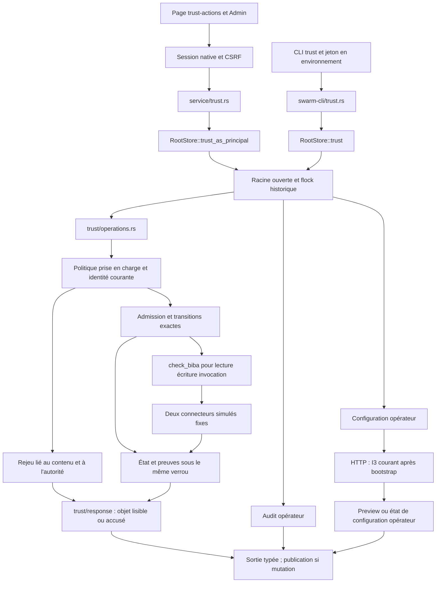
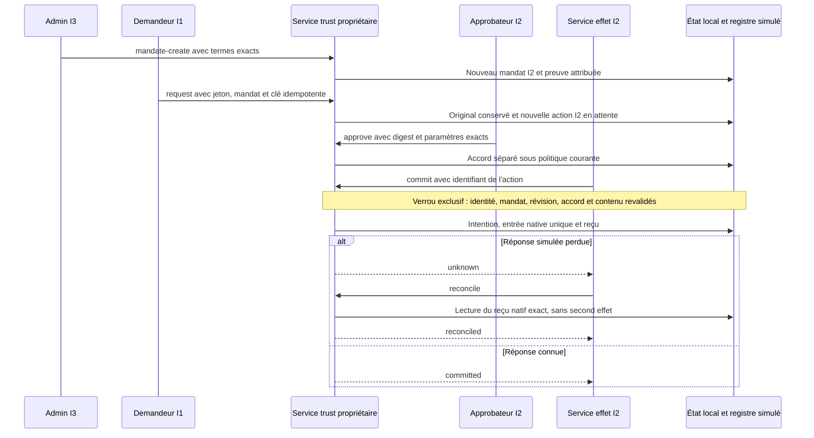
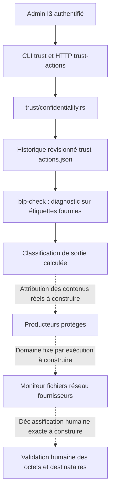
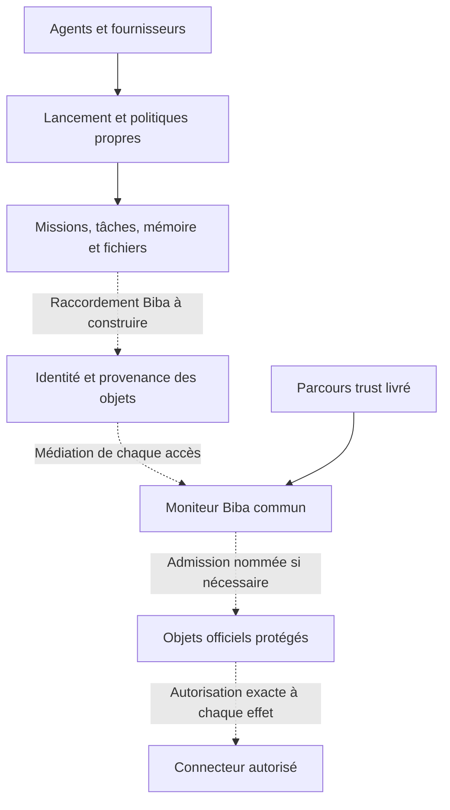
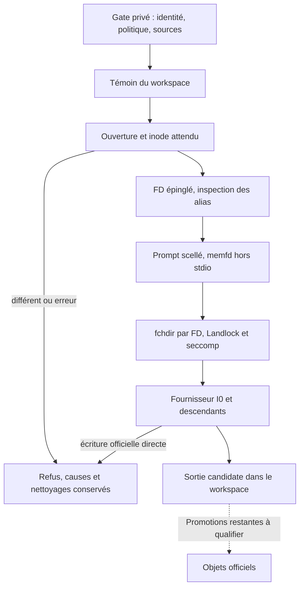
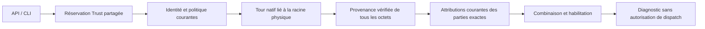
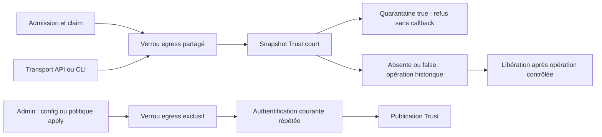
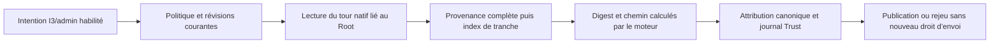
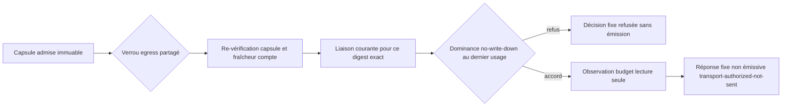

# Biba Rust — architecture et contrat technique

[Bell-LaPadula : capacités disponibles et limites](BELL-LAPADULA.md).

Biba est la règle d’intégrité de référence de Swarm, confirmée par l’utilisateur
le 26 octobre 2026. Cette exigence concerne la cible ; le raccordement actuel
couvre le noyau `trust` local, pas toutes les missions Rust. Cette page décrit
les producteurs et consommateurs inspectés, sans transformer une cible en
fonction livrée. [Guide opérateur](../actions-confiance-rust.md) ·
[English](../en/BIBA-RUST.md) ·
[audit daté](../plans/migration-rust/evidence/20261026-biba-integration-audit/PLAN.md).

## Modèle et frontière de confiance

Pour l’introduction, la distinction avec Bell–LaPadula et les exemples de
remboursement client et de facture fournisseur, voir
[Biba et agents IA](BIBA-AGENTS.md). Leurs diagrammes décrivent une architecture
de référence, distincte des connecteurs simulés implémentés ci-dessous.

La [séparation des rôles et la chaîne d’audit](BIBA-GOUVERNANCE-AUDIT.md)
complètent cette cible, avec les limites des chaînes de hachés, signatures et
témoins indépendants ; elles n’étendent pas les mécanismes livrés par cette page.

Le contrat retient Biba strict, avec quatre niveaux ordonnés I0–I3.
Pour les accès ordinaires, `check_biba` applique : lecture si sujet ≤ objet ;
écriture et invocation si sujet ≥ cible. C’est un contrôle d’intégrité, distinct
de la confidentialité, de l’authentification et du confinement Linux.
Référence historique : K. J. Biba,
[MTR-3153, 1975](https://seclab.cs.ucdavis.edu/projects/history/papers/biba75.pdf) ;
la [notice CERIAS de la révision 1977](https://www.cerias.purdue.edu/apps/reports_and_papers/view/2834/)
identifie ESD-TR-76-372. Les niveaux et procédures ci-dessous sont le contrat
Swarm ; ils ne constituent pas une certification externe.

| Frontière | Autorité réelle | Limite |
| --- | --- | --- |
| CLI locale / configuration | opérateur possédant la racine ouverte | pas une identité métier déduite de `actor` |
| HTTP / configuration | session native, Host/Origin, CSRF et racine liée | le cookie opérateur est distinct du jeton métier |
| Commande métier | identité courante retrouvée par empreinte du jeton | `actor` et `integrity` envoyés ne confèrent aucun droit |
| Objet officiel I2 | mandat admis, action, accord et effet simulé | labels fixes du protocole, pas une classification client |
| Lectures métier | `read-object` I2, `read-original` I1 | passent par le moniteur de lecture |
| Audit opérateur | `show`, `export`, `anchor` | hors contrôle de lecture du principal métier |

Les admissions sont des procédures de confiance nommées : I3 crée un nouveau
mandat I2 ; une demande authentifiée conforme au mandat crée une nouvelle action
I2 en attente. L’original et son empreinte restent conservés. Ce passage ne
hausse jamais le niveau du demandeur et ne constitue pas une invocation directe
autorisée d’un effet I2 par I1. La configuration et l’audit opérateur font partie
de la base de confiance ; une session opérateur ne doit pas être donnée à un
agent dont on attend l’isolation par le seul jeton métier.

Après bootstrap de la racine, preview/apply HTTP exigent maintenant une identité I3/admin courante sous verrou, avant même un replay. La CLI opérateur reste une voie de reprise distincte. Le cookie demeure une autorité opérateur pour les autres routes : cette tranche ne qualifie pas une isolation native globale.

## Raccordement implémenté

**Tranche du 27 octobre** : les retours métier et les anciens replays passent par `trust/response.rs`. I1/I2 peuvent lire l’objet I2 ; I3 reçoit uniquement l’accusé nommé `trust-status-ack-v1` (identifiant et état fermé, sans paramètres ni original). L’objet n’est pas relabellé, aucun droit n’est donné. Le statut n’est ni une approbation ni une preuve d’acceptation. La publication et les erreurs tardives restent attribuées. Voir le plan et les preuves de la tranche pour distinguer source, candidat vérifié et version installée.



Producteurs : `swarm-engine/src/biba.rs`, `trust_types.rs`, `trust/command.rs`,
`trust/config.rs`, `trust/operations.rs`, `trust/proof.rs`,
`root_store/trust_store.rs`. Entrées : `swarm-cli/src/trust.rs` et
`swarm-web/src/service/trust.rs`, sous `rust/crates/`. L’UI servie est
`web/trust-native.html`, `.js`, `.css`, avec les ressources i18n embarquées.
Le moniteur pur n’est pas, à lui seul, un moniteur de tous les accès du moteur.

## Admission, accord et effet



Le rôle seul ne suffit pas : `approve` exige une écriture I2 autorisée et, si
la politique le demande, un sujet distinct du demandeur ; `commit` exige une
invocation I2 autorisée. I3 est également autorisé par la comparaison de niveaux,
sous les rôles requis. Une révision de configuration périme les anciens mandats.
La révocation empêche un nouvel effet ; la réconciliation d’un effet déjà observé
reste possible et ne l’annule pas. Un rejeu restitue un résultat historique à la
même autorité courante ; il ne prouve pas une nouvelle admission du mandat.

Les connecteurs fermés version 1 sont `local-ledger-simulation` et
`local-access-simulation`. Ils partagent le domaine d’idempotence. Le second
écrit un registre d’accès simulé, pas des droits système. Aucun fournisseur
arbitraire, programme, URL ou paiement réel n’est exécuté.

## Persistance, politiques et erreurs

L’état schéma 1 réside dans `.swarm/trust-actions.json`, les originaux en base64
dans cet état ; le verrou est `trust-actions.lock` et la clé HMAC séparée
`trust-actions-proof.key`. La racine est liée à son instance ouverte. Les
écritures passent par les primitives de stockage atomique ; une fermeture ou
une erreur de sortie tardive conserve `trust_publication`. Une erreur ne prouve
donc pas l’absence d’effet : relire la même action et réconcilier si nécessaire.
La clé perdue n’est pas régénérée pour une histoire configurée. Une initialisation
Go en attente ferme les mutations, sans reprise automatique portée ici.

Les quatre politiques, bornes, unités et sens de zéro sont décrits dans le
[guide](../actions-confiance-rust.md#parcours-public). Elles suivent
configuration → validation → aperçu/application révisionnés → Admin/CLI/API →
transitions. La rétention est enregistrée, sans purge dans ce noyau. Les limites
de représentation (état 8 Mio, commande 16 Mio, clé 32 octets) sont exposées
séparément des choix opérateur. L’activation reconnue d’une politique avancée
non portée ferme les opérations. `trust/extensions.rs` refuse les noms inconnus,
types erronés et doublons de clés de politique. La configuration n’accepte plus
de modification d’un bloc non porté : omission/null conservent ; seuls les
mêmes octets compacts d’un bloc existant peuvent être retransmis. Les anciens
blocs inactifs restent relus sans réécriture, sous contrôle structurel. Ce
contrôle ferme les cas de l’audit sans prétendre porter toute la validation
métier des sous-schémas ni leurs consommateurs. L’audit du 26 octobre reste intact.

Un refus métier produit `state:denied`, une preuve attribuée et aucun changement
de mandat/action/effet. Format, authentification et conflit restent des erreurs
distinctes (CLI 2/4/3, HTTP 400/403/409 selon la cause). `verify` est pur : export
v2, ancre HMAC schéma 1 et clé acquise séparément. La vérification n’atteste ni
heure tierce, ni protection contre le même UID, ni acceptation indépendante.

## Confidentialité Bell-LaPadula — administration livrée, contrôle partiel

Confidentialité distincte de l’intégrité Biba, indépendante et combinable :
une classification est un niveau ordonné plus des compartiments ; la lecture
exige que l’habilitation domine la source, la sortie une destination dominant
le domaine d’exécution fixe. La crate `swarm-confidentiality` porte ces
contrats de données purs, sans contenu privé dans les diagnostics. Ce qui est
vérifié (tests unitaires et d’intégration datés du 31 octobre 2026) :
validation et dominance/combinaison, domaine fixe lié à la révision de
politique, historique persisté révisionné avec replays contrôlés, refus des
sujets inconnus et des catalogues qui relabellisent l’historique. Ce qui ne
l’est pas : attribution des contenus réels, médiation fichiers/réseau/
fournisseurs, déclassification humaine — d’où `runtime_enforced:false` et
`runtime_authorized:false`, maintenus dans chaque réponse.



Arêtes pleines : administration et diagnostic vérifiés, non autorisants.
Arêtes pointillées : cible étiquetée, aucun contrôle actif. Les réponses
portent `runtime_enforced:false` ; le raccord des producteurs et consommateurs
réels reste le critère d’activation, jamais le passage des drapeaux à true.
Suivi et critères : [BLP-APEX](../plans/actions-confiance/BLP-APEX.md) ;
preuves : `docs/plans/actions-confiance/verification-blp/`.

## Cible Biba transversale — raccordements non livrés



Les traits pointillés sont une cible, pas des contrôles actifs. La lecture de
`agent_launch::prepare`, `agent_launch_preflight` et `mission_start` montre des
contrôles propres de politique/révision/fournisseur, sans raccord Biba aux
identités et objets `trust`. Sur la baseline auditée, un agent accédait aux fichiers selon ses droits
OS. Le candidat ci-dessous ajoute une barrière aux helpers locaux ; cela ne
raccorde pas encore toutes les voies au moniteur applicatif. Avant de qualifier Biba
pour tout Swarm, il faut inventorier et raccorder lectures, écritures, commandes,
mémoire, imports/restaurations et effets, ainsi que leurs chemins directs.

Critère observable de raccordement : une identité de fixture basse ne peut ni
écrire un objet officiel, ni invoquer un effet supérieur, ni faire passer une
sortie non endossée pour une décision protégée ; une identité haute ne lit pas
un original inférieur par une lecture métier. Chaque refus est attribué, sans
effet protégé, y compris après rejeu, retrait ou redémarrage. Une admission doit
créer un nouvel objet relié à son original, sous autorité nommée. Les parcours
hors moniteur restent des écarts, même si les tests du module pur sont verts.

## Vérification reproductible et limites

`tests/rust_trust_biba_unit.py`, `tests/rust_trust_biba.py` et
`tests/rust_trust_biba_ui.cjs` portent les gardes existantes ; le manifeste est
`tools/verification/recipes/trust-biba-rust.json`. Séparer résultats sur les
sources du jour, profil de test, binaire de production réellement exécuté et
octets embarqués servis. Une modification concurrente du workspace interdit
d’assimiler automatiquement ces quatre ensembles. Le catalogue anglais du
binaire installé peut différer du catalogue du workspace : conserver le refus
de comparaison et vérifier les libellés réellement rendus séparément.

L’audit et ses résultats datés se trouvent dans
`docs/plans/migration-rust/evidence/20261026-biba-integration-audit/`.
Les résultats de l’ancien portage restent historiques ; ni leur réemploi borné,
ni ce document, ni les schémas n’établissent une conformité globale.

## Frontière Linux transversale — candidat en cours

Le [plan BT01–BT05](../plans/actions-confiance/BIBA-TRANSVERSE-APEX.md) conserve
les preuves, refus et critères ouverts. Les sources raccordent agent, planning,
reviewer et préparation CLI au transport `native_provider_exec`. Une erreur
refuse avant exec sans repli non confiné ; aucun privilège n’est augmenté.

Le gate fournit l’inode attendu du workspace. `Sandbox::prepare_bound` ouvre et
épingle cet inode avant inspection ; règles Landlock et `fchdir` utilisent ce
même descripteur. Un remplacement refuse. Tout descripteur détenu par la crate
vit au-dessus de 2 (`biba-path-repin` sinon) : l’appelant possède 0–2 et peut les
réaffecter (dup2 stdin) pendant la vie du profil, ce qui refermerait sinon un
descripteur épinglé bas. Le descripteur de ruleset Landlock est épinglé à la
création (`landlock_restrict_self` le refuse `EBADFD` sinon, étape `biba-restrict`). La préparation CLI observe son
répertoire de travail privé après vérification du parent et du jeton ; ce
répertoire vit sous `<Root>/preparation-cli/`, jamais sous `/tmp` (interdiction
opérateur du 31 octobre 2026 : aucune donnée de projet dans le temporaire
système) ni sous `.swarm` (les deux gardes de chevauchement Biba restent
applicables). Le transfert du descripteur original depuis le parent reste à
qualifier.

Les sorties tool-free se trouvent sous `.swarm/biba-i0/planning/<claim_id>` ou
`.swarm/biba-i0/reviewer/<event_id>`. Le moteur les ouvre relativement au
répertoire privé possédé ; les relectures ne les créent pas. Le périmètre hôte
persisté lie chemin et inode. Une sortie reste I0, jamais une autorisation.



Le profil exige Linux/Landlock ABI6, un helper à un thread sans capacités
privilégiées et aucune solution de repli. `FIOCLEX` pose seulement CLOEXEC ;
le memfd est relogé hors 0/1/2 avant rattachement à stdin. Les descripteurs non
stdio deviennent CLOEXEC. Les appels keyring sont refusés. Ces invariants ne
sont pas de nouveaux réglages opérateur.

La recette `tools/verification/recipes/biba-linux-boundary.json` vérifie le
profil natif, ses refus et une substitution d’inode réellement injectée.
`tests/rust_biba_stdin_transport.py` compare les sources réelles dans un adapter
minimal ; elle ne qualifie pas le profil du moteur. Le plan conserve séparément
les parcours publics sur leurs images exactes. Compiler n’installe rien.

Limites : lectures hors racine privée et réseau Internet ne sont pas confinés
par ce profil ; ce n’est pas un coffre général. Il ne fige pas un écrivain
extérieur non confiné du même UID ni des montages privilégiés. Les autres
lanceurs de contrôle, HTTP/SSE, mémoire, imports et promotions restent à traiter.
Les parcours planning/reviewer modifiés, la vue Admin transversale, la revue du
candidat final et l’installation restent ouverts. Aucun Biba global n’est qualifié.

## Attribution BLP : une nouvelle politique ne déclassifie pas

`blp-object-attribute` lie une classification explicite au digest canonique et
au chemin projet, sous la révision BLP et la révision Trust courantes. L’acteur
I3/admin doit aussi être habilité à lire cette classification. Une seconde
attribution du même objet dans une même révision reste refusée ; le même événement
exact peut être rejoué tant que son autorité reste courante.

Entre révisions, la nouvelle classification doit dominer toutes les attributions
antérieures du même digest/projet : niveau égal ou supérieur, tous les anciens
compartiments conservés. Une baisse, un retrait ou un remplacement de compartiment
refuse `blp-declassification-required` avant publication, sans modifier le journal.
Une habilitation admin ou une nouvelle révision ne vaut pas accord humain BLP-06.
Le renouvellement égal ou plus restrictif reste disponible.

La relecture valide également l’historique : une baisse déjà enregistrée provoque
`trust-proof-integrity`, cause sûre `blp-attribution-history-downgrade`, avant toute
projection protégée. Elle n’est ni réparée automatiquement ni transformée en
étiquette plus haute silencieuse. Conserver l’original, ne pas éditer un journal
vivant ; un historique déjà incohérent exige une reprise autorisée préservant ses
preuves (aucune commande de réparation n’est livrée ici). Le propriétaire reste
l’opérateur de contrôle ; une déclassification exige le futur contrat BLP-06.

Portée : attributions PAEA persistées et lecteurs raccordés. Le digest/chemin ne
prouve pas à lui seul l’identité physique d’un fichier ni la filiation des copies.
La classification complète des sources de préparation et le contrôle transversal
des fichiers, réseaux et fournisseurs restent ouverts. Voir le [plan BLP](../plans/actions-confiance/BLP-APEX.md).

### Attribution explicite par les interfaces publiques

`swarm-rust trust blp-object-attribute --root RACINE --input INTENTION.json --json`
(identité dans `SWARM_TRUST_TOKEN`) et
`POST /api/v1/trust-actions?action=blp-object-attribute` (session, Host, Origin,
CSRF puis `Authorization: Bearer …`) utilisent le même producteur moteur.
Un Admin I3 courant et habilité fournit `schema_version:1`, `event_id`,
`expected_revision` BLP, `expected_trust_revision`, `canonical_digest`
(64 caractères hexadécimaux minuscules), `project_path` absolu UTF-8,
`classification:{level,compartments}` et `reason` non vide. Les deux révisions
sont celles de `blp-show`, jamais une valeur présumée.

Le producteur vérifie l'autorité et la dominance avant publication ; même événement
exact rejoué sans réécriture, autre événement pour le même objet/révision refusé,
révisions périmées et déclassement refusés. Le lecteur recalcule le digest de son
objet réel et consulte la politique courante : fournir un digest n'établit ni
les octets source, ni la filiation physique, ni un droit de déclassification.
Le formulaire Admin configure la politique ; il n'offre pas encore de formulaire
d'attribution d'objet. Aucun classement implicite des sources de préparation ou
contrôle transversal n'est introduit. Les erreurs de publication/conclusion
conservent leur état connu ; après résultat incertain, relire avant reprise.

### Diagnostic des sources de préparation

`swarm-rust trust blp-preparation-check --root RACINE --input CONTROLE.json --json`
utilise `SWARM_TRUST_TOKEN`. L’API équivalente est
`POST /api/v1/trust-actions?action=blp-preparation-check` : protections session,
Host, Origin et CSRF habituelles, puis authentification Trust indépendante.
Le corps strict contient `schema_version:1`, `expected_revision` (révision BLP),
`preparation_id` et `turn_id`. Aucune classification, identité ou destination
n’est acceptée dans ce corps. Le contrôle est en lecture seule, sur racine
physiquement liée ; le journal Trust reste réservé durant l’observation SQL.

Le consommateur relit le prompt privé natif et vérifie sa provenance complète.
Chaque tranche transmise doit avoir une attribution de contrôle courante, pour
son SHA-256 exact et le chemin absolu exact de ce projet. Cela inclut instructions,
contexte projet, contrat éventuel, neuf valeurs JSON et tout le cadrage JSON.
Le producteur d’attribution reste `blp-object-attribute` sous Admin I3 ; aucune
étiquette n’est déduite du nom de source ou de l’habilitation. Les valeurs
structurées sont attribuées ensemble à ce stade (pas encore leurs fichiers ou
éléments individuels). Une attribution de document brut ne couvre pas sa
représentation JSON échappée. Les opérateurs doivent établir leurs digests sur
les tranches réellement enregistrées ; aucun écran d’inventaire n’est livré.

Un succès retourne uniquement acteur authentifié, révision BLP, digest du prompt,
nombre de parties et classification combinée (niveau maximal, union des
compartiments), avec `diagnostic_only:true` et `runtime_authorized:false`.
L’habilitation doit dominer cette combinaison. Aucun texte du prompt n’est rendu.
Identité inconnue/désactivée refuse l’autorisation avant lecture de la ligne ;
politique absente/périmée, provenance historique absente, mauvais parent/racine,
source non attribuée ou habilitation insuffisante refusent explicitement.
Un prompt altéré refuse `preparation-prompt-provenance-invalid`. Les erreurs de
stockage, SQL, rollback et fermeture conservent leurs causes ; aucun résultat
vide ne remplace un refus. La réservation ne donne aucune autorité ultérieure.

Reprise : corriger l’intention/révision ou produire explicitement les attributions
manquantes sous la politique courante, puis relancer une nouvelle observation.
Ne pas modifier une ligne historique pour fabriquer la provenance. Un changement
de politique impose de nouvelles attributions à la révision courante. Ce
diagnostic ne protège pas l’envoi, ne lie pas son principal ou destinataire et
ne change pas `runtime_enforced:false` ; médiation et héritage restent à réaliser.



Tout refus interrompt ce parcours ; aucune flèche ne mène à un fournisseur.
La réservation protège cette observation, pas une utilisation ultérieure.

La réponse HTTP distingue 400 (intention invalide), 403 (identité/habilitation),
404 (tour absent) et 409 (politique absente/périmée, source non attribuée,
provenance historique absente ou mauvais parent). Un principal sans habilitation
BLP refuse avant lecture du tour. La provenance incohérente, une racine privée
incompatible et les échecs de stockage/rollback/fermeture restent des erreurs
serveur ; leur cause n’est pas masquée par un statut client. L’opération refuse
explicitement hors Linux (501), sans preuve d’exécution sur ces plateformes.

## Quarantaine explicite des envois de préparation

Livré localement en version 299 et vérifié sur récepteurs inertes : le champ booléen
`preparation_quarantine` de la politique BLP est persisté par les opérations
`blp-policy-preview`/`blp-policy-apply` et éditable dans le JSON de l’Admin.
Absent ou false conserve le fonctionnement historique et l’encodage antérieur ;
ce n’est pas un mode d’envoi classifié autorisé. Null, chaînes et nombres refusent.
True interdit les nouveaux sends (rejeux compris), la prise en charge de tours
en attente et les transports API/CLI contrôlés : `blp-preparation-quarantined`
(HTTP403 pour le send). La capacité BLP expose `preparation_quarantined` ;
`runtime_enforced:false` reste la vérité de la couverture transversale.

Une réservation partagée dédiée preparation-egress couvre admission/prise en
charge et transport. Le verrou Trust de lecture est libéré avant l’IO ; les
écritures métier sans rapport restent possibles. Une application de politique exclusive
attend la fin de l’émission engagée ; elle ne l’annule pas. En cas d’attente,
l’opérateur utilise l’arrêt du tour ou les délais fournisseur déjà configurés.
Aucun nouveau délai global, tentative ou plafond n’est introduit. Un journal
illisible/invalide refuse, sans transformer l’erreur en « quarantaine désactivée ».
Une autorité devenue périmée ne lève pas une quarantaine déjà enregistrée.
Une levée explicite exige la politique et les révisions courantes.

La finalisation d’un tour refusé avant tentative libère sa réservation non
engagée ; elle ne rembourse aucune tentative estimée. Si l’opération a réussi
mais que la libération du verrou échoue, le diagnostic conserve
`preparation-egress-operation-completed` et la cause de nettoyage. Une admission
déjà enregistrée conserve aussi son reçu. Une erreur tardive ne prouve jamais
l’absence de contact ou d’effet distant. Ce verrou ne classe pas les sources,
n’hérite pas de labels sur les résultats et ne confine pas les accès directs ou
les descendants échappant aux transports contrôlés.



Le schéma décrit ce verrou seulement ; la branche historique ne vérifie pas de
domaine classifié. Un ancien binaire ou un accès direct ne participe pas à ce protocole.

## Attribution depuis une source de préparation capturée

`blp-preparation-attribute` sélectionne une tranche du prompt enregistré, par
`preparation_id`, `turn_id`, `expected_turn_revision` (le `source_revision` du DTO)
et `source_index` (index à partir de zéro). Le corps exige aussi `schema_version:1`,
`event_id`, `expected_revision` BLP, `expected_trust_revision`, `classification`
explicite et `reason` non vide. Aucun digest, chemin ni acteur déclarés ne sont
acceptés. Exemple de corps (remplacer les identifiants/révisions et la classification
par les valeurs observées et décidées ; ces noms ne sont pas un catalogue livré) :

```json
{"schema_version":1,"event_id":"classement-source-1","expected_revision":1,"expected_trust_revision":1,"preparation_id":"PREPARATION","turn_id":"TOUR","expected_turn_revision":2,"source_index":0,"classification":{"level":"confidentiel","compartments":[]},"reason":"Décision explicite de classement"}
```

L’API/CLI utilisent la même opération Trust mutante, sous I3/admin authentifié et
habilité à la classification choisie. Cette autorité est vérifiée avant recherche
de ligne. Le moteur vérifie parent, révision, instance Root native et provenance
complète, puis calcule le digest de la tranche et le chemin du Root ouvert. Le
contrat d’attribution existant conserve unicité, monotonie, journal et rejeu.
Le contexte de sélection entre dans l’identité de l’événement ; le rejouer avec
un autre index, tour ou motif refuse. Deux tranches aux octets identiques sont un
seul objet : un second événement d’attribution refuse, même avec la même étiquette.

Le résultat ajoute `producer_captured:true`, les identifiants du tour,
`turn_revision` (chaîne du source_revision), `source_index` et `source_count` à
l’attribution habituelle. Aucun texte du prompt n’est rendu. Aucun inventaire
visuel de tranches n’est livré. Le classement est explicite, tranche par tranche,
y compris les instructions, valeurs nulles et éléments de cadrage ; aucun indice
absent n’est interprété comme public. Après attribution de chaque digest distinct,
`blp-preparation-check` peut vérifier leur jointure. Un tour historique sans
provenance refuse sans migration silencieuse.

Refus HTTP : format/intention ou classification invalide400, identité/rôle/
habilitation403, tour/index absent404, parent/révisions/politique ou conflit409.
Provenance corrompue, instance incompatible et échecs de stockage/libération
restent des erreurs serveur. Le Root ne publie aucune attribution après échec
de lecture ou de validation ; les erreurs tardives de publication restent
observables selon le contrat Trust existant. Le classement est postérieur à la
capture : il ne prouve ni classification à l’admission, ni filiation physique
durable, ni autorisation d’envoi, ni héritage ou protection de tous les résultats.
La quarantaine et `runtime_enforced:false` gardent leur sens actuel.

Classer après capture ne suspend pas un fournisseur et ne retire pas des octets
déjà émis. Cette opération ne modifie pas preparation_quarantine ; la politique
explicite de quarantaine reste le seul blocage livré pour ces émissions. Aucun
contrôle de destinataire ne doit être déduit d’une attribution réussie.



## Admission immuable avant transport

Trois opérations Linux API/CLI réutilisent l’authentification Trust actuelle :

| Opération | Contrat |
| --- | --- |
| `blp-preparation-input-attribute` | I3/admin habilité choisit explicitement une classification et l’index d’une tranche du prompt assemblé sans tour ; digest/chemin résolus par le moteur, unicité/monotonie canoniques |
| `blp-preparation-admit` | Le principal authentifié, même non administrateur, doit être habilité à la jointure de toutes les tranches actuellement attribuées ; aucun label/principal déclaré n’est accepté |
| `blp-preparation-admission-show` | Métadonnées seulement pour le propriétaire authentifié actuel, sous la politique/racine enregistrées encore courantes ; l’Admin ne remplace pas le propriétaire |

Le corps d’admission contient `schema_version:1`, `event_id`, `expected_revision`
BLP, `expected_trust_revision` et `intent`, l’intention `prepare send` existante
(version, préparation/révision, provider, capability_hash, message, contexte/cible,
éventuellement niveau/policy_hash selon son protocole). Exemple schématique :

```json
{"schema_version":1,"event_id":"domaine-1","expected_revision":1,"expected_trust_revision":1,"intent":{"version":1,"event_id":"intention-non-envoyee","preparation_id":"ID_OBSERVE","expected_revision":2,"provider":"FOURNISSEUR_CONFIGURE","capability_hash":"EMPREINTE_OBSERVEE","message":"Texte à classer","context_mode":"full"}}
```

L’attribution pré-admission ajoute `source_index` à partir de zéro,
`classification` explicite et `reason` non vide. Chaque index est capturé par le
même assembleur que le send historique, sous snapshot SQL/settings et vérification
du Root. La capture ne crée pas de tour, ne réserve aucun budget et ne contacte
pas le fournisseur. Les paramètres de préparation existants (activation, limites,
fraîcheur des sources/capacités, activité, contention) s’appliquent ; aucun nouveau
plafond ou délai n’est introduit. Une classification n’est pas déduite du rôle,
de l’origine, d’un champ vide ou d’une habilitation maximale. Les instructions,
valeurs nulles, cadrage JSON et historique exigent aussi une attribution. Des
tranches identiques sont le même objet : le second événement refuse409 plutôt
que remplacer sa classification. Un index hors contexte refuse404.

L’admission fixe le principal réel et la classification combinée avant toute
émission possible par ce parcours. Source inconnue, habilitation insuffisante,
révision périmée ou intention différente sous le même événement refusent sans
capsule. La capture complète, sa provenance, les métadonnées de routage sans clé,
le Root physique observé et les révisions/digest de politique sont conservés dans
une capsule privée create-only `.swarm/blp-admission-HASH.receipt`. Le framing
natif vérifie longueur réelle/SHA avant allocation ; son format n’est ni une
limite opérateur ni une preuve cryptographique d’autorité.

Le résultat contient `admission_id`, `principal`, préparation/révision source,
révisions Trust/BLP, `prompt_sha256`, `source_count`, `output_classification`,
`state:admitted-no-transport`, `runtime_authorized:false`, `runtime_enforced:false`.
Il ne rend jamais le prompt ni une clé/gate. La lecture utilise seulement
`schema_version`, `admission_id`, `expected_revision`, `expected_trust_revision`.
Un rejeu retrouve les octets et le domaine fixes, sans recapturer l’historique ni
réserver un coût. Changement de contexte : nouvelle attribution puis nouvel
événement d’admission. Changement de politique : aucune remise à jour implicite
de l’ancienne capsule ; réadmission explicite depuis des attributions courantes.

La publication `admission-recorded`/`admission-replayed` est distincte d’un événement
métier Trust et n’écrit pas le journal de politique. Une erreur après renommage
retient `admission-durability-unknown` ; erreurs tardives de Root/libération et
sortie conservent l’effet connu. Erreur ne signifie donc pas absence de capsule.
Avant publication, les refus ne créent ni capsule ni tour/réservation. Les
capsules n’ont ni exécution ni purge automatique dans ce lot ; leur retrait et
migration restent à définir sans supprimer l’historique.

Aucun worker/lecteur legacy n’énumère ces capsules ; elles ne deviennent pas un
`PreparationTurn` par leur ID. Ce domaine concerne les octets du prompt, pas les
clés du fournisseur ou toute la mémoire du moteur de confiance. Il n’autorise
ni destinataire, transport, descendants ou lecture des futurs résultats. Les
producteurs amont n’héritent pas encore automatiquement leurs labels vers chaque
transformation. Les envois legacy restent ceux de leur politique actuelle ; la
quarantaine peut rester activée pendant le classement et l’admission locaux.
Les refus HTTP distinguent intention400, autorité403, objet/index absent404,
conflit409 ; corruption de capsule/provenance/Root et IO restent500. Même UID,
restauration de sauvegarde, confinement OS et acceptation indépendante ne sont
pas établis. Aucune donnée réelle n’est reclassée automatiquement.


La lecture/relecture d’une capsule ne recapture pas le parent et ne garantit
pas la fraîcheur actuelle du fournisseur ou des paramètres d’exécution. Elle
prouve uniquement l’observation immuable et son droit de lecture courant ; le
futur transport devra vérifier ces préconditions et les droits/budgets effectifs.

## Liaison du destinataire et transport au dernier usage

Deux opérations Linux API/CLI prolongent l’admission immuable jusqu’au contrôle
du compte/endpoint, sans émission :

| Opération | Contrat |
| --- | --- |
| `blp-preparation-destination-attribute` | Administrateur habilité enregistre un label de destination pour le compte/endpoint exact d’une connexion `api-` : nom `api-`+identifiant du catalogue, écho obligatoire de `base_url` et `model` extraits de la connexion courante, digest de configuration recalculé par le Root (jamais fourni par l’appelant), clé jamais en entrée |
| `blp-preparation-transport` | Le principal propriétaire d’une capsule admise observe une décision go/no-go au dernier usage, sous le verrou egress partagé, sans émettre |

La liaison enregistre `{policy_revision, provider_name, digest, label,
base_url, model}` dans l’Entry de politique courante. Elle est ré-enregistrable
(dernière écriture gagnante, comme une attribution de tranche) et disparaît avec
l’Entry : tout `blp-policy-apply` efface les liaisons comme les attributions.
Le digest canonique est `hash(hash(ai-connections.json) ‖ 0 ‖ hash(providers.json))
‖ 0 ‖ settings_digest` — le même que celui exigé à l’admission de l’intention
pour un provider `api-` : la liaison porte donc exactement sur le couple
compte/endpoint/capabilité que la capsule référence.

La décision de transport re-vérifie intégralement la capsule sous le verrou
egress (principal courant, instance, révisions Trust/BLP, digest de politique,
rejointe de chaque source avec ses octets, label de sortie reconstruit), puis
contrôle la fraîcheur depuis l’admission : connexion existante/active avec
`base_url`/`model` inchangés, `provider_source` inchangé, digest de paramètres
inchangé (`blp-transport-connection-changed`,
`blp-transport-provider-source-changed`, `blp-transport-settings-changed`
sinon). La liaison courante doit correspondre au digest exact
(`blp-destination-not-attributed` sinon) et son label doit dominer le label de
sortie au dernier usage (`blp-access-denied`, no-write-down). L’observation
lecture seule des enveloppes de budget conserve les codes existants
(`preparation-budget-exhausted`, `work-budget-exhausted`).

La réponse fixe contient `decision:granted|refused`, `state:
transport-authorized-not-sent`, `runtime_authorized:false`,
`runtime_enforced:false`, le principal, la destination (`connection` =
identifiant catalogue, `provider` = nom `api-`, label, `base_url`, `model`,
digest) et `source_count`. Elle ne rend jamais la clé, ni une autorité
d’émission. Le corps de transport contient `schema_version:1`, `admission_id`,
`expected_revision` BLP, `expected_trust_revision` et l’écho
`connection`/`expected_base_url`/`expected_model` ; il ne contient pas
d’`event_id` — la capsule est la clé d’idempotence de l’observation, un rejeu
retourne la décision identique sans nouvel effet. L’écho de destination est
vérifié contre la connexion réellement chargée sous verrou
(`blp-destination-echo-mismatch`, `blp-transport-invalid` sinon).

Les refus HTTP distinguent grammaire400, objet absent404
(`blp-destination-not-attributed`, admission introuvable), fraîcheur409,
autorité403, corruption/IO500. La liaison passe par le producteur
`blp-object-attribute` existant : publication `recorded`/`replayed`, entrée de
journal `blp-attribution`, unicité exact-once par (digest, projet, révision) et
garde anti-déclassification hérités tels quels. La décision de transport, elle,
n’a aucune publication : observation pure, sans écriture d’état ni journal. Aucun
chemin d’envoi legacy n’est modifié : les travailleurs existants ignorent ces
capsules et ces liaisons. La décision n’engage pas le transport réel, n’hérite
pas des résultats, ne confine pas les descendants et n’autorise aucune émission ;
le compte/endpoint réel ne peut toujours pas être lu, et l’acceptation
indépendante n’est pas établie. Aucune donnée réelle n’est classée.



Le ré-enregistrement d’une liaison ou le renouvellement de politique invalide
les observations précédentes ; la relecture d’une capsule admise ne recapture
pas la liaison. La cohabitation avec la quarantaine explicite reste celle de
l’admission : activer la quarantaine locale pendant le classement ne change pas
ce contrat.

## Gate travailleur d’émission au dernier usage

La branche Api du travailleur Rust (`_prepare_turn` dans
`swarm-cli/src/preparation_worker.rs`) applique désormais la décision avant
toute émission classifiée, par
`RootStore::preparation_worker_transport_gate(id, token, base_url, model)`,
exécutée dans la réservation egress partagée déjà tenue par le travailleur
(`with_preparation_egress`) et appelée avant la construction de la requête :
aucun socket ne s’ouvre sans décision.

**Possession du tour.** Un accesseur privé `gated_turn(root, id, token)`
relit la ligne sous `with_material_read` et exige exactement l’état
`running` laissé par le claim, token égal à SHA256 du nonce natif, et
PID/stamp/host égaux à `SupervisorIdentity::current()`
(`preparation-worker-registration-mismatch` sinon), puis racine inchangée
(`preparation-root-instance-changed`). Il expose `TurnCustody{turn,
request_level, settings_digest}` sans jamais exposer prompt, provenance ni
nonce. Le travailleur ne détient aucun principal : l’identité vient du
receipt d’admission re-vérifié.

**Chemin legacy intact.** Le balayage cherche dans `names()` les noms de
grammaire exacte `blp-admission-{64 hex minuscules}.receipt`. Zéro
correspondance au triplet (preparation_id, provider, request_hash) →
`Ok(())` avant toute lecture d’état Trust : les tours sans admission ne
paient rien. Un candidat de format valide mais illisible ou indécodable
refuse typé (`blp-admission-not-found`, `blp-admission-record-invalid`) :
jamais de passage silencieux.

**request_hash couvre event_id.** Le hash canonique du send couvre
l’`event_id` : deux événements distincts donnent des hash distincts. Un
receipt d’admission ne correspond donc qu’au tour émis pour le MÊME
event_id (même preparation_id, même provider) — la liaison admission→tour
est par événement, pas seulement par préparation.

**Décision au dernier usage.** Avec ≥1 correspondance : réservation Trust
courte (après le balayage, jamais avant), relecture de l’Entry courante,
puis pour chaque receipt `preparation_admission::verify` complet (principal
du receipt, schéma, digest d’identité, instance, révisions, digest de
politique, rejointe des sources, label de sortie) ; fraîcheur
`settings_digest` de la capture (`blp-transport-settings-changed`),
résolution de la destination depuis le `provider` du tour avec écho
obligatoire du `base_url`/`model` effectifs du travailleur
(`blp-destination-echo-mismatch`) — fermeture du TOCTOU claim→envoi —,
attribution pour le digest de destination courant
(`blp-destination-not-attributed`), no-write-down re-dérivé par
`ExecutionDomain::prepare` sous politique COURANTE vers le label de
destination (`blp-access-denied`), observation budget lecture seule. La
gate ne contacte rien, ne réserve rien en SQL et n’écrit rien ; l’ordre de
verrous est egress (déjà tenue) → lecture matérielle → balayage →
réservation Trust courte → clôture.

Vérification : test d’intégration `preparation_worker_transport.rs`
(bootstrap admission→tour legacy claimé puis terminé→tour lié claimé ;
refus token, destination non attribuée, écho base_url faux, écho model
faux ; passage exact sans réservation de gate ; comptage SQL des
réservations avant/après) et recette permanente
`tools/verification/recipes/blp-preparation-worker-gate.json` (gate,
suites voisines `preparation_calls`/`preparation_transport`, compilation
`cargo check -p swarm-cli`). Contraintes d’ordre vérifiées :
l’attribution doit précéder tout send (refus `preparation-turn-active`
sinon), la gate exige le claim, un seul tour actif par préparation. Portée
: branche Api du travailleur ; le chemin CLI conserve son propre contrôle
egress. BF-16 (héritage des résultats) et le confinement OS/descendants
restent ouverts ; non activé en production, non accepté, Bell-LaPadula non
déclaré terminé.
