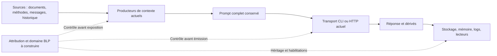

# Bell-LaPadula — inventaire des sources et transmissions Rust

[Bell-LaPadula : état existant et interfaces](BELL-LAPADULA.md).

[English](../en/BLP-FLOWS.md) · [Inventaire lié aux sources](blp-flow-inventory.json) ·
[Plan BLP](../plans/actions-confiance/BLP-APEX.md) ·
[Réexamen PAEA](../plans/actions-confiance/paea/BLP-REASSESSMENT-20261031.md).

## État et périmètre

BLP-01, révision du 1er novembre 2026 : **25 flux documentés, 50 ancrages dans 46 fichiers
sources**, revus au niveau des producteurs et consommateurs actuels. Le JSON
conserve pour chaque flux : matière exposée, producteur, destinataire, contrôles
existants, responsable, lots manquants et observable de qualification. Il fige
les empreintes complètes et lignes d'ancrage ; tout changement impose une revue.
Les 25 flux restent `OPEN` pour leur contrôle BLP effectif. Leur recensement
ne démontre pas un inventaire exhaustif des comportements dynamiques.

La recette `blp-flow-inventory.json` passe ses deux étapes ; cinq tests du
vérificateur ont réellement été exécutés. Ces preuves portent sur la fraîcheur
de l'inventaire, les refus et la reprise du vérificateur, **pas sur la prévention
d'une divulgation**. Aucun appel fournisseur, donnée vivante, compte ou réglage
de sécurité n'est modifié. Pour ce premier lot d’inventaire, aucun comportement de l'exécutable produit ne change ;
build, installation et notes d'évolution ne sont donc pas requis pour ce lot.

## Frontières recensées

| Flux | Sources → destinataires | Raccord restant |
|---|---|---|
| BF-01–04 | Profil projet, mémoire, méthodes locales/embarquées, extraits et historique → contexte | Attribuer toutes les versions et copies, y compris les instructions ; les gardes de chemin et de secrets ne donnent aucune classification |
| BF-05 | Documents, brief adopté, historique, message courant et méthodes → prompt complet conservé | Produire le domaine fixe depuis toutes les entrées, sans source manquante ni classification publique implicite |
| BF-06–08 | Préparation CLI, HTTP JSON/SSE et sonde manuelle → fournisseur/configuration effective | Lier octets, compte, destination et utilisation des clés au dernier usage ; le texte fixe d'une sonde ne rend pas publique sa clé |
| BF-09–13 | Travailleur, planificateur, relecteur et validation → programmes/descendants | Reprendre les autorisations existantes sans leur substituer une simple étiquette ; traiter argv, environnement, stdin et workspace |
| BF-14–15 | Lectures indirectes, SDK/caches/réseau, télémétrie → hôte et services | Inventaire dynamique et médiation réels, y compris métadonnées et variables d'exporter |
| BF-16–18 | Réponses/propositions, logs/transcriptions, archives/reprise → stockage et lecteurs | Héritage de confidentialité, relecture courante et contrôle de chaque export ; tronquer ou résumer ne déclassifie rien |
| BF-19 | Proposition/contexte PAEA fournis → rapports purs/CLI/API | Les labels sérialisés restent des déclarations ; attribution protégée distincte sans changer les préimages v1 historiques |
| BF-20–22 | Source Git/pack/référence ou ledger/règlement → autres stockages et reçus | Le transfert pack divulgue avant la publication d'une ref ; permissions d'effet et confidentialité restent cumulatives |
| BF-23–24 | Aperçu/accords, originaux, preuves et audit → opérateur, vérificateur et archives | Habilitation des lecteurs, droit de déclassifier distinct et protection des preuves elles-mêmes |
| BF-25 | Diagnostic du prompt enregistré → CLI/HTTP | Attribution courante de chaque partie et habilitation du demandeur ; pas de ticket d’envoi ni de contrôle du support de sortie |



Les flèches pleines décrivent les flux inspectés, sans garantie BLP. Les flèches
pointillées représentent les contrôles à implémenter et qualifier.

## Menaces et hypothèses

- Le contenu utilisateur, les documents, les réponses du modèle et les champs
  de contexte PAEA ne peuvent s'attribuer ni provenance, ni habilitation, ni droit
  de déclassifier. Un destinataire de même niveau mais d'un autre compartiment
  reste interdit ; un superviseur n'est pas habilité par son seul rôle.
- Les mécanismes actuels de fraîcheur, racine ouverte, permissions d'effet,
  Biba et confinement I0 sont des acquis à conserver. Ils ne constituent pas
  une habilitation de confidentialité et ne doivent pas être désactivés pour
  faire fonctionner un scénario BLP.
- Le profil Linux inspecté limite les écritures et l'autorité privée, mais permet
  des lectures hors racine privée ; le refus AF_UNIX ne confine pas Internet.
  Les SDK peuvent consommer fichiers, caches, configuration de compte et services
  hors du prompt. Les observer est une précondition des revendications BF-14.
- L'endpoint configuré ne suffit pas à établir la destination complète : compte,
  résolution, routage/proxy éventuel et connexion effectivement utilisée doivent
  être liés ou explicitement refusés. La présence d'un proxy ambiant n'a pas été
  recherchée ni testée sur des paramètres privés ; son effet reste à qualifier.
- L'hôte privilégié et les opérateurs possédant les autorités de contrôle sont
  dans la base de confiance. Les écrivains externes non confinés du même UID,
  les canaux cachés et un noyau compromis ne sont pas couverts par ce relevé.
- Une erreur après émission peut conserver une divulgation connue ou inconnue.
  L'arrêt, la révocation et la réconciliation ne rappellent aucun octet envoyé.

## Raccord décidé pour BLP-03/04/05 — cible non implémentée ici

Réutiliser les vrais producteurs de contexte et le moniteur existant, avec une
attribution protégée distincte des DTO publics. Éviter deux fausses solutions :
faire confiance à `SourceRef.confidentiality_labels`, ou contrôler seulement la
dernière chaîne de prompt en oubliant l'historique et les accès du programme.

1. Un résolveur sous autorité courante relie l'objet/version, ses octets réels,
   sa classification persistée et le projet ouvert. Pour l'existant, admission
   explicite et historique conservé ; aucune source absente n'est réputée publique.
2. L'assembleur conserve la filiation de chaque fragment exposé : profil,
   instructions embarquées/locales, documents, extraits, historique, message et
   contrat de réponse. Il produit un domaine fixe et une filiation du prompt exact.
3. Les transports CLI et HTTP consomment ce résultat du producteur, avec principal
   authentifié et politique actuelle au point d'engagement. Une chaîne libre ou
   un résultat du diagnostic `blp-check` n'est pas une capacité d'émission.
4. Les dérivés, réponses, preuves et messages d'erreur héritent du domaine exposé.
   La lecture et la transmission sont réautorisées ; les accès indirects sont
   médiatisés. Une nouvelle exécution est requise pour changer de domaine.
5. Une baisse vers un destinataire utilise exclusivement BLP-06 : nouvelle copie,
   identité humaine établie, droit spécifique et accord sur octets/destinataires/
   classification cible/révision. Les accords Git existants n'accordent pas ce droit.

Premier parcours de raccord à prendre : BF-05 → BF-07 → BF-16 (préparation HTTP),
avec serveur local de fixture, aucun fournisseur payant. Contrôles attendus :
témoin de lecture/émission autorisées, source inconnue, compartiment incompatible,
mutation après préparation, révocation avant envoi, réponse perdue, héritage à
la reprise ; l'oracle reçoit les octets et vérifie que les refus n'en envoient
aucun. Ce choix de séquence ne dispense pas les autres voies ; tant qu'elles
restent ouvertes, aucune confidentialité transversale ne peut être revendiquée.

## Recette, erreurs et reprise

```sh
python3 tools/paea/check_blp_inventory.py --inventory docs/architecture/blp-flow-inventory.json
python3 tools/verification/recipe.py run --recipe tools/verification/recipes/blp-flow-inventory.json --output DOSSIER_NEUF
python3 tools/verification/recipe.py verify --evidence DOSSIER_NEUF
```

Le vérificateur ne rafraîchit jamais une empreinte. Un ancrage ou fichier modifié
refuse ; relire le contrat producteur/consommateur, qualifier le changement puis
réviser explicitement l'inventaire. JSON ambigu, référence inconnue, chemin hors
racine, rubrique incomplète ou prétention `runtime_enforced:true` refusent aussi.
Un contrôle vert signifie seulement que les déclarations revues sont encore
actuelles ; un nouveau canal absent des déclarations peut lui échapper.

Revue de l'incrément : les nombres de flux/ancrages/tests sont des observations,
pas des plafonds. Le schéma1, les IDs BF et le format d'empreinte sont des contrats
de représentation ; aucune politique opérateur nouvelle. Fonctions du vérificateur
et tests documentés ; les erreurs d'IO remontent à l'appelant de bibliothèque et
la CLI expose des codes sûrs, sans contenu privé. Le graphe ne crée aucun droit.
Preuves : `docs/plans/actions-confiance/verification-blp/20261031-flow-inventory-01/`.
BLP-01 demeure partiel pour les voies dynamiques ; BLP-RET-01/02/03 restent ouverts.

## BLP-04 — provenance des octets de préparation (incrément du 31 octobre)

Le producteur `preparation_send` assemble désormais le prompt avec
`preparation_prompt::assemble`. Un manifeste privé couvre tous ses octets dans
l’ordre, sans recopier les textes : contexte projet agrégé, instructions moteur,
contrat de plan éventuel, cadrage JSON et chacun des neuf champs des données.
Ces champs comprennent les documents, extraits conservés, brief adopté, méthode,
sources de méthode, historique, mode, nombre d’échanges omis et message courant.
Le texte envoyé reste identique à l’assemblage précédent. Les empreintes portent
sur les représentations JSON effectivement incluses, pas sur un texte normalisé.
Les sources agrégées ne deviennent pas une attribution de chaque fichier/version.

Les nouveaux tours utilisent l’enveloppe native privée v3 et exigent le manifeste.
Les formats historiques v1/v2 restent lisibles sans lui ; aucun manifeste n’est
reconstruit rétroactivement. Un ancien worker refuse v3. La lecture native utilisée
par le dispatch, la prise en charge du worker et le rejeu vérifie les empreintes,
la couverture complète, les limites UTF-8 et la correspondance origines/clés JSON.
Un format v3 sans manifeste ou avec `null` refuse ; une incohérence produit
`preparation-prompt-provenance-invalid`, avant remise du prompt au fournisseur.
Le DTO public continue à omettre prompt, manifeste et nonce.

Ce manifeste est une preuve de cohérence des octets observés, **pas une preuve
d’identité, de classification ou d’autorisation de divulgation**. Un écrivain du
stockage peut réécrire les octets et leurs empreintes ; l’authenticité et les
attributions persistées restent à construire. La préparation ne possède pas encore
le principal BLP courant requis. Il n’y a ni domaine de confidentialité calculé,
ni contrôle BLP de destination, ni héritage de réponse. BF-05/07/16 et BLP-04
restent ouverts ; `runtime_enforced:false` reste exact.

Recette : `tools/verification/recipes/blp-preparation-provenance.json` (assembleur
et consommateur de ligne native). La recette CLI existante vérifie également la
couverture du manifeste et son égalité avec l’empreinte du stdin réellement reçu
par un fournisseur inerte. Les résultats et la livraison sont conservés dans le
[suivi de reprise](../plans/actions-confiance/BLP-PROVENANCE-20261031.md).

Révision du 1er novembre : BF-23/24 incluent le lecteur PAEA et sa relecture
d’attribution courante. Les renouvellements de politique conservent les niveaux
et compartiments antérieurs ; le contrôle reste partiel. Les quatre fichiers
dont les empreintes avaient dérivé ont été relus (aperçu, présentation, dispatch
Trust, module BLP), sans rafraîchir les autres empreintes.

### Révision : diagnostic des sources de préparation

BF-25 recense le résultat de `blp-preparation-check` vers CLI/HTTP : principal
authentifié, classifications de contrôle courantes de toutes les parties,
combinaison conservatrice, refus typés et absence de mutation. Il reste `OPEN`
pour l’identité physique des sources et la maîtrise réelle du destinataire/support
de sortie ; ce diagnostic ne constitue pas un ticket d’envoi. BF-05 distingue
désormais ce contrôle postérieur de l’admission du prompt. BF-16 précise qu’aucune
classification n’est persistée sur les réponses/propositions. Après revue sémantique
des trois fichiers moteur modifiés, les ancrages ont été actualisés ; cinq nouveaux
ancrages couvrent le diagnostic et ses adaptateurs. La recette
`20261101-preparation-flow-inventory-01` passe deux étapes et cinq tests du
vérificateur, avec intégrité vérifiée. Le refus de l’ancien inventaire reste
conservé dans `20261101-preparation-flow-inventory-before-01`. Ces comptes ne sont
pas des comptes de contrôles BLP effectifs ni une acceptation indépendante.

### Révision : quarantaine explicite des préparations

BF-05/06/07 incluent le refus courant à l’admission, au claim et au transport API/CLI. Quatre ancrages supplémentaires suivent le verrou egress dédié et les mutations Trust locales/enrôlées ; le verrou métier est relâché avant l’IO. Les dix références dont les sources ont changé ont été relues et actualisées. Les 25 flux restent OPEN : une quarantaine optionnelle ne fournit ni autorisation classifiée de destinataire ni héritage de résultat ni confinement des descendants. Les preuves du nouveau parcours sont conservées dans le plan APEX.

BLP-04 ajoute le producteur public blp-preparation-attribute : il sélectionne une tranche
du tour natif vérifié sous I3/admin habilité, sans digest/chemin déclarés par le
demandeur. Deux nouveaux ancrages portent l’inventaire à56 ; les25 flux restent
OPEN. Ce contrôle après capture ne fournit ni domaine fixe à l’admission, ni
autorisation de destinataire, ni héritage des résultats.

L’admission pré-transport ajoute quatre ancrages (60 au total) au flux BF-05 :
producteur partagé sans tour/réservation, attribution explicite des tranches
avant admission et capsule immuable sous principal authentifié. Les25 flux
restent OPEN : ni destinataire/transport autorisé, ni héritage des résultats,
ni protection générale des envois legacy ou des transformations amont.

### Révision : liaison de destination et décision de transport au dernier usage

BF-05 et BF-07 ajoutent la liaison de destination explicite et la décision
last-use `blp-preparation-transport` : un administrateur habilité enregistre un
label de destination pour le compte/endpoint exact d’une connexion `api-`
(écho `base_url`/`model` obligatoire, digest canonique par Root, clé jamais en
entrée), puis le principal propriétaire d’une capsule admise peut observer une
décision go/no-go sous le verrou egress partagé : re-vérification complète de la
capsule (principal, instance, révisions, digest de politique, rejointe de chaque
source, label de sortie reconstruit), fraîcheur connection/provider_source/
settings depuis l’admission, label courant pour ce digest exact, dominance
no-write-down au dernier usage et observation lecture seule des enveloppes de
budget. La réponse est fixe et non émissive (`runtime_authorized:false`,
`runtime_enforced:false`, état `transport-authorized-not-sent`) ; aucun tour,
réservation ou IO fournisseur n’est produit, et aucun chemin legacy n’est modifié.
Les refus typés couvrent grammaire (`blp-transport-invalid`,
`blp-destination-invalid`), écho (`blp-destination-echo-mismatch`), attribution
absente (`blp-destination-not-attributed`), fraîcheur
(`blp-transport-connection-changed|provider-source-changed|settings-changed`),
write-down (`blp-access-denied`) et budget
(`preparation-budget-exhausted|work-budget-exhausted`) ; le mapping HTTP
distingue 400/404/409/403/500. La surveillance ne crée ni droit d’émission ni
confinement OS ni héritage de résultat ; BF-07 reste OPEN pour l’engagement
réel du transport, BF-05 pour l’identité physique des sources.

### Révision : gate travailleur d’émission (hook BF-07 livré)

Le hook BF-07 est implémenté et vérifié localement : la branche Api du
travailleur Rust appelle la décision via
`preparation_worker_transport_gate(id, token, base_url, model)` dans la
réservation egress déjà tenue, avant la construction de la requête — aucun
socket sans décision. Zéro receipt d’admission correspondant au tour
(preparation_id, provider, request_hash — hash qui couvre l’event_id : la
liaison admission→tour est par événement) → chemin legacy inchangé ; ≥1
receipt → re-vérification complète (principal du receipt, fraîcheur
settings, attribution pour le digest résolu du `provider` du tour, écho
obligatoire du `base_url`/`model` effectifs fermant le TOCTOU claim→envoi,
no-write-down au dernier usage, budget lecture seule). Le balayage est
fail-closed et la possession du tour exigée (état `running`, token
SHA256(nonce), PID/stamp/host). Vérifié par
`preparation_worker_transport.rs` et la recette
`tools/verification/recipes/blp-preparation-worker-gate.json`. Restent
OPEN : héritage des résultats (BF-16), confinement OS/descendants,
quarantaine optionnelle ; non activé en production, non accepté.


### Révision : observation Sécurité et preuves

BF-24 ajoute la projection I3/admin security-show et sa vue native : métadonnées
de configuration et inventaire compilé, sans contenu projet ni preuve importée.
69 références, 25 flux OPEN. Les ancrages modifiés ont été relus et actualisés ;
ce rafraîchissement ne qualifie pas les modifications concurrentes BF-16a/stockage.
Les états NOT_TESTED/unknown/not_qualified restent explicites ; aucune certification.
