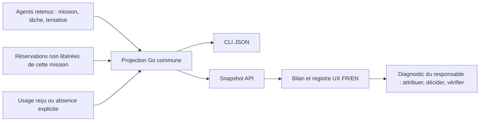

# Registre des appels, réservations et consommations

[English](../en/CALL-ACCOUNTING.md)

## Pourquoi conserver chaque ligne

Le bilan aide à attribuer une consommation, comparer une reprise et distinguer
production, décisions et revue. Les agrégats seuls cachent une tentative ancienne
ou une mesure absente. Le registre décrit les enregistrements conservés par Swarm,
pas tous les appels internes d'un fournisseur et pas une facture.

`swarm --json mission spending WORK` et `mission.spending` du snapshot public
utilisent la même projection Go. Dans la conduite, ouvrir **Actions et historique**,
puis **Où vont les appels et les coûts ?**, puis le registre à déplier. Le bilan
budget réutilise ce composant. Les accordéons mémorisent leur ouverture ; les
réouvrir ne doit pas dupliquer leurs lignes. L'affichage détaillé est construit
à l'ouverture et utilise du texte, sans interpréter du HTML fournisseur.

## Contrat et provenance

| Champ / objet | Origine et sens |
| --- | --- |
| `calls[].id` | `agent/ID` pour une tentative ; `planning/ID` pour une réservation |
| `record_type`, `kind`, `role` | Tentative producteur ou réservation de planification ; worker, planner ou reviewer |
| `task`, `attempt`, `scope` | Attribution conservée ; le scope worker vient du propriétaire de la tâche |
| `state`, `registered_at` | État et date enregistrés ; une réservation n'est pas une preuve d'envoi |
| `provider`, `requested_model`, `observed_model` | Données historiques de l'agent lorsqu'elles existent ; jamais la configuration courante substituée à une attribution absente |
| `usage` | Structure reçue ou `null`, explicitement inconnue |

Les réservations `released` ne sont pas des appels comptabilisés. Les autres
réservations sont projetées avec leur état `estimated` ou `finished` ; même un
état terminé n'établit pas à lui seul une facturation. La table historique des
réservations ne conserve pas le fournisseur/modèle de chaque ligne : ceux-ci
restent non attribuables dans ce registre. Les tentatives worker peuvent les
conserver, ainsi que le modèle effectivement rapporté.

`spendingAgents` lit toutes les tentatives retenues de **cette mission**. Le
panneau des agents récents conserve sa tranche de 200 ; elle ne borne plus le
registre ni ses agrégats. Cela ne reconstitue pas des données supprimées par
rétention. Les lectures et le rendu peuvent grossir avec l'historique : aucune
troncature silencieuse ni nouveau plafond opérateur n'est introduit.

## Mesures connues et inconnues

Une mesure reçue comprend `input_tokens` et `output_tokens`, y compris un zéro
explicitement reçu. `null`, même entouré d'espaces, signifie absence. Un objet
partiel, un type invalide ou des jetons/cache/coût négatifs provoquent une erreur
de lecture, jamais un succès vide ou un zéro inventé.

Exemple : `100 / 25`, `cached_input_tokens:40`, coût absent signifie 100 jetons
bruts d'entrée, 25 de sortie, 40 d'entrée déclarée en cache et coût inconnu.
On n'ajoute pas 40 à 100. `provider_reported_cost_usd:0` est un montant nul
explicitement rapporté, distinct d'un champ absent ; il ne prouve pas une facture
gratuite. Les champs de cache restent séparés et facultatifs. Aucun tarif local
n'est appliqué pour combler une facture absente.

Les reprises sont le nombre de tentatives distinctes retenues par tâche au-delà
de la première, avec un minimum égal aux liens historiques `Agent.Previous`
explicitement conservés. Les liens historiques sans tentative connue restent
comptés ; les identités de tentative répétées ne sont pas des reprises nouvelles.
Ce compteur n'est ni un nombre d'inférences ni un taux d'erreurs du fournisseur.

Le worker et le fournisseur portent les mesures reçues. Le sous-superviseur
analyse son périmètre ; la racine arbitre les reprises et budgets transversaux.
Le moteur vérifie l'attribution et projette les données ; ce registre ne lui
confie aucune décision de fin métier et ne modifie ni droits ni consommation.

## Recette et prévention

Les tests ciblés `TestMissionSpending*` couvrent les unités, les appels étrangers
et libérés, l'usage nul, les entrées invalides, le cas 201 tentatives, les reprises
ordinaires et les anciens liens. `tests/call_ledger_test.cjs` vérifie FR/EN,
inconnus/zéro/cache et texte non interprété. `tests/call_ledger_ui.cjs` utilise
une racine isolée déjà en pause : vrai CLI et navigateur, deux thèmes, clavier,
Échap, retour du focus, mobile, diagnostics et état métier inchangé, sans appel IA.
Les preuves datées restent dans le RETEX ; elles ne certifient pas une version
ultérieure sans examen des sources et entrées modifiées.
