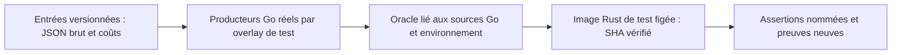
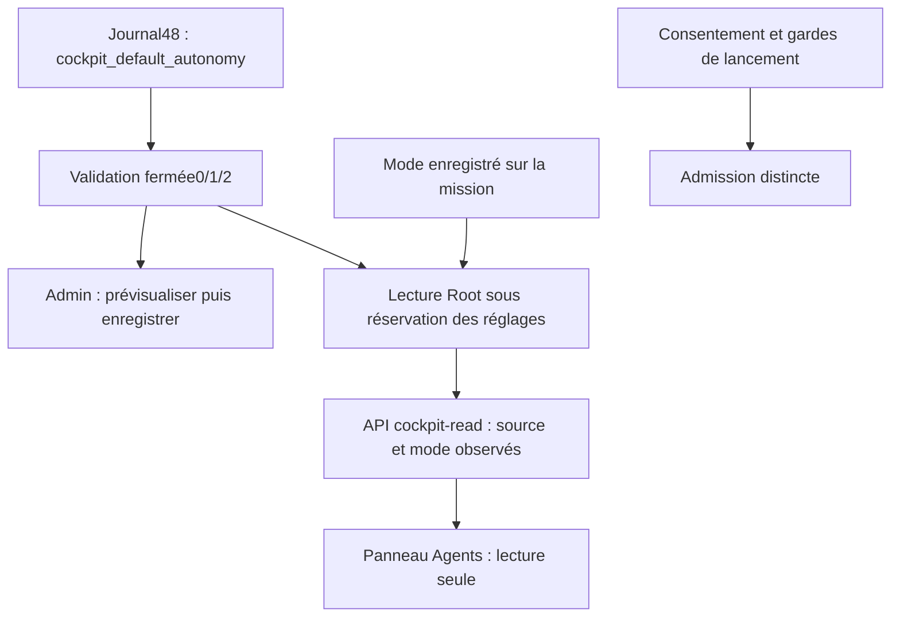
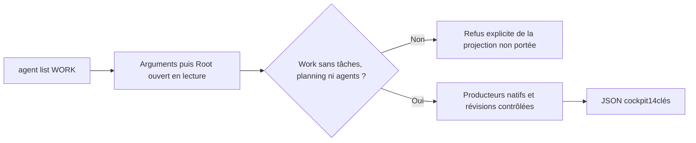
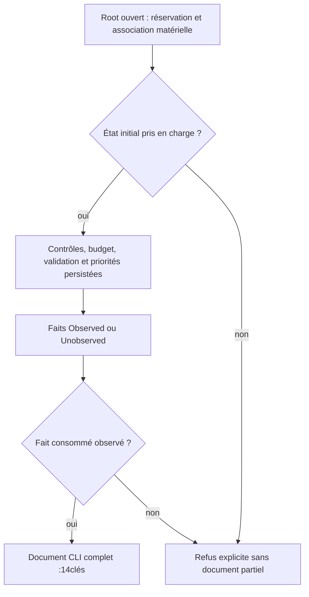

# Contrats de sérialisation du cockpit Go/Rust

Le banc maintenu compare deux producteurs réels : `acceptanceSource` et
`CostTotal.Text` Go, puis leurs homologues Rust. Il vérifie20cas :12sources
(ordre des champs, null/vides, dernière tentative, contrôles/revue, HTML et
nombres JSON bruts) et8textes de coût (absence, zéro, partiel, arrondis,
grande valeur et zéro négatif). Ce n’est pas le contrat complet `agent list`.
Le raccordement public partiel des faits Root et des14clés est décrit ci-dessous ;
les états non couverts, la fraîcheur complète et les droits restent à vérifier.

Les entrées `fixtures/cockpit-source-inputs.json` et résultats Go
`fixtures/cockpit-post-delivery-go.json` sont versionnés dans
`tools/rust-migration/`. La tâche reste une chaîne JSON brute : parser puis
réencoder un `RawMessage` ou les arguments numériques peut modifier `1.00`,
`1e0` ou `-0` et fabriquer un faux écart. Les coûts utilisent les arguments
originaux, jamais une copie normalisée de la sortie Go.



Le générateur Go crée un overlay temporaire, sans ajouter de fichier Go au
produit ni ouvrir de Root. `--check-fixture` refuse un résultat, environnement
ou inventaire Go différent ; il ne réécrit pas l’oracle. `--write-fixture` exige
un chemin neuf. Une évolution s’effectue vers un fichier de staging neuf,
revue des écarts puis remplacement atomique sous le verrou partagé de build,
en conservant l’original. Les inventaires et archives sont contrôlés avant/après ;
les entrées C/toolchain et l’authenticité indépendante restent hors preuve.

Pour créer une image Rust de test :

```sh
python3 tools/rust-migration/run_cockpit_oracle.py \
  --profile-invocation /CHEMIN/BUILD/profile/invocation.json --output /CHEMIN/NEUF
```

Le lanceur reprend les options réelles du build enregistré (debug/incremental),
fige l’exécutable avant exécution, archive les510sources locales effectives
observées dans la preuve du28octobre et vérifie le corpus avant/après. Ce binaire
`cfg(test)` ne doit jamais être installé. Les sources compilées et le corpus lu
à l’exécution sont liés séparément. Un rejeu sur un corpus modifié n’affirme pas
que les sources courantes ont été recompilées.

```sh
export SWARM_COCKPIT_UNIT_RECORD=/CHEMIN/PREUVE/result.json
python3 tools/verification/recipe.py run \
  --recipe tools/verification/recipes/cockpit-go-source-cost.json --output /CHEMIN/NEUF
python3 tools/verification/recipe.py verify --evidence /CHEMIN/NEUF
```

La recette vérifie les refus de réutilisation d’un dossier de preuve, recalcule
l’oracle Go courant, puis rejoue l’image Rust conservée sans Cargo. Go est un
prérequis de ce contrôle différentiel, pas de l’application livrée. Aucun Root,
fournisseur, installation ou watchdog global ; toute erreur conserve sa cause,
arrête la chaîne et laisse les preuves originales intactes. Un changement du
code Rust impose une nouvelle image ; des entrées de corpus seules peuvent être
rejouées sur l’image existante. Les empreintes ne sont ni signature ni acceptation.

## Autonomie initiale configurable — journal48

La décision utilisateur retient « Autonome » comme défaut initial de cockpit,
avec trois choix dans Admin : Manuel, Assisté et Autonome. Le journal48 porte
`cockpit_default_autonomy` (`0`, `1`, `2` en chaînes), avec validation fermée ;
le catalogue6 décrit un champ scalaire `choice`. Ce choix de présentation ne
constitue ni consentement ni lancement. Le mode enregistré de la mission reste
prioritaire. Un journal historique47 reste lisible sans adopter ce défaut ;
l’adoption exige la prévisualisation et l’enregistrement explicites dans Admin.

État courant : politique, catalogue, sélecteur Admin et lecture Root/API/panneau
Agents livrés et vérifiés en version240. Les preuves détaillées ci-dessous
séparent unités, parcours publics, image compilée et instance installée. La recette maintenue
`tests/rust_cockpit_autonomy.py` vérifie la sauvegarde/relecture CLI et HTTP,
les refus sans mutation et la priorité du mode de mission sur un Root isolé.



Le booléen `launch_authorized:false` de cette observation est un invariant du
contrat de lecture, pas une politique opérateur cachée. La révision des réglages
reste une chaîne décimale exacte. Un journal sans choix produit `autonomy:null`,
`source:not_configured` ; une réponse ancienne sans observation affiche un mode
non observé. Une erreur de réglage/SQL/fermeture refuse avec sa cause ; elle ne
produit jamais un mode autonome de remplacement.

Une version de journal élevée ne prouve pas que tous les groupes indépendants
plus anciens ont été adoptés. Admin conserve ces absences à la lecture ; un champ
v1 manquant ou un champ futur présent refuse. À l’ouverture seulement, les valeurs
manquantes sont proposées dans le brouillon, avec avertissement et confirmation
requise. L’API peut adopter le seul choix d’autonomie tout en conservant absents
les autres groupes. Le cas réel local41 a révélé cette distinction ; le test
`engine_settings_admin_choice_ui.cjs` conserve son contre-exemple.

### Livraison locale vérifiée —28octobre2026

Version240, SHA `d4e5493f4b4dad0106d871ef6c564b9f83bfbea23bcbf1104fed58fbf431752d`,
installée par le lanceur normal et vérifiée sur le processus réel. Le choix
utilisateur Autonome est adopté seul du journal local41au48 ; autres valeurs,
historique, cinq missions et contrôles conservés, aucun consentement modifié.
Preuves :12tests Rust des réglages (sources concernées inchangées),9cas UI
de choix scalaire,20assertions publiques CLI/API,78assertions navigateur sur
image240, témoin historique47→48, puis14Version et16Admin installés sans POST.
Les4assets protégés correspondent à l’archive du build. Les comptes sont de
natures différentes et ne constituent pas un pourcentage de migration.
Recettes : `cockpit-autonomy.json` et `cockpit-go-source-cost.json` ; contrôles
installés en lecture seule : `tests/rust_installed_cockpit_autonomy.py`.
La route historique complète `agent list` reste à raccorder ; installation de
ce réglage n’est ni acceptation indépendante ni clôture de migration/Biba/PAEA.

## Agent list — premier raccord public livré241

`agent list WORK` est maintenant raccordé dans les sources à
`RootStore::inspect_cockpit`. Le périmètre initial est un Work ordinaire sans
tâche, planification ni agent conservé. La lecture compose réellement les14clés
Go : Work, validation, coûts, pause/mode et créneaux enregistrés, priorités
contrôlées et état du cockpit. Les collections vides résultent des observations
vides de cette tranche ; un Work non couvert refuse explicitement sa projection
`cockpit-task-projection-unported`, `cockpit-planning-projection-unported` ou
`cockpit-agent-projection-unported`. Ce n’est pas un support complet d’agent list.

Le CLI émet le JSON avec ou sans `--json`, comme Go, valide ses arguments avant
ouverture et conserve les erreurs de fermeture/sortie. Le lecteur maintient
l’association au Root, réserve les réglages et compare les révisions observées ;
les lectures SQL restent séparées, sans snapshot atomique ni autorité pour une
action suivante. Aucun lancement, consentement ou réglage n’est modifié.



Le banc maintenu `tests/rust_cockpit_agent_list.py` compare Go/Rust sur le même
Root inerte, en ne normalisant que `pilotage.snapshot_as_of`, vérifié dans les
fenêtres réelles des appels. `project_view_key` est le SHA des octets du chemin
canonique du Root, jamais celui du Work JSON. Le comparateur rejette une clé
inventée et un booléen substitué à un compteur. Recette différentielle :52assertions publiques et4tests du comparateur PASS ;
intégrité de la recette permanente `cockpit-agent-list.json` vérifiée. Le profil
natif241 est qualifié sans fixture et cette image est installée. La revue
d’incrément porte sur les4entrées de compilation réellement modifiées par
rapport à240. Les réglages opérateur peuvent intentionnellement différer des
valeurs fixes de Go ; l’égalité Go/Rust est vérifiée sous politiques compatibles,
sans reproduire le plafond Go caché de16créneaux.

## Extension des tâches initiales — livrée en version243

La lecture CLI livrée accepte les tâches `todo` sans
dépendances, tentatives, gate, revue ou revalidation, pour un Work ordinaire
sans planning ni agent conservé. Elle assemble les actions et la livraison
observée, le budget réel, les contrôles de pause/hold/brief et uniquement les
priorités persistées. Une action proposée ne vaut ni consentement ni autorisation.
Les gardes consommées doivent être `Observed` ; `Unobserved` refuse si nécessaire,
sans inventer un passage de gate. Les branches non consommées restent non observées.
Les autres états refusent avant toute publication du document. Les lectures SQL
séparées et les contrôles de révision ne constituent pas un snapshot atomique.

La recette `rust_cockpit_agent_list.py --initial-tasks` compare le document complet
Go/Rust, la pause, la priorité, le budget insuffisant et sa reprise. Le refus de241
est conservé avant correction. Sur le candidat243 :85assertions de parcours,
15sur recouvrement global et4contre-exemples du comparateur passent ;
14tests Rust d’actions et1de priorités passent également. Installation locale
vérifiée : image9bc11252d9c37d1f76f2241325a6f05afee85a804c4e64d11e9aa6475fe909c3,
processus1102767,4ressources protégées conformes ;14assertions Version et16Admin
FR/EN. Les5Works et leurs contrôles/réglages restent inchangés. Ces preuves
ne qualifient pas les tâches avec dépendances/historique, agents ou planning,
ni PAEA/Biba et la migration complète.



Les actions sont des propositions de lecture. Le lancement reste soumis aux
gardes d’autorité, d’identité, d’espace de travail et de budget du moteur.

## Dépendances TODO — livrées en version244

La lecture observe maintenant les dépendances entre tâchesTODO : elles
restent en attente, jamais « fraîches ». Le graphe et les listes waiting_on
conservent l’ordre enregistré ; les motifs de départ et dérogation citent la
première dépendance. Les horloges evaluated_at sont vérifiées dans les fenêtres
des appels réels, sans neutraliser les autres faits. Témoins : zéro lien, un
lien, plusieurs prérequis et chaîne ; état bloqué ensuite refusé sans document.
La version244étend la tranche243. Le parcours Go/Rust complet passe101assertions
principales,15sur recouvrement global et5contre-exemples du comparateur. Le
profil normal est lié à2entrées modifiées (lecteur et notes), sans fixture.
Installation vérifiée : image2d28e0bc7fe061131617ee9c26ceb276bce74b2c36a304d85648b5b57e34015b,
PID1130985 ;4assets conformes,14Version et16AdminFR/EN,5Works et leurs contrôles
préservés. Les états avec tentatives, revues, agents conservés ou planning
restent explicitement hors de cette tranche. Aucune migration complète déduite.
