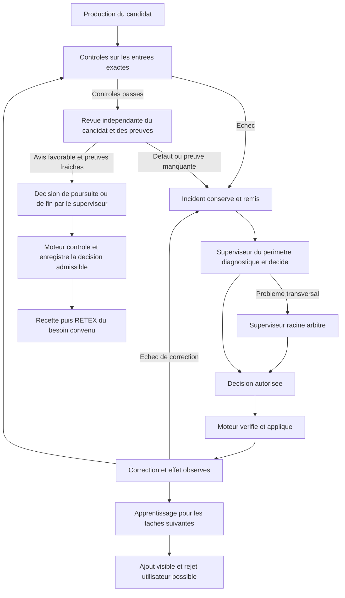

# Contrôles et boucles de rétroaction : améliorer le travail des agents

État de recherche au 11 octobre 2026. [English version](../en/CONTROLS-AND-FEEDBACK.md).

## Ce que nous cherchons à améliorer

Un agent peut produire un changement plausible tout en citant un test absent,
en travaillant sur un contexte ancien ou en interprétant mal un refus. Swarm
cherche à rendre ces erreurs détectables, corrigeables et moins susceptibles de
se reproduire. La qualité visée est un résultat conforme au besoin, accepté sous
les preuves requises, avec moins de relances humaines.

Les contrôles et les rétroactions améliorent cette fiabilité lorsqu'ils détectent
un défaut réel puis provoquent une correction vérifiée. Ajouter une règle ou une
ligne de journal ne suffit pas. Un gain de vitesse ou de coût doit être mesuré :
une revue supplémentaire peut réduire les reprises tout en augmentant la durée
immédiate. La prévention doit diminuer les erreurs futures, pas seulement enrichir
la documentation de l'erreur passée.

L’apprentissage décrit ici porte sur les consignes, le contexte remis et les
contrats de travail disponibles aux agents. Son efficacité se vérifie dans les
tâches suivantes ; elle ne se déduit pas de la sauvegarde de nouvelles consignes.

## Trois fonctions complémentaires

| Fonction | Question traitée | Responsable | Preuve attendue |
| --- | --- | --- | --- |
| Contrôle | Le candidat respecte-t-il une condition vérifiable ? | Moteur exécutant le contrôle configuré | Commande, entrées, candidat, sortie originale et résultat attribués |
| Rétroaction | Que signifie l'échec et quelle correction choisir ? | Sous-superviseur de la portée, racine pour les problèmes transversaux | Incident reçu, diagnostic, décision autorisée et effet observé |
| Apprentissage | Que faut-il changer pour les tâches suivantes ? | Superviseur, avec choix de rejet conservé pour l'utilisateur | Ajout attribué aux consignes futures, réception et évaluation de son utilité |

La revue indépendante examine le candidat et ses preuves dans un contexte séparé.
Elle ne corrige pas elle-même le candidat. Le superviseur décide du travail à
poursuivre et de sa fin ; le moteur vérifie l'admissibilité de cette décision,
les droits, la fraîcheur, les réservations et les preuves exigées. Un processus
terminé, un test réussi ou un acquittement n'est pas une acceptation métier.

## La boucle complète

Deux boucles ont des objectifs distincts : la correction remet le travail courant
sur une base vérifiable ; l'apprentissage ajuste les instructions ou le contrat
pour les travaux suivants. Le RETEX évalue leurs effets et propose des évolutions.
Il ne remplace pas une recette ni un objectif initial encore inachevé.

## Exemple 1 — Une preuve de test mal attribuée

**Cas observé dans T2.** Le bilan citait une exécution locale avec `-v` et une
durée de paquet de 8,302 s. Le contrôle natif enregistré avait une autre commande,
sans `-v`, et un temps mur de 11,434 s. Ces valeurs ne décrivent pas la même
exécution. La revue a demandé le reçu propre du test alternatif.

La réparation conserve les originaux et produit un nouveau reçu local daté :
argv complet, début et fin, sortie brute, SHA-256, exit 0 et sources inchangées.
Pour cette nouvelle exécution, le paquet rapporte 7,274 s et la commande entière
17,491583 s. La livraison distingue désormais les deux mesures et le contrôle
natif. Un nouveau candidat exige encore ses contrôles frais et sa revue.

**Pourquoi cela aide les agents.** Le prochain agent peut vérifier quel test a
réellement tourné et réutiliser une preuve compatible avec ses entrées. Il reçoit
une règle générale : chaque affirmation de test doit être rattachée à son propre
reçu ; une durée de paquet n'est pas le temps mur de la commande. La preuve de
prévention sera l'absence de cette confusion dans les livraisons suivantes.

## Exemple 2 — Une pièce complète existe mais le superviseur ne la voit pas

**Cas observé et correction moteur qualifiée.** Un contexte de revue original de
759 750 octets était lu avec une limite destinée à un autre type de dossier. Le
superviseur recevait un inventaire vide alors que onze sources étaient présentes
et attestées. Répéter « consulter les preuves » dans les consignes ne corrigeait
pas cette frontière de transmission.

La correction générale authentifie et lit le contexte complet, puis expose
l'inventaire frais aux superviseurs racine et enfant. Elle conserve les originaux
et les anciens journaux. Les tests couvrent le contre-exemple, les entrées
altérées et les variantes. La reprise native a établi la réception de la preuve,
la décision de reprise par le superviseur et son application au nouveau journal.
Son premier appel a ensuite rencontré un quota fournisseur : aucun verdict final
favorable n'en est déduit.

**Pourquoi cela aide les agents.** Le diagnostic peut porter sur les véritables
pièces disponibles. Un manque de contexte, une capacité insuffisante et un défaut
du candidat deviennent trois problèmes distincts, avec des corrections distinctes.

## Exemple 3 — La correction introduit elle-même un blocage

**Cas reproduit pendant la qualification.** Une nouvelle projection de reprise
réacquérait une connexion SQL déjà détenue par la mutation en cours. Le blocage
était un défaut du moteur ; attendre davantage ou augmenter le budget du modèle
ne pouvait pas le résoudre.

La pile originale a permis de localiser la frontière : la projection devient une
lecture de preuves immuables, et le contrôle du producteur au commit utilise la
transaction déjà ouverte. Les parcours racine/enfant et les refus invalides sont
rejoués. La suite complète et le contrôle de concurrence passent sur le cumul
qualifié. Les processus de revue de ces régressions sont des doubles : ils ne
prouvent pas, à eux seuls, une décision autonome d'un modèle réel.

**Pourquoi cela aide les agents.** La méthode `replan` s'applique aussi à la
correction et à notre propre diagnostic. Une nouvelle panne reste liée à son
incident parent ; sa résolution doit permettre de reprendre le besoin initial.

## Exemple 4 — Claude refuse un appel pour quota

**Cas observé.** Un appel de sélection reçoit un refus 429 avec un délai indiqué
par le fournisseur. Il n'a fourni aucun avis exploitable. Le moteur conserve le
refus, l'appel consommé et l'historique ; le quota ne devient pas un défaut métier
du candidat ni un verdict d'acceptation.

Le propriétaire de la dépendance est le compte fournisseur. Les corrections
indépendantes continuent pendant l'attente. Une reprise nécessite une précondition
modifiée : délai écoulé ou compte rétabli explicitement confirmé, opération publique
attribuée, puis véritable appel pour vérifier la disponibilité. Un nouveau refus
reste traité comme un incident ; il ne justifie pas une répétition inchangée.

**Pourquoi cela aide les agents.** Ils disposent d'une condition concrète de reprise
et évitent de consommer des appels identiques sans avoir corrigé la dépendance.
L'amélioration se mesure en appels inutiles évités, sans effacer les dépenses.

## Exemple 5 — Deux agents travaillent en parallèle

**Exemple de fonctionnement à vérifier dans chaque recette.** Un agent modifie le
juge global et un autre prépare son panneau de réglages. Le sous-superviseur garde
la propriété de chaque périmètre et la dépendance sur le contrat partagé. Le moteur
contrôle les réservations et rattache les preuves au candidat effectivement revu.

Si le contrat change après la revue du panneau, son ancienne preuve peut devenir
périmée. Le superviseur décide de la requalification nécessaire ; le moteur refuse
une décision appliquée sur des entrées incompatibles. Cette coordination doit
laisser avancer les tâches indépendantes sans transformer chaque erreur locale
en arrêt global. Sa réalisation parallèle avec modèles réels doit être démontrée
par la recette prévue, pas inférée de la présence des rôles.

## Exemple 6 — Un processus métier

**Illustration, pas recette Swarm exécutée.** Un agent prépare un dossier de
facturation et un autre vérifie les pièces. Une pièce manque ou un montant diverge.
Le sous-superviseur qualifie le problème et choisit la demande de pièce ou la
correction ; la racine intervient si le défaut concerne plusieurs dossiers ou les
droits. Le moteur contrôle les transitions et les preuves, puis applique la
décision admissible. La fin de traitement appartient au responsable métier sous
ses conditions de recette. Envoyer la facture requiert les droits correspondants.

Le RETEX peut proposer une vérification plus tôt dans le parcours. L'utilisateur
peut rejeter l'ajout aux consignes futures. La présence de cette proposition ne
prouve ni sa réception par les prochains agents ni son effet sur les erreurs.

## Mesurer une amélioration réelle

Comparer des objectifs et des conditions comparables ; conserver type de tâche,
révision du moteur, modèle, budget, entrées et interventions humaines. Séparer les
résultats locaux, les doubles, les modèles réels et l'acceptation native.

| Mesure | Définition utilisable | Risque d'interprétation |
| --- | --- | --- |
| Acceptation au premier passage | Résultats acceptés sans correction / résultats soumis à revue | Un contrôle retiré peut créer un faux gain |
| Récidives | Réapparitions d'une même cause après correction vérifiée | Une formulation différente peut masquer la même cause |
| Relances humaines | Interventions nécessaires au diagnostic ou à la reprise | Une simple notification n'est pas une relance nécessaire |
| Délai jusqu'à acceptation | Temps entre début autorisé et acceptation sous preuves | Séparer attente fournisseur, production, contrôle et revue |
| Coût par résultat accepté | Consommation attribuée, corrections et appels refusés inclus | Les tentatives infructueuses ne doivent pas disparaître |
| Chaînes résolues | Incidents avec réception, décision, application et effet vérifiés | ACK ou nouvelle consigne seuls ne constituent pas une résolution |
| Coût des contrôles | Durée et consommation des contrôles par classe de tâche | Plus de contrôles ne signifie pas automatiquement plus de qualité |

Un contrôle supplémentaire doit traiter un risque observé et produire une preuve
utile à la décision. Les niveaux de contrôle et les réglages doivent être
explicités et configurés dans leur contrat approprié ; ces exemples et nombres
observés ne créent aucun seuil arbitraire. Une correction durable conserve le cas
initial et les variantes en non-régression, puis transmet l'apprentissage.

## Ce que nous pouvons conclure aujourd'hui

Les défauts détectés et les corrections qualifiées montrent une amélioration des
contrats de preuve, de transmission et de reprise. Ils ne donnent pas encore une
mesure globale du gain de vitesse, de coût ou d'autonomie de Swarm. La chaîne native
jusqu'à la revue finale, la recette et le RETEX reste le critère de réalisation.

Sources de travail : [recherche et preuves](../publications/20261005-cursor-moteur/dossier-recherche/revisions/20261011-instruction-learning-retex.md),
[reprise autorécursive](AUTORECURSIVE-RECOVERY.md), [traçabilité](TRACEABILITY.md),
[contrat des publications Cursor](CURSOR-ENGINE-CONTRACT.md).
