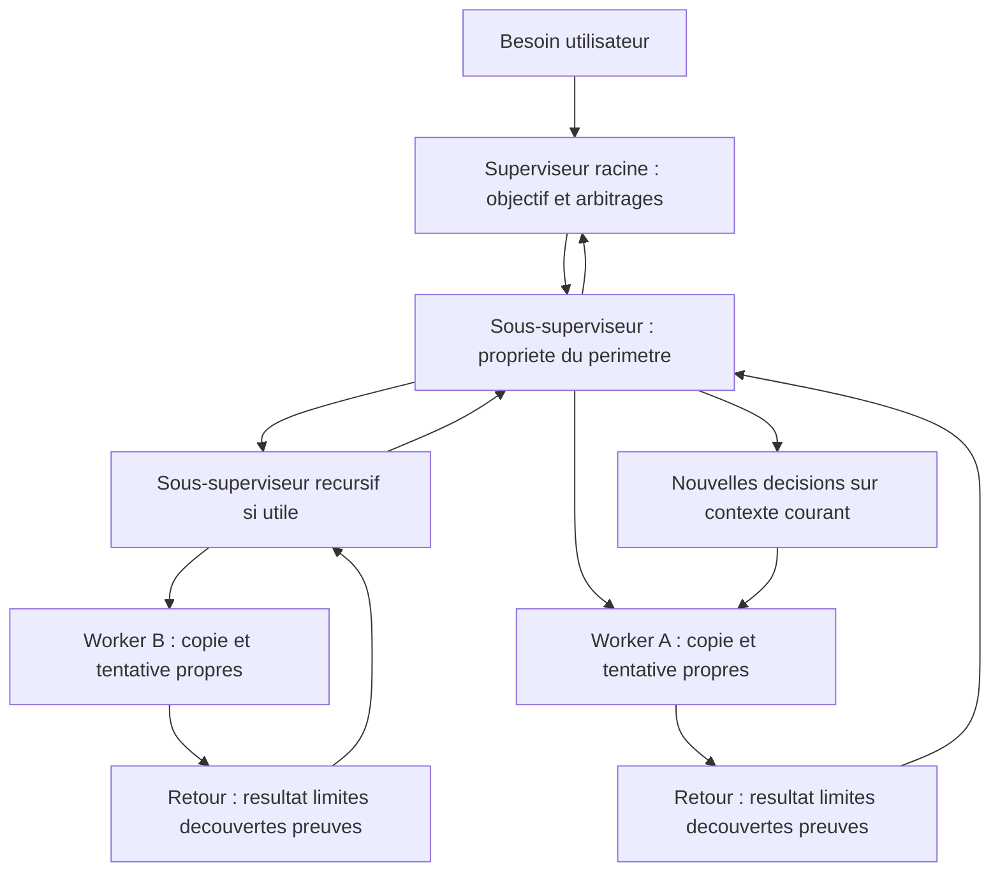
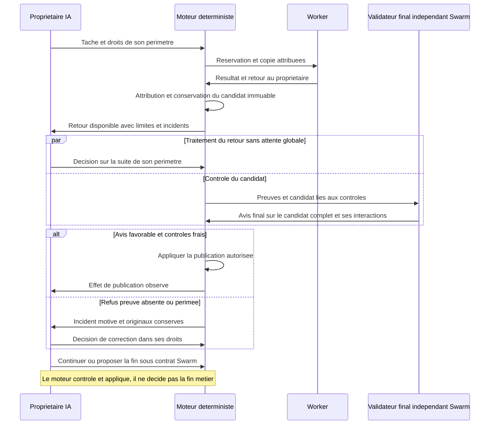
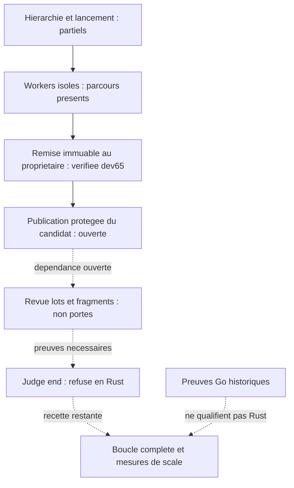
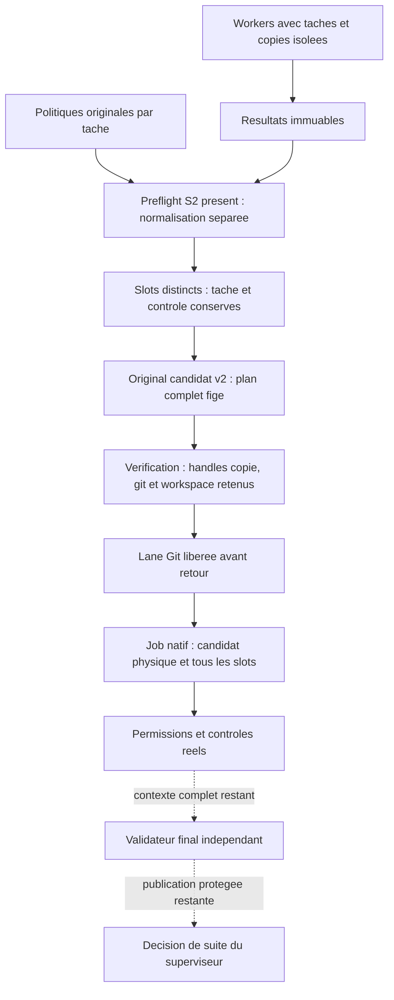
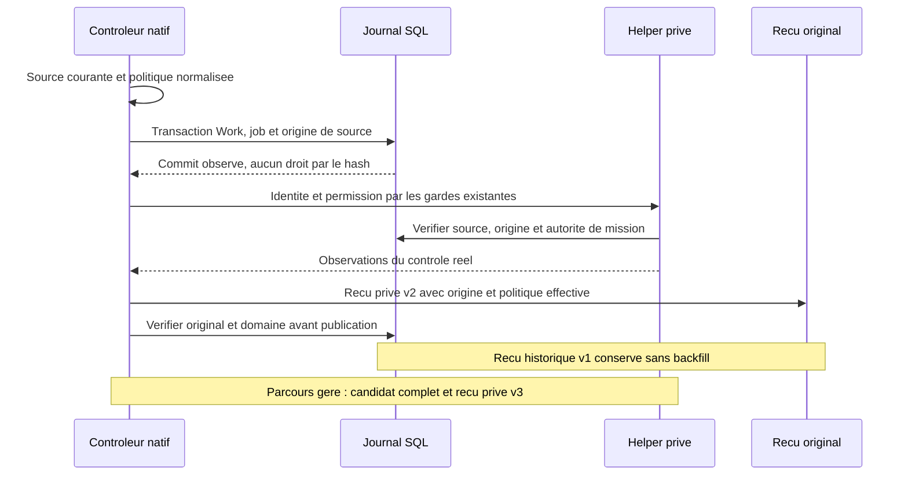
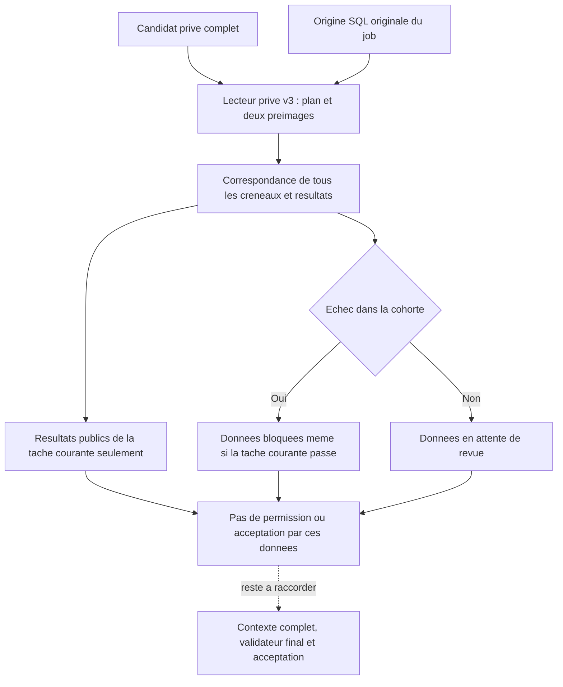
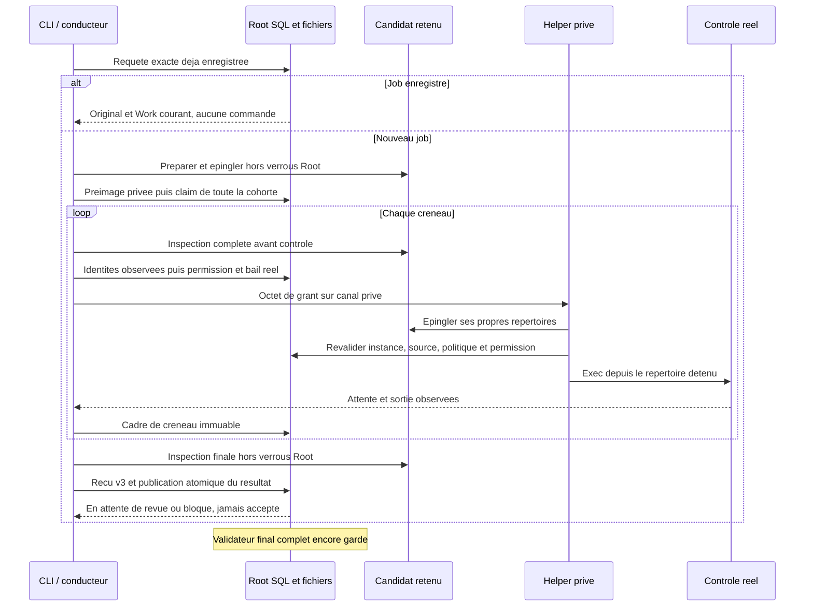

# Contrat du moteur : références Cursor de janvier et février 2026

> **Lecture courante Rust :** voir la relecture du 25 octobre et ses schémas en fin de page. Les résultats antérieurs ci-dessous restent historiques Go.

[English](../en/CURSOR-ENGINE-CONTRACT.md)

[Évolution APEX lancée le 10 octobre : architecture, lots et étude eBPF](CURSOR-ENGINE-EVOLUTION-20261010.md).

Références retenues : [Cursor — Scaling long-running autonomous coding](https://cursor.com/blog/scaling-agents), 14 janvier 2026, et [Towards self-driving codebases](https://cursor.com/blog/self-driving-codebases), 5 février 2026.

Clarification utilisateur du 10 octobre 2026 : les deux publications sont retenues. La correction précédente avait exclu février à tort. Janvier reste la référence des exigences JAN-1 à JAN-7 ; février complète l’architecture et explicite son évolution. Les différences entre versions doivent être documentées, sans déclarer une conformité par addition de leurs descriptions. Cette correction documentaire ne modifie pas le moteur.

Ce document distingue une règle de conception, son contrôle par le moteur et sa
preuve d'exécution. « Conforme Cursor » n'est pas une certification : l'article
décrit une expérience de recherche, avec des compromis. Les tests déterministes
de Swarm ne prouvent pas à eux seuls qu'une mission réelle se termine sans aide.

## Répartition des responsabilités

Le [parallélisme des agents](AGENT-PARALLELISM.md) précise les besoins, les
contraintes et les preuves attendues, avec schémas Mermaid et distinction entre
production parallèle et publication exclusive.

| Rôle | Responsabilité | Effet autorisé |
|---|---|---|
| Responsable racine | Possède l'ensemble du besoin ; décompose et adapte le travail. | Décisions structurées de planification, aucune commande de codage. |
| Responsable de périmètre | Possède la partie explicitement déléguée ; peut déléguer à son tour dans les bornes. | Tâches et décisions dans son périmètre, aucune commande de codage. |
| Exécutant | Réalise une tâche bornée dans sa copie du dépôt. | Modifications locales et remise au responsable propriétaire. |
| Vérificateur indépendant | Examine le résultat et les preuves sur la révision candidate. | Avis motivé, sans outil d'écriture ni pouvoir d'autoacceptation. |
| Contrôleur déterministe | Exécute les commandes de contrôle et applique les règles de publication. | Reçus, refus et transition atomique si toutes les conditions sont réunies. |

La publication de janvier sépare planificateurs et workers, autorise des sous-planificateurs récursifs et prévoit un juge en fin de cycle, puis un démarrage frais de l’itération suivante. La revue indépendante d’un candidat dans Swarm ne remplace pas ce juge global. Les garanties supplémentaires de preuve et d’acceptation de Swarm doivent être distinguées de ces exigences. La livraison **Go du 13 octobre** a vérifié `judge`/`renew` en fixtures et dans la recette cumulative réelle décrite dans la section historique dédiée ; cela ne qualifie pas leur chaîne complète Rust. Voir [les cycles de jugement](JUDGMENT-CYCLES.md).

Les copies isolent les modifications et les références Git. Elles ne constituent
pas une frontière de sécurité contre un processus malveillant disposant des droits
du compte hôte. Les contrôles décrits ici s'appliquent aux opérations publiques du
moteur ; un administrateur capable de modifier sa base ou ses exécutables reste
hors de cette garantie.

## Exigences de janvier — état historique de l’audit du 10 octobre

Cette matrice définit la cible ; elle ne décrit pas des fonctions déjà livrées.
Les plafonds locaux et les garanties de Swarm ne sont pas des prescriptions de
Cursor. Toute preuve doit distinguer examen du code, tests simulés et exécution
avec un fournisseur réel.

| ID | Comportement attendu | Preuve attendue | État de cet audit |
|---|---|---|---|
| JAN-1 | Les planificateurs explorent continuellement le code et créent les tâches. | Montrer les informations du dépôt réellement accessibles au planificateur et une adaptation fondée sur une découverte nouvelle. | Partiel : décisions événementielles présentes ; exploration continue du dépôt non démontrée par un prompt sans outils. |
| JAN-2 | La planification peut être récursive et parallèle. | Observer deux sous-planificateurs actifs simultanément, propriétaires de périmètres distincts, puis leurs décisions persistées. | Délégation présente ; parallélisme réel des sous-planificateurs non démontré dans cet audit. |
| JAN-3 | Les workers terminent leurs tâches sans coordination directe entre workers et publient leurs changements. | Observer deux tâches indépendantes en parallèle, les refus des canaux latéraux et la remontée de leurs résultats. | Tests ciblés réussis ; chemin d’intégration central de Swarm à distinguer du fonctionnement décrit par Cursor. |
| JAN-4 | Un juge de fin de cycle décide si le travail doit continuer. | Verdict portant sur l’objectif et les résultats du cycle, avec décision persistée de poursuite ou de fin. | Non démontré : une revue de candidat ou une clôture déterministe ne suffit pas. |
| JAN-5 | L’itération suivante démarre avec un contexte frais. | Observer le passage entre deux cycles, le nouveau contexte et la conservation de l’objectif, des preuves et des limites. | Partiel : projections fraîches par activation ; transition globale entre cycles non démontrée. |
| JAN-6 | La coordination permet d’augmenter le débit sans attente centrale excessive. | Mesurer temps de calcul, attente des verrous, contrôles, revue, publication et débit pour plusieurs niveaux de concurrence. | Non mesuré ; plafond de 16 workers par mission et voie de publication sérialisée identifiés. |
| JAN-7 | Les prompts et le choix de modèle conviennent à chaque rôle. | Examiner les prompts effectifs et comparer les comportements sur des missions longues avec modèles et coûts identifiés. | Routes distinctes présentes ; adéquation et endurance non démontrées. |

Les tests ciblés de coordination réussis le 10 octobre 2026, y compris avec
`-race`, ne couvrent pas à eux seuls JAN-1 à JAN-7. Une absence de preuve ne
prouve pas une absence de fonction ; elle interdit de déclarer l’alignement
complet. L’audit du moteur reste à compléter sur ces points.

## Apports de février — état historique de l’audit du 10 octobre

Février décrit une hiérarchie continue, des copies propres aux workers et des remises au propriétaire. Il retire le juge dans une évolution intermédiaire et l’intégrateur central. JAN-4 et JAN-5 restent des exigences Swarm conservées dans ce cadrage ; elles ne sont pas présentées comme des invariants du système final de février. Comparer une hiérarchie continue avec des points de jugement et des cycles explicites avant de choisir leur articulation.

| ID | Complément à vérifier | Preuve attendue | État |
|---|---|---|---|
| FEB-1 | Propriété récursive et remise au responsable | Retour durable, propriétaire exact, réactivation après redémarrage | Partiel : mécanismes présents, recette réelle à compléter |
| FEB-2 | Remise contenant limites et découvertes | Contenu réel exploité dans une décision suivante | Non démontré |
| FEB-3 | Fraîcheur pendant le travail continu | Renouvellement observé sans perte d’objectif ni de preuves | Non démontré |
| FEB-4 | Débit et compromis de qualité explicites | Mesures et politique distincte de publication validée | Non mesuré ; contrôles Swarm maintenus |

## Règles à vérifier dans le moteur

| Invariant | Refus attendu | Preuve à conserver |
|---|---|---|
| Un planificateur ne code pas dans une mission hiérarchique | Un départ explicitement demandé avec rôle planner/subplanner est refusé, jamais transformé silencieusement en worker. | Réponse CLI et HTTP, absence d'agent, de réservation et de copie résiduelle. |
| Délégation exclusive | Une exigence déjà confiée ne peut être réattribuée ou traitée par le mauvais responsable. | Décision rejetée, révision et événements non consommés. |
| Isolation des exécutants | Deux tentatives n'utilisent pas une même copie pour écrire. | Chemins, références et contenu observés sur deux copies réelles de test. |
| Remise au propriétaire | Périmètre étranger, ancienne tentative, fichier d'une autre copie ou empreinte incorrecte sont refusés. | Même état avant/après refus ; retour valide reçu une seule fois par son propriétaire. |
| Réactivation | Un retour courant réveille son responsable ; le rejeu ne duplique pas l'événement. | Réouverture du Store, identités de tentative et d'événement conservées. |
| Clôture descendante | Un parent ne se ferme pas avec enfant ouvert, tâche inachevée ou preuve périmée. | Refus de clôture sur chaque cas et contrôle des preuves fraîches. |
| Acceptation indépendante | Contrôles réussis sans avis favorable, avis périmé, inconnu ou défavorable ne suffisent pas. | SHA candidat, tentative, contrat, contexte de revue et reçus empreintés. |
| Reprise bornée | Quota connu, limite atteinte ou appel déjà réservé ne donnent pas droit à une tentative supplémentaire. | Compteurs et historique inchangés, attente durable et motif explicite. |

Les détails du quota et de sa levée explicite sont dans le
[guide des attentes fournisseur](../PROVIDER-QUOTAS.md).

Les anciens lancements manuels sans organisation hiérarchique restent compatibles.
Ils ne constituent pas une mission autonome démontrant ces propriétés ; le départ
autonome exige l'organisation complète.

## Ce qui reste à démontrer

1. **Qualité des remises.** Le contrat courant transporte des constats et des
   artefacts. Il ne rend pas encore obligatoires des champs séparés pour changements,
   limites, écarts et décisions attendues. Un bon routage ne prouve pas cette qualité.
2. **Autonomie réelle.** Il faut observer un besoin, une délégation, une production,
   un refus motivé, une correction et une clôture avec un fournisseur réel. Les
   réponses simulées et les interventions de l'hôte sont comptées séparément.
3. **Reprise visible.** Après une levée manuelle d'attente sans échéance, les traces
   historiques doivent rester consultables sans être présentées comme un nouveau
   refus actif. L'autorisation d'un nouvel essai ne garantit pas la disponibilité.
4. **Débit et concurrence.** Mesurer le verrou d'intégration pendant contrôles et
   revue, ainsi que la taille du contexte cumulatif. La sérialisation actuelle et
   le refus de contexte trop grand doivent rester visibles.

## Définition de « terminé »

Une sortie normale du processus ne suffit pas. Pour un résultat accepté, conserver
la révision vérifiée, les commandes réellement exécutées avec dates et codes de
sortie, le rapport, l'avis indépendant, la décision, la fraîcheur des preuves, les
livrables et le nombre d'interventions externes. Un correctif écrit par l'hôte peut
renforcer Swarm ; il ne doit pas devenir une réussite autonome inventée dans la
mission qui l'évalue.

## Taille des preuves et transport du dossier

La limite du prompt de revue reste de 192 Kio, consignes comprises. Le moteur
conserve le diff depuis la base, les rapports, les reçus et les sources du même
candidat. Il réduit d'abord les lignes inchangées autour des modifications et
retire uniquement les sources nouvelles déjà reproduites intégralement dans le
diff, après comparaison exacte.

Si l'échappement JSON dépasse encore la limite, les textes sont transportés en
blocs UTF-8 intégraux, identifiés par champ, nombre d'octets et SHA-256. Les autres
métadonnées restent en JSON. Le contexte canonique conservé sur disque et son
empreinte ne changent pas. Aucun résumé ne remplace une preuve, aucun changement
antérieur n'est retiré du diff. Si ce transport dépasse encore le plafond, la
revue reste bloquée avant tout appel fournisseur. Les tests reconstruisent le
dossier dans un processus distinct et comparent tous ses champs au contexte
conservé ; ils vérifient aussi le refus d'un dossier réellement trop grand.

Un rapport nouveau déjà reproduit intégralement dans le diff peut aussi être
référencé à cet endroit : le moteur exige une identité exacte du texte, et le
transport conserve sa taille et son empreinte. Un rapport modifié ou partiellement
présent reste joint en entier. En cas de refus, le journal indique la taille
réelle et la part occupée par les consignes, sans exposer le contenu.

## État des preuves après livraison directe du 13 octobre

Les matrices initiales ci-dessus restent historiques. La recette cumulative réelle Go, les corrections et avis indépendants sont qualifiés dans les limites explicites du tableau ; [audit T1–T8](../plans/engine-cursor-contract/completion-audit-20261012.md) et [RETEX final](../plans/engine-cursor-contract/RETEX-final-20261013.md).

| Exigence | Preuve actuelle | Limite de démonstration |
| --- | --- | --- |
| JAN-1/JAN-2 | SPEC explorée et attribution persistée ; deux sous-planificateurs réels simultanément réservés | Deux modules ; pas exploration continue d'un grand dépôt |
| JAN-3/FEB-1/FEB-2 | Workers isolés en parallèle, remise reçue, deux résultats accepted/fresh sur le même candidat publié | Reprise après défaut worker et refus sémantique couverte en fixtures, pas observée réellement dans cette recette |
| JAN-4/JAN-5/FEB-3 | Continue/renew reçus et appliqués avec contexte neuf ; end explicite cycle 5, neuf scopes clos | Reprises assistées, pas endurance continue sur plusieurs jours |
| JAN-6/FEB-4 | Deux niveaux en fixtures ; chevauchement réel : 53,149 s ; trois contrôles enregistrés | Pas débit/coût comparé à grande échelle ; coût inconnu, usages incomplets |
| JAN-7 | Route standard figée, ordre discriminant corrigé et effet réel sur les décisions | Pas comparaison d'endurance de plusieurs modèles |

L'architecture combine hiérarchie continue et points de jugement, publication exclusive et production parallèle. Les politiques Admin remplacent les anciens plafonds cités dans l'audit initial. Le développement direct, la recette isolée, le code revu et le binaire installé ont des preuves distinctes. La mission historique reste en pause ; aucune certification Cursor ou autonomie générale n'est annoncée.

## Relecture des principes et migration Rust — 25 octobre 2026

Relecture intégrale des deux articles cités en tête. Les sections précédentes
conservent les audits et recettes **Go** ; elles ne qualifient pas le moteur Rust.
Le [plan Rust actif](../plans/migration-rust/PLAN.md) porte la livraison courante.
La lecture des sources ci-dessous constate des raccords et refus ; elle ne remplace
ni recette sur le binaire servi ni campagne réelle à grande échelle.

### Principes de recherche, sans fusionner les versions

En janvier, Cursor distingue exploration/planification et réalisation, permet des
sous-planificateurs récursifs, puis décrit jugement de cycle et contexte neuf.
La coordination plate par fichier et les verrous prolongés ont produit attente,
fragilité et tâches prudentes sans responsable du besoin complet. Le choix des
modèles et les prompts comptent ; ajouter des agents ne suffit pas.

En février, l'exécuteur continu cumule trop de responsabilités et dérive.
L'architecture finale répartit la propriété entre racine, sous-planificateurs et
workers isolés. Un retour unique remonte résultats, difficultés et découvertes au
propriétaire, qui peut reprendre sa réflexion. Le juge a été retiré dans une étape
intermédiaire et l'intégrateur central abandonné comme goulot. Le système assume
une convergence progressive du code et distingue celle-ci de la préparation d'une
version publiable. Ces compromis expérimentaux ne constituent pas une permission
Swarm d'accepter un candidat sans ses preuves requises.

### Traduction en décisions Swarm

| Principe | Décision et limite propres à Swarm | Témoin observable requis |
| --- | --- | --- |
| Un propriétaire du besoin, responsabilités distinctes | La racine arbitre le transverse ; le sous-superviseur possède son périmètre ; le worker réalise. Le moteur applique les décisions autorisées. | Une découverte locale entraîne une décision attribuée au bon propriétaire. |
| Planifier pendant que le travail avance | Décomposer selon dépendances et découvertes, sans attendre tous les workers pour traiter un retour exploitable. | Un retour courant déclenche une nouvelle décision pendant qu'un autre worker travaille encore. |
| Produire en parallèle, remonter au propriétaire | Préserver copies et tentatives distinctes ; éviter les canaux directs entre workers. | Deux productions indépendantes se chevauchent ; chaque retour atteint uniquement son propriétaire. |
| Renouveler le contexte sans effacer l'histoire | Conserver l'objectif, les décisions, preuves, incidents et consommations ; transmettre le contexte courant utile. | Reprise après arrêt avec les mêmes identités et les nouvelles informations effectivement reçues. |
| Réduire la contention | Distinguer production, préparation du candidat, contrôles, revue et publication ; mesurer leur attente séparément. | Un contrôle long ne monopolise pas les droits d'écriture du registre pour les travaux indépendants. |
| Récupérer une panne sans succès inventé | Conserver la cause et l'effet connu, corriger dans ses droits ou transmettre ; aucune relance inchangée. | Incident → décision → application → effet, avec refus/rejeu sans dépense doublée. |
| Mesurer l'utile | Compter résultats frais acceptés, temps d'attente, reprises et coût connu ; ne pas confondre tokens, commits et livraison. | Comparaison à charge identique pour plusieurs concurrences, avec qualité et interventions explicites. |

Le **validateur final indépendant** est conservé : il examine le candidat complet,
les critères et interactions, sur les mêmes sources que les contrôles. Des avis
locaux favorables ou des tests réussis ne constituent pas son avis final.
`pass`, `fail` et `unknown` restent distincts ; un manque de preuve ne devient pas
une approbation. Il n'accorde pas de droits et ne décide pas que le besoin global
est terminé. Le superviseur possède cette décision de poursuite ou de fin, sous
les preuves exigées ; le moteur contrôle leur fraîcheur et applique la décision.
Ce rôle de validation finale du candidat n'ajoute pas un intégrateur central qui
réaliserait ou arbitrerait les tâches de tous les workers.

| Rôle dans Swarm | Décision ou opération | Preuve et portée |
| --- | --- | --- |
| Sous-superviseur | Proposer/corriger/continuer dans son périmètre. | Retour courant attribué ; respect des droits et dépendances. N'attend pas la validation d'un candidat sans rapport avec sa décision. |
| Validateur final indépendant | Rendre `pass`, `fail` ou `unknown` sur le candidat complet. | Critères, contrôles et originaux du même candidat ; interactions et réserves explicites. Ne clôt pas la mission. |
| Racine en rôle de juge global | Décider de poursuivre ou proposer la fin du besoin global. | Résultats courants et preuves de clôture exigées par le contrat ; une proposition ne crée pas les preuves manquantes. |
| Moteur déterministe | Refuser ou appliquer la transition autorisée. | Schéma, droits, réservations, fraîcheur et preuves ; ne remplace aucun jugement métier. |

La validation finale ne bloque pas par principe les décisions des autres périmètres.
La contention se vérifie par scénario et mesures ; aucun délai arbitraire de
refus ni taux de réussite inventé n'est ajouté pour prétendre résoudre ce risque.

Le juge de cycle, le validateur final et la publication protégée restent des
contrats **Swarm**. Conserver JAN-4/JAN-5 est notre choix de conception ; ce n'est
pas une description de l'architecture finale de février. La protection
transactionnelle d'une publication n'impose pas un agent intégrateur central ni
un verrou maintenu pendant un appel modèle. La politique de qualité et son éventuel
assouplissement exigent une décision explicite ; cette relecture ne les change pas.

### État Rust examiné et ordre APEX

| Chaîne | Constat des sources Rust | Suite et preuve manquante |
| --- | --- | --- |
| Planification hiérarchique | `planning_run_material.rs` annonce tâches, délégation et reprises ; `planning_decision.rs` restreint encore les opérations des dépôts gérés. | Vérifier la boucle complète, pas seulement les opérations annoncées. |
| Retour d'un worker géré | Rust dev67 installé fige le commit de résultat et le rapport exact, puis le relais sous bail remet ce dernier au scope propriétaire. Le writer canonique revérifie worker/tentative d’origine, réglages, rapport et attribution Git. | Remise vérifiée sur deux Roots isolés, sans acceptation. Publication du candidat, validation managed et mesure du cycle complet restent ouvertes. |
| Revue de grands dossiers | `managed_review_files.rs`, `managed_review_git.rs` et `managed_receipt.rs` refusent encore lots/fragments. | Porter ensemble producteurs, journaux, contrôles et consommateurs ; ne pas supprimer uniquement le refus. |
| Jugement global | `planning_judge.rs` refuse `end` avec `planning-judge-end-managed-evidence-unported` ; présence de `continue`/`renew` distincte de leur disponibilité dans tous les parcours. | Dépend du résultat courant et des preuves fraîches de clôture ; ne pas convertir l'arrêt du processus en fin métier. |
| Recette de scale | Les preuves Go historiques et les processus Rust factices restent distincts. | Refaire une boucle Rust avec plusieurs workers, refus/correction, retour, décision et reprise ; endurance/coût restent ouverts. |

Ordre de dépendance : examiner les contrats réels et les acquis déjà portés →
livrer worker/candidat/retour utile → qualifier la revue et sa reprise → raccorder
la clôture sous preuves fraîches → mesurer le parcours complet et produire le
RETEX. Les parties indépendantes peuvent avancer en parallèle ; cette séquence
n'impose pas une barrière globale entre tous les workers.

Les GLM SKYNET autorisés reçoivent des tâches bornées et les sources nécessaires.
Ils proposent sans accès au dépôt ni outils. Le principal vérifie et intègre ;
une réponse GLM, un schéma ou cette documentation ne prouvent aucun portage ni
acceptation. Les lots et références de preuve restent dans le plan Rust existant.

### Conservation du résultat interrompue

`managed_repository_result.rs` conserve une ref privée du résultat avant de publier
`results/AGENT/report.md` et son manifeste canonique, sans remplacement. Après
interruption, la conservation réutilise cette ref ; elle ne doit jamais refaire
un instantané de la copie du worker modifiée. Le plafond du rapport vient du
`review_delivery_max_bytes` persisté, chaque commande Git du délai Git enregistré.
Aucune tentative ni borne de politique supplémentaire n'est ajoutée. Un échec
peut laisser objets/ref/fichiers : une erreur ne prouve jamais un retour arrière.
La nouvelle fixture refuse volontairement un chemin de fichier par un répertoire
vide possédé, puis vérifie la reprise avec la copie temporairement déplacée.
Ce refus de forme du système de fichiers ne prouve ni ENOSPC, ni la durabilité
après coupure, ni l'acceptation du validateur final. Sources, résultat et limites
restantes sont conservés dans le plan scaling et ses preuves.

### Programmes Git et preuve des sources

Une configuration Git de copie worker peut nommer des filtres externes. Le
contrat de conservation interdit leur exécution : `snapshot_tree` découvre les
filtres effectifs, neutralise clean/smudge/process et required dans les arguments,
puis vérifie ces valeurs avant `add` et `write-tree`, sans modifier la configuration. Un nom non
représentable dans `-c` refuse avant staging. Ce sont des invariants techniques de
l’opération, pas une politique opérateur ou une permission d’exécuter du code.
Le producteur doit être terminé et les répertoires détenus ; ceci ne confine pas
un processus arbitraire du même utilisateur. Un échec de staging peut laisser
l’index modifié et ne prouve aucun retour arrière.

Le composant de candidat S2, désormais consommé par le contrôleur Root,
vérifie HEAD et le parent par lecture des objets Git, sans diff du worktree :
un diff peut exécuter un filtre clean même avec `--no-textconv`. Il compare les
empreintes des octets bruts de tous les fichiers suivis à l’original enregistré
après création du clone contrôlé. Le refus conserve l’original ; restaurer les
octets permet sa relecture sans recréer le candidat. L’index (`assume-unchanged`, `skip-worktree`)
ne suffit pas à attester leur intégrité. Les liens sont lus sans suivre la cible ;
les gitlinks et chemins non UTF-8 refusent explicitement tant que leur garde n’est
pas portée. Une observation de fichier ne vaut ni droit, ni contrôle exécuté, ni
avis final. Le tampon de lecture de 8192 octets ne plafonne pas la taille lue.
La recette doit vérifier le témoin valide, le refus sans publication/acceptation
et la reprise ; le plan conserve les preuves et la version effectivement installée.

### Tâches, agents et jobs de contrôle

Un job de contrôle est une exécution enregistrée, pas une mission ni un agent.
Les workers gardent leurs tâches et copies attribuées et peuvent avancer en
parallèle. Le composant S2 planifie les contrôles de la tâche courante et de toutes
les tâches déjà acceptées, dans l’ordre du Work. Chaque politique originale est
conservée et normalisée séparément sous les réglages effectifs ; aucun plafond
agrégé n’est introduit. Un contrôle de même nom dans deux tâches garde son nom,
avec deux clés de transport distinctes. Les politiques manquantes, non autorisées,
non automatiques ou ne couvrant pas les critères refusent avant création du candidat.

Cette planification est consommée par le candidat privé puis par le contrôleur
natif Root. `task validate` crée un job lié au candidat physique et au plan complet,
avec permission réelle par créneau, exécution dans le sous-projet candidat et
originaux nécessaires à la reprise. `mission watch` utilise aussi ce parcours sous
son bail effectif. Un plan ou un hash seul ne crée aucun droit de commande ou de
tâche : les gardes Root et les réglages enregistrés restent autoritaires.

Le reçu ordinaire reste v2 ; le producteur géré conserve un reçu privé v3 avec le
candidat complet. Les deux vérifient politique → créneau → résultat avant
conversion publique, lecture d'original et rejeu. Identité, arguments, compte,
ordinal, job ou versions incohérents refusent. Le validateur final géré, son
contexte de cohorte complet, l'acceptation et la publication du pointeur candidat
restent ouverts ; les reçus de contrôle ne les remplacent pas.

### Original du candidat et contrôles effectifs

Le checkpoint privé du candidat est désormais v2 : il conserve le plan complet
(politique originale et normalisée de chaque tâche, créneaux ordonnés, identifiants
de transport). Préparation et vérification recomparent cette préimage au plan
recalculé avec les réglages effectifs. Un changement de défaut normalisé peut
laisser le contrat métier identique : il refuse alors avec
`managed-candidate-controls-changed`, sans remplacer l’original ni recréer une
étape de préparation. Restaurer les réglages initiaux permet de relire le même
original ; cela n’autorise pas une commande ni une reprise de job.

Un ancien checkpoint privé v1 sans plan refuse explicitement
`managed-candidate-controls-unbound` et reste conservé. Il n’est pas enrichi à la
lecture. Ce format concerne le candidat privé, distinct des reçus de job natif
v1/v2 ci-dessous. Les preuves historiques gardent leur portée et leurs octets.
L’empreinte de domaine du checkpoint couvre tous ses champs hors empreinte
elle-même : plan, coordonnées, sources suivies et observations physiques. Le
producteur l’enregistre, le lecteur la recalcule ; une empreinte absente ou
altérée refuse avec `managed-candidate-preimage-binding-mismatch`. Un premier
checkpoint privé v2 sans cette liaison reste conservé et refuse aussi. Cette
intégrité n’authentifie pas un acteur et ne remplace pas les gardes natives.
Aucune API de migration des anciens candidats n’est encore fournie ; ni la
suppression d’un original ni une nouvelle préparation après job ne sont des
réparations prises en charge. Le contrôleur natif conserve les descripteurs physiques et lie cette préimage
au job avant toute permission ; le helper acquiert son propre témoin.

### Descripteurs du candidat : propriété et libération

Le vérificateur privé fournit maintenant `pin_candidate` : il vérifie le même
checkpoint, ref, parent Git, plan effectif et sources brutes que la lecture
ordinaire, puis conserve les descripteurs ouverts de la copie, de `.git` et du
workspace. La lane Git et les descripteurs des ancêtres sont libérés avant le
retour. Le contrôleur garde ce témoin pendant son exécution possédée,
et le helper jusqu’à son exec ; un chemin procfs ne peut pas survivre au témoin.
Ces handles empêchent la réutilisation des inodes retenus, sans confinement face
à un autre écrivain du même UID et sans permission native implicite.

`prepare_candidate` et `verify_candidate` consomment aussi cette garde puis
ferment explicitement tous ses handles avant de rendre leurs seules observations.
Le propriétaire du nouveau témoin reste hors des wrappers génériques de fermeture :
une erreur d’un ancêtre/verrou ne peut donc pas le perdre sans conserver aussi
ses erreurs de fermeture. Une acquisition partielle ferme chaque duplicata déjà
acquis, sans fermer les handles empruntés ; toutes les fermetures sont tentées.
Une erreur de fermeture reste une erreur, pas une preuve de libération complète.

Le témoin garde l’ancien inode après un renommage ; cela **n’autorise pas à
exécuter une source périmée**. Une nouvelle vérification du chemin remplacé doit
refuser ; la vérification des identités des handles seuls ne détecte pas cette
substitution. Le contrôleur revalide sources et droits au point de permission. La garde seule
ne les autorise pas. Le raccordement du validateur final reste refusé explicitement
tant que son contexte complet et l’acceptation ne sont pas portés.

### Liaison des sources au job natif

Le parcours ordinaire lie maintenant source et politique normalisée à une origine
SQL, puis à l’empreinte du job et au reçu privé v2. Le lecteur vérifie le contenu
normalisé, pas seulement une empreinte déclarée. Rejeu et réconciliation vérifient
l’original ; les reçus v1 restent historiques sans écriture de migration. Cette
liaison est consommée avant permission et lors de la lecture de contrôle pour la
revue. Le parcours géré vérifie explicitement le candidat complet, les sources du dépôt,
la véritable instance Root/SQLite et le plan courant ; il ne passe pas par le
lecteur ordinaire sans candidat. Aucun avis final ni publication du candidat
n’est déduit de ces hashes.

### Reçus cumulatifs privés : producteur et lecteur v3

Le lecteur accepte une variante privée v3 conservant le candidat complet, donc
les politiques originales/normalisées de chaque tâche et tous les créneaux.
`controls_sha256` lie le plan complet ; `candidate_binding_sha256` lie la préimage
du checkpoint entier. Le lecteur vérifie ces contenus, la ligne SQL originale et
le domaine du job, puis les créneaux/résultats. Une réécriture cohérente du JSON
avec de nouvelles empreintes ne remplace pas l’origine enregistrée.

| Reçu privé | Origine | Politique effective séparée | Candidat complet |
| --- | --- | --- | --- |
| v1 historique | absente | absente | absent |
| v2 ordinaire | présente, sans liaison candidat | présente | absent |
| v3 cumulatif | présente, avec liaison candidat | absente, plan dans le candidat | présent |

Toute combinaison mixte ou version inconnue refuse, sans downgrade ni backfill.
Les reçus v1/v2 gardent leurs octets et le producteur ordinaire reste v2. Le
lecteur ordinaire utilisé par les permissions/revues exige explicitement une
liaison candidat absente ; le producteur géré utilise un parcours source conscient du candidat,
sans réutiliser implicitement celui-ci.

Exemple de **fixture de données**, pas d’exécution gérée : tâche A acceptée et B
courante ont chacune un contrôle `check`. Les clés de transport diffèrent, les
noms restent conservés et aucun plafond agrégé de politique n’est ajouté. Si A
échoue et B réussit, les contrôles publics restent ceux de B mais l’état global
est `blocked`, avec tâche/contrôle/transport de A dans les échecs. Le reçu privé
conserve les deux observations. La conversion exige aussi des arguments de
commande non vides et sans NUL ; deux valeurs invalides identiques ne valent
pas une preuve d’exécution.

Le lecteur compare la forme normalisée aux seules transformations du normaliseur
(trim, retrait d’autorité, résolution positive d’un délai initialement nul), sans
recharger des limites actuelles ni les inventer pour l’historique. L’appartenance à la cohorte réelle et la normalisation sous les réglages
enregistrés sont recalculées au claim. Les empreintes et DTO seuls ne prouvent ni
permission, ni propriétaire natif, ni descripteurs ouverts, ni intégrité Git.
Le parcours natif les contrôle séparément et publie les résultats de contrôle,
sans accepter la tâche. **La revue finale complète, l’acceptation et la publication
du candidat restent à raccorder.** La preuve native actuelle couvre trois contrôles
de la tâche courante ; la cohorte avec antécédent accepté n’a qu’une preuve de
composant, en attendant une véritable acceptation gérée.

Le contrôleur peut désormais reconstruire un reçu global absent à partir de tous
les créneaux originaux connus, après vérification de la source et de l'origine SQL,
via réconciliation ou abandon explicite. Aucun processus n'est relancé ; créneaux
manquants, wait inconnu ou source modifiée restent refusés. Le
[contrat de reconstruction](NATIVE-REVIEWER.md#reconstruction-du-reçu-global-à-partir-des-créneaux)
distingue cette récupération de l'acceptation et du validateur final encore ouverts.

## Schémas Mermaid — cible et limites de la migration

Les deux premiers schémas expriment la **cible Swarm**, inspirée des publications
mais enrichie de ses garanties propres. Ils ne décrivent pas une boucle Rust déjà
qualifiée. Les schémas suivants distinguent manques, préflight et liaison des sources au job.

### Raccordement natif — préparation réelle, sans lancement

La commande explicite `task validation-candidate` relie maintenant les observations Root du vrai producteur terminé à la préparation du candidat mono-parent et du plan cumulatif hors des verrous SQL/réglages, puis à une seconde observation de fraîcheur. [Contrat et séquence](NATIVE-REVIEWER.md#préparation-native-explicite-du-candidat-géré). Cette commande seule ne crée aucun job ni contrôle. Le lancement appartient désormais à `task validate` et au conducteur natif ; le contexte d’inspection complet est disponible, tandis que verdict final, acceptation et publication du candidat restent ouverts. Cette étape n’établit pas la conformité globale aux publications Cursor.

### Exécution native gérée — état vérifié

Le producteur v3, les permissions réelles, les commandes dans le candidat, la reprise des originaux et le rejeu terminal sont raccordés. Le [contrat opérationnel](NATIVE-REVIEWER.md#exécution-native-des-contrôles-gérés) précise propriété des descripteurs, séparation des verrous et limites. La recette `native-managed-validation` démontre trois contrôles par job, un vrai bail automatique, un échec suivi du contrôle suivant, réconciliation sans réexécution et abandon explicite. Elle ne démontre ni validateur final géré, ni acceptation, ni boucle Cursor complète.

### Inspection complète disponible ; validateur final encore protégé

Le contexte géré en lecture seule est raccordé aux vrais contrôles natifs réussis et au candidat suivi complet. Limites persistées du reviewer, rapports canoniques de cohorte et cibles littérales des liens sont vérifiés sans troncature ni appel fournisseur. Verdict final géré, validité des verdicts des antécédents acceptés, acceptation et publication du pointeur candidat restent ouverts. Voir le [contrat opérationnel](NATIVE-REVIEWER.md#inspection-native-du-candidat-complet-avant-revue-finale) et les [preuves dev84](../plans/migration-rust/evidence/20261025-scaling-s2-oi9dgo_e/native-review-context-ekf9ibrv/RESULT.md). Le diagramme suivant décrit les contrôles seulement.

### Protocole du validateur en lecture seule

L’inspection gérée expose le contexte typé de cohorte, le catalogue complet des originaux citables et le schéma de réponse v2 sous limites Admin persistées. Les métadonnées moteur gardent leur rôle de données ; elles ne deviennent pas des sources d’implémentation. Les tests du vrai parseur couvrent cette frontière et l’aller-retour JSON public. Le schéma reste un guide : invocation finale native, validité des verdicts des antécédents acceptés, publication et acceptation restent protégées. [Preuves et reprise restante](../plans/migration-rust/evidence/20261025-scaling-s2-oi9dgo_e/native-review-protocol-2vxq_rki/RESULT.md).

