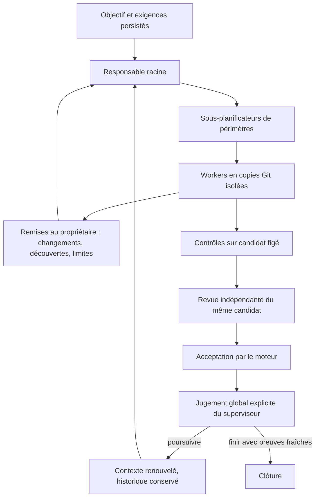
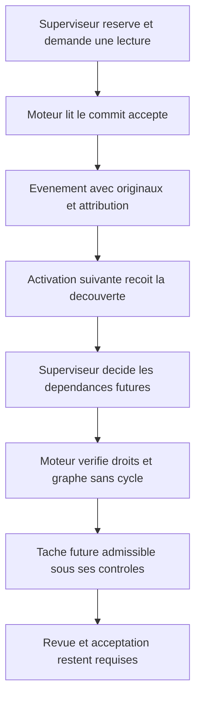
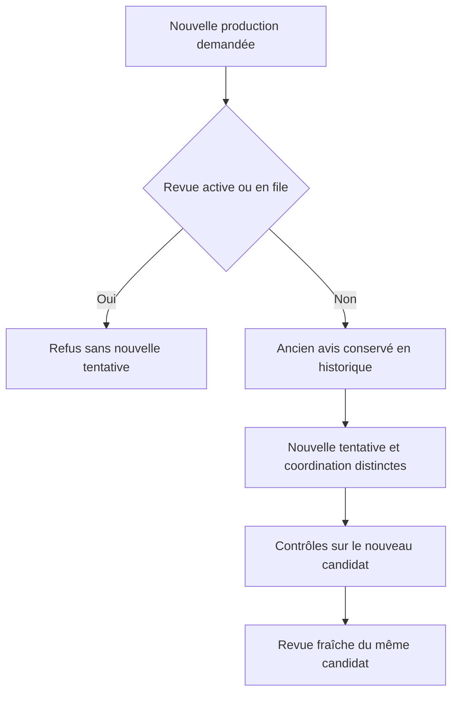
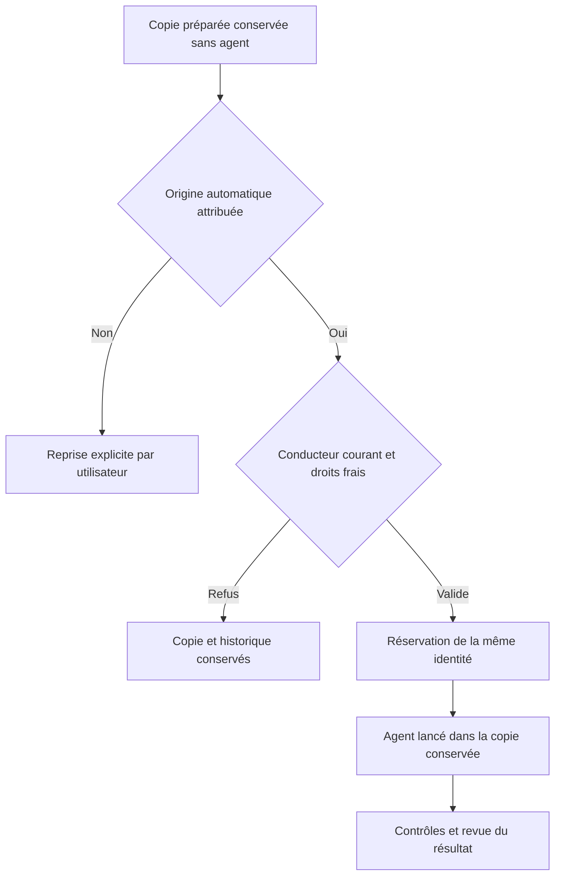
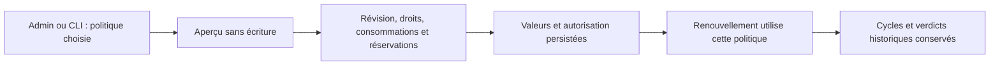
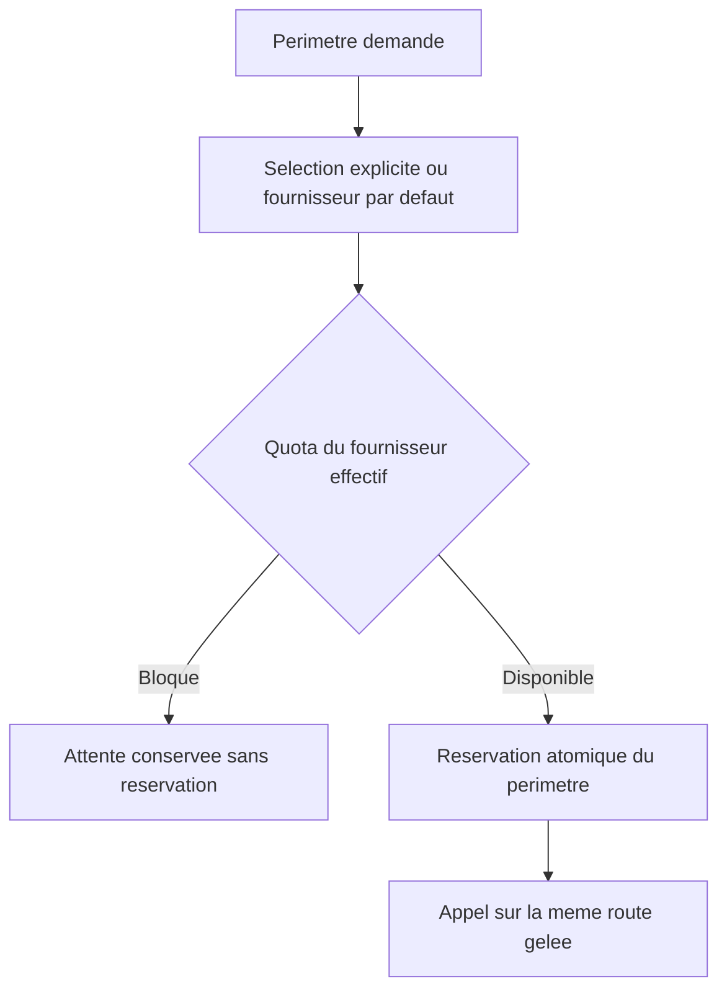

# Évolution du moteur Cursor — lancement APEX du 10 octobre 2026

## Statut et périmètre

Le 12 octobre, l'utilisateur demande de poursuivre le développement directement
dans le dépôt avec Codex seul, sans Claude ni orchestration de la mission par
Swarm. La mission est conservée en pause. Le
[plan de reprise directe](../plans/engine-cursor-contract/developpement-direct-20261012.md)
conserve T1 à T8, les critères et la distinction entre vérification locale,
recette réelle et acceptation historique. Les contrôles restent nécessaires au
développement ; les phases natives ne conditionnent plus ses modifications.

Ce document accompagne le [plan d’évolution](../plans/engine-cursor-contract/evolution-20261010.json).
Il décrit une cible à décider et à implémenter, pas une conformité déjà acquise.
Le [contrat JAN/FEB](CURSOR-ENGINE-CONTRACT.md) conserve les deux publications
Cursor de janvier et février. Le corpus récent, Cursor prioritaire, se trouve
dans les [fiches de recherche](../publications/20261005-cursor-moteur/article-scientifique/fiches-lecture.md).

La préparation initiale `prep-a9d06c4844e9da0563731f85` est conservée. Son
rattachement à `w-fff7368010d114f6e2578985` était incompatible : cette mission
vise une finalisation ciblée depuis un ancien candidat, sans nouvelle exploration
globale. Elle reste intacte, avec ses tâches acceptées et ses compteurs. La présente
évolution constitue un objectif distinct ; elle ne remplace aucune tentative en échec.

## Décision à produire au lot T1

Comparer les cycles explicites et une hiérarchie continue avec points de jugement.
Évaluer correction, reprise, débit, coût, effort et compatibilité des migrations.
Les exigences Swarm de jugement global et de contexte renouvelé restent retenues.
Un juge de cycle et un reviewer de candidat ont des responsabilités différentes.
Les publications récentes constituent des hypothèses à éprouver sur Swarm.

Ce schéma est la cible fonctionnelle. T1 doit préciser les composants existants,
ceux à modifier et les transitions absentes ; les lots suivants actualisent le
schéma avec les opérations et états effectivement implémentés.

Dans les sources actuelles, les opérations racine `judge` et `renew` sont
raccordées au contexte et au schéma réellement reçus, puis vérifiées en fixtures.
Voir [les cycles](JUDGMENT-CYCLES.md), [le parallélisme](AGENT-PARALLELISM.md),
[le déplacement et l'appartenance](PROJECT-RELOCATION.md) et
[l'audit de clôture](../plans/engine-cursor-contract/completion-audit-20261012.md).
La composition réelle avec fournisseur et revue indépendante demeure à démontrer.

## Livrables d’architecture par lot

| Lot | Documentation obligatoire dans le même candidat |
| --- | --- |
| T1 | Matrice JAN/FEB, comparaison, décision, composants, risques et migration |
| T2 | États du juge, identités de cycle, renouvellement, persistance et rejeu |
| T3 | Exploration en lecture, périmètres, concurrence, réservations et budgets partagés |
| T4 | Remises, découvertes, publication, conflits et reprise après interruption |
| T5 | Réglages persistés, API/CLI/Admin FR/EN, provenance et routes de modèles |
| T6 | Scénarios, commandes et mesures, candidat exact, échecs et limites |
| T7 | Recette fournisseur réel, revue indépendante, couverture cumulative |

Chaque lot met à jour ce document et les contrats FR/EN pertinents. Décrire les
valeurs de politique dans la configuration persistée et l’Admin ; ne pas les
introduire en constantes Go. Distinguer limites techniques et choix réglables.

### Concurrence et dépendances

Le [contrat de traçabilité](TRACEABILITY.md) complète cette architecture : preuves
locales et reçus moteur, rôle de chaque superviseur, intégrité et événements
concurrents, avec schémas Mermaid FR/EN.
Le [diagnostic autorécursif](AUTORECURSIVE-RECOVERY.md) précise la boucle de reprise
obligatoire et les contrôles de la méthode elle-même. Les lots T3 à T7 doivent
démontrer son usage et ses effets, pas seulement ajouter des consignes.

Le [contrat de parallélisme des agents](AGENT-PARALLELISM.md) documente les besoins,
les contraintes, l’admission, la supervision et les preuves avec six schémas
Mermaid ; une [version anglaise](../en/AGENT-PARALLELISM.md) l’accompagne.

La mission adoptée reste une chaîne T1 → T7. La
[précision sur le parallélisme](../publications/20261005-cursor-moteur/dossier-recherche/revisions/20261010-parallelisme-plan.md)
demande à T3 de justifier les dépendances et de démontrer une adaptation persistée
du graphe, à T6 de mesurer le chevauchement et le débit, et à T7 de l’observer
avec fournisseur réel. Ces attentes complètent les remises des lots existants ;
elles ne démontrent pas un parallélisme déjà disponible dans cette mission.

## Précondition de lancement corrigée

La reprise après les expirations du vérificateur et du responsable est décrite
dans [le contrat de surveillance d’activité](PROVIDER-LIVENESS.md). Les appels
actifs héritent d’une politique réglable dans Admin ; la durée totale est facultative,
le silence est surveillé et la réservation du responsable est renouvelable.

La conversion publique d’une préparation peut recevoir `organization.repository`
avec `path` et soit `committed_only`, soit `include_dirty` explicite. Elle utilise
le mécanisme Git géré existant : instantané figé et copie distincte par tentative.
Elle exige une validation automatique explicitement autorisée et conserve la
revue indépendante obligatoire. Elle ne committe ni ne modifie le HEAD du dépôt
source. Le plan, l’organisation et le démarrage restent des opérations distinctes.

Les contrôles automatisés assurent les vérifications mécaniques annoncées ;
la revue indépendante doit examiner la couverture sémantique des critères et
refuser les preuves insuffisantes. Un test de régression n’est pas une preuve
d’autonomie ni une recette fournisseur réel. Les échecs historiques de la suite
globale restent visibles ; leurs manifestes ne doivent pas être falsifiés.

## Frontière de preuve entre producteur et vérificateur

Le vérificateur reçoit le contexte composé par le moteur, sans accès aux outils
ni à la copie du producteur. Le [correctif global de transmission des preuves](REVIEW-EVIDENCE.md) joint les
fichiers déclarés dans `delivery.criteria[].evidence`, même inchangés. Le manifeste
`docs/TASK-ID.review-context.json` permet de déclarer ces sources :
`managedReviewSourcesByTask` charge les blobs complets depuis le candidat testé,
avec chemin, objet Git et SHA256 ; `managedReviewContext` les joint dans `sources`.
Les entrées invalides ou trop grandes sont refusées sans troncature. Le
[guide de reprise](../ATTEMPT-RECOVERY.md#donner-au-vérificateur-les-sources-du-candidat)
donne le format et les limites applicables.

Le cas T1 du 10 octobre montre deux refus `unknown` avant une réparation externe
explicite du dossier. La [note de recherche](../publications/20261005-cursor-moteur/dossier-recherche/revisions/20261010-refus-contexte-revue.md)
conserve la chronologie et distingue une source citée d'une source reçue.
`planning revise-recovered-result` enregistre l'acteur, l'arbre examiné, le résultat
remplacé et le refus précédent ; la nouvelle preuve exige de nouveaux contrôles
et une revue fraîche. Les tentatives et plafonds restent inchangés. Cette
réparation manuelle ne prouve pas une récupération autonome par le responsable.

La correction commune du moteur et des consignes est distincte du candidat figé
de la mission. T5 doit intégrer cette correction et vérifier son diagnostic
dans le résultat géré, avec documentation FR/EN. Une transmission complète ne garantit ni
un verdict favorable ni la conformité JAN/FEB.

## Publication et fraîcheur des phases du plan

La [publication des phases du plan](MANAGED-PLAN-GATES.md) corrige également
une acceptation T1 inutilisable par T2 : le moteur doit reprendre les phases
persistées plutôt qu’affecter la livraison à tous les contrôles. La
requalification publique conserve le résultat et les preuves précédentes,
puis exige de nouveaux contrôles et une revue indépendante.

## Extension demandée : observabilité eBPF

L’utilisateur demande d’étudier eBPF pendant le lancement. T1 compare son apport
à l’instrumentation Go existante : attentes d’ordonnancement, activité disque et
réseau, cycle de vie des processus agents. Relier les mesures noyau aux identités
mission/tâche/tentative via les PID, leurs descendants et, si disponibles, les
cgroups. Les décisions du planner, tokens et verdicts restent des événements du
moteur ; les métriques noyau ne permettent pas d’en déduire la réussite.

Cible proposée, à valider par T1 : collecteur Linux optionnel utilisant
[`cilium/ebpf`](https://ebpf-go.dev/), séparé du moteur et relié par un transport
local. Le moteur fonctionne sans collecteur. Documenter capabilities nécessaires,
détection des fonctionnalités, disponibilité BTF selon les sondes, pertes de
mesures, nettoyage des sondes et coût comparé avec/sans collecte. Activation,
sélection des sondes, échantillonnage et rétention sont des politiques persistées
exposées dans Admin FR/EN. Aucune activation privilégiée n’a été effectuée.

Observation locale au lancement : noyau `6.17.0-41-generic`, BTF lisible dans
`/sys/kernel/btf/vmlinux`, session utilisateur UID 1001. Cela ne prouve ni les
permissions de chargement ni la disponibilité de toutes les sondes.
Sources primaires consultées : [présentation eBPF](https://ebpf.io/what-is-ebpf/)
et [guide eBPF en Go](https://ebpf-go.dev/guides/getting-started/).

### T3 : exploration et adaptation des tâches futures

Le planificateur demande une lecture par l’opération `explore`, dans sa décision
réservée : `id` identifie la requête et `deliverable` contient le JSON du mode
`list` ou `read`, le commit accepté exact et le répertoire ou les fichiers.
Le moteur lit l’arbre Git immuable, puis conserve dans un événement les sources
entières, leurs empreintes, le périmètre, la génération et la révision observée.
Il ne lance aucune commande proposée par l’IA et ne modifie pas le dépôt.
Le planificateur reçoit ces originaux lors d’une activation suivante.

La capacité provient du transport existant du rôle, après ses méthodes et ses
instructions effectivement transmises. Il n’existe pas de nouveau plafond de
lecture arbitraire : une pièce entière hors capacité est refusée avec sa cause.
La lecture complète doit être transmissible avant la décision persistée ; une
source attachée n’est ni comprise ni validée par ce seul fait. Une nouvelle base
acceptée rend les anciennes découvertes historiques, sans effacer leurs octets.

`revise-dependencies` permet au superviseur de modifier uniquement les dépendances
d’une tâche future `todo`, sans tentative et dans son périmètre. Le tableau est
explicite, y compris vide. Le moteur vérifie le graphe sans cycle, les identités,
le bail, l’absence de processus et de préparation déjà réservés pour cette tâche.
Les critères, exigences, budgets et résultats des autres tâches restent intacts ;
l’ancien et le nouveau graphe sont attribués dans un événement. Modifier l’ordre
ne vaut jamais acceptation du résultat dont la dépendance a été retirée.

Deux sous-superviseurs peuvent détenir des baux différents simultanément.
Chaque décision conserve son périmètre et sa génération ; la transaction atomique
conserve les compteurs propres, ceux des ancêtres et le budget partagé. Les
régressions font chevaucher deux vrais sous-processus de fournisseurs déterministes,
vérifient les réservations, le refus d’un troisième créneau hors budget, la pause,
le rejeu et la conservation après réouverture. Elles ne prouvent pas l’autonomie
de deux fournisseurs IA réels ; cette recette reste à T7.

Cette évolution T3 a été développée et qualifiée en copie isolée, puis composée
dans le dépôt courant avec le juge développé en T2. Les contrôles du candidat
T3 ont réussi, mais sa revue indépendante n'a pas abouti : sa présence dans le
code ne vaut pas acceptation de T2 ou T3. Le dernier état public observe T3
dépendante de T1, T4 dépendante de T2 et T3, et la mission en pause à la révision
839. La reprise directe conserve ces preuves historiques.

### Revue et identité d'une nouvelle tentative

Une nouvelle production archive l'avis précédent, conserve les dépenses et
réinitialise la coordination de revue propre à l'ancien candidat. Une revue
encore active ou en file interdit cette nouvelle production. Pour les anciens
états qui ont conservé un avis courant par erreur, le précontrôle reconnaît
uniquement un avis terminé lié à une tentative antérieure de la même tâche.
Une lecture d'inventaire reste sans écriture ni appel ; l'archivage accompagne
ensuite une décision ou une réservation validée dans sa transaction.

Une tentative inconnue, un avis inachevé ou celui de la tentative actuelle reste
bloquant. L'avis historique ne devient jamais une preuve favorable du nouveau
candidat. Le journal d'une réparation retrouve son avis par producteur et
tentative, même après archivage, sans le rétablir comme revue courante.

### T4 : reprendre une préparation automatique conservée

Le [contrat de parallélisme](AGENT-PARALLELISM.md) décrit également la conservation
anticipée d'un résultat terminé pendant la revue d'un autre candidat : les
gardes sont partagées, le résultat est immuable et la publication reste exclusive.
Ce gain de remise est vérifié en fixture concurrente avec détection de courses ;
il ne constitue pas une mesure de débit avec fournisseurs réels.

Le conducteur peut reprendre une copie préparée dont la réservation d'agent n'a
pas abouti, uniquement lorsque la demande sauvegardée porte une origine
automatique et un conducteur identifié. Il conserve l'identifiant de lancement,
les fichiers de la copie, les paramètres gelés et la référence Git. Le conducteur
courant doit posséder un bail frais ; une reprise après redémarrage peut donc
changer son identité sans transformer l'origine en demande de l'opérateur.

La reprise passe par les mêmes vérifications transactionnelles que le lancement :
mission autorisée, mode autonome, pause, droits, fournisseur, créneaux, budget,
dépendances et contrat de la copie. Une préparation de l'opérateur reste soumise
à `resume-launch`. Une intention ancienne sans conducteur attribuable exige
aussi une reprise explicite. Un refus conserve la copie et ne crée ni agent,
tentative ni dépense. Le journal de lancement distingue le conducteur de
l'opérateur local.

Les régressions emploient une base isolée et un fournisseur déterministe. Elles
prouvent la reprise de réservation et son attribution, pas l'autonomie d'une IA
réelle. La mission historique reste en pause pendant le développement direct.

### T5 : politique de cycles réglable

Le [contrat de jugement global](JUDGMENT-CYCLES.md), disponible en FR/EN,
documente la liaison entre contexte reçu, opérations structurées `judge`/`renew`,
décision sous bail et nouvelle activation. La racine décide ; le moteur conserve
et applique sous ses contrôles, sans jugement implicite ni remise à zéro.

Le plafond de cycles du juge global est enregistré dans `JudgeState.MaxCycles`.
Il est visible et modifiable depuis **Admin → Réglages du moteur** et la vue
des budgets. `GET /api/v1/quotas` et `quotas show` exposent les mêmes valeurs,
consommations, bornes techniques et dernière autorisation ; aperçu et application
utilisent la révision commune de la mission. `limits.judge_cycles` omis conserve
la valeur existante, une valeur positive fixe un plafond, `0` signifie aucun
plafond de cycle. Les plafonds d'appels et de dépenses restent distincts.

Une nouvelle mission n'hérite plus d'un plafond implicite de vingt cycles. Les
missions existantes conservent exactement leur configuration. Une modification
ne rembourse ni cycle ni appel, ne supprime aucun verdict et ne relance aucun
agent. Elle est refusée si un responsable ou une revue détient encore sa
réservation, si la révision est périmée ou si un plafond positif est inférieur
au nombre de cycles déjà ouverts. La restauration utilise le même aperçu et
les valeurs historiques, sous ces vérifications courantes.

Le schéma de stockage 32 protège cette sémantique et les valeurs avant/après
de l'autorisation contre un ancien décodeur. La migration sauvegarde la base et
ne réécrit aucun corps de mission. Elle a été vérifiée sur une base isolée ;
aucune migration de la mission historique n'est déduite du développement.

### Réservation et fournisseur effectif du superviseur

Après une sélection explicite de modèle sur un périmètre, le contrôle de quota
de la réservation utilise ce fournisseur effectif, comme le lancement. Un délai
du fournisseur par défaut ne bloque pas un autre fournisseur choisi ; le délai
du fournisseur réellement choisi interdit la réservation sans consommer de budget.
La sélection d’un sous-superviseur reste propre à son périmètre. Le fournisseur
par défaut, les autres délais, les compteurs et les réponses historiques demeurent
intacts. Un replay de réservation déjà appliquée ne crée aucun nouvel appel.

Le défaut est reproduit sur une base isolée avant correction : réservation
refusée sur le mauvais fournisseur et réservation autorisée malgré le délai du
fournisseur choisi, pour racine et enfant. Les six variantes de sélection/héritage
et les régressions de quotas/modèles passent. Ce constat local ne certifie ni
la disponibilité du compte alternatif ni la reprise native de T3.

