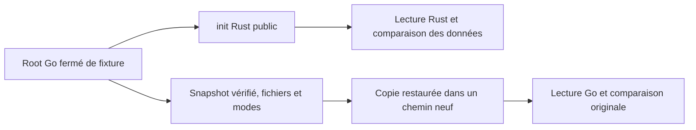

# Initialisation d’un Root Go pour Rust

La commande publique `bin/swarm --root /chemin/du/projet init` initialise les
réglages Rust et applique ses migrations SQL à un Root existant. Elle ne constitue
ni un départ d’agents ni une reprise de leurs permissions ou processus.
Sans ce passage, un Root Go sans fichier de réglages Rust refuse l’ouverture :
ce refus ne prouve pas une perte des travaux.

La recette `tests/rust_cutover_go_root.py` crée un Root Go37 inerte avec un travail,
une tâche et un budget, le sauvegarde à froid, puis utilise le binaire Rust explicitement fourni (preuves233 et238). Dix assertions
vérifient les lectures publiques, le JSON du travail, toutes les colonnes SQL
existantes, les réglages créés et la restauration dans un chemin neuf, relisible
par Go avec les données originales. Ce sont des données de recette, pas des
missions utilisateur ni une migration d’autorité.

L’outil `tools/rust-migration/cutover_snapshot.py` est réservé aux fixtures fermées
possédées par l’appelant : aucun écrivain, WAL ou SHM. Il vérifie les octets et
modes et refuse les liens/objets spéciaux. Il ne découvre ni n’arrête les écrivains,
ne sauvegarde pas une application vivante et ne remplace aucun Root existant.
La restauration conserve les données historiques ; elle ne transfère aucun lien
physique d’exécution, identité authentifiée ou droit courant.

Le retour vérifié ici précède toute écriture métier Rust après conversion.
Il ne qualifie pas un downgrade conservant de nouvelles écritures, des agents
actifs, une sauvegarde en ligne ou un retour arrière en production. Ces critères
restent distincts de cette preuve R6 bornée et de la bascule du service local.

Le banc reçoit explicitement `SWARM_CUTOVER_GO_BINARY` et
`SWARM_CUTOVER_RUST_BINARY` via la recette permanente
`tools/verification/recipes/go-rust-closed-cutover.json`. Le binaire Go sert
uniquement d’oracle local de vérification ; il n’est jamais installé comme
moteur actif. Aucune limite temporelle globale n’est ajoutée au banc.
