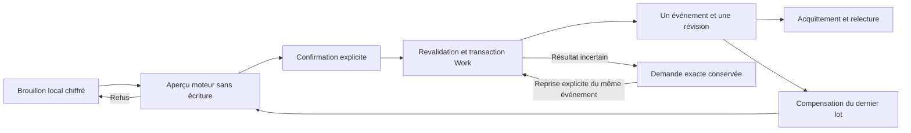
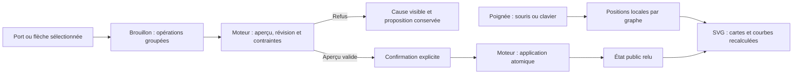

# Atelier du graphe

## Raccordement Rust

Le cockpit natif utilise `web/cockpit-native-graph.js` sur les vrais objets Work.
Le parcours métier natif décrit ci-dessous concerne les **plans manuels**.
Une mission hiérarchique conserve son parcours de révision de contrat : le lot
ne contourne ni ses rôles ni le refus existant de création manuelle de tâches.
Le zoom (boutons ou Ctrl + molette), la vue d’ensemble, le déplacement du fond,
les poignées souris/clavier des cartes, l’orientation et le plein écran sont des
préférences de présentation. Les positions sont locales à l’origine HTTP, à la
mission et à l’orientation ; elles ne modifient ni révision ni budget. Échap
annule un déplacement en cours avant de fermer le plein écran. Ce dernier est
un dialogue modal natif : focus contenu et retour au bouton à la fermeture.

« Analyser et sélectionner » propose trois sections repliables exclusives :
« Lire une branche », « Comparer deux tâches », « Déplacer un groupe ».
Appliquer un filtre ou activer la sélection referme le panneau pour rendre la
surface au graphe ; le résultat et la sélection restent visibles dans le flux.
Cette lecture locale est destinée aux analystes :

- **Isoler la branche** conserve la tâche choisie, ses prérequis et ses dépendants
  transitifs. Les tâches sœurs sont masquées, sans recalculer le placement.
- **Montrer les chemins** conserve l’union des chemins orientés du départ à
  l’arrivée, dans le sens prérequis→tâche. Deux extrémités identiques isolent une
  carte ; aucun chemin conserve la vue précédente avec un message explicite.
- **Voir tout le graphe** restaure les cartes et liens. La mini-carte, la recherche
  et l’export suivent le filtre ; le cadrage inclut les seules cartes visibles.
- **Sélectionner plusieurs cartes** transforme temporairement l’activation des
  cartes (clic, Entrée ou Espace) en sélection. Le texte liste les identifiants,
  un contour à motif et l’état accessible distinguent les cartes choisies.
  Quitter ce mode conserve le groupe ; **Effacer la sélection** le vide.
  Déplacer la poignée d’une carte sélectionnée, au pointeur ou avec les flèches,
  translate le groupe sans déformer son placement. Une poignée non sélectionnée
  déplace sa carte seule. Le groupe est clampé à l’origine, sans coordonnées
  négatives. Échap pendant le geste annule tout le groupe ; undo/redo s’appliquent
  au groupe terminé. Hors geste, Échap quitte le mode sélection avant le plein écran.

Filtrer annule le geste provisoire et vide la sélection pour éviter de déplacer
des cartes masquées. Filtre et sélection restent éphémères au nouveau rendu et
ne modifient aucune tâche, lien, révision ou autorisation. L’aperçu métier par lot
reste distinct de ces filtres de lecture. Le parcours permanent
`tests/rust_graph_analyst_ui.cjs`, appelé par la recette native, couvre ces règles,
FR/EN, thèmes, clavier/pointeur et mobile ; son graphe diamant est une fixture de
projection locale, jamais une preuve de mutation moteur.

### Brouillon multi-tâches, aperçu et annulation métier

**Brouillon multi-tâches** ouvre un atelier distinct du graphe confirmé. Préparer
ou modifier une tâche ajoute seulement une proposition. **Dupliquer** copie
identifiant vierge, titre, livrable, critères et prérequis ; statut, preuves,
modèle, budget et habilitations ne sont pas copiés. Dans l’éditeur individuel,
**Dupliquer la tâche** prépare également une nouvelle tâche à confirmer. Un identifiant déjà utilisé dans le plan ou le brouillon est refusé sans convertir l’ajout en modification ; la saisie reste disponible.

**Prévisualiser le lot** appelle le moteur sans modifier le Work ou son journal.
L’aperçu expose les définitions complètes avant/après, notamment tous les liens
et critères. Un refus invalide l’aperçu précédent ; un cycle reste explicite.
**Appliquer explicitement** revalide contenu, révision, droits et activité dans
une transaction, puis enregistre un seul événement et une seule révision pour
tout le lot. Les nouvelles tâches peuvent se référencer entre elles. Un échec
ne doit jamais transformer la moitié du lot en succès. Aucune commande ne lance
un agent ou ne change un budget.

Le brouillon local est chiffré AES-GCM, avec une clé dérivée de la session et
jamais conservée dans le stockage ; l’origine, le Work et la session isolent
la préférence. Le stockage conserve uniquement l’enveloppe chiffrée versionnée,
son nonce technique et le texte authentifié. Une rotation de session peut rendre
un ancien brouillon illisible. Un refus de stockage/crypto reste visible et
conserve l’original. L’application garde sa demande exacte avant l’envoi ; si
cette sauvegarde échoue, aucun nouveau lot n’est envoyé depuis cet atelier.

Un seul atelier peut modifier le même brouillon par origine, Work et session.
Un Web Lock refuse immédiatement le second onglet ; fermer l’atelier libère
la protection. Une proposition est acceptée seulement après sauvegarde locale ;
un refus conserve la saisie du formulaire. La copie locale reste gérée par le
navigateur, sans garantie de sauvegarde serveur. Un navigateur sans Web Locks ou
crypto refuse explicitement cet atelier.

Après une réponse perdue, les modifications du brouillon sont gelées.
**Reprendre la même demande sans doublon** exige un geste explicite et réutilise
le même événement et le même contenu. Le moteur relit le résultat enregistré
ou revalide la demande ; aucun nouvel événement n’est inventé pour contourner
un conflit. Une erreur d’enregistrement/fermeture n’est pas une preuve de rollback.
L’acquittement distingue révision appliquée, Work actuellement relu et replay.

**Options du brouillon → Actualiser la base** relit explicitement le plan en
conservant les propositions. Les définitions de départ sont remplacées par les
observations courantes, qui doivent être examinées dans un nouvel aperçu. Un
identifiant ajouté entre-temps ou une tâche disparue bloque cette reprise : retirer
ou renommer la proposition est nécessaire. Cette action n’applique rien.

**Prévisualiser l’annulation du dernier lot** demande au moteur une compensation
dérivée de l’événement réellement enregistré. Elle exige qu’aucun autre événement
n’ait changé le Work. Les définitions antérieures sont proposées ; une tâche
nouvelle n’est retirée que si elle est encore vierge et sans historique d’agent.
Les preuves invalidées ne sont jamais réactivées. L’application de l’annulation
ajoute une révision et un événement ; l’historique original demeure. Il n’y a
pas d’undo arbitraire d’une ancienne mission ni de chaîne de rétablissements métier.

Les définitions du lot sont complètes : titre et livrable ne peuvent être vides
ou blancs. Le moteur refuse ces valeurs sans mutation ; un champ vide ne signifie
jamais « conserver l’ancien ». L’aperçu doit correspondre au candidat réellement
appliqué, y compris pour une compensation.

### Contrat natif CLI/API

Le format natif est distinct des anciens `graph_drafts` Go, dont les tables et
documents restent inchangés. Les lignes persistées `graph_draft_authorizations`
restent respectées : prepare/apply indépendants, scopes des tâches modifiées et
révocation actuelle, y compris au replay. En l’absence de ligne, le comportement
historique d’opérateur local s’applique ; cette identité observée n’est ni une
authentification distante ni un confinement contre le propriétaire OS.

- `POST /api/v1/graph-batch/preview` et `/apply` exigent session/CSRF et le même
  datastore ouvert, avec un corps `{ "work": "ID", "request": REQUEST }`.
- `./bin/swarm task graph-preview WORK --input batch.json --json` et
  `task graph-apply WORK --input batch.json --json` utilisent la même préparation
  et transaction. Les deux commandes natives rendent du JSON structuré.
- `REQUEST` contient `schema_version:1`, `event_id`, `expected_revision`, `changes`,
  `undo_of` et `preview_digest` (ces deux derniers sont des chaînes vides par défaut).
  Chaque changement est `{before,after}` ; une définition contient exactement
  `id,title,deliverable,criteria,depends`. Un ajout a `before:null`. Un retrait
  arbitraire est refusé ; une annulation fournit `undo_of` avec `changes:[]`.
- L’aperçu renvoie `work,revision,changes,preview_digest,no_implicit_launch:true`.
  Appliquer réutilise le digest exact, lié au contenu, candidat, révision et droits.
  L’acquittement renvoie `work,event_id,applied_revision,replayed` ; le Work peut
  être plus récent lors d’un replay et n’est pas présenté comme un ancien snapshot.
- Champs inconnus/dupliqués et types invalides sont refusés. Les limites de
  transport et de critères proviennent des paramètres existants ; aucun plafond
  secret de taille de lot, tentative ou délai n’est ajouté.
- Les motifs publics sont statiques (cycle, autorisation, base périmée…). SQL,
  fichiers privés et causes de nettoyage ne deviennent pas des diagnostics de
  formulaire. Les erreurs conservant un effet connu restent distinctes des refus.

« Outils du graphe » regroupe rangement, undo/redo, repérage, orientation,
réinitialisation de navigation et export. Il est replié par défaut sur mobile,
déplié sur ordinateur ; passer le breakpoint existant réapplique ce défaut.
Sa fermeture et Échap rendent le focus à son titre. Zoom, recherche, ajout et plein
écran restent dans la barre principale. Le bouton 100 % conserve le centre de la
vue sous clamp ; +/− sont désactivés aux bornes de 15 % et 200 % existantes.

La vue d’ensemble utilise aussi l’étendue des cartes déplacées ; à la limite de
zoom minimale existante (15 %), un message demande de rapprocher les cartes.
« Annuler le placement » restaure le dernier déplacement terminé ou rangement,
une seule fois. « Rétablir le placement » récupère cette annulation, une fois ;
un nouveau placement terminé invalide ce témoin. Geste annulé ou sans mouvement
le conserve. Undo/redo disparaissent au nouveau rendu ; les coordonnées restaurées
sont mémorisées localement et ne modifient aucune tâche.
La mini-carte affiche la zone visible : cliquer centre la vue, les flèches
parcourent un demi-écran, Début revient à l’origine et Fin à l’extrémité.
Le bouton **ID** copie l’identifiant exact sans ouvrir le formulaire. Le succès
attend l’accord du presse-papiers ; un refus ou une API indisponible laisse
l’identifiant en lecture seule, sélectionné, sans annoncer de copie réussie.
« Aide des gestes » ouvre une modale nommée, avec titre, contenu défilable et
fermeture visible, aussi au-dessus du plein écran. Fermer ou Échap rend le focus
au bouton d’aide sans fermer le graphe. Les titres et libellés de carte sont abrégés à 24 unités UTF-16
pour ménager les commandes ; leur texte complet reste dans l’infobulle.

La recherche par identifiant ou titre ignore la casse et les accents. Elle met
en évidence les correspondances sans masquer de carte ou de lien ; Entrée ou
« Suivant » centre la correspondance suivante et place le focus sur sa carte.
« Précédent » ou Maj+Entrée dans la recherche parcourt les résultats à rebours,
avec retour au dernier résultat depuis le premier.
« Effacer la recherche » ou Échap dans la saisie efface les repères. Le zoom et
les positions restent identiques ; la requête est locale, non enregistrée, et
repart vide lors d’un nouveau rendu. Une absence de résultat est explicite.

Le zoom Ctrl + molette conserve le point sous le curseur ; les bornes de zoom
et les limites natives du défilement continuent de s’appliquer. Les rerenders du
même travail conservent en mémoire orientation, zoom, positions, zone visible et
plein écran, y compris le défilement extérieur du studio sur écran bas. Un glisser inachevé reste provisoire, y compris pendant un zoom :
sa capture est exclue de la mémorisation et annulée lors du rerender. Le plein écran attend la fermeture de l’éditeur pour ne pas masquer
le formulaire pendant la relecture. Le focus de la tâche enregistrée ne décale
pas la zone restaurée. Orientation, zone du canevas/studio et ouverture des outils
sont mémorisées dans une préférence locale versionnée par travail et origine ;
zoom et positions gardent leur format existant par orientation. Après rechargement,
la vue est restaurée sous les clamps disponibles, sans ouvrir le plein écran.
Un autre travail retrouve sa propre préférence. JSON invalide ou stockage refusé
restent visibles ; un refus ne vaut pas mémorisation. « Réinitialiser la navigation »
efface cette préférence et revient à gauche→droite/origine ; zoom et placements
gardent leurs commandes dédiées.

« Repérer les dépendances » choisit une carte : contour plein pour la cible,
tirets pour ses prérequis directs, pointillés pour ses dépendants directs et
liens concernés renforcés. Le statut écrit les identifiants de chaque groupe ;
aucune carte ni flèche n’est masquée. « Effacer le repérage » retire ces repères.
Le repérage repart vide au nouveau rendu.
Le formulaire propose une recherche littérale titre/ID sans casse ni accents.
Les prérequis sélectionnés restent visibles hors filtre et sont récapitulés ;
un filtre sans correspondance est annoncé et ne supprime aucun choix. Échap
efface une recherche non vide ; Échap suivant ferme le formulaire. Entrée dans
ce filtre ne soumet pas le formulaire de tâche.

« Exporter le SVG » demande au navigateur un fichier `swarm-graph.svg` local.
Il conserve placement, liens, libellés et palette calculée, avec fond du thème,
sans poignées, ports, boutons ou ressource externe. Il peut être ouvert hors de
l’application ; la grille du canevas et la mini-carte ne font pas partie du SVG.
Le téléchargement n’effectue aucun POST et n’emporte pas la session. Le statut
annonce la demande de téléchargement, pas une confirmation d’écriture du fichier.
Un échec de génération reste visible et permet une nouvelle demande explicite.
Un caractère non représentable en XML est refusé sans modifier le travail.

« Ajouter une tâche » et l’activation d’une carte ouvrent le formulaire de tâche.
Titre, livrable, critères et prérequis sont enregistrés explicitement par
`/api/v1/action` (`task-add` → `task.add`, `task` → `task.update`). Le moteur garde
les contrôles de session/CSRF, Root lié, révision, activité, références et cycles.
La mini-carte reflète les cartes déplacées. Relier une sortie à une entrée
(souris ou clavier) prépare les prérequis de la destination dans le formulaire ;
activer un lien ou Suppr prépare son retrait. Ces gestes ne sauvegardent rien.
La sélection des prérequis ajoute ou retire des liens pour une seule tâche.
Les champs restent visibles après refus ; un résultat incertain interdit une
nouvelle soumission jusqu’à fermeture et actualisation. Le succès exige une
relecture protégée, puis attend que le cockpit ait rechargé ses observations
avant de fermer le formulaire. Le bouton et une zone de statut annoncent
« Enregistrement en cours… » jusqu’à la fin de cette relecture et de
l’actualisation. Après un refus ou une issue incertaine, cet état d’attente
disparaît et le diagnostic reste visible ; une issue incertaine garde le
renvoi désactivé. Aucun agent ne
démarre. Sur un plan géré, les refus du moteur restent applicables.

La recette native est `tests/rust_graph_navigation.py --binary bin/swarm
--output DOSSIER_NEUF --editing`. Sans `--editing`, elle vérifie que tous les
gestes de présentation laissent le Work identique. `--workspace-preview` est
réservé à l’itération : son overlay ne prouve pas les ressources embarquées.

**Limite de migration :** les brouillons atomiques par lots, leur aperçu moteur
et l’annulation/rétablissement historique ne sont
pas encore raccordés au cockpit Rust. Le contrat historique ci-dessous reste
la cible pour ces capacités ; il ne décrit pas leur disponibilité native.
Preuves et critères ouverts : [reprise APEX](../plans/migration-rust/GRAPH-REGRESSION-20261031.md).

### Déplacer les cadres et modifier les liens

Glisser directement le corps d’une carte déplace son placement local. Un clic
sans mouvement ouvre sa tâche ; la poignée et ses flèches clavier restent
disponibles, y compris pour le groupe sélectionné. Échap annule le déplacement
provisoire et Annuler le placement restaure le précédent. Aucun déplacement
ne modifie le Work. Les icônes des outils complètent leurs textes ; les couleurs
viennent des paires sémantiques du thème, avec une légende des états.

Sur mobile, zoom, recherche et plein écran utilisent des icônes compactes dont
le nom accessible et l’infobulle conservent le libellé. Les actions principales
gardent leur texte pour laisser une surface de graphe utilisable.

**Ajouter une tâche** ouvre le formulaire existant. Renseigner identifiant, titre,
livrable, critères et prérequis puis Enregistrer ; le moteur vérifie révision,
droits et cycles. **Brouillon multi-tâches** reste l’option pour préparer un lot.

Relier une sortie à une entrée prépare un lien dans ce même formulaire. Cliquer
une flèche ouvre **Modifier un lien** : choisir un autre prérequis ou **Retirer
ce lien**, puis vérifier et enregistrer le formulaire suivant. Entrée/Espace
sur la flèche ouvre cette modale ; Suppr prépare directement son retrait.
Aucune de ces préparations ne sauvegarde avant Enregistrer. Le déplacement du
fond ignore cartes et flèches pour ne pas capturer leurs gestes.

## Atelier historique et cible restante

Le cockpit permet d'ouvrir le graphe en plein écran, de déplacer les cartes et de
préparer des modifications de liens. Le placement visuel et les dépendances ont
deux contrats distincts. `web/graph-studio.js` réutilise le rendu SVG/Dagre local,
les préférences du pilotage et le brouillon public existant ; aucune bibliothèque
externe ni opération privée de stockage n'est ajoutée.

## Utilisation

- **Plein écran** agrandit l'atelier. Échap revient au cockpit ; le bouton retrouve
  le focus. L'inspecteur de tâche reste accessible au-dessus du graphe.
- La poignée **Déplacer la carte** fonctionne au pointeur et avec les quatre
  flèches du clavier. Échap annule un geste en cours. **Ranger les cartes** efface
  les positions personnalisées pour retrouver le placement automatique.
- Les positions sont mémorisées dans ce navigateur par projet, mission et
  orientation. Elles survivent au rechargement mais ne sont pas partagées entre
  utilisateurs ; un échec de stockage est visible. Elles ne changent ni révision,
  ni tâche, ni réservation, ni lancement d'agent.
- Les ports indiquent entrée et sortie. Tirer un port vers une autre carte
  prépare une dépendance. Au clavier, activer une sortie puis une entrée offre
  le même parcours. Le brouillon reste modifiable avant application.
- Sélectionner une flèche montre ses deux tâches et les commandes de retrait ou
  de changement d'extrémité. **Suppr** prépare son retrait. Une reconnexion
  prépare un seul lot : retrait du lien original et ajout du nouveau.
- **Prévisualiser**, puis **Appliquer explicitement** passent par le moteur.
  Aucun déplacement, port ou raccourci ne confirme implicitement ce lot.

## Frontières et reprise

Le moteur reste la source de vérité pour les tâches et relations. Les endpoints
`/api/v1/graph-drafts`, `/preview` et `/apply` contrôlent identité, révision,
activité, dépendances et cycles. Un refus conserve le graphe confirmé et la
proposition ; les commandes d'application restent indisponibles sans aperçu
valide. Si l'enregistrement du brouillon échoue, une ancienne version enregistrée
ne peut pas être prévisualisée à la place de la proposition visible. La reprise
explicite relit la révision et recrée le brouillon ; elle n'applique rien.

Les flèches sont des courbes cubiques entre ports, adaptées à l'orientation.
L'utilisateur peut déplacer des cartes pour dégager une route. Ce tracé ne prétend
pas résoudre automatiquement toutes les intersections d'un placement arbitraire.
Le zoom, la recherche, les branches et le déplacement du canevas sont conservés.
Les couleurs de rôles et d'états utilisent les paires sémantiques partagées,
complétées par les libellés ; poignée, ports et sélection ont un focus visible.

## Recette et limites

`tests/graph_studio_ui.cjs` utilise le CLI, le serveur candidat et Chromium sur
racines isolées : plein écran/focus, clavier, pointeur et annulation, persistance,
création/retrait/reconnexion, cycle refusé sans mutation, inspecteur et mobile,
FR/EN et deux thèmes. Aucun fournisseur n'est appelé. Le garde
`tests/graph_studio_test.cjs` couvre notamment un enregistrement refusé suivi de
la récupération. Les vérifications de charge utilisent le harnais existant et
restent des mesures locales ; elles ne prouvent ni autonomie ni coût fournisseur.

Cette livraison de sources ne met pas à jour automatiquement le serveur natif.
Voir [le plan de livraison](../plans/engine-cursor-contract/graphe-ux-20261012.md)
pour les preuves liées au candidat et les critères encore non démontrés.
