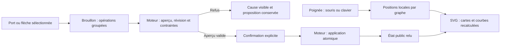

# Atelier du graphe

Le cockpit permet d'ouvrir le graphe en plein écran, de déplacer les cartes et de
préparer des modifications de liens. Le placement visuel et les dépendances ont
deux contrats distincts. `web/graph-studio.js` réutilise le rendu SVG/Dagre local,
les préférences du pilotage et le brouillon public existant ; aucune bibliothèque
externe ni opération privée de stockage n'est ajoutée.

## Utilisation

- **Plein écran** agrandit l'atelier. Échap revient au cockpit ; le bouton retrouve
  le focus. L'inspecteur de tâche reste accessible au-dessus du graphe.
- La poignée **Déplacer la carte** fonctionne au pointeur et avec les quatre
  flèches du clavier. Échap annule un geste en cours. **Ranger les cartes** efface
  les positions personnalisées pour retrouver le placement automatique.
- Les positions sont mémorisées dans ce navigateur par projet, mission et
  orientation. Elles survivent au rechargement mais ne sont pas partagées entre
  utilisateurs ; un échec de stockage est visible. Elles ne changent ni révision,
  ni tâche, ni réservation, ni lancement d'agent.
- Les ports indiquent entrée et sortie. Tirer un port vers une autre carte
  prépare une dépendance. Au clavier, activer une sortie puis une entrée offre
  le même parcours. Le brouillon reste modifiable avant application.
- Sélectionner une flèche montre ses deux tâches et les commandes de retrait ou
  de changement d'extrémité. **Suppr** prépare son retrait. Une reconnexion
  prépare un seul lot : retrait du lien original et ajout du nouveau.
- **Prévisualiser**, puis **Appliquer explicitement** passent par le moteur.
  Aucun déplacement, port ou raccourci ne confirme implicitement ce lot.

## Frontières et reprise

Le moteur reste la source de vérité pour les tâches et relations. Les endpoints
`/api/v1/graph-drafts`, `/preview` et `/apply` contrôlent identité, révision,
activité, dépendances et cycles. Un refus conserve le graphe confirmé et la
proposition ; les commandes d'application restent indisponibles sans aperçu
valide. Si l'enregistrement du brouillon échoue, une ancienne version enregistrée
ne peut pas être prévisualisée à la place de la proposition visible. La reprise
explicite relit la révision et recrée le brouillon ; elle n'applique rien.

Les flèches sont des courbes cubiques entre ports, adaptées à l'orientation.
L'utilisateur peut déplacer des cartes pour dégager une route. Ce tracé ne prétend
pas résoudre automatiquement toutes les intersections d'un placement arbitraire.
Le zoom, la recherche, les branches et le déplacement du canevas sont conservés.
Les couleurs de rôles et d'états utilisent les paires sémantiques partagées,
complétées par les libellés ; poignée, ports et sélection ont un focus visible.

## Recette et limites

`tests/graph_studio_ui.cjs` utilise le CLI, le serveur candidat et Chromium sur
racines isolées : plein écran/focus, clavier, pointeur et annulation, persistance,
création/retrait/reconnexion, cycle refusé sans mutation, inspecteur et mobile,
FR/EN et deux thèmes. Aucun fournisseur n'est appelé. Le garde
`tests/graph_studio_test.cjs` couvre notamment un enregistrement refusé suivi de
la récupération. Les vérifications de charge utilisent le harnais existant et
restent des mesures locales ; elles ne prouvent ni autonomie ni coût fournisseur.

Cette livraison de sources ne met pas à jour automatiquement le serveur natif.
Voir [le plan de livraison](../plans/engine-cursor-contract/graphe-ux-20261012.md)
pour les preuves liées au candidat et les critères encore non démontrés.
