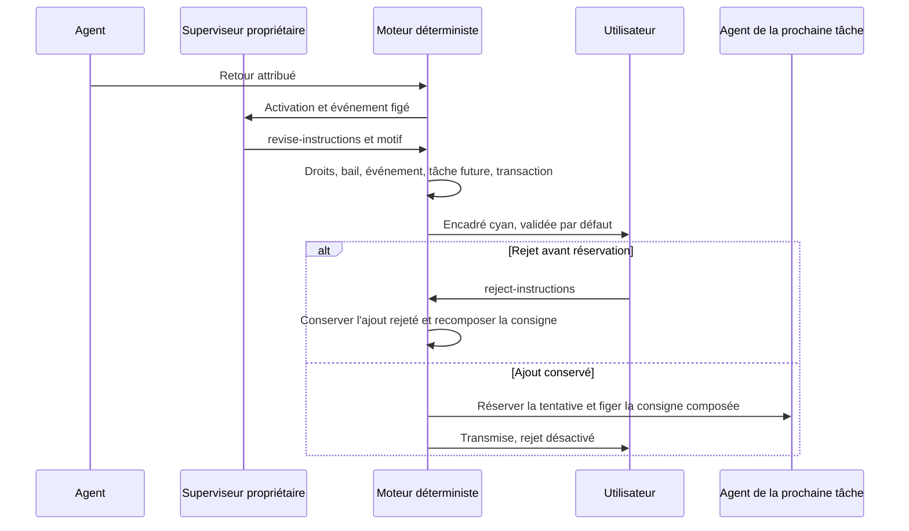

# Amélioration récursive des consignes

Un retour d’exécution peut révéler une précaution utile pour une prochaine tâche.
Le superviseur ou sous-superviseur propriétaire propose `revise-instructions`
avec l’ID d’une tâche `todo`, un ajout dans `next` et le motif dans `reason`.
La décision doit traiter un événement réellement reçu dans son activation.
Le moteur n’invente pas cet apprentissage : il contrôle et applique la décision.

L’ajout est **validé par défaut**. Dans l’inspecteur de tâche, un encadré cyan
« Consignes améliorées » montre le texte, son état, le motif, le responsable et
la date. Un bouton **Rejeter** retire cet ajout des consignes futures et conserve
son historique. Il n’y a pas de confirmation préalable à l’application. La
validation concerne la consigne ; les critères et l’acceptation du résultat
restent soumis aux contrôles existants.

## Droits et état contrôlés

- Seul le propriétaire exact peut réviser une tâche future de son périmètre.
  Une tâche de sous-superviseur et une tâche déjà en production sont refusées.
- Bail, détenteur, génération, révision et événements reçus sont ceux de la
  décision habituelle ; droits et quotas de planification restent inchangés.
- `revise-instructions` accepte seulement `kind`, `id` et `next` ; les autres
  champs du schéma IA restent vides ou nuls. La borne de protocole existante
  de 2 000 octets s’applique à l’ajout. Elle n’est pas un délai d’arrêt.
- Titre, livrable, critères, dépendances, limites, tentatives et preuves restent
  conservés. Une addition identique déjà enregistrée, y compris rejetée, est refusée. La décision entière
  est atomique : une autre opération invalide annule tous ses effets.
- Réservation d’une tentative et révision/rejet partagent la transaction et la
  révision du travail. Une session queued/starting/running/stopping interdit
  la modification. En concurrence, une seule mutation gagne ; l’autre doit
  relire l’état actuel. Une simple absence de processus affiché ne suffit pas.

## Historique et transmission

`instruction_base` conserve la consigne initiale ; `instruction_revisions`
conserve les additions, décision, périmètre, détenteur, génération, IDs des
retours, motif, date, état et empreintes avant/après. Les additions actives sont
composées avec l’original, la plus récente en premier dans le contexte borné du
planificateur. Le prompt du producteur reçoit la consigne composée complète,
y compris avec un profil de lancement propre à la tâche.

Lors de la réservation, `used_by_attempt` relie les ajouts actifs à la tentative
qui les reçoit. Le bouton est ensuite désactivé : un rejet n’efface jamais un
contexte déjà transmis. Une nouvelle révision doit rester fondée sur l’état
actuel ; un changement manuel intervenu hors du registre n’est pas écrasé.
Le rejeu de la même commande restitue le reçu, sans nouvel ajout ni nouvel appel.

Les ajouts opérateur transmis par `task.update` à une tâche future conservent
les apprentissages actifs dans une composition séparable. `instruction_base`
reste l’original immuable ; `instruction_operator_base` contient la base
opérateur actuelle, tandis que l’événement public conserve le texte demandé.
Rejeter un apprentissage retire seulement cet ajout, en conservant les entrées
opérateur et les autres apprentissages. Les empreintes historiques ne changent
pas. Un ancien préfixe opérateur suivi de la composition complète reconnue est
réconcilié à la prochaine mutation ; une modification ambiguë reste refusée.
Cette reprise ne réécrit aucun contexte déjà réservé par un agent.

Le parcours opérateur public est `planning reject-instructions WORK --input ...`
ou `POST /api/v1/planning?work=WORK&action=reject-instructions`, avec
`schema_version`, `event_id`, `expected_revision`, `task_id`,
`instruction_revision_id` et `reason`. Le rejet ne consomme pas une décision IA. Un événement `instruction_rejected`
est adressé au propriétaire : le refus doit orienter sa prochaine décision.
L’UI attend le succès serveur et affiche les refus, sans simuler un rejet réussi.
Un refus reçu est affiché immédiatement dans la carte courante, même si la
relecture du snapshot est lente. L'état du retour local participe au cache de
l'inspecteur : une tâche inchangée ne doit pas conserver un ancien « Rejet en
cours… ». Le bouton retrouve son admissibilité après relecture ; une révision
périmée impose une nouvelle décision de l'utilisateur, sans rejeu automatique.

## Lien avec le RETEX

Après la recette, le [parcours produit](../PRODUCT-WORKFLOW.md) offre un
RETEX et des quick wins. L’utilisateur choisit les évolutions du projet ; leur
préparation est distincte des ajouts de consigne appliqués par défaut. La
récursivité ne crée aucun droit, agent, budget ou acceptation implicite.
