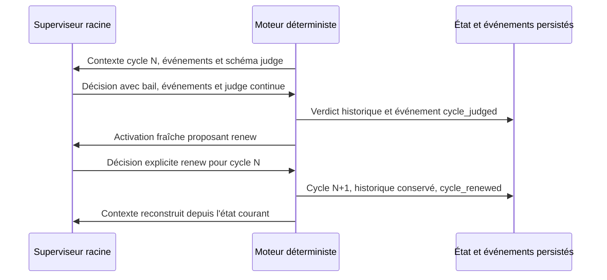

# Jugement global et renouvellement des cycles

[English](../en/JUDGMENT-CYCLES.md)

Le superviseur racine décide si l'objectif doit continuer ou se terminer. Ce
jugement porte sur le cycle et ses preuves cumulées ; la revue indépendante
examine chaque candidat. Un verdict global ne remplace ni les contrôles ni cette
revue et ne crée aucune acceptation de tâche.

## Contrat reçu et décision

Le contexte racine contient `global_cycle` (identité, verdict courant, politique
et nombre d'enregistrements historiques) et `cycle_operations` (actions admissibles).
Le schéma fourni au modèle propose `judge` avant le verdict, puis `renew` après
`continue`, si la politique de cycles le permet. Les sous-superviseurs ne reçoivent
pas ces opérations globales. Le numéro de cycle proposé est celui du reçu.

Une décision de cycle contient une seule opération. Comme les autres décisions,
elle utilise `input_events`, `reason`, le bail du superviseur, sa génération et
les révisions courantes. Le moteur revalide ces données dans l'opération publique
`planning decide` ; le schéma fournisseur facilite une réponse admissible mais
ne constitue pas une autorisation.

Exemple d'opération pour poursuivre :

```json
{"kind":"judge","judge_cycle":1,"judge_verdict":"continue","expected_candidate":""}
```

Après ce verdict, le superviseur peut proposer :

```json
{"kind":"renew","judge_cycle":1}
```

Le verdict et le renouvellement restent deux décisions distinctes. Le moteur
n'en déduit pas l'une de l'autre. Les champs relatifs aux tâches ou à la délégation
sont refusés dans ces opérations ; les champs de cycle sont refusés dans les
autres opérations.

## Effet durable et contexte neuf

Le verdict public direct `planning judge` ne peut pas traiter `input_events` : ces entrées sont refusées sans mutation. Il exige des retours déjà acquittés pour terminer. Pour examiner et acquitter les retours tout en proposant `end`, le superviseur utilise `planning decide` avec un bail valide et une seule opération `judge`. La validation des entrées, la clôture et leur acquittement partagent la même transaction ; le moteur ne déduit jamais leur traitement d’une simple liste fournie au verdict direct.



`continue` conserve le verdict et produit un événement `cycle_judged` pour la
racine. `renew` marque le cycle précédent renouvelé, augmente son identité,
vide seulement le verdict, le motif et l'attestation courants, puis produit
`cycle_renewed`. L'objectif, les exigences, résultats, incidents, tentatives,
compteurs et paramètres restent conservés. La prochaine activation reçoit le
nouveau cycle et les entrées actuelles, sans retraitement des événements acquittés.

`JudgeState.MaxCycles` est une politique persistante accessible dans la modale
Admin et les opérations publiques `quotas`. `0` signifie aucun plafond de cycle.
Les budgets d'activation, décision et fournisseur continuent à s'appliquer ;
renouveler ne les réinitialise pas et n'autorise pas un appel supplémentaire.

## Fin et refus

Un `judge` avec verdict `end` doit attester le candidat courant dans
`expected_candidate`. Le moteur vérifie toutes les preuves fraîches requises,
les enfants clos, les événements reçus/traités et l'absence de processus actif.
La décision structurée explicite ferme alors le juge et le périmètre racine.
Un blocage, un budget vide ou la fin d'un processus ne déclenche jamais cette
décision à la place du superviseur.

Un cycle ancien, un verdict déjà donné, un renouvellement sans `continue`, une
pause, un bail périmé, des champs incompatibles ou une preuve insuffisante
refusent la mutation. Le rejeu du même événement restitue le même résultat sans
nouveau verdict, événement, consommation ou cycle. Les commandes publiques
`planning judge` et `planning renew` conservent leur contrat existant ; la
liaison décrite ici concerne les opérations proposées par le superviseur dans
`planning decide`.

## Preuves et limites

Les tests `planning_judge_operations_test.go` exercent décision, rejeu après
réouverture, contexte reçu, sous-périmètre, entrées invalides, pause et fin avec
preuve fraîche ou processus actif. Un sous-processus fournisseur déterministe
reçoit le schéma, renvoie les décisions, puis reçoit le contexte du cycle 2 via
`planningStep`. Ce parcours prouve la transmission et l'effet du protocole ;
il ne mesure pas la qualité de jugement ni l'autonomie d'une IA réelle.
La mission historique est conservée en pause ; aucun déploiement n'est déduit de
ces contrôles. Voir le [plan de développement direct](../plans/engine-cursor-contract/developpement-direct-20261012.md).
