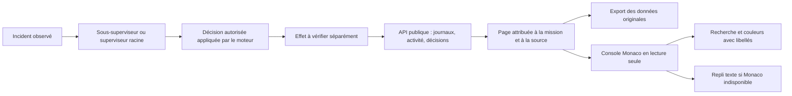

# Console des journaux

La console se trouve dans **Suivi → Journaux** de la mission sélectionnée.
Monaco, déjà embarqué et servi localement, affiche les données en lecture seule.
Les erreurs sont rouges, les avertissements ambre, l’activité cyan et les succès
explicitement enregistrés verts. Le niveau écrit accompagne toujours la couleur.
Les deux thèmes utilisent les jetons sémantiques de Swarm.

Le [contrat de lecture dense](../DENSE-TEXT.md) complète la console : accès à un
événement, précédent/suivant, prochain signal, espacement et retour à la ligne.
La navigation manuelle met le suivi en pause par un message de cadre vérifié.
Les repères des clés JSON et valeurs viennent du thème ; originaux, recherche,
filtres et export restent indépendants de cette mise en forme.

Les sources restent distinguées : sorties d’une tentative, activité du moteur,
incidents et décisions des superviseurs. Une décision enregistrée et un incident
acquitté ne prouvent ni une correction réussie ni l’achèvement du travail. Les
motifs, identités, opérations et états courants viennent des API publiques.
La console n’exécute aucune commande et n’accepte aucun résultat.

`Ctrl+F` recherche dans la console affichée. La recherche des sorties d’une
tentative utilise le filtre serveur ; celle du journal d’activité du moteur
s’applique à la page chargée, ce qui est indiqué dans l’interface. Les curseurs
et limites d’historique restent visibles. Le suivi peut être mis en pause pour
lire ; l’export conserve la réponse originale de l’API, sans reconstruire une
preuve à partir de la coloration.

La console est isolée dans un cadre de même origine, authentifié par la session.
Les messages sont vérifiés par origine et fenêtre émettrice. Les styles dynamiques
de Monaco utilisent un nonce propre au cadre ; la politique de scripts et celle
du cockpit restent inchangées. Le contenu fourni par un agent reste du texte.

La recette isolée `tests/log_console_ui.cjs` doit vérifier les données reçues,
couleurs, langues, thèmes, clavier, filtres, changement de source/mission,
direct, export, refus réseau et repli texte. Aucun appel de modèle réel n’est
nécessaire pour cette recette ; elle ne démontre pas l’autonomie des superviseurs.

Une console masquée conserve la page de messages reçue mais ne calcule pas son rendu Monaco. Un `ResizeObserver` reprend le rendu dès que le conteneur a une largeur et une hauteur positives ; le contenu n’est ni perdu ni rejoué. Cette frontière évite les mesures de lignes sur des plages DOM absentes. La recette du graphe couvre cinq rechargements avec console cachée ; la recette de console couvre son ouverture et ses filtres.

Ce même observateur possède aussi le redimensionnement : `automaticLayout` de
Monaco est désactivé, car son observateur interne mesurerait les retours à la
ligne malgré la garde de `render()`. L’accessibilité et les retours à la ligne
restent actifs. `tests/log_console_visibility_ui.cjs` vérifie la navigation hors
des journaux, les changements de largeur pendant leur masquage, puis le retour
à une console lisible avec les données originales et sans erreur de console.
