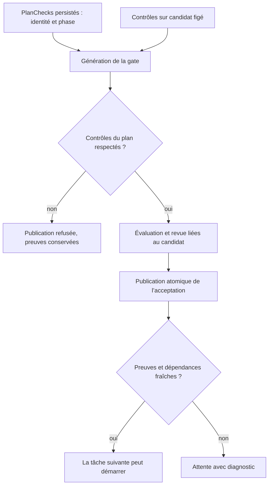

# Phases du plan et publication d’un candidat géré

Le 10 octobre 2026, T1 de la mission `w-ca937edf4e0abd85f8d3d67b` était
`accepted` après ses contrôles et sa revue indépendante, mais T2 restait en
attente : `acceptedFresh` refusait sa dépendance. La publication gérée avait
attribué `delivery` à tous les contrôles. Le plan importé exigeait pourtant
`entry` pour `plan-entry`, `validation` pour `plan-validation` et les critères,
et `delivery` pour `plan-delivery`. Une évaluation mécanique verte ne suffit
donc pas à rendre une acceptation utilisable.

## Contrat corrigé

`integrateManagedAttempt` reprend la phase de chaque contrôle dans le
`Task.PlanChecks` persisté. Les tâches historiques sans cette correspondance
conservent leur phase de livraison. Avant publication, `requiredPlanChecks`
vérifie les identités, les phases et le caractère obligatoire des contrôles.
Une divergence interrompt la transaction ; le candidat et l’acceptation ne
sont pas publiés. Aucune nouvelle politique de délai ou de budget n’est ajoutée.

## Reprise d’une acceptation déjà affectée

L’opération publique `planning requalify` accepte également une gate incompatible
avec les contrôles du plan, lorsqu’un avis indépendant `passed` existe. Elle
exige `confirm_recovery`, l’identité exacte de cet avis, la révision courante,
le producteur, sa tentative, son résultat et le candidat attendu. Elle conserve
les autres protections : processus terminé, aucun agent ni revue actif,
responsable sans réservation, disponibilité du vérificateur, contrôles autorisés
et budget restant. Une acceptation fraîche ou une confirmation inadéquate est
refusée sans changement.

La reprise retire la validité courante et archive la gate, les contrôles et
l’avis précédents. Elle réserve une nouvelle clé de preuve. Le conducteur
relance les contrôles et une revue indépendante sur le résultat conservé, sans
nouvel exécutant ni remboursement de tentative. Ce nouvel appel est décompté
du budget de revue existant. Le rejeu du même événement est idempotent.

Le diagnostic et la requalification de T1 sont une intervention explicite dans
la mission existante ; ils ne démontrent pas une reprise autonome du superviseur.
Le [plan Cursor](CURSOR-ENGINE-EVOLUTION-20261010.md) conserve les lots suivants
et l’obligation de recette indépendante cumulative.

## Vérification

`TestManagedImportedPlanPhasesProduceFreshAcceptance` reproduisait avant
correction une tâche `accepted` dont les preuves empêchaient sa dépendante de
progresser. Après correction, cette même tâche satisfait `acceptedFresh` avec
une seule tentative et un seul appel de revue.

`TestRequalifyExplicitManagedPlanPhaseMismatch` vérifie la reprise d’une ancienne
gate fautive, le refus sans confirmation ou avec un autre avis, le refus d’une
acceptation fraîche, les nouveaux contrôles et avis, les compteurs conservés,
le résultat retenu, l’intégrité de l’ancien reçu et le rejeu idempotent.
Ces tests utilisent des racines temporaires et un fournisseur déterministe ;
ils ne constituent pas une recette de qualité du modèle réel.
