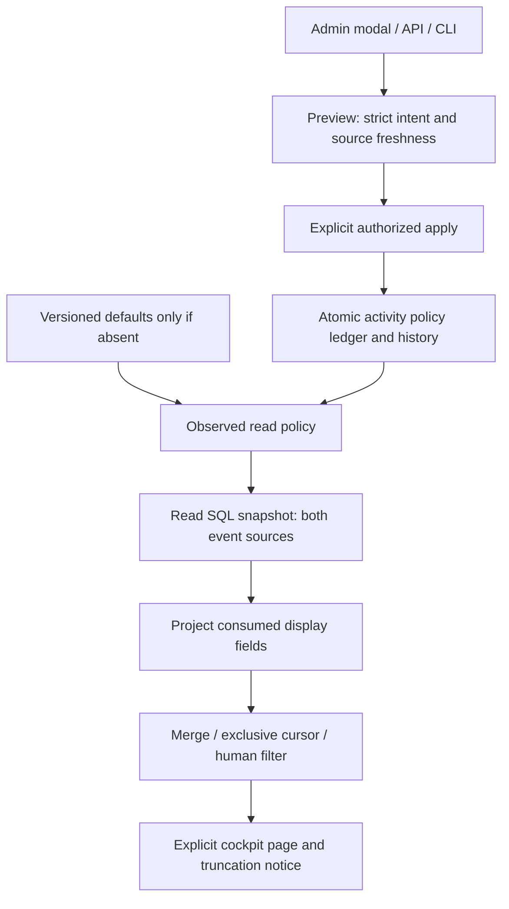

# Fil d’activité natif

Groupe G1 : GET/HEAD `/api/v1/activity?work=WORK&before=CURSOR&limit=N&decisions=0|1` et `activity show WORK --input QUERY.json --json`. Le fichier de requête impose schema_version1 ; curseur, limite et filtre sont facultatifs. Lecture explicite dans le cockpit, suite explicite, aucun polling. Les entrées sont des observations historiques ; « vous »/« moteur » sont des catégories déduites du type et du payload, jamais une identité authentifiée, une preuve d’autonomie ou une validation du travail.

Les sources cockpit_events et events sont lues par séquence décroissante dans une transaction SQL en lecture, puis fusionnées par `at|rank` décroissant. Le rang conserve le préfixe de source et la largeur minimale Go12 ; les valeurs signées ou plus larges restent comparées lexicalement. Le curseur complet est exclusif. Le filtre humain conserve uniquement origin=vous. `more` exige une entrée éligible supplémentaire ; next_cursor est vide sinon. Le drapeau history_truncated signale qu’une source contient une ligne au-delà de la limite observée, même si le filtre ne retourne aucune entrée. Les données TEXT/BLOB sont décodées selon les remplacements UTF-8/UTF-16 Go pour les chaînes ; un champ consommé de type invalide échoue au lieu du fallback trompeur Go. Les charges historiques sont polymorphes : huit chaînes nécessaires à l’affichage sont projetées, sans imposer Request à un résultat de revue dont criteria contient des objets. Les champs non consommés ne sont pas jugés comme une commande ou une autorisation.

## Réglage persistant et parcours

La source absente expose explicitement les valeurs versionnées de `config/activity-policy.json` : page_default_rows50, page_max_rows200, source_max_rows500. Une source présente invalide est une erreur ; aucun repli. Le fichier privé activity-policy.json porte révision et historique. Il est accessible par `run-limits activity show|history|preview|apply`, `/api/v1/activity-policy`, `/preview`, `/apply`, et la modale Administration → Pagination du fil d’activité. Aperçu sans écriture, confirmation explicite, sauvegarde atomique avec sauvegarde précédente, relecture du reçu et de la source. Un résultat incertain exige une relecture ; aucune répétition automatique.

Le défaut doit être positif ; le maximum de page doit couvrir ce défaut. Null signifie sans plafond pour les deux maxima ; `unlimited` le représente dans la modale. Zéro source ne lit aucun payload mais recherche le témoin de troncature. Limite de requête absente ou zéro choisit le défaut enregistré ; une demande supérieure au maximum enregistré est ramenée à ce maximum uniquement. Les entiers exacts JSON/JavaScript et usize sont des contraintes de représentation, pas un second choix opérateur. La même borne sauvegardée agent_provider_config_max_bytes encadre source et historique sérialisé, affichée dans les réglages moteur. Modifier une limite ne modifie aucun agent, budget ni historique de mission.

Requête de changement : schema_version1, event_id valide, expected_revision, values contenant les trois choix obligatoires (null permis pour les maxima), reason non vide, preview_token facultatif liant intention/source/réglages/instance. CAS et conflit événement refusent409 ; entrée invalide400 ; erreur de source500. Rejeu exact retourne l’état courant sans nouvelle écriture. Les doublons et champs inconnus des objets natifs refusent. Le lecteur exige une mission existante (404 au lieu de la liste vide Go). Les paramètres HTTP inconnus/doublons et nombres non canoniques refusent400 ; le curseur opaque utilise le décodage form_urlencoded. Le fichier de politique et le snapshot SQL ne sont pas conjointement atomiques : read_policy décrit la révision observée pour cette lecture.

## Preuves et limites

La recette permanente activity-read-rust200 passe trois étapes (public Go/Rust8 groupes, frontière de fenêtre3, navigateur4 FR/EN×thèmes320/1440), intégrité VERIFIED. Le composant de pagination5 tests et Rustdoc/i18n passent. Installation locale200 :23 contrôles et14 assertions Version ; cinq travaux inchangés, également relus avant activation. La lecture réelle198 a révélé les événements de revue polymorphes ; contre-exemple et correction200 conservés. La revue globale reste BLOCKED sur les changements concurrents et issues antérieures. Voir le RETEX dans docs/plans/migration-rust/evidence/20261027-activity-l8z4x8wi/RESULT-RETEX.md.

Une borne de source définit la fenêtre récente entière, pas un quota renouvelé à chaque page. Les pages ne traversent pas cette fenêtre : more=false peut coexister avec history_truncated=true. Pour lire plus ancien, augmenter source_max_rows ou choisir null dans Admin, puis relire la première page. Cette sémantique est celle de Go ; pousser seulement le rang dans SQL changerait l’ordre temporel et la portée du contrat.

Exemple : une mutation peut stocker criteria comme ["preuve"] ; un résultat de revue le stocke comme [{"criterion":"preuve","passed":true}]. Ce sont deux producteurs différents. Le fil ne consomme pas criteria : ce champ ne doit pas rendre sa lecture impossible. title=false, en revanche, invalide un champ consommé et reste une erreur. Prévention : inventorier les producteurs d’un historique avant de réutiliser un DTO de commande ; tester une charge d’un autre producteur et un champ affiché invalide.

