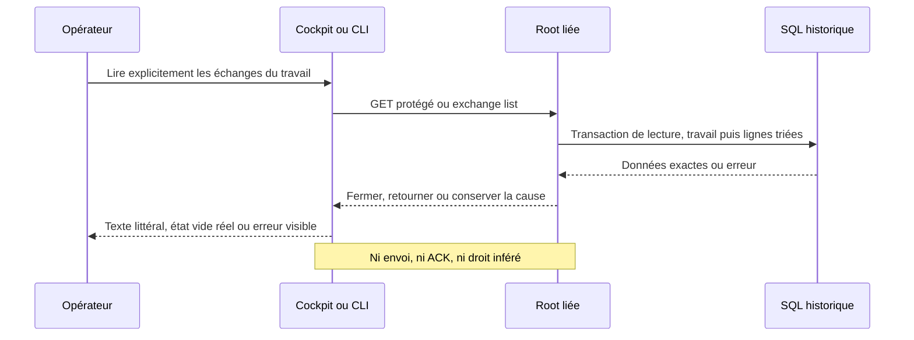

# Lecture Rust des échanges entre agents

Ce lot porte exchange list WORK et GET/HEAD /api/v1/exchanges?work=WORK. Le parcours en lecture est installé et vérifié sur la version locale194 ; les opérations d’envoi/ACK et la clôture globale restent distinctes.

Une transaction de lecture vérifie le travail existant puis lit agent_exchanges, trié par created_at,id. Le même lecteur est utilisé par les entrées historiques du statut de mission ; l’extraction conserve le décodeur d’artifacts Go (null et [] distincts, doublons/valeurs nulles de champs et erreurs de type conservés). Les champs facultatifs vides sont omis comme en Go. Les types SQLite BLOB et TEXT passent par le même décodeur Go ; les octets UTF-8 invalides et les surrogates UTF-16 isolés dans les chaînes deviennent U+FFFD sans effacer les membres dupliqués. Un NULL SQL devient une entrée JSON vide refusée, pas un tableau vide réussi. Aucun nouveau plafond de lignes, délai, rétention ou défaut métier. Le travail inconnu, une source malformée et les erreurs SQL, finalisation, rollback, fermeture ou sortie restent des échecs visibles, jamais une liste vide réussie.

L’API exige une session autorisée, un corps vide et un unique work valide ; les paramètres inconnus ou dupliqués sont refusés explicitement par la validation native. Ce contrat d’entrée stricte ne prétend pas reproduire le comportement ambigu du Get Go sur une query dupliquée. La CLI ouvre la même Root en lecture et termine sa fermeture avant sortie/flush.

Dans le cockpit natif, sélectionner une mission puis ouvrir Échanges entre agents et demander Lire les échanges. Il n’y a ni lecture périodique ni envoi automatique. Le changement de sélection neutralise l’affichage tardif d’une réponse précédente. Le rendu utilise du texte littéral pour les données ; les chemins et empreintes de pièces sont des déclarations, pas des fichiers ouverts ou vérifiés. Une lecture échouée est visible et doit être relancée explicitement ; aucun état vide n’est inventé.

Ce lecteur ne crée, n’envoie, ne consomme et n’accuse réception d’aucun échange ; il ne prouve ni identité de l’agent, ni transmission, ni autorisation, ni progression autonome. Ces décisions et preuves restent soumises aux contrats de supervision et de contrôle du moteur. Les migrations des opérations d’écriture demeurent distinctes.

La vérification HEAD lit les octets TCP réels après un GET valide : le client HTTP habituel masque les corps HEAD et ne constitue pas cette preuve. Le témoin commun refuse un corps effectivement publié, sans borne temporelle ajoutée.

Preuves : recette194 PASS2/intégrité vérifiée (public Go/Rust7 et navigateur4), témoin HEAD TCP5 tests +4 parcours antérieurs, ancien lecteur de statut4 avant/après, installation21 +Version14 et cinq travaux inchangés. Les contenus des travaux/échanges réels sont comparés par empreintes sans conservation dans le nouveau rapport. Revue effective17 fichiers ; trois changements identité/préparation concurrents restent ouverts, sans conformité globale implicite. Voir le RETEX sous docs/plans/migration-rust/evidence/20261027-exchanges-hq2js3us.

