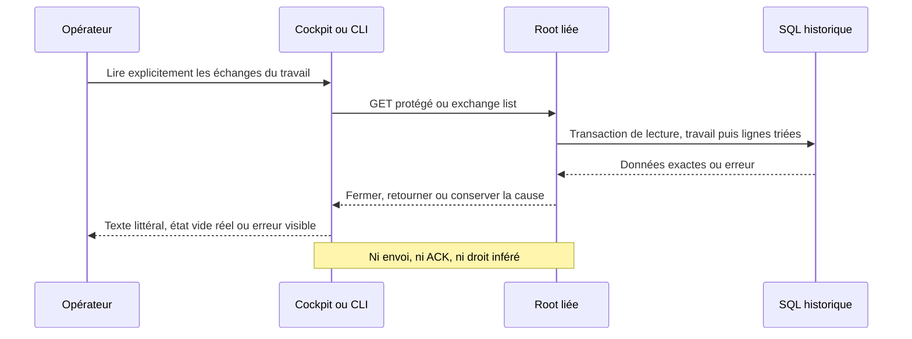
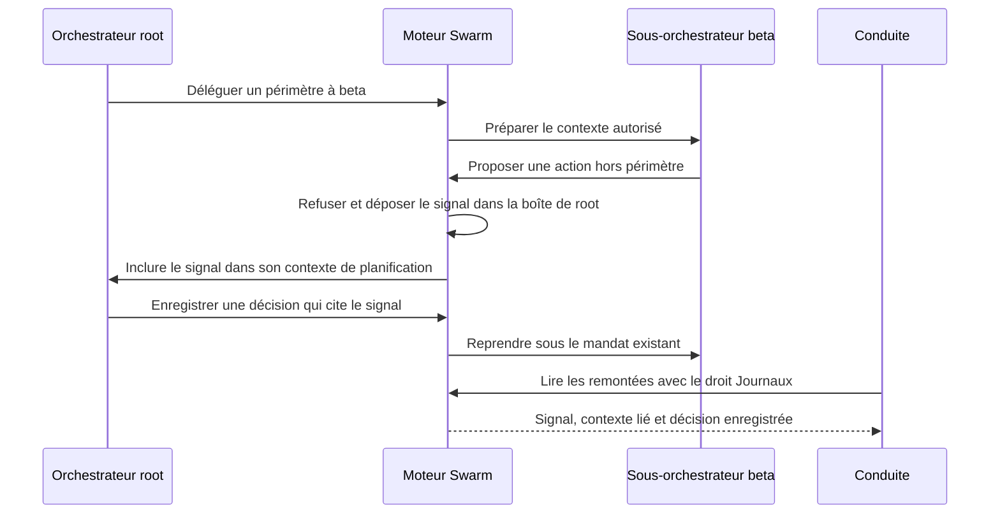
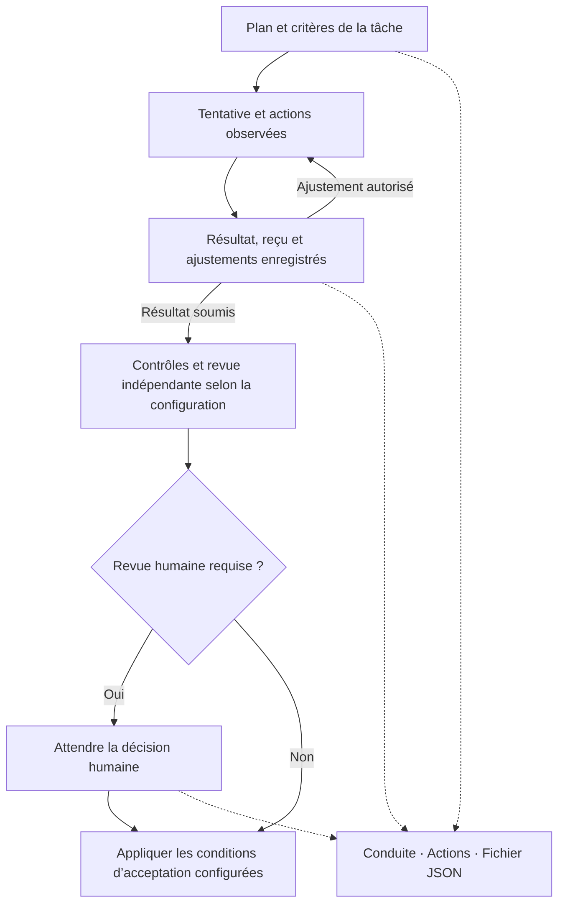
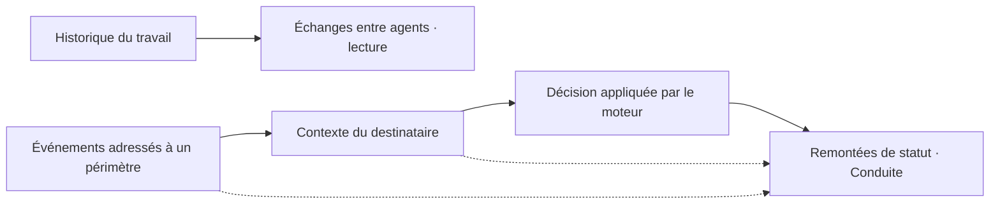
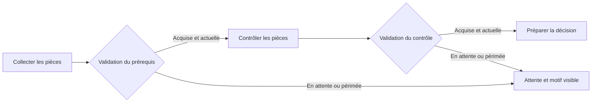
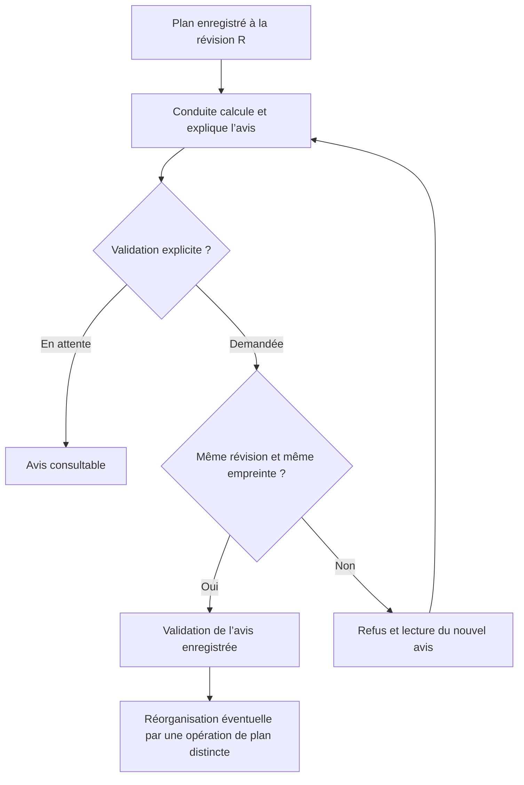
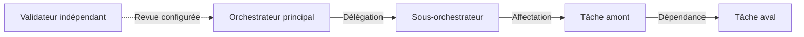

# Lecture Rust des échanges entre agents

Ce lot porte exchange list WORK et GET/HEAD /api/v1/exchanges?work=WORK. Le parcours en lecture est installé et vérifié sur la version locale194 ; les opérations d’envoi/ACK et la clôture globale restent distinctes.

Une transaction de lecture vérifie le travail existant puis lit agent_exchanges, trié par created_at,id. Le même lecteur est utilisé par les entrées historiques du statut de mission ; l’extraction conserve le décodeur d’artifacts Go (null et [] distincts, doublons/valeurs nulles de champs et erreurs de type conservés). Les champs facultatifs vides sont omis comme en Go. Les types SQLite BLOB et TEXT passent par le même décodeur Go ; les octets UTF-8 invalides et les surrogates UTF-16 isolés dans les chaînes deviennent U+FFFD sans effacer les membres dupliqués. Un NULL SQL devient une entrée JSON vide refusée, pas un tableau vide réussi. Aucun nouveau plafond de lignes, délai, rétention ou défaut métier. Le travail inconnu, une source malformée et les erreurs SQL, finalisation, rollback, fermeture ou sortie restent des échecs visibles, jamais une liste vide réussie.

L’API exige une session autorisée, un corps vide et un unique work valide ; les paramètres inconnus ou dupliqués sont refusés explicitement par la validation native. Ce contrat d’entrée stricte ne prétend pas reproduire le comportement ambigu du Get Go sur une query dupliquée. La CLI ouvre la même Root en lecture et termine sa fermeture avant sortie/flush.

Dans le cockpit natif, sélectionner une mission puis ouvrir Échanges entre agents et demander Lire les échanges. Il n’y a ni lecture périodique ni envoi automatique. Le changement de sélection neutralise l’affichage tardif d’une réponse précédente. Le rendu utilise du texte littéral pour les données ; les chemins et empreintes de pièces sont des déclarations, pas des fichiers ouverts ou vérifiés. Une lecture échouée est visible et doit être relancée explicitement ; aucun état vide n’est inventé.

Ce lecteur ne crée, n’envoie, ne consomme et n’accuse réception d’aucun échange ; il ne prouve ni identité de l’agent, ni transmission, ni autorisation, ni progression autonome. Ces décisions et preuves restent soumises aux contrats de supervision et de contrôle du moteur. Les migrations des opérations d’écriture demeurent distinctes.

La vérification HEAD lit les octets TCP réels après un GET valide : le client HTTP habituel masque les corps HEAD et ne constitue pas cette preuve. Le témoin commun refuse un corps effectivement publié, sans borne temporelle ajoutée.

Preuves : recette194 PASS2/intégrité vérifiée (public Go/Rust7 et navigateur4), témoin HEAD TCP5 tests +4 parcours antérieurs, ancien lecteur de statut4 avant/après, installation21 +Version14 et cinq travaux inchangés. Les contenus des travaux/échanges réels sont comparés par empreintes sans conservation dans le nouveau rapport. Revue effective17 fichiers ; trois changements identité/préparation concurrents restent ouverts, sans conformité globale implicite. Voir le RETEX sous docs/plans/migration-rust/evidence/20261027-exchanges-hq2js3us.

Chaque échange expose sa tentative source. Après une lecture réussie, les
boutons de navigation suivent uniquement les identifiants exacts de `reply_to`
présents dans la même réponse Work. Le focus rejoint le titre de l’échange
lié sans lire à nouveau l’API. Une référence absente est signalée et les
identifiants dupliqués font échouer le rendu. L’accusé est présenté comme une
donnée enregistrée, avec une mention explicite en son absence.

Le parcours navigateur `tests/rust_agent_exchanges_browser.py` vérifie les
ressources JavaScript protégées servies par le binaire, les deux sens de
navigation, l’absence de lecture supplémentaire et les états d’erreur, dans
les deux langues et les deux thèmes.

## Supervision et remontées de statut dans Conduite

Le [guide Anthropic *Building Effective AI Agents*](https://resources.anthropic.com/hubfs/Building%20Effective%20AI%20Agents-%20Architecture%20Patterns%20and%20Implementation%20Frameworks.pdf#page=15) décrit la supervision hiérarchique aux p. 15–16, avec délégation, remontée des résultats et contexte dédié. Le diagramme ci-dessous décrit la recette Swarm livrée dans `v0.1.1-dev.410`. Le moteur applique les limites de chaque périmètre. Un retour de worker vise le périmètre auquel sa tâche est rattachée. Dans le scénario d’arbitrage vérifié, le moteur adresse le refus hors périmètre de `beta` à `root`. Le rapprochement des événements de planification est accessible dans **Conduite → Équipe et validation → Remontées de statut**. Le lecteur d’échanges présenté plus haut conserve son propre accusé enregistré.

| Indication | Trace utilisée |
| --- | --- |
| **Transmis** | Dépôt canonique dans la boîte du destinataire, avec heure, message et identifiant. |
| **Reçu dans le contexte** | Inclusion du même signal dans un contexte de planification enregistré pour le destinataire. Son empreinte est vérifiée et le contexte est relié à l’activation. |
| **Traité** | Décision appliquée du destinataire qui cite le signal. Une décision peut l’acquitter sans opération et l’acceptation du travail suit ses propres contrôles. |

La lecture protégée `GET /api/v1/agent-logs/orchestration-signals?work=WORK` rapproche ces preuves dans une transaction de lecture. Elle rend explicite l’absence de preuve pour un signal en attente. Le contexte brut reste privé. La recette a observé l’arbitrage, la reprise de `beta` et l’état intermédiaire où le contexte existe alors que la décision est en attente. Le code de clôture dépose aussi un signal au parent. Sa recette s’est arrêtée dans le fournisseur de test avant l’émission et reste à rejouer. [Plan et recette APEX](../plans/ORCHESTRATION-SIGNALS-APEX.md) · [Intégration et contrôles](https://github.com/mo0ogly/swarm/pull/69).

### Profondeur et gestion du contexte

Le code autorise un sous-orchestrateur à déléguer à un enfant dans les limites de son mandat, de ses budgets et de la profondeur configurée. Le contexte d’une activation contient les tâches et les événements de son périmètre. Un worker remet son résultat à son périmètre. La clôture produit un signal adressé au parent immédiat. Le refus d’autorité qui demande un arbitrage est adressé à `root`. La recette APEX ci-dessus a exercé une délégation à un niveau. Elle laisse ouverte la validation de bout en bout d’une chaîne à plusieurs niveaux, clôture et synthèse finale comprises.

Le planificateur propose des opérations structurées comme `delegate` et `task`. Le moteur valide ces opérations et planifie les activations. Il prépare les événements en lots selon le plafond configuré et refuse un contexte qui dépasse son plafond en octets. Les contextes et références de rapports enregistrés permettent une lecture ultérieure. L’édition automatique d’une conversation en fonction de sa taille en jetons, la mémoire autonome du modèle et un routage direct des échanges utilisateur vers un spécialiste restent non établis. Ces limites précisent le rapprochement avec les variantes et conseils du guide Anthropic, p. 15.

## Boucle de travail, preuve et revue

Le [guide Anthropic](https://resources.anthropic.com/hubfs/Building%20Effective%20AI%20Agents-%20Architecture%20Patterns%20and%20Implementation%20Frameworks.pdf#page=11) décrit la boucle planifier, agir, observer et ajuster, avec possibilité de s’arrêter pour revue humaine (p. 11–12). Il présente également l’évaluateur–optimiseur comme une boucle de raffinement (p. 21–22). Dans Swarm, les contrôles, le rôle de vérificateur indépendant et la revue humaine relèvent des conditions configurées pour le travail. Le schéma résume ce parcours documenté et la place des traces consultables.

Le fichier JSON de la tâche est une lecture du plan, des tentatives et des ajustements enregistrés. Il indique l’attente d’une acceptation humaine lorsqu’elle est requise. Les actions visibles dépendent des événements d’outil et des reçus disponibles. Voir [le guide de Conduite](../../GUIDE-UTILISATEUR.md#ouvrir-le-fichier-dactions-dune-tâche) pour l’ouverture du fichier et les limites d’observation.

## Collaboration entre pairs

Le [guide Anthropic, p. 16–18](https://resources.anthropic.com/hubfs/Building%20Effective%20AI%20Agents-%20Architecture%20Patterns%20and%20Implementation%20Frameworks.pdf#page=16) décrit une coordination qui émerge entre spécialistes. Son exemple d’intelligence concurrentielle combine répartition du travail, recoupement des découvertes et synthèse collective. Le tableau indique la portée vérifiée dans Swarm Rust `v0.1.1-dev.410`.

| Mécanisme | Portée vérifiée |
| --- | --- |
| Échanges directs | La CLI et le cockpit lisent les messages, les réponses liées et les accusés déjà enregistrés. Les commandes historiques d’envoi et de consommation appartiennent au contrat Go. |
| Coordination par événements | Le moteur prépare des contextes à partir des événements adressés à un périmètre. La remontée `beta → root` et la reprise après décision sont vérifiées en recette de supervision. |
| Conversation collective et négociation des rôles | Capacité non établie sur le moteur livré. |
| Tableau noir partagé en lecture et écriture | Capacité non établie. L’historique d’un travail donne accès à ses échanges enregistrés. |
| Recoupement et synthèse entre pairs | Le scénario complet du guide reste à démontrer, y compris la résolution des désaccords et l’arrêt des échanges. |

## Workflows séquentiels

Dans **Conduite → Graphe des tâches**, les dépendances dirigées permettent de définir une séquence à l’avance, par exemple **Collecter → Contrôler → Préparer la décision**. Le moteur vérifie l’état des prérequis et la fraîcheur des preuves applicables. Si la revue humaine est exigée sur un prérequis, son premier résultat ne suffit pas à ouvrir l’étape suivante. Une dérogation motivée suit le contrat de validation applicable. Chaque flèche reste consultable dans le graphe.

Cette structure correspond aux dépendances prédéfinies du [guide Anthropic, p. 18–19](https://resources.anthropic.com/hubfs/Building%20Effective%20AI%20Agents-%20Architecture%20Patterns%20and%20Implementation%20Frameworks.pdf#page=18). L’ordre et les conditions de départ sont contrôlés par le moteur. Le contenu produit par un agent peut varier. Un planificateur autorisé peut proposer une nouvelle tâche avec des dépendances dans son périmètre, sous les contrôles du moteur. Cela couvre l’adaptation du plan par décision enregistrée. Le routage déclaratif général du type « si le score dépasse X, choisir B, sinon C » reste non établi pour le graphe des tâches. Voir [l’architecture produit et les modèles de travail](../PRODUCT-ARCHITECTURE.md#précision--modèles-de-cadrage-et-modèles-de-travail).

### Exemple — analyse de données

L’exemple du [guide Anthropic, p. 19](https://resources.anthropic.com/hubfs/Building%20Effective%20AI%20Agents-%20Architecture%20Patterns%20and%20Implementation%20Frameworks.pdf#page=19) se traduit en plan de travail par **Cadrer → Préparer les données → Analyser → Remettre le rapport**. Chaque tâche nomme l’intrant qu’elle attend, le livrable qu’elle produit et les critères d’acceptation. La dépendance règle l’éligibilité de la tâche suivante. L’accès effectif au fichier ou à la source de données relève aussi du dossier d’exécution et des droits configurés.

Le contrôle de l’analyse se configure par tâche, avec des vérifications autorisées ou une acceptation humaine selon le besoin. Le vérificateur indépendant examine le résultat lorsqu’il est configuré. On peut modéliser **Brouillon → Revue de fond → Révision** comme trois tâches si la revue produit des observations à remettre au rédacteur. L’acceptation du résultat final conserve ses propres critères.

Il s’agit d’un exemple de plan. Le choix dynamique d’un parcours analytique, les connexions aux sources de données et la distribution d’un tableau de bord ou d’un rapport demandent des opérations ou intégrations adaptées. Le parcours sectoriel complet reste à vérifier.

### Auditer et réévaluer le choix avec l’IA

La fenêtre **Aide** de Préparer présente les quatre formes de workflow avec des exemples et des critères de choix. Sur mobile, le titre et la fermeture restent visibles pendant la lecture. Elle distingue les formes de coordination des modèles du catalogue et rappelle le rôle des livrables, des prérequis et de la revue indépendante.

Dans **Préparer avec l’IA → Choisir l’architecture du workflow**, utilisez **Préparer un avis IA**. La question ajoute au brouillon une comparaison des dépendances, des remises, des périmètres, de la validation, de la reprise et des coûts ou délais connus. Les conclusions possibles sont une séquence, une hiérarchie, une combinaison motivée ou des preuves insuffisantes. Envoyez explicitement la demande dans la conversation.

Après un changement de plan ou de contrainte, utilisez **Préparer une réévaluation IA**. Fournissez l’avis précédent et les nouvelles pièces, ou transmettez la conversation complète si elle contient l’avis. La demande fait distinguer le maintien du choix, sa révision motivée et l’absence de preuves suffisantes. L’avis et sa réévaluation sont consultables dans l’historique de préparation. L’opérateur décide ensuite s’il adopte un plan.

### Avis automatique et validation dans Conduite

Ouvrez **Conduite → Équipe et validation → Avis d’architecture du workflow**.
La lecture calcule l’avis à partir du graphe enregistré. Une chaîne d’au moins
deux tâches dont les prérequis imposent un ordre unique donne un avis séquentiel.
Des branches pouvant avancer au même stade dans des périmètres délégués distincts
et reliées par un prérequis documenté donnent un avis hiérarchique. Des branches
indépendantes seules laissent le choix indéterminé. Le calcul inclut aussi les
prérequis d’exigences à producteur unique. Une provenance ambiguë laisse
l’avis indéterminé. Les motifs, le nombre de
tâches, de dépendances et de périmètres, ainsi que la révision, sont visibles.
Le calcul structurel ne consomme aucun appel IA. L’analyse contextuelle reste
accessible dans Préparer avec l’IA.

Après une modification enregistrée, la prochaine lecture de Conduite présente
l’avis de la nouvelle révision. Les modifications de graphe appliquées dans
Conduite déclenchent déjà cette lecture. **Valider cet avis** enregistre une
validation sur la révision et l’empreinte effectivement examinées. Une demande
devenue périmée est refusée. L’avis validé et la réorganisation effective sont
deux opérations. La validation seule ne change pas la mission.

Voir la [recette APEX](../plans/WORKFLOW-ARCHITECTURE-APEX.md#avis-automatique-dans-conduite).

### Projection des responsabilités dans Conduite

Le graphe lit les périmètres du plan, leur parent, les affectations des tâches
et le validateur indépendant configuré. Il affiche les relations suivantes.

Chaque dépendance conserve ses commandes d’édition. Les relations de responsabilité
sont en lecture seule. Les délégations sont en ambre et en trait plein. Les
affectations apparaissent en gris après ouverture d’un périmètre ou de la vue
complète. Les délégations et affectations arrondissent leurs embranchements.
Les affectations d’un même périmètre partagent le départ de leur trajet. La vue initiale des plans organisés montre les orchestrateurs. Les
cartes de tâche utilisent l’identifiant d’agent de la tentative observée. Un
second clic sur l’orchestrateur sélectionné referme son périmètre. Le validateur
configuré apparaît dès l’ouverture d’un périmètre, relié au principal. Les
périmètres sont regroupés par niveau. En détail, seuls les ancêtres du
périmètre restent visibles et ses tâches sont rapprochées. Sur écran étroit,
les liens contournent le validateur. Dans le périmètre ouvert, les tâches sont
réparties par rang de dépendance. Une ligne d’affectation commune dessert les
rangées par le haut, et les prérequis passent sur le côté opposé.
L’en-tête montre la hiérarchie enregistrée et l’avis du moteur lié à la
révision courante. Un avis indisponible ou périmé est signalé dans le graphe.
La liaison de revue en pointillé vert représente la configuration. Les
reçus et les remontées restent accessibles dans **Équipe et validation**.
Le contour animé se rapporte à une observation actuelle d’un processus en cours.
L’historique, la préférence de mouvement réduit et **Suspendre l’animation**
permettent une lecture statique.
