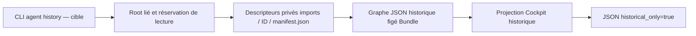

# Historique d’agents importé

État : candidat en raccordement ; la version locale219 refuse encore `agent history`.
Le plan et les preuves courantes sont dans
[AGENT-HISTORY-20261027](../plans/migration-rust/AGENT-HISTORY-20261027.md).

Le parcours cible `agent history ID --root ROOT [--json]` lit le manifeste privé
`.swarm/imports/ID/manifest.json`. Il rend toujours du JSON, y compris sans `--json` :
`{"historical_only":true,"history":...}`. Une histoire absente/null reste `null` ;
les collections vides et les champs omis suivent le format Go. L’identifiant doit
être un nom local valide ; le travail courant peut avoir été supprimé.

Le graphe figé contrôle aussi les types connus des champs du manifeste non rendus
(travail, événements, assistant, état automatique, fichiers). Il tolère les champs
inconnus et applique les règles JSON Go de doublons, null et remplacement UTF8.
Il ne rejoue pas l’admission d’import : les versions, révisions et données anciennes
restent des déclarations d’archive. Les extensions natives de l’Agent actuel ne
font pas partie du graphe historique. Le contrat versionné et son générateur
n’utilisent aucun source Go au runtime ni pour régénérer le module Rust.

Un statut « running », un PID, un coût, une décision ou un marque-page importé
ne prouve ni activité, ni auteur authentifié, ni autorisation actuelle. Le lecteur
ne signale aucun processus, n’insère aucun agent, ne rejoue aucun contrôle et
n’écrit ni SQL, ni budget, ni visite. Il ne vérifie pas les signatures, les blobs,
les chaînes d’événements, la fraîcheur ou la complétude de l’archive. Le code
physique de lecture est limité à Linux et ne constitue pas un confinement OS.

Les noms invalides, chemins privés remplacés par des liens, propriétaires/modes
incompatibles, manifestes absents, types invalides, erreurs de lecture/fermeture
ou de sortie restent des échecs visibles. Aucune liste vide de succès n’est
fabriquée. Les causes primaires et de fermeture sont conservées. Le contenu peut
devenir ancien dès sa lecture ; il n’y a pas de snapshot atomique de toute l’archive.
La mémoire suit la taille du manifeste, sans nouveau plafond de lecture caché.

Les restaurations de fichiers dans la recette sont exclusivement des fixtures
inertes. Elles ne constituent pas une opération Rust d’import/restauration prise
en charge, ni une autorisation de modifier les données privées d’un travail réel.
