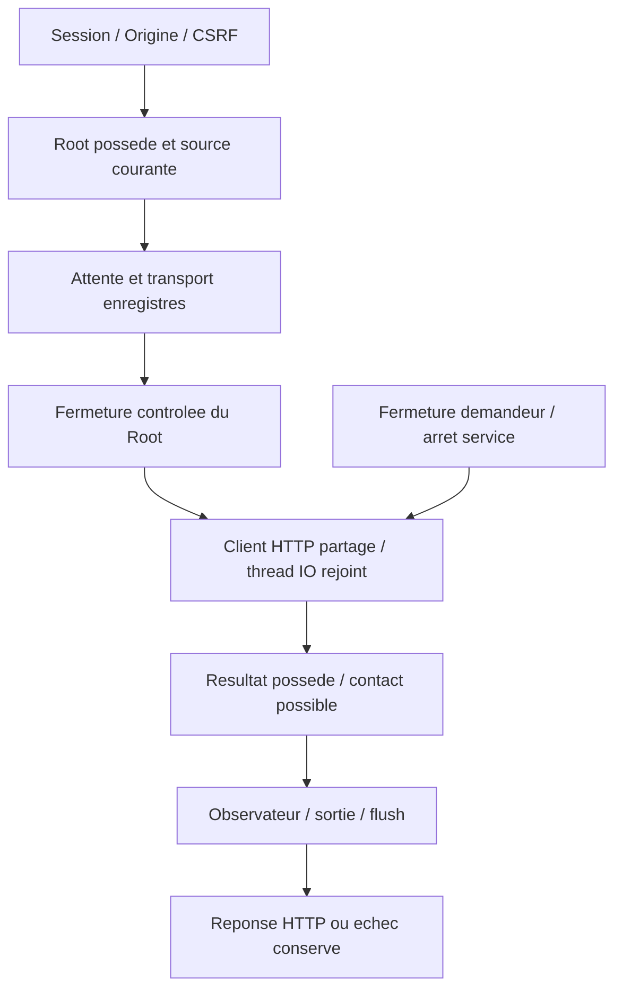

# Test manuel de connexion API natif

Le serveur Rust porte POST `/api/v1/providers/connections/test`. **Tester une connexion API**, dans Admin, teste une connexion existante ou un brouillon sans le sauvegarder et prévient que le fournisseur peut facturer ce test. La clé reste en mémoire du dialogue pour une nouvelle action explicite, puis est effacée à la fermeture.

## Admission et propriété

La demande reprend le changement de connexion : version1, empreinte attendue, connexion et choix explicite de remplacement de clé. Host/session/Origin/CSRF précèdent le décodage et l’ouverture du Root. Le moteur vérifie son instance possédée, la source, les données et la destination exacte d’une clé conservée. Une empreinte périmée refuse409 ; un brouillon désactivé ou invalide refuse400. Avec `replace_key:false`, le champ de clé soumis ne remplace pas la clé enregistrée ; celle-ci ne change pas de destination.

Le Root est fermé avec contrôle avant le réseau. Aucun fichier fournisseur, Work, Agent, réservation ou budget n’est modifié. Le moteur admet le contrat et fournit un instantané privé ; l’adaptateur HTTP effectue l’IO. Le propriétaire conserve job et capacité jusqu’à l’observation. Le test ne termine aucune mission et ne remplace aucune décision métier du superviseur.

Le seul message transmis est `Réponds seulement : Connexion réussie.`, sans contexte de mission, consigne projet ou outil. La clé est facultative ; non vide, elle devient un Bearer. Le client partagé conserve TLS/proxy système, refuse redirection/outils, exige HTTP200 avec un unique choix texte complet et ne relance pas. Une clé reflétée est masquée. Le texte affiché n’est jamais interprété comme HTML. Les diagnostics publics n’exposent ni URL privée, corps distant d’erreur ni clé.

## Réglages effectifs

| Source persistée | Unité et effet |
| --- | --- |
| `provider-wait.json` : `max_duration_seconds` | Secondes totales ; zéro signifie illimitée. |
| `preparation_call_response_max_bytes` | Octets du corps JSON ; null sans borne, zéro refuse un corps non vide. |
| `preparation_call_http1_max_headers` | Nombre positif d’en-têtes HTTP1. |
| `preparation_call_http2_max_header_bytes` | Octets positifs représentables en u32 pour HTTP2. |
| `preparation_call_observation_ms` | Intervalle positif d’observation d’une annulation locale. |

Seules ces quatre dimensions de transport sont partagées avec la préparation ; activation, messages/tours, mode JSON/SSE et délais métier restent séparés. Silence et bail ne sont pas des délais de test. Le même Admin/API/CLI édite les valeurs persistées ; l’aide précise le partage. Une politique absente refuse501 avant contact sans adopter de défauts. L’instance observée conserve des réglages41 : l’adoption explicite dans Admin reste nécessaire pour utiliser le test et n’a pas été imposée.

Le pont synchrone possède et rejoint son thread IO, même depuis Tokio. Création de thread/runtime, panic opaque, transport, décodage et deadline conservent leurs causes. Aucun job n’est détaché. Déconnexion et arrêt du service annulent l’IO locale selon l’intervalle enregistré ; ils ne prouvent ni arrêt distant ni absence de facturation. Aucune nouvelle limite de durée, tentative ou concurrence n’est cachée.

## Résultats et reprise

Un échec fournisseur reste HTTP200 avec `ok:false` et un code sûr : ce n’est pas un succès de fonction. Le résultat porte `text`, `error`, `latency_ms`, `provider_contact_may_have_occurred`, `source_digest`, `settings_revision` et `wait_revision` ; les révisions sont des chaînes exactes.

Le contact possible est séparé des mutations locales. Vrai ne prouve ni fin distante, coût connu ni acceptation. Le reçu possédé traverse réponse, observateur, encodage et erreurs de sortie/flush ; les causes originales restent en mémoire sous une projection sûre. Les erreurs internes de source/IO restent500, jamais un succès vide.

Le dialogue garde l’échec visible et permet une nouvelle action explicite. Une réponse absente/annulation affiche l’incertitude, bloque le brouillon et exige une relecture. Une politique absente donne une instruction spécifique. Le pied d’actions reste visible sur petit écran sans couper les mots ; le résultat reçoit le focus dans le corps déroulant et la fermeture restaure le focus.

## Preuves et limites

La livraison locale174 a été observée par binaire, profil sans fixture, ressources protégées, notes FR/EN et dialogue Version. Dix groupes HTTP couvrent notamment clés conservées, destination/refus/remplacement/reprise, source périmée, plafond enregistré et arrêt illimité. Cinq comparaisons utilisent le véritable serveur Go ; quatre parcours navigateur couvrent FR/EN, deux thèmes,320/1440px, contraste, clavier, échec et annulation. Trois tests couvrent le pont Tokio/panic et la garde de résultat ; un autre la sortie CLI tardive. Il s’agit de fixtures HTTP locales possédées, sans compte réel. Échecs originaux, versions, recettes vérifiées et RETEX restent dans [le plan](../plans/migration-rust/PLAN.md), dossier `20261027-api-connection-probe-r6eeepeu`.

Le natif ajoute empreinte fraîche et choix de clé commun au save ; Go ne contrôle pas tous ces points sur son test. Les constantes Go20000/1MiB/500 ne deviennent pas des politiques cachées et ses anciens diagnostics ne sont pas simulés. L’appel natif ordinaire `complete` conserve son exigence de clé ; sa parité plus large et l’exécution API des agents restent séparées. Aucune conformité Go globale, disponibilité de compte, facturation connue, acceptation indépendante ou migration totale n’est déduite de ces preuves.

