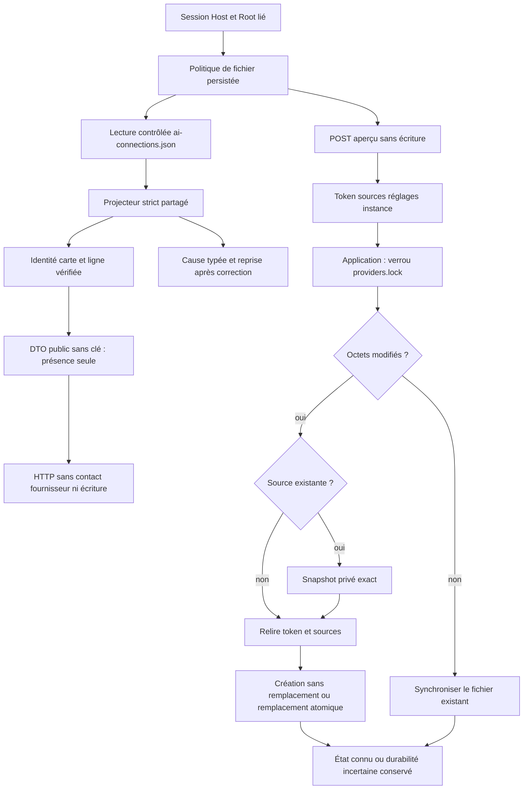

# Inventaire natif des connexions API

`GET/HEAD /api/v1/providers/connections` lit les déclarations de l’opérateur authentifié. La réponse conserve `version:1`, l’empreinte des octets réellement lus et les lignes triées `id`, `label`, `base_url`, `model`, `disabled`, `has_key`, `provider`. La clé reste privée ; sa seule présence est exposée. L’adresse et le modèle sont des déclarations stockées, sans preuve de disponibilité ni autorisation de contact.

Un fichier absent donne une liste vide et l’empreinte des octets vides, sans créer de fichier. Un document `null` donne une liste vide avec sa propre empreinte. Les erreurs de format/type/champ inconnu, lecture, identité de ligne incohérente avec la clé de carte et fermeture restent des erreurs serveur. Le même projecteur strict hérité valide le catalogue pour le garde de namespace : cette lecture complète ne change pas ses règles d’alias actif/désactivé. La sélection/exécution d’un fournisseur API reste explicitement non portée.

Le plafond de fichier vient de `agent_provider_config_max_bytes`, réglage persisté existant consommé par la politique de lancement. Aucune limite de32 connexions ou64Kio n’est ajoutée. Session, Host et liaison au Root s’appliquent ; paramètres, corps de lecture et méthodes incorrectes sont refusés. La garde de lecture est acquise puis fermée ; aucun appel réseau, réservation d’exécution, Agent, travail ou fichier n’est modifié. Une ligne `null` a une identité vide et est donc refusée par l’inventaire, tandis que le garde de namespace conserve sa compatibilité héritée. La recette `api-connections-read-rust` utilise un Root inerte isolé, un témoin Admin valide puis absence, valeurs privées factices, sources invalides, refus et reprise.

## Enregistrement natif avec aperçu

`POST /api/v1/providers/connections` utilise la requête Go `version`, `expected_digest`, `connection`, `replace_key`, avec les extensions natives `preview` et `preview_token`. `preview:true` ne crée ni fichier ni verrou de publication ; la réponse ne contient que les empreintes, le token et les indicateurs. Pour appliquer, envoyer `preview:false` et le token courant. Un ancien POST sans aperçu est refusé explicitement. La CLI `providers connections show|preview|apply --input FILE` partage les mêmes méthodes Root ; `show` ne prend pas de document. L’interface historique Go n’est pas embarquée dans Rust : son adaptation et l’interface native restent distinctes.

L’adresse est normalisée sans slash final et doit être HTTP(S), sans identifiants incorporés, requête ni fragment. La clé doit pouvoir être représentée sans injection d’en-tête HTTP. L’identifiant suit le format hérité des connexions v1 (64 octets ASCII au plus, sans préfixe `api-`) ; le modèle suit le format modèle v1 existant. Ces formats ne sont pas des limites d’exécution. Aucune copie des plafonds Go32 connexions/64Kio/20Kio/8192 octets de clé n’est ajoutée : limites de fichier et transport courantes s’appliquent.

`replace_key:false` ignore le champ clé soumis et conserve la clé existante, ou une clé vide lors d’une création ; définir une clé, y compris la première, exige `replace_key:true`. Un changement de destination avec clé conservée est refusé. `replace_key:true` remplace la clé, ou la retire si elle est vide. La réponse conserve `saved:true` après application sans exposer la clé. Le token lie les octets avant/après, le catalogue CLI, les réglages/revision et l’identité observée de la base et du répertoire. Il ne crée ni identité, ni droit ou bail durable. Les alias CLI `api-ID` sont refusés même si la connexion est désactivée.

L’application reprend le verrou de coordination Go `providers.lock`, relit le token, conserve un snapshot privé des octets originaux, puis relit les sources avant publication atomique. Une source absente utilise une création sans remplacement. Un no-op synchronise le fichier existant sans créer un snapshot supplémentaire. Les échecs avant remplacement préservent la source ; un remplacement visible avec durabilité incertaine, ou un échec ultérieur de fermeture/sortie, reste explicitement susceptible d’être enregistré : relire avant toute reprise. Un snapshot seul ne prouve pas le remplacement du fichier courant.

La validation concerne aussi la clé effectivement conservée. Une clé stockée non représentable en en-tête produit une erreur de source sûre (`api-connection-stored-key-invalid`), sans écriture ; un remplacement ou retrait explicite permet la reprise. Les erreurs de requête sont des refus client ; une source stockée malformée, les erreurs de lecture/fermeture et les politiques invalides restent des erreurs serveur. Un digest périmé est un conflit. Les tests utilisent exclusivement des racines et clés factices. Le test HTTP du fournisseur et son exécution native restent à migrer.

