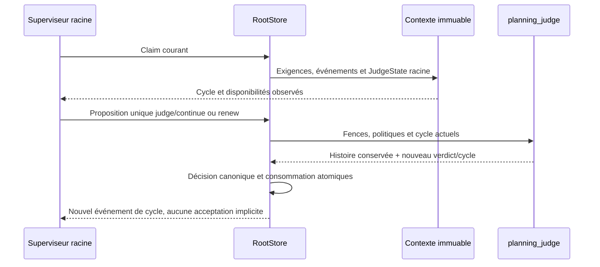
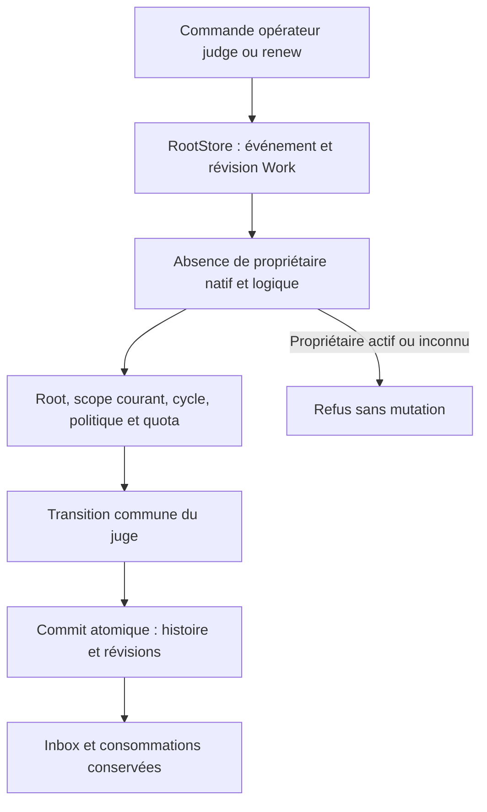

# Juge global natif : cycles, quotas et histoire

Les opérations `judge` avec verdict `continue`, puis `renew`, sont vérifiées sur fixtures natives au lot177. Elles ne remplacent pas la revue indépendante d’un candidat. `judge/end` reste refusé : la preuve de candidat managed natif nécessaire n’est pas encore portée. Aucune clôture globale n’est déduite de ce port.

## Contrat de décision

Le superviseur racine propose une seule opération dans sa décision louée ordinaire. Le moteur vérifie la mission, la révision, le détenteur déclaré, la génération, les entrées reçues, les politiques et le cycle courant. Ces déclarations sont des clôtures de concurrence, pas une authentification sémantique des agents.

Exemple de proposition du modèle, sans métadonnées de lease inventées :

```json
{"input_events":["evenement-recu"],"reason":"Poursuivre le besoin encore ouvert","operations":[{"kind":"judge","judge_cycle":1,"judge_verdict":"continue"}]}
```

Le verdict n’est enregistré qu’une fois par cycle. Ensuite, `{"kind":"renew","judge_cycle":1}` ajoute `renewed_at` au dernier enregistrement et ouvre le cycle2. Verdicts, motifs, références et dates précédents sont conservés. Une référence fournie avec `continue` reste une donnée déclarée, sans preuve de candidat. Les tâches, avis, essais, activations, décisions et dépenses ne sont pas réinitialisés. Une opération globale ne se mélange pas à une mutation du plan.

Un enfant ne reçoit pas le `JudgeState` racine et ne peut pas rendre son verdict. Le test13 enregistre d’abord un vrai motif privé racine, puis vérifie son absence du prompt enfant et le refus de sa tentative, avec conservation du véritable appel refusé.

## Politiques et reprise

`max_judge_cycles` à l’activation et `judge_cycles` dans les quotas donnent le plafond persistant de la mission ;0 enlève ce plafond. Les autres budgets et bornes de représentation restent applicables. Un dernier verdict `continue` n’autorise pas un renouvellement au-delà du quota et ne devient jamais automatiquement `end`.

`planning_decision_max_reason_bytes` limite les nouveaux motifs en octets UTF8. Le réglage existant est exposé par le catalogue Admin et `engine-settings preview/apply/show`, puis consommé par `planning_decision` et `planning_judge`. Pour cette famille de caps, `null` enlève le plafond et0 refuse un motif non vide ; cette sémantique diffère du quota de cycles. La cohérence historique vérifie toujours verdicts, cycle, dates et correspondances, sans réappliquer l’ancien plafond4000 aux données déjà conservées. Témoin :5000octets acceptés sous6000, puis encore lisibles après sauvegarde de200, qui refuse une nouvelle raison trop longue.

Les plafonds de missions sont déjà éditables dans le dialogue natif « Plafonds des missions », groupe Juge (`web/native-quotas.js`). L’Admin général utilise le catalogue dynamique (`frontend/engine-settings/admin.js`). Les parcours CLI de sauvegarde/réouverture et d’utilisation sont vérifiés ici ; les interactions navigateur ne sont pas rejouées dans ce lot sans changement frontend.

Un propriétaire actif bloque une édition de quota. La recette vérifie ce refus sans mutation, puis utilise pause publique → édition → reprise → nouveau claim. L’ancien historique et les consommations restent conservés. Le contexte racine inclut l’histoire complète sous les caps de contexte existants : cycles sans plafond ne signifie pas prompt sans plafond ; aucune troncature ni augmentation automatique ne sont faites.

## Contexte reçu et changement de version

Le contexte du claim et son SHA sont conservés dans `native_planning_claims`. La fraîcheur compare aussi le `JudgeState` racine. Un contexte ancien sans ce champ ne prouve pas sa réception et n’est pas complété artificiellement. Legacy14 vérifie un ancien claim **non exécuté**, refusé sans modification, puis reprise publique et nouveau contexte avec anciennes lignes/réserves intactes. Les résultats anciens déjà en vol exigent une qualification distincte et un rapprochement avant R7.



## Preuves et limites

Profil normal06 `9fb426` :275sources effectives archivées, aucune feature de fixture ;47tests ciblés, Clippy strict et Rustdoc04. Control11/faults12 : cycles natifs, motif long, sept refus ciblés, quota actif protégé, restauration et rejeu sans nouvel appel. Child13 : portée et confidentialité ; legacy14 : reprise limitée à l’ancien claim non exécuté. Recette durable : `tools/verification/recipes/native-global-judge-cycles.json` ; étapes exécutées séparément sur le binaire figé, pas une exécution globale du manifeste sur le checkout concurrent.

Ces preuves concernent des processus inertes locaux, sans modèle payé, acteur humain authentifié, installation ou acceptation globale. Le conducteur complet, les routes HTTP managed de planification, le candidat managed, les autres parités, la restauration des données et la bascule finale restent ouverts dans le plan.

## Commandes directes opérateur

Le lot178 vérifie `planning judge WORK --input demande.json --json` et `planning renew WORK --input demande.json --json` sur le profil normal05 (`d1b953fd`). Ces commandes sont distinctes de `planning lease-renew`, qui prolonge un claim détenu. Exemple de demande directe, avec les révisions réellement lues :

```json
{"schema_version":1,"event_id":"jugement-operateur","expected_revision":12,"scope":"root","scope_revision":3,"judge_cycle":1,"judge_verdict":"continue","reason":"Poursuivre le besoin ouvert"}
```

Pour renouveler, utiliser un nouvel `event_id`, les révisions courantes et `judge_cycle`, sans `judge_verdict` ni `expected_candidate`. Une requête directe ne crée ni claim ni appel modèle. Elle conserve l’inbox et ses acquittements, les dépenses et les compteurs d’activation/décision ; elle incrémente la révision du Work et celle du scope racine et conserve l’événement canonique de commande. Elle n’ajoute pas l’événement d’inbox de cycle produit par une décision louée. Les `input_events` non vides sont refusés sur les deux commandes ; pour acquitter, passer par `decide` avec le véritable contexte reçu.

Le scope doit être `root`, la planification active et non pausée, les révisions et le cycle actuels. Aucun détenteur logique, même expiré, ni run natif conservant l’ownership ne doit rester. Un délai de lease écoulé ne prouve pas la fin physique du processus. Les champs étrangers, dont un détenteur déclaré ou des opérations de plan, sont refusés. Les quotas et la politique de raison sauvegardés restent identiques au parcours loué ; `end` reste refusé. Un rejeu canonique identique retourne l’état courant sans appliquer une seconde transition, même après abaissement de la limite des nouveaux motifs.



Preuves178 : direct06 vérifie les commandes, quatorze refus ciblés, sauvegarde/réouverture des caps, quota et rejeu ; held08 utilise socket, identité du pair et pidfd d’un véritable processus inerte détenu, puis vérifie l’application de son résultat original après libération ; cycles07 revalide le parcours modèle loué. Les48 tests ciblés, Clippy strict et Rustdoc moteur sont conservés sous quality03 ; la CLI a son contrôle documentaire séparé. Recette : `native-global-judge-cycles.json`, avec les commandes directes et le contrôle de processus actif. Pas de watchdog global de recette. Le lease120s du témoin est une entrée explicite de produit, sans délai arbitraire ajouté au lanceur.

Les commandes CLI sont vérifiées, sans livraison installée ni acteur authentifié. Le lot179 ajoute [le vrai endpoint HTTP de planification](NATIVE-PLANNING-HTTP.md) avec les protections communes. `/api/v1/action` reste réservé aux actions de tâche ; les cycles passent par `/api/v1/planning`. Aucun contrôle navigateur ni modification des travaux frontend de Claude dans ces lots.
